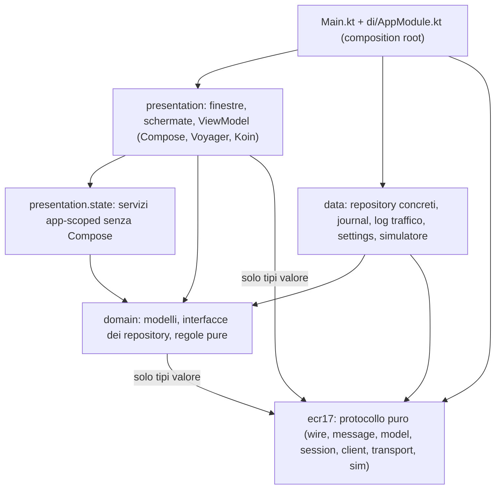
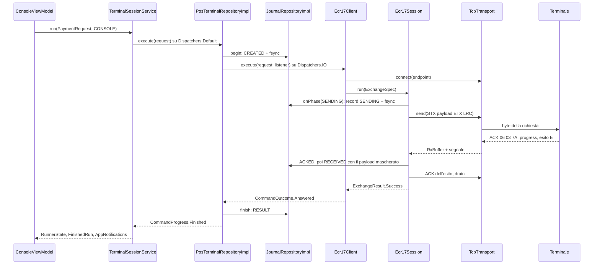
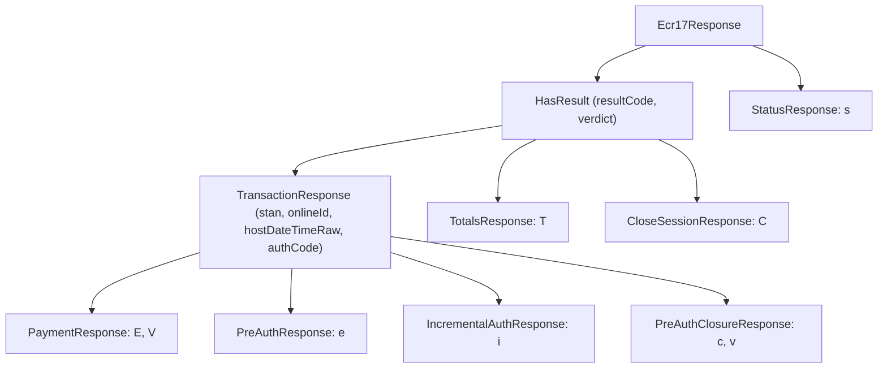

# Analisi del progetto attuale

Guida al codice di **Protocollo17ComposeDesktop** così com'è oggi: cosa fa ogni classe, come collaborano, e come
funziona il Protocollo 17 (ECR17) implementato nel package `ecr17`. Fotografa `main` al commit `3b95566`
(19/10/2026).

- **Non sostituisce [DESIGN.md](DESIGN.md)**, che resta la fonte delle decisioni (firme vincolanti, algoritmi, piano
  di test). Qui si descrive il codice; dove codice e DESIGN differiscono c'è una riga "Nota".
- [ANALISI_REPOSITORY.md](ANALISI_REPOSITORY.md) (A§) e [ANALISI_LARAVEL_ECR17.md](ANALISI_LARAVEL_ECR17.md) (L§)
  analizzano i progetti **vecchi** da cui questo è stato riscritto, non questo codice.
- I link portano ai file; i numeri di riga si leggono nell'IDE (cambiano a ogni modifica e qui non si citano).
- `M1`-`M10` sono gli invarianti di money-safety (DESIGN §1.5, CLAUDE.md), `U1`-`U15` le decisioni dell'utente
  (DESIGN §1.2), `§x` le sezioni di DESIGN.

## Indice

1. [Panoramica e flussi](#1-panoramica-e-flussi): cosa fa l'app, strati e regole di dipendenza, avvio e chiusura,
   il percorso di un pagamento dal clic ai byte, esito sconosciuto e risoluzione con G, dati su disco, test.
2. [Il protocollo ECR17 (Protocollo 17)](#2-il-protocollo-ecr17-protocollo-17): trasporto, frame, LRC, ACK/NAK,
   dialogo, comandi, risposte, errori, money-safety nel codice, profili, glossario.
3. [ecr17: wire, model, error, event, profile](#3-ecr17-wire-model-error-event-profile)
4. [ecr17: messaggi, trasporto e client](#4-ecr17-messaggi-trasporto-e-client)
5. [ecr17: sessione e simulatore](#5-ecr17-sessione-e-simulatore)
6. [domain, data, di e Main](#6-domain-data-di-e-main)
7. [presentation: stato, modelli, utilità, tema e finestre](#7-presentation-stato-modelli-utilità-tema-e-finestre)
8. [presentation: componenti e schermate](#8-presentation-componenti-e-schermate)

Chi parte da zero legge i capitoli 1 e 2; i capitoli 3-8 sono il riferimento per package, con una tabella per
classe ("Classe | File | Cosa fa | Usata da") e la spiegazione degli algoritmi.

## 1. Panoramica e flussi

Questo capitolo guarda il progetto dall'alto: cosa fa l'app, come sono divisi gli strati, cosa succede all'avvio e alla chiusura, e il percorso completo di un comando dal clic dell'operatore ai byte sul socket e ritorno. Descrive il codice di `main` al commit `3b95566` (versione `1.0.0` in [build.gradle.kts](../build.gradle.kts)). I riferimenti `§x` sono sezioni di [DESIGN.md](DESIGN.md), la fonte delle decisioni; `M1`-`M10` sono gli invarianti di money-safety di DESIGN §1.5, `U1`-`U15` le decisioni dell'utente di DESIGN §1.2. Qui compaiono solo le classi che servono a seguire i flussi: le tabelle complete, una riga per classe, stanno nei capitoli dedicati ai singoli package (`ecr17`, `domain`, `data`, `presentation`, test).

### 1.1 Cosa fa l'app

L'app fa la parte dell'**ECR** (il registratore di cassa): apre una connessione TCP verso un terminale POS, gli invia una richiesta Protocollo 17 / ECR17 e decodifica l'esito. È un'app di **test**: ogni parametro del comando e ogni opzione del filo sono modificabili, ogni byte finisce nel log traffico, e ogni tentativo che muove denaro è scritto su disco prima di partire. Il protocollo è reimplementato da zero nel package `ecr17`; i progetti da cui deriva (la vecchia app WPF con `IAE37.dll` e i port padosoft) sono analizzati in [ANALISI_REPOSITORY.md](ANALISI_REPOSITORY.md) e [ANALISI_LARAVEL_ECR17.md](ANALISI_LARAVEL_ECR17.md), che descrivono codice vecchio e non questo.

**Profili** ([TerminalProfile.kt](../src/main/kotlin/it/prime/protocollo17/ecr17/profile/TerminalProfile.kt)): `TerminalProfiles.INGENICO` (evidenza `CAPTURE`, porta di default 5577) e `TerminalProfiles.CCV` (evidenza `ASSUMPTION`, porta obbligatoria). Oggi hanno gli stessi default di `ProtocolOptions`: CCV è un clone di Ingenico finché non c'è una cattura (U1).

**Il filo in breve** (dettagli nel capitolo del protocollo):

- frame applicativo `STX` + payload ASCII a larghezza fissa + `ETX` + LRC; il payload comincia con il Terminal ID (pos 1-8, solo cifre), un `'0'` (pos 9) e il codice del messaggio (pos 10), scritto da `RequestEncoder` e letto da `WireFrame.Application.replyCode`;
- LRC = XOR a partire da `0x7F` ([LrcMode.kt](../src/main/kotlin/it/prime/protocollo17/ecr17/wire/LrcMode.kt)); il terminale Ingenico vuole `LrcMode.STX` (lo STX entra nello XOR) per i frame applicativi, ma il suo ACK è `06 03 7A`, cioè l'LRC **senza** STX (`ControlLrcRule.WIRE`). Per questo LRC applicativo e LRC dei frame di controllo sono due opzioni separate (U2, U3);
- il terminale manda anche progress `SOH testo EOT` (senza LRC, mai confermati) e righe di scontrino con codice `S`.

**I 13 comandi** sono le righe di `CommandCode` ([CommandCode.kt](../src/main/kotlin/it/prime/protocollo17/ecr17/model/CommandCode.kt)): ogni regola di money-safety è una proprietà del comando, non un `when` sparso tra sessione, client e UI.

| `CommandCode` | Lettera | Tipo | Esiti attesi (pos 10) | Policy ACK finanziaria | Journal | Replay dopo caduta |
|---|---|---|---|---|---|---|
| `STATUS` | `s` | `EXCHANGE` | `s` | no | `NONE` | sì |
| `PAYMENT` | `P` | `EXCHANGE` | `E` `V` | sì | `RECORD_AND_BLOCK` | no |
| `PAYMENT_EXTENDED` | `X` | `EXCHANGE` | `E` `V` | sì | `RECORD_AND_BLOCK` | no |
| `REVERSAL` | `S` | `EXCHANGE` | `E` `V` | sì | `RECORD_AND_BLOCK` | no |
| `PRE_AUTH` | `p` | `EXCHANGE` | `e` | sì | `RECORD_AND_BLOCK` | no |
| `INCREMENTAL_AUTH` | `i` | `EXCHANGE` | `i` | sì | `RECORD_AND_BLOCK` | no |
| `PRE_AUTH_CLOSURE` | `c` | `EXCHANGE` | `c` `v` | sì | `RECORD_AND_BLOCK` | no |
| `CARD_VERIFICATION` | `H` | `EXCHANGE` | `E` `V` | sì | `RECORD` | no |
| `CLOSE_SESSION` | `C` | `EXCHANGE` | `C` | sì | `RECORD` | no |
| `TOTALS` | `T` | `EXCHANGE` | `T` | no | `NONE` | sì |
| `LAST_RESULT` | `G` | `EXCHANGE` | `E` `V` `e` `i` `c` `v` | no | `NONE` | sì |
| `ECR_PRINTING` | `E` | `ACK_ONLY` | — | no | `NONE` | sì |
| `REPRINT` | `R` | `ACK_ONLY` | — | no | `NONE` | no |

`movesMoney` vale per `RECORD_AND_BLOCK` (P X S p i c), `journaled` per tutto ciò che non è `NONE` (anche H e C). La colonna "Replay" è `safeToRetryAfterReconnect`: solo `s T G E` possono essere ripetuti una volta dopo una caduta (M1).

**Le finestre** (U10). La principale è dichiarata da `MainWindow`, le altre da `SecondaryWindows()` nello scope `application {}`: sono finestre vere, spostabili su un altro monitor, e restano aperte indipendentemente l'una dall'altra.

| Finestra | File | Come si apre | Cosa contiene |
|---|---|---|---|
| Principale (Console) | [MainWindow.kt](../src/main/kotlin/it/prime/protocollo17/presentation/windows/MainWindow.kt), [ConsoleScreen.kt](../src/main/kotlin/it/prime/protocollo17/presentation/screen/console/view/ConsoleScreen.kt) | sempre | Menu File / Comandi / Finestre / Strumenti / Aiuto; intestazione di connessione (profilo, destinazione, switch U4/U5, LRC, collegamento, TID); sidebar dei 13 comandi con lucchetto sui bloccati; banner dei tentativi da risolvere; form del comando; schede Esito e Cronologia; velo di occupato con Annulla durante un comando |
| Opzioni | [OptionsWindow.kt](../src/main/kotlin/it/prime/protocollo17/presentation/windows/OptionsWindow.kt) | Ctrl+, | Sezioni Terminale, Comportamento, Tempi e ritrasmissioni, LRC e controllo, Log e journal, Aspetto, Scontrini. I valori validi si salvano subito e valgono dal comando successivo; quelli non validi restano visibili accanto al loro errore |
| Log traffico | [TrafficLogWindow.kt](../src/main/kotlin/it/prime/protocollo17/presentation/windows/TrafficLogWindow.kt) | Ctrl+L | Copia in memoria del traffico hex TX/RX e degli eventi: filtro di testo, frame e/o eventi, solo avvisi, colonna ASCII, pausa della vista (la registrazione continua), scorrimento automatico, svuota memoria (il file resta), esporta |
| Journal | [JournalWindow.kt](../src/main/kotlin/it/prime/protocollo17/presentation/windows/JournalWindow.kt) | Ctrl+J | Tentativi dei comandi journaled (filtri tutti / da risolvere / oggi), dettaglio con la sequenza dei record, Ultimo esito (G) e chiusura con nota |
| Simulatore | [SimulatorWindow.kt](../src/main/kotlin/it/prime/protocollo17/presentation/windows/SimulatorWindow.kt) | Ctrl+Shift+S | Porta, TID, decisione, guasto, ritardi, LRC, stampa su ECR, avvio automatico, log e contatori del simulatore |

L'insieme delle finestre secondarie aperte e la geometria di ciascuna sono salvati in `settings.json` (`ui.openWindows`, `ui.windows`) da `AppWindows`: chiudendo la principale le secondarie spariscono senza passare dal loro `onCloseRequest`, e all'avvio si riaprono dove erano.

**Il simulatore** ([TerminalSimulator.kt](../src/main/kotlin/it/prime/protocollo17/ecr17/sim/TerminalSimulator.kt)) è un terminale finto che parla il filo Ingenico osservato: un `ServerSocket` su `127.0.0.1` (nessun prompt del firewall, nulla esposto sulla LAN), una connessione servita alla volta, risposte calcolate da `SimResponder` (puro). Riproduce 15 guasti di `SimFault` oltre a `NONE` (ACK mancante, silenzio, NAK, cadute in tre punti, esito con LRC errato, esito stantio alla connessione, esito trattenuto e consegnato dopo la richiesta successiva…) e tre decisioni (`SimDecision`: approva, rifiuta, carta non presente). Nell'app lo avvolge `SimulatorControllerImpl` (data layer), che legge `AppSettings.simulator`, lo riavvia al cambio di porta, trasforma una porta occupata nello stato `SimulatorStatus.Failed(PortInUse)` invece che in un'eccezione e lo avvia da solo se `simulator.autoStart` è vero. *Strumenti > Usa simulatore come terminale* (`useAsTarget`) mette `terminal.host = 127.0.0.1` e la porta attiva salvando la destinazione precedente in `simulator.previousHost/previousPort`; *Ripristina terminale* (`restoreTarget`) la rimette. Le voci di Strumenti sono abilitate solo con il runner inattivo, e la finestra Simulatore rifiuta avvio, arresto e cambio di porta durante un comando: fermare il simulatore a metà di un pagamento lascerebbe l'esito sconosciuto. Gli stessi `TerminalSimulator` e `TcpTransport` servono ai test di integrazione su porta effimera (sezione 1.7).

**Il journal** è il registro persistente dei tentativi dei comandi journaled (P X S p i c H C): un file JSONL append-only con `fsync` a ogni riga, in cui un tentativo è una sequenza di record (`CREATED`, `SENDING`, `ACKED`, `GO_AHEAD`, `RECEIVED`, `EVIDENCE`, `RESULT`, `NOT_SENT`, `REFUSED`, `UNKNOWN`, `RESOLVED`) e lo stato corrente (`JournalEntry`) è il fold di tutti i suoi record. Un tentativo con esito sconosciuto o "da verificare" blocca i comandi a rischio finché l'operatore non lo chiude (U7, M6): è il meccanismo descritto nella sezione 1.5.

**Il log traffico** riceve ogni `ProtocolEvent` del client (frame TX/RX, byte scartati, fasi, stato del collegamento, progress, righe di scontrino, avvisi), con il PAN già mascherato (M9), e lo tiene in memoria per la finestra e in un file giornaliero confrontabile con il log della DLL (§5.4.2).

### 1.2 Architettura a strati e regole di dipendenza

Un solo modulo Gradle (U12), package radice `it.prime.protocollo17`, cinque strati più la composition root:



| Strato | Dimensione (circa) | Ruolo | Può importare | Non può importare | Controllo |
|---|---|---|---|---|---|
| `ecr17.**` | 34 file, 7 070 righe | Protocollo: LRC, frame, splitter, mascheramento PAN, encoder/parser, sessione, client, trasporto TCP, simulatore | `kotlin.*`, `java.*` (JDK), `kotlinx.coroutines.*` core | Compose, Koin, Voyager, AWT/Swing, `kotlinx.coroutines.swing`, `kotlinx.serialization`, slf4j/logback, `domain`/`data`/`presentation`/`di`; nessun `Dispatchers.Main` | `Ecr17IsolationTest` |
| `domain.**` | 20 file, 1 460 righe | Modelli (settings, journal, traffico, comandi, simulatore), interfacce dei repository, regole pure (`PaymentBlockPolicy`, `GAssessment`, `RequestFactory`, `ConfigResolver`, importi) | stdlib, serialization, coroutines core, `ecr17.(model\|profile\|error\|event)`, `ecr17.wire.{LrcMode, ControlLrcRule, Hex}`, `ecr17.message.RequestEncoder` | Compose, Koin, Voyager, `data`, `presentation`, `di`, il resto di `ecr17` | `PresentationBoundaryTest` |
| `data.**` | 13 file, 2 420 righe | Implementazioni: `PosTerminalRepositoryImpl`, `JournalRepositoryImpl` + `JournalStore`, `TrafficRecorder`, `SettingsRepository`, `SimulatorControllerImpl`, sistema (`SingleInstanceGuard`, `ShutdownWatchdog`) | `domain`, tutto `ecr17`, slf4j, serialization | `presentation`, Compose, Voyager | a mano |
| `presentation.**` | 78 file, 10 270 righe | Finestre, schermate MVI (ScreenModel Voyager), componenti, tema, mapper di vista | `domain`, `ecr17.(model\|profile\|error\|event)`, `ecr17.wire.{LrcMode, ControlLrcRule, Hex}`, Compose, Voyager, Koin, `data.local.settings.SettingsRepository`, `data.local.AppDirs` | il resto di `ecr17`, `data.repository.*`, `data.local.(journal\|traffic\|simulator\|system)` | `PresentationBoundaryTest` |
| `presentation.state.**` | 7 file, 720 righe (inclusi sopra) | Servizi app-scoped: `TerminalSessionService`, `AppNotifications`, `AppWindows`, `ShortcutBus`, `closeNeedsConfirmation` | come `presentation`, senza Compose | `androidx.*`, `org.jetbrains.compose.*` | `PresentationBoundaryTest` |
| `di`, `Main.kt` | 2 file | Composition root e sequenza di avvio/chiusura | tutto | — (solo `Main.kt` vede `ShutdownWatchdog`) | a mano |

Le righe "a mano" (`data`, `di`, `Main.kt`) non hanno un test: al commit `3b95566` nessun file di `data` importa `presentation`, Compose, Voyager o Koin.

> Nota: la tabella di DESIGN §2.10 non nomina slf4j tra gli import di `presentation`, ma `TerminalSessionService`, `ConsoleViewModel`, `JournalViewModel`, `OptionsViewModel`, `TrafficLogViewModel` e tre file di `presentation/util` lo usano; nessun test architetturale lo vieta.

**Perché `ecr17` è puro e non logga.** Il sottoalbero deve poter diventare un modulo separato senza trascinarsi UI, DI o logging (U12). Per questo non usa slf4j: tutta la diagnostica esce come `ProtocolEvent` ([ProtocolEvent.kt](../src/main/kotlin/it/prime/protocollo17/ecr17/event/ProtocolEvent.kt)) verso un `ProtocolEventSink` iniettato, e il data layer (`TrafficRecorder`) la scrive su file; le callback per comando (`ExchangeListener`) sono il canale verso journal e UI. La seconda ragione è il **tempo virtuale**: `Ecr17Client` e `Ecr17Session` girano sul dispatcher del chiamante e misurano il tempo con un `TimeSource` iniettato, e solo `TcpTransport` ha un proprio scope `ecr17-io` su `Dispatchers.IO`. Un solo `withContext(Dispatchers.IO)` nel client farebbe usare a `withTimeoutOrNull` il tempo reale, e i test in tempo virtuale aspetterebbero davvero ogni timeout invece di attraversarlo in microsecondi.

**Perché la presentation vede solo i tipi valore.** Se un ViewModel importasse il client, l'encoder o il journal concreto, i suoi test avrebbero bisogno di socket e file veri. La presentation parla con `domain` (interfacce `PosTerminalRepository`, `JournalRepository`, `SimulatorController`, `TrafficRepository`) e con i tipi valore di `ecr17` (`CommandCode`, `CommandOutcome`, `Ecr17Failure`, `ProtocolWarning`…). Le due eccezioni tollerate sono `SettingsRepository` e `AppDirs`, classi locali concrete. `presentation.state` resta senza Compose perché i servizi app-scoped si provano con JUnit puro. `domain` può importare `RequestEncoder` perché è l'unica fonte delle regole di validazione: `RequestFactory` costruisce la richiesta dal form e chiede a lui gli errori, così il form non accetta un valore che il protocollo rifiuterebbe.

**La composition root** è [AppModule.kt](../src/main/kotlin/it/prime/protocollo17/di/AppModule.kt), un solo modulo Koin a blocchi (fondamenta, log traffico, protocollo, persistenza, repository, stato app, ViewModel). I valori configurabili arrivano come **provider** (`{ get<SettingsRepository>().getSnapshot()… }`), non come istantanee: `Ecr17Client` riceve `configProvider = { ConfigResolver.resolve(settings.getSnapshot()).config }` e lo legge una volta all'inizio di ogni comando, quindi una modifica in Opzioni vale dal comando successivo senza riavvio e mai a metà di uno scambio. Lo stesso `TrafficRecorder` è sia il `ProtocolEventSink` del client sia il `TrafficRepository` della finestra Log; lo stesso `TerminalSessionService` è registrato anche come `CommandRunner`. I ViewModel sono `factory` e le schermate li ottengono con `koinScreenModel()`. Koin costruisce i `single` alla prima richiesta: per questo `AppModuleTest` li risolve tutti.

**I test architetturali** leggono i sorgenti come testo (regex sugli import, commenti tolti):

| Classe | File | Cosa fa | Usata da |
|---|---|---|---|
| `Ecr17IsolationTest` | [Ecr17IsolationTest.kt](../src/test/kotlin/it/prime/protocollo17/architecture/Ecr17IsolationTest.kt) | Quattro test: i sorgenti di `ecr17` esistono (almeno 20, altrimenti i controlli passerebbero a vuoto); `ecr17` importa solo `kotlin`, `java`, `kotlinx.coroutines` ed `ecr17` stesso, con i divieti espliciti controllati prima; nessun `Dispatchers.Main` in `ecr17`; nessun `Dispatchers.IO` in `ecr17/client` ed `ecr17/session` | Gradle `test` |
| `PresentationBoundaryTest` | [PresentationBoundaryTest.kt](../src/test/kotlin/it/prime/protocollo17/architecture/PresentationBoundaryTest.kt) | Quattro test: i sorgenti esistono; `presentation` importa da `ecr17` e `data` solo quanto ammesso; `presentation/state` non importa Compose; `domain` non importa UI, DI, `data`, `presentation` né il motore del protocollo | Gradle `test` |
| `NoCommandTimeoutTest` | [NoCommandTimeoutTest.kt](../src/test/kotlin/it/prime/protocollo17/architecture/NoCommandTimeoutTest.kt) | M8: nessun `withTimeout(` / `withTimeoutOrNull(` in `presentation` e `data`, tranne tre eccezioni dichiarate per file e funzione (`TerminalSessionService.shutdown`, `SimulatorControllerImpl.close`, `TrafficRecorder.close`); un'eccezione senza più la chiamata fa fallire il test | Gradle `test` |
| `SourceImports` | [SourceImports.kt](../src/test/kotlin/it/prime/protocollo17/architecture/SourceImports.kt) | Helper `internal object`: elenca i `.kt` di un package, estrae gli import con riga, toglie i commenti, `isUnder` per i prefissi | I tre test sopra |

### 1.3 Avvio e chiusura

[Main.kt](../src/main/kotlin/it/prime/protocollo17/Main.kt) contiene solo la sequenza, nessuna logica. È l'unico file che vede `ShutdownWatchdog` e le classi concrete da chiudere: la presentation riceve una lambda (§2.10, §6.18).

**Avvio** ([`main`](../src/main/kotlin/it/prime/protocollo17/Main.kt)):

1. `Thread.setDefaultUncaughtExceptionHandler`: un'eccezione non gestita su qualsiasi thread finisce nel log invece di sparire.
2. `AppDirs.default().ensure()`: crea `~/.protocollo17` e le sottocartelle `journal`, `traffic`, `logs`. Una sola radice fissa, senza varianti per variabile d'ambiente, così quando si chiede un log all'operatore c'è un solo posto da indicare.
3. `logBanner`: versione dell'app (`AppVersion.current`), JVM, `java.home` (distingue `gradlew run` dal runtime jlink dell'MSI), OS, pid, cartella dati e file di log.
4. `SingleInstanceGuard.acquire(dirs.lockFile)`: un `FileLock` del sistema operativo su `app.lock`. `HeldByOther` ⇒ dialog "è già aperto" ed `exitProcess(0)`, perché due istanze condividerebbero journal e terminale e si confonderebbero gli esiti; `Unavailable` (lock non ottenibile per altri motivi) ⇒ si prosegue con un warning. Il lock muore con il processo: un'app terminata male non lascia un file "occupato".
5. `startKoin { modules(appModule) }`.
6. [`recoverJournalOrExit`](../src/main/kotlin/it/prime/protocollo17/Main.kt): `runBlocking(Dispatchers.IO) { JournalRepository.recoverOnStartup() }`, **prima della UI**, perché i tentativi rimasti a metà all'ultima chiusura devono bloccare i pagamenti già alla prima schermata. [`recoverOnStartup`](../src/main/kotlin/it/prime/protocollo17/data/repository/JournalRepositoryImpl.kt) legge tutto il file, compatta se supera `journal.compactAboveKb`, e chiude i tentativi rimasti aperti guardando l'ultima fase **scritta su disco**: `SENDING`/`ACKED`/`GO_AHEAD`/`RECEIVED` ⇒ `UNKNOWN` ("app terminata durante lo scambio"), `CREATED` ⇒ `NOT_SENT` ("app terminata prima dell'invio"), tentativo senza `CREATED` e non chiuso ⇒ `UNKNOWN` ("tentativo con dati incompleti non chiuso"). Restituisce i tentativi chiusi ora. Se il file esiste ma non si legge (antivirus, OneDrive, permessi, disco) lancia: dialog d'errore, rilascio del lock ed `exitProcess(1)`. Partire senza sapere quali pagamenti sono rimasti senza esito toglierebbe il blocco (M6). Un file mancante è un journal vuoto; le righe corrotte si saltano e si conservano in `journal.jsonl.corrupt-*`.
7. `koin.get<SimulatorController>()`: crea `SimulatorControllerImpl`, che avvia il simulatore se `simulator.autoStart` è vero.
8. `ShutdownWatchdog()` e `runUi`: `application(exitProcessOnExit = false) { MainWindow(…); SecondaryWindows() }`. Con `exitProcessOnExit = false` la funzione ritorna quando le finestre sono smontate, e il `finally` di `main` può chiudere le risorse.
9. Alla prima composizione `MainWindow` chiede a Koin `AppWindows`, `CommandRunner`, `ShortcutBus`, `AppNotifications`, `SimulatorController` e `AppDirs`: è qui che nascono `TerminalSessionService`, `PosTerminalRepositoryImpl`, `Ecr17Client`, `TcpTransport` e `TrafficRecorder`. `NotificationsEffect` raccoglie `AppNotifications.events` con `CoroutineStart.UNDISPATCHED` (il flusso non ha replay e un avviso emesso prima dell'iscrizione andrebbe perso), pubblica `AttemptTexts.startupRecoveryText(startupRecovered)` per i tentativi tornati `UNKNOWN` ("All'ultimo avvio 1 operazione è rimasta senza esito: pagamenti bloccati finché non la risolvi", con azione "Apri" verso il Journal) e trasforma ogni passaggio del simulatore a `Failed` in un avviso. `G` non parte mai da solo, nemmeno all'avvio (U7): c'è solo l'avviso, e il banner della Console mostra i tentativi.

**Chiusura** (stesso file e [MainWindow.kt](../src/main/kotlin/it/prime/protocollo17/presentation/windows/MainWindow.kt)):

1. La X della finestra o *File > Esci* chiamano `requestClose()`, che interroga `closeNeedsConfirmation(runner.state.value)` ([CloseGuard.kt](../src/main/kotlin/it/prime/protocollo17/presentation/state/CloseGuard.kt)): vero solo se il comando in corso è journaled **e** ha raggiunto `SENDING` (R11). In quel caso compare "Un comando finanziario è in corso: chiudendo, l'esito resterà SCONOSCIUTO e sarà registrato nel journal. Chiudere comunque?". Prima di `SENDING` chiudere è innocuo (il journal scriverà `NOT_SENT`); i comandi non journaled non chiedono mai conferma.
2. `exitNow()`: `onBeforeExit()` (cioè `watchdog.arm()`), ultimo salvataggio della geometria (quello in continuo ha un debounce di 500 ms), finestra AWT nascosta, `onExit()` = `exitApplication`.
3. `application` ritorna (o lancia: l'errore va nel log) e il `finally` di `main` esegue `watchdog.arm()` (idempotente: parte un solo conto alla rovescia), `closeAppResources()` ed `exitProcess(0)`.
4. [`closeAppResources`](../src/main/kotlin/it/prime/protocollo17/Main.kt), ogni passo nel proprio `runCatching`, in quest'ordine:
   1. `TerminalSessionService.shutdown(timeoutMs = 3_000)`: annulla il job del comando e il client, poi aspetta al massimo 3 s che il `finally` del repository scriva la chiusura del tentativo (`UNKNOWN` dopo un invio, `NOT_SENT` prima). È l'unico `withTimeoutOrNull` attorno a un comando ammesso da `NoCommandTimeoutTest`: il comando è già annullato, l'attesa serve solo a non bloccare l'uscita se il disco non risponde. Va per primo perché il journal deve chiudere il tentativo mentre il simulatore è ancora vivo;
   2. `SimulatorController.close()`: la porta si libera prima di chiudere i client;
   3. `Ecr17Client.close()` (= `transport.shutdown()`);
   4. `TrafficRecorder.close()`: svuota il canale degli eventi (al massimo 1 s) e chiude il file;
   5. `JournalRepository.close()`, `SettingsRepository.close()` (flush delle impostazioni non ancora salvate), `SingleInstanceGuard.release()`, riga di log "chiusura completata".
5. `ShutdownWatchdog` è un thread daemon che, 10 s dopo `arm()`, chiama `Runtime.getRuntime().halt(0)`: un'app che non si chiude (un thread non daemon appeso, un socket bloccato) è peggio di una che perde qualcosa alla chiusura, e il journal è già su disco con `fsync`. `SettingsRepository` registra inoltre uno shutdown hook (`settings-flush`) per gli ultimi 400 ms di modifiche, nel caso la JVM si chiuda senza passare da `close()`.

> Nota: DESIGN §6.18 descrive il contenuto della finestra come `AppTheme { Navigator(MainScreen()) { Box { CurrentScreen(); SnackbarHost(…) } } }` e il minimo della finestra impostato in un `LaunchedEffect(density)`. Il codice usa `WindowFrame(notices)` (tema, `Surface`, `AppSnackbarHost` e `LocalNoticePresenter`, condiviso con le finestre secondarie) attorno al `Navigator`, e `ApplyMinimumSize(MainWindowSpec)`. La sostanza è la stessa.

| Classe | File | Cosa fa | Usata da |
|---|---|---|---|
| `main`, `runUi`, `recoverJournalOrExit`, `closeAppResources`, `logBanner`, `showAlreadyRunningDialog` (funzioni top-level) | [Main.kt](../src/main/kotlin/it/prime/protocollo17/Main.kt) | Sequenza di avvio e chiusura descritta sopra | JVM (`mainClass = it.prime.protocollo17.MainKt`) |
| `appModule` | [AppModule.kt](../src/main/kotlin/it/prime/protocollo17/di/AppModule.kt) | Unico modulo Koin: singleton, provider delle impostazioni, ViewModel `factory` | `Main.kt`, `AppModuleTest` |
| `AppDirs` | [AppDirs.kt](../src/main/kotlin/it/prime/protocollo17/data/local/AppDirs.kt) | Percorsi di `~/.protocollo17` (`settingsFile`, `journalDir`, `trafficDir`, `logsDir`, `lockFile`) ed `ensure()`; radice parametrica solo per i test | `Main.kt`, `appModule`, `MainWindow` (Apri cartella dati, Informazioni), `OptionsViewModel` |
| `SingleInstanceGuard` (con `Attempt`: `Held`, `HeldByOther`, `Unavailable`) | [SingleInstanceGuard.kt](../src/main/kotlin/it/prime/protocollo17/data/local/system/SingleInstanceGuard.kt) | `FileLock` su `app.lock`; solo `HeldByOther` ferma l'avvio | `Main.kt` |
| `ShutdownWatchdog` | [ShutdownWatchdog.kt](../src/main/kotlin/it/prime/protocollo17/data/local/system/ShutdownWatchdog.kt) | Thread daemon `shutdown-watchdog`: `halt(0)` dopo `graceMs` (10 s); `arm()` idempotente | Solo `Main.kt` (§2.10) |
| `MainWindow` (+ `MainWindowSpec`) | [MainWindow.kt](../src/main/kotlin/it/prime/protocollo17/presentation/windows/MainWindow.kt) | Finestra principale: menu, scorciatoie (`mainWindowShortcut`), avvisi globali (`NotificationsEffect`), conferma di chiusura, dialog Informazioni | `Main.runUi` |
| `SecondaryWindows`, `SecondaryWindow`, `WindowFrame`, `handleWindowShortcut` | [SecondaryWindows.kt](../src/main/kotlin/it/prime/protocollo17/presentation/windows/SecondaryWindows.kt) | Dichiara le finestre secondarie presenti in `AppWindows.open`; cornice comune (tema + snackbar per finestra); Ctrl+, / L / J / Shift+S anche dalle secondarie | `Main.runUi`, `MainWindow` (`WindowFrame`), le quattro finestre secondarie |
| `MainScreen` | [MainScreen.kt](../src/main/kotlin/it/prime/protocollo17/presentation/screen/main/MainScreen.kt) | `Screen` Voyager radice della principale: Voyager serve solo al ciclo di vita del `ConsoleViewModel`, non c'è navigazione a stack | `MainWindow` |
| `closeNeedsConfirmation` (funzione) | [CloseGuard.kt](../src/main/kotlin/it/prime/protocollo17/presentation/state/CloseGuard.kt) | Pura: conferma solo per comando journaled con `requestSent` | `MainWindow.requestClose` |
| `AppWindows`, `AppWindowId` | [AppWindows.kt](../src/main/kotlin/it/prime/protocollo17/presentation/state/AppWindows.kt), [AppWindowId.kt](../src/main/kotlin/it/prime/protocollo17/presentation/state/AppWindowId.kt) | Insieme delle finestre aperte (persistito), richieste di primo piano, geometrie | `MainWindow`, `SecondaryWindows`, `ConsoleScreenRoot`, finestre secondarie, supporto geometria |
| `ShortcutBus`, `Shortcut` | [ShortcutBus.kt](../src/main/kotlin/it/prime/protocollo17/presentation/state/ShortcutBus.kt) | Scorciatoie e voci di menu dalla finestra ai ViewModel (il menu sta sopra il `Navigator` e non vede il `ConsoleViewModel`) | `MainWindow` (invia), `ConsoleScreenRoot` e `StopOnEscape` (ricevono) |
| `AppNotifications` (con `Kind`, `Notice`) | [AppNotifications.kt](../src/main/kotlin/it/prime/protocollo17/presentation/state/AppNotifications.kt) | Avvisi globali sullo snackbar della principale, con `displayText` che non ripete la fonte e azione "Apri" | `TerminalSessionService`, `MainWindow`, `SimulatorViewModel` |

### 1.4 Flusso di un pagamento dal clic ai byte e ritorno

Il percorso di un `P` con le impostazioni di default (profilo Ingenico, una connessione per comando, `IMPLICIT_GO_AHEAD`, ACK 2 s, esito 180 s, stampa su ECR disattivata). Il comando attraversa sette classi, e le difese di money-safety sono ripetute a più livelli: il rifiuto di un secondo comando (M7) sta nella Console, nel servizio e nel client, il blocco dei pagamenti nella Console e nel servizio.



**Andata**

1. **`CommandFormCard` / `MainWindow`.** Il pulsante Esegui del form invia `ConsoleAction.RunSelected`. Ctrl+Invio porta alla stessa azione per un'altra strada: `mainWindowShortcut` pubblica `Shortcut.RunSelected` su `ShortcutBus` e `ConsoleScreenRoot` lo traduce in azione, ma solo se nessun dialog è aperto (`shortcutsEnabled`).
2. **[`ConsoleViewModel.runSelected`](../src/main/kotlin/it/prime/protocollo17/presentation/screen/console/viewModel/ConsoleViewModel.kt).** Se `ConsoleUiState.canRunSelected` è falso (comando in corso, operazione di collegamento in corso, comando bloccato o configurazione non utilizzabile) non parte nulla; se il motivo è il blocco si apre il dialog `BlockedInfo`. Poi `RequestFactory.build(command, drafts)` converte i testi del form in un `Ecr17Request`: importo in euro con `AmountParser`, il resto delle regole (cifre, larghezze, ASCII) chiesto a `RequestEncoder.validate`. `RequestBuild.Invalid` evidenzia i campi; per `C` con `ui.confirmCloseSession` c'è un dialog di conferma. Infine [`start`](../src/main/kotlin/it/prime/protocollo17/presentation/screen/console/viewModel/ConsoleViewModel.kt) chiama `runner.run(request, RunOrigin.CONSOLE)` e traduce il `RunStart` (`Started`, `Busy`, `Blocked`, `InvalidConfig`) in un avviso o in un dialog. Il ViewModel non esegue mai un comando da sé, e non ne accoda né ne riavvia mai uno (M7).
3. **[`TerminalSessionService.run`](../src/main/kotlin/it/prime/protocollo17/presentation/state/TerminalSessionService.kt)** (unico `CommandRunner`, app-scoped: due finestre non possono lanciare due comandi e un comando sopravvive alla chiusura della finestra che l'ha avviato). Sotto un lock, senza sospendere: `Busy` se un comando è già in corso; `PaymentBlockPolicy.blocking(command, journal.unresolved.value)` come seconda difesa dopo il pulsante disabilitato; `repository.effectiveConfig()` deve essere `usable`. Poi crea `RunningCommand` (fase `PREPARING`, timeout ACK ed esito per il cronometro dell'overlay), annota gli `attemptId` già noti e lancia `execute` nel proprio scope `SupervisorJob + Dispatchers.Default` ("terminal-session").
4. **`TerminalSessionService.execute` / `reduce`.** Raccoglie il `Flow<CommandProgress>` del repository e aggiorna `RunningCommand` a ogni elemento: `Started` (attemptId), `Phase` (fase, numero di invii, go-ahead implicito, inizio dell'attesa dell'esito), `Progress`, `Receipt`, `Warning`. `BusyOverlay` mostra fase, cronometro, ultimo progress, righe di scontrino, avvisi e Annulla.
5. **[`PosTerminalRepositoryImpl.execute`](../src/main/kotlin/it/prime/protocollo17/data/repository/PosTerminalRepositoryImpl.kt)** è l'unico punto in cui client e journal si incontrano (`channelFlow`, `buffer(UNLIMITED)`, `flowOn(Dispatchers.IO)`):
   1. rilegge la configurazione con `ConfigResolver.resolve`; se non è utilizzabile emette `Started` e `Finished(NotSent(ConfigInvalid))`: un valore illeggibile non viene mai sostituito in silenzio;
   2. genera `attemptId = journal.newAttemptId()` **prima** di `begin`, così il `finally` può chiudere il tentativo anche se `begin` è stato annullato;
   3. `journal.begin(attemptId, request, config)`: record `CREATED` con `fsync`. Se il disco non è scrivibile il comando finisce `NotSent(Internal)` e nulla parte (M3);
   4. `ensureActive()`: un Annulla arrivato durante l'`fsync` di `begin` ferma il comando qui, e il `finally` chiude il tentativo come `NOT_SENT`;
   5. emette `Started` e costruisce un `ExchangeListener` che a ogni `onPhase` scrive la fase nel journal (`journalPhaseOf`, tabella sotto) e la inoltra come `CommandProgress.Phase`, inoltra progress, righe di scontrino e avvisi e mette da parte i payload degli avvisi `POSSIBLE_LOST_RESULT`;
   6. `outcome = client.execute(request, listener)`.
6. **[`Ecr17Client.execute`](../src/main/kotlin/it/prime/protocollo17/ecr17/client/Ecr17Client.kt).** `mutex.tryLock()`, altrimenti `NotSent(Busy)` (M7, terza difesa); crea un `CancelToken` per questo comando e lo pubblica in `current`, così un `cancelCurrent()` vale da subito, anche prima della connessione. Poi [`perform`](../src/main/kotlin/it/prime/protocollo17/ecr17/client/Ecr17Client.kt):
   1. legge `configProvider()` **una volta** e la valida;
   2. `RequestEncoder.validate` ed `encode` **prima** di aprire il socket;
   3. emette `ProtocolEvent.CommandStarted`, crea il `TraceRecorder` del comando e registra le fasi `PREPARING` e `CONNECTING`;
   4. `openConnection`: in `PER_COMMAND` (default, U5) `transport.connect(endpoint, connectTimeoutMs)`; in `PERSISTENT` riusa il collegamento se è aperto verso lo stesso endpoint e senza una caduta già vista;
   5. con "stampa su ECR" attiva e un comando che la prevede, prima invia `E1` in una sessione solo-ACK con un `TraceRecorder` interno, così una scrittura di `E1` non rende "forse eseguito" il pagamento. Se `E1` fallisce il pagamento non parte (`NotSent(PrintingSetupFailed)`);
   6. costruisce l'`ExchangeSpec`: esiti attesi, tipo di scambio, policy dell'ACK (`financialAckPolicy` per i comandi con `usesFinancialAckPolicy`, altrimenti `RETRANSMIT`), raccolta dello scontrino, LRC rigido per l'esito dei journaled e di `G`, connessione fresca o riusata;
   7. `Ecr17Session(…).run(spec)`.
7. **`Ecr17Session`**, un'istanza per comando, algoritmo vincolante di §3.21 in [`Exchange.run`](../src/main/kotlin/it/prime/protocollo17/ecr17/session/Ecr17Session.kt):
   1. [`collectOrphans`](../src/main/kotlin/it/prime/protocollo17/ecr17/session/Ecr17Session.kt): su una connessione fresca attende `preSendQuietMs` (50 ms), poi prende dall'`RxBuffer` i byte arrivati prima dell'invio. Li scarta senza ACK con l'avviso `STALE_BYTES`; un esito orfano della famiglia `E V e i c v` diventa `POSSIBLE_LOST_RESULT` con il payload mascherato;
   2. [`transmitMain`](../src/main/kotlin/it/prime/protocollo17/ecr17/session/Ecr17Session.kt): `trace.phase(SENDING)` emette `PhaseChanged` e **attende** il listener, quindi il record `SENDING` con `fsync` (M3). Se il listener fallisce prima del primo tentativo di scrittura, `TraceRecorder` lancia `ListenerAbortException` e il frame non parte. Subito prima di `transport.send` imposta `anyMainFrameWriteAttempted = true`, appiccicoso (M10). Poi un evento `Wire` TX e la fase `AWAITING_ACK` con scadenza `ackTimeoutMs`;
   3. [`awaitAck`](../src/main/kotlin/it/prime/protocollo17/ecr17/session/Ecr17Session.kt): un ACK porta ad `ACKNOWLEDGED` (record `ACKED`). Un NAK valido (con ETX e LRC di una delle due convenzioni) fa reinviare fino a `nakRetryCount`; un NAK ambiguo lo scarta lo splitter e non fa mai reinviare. Un progress o una riga `S` valgono come ACK implicito, un esito atteso prima dell'ACK è `RESULT_BEFORE_ACK` con l'avviso `EARLY_RESULT` per i finanziari. Un frame non atteso riceve ACK e diventa orfano, ma non vale come ACK. Allo scadere ([`onAckTimeout`](../src/main/kotlin/it/prime/protocollo17/ecr17/session/Ecr17Session.kt)) con `IMPLICIT_GO_AHEAD` il frame finanziario **non** si reinvia: avviso `IMPLICIT_GO_AHEAD`, fase omonima (record `GO_AHEAD`) e si passa ad attendere l'esito (M2). Solo con `RETRANSMIT`, o per i comandi non finanziari, si reinvia fino a `ackTimeoutRetransmitCount`, e solo se il terminale non ha dato segni di vita;
   4. [`awaitResult`](../src/main/kotlin/it/prime/protocollo17/ecr17/session/Ecr17Session.kt): scadenza `responseTimeoutMs`, mai estesa da progress, scontrini o ACK tardivi. Le righe `S` ricevono ACK e vanno nello scontrino; un codice fuori da `expectedReplies` (un `U` stantio, l'esito di un altro comando) riceve ACK e resta orfano (M4). Il codice atteso passa ad [`acceptResult`](../src/main/kotlin/it/prime/protocollo17/ecr17/session/Ecr17Session.kt): ACK best effort (M5), fase `RESULT_RECEIVED` con il payload già mascherato (record `RECEIVED`: l'esito è su disco prima del drain), avviso `POSSIBLE_DUPLICATE` se c'erano stati reinvii per ACK mancante;
   5. [`drain`](../src/main/kotlin/it/prime/protocollo17/ecr17/session/Ecr17Session.kt): raccoglie righe `S`, esito ritrasmesso e orfani fino al silenzio (`postResultDrainMs` 100 ms, `receiptDrainMs` 1,5 s se si attende uno scontrino), alla riga finale dello scontrino o a un tetto. Un problema qui produce solo l'avviso `DRAIN_INTERRUPTED`, mai un errore (M5). Fase `COMPLETED`.
8. **`TcpTransport`.** `send` fa una sola write+flush sotto `writeMutex`, con un watchdog (`ecr17-write-watchdog`) che chiude il socket allo scadere di `writeTimeoutMs`, perché una write su socket ignora l'interrupt. Un solo lettore, la coroutine `ecr17-reader`, accoda i byte nell'`RxBuffer` marcati con l'epoca della connessione, così il lettore di una connessione vecchia non scrive in quella nuova; EOF o `IOException` portano lo stato a `LinkState.Closed`. La sessione non riceve mai byte da un `Channel`: attende con `withTimeoutOrNull` un segnale conflated (`awaitDataOrClose`) e prende i dati con `takeAll()`, quindi un segnale perso è innocuo e una cancellazione non può perdere proprio l'esito. `FrameSplitter` trasforma i byte in `SplitItem` (frame riconosciuti o byte scartati con il motivo).
9. **Di nuovo nel client.** Dopo una caduta, un solo replay se `RetryPolicy.shouldRetryAfterReconnect` lo consente, cioè solo per `s T G E` (M1). Poi [`mapResult`](../src/main/kotlin/it/prime/protocollo17/ecr17/client/Ecr17Client.kt) decide l'esito leggendo il flag del `TraceRecorder`, mai il solo risultato:

   | Risultato della sessione | Condizione | `CommandOutcome` |
   |---|---|---|
   | `Success` con frame | — | `Answered` (risposta da `ResponseParser.parse(…, maskPan = true)`) |
   | `Success` senza frame | comando `ACK_ONLY` | `Acknowledged` |
   | `Failure` | nessun tentativo di scrittura del frame principale | `NotSent` |
   | `Failure(Nak)` | ogni invio ha avuto un NAK e nessun reinvio per ACK mancante | `Refused` |
   | `Failure` | comando journaled | `Unknown` (esito sconosciuto) |
   | `Failure` | comando non journaled | `Failed` |

   Un'eccezione inattesa diventa `Internal` con la stessa regola (mai `NotSent` dopo una scrittura, M10). `applyClosePolicy` chiude la connessione (sempre in `PER_COMMAND`; in `PERSISTENT` dopo un esito mancante o sospetto, perché un esito tardivo arrivi su un socket morto e non venga letto come esito del comando successivo), poi `CommandFinished` e rilascio del `Mutex`.

**Ritorno**

10. **`PosTerminalRepositoryImpl`, `finally` in `NonCancellable`.** [`closeJournal`](../src/main/kotlin/it/prime/protocollo17/data/repository/PosTerminalRepositoryImpl.kt) non lancia mai. Ogni prova `POSSIBLE_LOST_RESULT` raccolta diventa un record `EVIDENCE` sul tentativo non risolto più recente diverso da quello corrente; poi `journal.finish(attemptId, outcome)` scrive il record terminale con `JournalMapper.terminalRecord`: `Answered` ⇒ `RESULT` (verdetto, STAN, online id, payload mascherato, `needsReview`), `NotSent` ⇒ `NOT_SENT`, `Refused` ⇒ `REFUSED`, `Unknown` ⇒ `UNKNOWN`. Con `outcome == null` (coroutine annullata) decide l'ultima fase scritta. Se la scrittura fallisce, `JournalRepositoryImpl` ha già forzato l'entry a `UNKNOWN` in memoria (pagamenti bloccati senza riavvio) e l'errore viaggia **accanto** all'esito in `Finished.journalError`: un disco pieno non trasforma un APPROVATO in un errore generico.
11. **`CommandProgress.Finished(outcome, attemptId, journalError)`.** `TerminalSessionService.complete` costruisce il `FinishedRun` (id monotono), aggiorna `RunnerState` (`running = null`, `lastByCommand`, `history` con al massimo 200 voci, `lastSeenTerminalId`), lo emette su `finished` e chiama [`notifyFinished`](../src/main/kotlin/it/prime/protocollo17/presentation/state/TerminalSessionService.kt): un avviso per comando ("Pagamento 1,00 €: APPROVATO", "…: RIFIUTATO: <descrizione>", "…: esito sconosciuto, pagamenti bloccati: esegui Ultimo esito (G)", "…ma da verificare: possibile doppio addebito"), più l'avviso del journal non scritto. Lo Stato (F5) della barra, con origine `CONSOLE_PING`, ha l'avviso della Console invece di quello del servizio. Se il flusso termina senza `Finished` (annullamento, bug), [`synthesizeAndComplete`](../src/main/kotlin/it/prime/protocollo17/presentation/state/TerminalSessionService.kt) ricava l'esito dal journal, già chiuso dal `finally` del repository: `Unknown` se il journal registra un invio, `Failed` per un non journaled già inviato, altrimenti `NotSent`. Ogni comando termina quindi con esattamente un `FinishedRun`.
12. **UI.** `MainWindow.NotificationsEffect` mostra l'avviso sullo snackbar (un avviso sostituisce quello visibile; "Apri" porta alla finestra indicata). `ConsoleViewModel.observeRunner` trasforma `lastByCommand` con `ResultViewMapper.map` (risultato in cache per `FinishedRun.id`) e `ResultPanel` disegna l'esito: approvato, rifiutato, non inviato ed esito sconosciuto hanno titoli e colori distinti, e un esito da verificare non è mai verde. `observeJournal` ricalcola `unresolved` e `blockedCommands` per `UnresolvedBanner` e `CommandSidebar`.

**Gli eventi, in parallelo.** Ogni evento nasce nell'`EventEmitter` del client, che sotto un lock assegna `seq` e `at`, chiama il sink sincrono e poi lo pubblica su `Ecr17Client.events` (`SharedFlow`, 256 elementi, `DROP_OLDEST`); gli eventi del collegamento arrivano dal thread del lettore attraverso `transport.linkListener`. Il sink è `TrafficRecorder.onEvent`, un solo `trySend` su un canale illimitato, perché un disco lento non deve mai ritardare un ACK. Un consumatore su `Dispatchers.IO` formatta con `TrafficFormatter`, aggiorna un ring di `traffic.memoryEntries` voci (default 5 000), pubblicato alla finestra Log al massimo 10 volte al secondo, e scrive il file del giorno con un flush per lotto. I byte degli eventi `Wire` e `Discarded` passano da `PanMasker` prima di uscire dalla sessione (M9).

**Fasi dello scambio e record del journal** (`PosTerminalRepositoryImpl.journalPhaseOf` e chiamate dirette):

| `ExchangePhase` / chiamata | Record `JournalPhase` | Nota |
|---|---|---|
| `journal.begin` (prima della connessione) | `CREATED` | `fsync`; fallito ⇒ `NotSent(Internal)` |
| `PREPARING`, `CONNECTING`, `PRINTING_SETUP` | — | |
| `SENDING` (prima di **ogni** scrittura del frame, anche dei reinvii) | `SENDING` | `fsync`; fallito prima del primo invio ⇒ il frame non parte |
| `AWAITING_ACK`, `AWAITING_RESULT`, `DRAINING`, `COMPLETED` | — | |
| `IMPLICIT_GO_AHEAD` | `GO_AHEAD` | |
| `ACKNOWLEDGED` | `ACKED` | |
| `RESULT_RECEIVED` | `RECEIVED` | con `rawResult` mascherato, prima del drain |
| prova orfana (`POSSIBLE_LOST_RESULT`) | `EVIDENCE` | sul tentativo non risolto più recente, non sul corrente |
| `journal.finish` | `RESULT` / `NOT_SENT` / `REFUSED` / `UNKNOWN` | in `NonCancellable` |
| `journal.resolve` (operatore) | `RESOLVED` | sezione 1.5 |

Dopo il primo invio un errore del journal non interrompe lo scambio: `TraceRecorder` lo trasforma nell'avviso `JOURNAL_WRITE_FAILED` e l'entry resta bloccante in memoria (M3, M10).

> Nota: il blocco di codice di DESIGN §5.5 (dichiarato vincolante) non contiene l'`ensureActive()` subito dopo `journal.begin` né il parametro `request` di `closeJournal`. Il codice li ha entrambi: il primo chiude la corsa per cui un pagamento annullato durante l'`fsync` di `begin` partiva lo stesso (R22 nell'appendice di DESIGN), il secondo serve alla nota del record `EVIDENCE` ("orfano durante '<comando>' delle HH:mm:ss").

| Classe | File | Cosa fa | Usata da |
|---|---|---|---|
| `ConsoleScreen` | [ConsoleScreen.kt](../src/main/kotlin/it/prime/protocollo17/presentation/screen/console/view/ConsoleScreen.kt) | Layout puro (`state`, `onAction`) della principale: intestazione, sidebar, banner, form, schede, overlay, dialog | `ConsoleScreenRoot`, anteprime, `ScreenRenderSmokeTest` |
| `ConsoleScreenRoot` | [ConsoleScreenRoot.kt](../src/main/kotlin/it/prime/protocollo17/presentation/screen/console/view/ConsoleScreenRoot.kt) | Collega stato, eventi (snackbar), Esc (`StopOnEscape`) e scorciatoie del `ShortcutBus` | `MainScreen` |
| `ConsoleViewModel` | [ConsoleViewModel.kt](../src/main/kotlin/it/prime/protocollo17/presentation/screen/console/viewModel/ConsoleViewModel.kt) | MVI della Console: bozze dei form, esecuzione via `CommandRunner`, annullamento con conferma, G e risoluzione, test connessione, simulatore | `MainScreen` (via `koinScreenModel`) |
| `ConsoleUiState`, `ConsoleAction`, `ConsoleEvent`, `ConsoleDialog` | [ConsoleContract.kt](../src/main/kotlin/it/prime/protocollo17/presentation/screen/console/viewModel/ConsoleContract.kt) | Contratto MVI; le regole di abilitazione (`canRunSelected`, `canRecoverWithG`, `escapeCancels`…) sono proprietà calcolate, testabili senza Compose | `ConsoleViewModel`, `ConsoleScreen` |
| `RequestFactory` | [RequestFactory.kt](../src/main/kotlin/it/prime/protocollo17/domain/util/RequestFactory.kt) | Dai testi del form all'`Ecr17Request`, con i default; validazione delegata a `RequestEncoder` | `ConsoleViewModel`, `ConsoleScreen`, `CommandFormCard` |
| `CommandRunner` (con `RunOrigin`, `RunningCommand`, `FinishedRun`, `RunnerState`, `RunStart`, `CancelResult`) | [CommandRunner.kt](../src/main/kotlin/it/prime/protocollo17/presentation/state/CommandRunner.kt) | Unico punto d'ingresso per eseguire comandi; `run` non sospende e rifiuta invece di accodare | Console, Journal, Opzioni, Simulatore (ViewModel), `MainWindow` |
| `TerminalSessionService` | [TerminalSessionService.kt](../src/main/kotlin/it/prime/protocollo17/presentation/state/TerminalSessionService.kt) | Implementazione app-scoped di `CommandRunner`: rifiuto se occupato o bloccato, stato condiviso, sintesi dell'esito, avvisi di fine comando, `shutdown` | `appModule`, `Main.closeAppResources` |
| `PosTerminalRepository` | [PosTerminalRepository.kt](../src/main/kotlin/it/prime/protocollo17/domain/repository/PosTerminalRepository.kt) | Interfaccia di dominio: `execute` come `Flow<CommandProgress>`, `cancelCurrent`, test connessione, connetti/disconnetti | `TerminalSessionService`, `ConsoleViewModel` |
| `CommandProgress` | [CommandProgress.kt](../src/main/kotlin/it/prime/protocollo17/domain/model/command/CommandProgress.kt) | `Started`, `Phase`, `Progress`, `Receipt`, `Warning`, poi esattamente un `Finished` | repository, `TerminalSessionService` |
| `PosTerminalRepositoryImpl` | [PosTerminalRepositoryImpl.kt](../src/main/kotlin/it/prime/protocollo17/data/repository/PosTerminalRepositoryImpl.kt) | Incontro tra client e journal: `CREATED` prima della connessione, fasi dal listener, chiusura in `NonCancellable`, prove orfane | `appModule` |
| `Ecr17Client` | [Ecr17Client.kt](../src/main/kotlin/it/prime/protocollo17/ecr17/client/Ecr17Client.kt) | Facciata del protocollo: `Mutex`, configurazione per comando, validazione, connessione, `E1`, sessione, replay, mappatura money-safety, chiusura, eventi | `PosTerminalRepositoryImpl`, `Main.closeAppResources` |
| `Ecr17Session` | [Ecr17Session.kt](../src/main/kotlin/it/prime/protocollo17/ecr17/session/Ecr17Session.kt) | `internal`: uno scambio completo su una connessione aperta (orfani, invio, handshake, esito, drain) | `Ecr17Client` |
| `TraceRecorder` | [TraceRecorder.kt](../src/main/kotlin/it/prime/protocollo17/ecr17/session/TraceRecorder.kt) | `internal`: contatori del comando, flag appiccicoso `anyMainFrameWriteAttempted`, regola delle eccezioni del listener | `Ecr17Client`, `Ecr17Session` |
| `ExchangeSpec` | [ExchangeSpec.kt](../src/main/kotlin/it/prime/protocollo17/ecr17/session/ExchangeSpec.kt) | `internal`: tutto ciò che la sessione deve sapere di un invio, deciso dal client | `Ecr17Client`, `Ecr17Session` |
| `EventEmitter`, `CancelToken`, `ListenerAbortException` | [SessionSupport.kt](../src/main/kotlin/it/prime/protocollo17/ecr17/session/SessionSupport.kt) | `internal`: numerazione unica degli eventi; token di annullamento per comando, mai riusato; abort del journal prima del primo invio | `Ecr17Client`, `Ecr17Session`, `TraceRecorder` |
| `RetryPolicy` | [RetryPolicy.kt](../src/main/kotlin/it/prime/protocollo17/ecr17/session/RetryPolicy.kt) | Unica regola di replay dopo una caduta (vera solo per `autoReconnect && dropped && safeToRetry`) | `Ecr17Client` |
| `Ecr17Transport`, `TransportException`, `TransportErrorKind` | [Ecr17Transport.kt](../src/main/kotlin/it/prime/protocollo17/ecr17/transport/Ecr17Transport.kt) | Contratto del trasporto (interfaccia per poter provare la sessione con un trasporto scriptato) | `Ecr17Client`, `Ecr17Session`, `TcpTransport`, `ScriptedTransport` |
| `TcpTransport` | [TcpTransport.kt](../src/main/kotlin/it/prime/protocollo17/ecr17/transport/TcpTransport.kt) | Socket reale, unico lettore, epoche, watchdog di scrittura, `abort` da qualsiasi thread | `appModule`, test di integrazione |
| `RxBuffer` | [RxBuffer.kt](../src/main/kotlin/it/prime/protocollo17/ecr17/transport/RxBuffer.kt) | Buffer di ricezione con epoche e segnale conflated | `TcpTransport`, `Ecr17Session`, `Ecr17Client` |
| `ExchangeListener` | [ExchangeListener.kt](../src/main/kotlin/it/prime/protocollo17/ecr17/event/ExchangeListener.kt) | Callback per comando (`onPhase` sospesa e attesa, `onProgress`, `onReceiptLine`, `onWarning`) | `PosTerminalRepositoryImpl` (implementa), `TraceRecorder` (chiama) |
| `ProtocolEvent`, `ProtocolEventSink`, `ProtocolWarning`, `WarningCode` | [ProtocolEvent.kt](../src/main/kotlin/it/prime/protocollo17/ecr17/event/ProtocolEvent.kt) | Diagnostica del protocollo al posto del logging; `REVIEW_WARNINGS` rende un esito "da verificare" | `Ecr17Client`, `Ecr17Session`, `TrafficRecorder`, `CommandOutcome.Answered` |
| `CommandOutcome`, `ExchangePhase`, `ExchangeTrace`, `OutcomeClass` | [Outcome.kt](../src/main/kotlin/it/prime/protocollo17/ecr17/model/Outcome.kt) | Esiti `Answered`, `Acknowledged`, `NotSent`, `Refused`, `Failed`, `Unknown`: la distinzione dice se il terminale può aver eseguito il comando | tutti gli strati |
| `JournalRepository` | [JournalRepository.kt](../src/main/kotlin/it/prime/protocollo17/domain/repository/JournalRepository.kt) | Interfaccia del journal: `entries`, `unresolved`, `recoverOnStartup`, `begin`, `recordPhase`, `attachEvidence`, `finish`, `resolve`, `knownResultsBefore` | repository, servizio, Console, Journal, `Main.kt` |
| `JournalRepositoryImpl` | [JournalRepositoryImpl.kt](../src/main/kotlin/it/prime/protocollo17/data/repository/JournalRepositoryImpl.kt) | Fold in memoria sopra il file; scritture in `NonCancellable` sotto un mutex; entry forzata a `UNKNOWN` se un append fallisce | `appModule` |
| `JournalStore` | [JournalStore.kt](../src/main/kotlin/it/prime/protocollo17/data/local/journal/JournalStore.kt) | File JSONL: `append` con `force(true)`, `readAll` con righe corrotte da parte, `rewrite` atomico con `.bak` | `JournalRepositoryImpl` |
| `JournalMapper` | [JournalMapper.kt](../src/main/kotlin/it/prime/protocollo17/data/mapper/JournalMapper.kt) | Record da richiesta ed esito, fold dei record in `JournalEntry`, esiti noti per `GAssessment` | `JournalRepositoryImpl`, `FakeJournalRepository` |
| `TrafficRecorder` | [TrafficRecorder.kt](../src/main/kotlin/it/prime/protocollo17/data/local/traffic/TrafficRecorder.kt) | Sink non bloccante degli eventi: ring in memoria e file giornaliero, rotazione, retention, esportazione | `appModule` (`ProtocolEventSink` del client e `TrafficRepository`), `Main.closeAppResources` |
| `ResultViewMapper` | [ResultViewMapper.kt](../src/main/kotlin/it/prime/protocollo17/presentation/model/ResultViewMapper.kt) | Da `FinishedRun` a `ResultView` e riga di cronologia (tabella §6.7) | `ConsoleViewModel`, `JournalViewModel`, `BusyOverlay` |
| `CommandFormCard`, `BusyOverlay`, `ResultPanel`, `HistoryPanel`, `UnresolvedBanner`, `CommandSidebar`, `ConnectionHeader`, `ConsoleDialogs` | [view/components/](../src/main/kotlin/it/prime/protocollo17/presentation/screen/console/view/components/) | Pezzi della principale: form, velo di occupato, esito, cronologia, banner, sidebar, intestazione, dialog | `ConsoleScreen` |

### 1.5 Flusso di un esito sconosciuto e della risoluzione con Ultimo esito (G)

Un esito **sconosciuto** è quello di un comando journaled di cui il terminale può aver ricevuto la richiesta senza che l'ECR abbia ricevuto la risposta: il pagamento può essere stato addebitato oppure no. L'app non lo indovina e non lo ripete (M1): blocca i comandi a rischio e chiede all'operatore di verificare (U7, M6).

**Come nasce.**

1. *Timeout o caduta dopo l'invio.* La sessione restituisce `ResponseTimeout`, `AckTimeout` o `Disconnected` dopo che `anyMainFrameWriteAttempted` è diventato vero; `Ecr17Client.mapResult` dà `Unknown` per i journaled.
2. *Annulla dopo l'invio.* [`ConsoleViewModel.requestCancel`](../src/main/kotlin/it/prime/protocollo17/presentation/screen/console/viewModel/ConsoleViewModel.kt) legge lo stato **corrente** del runner (non la copia nella UI, che arriva con un dispatch di ritardo): per un journaled già in `SENDING` apre `ConfirmCancelAfterSend` ("L'esito resterà SCONOSCIUTO…"), e solo dopo la conferma, se il comando è ancora quello, chiama `runner.requestCancel()`. `TerminalSessionService.requestCancel` restituisce `ABORTED_AFTER_SEND` e chiama `repository.cancelCurrent()`, cioè `Ecr17Client.cancelCurrent()`: `token.cancel()` più `transport.abort()`. La sessione vede il collegamento chiuso con il token annullato e restituisce `Cancelled`, che `mapResult` trasforma in `Unknown(Cancelled)`. Prima dell'invio, invece, l'annullamento cancella anche il job e il comando finisce `NotSent` (`CANCELLED_BEFORE_SEND`).
3. *Chiusura dell'app durante il comando.* `shutdown` annulla il job; il `finally` del repository chiama `journal.finish(attemptId, null)`, che scrive `UNKNOWN` se l'ultimo record su disco è successivo all'invio.
4. *Crash o kill del processo.* Il tentativo resta su disco in `SENDING`/`ACKED`/`GO_AHEAD`/`RECEIVED`, e `recoverOnStartup` lo chiude come `UNKNOWN` all'avvio successivo (sezione 1.3).
5. *Esito ricevuto ma da verificare.* Un `Answered` di un comando che muove denaro con un avviso di `REVIEW_WARNINGS` (`EARLY_RESULT`: esito prima dell'ACK; `POSSIBLE_DUPLICATE`: esito dopo reinvii per ACK mancante) ha `needsReview = true`. Il journal lo scrive come `RESULT` con `needsReview` e `reviewReason`, e il tentativo resta da risolvere: possibile doppio addebito.

**Cosa blocca.** `JournalEntry.isUnresolved` ([Journal.kt](../src/main/kotlin/it/prime/protocollo17/domain/model/journal/Journal.kt)) è vero per la fase `UNKNOWN` (anche forzata in memoria dopo un errore di scrittura) o per un `RESULT` con `needsReview`; `JournalRepository.unresolved` li pubblica come `StateFlow`. La regola su cosa bloccano è una funzione pura, [`PaymentBlockPolicy.blocking`](../src/main/kotlin/it/prime/protocollo17/domain/util/PaymentBlockPolicy.kt):

- un comando non journaled (`s T G E R`) non è mai bloccato: `G` deve restare disponibile, perché è proprio il comando che serve a risolvere;
- un'entry con `blocksPayments` (comando `RECORD_AND_BLOCK`, oppure comando illeggibile in un tentativo con dati incompleti) blocca **tutti** i journaled;
- un'entry `H` o `C` non risolta blocca solo i comandi la cui famiglia di risposta interseca la sua: un `H` blocca `P X S H` (un suo `E` tardivo potrebbe essere letto come esito di un pagamento), un `C` blocca solo un nuovo `C`.

La stessa regola è applicata in due punti: la Console (`ConsoleUiState.blockedCommands` da `PaymentBlockPolicy.blockedCommands`, che disabilita Esegui, mette il lucchetto nella sidebar e spiega il motivo con `BlockedInfo`) e il servizio (`RunStart.Blocked` in `TerminalSessionService.run`). Un pulsante disabilitato da solo non basta: un dialog di conferma (`ConfirmRun`) aperto prima che il blocco arrivasse, o un bug della UI, passerebbero comunque dal servizio, che rifiuta. L'avviso di fine comando dice cosa resta bloccato (`TerminalSessionService.unknownText`): "pagamenti bloccati", "bloccati P, X, S e H" oppure "nuova chiusura contabile bloccata".

**Risoluzione dalla Console.**

1. `UnresolvedBanner` elenca i tentativi (titolo, ora, motivo, se bloccano i pagamenti) con tre azioni: **Ultimo esito (G)** (`ConsoleAction.RecoverWithG`, abilitata da `canRecoverWithG`: nessun comando o collegamento in corso, configurazione utilizzabile), **Chiudi tentativo…** (`ConsoleAction.OpenResolve` sul più recente, chiusura senza G) e **Journal**.
2. `RecoverWithG` chiama `start(LastResultRequest())` con origine `CONSOLE`. `G` è un comando come gli altri: passa da `CommandRunner`, non è journaled e quindi non è mai bloccato, e parte solo da un clic dell'operatore (U7).
3. Alla fine di `G` il `FinishedRun` arriva su `runner.finished`; `ConsoleViewModel.onFinished` riconosce l'origine e il comando e chiama [`openResolveAfterG`](../src/main/kotlin/it/prime/protocollo17/presentation/screen/console/viewModel/ConsoleViewModel.kt). Se `G` non ha risposto non si apre nulla (l'avviso del servizio basta); altrimenti il bersaglio è il tentativo non risolto **più recente**, perché `G` riporta solo l'ultima transazione del terminale.
4. [`GAssessment.assess(attempt, journal.knownResultsBefore(attemptId), g)`](../src/main/kotlin/it/prime/protocollo17/domain/util/GAssessment.kt) produce un suggerimento (`GVerdict`) con la spiegazione. Le regole, nell'ordine (§5.3.4): (1) la risposta non è una `TransactionResponse` ⇒ `INCONCLUSIVE`; (2) payload identico a un esito già noto di un tentativo precedente (`RESULT`, `RECEIVED`, `G` usato per chiuderlo, `EVIDENCE`) ⇒ `LIKELY_PREVIOUS_RESULT`; (3) payload identico a un `RECEIVED` o `EVIDENCE` di questo tentativo ⇒ `LIKELY_THIS_ATTEMPT`; (4) STAN, online id e data/ora host tutti presenti e uguali a un esito noto ⇒ `LIKELY_PREVIOUS_RESULT`; (5) rifiuto senza data/ora host ⇒ `INCONCLUSIVE`, perché lo STAN di un KO non è univoco; (6) tentativo senza comando leggibile ⇒ `INCONCLUSIVE`, codice coerente con il comando del tentativo ⇒ `LIKELY_THIS_ATTEMPT`; (7) altrimenti `INCONCLUSIVE`. Si confronta con **tutti** gli esiti noti e non solo con l'ultimo: un `G` che ripete una transazione vecchia, o una già usata per chiudere un tentativo, non deve sembrare l'esito di quello nuovo.
5. `ResolveDialogModel` apre [`ResolveAttemptDialog`](../src/main/kotlin/it/prime/protocollo17/presentation/components/ResolveAttemptDialog.kt), con il tentativo, il motivo, le prove allegate (payload `RECEIVED`/`EVIDENCE`), l'esito di `G`, il suggerimento e il numero di altri tentativi aperti. Le decisioni dipendono dal caso: esito da verificare ⇒ "Verificato: nessun doppio addebito (o già stornato)" (`REVIEWED`, senza `G` solo con la spunta "Ho verificato"); con `G` ⇒ "Il tentativo non è stato eseguito" (`NOT_EXECUTED`) e "L'esito G appartiene al tentativo" (`CONFIRMED_BY_G`), con il pulsante coerente col suggerimento pieno e l'altro contornato; senza `G` ⇒ "Chiudi tentativo" (`DISMISSED`), abilitato solo con la spunta "Ho verificato l'esito sul terminale o sullo scontrino". La nota è sempre obbligatoria; "Lascia aperto" ed Esc non toccano il journal. La decisione resta dell'operatore: il verdetto è solo un suggerimento.
6. [`ConsoleViewModel.resolve`](../src/main/kotlin/it/prime/protocollo17/presentation/screen/console/viewModel/ConsoleViewModel.kt) chiama [`journal.resolve(attemptId, kind, note, gOutcome)`](../src/main/kotlin/it/prime/protocollo17/data/repository/JournalRepositoryImpl.kt): record `RESOLVED` (tipo, nota, verdetto e payload di `G`, STAN, online id, data/ora host) con `fsync`. Un solo `resolveJob` alla volta, così un doppio clic non tenta due chiusure; se la scrittura fallisce l'entry resta com'è, cioè bloccante, e l'operatore lo legge.
7. `unresolved` si aggiorna: banner, lucchetti e `RunStart.Blocked` spariscono. L'esito di `G` registrato in `gRawResult` diventa a sua volta un esito noto per le valutazioni successive.

**Dalla finestra Journal** il percorso è lo stesso con origine `RunOrigin.JOURNAL`: `JournalViewModel.runLastResult` ricorda il tentativo selezionato, e [`JournalViewModel.onFinished`](../src/main/kotlin/it/prime/protocollo17/presentation/screen/journal/viewModel/JournalViewModel.kt) lega l'esito di `G` solo al più recente non risolto. Se l'operatore aveva selezionato un tentativo più vecchio, il dialog si apre per quello ma **senza** `G`, con un avviso che spiega a quale tentativo appartiene l'esito: offrirgli "L'esito G appartiene al tentativo" lo inviterebbe a registrare su un pagamento l'esito di un altro. Ogni finestra apre il dialog solo per il `G` partito da lei.

| Classe | File | Cosa fa | Usata da |
|---|---|---|---|
| `JournalEntry`, `JournalRecord`, `JournalPhase`, `ResolutionKind`, `KnownResult`, `KnownResultSource` | [Journal.kt](../src/main/kotlin/it/prime/protocollo17/domain/model/journal/Journal.kt) | Modello del journal: record JSONL, fold per tentativo (`isUnresolved`, `needsReview`, `blocksPayments`), tipi di chiusura, esiti noti | journal, servizio, `PaymentBlockPolicy`, `GAssessment`, Console, Journal |
| `PaymentBlockPolicy` | [PaymentBlockPolicy.kt](../src/main/kotlin/it/prime/protocollo17/domain/util/PaymentBlockPolicy.kt) | Pura: tentativi che bloccano un comando, insieme dei comandi bloccati | `TerminalSessionService`, `ConsoleViewModel`, `AttemptTexts` |
| `GAssessment`, `GVerdict`, `GAssessmentResult` | [GAssessment.kt](../src/main/kotlin/it/prime/protocollo17/domain/util/GAssessment.kt) | Suggerimento: l'esito di `G` appartiene al tentativo o a una transazione precedente? | `ConsoleViewModel`, `JournalViewModel`, `ResolveAttemptDialog` (mostra il verdetto) |
| `ResolveDialogModel`, `ResolveAttemptDialog` | [ResolveAttemptDialog.kt](../src/main/kotlin/it/prime/protocollo17/presentation/components/ResolveAttemptDialog.kt) | Contenuto e dialog di chiusura di un tentativo: unico modo di sbloccare i pagamenti | `ConsoleDialogs`, `JournalScreen` |
| `UnresolvedBanner` | [UnresolvedBanner.kt](../src/main/kotlin/it/prime/protocollo17/presentation/screen/console/view/components/UnresolvedBanner.kt) | Banner dei tentativi da risolvere con G, chiusura e Journal | `ConsoleScreen` |
| `AttemptTexts` | [AttemptTexts.kt](../src/main/kotlin/it/prime/protocollo17/presentation/model/AttemptTexts.kt) | Testi dei tentativi (titolo, motivo, prove, etichetta della chiusura, avviso di recupero all'avvio) | `ConsoleViewModel`, `JournalViewModel`, `MainWindow` |
| `JournalViewModel` | [JournalViewModel.kt](../src/main/kotlin/it/prime/protocollo17/presentation/screen/journal/viewModel/JournalViewModel.kt) | Finestra Journal: lista, filtri, dettaglio, `G` con origine `JOURNAL`, risoluzione | `JournalWindow` |

### 1.6 Dati su disco

Tutto sta in `~/.protocollo17/` (`AppDirs.default()`, stessa radice di [logback.xml](../src/main/resources/logback.xml)), per macchina; *File > Apri cartella dati* la apre in Esplora risorse.

| Percorso | Contenuto | Chi scrive | Come, e perché così |
|---|---|---|---|
| `settings.json` | `AppSettings` (`schemaVersion` 2): `terminal`, `protocol`, `ui` (tema, ultimo comando, geometrie, finestre aperte, conferma della chiusura contabile), `traffic`, `journal`, `simulator` (compresi `previousHost`/`previousPort`), `drafts` (bozze dei form) | `SettingsRepository`; le modifiche arrivano da `OptionsViewModel`, `ConsoleViewModel` (bozze, ultimo comando), `AppWindows` (geometrie, finestre aperte), `SimulatorViewModel`, `SimulatorControllerImpl` (`useAsTarget`/`restoreTarget`); `SettingsMigration` porta un file vecchio alla versione corrente | `update` con CAS sullo `StateFlow`, debounce di 400 ms (una frase digitata diventa una scrittura), scrittura su `settings.json.part` e `ATOMIC_MOVE`, flush in `close()` e nello shutdown hook. Un crash a metà lascia al massimo un `.part` orfano, mai un file troncato |
| `settings.json.broken-<millis>` | Copia di un `settings.json` illeggibile | `SettingsRepository.copyAside` | Il file con i valori veri non viene mai sovrascritto senza copia: finché la copia non riesce, non si salva nulla |
| `app.lock` | Nessun contenuto: serve il `FileLock` | `SingleInstanceGuard` | Lock del sistema operativo, muore con il processo |
| `journal/journal.jsonl` | Un `JournalRecord` JSON per riga, append-only | `JournalStore.append`, chiamato da `JournalRepositoryImpl` | `force(true)` a ogni riga, in `NonCancellable` sotto un mutex: `append` ritorna solo a dato durevole (M3). Dopo una scrittura fallita a metà la riga successiva comincia su una riga nuova |
| `journal/journal.jsonl.bak` | Il file prima dell'ultima compattazione | `JournalStore.rewrite` | Compattazione solo all'avvio, oltre `journal.compactAboveKb` (2 048 KB): restano i tentativi aperti, non risolti, non chiusi e quelli chiusi negli ultimi `keepClosedDays` (180). Riscrittura su `journal.jsonl.part` con `sync` e move atomico |
| `journal/journal.jsonl.corrupt-<millis>` | Righe illeggibili trovate in lettura | `JournalStore.readAll` | Si salvano solo le righe che nessun file `corrupt-*` contiene già; l'avvio non si blocca |
| `traffic/yyyy_MM_dd-p17-traffic.txt` | Eventi del protocollo formattati da `TrafficFormatter` (hex minuscolo come la DLL, PAN mascherato) | Consumatore di `TrafficRecorder` | Un file per data dell'evento, flush per lotto; retention all'avvio e a ogni rotazione: prima i file più vecchi di `traffic.retentionDays` (30), poi i più vecchi finché il totale supera `maxTotalMb` (200), mai il file di oggi. `traffic.fileEnabled = false` ferma il file ma non la memoria |
| file scelto dall'operatore | Esportazione delle righe visibili del Log | `TrafficRecorder.export` | `.part` + move atomico |
| `logs/app.log` (+ `app-yyyy-MM-dd.i.log.gz`) | Log applicativo (logback) | slf4j da `data`, `presentation`, `Main.kt` (mai da `ecr17`) | `RollingFileAppender`: 10 MB per file, 14 giorni, 200 MB totali. I test scrivono solo in console ([logback-test.xml](../src/test/resources/logback-test.xml)), mai qui |

Restano **solo in memoria**: la cronologia dei comandi della sessione (`RunnerState.history`, 200 voci), il ring del log traffico (`traffic.memoryEntries`), il log e i contatori del simulatore, e la vista del journal (`entries`: gli ultimi `journal.memoryAttempts`, 500, più tutti i non risolti, ricostruita dal file a ogni avvio).

### 1.7 Test

Al commit `3b95566` ci sono 59 file `*Test.kt` con 757 metodi `@Test` (JUnit 5, mockk, Turbine, `kotlinx-coroutines-test`), più le classi di supporto. Si lanciano con `.\gradlew.bat test`.

| Area (`src/test/kotlin/it/prime/protocollo17/`) | File `*Test.kt` | `@Test` | Cosa coprono |
|---|---|---|---|
| `ecr17/` | 19 | 432 | wire, message (anche catture reali), sessione e client in tempo virtuale, trasporto e simulatore su loopback |
| `presentation/` | 16 | 152 | ViewModel, servizi di `presentation/state`, mapper di vista, testi, geometria, smoke test delle schermate |
| `data/` | 11 | 105 | journal, settings, log traffico, controller del simulatore, mapper, repository, sistema |
| `domain/` | 7 | 52 | `PaymentBlockPolicy`, `GAssessment`, `RequestFactory`, `ConfigResolver`, importi, catalogo del simulatore |
| `architecture/` | 3 | 12 | regole di dipendenza e M8 (sezione 1.2) |
| `integration/` | 1 | 2 | percorso completo dell'esito sconosciuto |
| `di/` | 1 | 1 | cablaggio Koin |
| `packaging/` | 1 | 1 | runtime jlink dell'MSI |

**Come sono costruiti.**

- **Unit test puri** per tutto ciò che non ha I/O: LRC, splitter, mascheramento, encoder/parser, regole di dominio, mapper, formatter, testi.
- **Tempo virtuale.** `Ecr17SessionTest` (scenari SE-01…SE-53) ed `Ecr17ClientTest` (CL-01…CL-28) usano `ScriptedTransport`, un trasporto che risponde a ogni frame scritto con uno script di passi ritardati, eseguito nel `backgroundScope` di `runTest`: anche un timeout di minuti dura microsecondi e ogni interleaving è deterministico. Funziona solo perché client e sessione non cambiano dispatcher (sezione 1.2). Le fixture di `Frames` sono costanti scritte a mano, mai `Hex.parse`, così non dipendono dal codice sotto test.
- **Catture reali.** `IngenicoCaptureTest` usa i sei esiti reali del terminale Ingenico dell'utente e le catture del progetto PosMock (righe `S` in `PosMockReceipts`) come oracolo: l'LRC deve tornare solo in modalità `stx`, e il parser deve leggere gli stessi valori che mostrava la DLL.
- **Socket reali su loopback, porta 0** (effimera, così due worktree in parallelo non si pestano i piedi): `TcpTransportTest` (TT-01…TT-11), `TerminalSimulatorLifecycleTest` (SL-01…SL-06), `SimulatorIntegrationTest` (IT-01…IT-23: `Ecr17Client` + `TcpTransport` contro `TerminalSimulator` con timeout brevi) e `UnknownRecoveryIntegrationTest` (pagamento con guasto `SILENT` ⇒ bloccato ⇒ `G` ⇒ verdetto `INCONCLUSIVE` ⇒ risolto ⇒ nuovo pagamento, con journal reale su `@TempDir`). `TcpTransportTest` e `TerminalSimulatorLifecycleTest` osservano gli stati (`linkState.first { … }`), mai un `delay` per "aspettare che succeda", con un `withTimeout` di sicurezza attorno a ogni test.
- **Data layer su `@TempDir`**: journal, settings, log traffico, lock di istanza, controller del simulatore. `PosTerminalRepositoryImplTest` usa un client mockk e `FakeJournalRepository`.
- **Servizio e ViewModel con fake.** `TerminalSessionServiceTest` ha un `FakePosRepository` interno che emette le fasi come il repository vero e `FakeJournalRepository`. I test dei ViewModel usano `FakeCommandRunner` (un comando resta in corso finché il test non chiama `finish`), `FakeSettings` e mockk per gli altri collaboratori; `ConsoleViewModelTest`, per esempio, imposta `Dispatchers.setMain(UnconfinedTestDispatcher())` e chiama `popStandaloneScreenModels()` per smontare gli scope standalone di Voyager tra un test e l'altro.
- **UI**: `ScreenRenderSmokeTest` compone e misura le schermate pure con `ImageComposeScene` alla dimensione minima e a quella di default, in chiaro e in scuro: un errore di layout che a schermo darebbe una finestra bianca diventa un test rosso.
- **Fuori dalla build normale**: `RealTerminalTest`, con tag `real-terminal`, che `build.gradle.kts` esclude se manca `-PrealTerminal`. Richiede `P17_HOST` (`P17_PORT`, default 5577) ed esegue solo `s`, `T`, `G`: mai comandi finanziari contro un terminale vero da un test automatico. Comando: `.\gradlew.bat cleanTest test -PrealTerminal --no-build-cache --tests "*RealTerminalTest"` (le variabili d'ambiente non sono input del task Gradle, da qui `--no-build-cache`).

| Classe | File | Cosa fa | Usata da |
|---|---|---|---|
| `ScriptedTransport` | [ScriptedTransport.kt](../src/test/kotlin/it/prime/protocollo17/ecr17/testing/ScriptedTransport.kt) | `Ecr17Transport` scriptato in tempo virtuale: uno script per frame applicativo scritto, passi con ritardo 0 applicati in modo sincrono | `Ecr17SessionTest`, `Ecr17ClientTest` |
| `Frames` | [Frames.kt](../src/test/kotlin/it/prime/protocollo17/ecr17/testing/Frames.kt) | Vettori di frame verificati e profili di opzioni rapidi (`Frames.fast`: ACK 40 ms, esito 200 ms) | test di wire, message, sessione, client, trasporto, simulatore, data layer e presentation |
| `PosMockReceipts` | [PosMockReceipts.kt](../src/test/kotlin/it/prime/protocollo17/ecr17/testing/PosMockReceipts.kt) | Righe `S` reali delle catture PosMock | `IngenicoCaptureTest`, `PanMaskerTest`, `ReceiptLineTest`, `ReceiptTextTest`, `ResultViewMapperTest` |
| `FakeJournalRepository` | [FakeJournalRepository.kt](../src/test/kotlin/it/prime/protocollo17/data/testing/FakeJournalRepository.kt) | Journal finto che registra le chiamate e applica la semantica essenziale (fold con `JournalMapper`, `finish(null)`, append fallito ⇒ `UNKNOWN`) | `PosTerminalRepositoryImplTest`, `TerminalSessionServiceTest` |
| `OutcomeFixtures` | [OutcomeFixtures.kt](../src/test/kotlin/it/prime/protocollo17/data/testing/OutcomeFixtures.kt) | Esiti costruiti a mano, senza parser né client | `JournalMapperTest`, `JournalRepositoryImplTest`, `PosTerminalRepositoryImplTest`, `TerminalSessionServiceTest` |
| `FakeCommandRunner` | [FakeCommandRunner.kt](../src/test/kotlin/it/prime/protocollo17/presentation/FakeCommandRunner.kt) | `CommandRunner` "con gate", senza delay né tempo virtuale | `ConsoleViewModelTest`, `JournalViewModelTest`, `OptionsViewModelTest`, `SimulatorViewModelTest` |
| `FakeSettings`, `popStandaloneScreenModels`, `awaitTrue` | [ScreenModelTestSupport.kt](../src/test/kotlin/it/prime/protocollo17/presentation/ScreenModelTestSupport.kt) | Impostazioni in memoria, pulizia degli scope Voyager, attesa con tetto per il lavoro su dispatcher veri | test dei ViewModel, `AppWindowsTest` |
| `UiFixtures` | [UiFixtures.kt](../src/test/kotlin/it/prime/protocollo17/presentation/UiFixtures.kt) | Risposte costruite a mano con il PAN già mascherato, indipendenti dal parser | test della presentation, `GAssessmentTest`, `TerminalSessionServiceTest` |
| `AppModuleTest` | [AppModuleTest.kt](../src/test/kotlin/it/prime/protocollo17/di/AppModuleTest.kt) | Risolve ogni singleton e ogni ViewModel di `appModule` su una cartella temporanea (`AppDirs` sostituita da un secondo modulo) e chiude nell'ordine di `closeAppResources` | Gradle `test` |
| `PackagedRuntimeTest`, `PackagedRuntimeProbe` | [PackagedRuntimeTest.kt](../src/test/kotlin/it/prime/protocollo17/packaging/PackagedRuntimeTest.kt) | JVM figlia con `--limit-modules` uguale all'elenco finale dei moduli jlink (proprietà `p17.runtimeModules` passata da Gradle): logback deve configurarsi con il FILE appender (`java.naming`), il provider di Java Access Bridge deve esserci (`jdk.accessibility`), `formatCents` deve dare i simboli italiani senza `jdk.localedata`, `jdk.unsupported` e `java.instrument` devono esserci | Gradle `test` |
| `RealTerminalTest` | [RealTerminalTest.kt](../src/test/kotlin/it/prime/protocollo17/ecr17/client/RealTerminalTest.kt) | Prova contro il terminale reale, solo comandi di servizio; verifica che il frame `s` sul filo sia quello della cattura (`02 30…73 03 3D`) | Gradle `test -PrealTerminal` |
| `UnknownRecoveryIntegrationTest` | [UnknownRecoveryIntegrationTest.kt](../src/test/kotlin/it/prime/protocollo17/integration/UnknownRecoveryIntegrationTest.kt) | Percorso completo della sezione 1.5 con simulatore, client, trasporto e journal reali | Gradle `test` |

Dopo ogni modifica significativa vanno verdi `.\gradlew.bat compileKotlin` e `.\gradlew.bat test` (CLAUDE.md); i test di rete o di terminale reale si rilanciano con `--no-build-cache cleanTest test`.

### 1.8 Dove guardare per…

| Per… | Guarda |
|---|---|
| Aggiungere o cambiare un comando | [CommandCode.kt](../src/main/kotlin/it/prime/protocollo17/ecr17/model/CommandCode.kt) (regole), [Requests.kt](../src/main/kotlin/it/prime/protocollo17/ecr17/model/Requests.kt) e [RequestEncoder.kt](../src/main/kotlin/it/prime/protocollo17/ecr17/message/RequestEncoder.kt) (richiesta), [Responses.kt](../src/main/kotlin/it/prime/protocollo17/ecr17/model/Responses.kt) e [ResponseParser.kt](../src/main/kotlin/it/prime/protocollo17/ecr17/message/ResponseParser.kt) (risposta), [RequestFactory.kt](../src/main/kotlin/it/prime/protocollo17/domain/util/RequestFactory.kt) e [FieldKey.kt](../src/main/kotlin/it/prime/protocollo17/domain/model/command/FieldKey.kt) (form), [CommandCatalog.kt](../src/main/kotlin/it/prime/protocollo17/presentation/screen/console/model/CommandCatalog.kt), [CommandTitles.kt](../src/main/kotlin/it/prime/protocollo17/domain/model/command/CommandTitles.kt), [FieldLabels.kt](../src/main/kotlin/it/prime/protocollo17/presentation/model/FieldLabels.kt), [ResultViewMapper.kt](../src/main/kotlin/it/prime/protocollo17/presentation/model/ResultViewMapper.kt), [SimResponder.kt](../src/main/kotlin/it/prime/protocollo17/ecr17/sim/SimResponder.kt) |
| LRC, ACK/NAK, riconoscimento dei frame | [LrcMode.kt](../src/main/kotlin/it/prime/protocollo17/ecr17/wire/LrcMode.kt), [ControlLrcRule.kt](../src/main/kotlin/it/prime/protocollo17/ecr17/wire/ControlLrcRule.kt), [FrameCodec.kt](../src/main/kotlin/it/prime/protocollo17/ecr17/wire/FrameCodec.kt), [FrameSplitter.kt](../src/main/kotlin/it/prime/protocollo17/ecr17/wire/FrameSplitter.kt), [WireFrame.kt](../src/main/kotlin/it/prime/protocollo17/ecr17/wire/WireFrame.kt) |
| Handshake, timeout, reinvii, drain | [Ecr17Session.kt](../src/main/kotlin/it/prime/protocollo17/ecr17/session/Ecr17Session.kt), [ExchangeSpec.kt](../src/main/kotlin/it/prime/protocollo17/ecr17/session/ExchangeSpec.kt), [ProtocolOptions.kt](../src/main/kotlin/it/prime/protocollo17/ecr17/profile/ProtocolOptions.kt); scenari in `Ecr17SessionTest` |
| Quando un esito è `NotSent`, `Refused`, `Unknown`…; replay; chiusura del link | [Ecr17Client.kt](../src/main/kotlin/it/prime/protocollo17/ecr17/client/Ecr17Client.kt) (`mapResult`, `applyClosePolicy`), [RetryPolicy.kt](../src/main/kotlin/it/prime/protocollo17/ecr17/session/RetryPolicy.kt), [Outcome.kt](../src/main/kotlin/it/prime/protocollo17/ecr17/model/Outcome.kt) |
| Mascheramento del PAN (M9) | [PanMasker.kt](../src/main/kotlin/it/prime/protocollo17/ecr17/wire/PanMasker.kt) |
| Una nuova opzione del protocollo | [AppSettings.kt](../src/main/kotlin/it/prime/protocollo17/domain/model/settings/AppSettings.kt) (`ProtocolSettings`), [OptionKey.kt](../src/main/kotlin/it/prime/protocollo17/domain/model/settings/OptionKey.kt), [ConfigResolver.kt](../src/main/kotlin/it/prime/protocollo17/domain/util/ConfigResolver.kt), [ProtocolOptions.kt](../src/main/kotlin/it/prime/protocollo17/ecr17/profile/ProtocolOptions.kt), [OptionsViewModel.kt](../src/main/kotlin/it/prime/protocollo17/presentation/screen/options/viewModel/OptionsViewModel.kt); [SettingsMigration.kt](../src/main/kotlin/it/prime/protocollo17/data/local/settings/SettingsMigration.kt) se cambia un default già salvato |
| Journal: record, fold, recupero, compattazione | [Journal.kt](../src/main/kotlin/it/prime/protocollo17/domain/model/journal/Journal.kt), [JournalMapper.kt](../src/main/kotlin/it/prime/protocollo17/data/mapper/JournalMapper.kt), [JournalRepositoryImpl.kt](../src/main/kotlin/it/prime/protocollo17/data/repository/JournalRepositoryImpl.kt), [JournalStore.kt](../src/main/kotlin/it/prime/protocollo17/data/local/journal/JournalStore.kt) |
| Dove il journal incontra il client | [PosTerminalRepositoryImpl.kt](../src/main/kotlin/it/prime/protocollo17/data/repository/PosTerminalRepositoryImpl.kt) |
| Blocco dei pagamenti | [PaymentBlockPolicy.kt](../src/main/kotlin/it/prime/protocollo17/domain/util/PaymentBlockPolicy.kt), `TerminalSessionService.run`, `ConsoleUiState.canRunSelected` in [ConsoleContract.kt](../src/main/kotlin/it/prime/protocollo17/presentation/screen/console/viewModel/ConsoleContract.kt) |
| `G` e risoluzione dei tentativi | [GAssessment.kt](../src/main/kotlin/it/prime/protocollo17/domain/util/GAssessment.kt), `ConsoleViewModel.openResolveAfterG`, `JournalViewModel.onFinished`, [ResolveAttemptDialog.kt](../src/main/kotlin/it/prime/protocollo17/presentation/components/ResolveAttemptDialog.kt), [AttemptTexts.kt](../src/main/kotlin/it/prime/protocollo17/presentation/model/AttemptTexts.kt) |
| Esecuzione, annullamento, avvisi di fine comando | [TerminalSessionService.kt](../src/main/kotlin/it/prime/protocollo17/presentation/state/TerminalSessionService.kt), [CommandRunner.kt](../src/main/kotlin/it/prime/protocollo17/presentation/state/CommandRunner.kt), [AppNotifications.kt](../src/main/kotlin/it/prime/protocollo17/presentation/state/AppNotifications.kt), [FailureMessages.kt](../src/main/kotlin/it/prime/protocollo17/presentation/util/FailureMessages.kt) |
| Formato e retention del log traffico | [TrafficFormatter.kt](../src/main/kotlin/it/prime/protocollo17/data/local/traffic/TrafficFormatter.kt), [TrafficRecorder.kt](../src/main/kotlin/it/prime/protocollo17/data/local/traffic/TrafficRecorder.kt), [TrafficLogViewModel.kt](../src/main/kotlin/it/prime/protocollo17/presentation/screen/traffic/viewModel/TrafficLogViewModel.kt) |
| Simulatore: risposte, guasti, ciclo di vita | [SimResponder.kt](../src/main/kotlin/it/prime/protocollo17/ecr17/sim/SimResponder.kt), [SimulatorConfig.kt](../src/main/kotlin/it/prime/protocollo17/ecr17/sim/SimulatorConfig.kt), [TerminalSimulator.kt](../src/main/kotlin/it/prime/protocollo17/ecr17/sim/TerminalSimulator.kt), [SimConnection.kt](../src/main/kotlin/it/prime/protocollo17/ecr17/sim/SimConnection.kt), [SimulatorControllerImpl.kt](../src/main/kotlin/it/prime/protocollo17/data/local/simulator/SimulatorControllerImpl.kt), [SimulatorConfigMapper.kt](../src/main/kotlin/it/prime/protocollo17/data/mapper/SimulatorConfigMapper.kt), [SimCatalog.kt](../src/main/kotlin/it/prime/protocollo17/domain/model/simulator/SimCatalog.kt) |
| Avvio, chiusura, istanza singola | [Main.kt](../src/main/kotlin/it/prime/protocollo17/Main.kt), [MainWindow.kt](../src/main/kotlin/it/prime/protocollo17/presentation/windows/MainWindow.kt), [CloseGuard.kt](../src/main/kotlin/it/prime/protocollo17/presentation/state/CloseGuard.kt), [SingleInstanceGuard.kt](../src/main/kotlin/it/prime/protocollo17/data/local/system/SingleInstanceGuard.kt), [ShutdownWatchdog.kt](../src/main/kotlin/it/prime/protocollo17/data/local/system/ShutdownWatchdog.kt) |
| Cablaggio delle dipendenze | [AppModule.kt](../src/main/kotlin/it/prime/protocollo17/di/AppModule.kt), [AppModuleTest.kt](../src/test/kotlin/it/prime/protocollo17/di/AppModuleTest.kt) |
| Menu e scorciatoie | `MainWindow` (`MenuBar`, `mainWindowShortcut`), [ShortcutBus.kt](../src/main/kotlin/it/prime/protocollo17/presentation/state/ShortcutBus.kt), [ConsoleScreenRoot.kt](../src/main/kotlin/it/prime/protocollo17/presentation/screen/console/view/ConsoleScreenRoot.kt), [StopOnEscape.kt](../src/main/kotlin/it/prime/protocollo17/presentation/util/StopOnEscape.kt), `handleWindowShortcut` in [SecondaryWindows.kt](../src/main/kotlin/it/prime/protocollo17/presentation/windows/SecondaryWindows.kt) |
| Finestre, geometria, riapertura | [AppWindows.kt](../src/main/kotlin/it/prime/protocollo17/presentation/state/AppWindows.kt), [WindowGeometrySupport.kt](../src/main/kotlin/it/prime/protocollo17/presentation/util/WindowGeometrySupport.kt), [GeometryRules.kt](../src/main/kotlin/it/prime/protocollo17/presentation/util/GeometryRules.kt), [SecondaryWindows.kt](../src/main/kotlin/it/prime/protocollo17/presentation/windows/SecondaryWindows.kt) |
| Regole di dipendenza tra package | [Ecr17IsolationTest.kt](../src/test/kotlin/it/prime/protocollo17/architecture/Ecr17IsolationTest.kt), [PresentationBoundaryTest.kt](../src/test/kotlin/it/prime/protocollo17/architecture/PresentationBoundaryTest.kt), [NoCommandTimeoutTest.kt](../src/test/kotlin/it/prime/protocollo17/architecture/NoCommandTimeoutTest.kt), DESIGN §2.10 |
| Versione dell'app, moduli jlink, MSI | `version` ed `extraRuntimeModules` in [build.gradle.kts](../build.gradle.kts), [AppVersion.kt](../src/main/kotlin/it/prime/protocollo17/presentation/util/AppVersion.kt), [PackagedRuntimeTest.kt](../src/test/kotlin/it/prime/protocollo17/packaging/PackagedRuntimeTest.kt) |

## 2. Il protocollo ECR17 (Protocollo 17)

Il Protocollo 17 (ECR17) è il dialogo tra un **ECR** (la cassa: qui l'app) e un **terminale POS**. Ogni messaggio è un frame di testo ASCII a **posizioni fisse**, protetto da un byte di controllo (LRC) e confermato da un handshake ACK/NAK. L'app reimplementa il protocollo da zero nel package `it.prime.protocollo17.ecr17`, che per la regola §2.10 è "puro": importa solo `kotlin.*`, il JDK e `kotlinx.coroutines` core, non logga (la diagnostica esce come `ProtocolEvent`) e non usa `Dispatchers.Main`. Il controllo è automatico (`architecture/Ecr17IsolationTest`). Il motivo è doppio: il package deve poter diventare un modulo a sé (U12), e i test della sessione girano in tempo virtuale, dove 180 s di timeout passano in microsecondi.

Gli strati, dall'alto in basso:

```text
Ecr17Client         (client)    un comando alla volta, configurazione, connessione, mappatura money-safety
  Ecr17Session      (session)   UNO scambio: invio, handshake, attesa dell'esito, drain
    RequestEncoder / ResponseParser            (message)   campi posizionali di richieste e risposte
    FrameCodec / FrameSplitter / LrcMode / PanMasker (wire) byte sul filo, LRC, mascheramento del PAN
    Ecr17Transport -> TcpTransport + RxBuffer  (transport) socket TCP
model / profile / error / event: tipi condivisi (comandi, richieste, risposte, opzioni, errori, eventi)
```

Questo capitolo segue il protocollo così come è scritto nel codice di `main` (commit 3b95566). DESIGN (§3) resta la fonte delle decisioni: dove codice e DESIGN differiscono lo segnala una "Nota".

### 2.1 Trasporto e ruoli

**Chi è client e chi è server.** L'ECR apre la connessione TCP e il terminale resta in ascolto. Il profilo Ingenico ha la porta di default **5577** (`TerminalProfiles.INGENICO.defaultPort`). Il profilo CCV non ne ha una (`defaultPort = null`): la porta va scritta a mano. `TerminalProfiles.ZVT_OPI_PORTS` (20002, 20007, 20011) serve solo a un avviso: su quelle porte di solito gira un altro protocollo (L§10.7). Il simulatore incorporato ascolta su `127.0.0.1` e di default sulla **15577** (`AppSettings`, dominio): la porta è diversa apposta, per non confonderlo con un terminale vero.

**Un solo lettore del socket.** [TcpTransport.kt](../src/main/kotlin/it/prime/protocollo17/ecr17/transport/TcpTransport.kt) apre un `java.net.Socket` con `tcpNoDelay = true`, `keepAlive = false` e `soTimeout = 0`, e avvia una sola coroutine `ecr17-reader` su `Dispatchers.IO`. La coroutine legge e accoda i byte in [RxBuffer.kt](../src/main/kotlin/it/prime/protocollo17/ecr17/transport/RxBuffer.kt) con l'**epoca** della sua connessione. Con EOF chiude l'epoca come `PEER_CLOSED`; con un'eccezione la chiude come `RESET` o `IO_ERROR`. Nessun altro codice legge il socket, nemmeno un "probe" per controllare la connessione. Nei progetti precedenti un controllo di quel tipo poteva rubare byte all'esito (A§5.6). `TcpTransport` è l'unico pezzo di `ecr17` con un proprio scope su `Dispatchers.IO`. Client e sessione girano sul dispatcher del chiamante, e il repository usa `flowOn(Dispatchers.IO)`.

**RxBuffer al posto di un Channel di byte.** La sessione prende i byte con `takeAll()` e attende un segnale `Channel.CONFLATED` (`awaitDataOrClose`). Il segnale dice solo "c'è qualcosa": se va perso non succede nulla, perché i dati restano nel buffer. Con un `Channel<ByteArray>`, invece, la cancellazione pronta di `receive` poteva perdere un chunk proprio sull'esito (A§12.4). Le epoche (`reset()` a ogni connessione) impediscono che il lettore di una connessione vecchia scriva nel buffer della nuova. Il buffer tiene al massimo 1 MiB (`maxBytes = 1 shl 20`). Oltre quel limite conserva gli **ultimi** byte, perché l'esito arriva in coda, e imposta `overflowed`: la sessione lo segnala una volta con `RX_OVERFLOW`. Il contratto di `Ecr17Transport` è che tutti i byte ricevuti prima di una chiusura siano già in `rx` quando `rx` risulta chiuso.

**Scritture.** `send` fa una sola `write` + `flush`, sotto `writeMutex`. Una `write` su socket ignora l'interrupt, quindi un watchdog chiude il socket allo scadere di `writeTimeoutMs` (causa `WRITE_TIMEOUT`). Se `rx` è già chiuso, `send` rifiuta la scrittura con `NOT_CONNECTED`. `abort()` si può chiamare da qualsiasi thread e chiude subito il socket e una connect in corso: è il pulsante *Annulla*.

**Stato del collegamento.** `LinkState` (`Idle`, `Connecting`, `Connected`, `Closed(cause)`, `ConnectFailed(timeout)`) deriva dal lettore, non da un flag azzerato a ogni transazione (A§8 D13). Così una caduta tra due comandi si vede prima di scrivere il comando successivo. Il client imposta `transport.linkListener`, che trasforma ogni cambio di stato in `ProtocolEvent.Link`.

**Modalità di connessione** (`ConnectionMode`, U5):

- `PER_COMMAND` (default; con la DLL si osserva "una connessione per operazione"). `Ecr17Client.openConnection` apre sempre una connessione nuova e `applyClosePolicy` la chiude sempre alla fine.
- `PERSISTENT`. Il client riusa la connessione se `reusable(endpoint)` è vera: link `Connected` verso lo stesso endpoint e `rx.closedCause == null`. Altrimenti si connette. A fine comando `persistentLinkMustClose` chiude il link in tre casi: l'esito non è "pulito" (cioè non è `Answered`, `Acknowledged` o `Refused` dopo una scrittura); la trace contiene un avviso sospetto (`STALE_BYTES`, `POSSIBLE_LOST_RESULT`, `UNEXPECTED_REPLY`, `RESULT_RETRANSMITTED`, `EARLY_RESULT`); oppure la configurazione è cambiata (modo o endpoint). Il motivo: l'esito tardivo di un comando rimasto senza risposta deve arrivare su un socket morto, dove non può essere scambiato per l'esito del comando successivo. `connect()` e `disconnect()` espliciti esistono solo per questo modo.
- `ExchangeSpec.freshConnection` è `true` quando la connessione è stata aperta per questo comando. In quel caso la sessione aspetta `preSendQuietMs` (50 ms) per raccogliere eventuali byte spontanei prima di inviare (§2.5, punto 1). Su una connessione riusata il mascheramento delle righe S parte prudenzialmente dalla coda sconosciuta (§2.9, M9).

Nota: DESIGN §3.23 punto 5 dice che il link persistente si riusa "se isOpen e stesso endpoint"; il codice chiede in più `rx.closedCause == null`.

| Classe | File | Cosa fa | Usata da |
|---|---|---|---|
| `Endpoint` | [LinkState.kt](../src/main/kotlin/it/prime/protocollo17/ecr17/model/LinkState.kt) | Host e porta; `toString()` = `host:porta`, la forma di log, journal e messaggi | `Ecr17Client`, `TcpTransport`, `LinkState`, `Ecr17Failure`, `ExchangeTrace`, `ConfigResolver` |
| `CloseCause` | [LinkState.kt](../src/main/kotlin/it/prime/protocollo17/ecr17/model/LinkState.kt) | Perché il link si è chiuso: `LOCAL`, `PEER_CLOSED`, `RESET`, `IO_ERROR`, `ABORTED`, `WRITE_TIMEOUT` | `RxBuffer`, `TcpTransport`, `Ecr17Session`, `Ecr17Failure.Disconnected`, `TrafficFormatter`, UI |
| `LinkState` (sealed: `Idle`, `Connecting`, `Connected`, `Closed`, `ConnectFailed`) | [LinkState.kt](../src/main/kotlin/it/prime/protocollo17/ecr17/model/LinkState.kt) | Stato del collegamento derivato dal lettore | `Ecr17Transport`, `Ecr17Client`, `ProtocolEvent.Link`, `PosTerminalRepositoryImpl`, `ConsoleViewModel` |
| `Ecr17Transport` | [Ecr17Transport.kt](../src/main/kotlin/it/prime/protocollo17/ecr17/transport/Ecr17Transport.kt) | Interfaccia a byte (`connect`, `send`, `close`, `abort`, `shutdown`, `rx`, `linkState`): permette di provare la sessione con un trasporto scriptato | `Ecr17Client`, `Ecr17Session`; implementata da `TcpTransport` e da `ScriptedTransport` dei test |
| `TransportErrorKind` | [Ecr17Transport.kt](../src/main/kotlin/it/prime/protocollo17/ecr17/transport/Ecr17Transport.kt) | Categoria dell'errore: `DNS_FAILED`, `CONNECT_TIMEOUT`, `CONNECT_FAILED`, `NOT_CONNECTED`, `WRITE_FAILED`, `WRITE_TIMEOUT`, `ABORTED` | `Ecr17Client.connectFailure`, `Ecr17Session.writeFailure` |
| `TransportException` | [Ecr17Transport.kt](../src/main/kotlin/it/prime/protocollo17/ecr17/transport/Ecr17Transport.kt) | Unica eccezione del trasporto (estende `IOException`); qualsiasi altra eccezione è un bug e diventa `Internal` | `Ecr17Client`, `Ecr17Session`, `TcpTransport` |
| `RxBuffer` | [RxBuffer.kt](../src/main/kotlin/it/prime/protocollo17/ecr17/transport/RxBuffer.kt) | Buffer di ricezione con epoche, chiusura, overflow e segnale conflated | `TcpTransport` (append), `Ecr17Session` (takeAll) |
| `TcpTransport` | [TcpTransport.kt](../src/main/kotlin/it/prime/protocollo17/ecr17/transport/TcpTransport.kt) | Socket reale: un solo lettore, watchdog di scrittura, `abort` da qualsiasi thread | `di/AppModule.kt` |
| `ConnectionMode` | [ProtocolOptions.kt](../src/main/kotlin/it/prime/protocollo17/ecr17/profile/ProtocolOptions.kt) | `PER_COMMAND` / `PERSISTENT` (U5) | `Ecr17Client`, `ConfigResolver`, `ConnectionHeader` |
| `Ecr17Client` | [Ecr17Client.kt](../src/main/kotlin/it/prime/protocollo17/ecr17/client/Ecr17Client.kt) | Facciata del protocollo: un comando alla volta, connessione, sessioni, mappatura dell'esito (§2.8) | `PosTerminalRepositoryImpl`, `di/AppModule.kt`, `Main.kt` |

### 2.2 Il frame applicativo

Ogni messaggio applicativo, in entrambe le direzioni, ha questa forma:

```text
+------+--------------------------------------+------+------+
| STX  | payload: ASCII, campi a posizioni     | ETX  | LRC  |
| 0x02 | fisse, pos 1..n (1-based come la spec)| 0x03 | 1 B  |
+------+--------------------------------------+------+------+
```

**Intestazione comune** (`RequestEncoder.header`, A§4.1). È uguale per richieste e risposte:

| Pos | Lung. | Contenuto |
|---|---|---|
| 1-8 | 8 | Terminal id (TID): solo cifre, allineato a destra con `'0'` |
| 9 | 1 | `'0'` riservato (riempitivo) |
| 10 | 1 | Codice del messaggio: il comando nella richiesta, il tipo di risposta nella risposta |
| 11… | fisse | Campi specifici del comando o della risposta |

Nelle risposte il TID è quello reale del terminale anche quando la richiesta porta `00000000`: `IngenicoCaptureTest` lo verifica sulla cattura (`02575733`). Il **codice in pos 10** decide tutto lato ricezione: `WireFrame.Application.replyCode` legge `payload[9]`, ed è `null` se il payload ha meno di 10 byte. Un frame diventa esito solo se quel codice è tra quelli attesi per il comando inviato (M4, §2.8).

**Set di caratteri.**

- **In uscita** solo ASCII stampabile `0x20..0x7E`. `FieldWriter` lo verifica su ogni carattere: un carattere di layout fuori intervallo è un bug del builder (`IllegalArgumentException`), un valore dell'utente fuori intervallo è un `ValidationError.NonAscii` con l'indice. Non esce mai un NUL: la DLL lo inviava nella ristampa (A§4.3.7).
- **In ingresso** si decodifica sempre **ISO-8859-1**, cioè 1 byte = 1 carattere (`FieldReader`, `RawPayload`). Con UTF-8 un byte ≥ 0x80 diventerebbe U+FFFD e sposterebbe tutti gli offset successivi (A§8 D6).

**Campi a larghezza fissa** ([AsciiFields.kt](../src/main/kotlin/it/prime/protocollo17/ecr17/message/AsciiFields.kt)).

- I numeri sono allineati a destra con `'0'` (`digits`).
- L'importo ha 8 cifre in centesimi (`amount`): da 0 a `MAX_AMOUNT_CENTS = 99_999_999`. Lo zero è accettato; un importo negativo dà `NegativeAmount`.
- Il testo dello scontrino è largo 128 caratteri (`RECEIPT_TEXT_WIDTH`) e **allineato a destra**, con spazi a sinistra. Lo dice la spec ("right-justified, space-filled on the left"); un `padEnd` sarebbe il bug noto.
- Un valore troppo lungo è sempre un errore (`FieldOverflow`), mai un troncamento.
- `FieldWriter` raccoglie **tutti** gli errori, così la UI li mostra insieme. Un campo non valido viene comunque scritto con il riempitivo, per non spostare i campi successivi. Alla fine `toByteArray()` verifica che il layout abbia riempito esattamente `capacity` byte: un campo dimenticato è un bug.
- `FieldReader` è tollerante: le posizioni sono 1-based, un payload corto restituisce stringhe vuote e non lancia mai.

**Gli altri due tipi di frame.**

- **Progress**: `SOH testo EOT`, senza LRC e **mai** confermato con ACK. Il testo è di norma di 20 caratteri; il progress dell'Ingenico è `"OPERAZIONE IN CORSO "` (fixture `Frames.PRG`).
- **Frame di controllo** ACK/NAK: `[ctrl, ETX, LRC]`, descritti in §2.4.

**Dallo stream ai frame: `FrameSplitter`.** TCP consegna chunk arbitrari: un frame può arrivare spezzato, oppure più frame possono arrivare in un solo chunk. Lo splitter ([FrameSplitter.kt](../src/main/kotlin/it/prime/protocollo17/ecr17/wire/FrameSplitter.kt)) è puro e con stato. `feed` accoda i byte, e `next()` restituisce un `SplitItem.Parsed(frame)`, un `SplitItem.Discarded(bytes, reason)`, oppure `null` se servono altri byte. Le regole dipendono dal primo byte in testa:

1. `06` o `15`: frame di controllo (`nextAck`, `nextNak`), §2.4.
2. `02`: cerca il **primo** `03` entro `maxFrameBytes` (4096) (`nextDelimited`). Se prima dell'ETX compare uno `02` o uno `01`, scarta i byte che lo precedono (`RESYNC_ON_NEW_START`). Se entro il limite non c'è un ETX, scarta 1 byte (`OVERSIZED`) e si risincronizza. Il byte dopo l'ETX è l'LRC e **non viene mai interpretato**: può valere 02, 03, 06 o 15. L'LRC si verifica in tutte e 4 le modalità (`AppLrcCheck`, §2.3).
3. `01`: progress fino al primo `04`, al massimo 64 byte.
4. Qualsiasi altro byte: rumore. I byte consecutivi si accorpano in un solo `Discarded(NOISE)`, consegnato quando arriva un byte di inizio (`01 02 06 15`) o quando il rumore raggiunge `maxFrameBytes`.

Proprietà vincolante: dare i byte in un solo chunk o uno alla volta produce la stessa sequenza di elementi. Per garantirlo, `next() == null` **non** vuol dire buffer vuoto: rumore in coda o frame troncati restano pendenti. La sessione li recupera alla fine di ogni scambio con `clear()` e li registra come `Discarded(NOISE)` mascherato (`logResidue`), altrimenti sparirebbero dal log del traffico.

`FrameCodec` è il codec di un **singolo** frame, con la semantica permissiva dei vecchi repo: `encodeApplication`, `encodeControl` e `decode` → `DecodedPacket`. La sessione ne usa solo `encodeApplication`, per costruire il frame principale. Il simulatore (`SimResponder`) e i test vector lo usano per intero.

**Esempio 1: la richiesta `s` (stato terminale), byte per byte.** È anche la riga `pagamenti:98 s` delle catture PosMock, LRC `3D`.

```text
02 30 30 30 30 30 30 30 30 30 73 03 3D
```

| Byte sul filo | Pos payload | Hex | Carattere | Significato |
|---|---|---|---|---|
| 0 | — | `02` | STX | Inizio frame |
| 1-8 | 1-8 | `30` × 8 | `00000000` | TID (default di `TerminalIds`) |
| 9 | 9 | `30` | `0` | Riservato |
| 10 | 10 | `73` | `s` | Codice comando: stato terminale |
| 11 | — | `03` | ETX | Fine payload |
| 12 | — | `3D` | — | LRC in modalità `stx` (calcolo in §2.3) |

**Esempio 2: un esito reale.** Riga `[22]` del log DLL del 2026-03-18: pagamento approvato contactless, 71 byte di payload, LRC `stx` `21`.

```text
02 30 32 35 37 35 37 33 33 30 45 30 30 30 30 30 35 35 38 32 37 38 2A 2A 2A 2A 2A 2A 34 37 36 38
43 4C 49 52 34 38 34 33 32 30 37 37 30 39 34 37 32 30 30 30 30 30 30 30 30 30 32 33 30 30 30 30
30 34 30 30 30 30 35 35 03 21
```

| Pos | Lung. | Valore | Campo (`FieldId`) |
|---|---|---|---|
| 1-8 | 8 | `02575733` | `TERMINAL_ID` |
| 9 | 1 | `0` | riservato |
| 10 | 1 | `E` | `REPLY_CODE`: esito di pagamento |
| 11-12 | 2 | `00` | `RESULT_CODE` → `Verdict.APPROVED` |
| 13-31 | 19 | `000558278******4768` | `PAN` (il terminale lo manda già troncato; l'app lo maschera comunque in `***************4768`) |
| 32-34 | 3 | `CLI` | `ENTRY_MODE` → `EntryMode.CLESS_ICC` |
| 35-40 | 6 | `R48432` | `AUTH_CODE` |
| 41-47 | 7 | `0770947` | `HOST_DATE_TIME` (giorno 077 = 18 marzo, 09:47) |
| 48 | 1 | `2` | `CARD_TYPE` → `CardType.CREDIT` |
| 49-59 | 11 | `00000000023` | `ACQUIRER_ID` |
| 60-65 | 6 | `000004` | `STAN` |
| 66-71 | 6 | `000055` | `ONLINE_ID` ("Operation Number" della DLL) |

Ogni valore di questa tabella è verificato da `IngenicoCaptureTest` ("riga 22 approvato").

| Classe | File | Cosa fa | Usata da |
|---|---|---|---|
| `WireFrame` (sealed: `Control`, `Application`, `Progress`) | [WireFrame.kt](../src/main/kotlin/it/prime/protocollo17/ecr17/wire/WireFrame.kt) | Frame completo estratto dallo splitter, `raw` = byte esatti (PAN non mascherato). Non è `data class`: `equals` confronterebbe gli array per riferimento | `FrameSplitter`, `Ecr17Session`, `ExchangeResult`, `SimConnection` |
| `SplitItem` (sealed: `Parsed`, `Discarded`) | [WireFrame.kt](../src/main/kotlin/it/prime/protocollo17/ecr17/wire/WireFrame.kt) | Elemento prodotto da `FrameSplitter.next()` | `Ecr17Session`, `SimConnection` |
| `FrameSplitter` | [FrameSplitter.kt](../src/main/kotlin/it/prime/protocollo17/ecr17/wire/FrameSplitter.kt) | Stream → frame, indipendente dai chunk; ETX obbligatorio, LRC dell'ACK nelle due convenzioni, NAK rigido | `Ecr17Session` (uno per run, più uno temporaneo per gli orfani), `SimConnection` |
| `PacketType` | [FrameCodec.kt](../src/main/kotlin/it/prime/protocollo17/ecr17/wire/FrameCodec.kt) | `ACK`, `NAK`, `APPLICATION`, `PROGRESS`, `UNKNOWN` (decodifica permissiva) | `FrameCodec`, test |
| `DecodedPacket` | [FrameCodec.kt](../src/main/kotlin/it/prime/protocollo17/ecr17/wire/FrameCodec.kt) | Tipo, payload (copia) e validità dell'LRC di un singolo frame | `FrameCodec`, test |
| `FrameCodec` | [FrameCodec.kt](../src/main/kotlin/it/prime/protocollo17/ecr17/wire/FrameCodec.kt) | `STX payload ETX LRC` e `[ctrl, ETX, LRC]`; `decode` permissivo di un frame già ritagliato | `Ecr17Session` (`encodeApplication`), `SimResponder`, test |
| `Hex` | [Hex.kt](../src/main/kotlin/it/prime/protocollo17/ecr17/wire/Hex.kt) | Unico formattatore: `spaced` (`"02 30 7A"`, o lo stile DLL minuscolo con spazio finale), `parse` rigoroso, `printable` (`<STX>`, `<1B>`) | `Ecr17Session`, sim, `TrafficFormatter`, `SimulatorControllerImpl`, UI (Console, Opzioni, esito) |
| `FieldWriter` (internal) | [AsciiFields.kt](../src/main/kotlin/it/prime/protocollo17/ecr17/message/AsciiFields.kt) | Scrive i campi di una richiesta raccogliendo tutti i `ValidationError`; verifica la lunghezza esatta | `RequestEncoder` |
| `FieldReader` (internal) | [AsciiFields.kt](../src/main/kotlin/it/prime/protocollo17/ecr17/message/AsciiFields.kt) | Letture 1-based tolleranti in ISO-8859-1 (`at`, `trimmedAt`, `charAt`, `restFrom`) | `ResponseParser` |
| Costanti `RECEIPT_TEXT_WIDTH`, `MAX_AMOUNT_CENTS`, `AMOUNT_WIDTH` (internal) | [AsciiFields.kt](../src/main/kotlin/it/prime/protocollo17/ecr17/message/AsciiFields.kt) | 128, 99 999 999, 8 | `FieldWriter`, `RequestEncoder` |

### 2.3 LRC: le modalità e la regola dei frame di controllo

**Formula.** L'LRC è uno XOR puro con base `0x7F` (`ControlChars.LRC_BASE`) su tutti i byte del payload. Le varianti dipendono solo da due cose: se lo STX entra nello XOR (`foldStx`) e se ci entra l'ETX (`foldEtx`):

```text
LRC = 0x7F  [^ 0x02 se foldStx]  ^ payload[0] ^ … ^ payload[n-1]  [^ 0x03 se foldEtx]
```

`LrcMode` ([LrcMode.kt](../src/main/kotlin/it/prime/protocollo17/ecr17/wire/LrcMode.kt)) conserva i nomi serializzati dei vecchi repo, ma la semantica sta nei due booleani. Il nome `noext` inganna: significa "senza STX, con ETX".

| Enum | `wireName` | `foldStx` | `foldEtx` | Rispetto a `std` | Richiesta `s` (`000000000s`) | Esito `[22]` |
|---|---|---|---|---|---|---|
| `STD` | `std` | no | no | `std` | `3C` | `20` |
| `STX` | `stx` | sì | sì | `std ^ 0x01` | `3D` | `21` |
| `NOEXT` | `noext` | no | sì | `std ^ 0x03` | `3F` | `23` |
| `STX_NOEXT` | `stx_noext` | sì | no | `std ^ 0x02` | `3E` | `22` |

**Perché quattro modalità.** Le implementazioni da cui il progetto deriva le usano in modo diverso. Il terminale Ingenico dell'utente usa `stx`: `IngenicoCaptureTest` controlla che ogni frame applicativo catturato (i 6 esiti del log DLL e tutte le catture PosMock, in entrambe le direzioni) abbia un LRC valido **solo** in `stx`. `stx` è quindi il default (`ProtocolOptions.appLrcMode = LrcMode.STX`). `fromWireName` legge le impostazioni in modo rigoroso: un nome sconosciuto dà `null`, mai un ripiego silenzioso su `std`.

**Esempio svolto** (richiesta `s` in `stx`):

```text
0x7F                          = 7F
^ STX 0x02  (foldStx)         -> 7D
^ '0' x 9   (0x30, n. dispari) -> 4D
^ 's' 0x73                    -> 3E
^ ETX 0x03  (foldEtx)         -> 3D   <- byte dopo l'ETX
```

**La regola dei frame di controllo (`ControlLrcRule`).** Sul terminale reale c'è un'anomalia: i frame applicativi usano `stx`, ma l'ACK è `06 03 7A` in **entrambe** le direzioni. `7A` = `0x7F ^ 0x06 ^ 0x03`, cioè l'LRC calcolato **senza** STX; i vettori lo confermano su 13 ACK catturati su 13. In `stx` la convenzione "come i frame applicativi" darebbe `78`. I vecchi repo legavano le due cose: il port rust in `stx` scartava l'ACK reale `7A` e ritrasmetteva il pagamento (KDoc di `FrameSplitter`). Per questo la regola di controllo è un'opzione separata (U2, U3):

| `ControlLrcRule` | Formula | ACK | NAK |
|---|---|---|---|
| `WIRE` (default `controlLrcTx`) | `0x7F ^ ctrl ^ ETX` | `06 03 7A` in ogni modalità | `15 03 69` |
| `SAME_AS_APP` | `appMode.compute([ctrl])` | `std 79`, `stx 78`, `noext 7A`, `stx_noext 7B` | `std 6A`, `stx 6B`, `noext 69`, `stx_noext 68` |

**Verifica in ricezione.**

- *Frame applicativi.* Lo splitter calcola sempre l'LRC in tutte e 4 le modalità (`AppLrcCheck.matchingModes`). Così si distingue un "LRC sbagliato" da un "LRC valido in un'altra modalità", e l'operatore può scoprire la modalità del suo terminale. `Ecr17Session.lrcAccepted` ([Ecr17Session.kt](../src/main/kotlin/it/prime/protocollo17/ecr17/session/Ecr17Session.kt)) decide così:
  1. LRC valido nella modalità configurata → frame accettato.
  2. Valido solo in un'altra modalità, con `AppLrcRxPolicy.ACCEPT_ANY_MODE` (default), e il frame non è un "esito rigido" → frame accettato con l'avviso `APP_LRC_OTHER_MODE`.
  3. Altrimenti → `NAK` + `APP_LRC_INVALID` (`rejectFrame`), e il terminale ritrasmette.
- *Esiti rigidi.* `ExchangeSpec.strictResultLrc = command.journaled || command == LAST_RESULT`. Un esito atteso di un comando journaled o di `G`, valido solo in un'altra modalità, riceve sempre NAK. Il motivo è un esempio reale. L'esito `E4` (KO, esito `"01"`) ha LRC `stx` `46`. Se il byte 12 passa da `'1'` a `'0'` (un solo bit, `0x31` → `0x30`), il frame alterato dice `"00"`, e il suo LRC `std` è proprio `46`. Con la tolleranza un errore di un bit trasformerebbe un rifiuto in un'approvazione con un LRC "valido".
- *Frame di controllo.* La policy di ricezione dell'ACK è `ControlLrcRxPolicy` (`TOLERANT` di default, `STRICT`). Il NAK è sempre rigido (§2.4).

| Classe | File | Cosa fa | Usata da |
|---|---|---|---|
| `LrcMode` | [LrcMode.kt](../src/main/kotlin/it/prime/protocollo17/ecr17/wire/LrcMode.kt) | Le 4 modalità dell'LRC applicativo, `compute`, `fromWireName` rigoroso | `FrameCodec`, `FrameSplitter`, `ControlLrcRule`, `Ecr17Session`, sim, `ConfigResolver`, `AppSettings`, UI Opzioni/Simulatore |
| `ControlLrcRule` | [ControlLrcRule.kt](../src/main/kotlin/it/prime/protocollo17/ecr17/wire/ControlLrcRule.kt) | LRC dei frame di controllo `WIRE` / `SAME_AS_APP`; `lrcFor`, `encode` | `FrameCodec`, `FrameSplitter`, `Ecr17Session.sendControl`, `SimulatorConfig`, UI (anteprima `06 03 7A`) |
| `AppLrcCheck` | [WireFrame.kt](../src/main/kotlin/it/prime/protocollo17/ecr17/wire/WireFrame.kt) | LRC ricevuto, modalità configurata, modalità in cui torna; `validInConfiguredMode`, `validInSomeMode` | `FrameSplitter`, `Ecr17Session` |
| `AppLrcRxPolicy` | [ProtocolOptions.kt](../src/main/kotlin/it/prime/protocollo17/ecr17/profile/ProtocolOptions.kt) | `ACCEPT_ANY_MODE` / `STRICT` per i frame applicativi ricevuti | `Ecr17Session.lrcAccepted`, `ConfigResolver` |
| `ControlLrcRxPolicy` | [ProtocolOptions.kt](../src/main/kotlin/it/prime/protocollo17/ecr17/profile/ProtocolOptions.kt) | `TOLERANT` / `STRICT` per l'LRC dell'ACK ricevuto | `FrameSplitter`, `SimConnection`, `ConfigResolver` |

### 2.4 Caratteri di controllo: ACK, NAK e gli altri

`ControlChars` ([ControlChars.kt](../src/main/kotlin/it/prime/protocollo17/ecr17/wire/ControlChars.kt)) definisce le costanti come `Int` 0..255 e non come `Byte`. In Kotlin i valori `0x80..0xFF` come `Byte` sono negativi, e un confronto scritto in fretta sbaglia senza errori. Tutto il protocollo legge i byte con `b.toInt() and 0xFF` (§2.12).

| Costante | Valore | Ruolo |
|---|---|---|
| `SOH` / `EOT` | `01` / `04` | Apertura e chiusura del progress |
| `STX` / `ETX` | `02` / `03` | Apertura e chiusura del frame applicativo |
| `ACK` / `NAK` | `06` / `15` | Conferma / rifiuto |
| `ESC` | `1B` | Fine scontrino (ultimo byte di una riga S); separatore TAG di `U` |
| `LRC_BASE` | `7F` | Base dello XOR |
| `RECEIPT_NEWLINE` | `7D` | Nelle righe S: a capo |
| `RECEIPT_DOUBLE` | `7F` | Nelle righe S: doppia altezza (rimosso dal testo) |
| `RECEIPT_DOUBLE_ALT` | `7E` | Nelle righe S a 24 colonne (Ingenico 2025): a capo + doppia altezza |
| `ZERO` | `30` | Riempitivo `'0'` |
| `PROGRESS_TEXT_LENGTH` | 20 | Lunghezza attesa del testo di un progress |
| `RECEIPT_TEXT_MAX` | 200 | Testo massimo di una riga S: un testo pieno vuol dire flusso tagliato |

`ControlChars.nameOf` dà il nome simbolico per i log; `Hex.printable` mostra per nome solo i delimitatori di frame, mentre ESC resta `<1B>`.

**Forma e trasmissione.** Un frame di controllo è `[ctrl, ETX, LRC]`. L'ECR lo invia con `Ecr17Session.sendControl`, che usa `options.controlLrcTx.encode(ctrl, appLrcMode)`: con il default `WIRE` escono `06 03 7A` e `15 03 69`.

**Ricezione, con asimmetria voluta (U3).** Un ACK accettato per errore è innocuo. Un NAK accettato per errore provoca un reinvio, e per un pagamento il reinvio può voler dire un doppio addebito. Per questo lo splitter (`nextAck`, `nextNak`) è tollerante con l'ACK e rigido con il NAK. Gli LRC validi di un ACK sono `78..7B`, quelli di un NAK `68..6B`: `01` e `02` non lo sono mai, quindi dopo `06`, `15`, `06 03` o `15 03` indicano l'inizio del frame successivo e non vengono consumati.

| Byte ricevuti | ACK (`06`) | NAK (`15`) |
|---|---|---|
| `xx 03` + LRC `WIRE` | `Control(ACK, WIRE)` (preferito quando coincide con `SAME_AS_APP`, es. in `noext`) | `Control(NAK, WIRE)`: **può** far reinviare |
| `xx 03` + LRC `SAME_AS_APP` | `Control(ACK, SAME_AS_APP)` | `Control(NAK, SAME_AS_APP)` |
| `xx 03` + altro LRC | `TOLERANT`: `Control(ACK, MISMATCH)` + avviso `CONTROL_LRC_MISMATCH`; `STRICT`: scarta 1 byte (`CONTROL_LRC_STRICT`) | `Discarded(3, AMBIGUOUS_NAK)` con qualsiasi policy |
| `xx 03` + `02`/`01` | ACK **nudo** di 2 byte (`BARE`) + avviso `BARE_CONTROL`; il frame dopo resta intatto | `Discarded(2, AMBIGUOUS_NAK)` |
| `xx` + `02`/`01` | ACK nudo di 1 byte (`BARE`) | `Discarded(1, AMBIGUOUS_NAK)` |
| `xx` + byte diverso da `03` | `Discarded(1, CONTROL_WITHOUT_ETX)` | `Discarded(1, CONTROL_WITHOUT_ETX)` |
| `06` / `06 03` (o `15` / `15 03`) isolati alla scadenza dell'attesa ACK | `flushBareControl()` → ACK `BARE` | `flushBareControl()` → `AMBIGUOUS_NAK` |

Un `06` isolato resta in attesa perché il byte successivo potrebbe essere l'LRC: solo il silenzio alla scadenza dell'ACK dice che non arriverà altro. `AckMode.EXPLICIT` copre `WIRE`, `SAME_AS_APP` e `MISMATCH` tollerato; `AckMode.BARE` copre l'ACK senza ETX o senza LRC.

**A cosa l'ECR risponde con ACK** (`Ecr17Session`):

- ogni frame applicativo con LRC accettato ricevuto durante lo scambio: l'esito, le righe S, i frame inattesi (orfani) durante l'handshake, l'attesa dell'esito e il drain;
- un frame con LRC rifiutato riceve invece **NAK**;
- **non** ricevono ACK i progress, gli orfani trovati prima dell'invio (`collectOrphans`: "scartati senza ACK") e il residuo a fine scambio;
- ACK e NAK ricevuti dopo l'esito, nel drain, si ignorano.

| Classe | File | Cosa fa | Usata da |
|---|---|---|---|
| `ControlChars` | [ControlChars.kt](../src/main/kotlin/it/prime/protocollo17/ecr17/wire/ControlChars.kt) | Costanti `Int` del protocollo, `nameOf` | wire, `ResponseParser`, `Responses.kt`, `Ecr17Session`, `SimResponder`, `TrafficFormatter`, `SimulatorControllerImpl` |
| `ControlKind` | [WireFrame.kt](../src/main/kotlin/it/prime/protocollo17/ecr17/wire/WireFrame.kt) | `ACK` / `NAK` di un `WireFrame.Control` | `FrameSplitter`, `Ecr17Session`, `SimConnection` |
| `ControlLrcMatch` | [WireFrame.kt](../src/main/kotlin/it/prime/protocollo17/ecr17/wire/WireFrame.kt) | Come l'LRC ricevuto si confronta con le convenzioni: `WIRE`, `SAME_AS_APP`, `MISMATCH` e `BARE` (questi due solo per l'ACK) | `FrameSplitter`, `Ecr17Session` |

### 2.5 Il dialogo: richiesta, ACK, progress, esito, drain

**Flusso reale di un pagamento Ingenico** (profilo di default, `PER_COMMAND`). È il flusso del test `SE-02` di `Ecr17SessionTest`: frame `P1` della cattura, ACK `7A`, progress, esito.

```text
 ECR (Ecr17Client + Ecr17Session)                         Terminale (server TCP, porta 5577)
  |  connect (connectTimeoutMs = 5 s)  ------------------------------------>|
  |  [preSendQuietMs 50 ms: byte spontanei = orfani, mai ACK]               |
  |  [listener.onPhase(SENDING) -> journal SENDING + fsync (M3)]            |
  |  [anyMainFrameWriteAttempted = true (M10)]                              |
  |  02 "000000000P000…" 03 2F   frame principale, invio 1  --------------->|
  |<------------------------------------------- 06 03 7A   ACK, entro 2 s   |
  |<------------------------------- 01 "OPERAZIONE IN CORSO " 04  progress  |   (nessun ACK)
  |<---------------------------------- 02 "…S<testo>" 03 lrc  riga S (*)    |
  |  06 03 7A  ------------------------------------------------------------->|
  |<--------------------------- 02 "025757330E00…" 03 21  esito, entro 180 s|
  |  06 03 7A   ACK finale, best effort (M5)  ------------------------------>|
  |  [drain: fino a 100 ms di silenzio, 1,5 s se si attendono righe S]      |
  |  close (PER_COMMAND)  -------------------------------------------------->|

 (*) Le righe S arrivano solo con la stampa su ECR attiva o con R verso l'ECR, e possono arrivare
     anche dopo l'esito, durante il drain.
```

**Variante: ACK mancante su un comando finanziario** (`FinancialAckPolicy.IMPLICIT_GO_AHEAD`, default, U4):

```text
  |  02 …P… 03 2F  -------------------------------------------------------->|
  |        … nessun ACK, progress o riga S entro ackTimeoutMs …             |
  |  avviso IMPLICIT_GO_AHEAD, fase IMPLICIT_GO_AHEAD: NESSUN reinvio (M2)  |
  |<----------------------------------------- 06 03 7A  ACK tardivo         |   -> LATE_ACK, stessa deadline
  |<----------------------------------------- 02 …E… 03 lrc  esito          |
  |  06 03 7A  ------------------------------------------------------------->|
```

**Algoritmo di `Ecr17Session.run`** ([Ecr17Session.kt](../src/main/kotlin/it/prime/protocollo17/ecr17/session/Ecr17Session.kt)). È una istanza per comando, con un'istantanea delle opzioni. Un `Exchange` interno tiene per ogni run lo splitter e i contatori.

1. **Orfani prima dell'invio** (`collectOrphans`). Su una connessione nuova attende `preSendQuietMs`. Poi `rx.takeAll()`: se c'erano byte, avviso `STALE_BYTES`, e i byte passano da uno splitter temporaneo che emette un evento per ciascun elemento. Per ogni frame della famiglia degli esiti (`E V e i c v`) c'è anche l'avviso `POSSIBLE_LOST_RESULT`, con allegato il payload mascherato. Nessun ACK.
2. **Invio** (`transmitMain`, [Ecr17Session.kt](../src/main/kotlin/it/prime/protocollo17/ecr17/session/Ecr17Session.kt)):
   1. annullamento già chiesto → `Cancelled`;
   2. fase `SENDING` (il journal registra e fa fsync **prima** della scrittura); se il listener lancia prima del primo invio → `Internal("journal: …")`;
   3. nuovo controllo dell'annullamento (l'fsync può durare);
   4. link chiuso o `rx` già chiuso → `Disconnected` (o `Cancelled` se l'operatore ha annullato);
   5. **`trace.anyMainFrameWriteAttempted = true`**, poi `transport.send`;
   6. se la scrittura riesce: `sends++`, deadline dell'ACK = ora + `ackTimeoutMs`, evento `Wire` TX con `attempt`, fase `AWAITING_ACK`.
3. **Handshake** (`awaitAck`). La deadline si riarma **solo** a ogni invio. In attesa possono arrivare:
   - `ACK` → `ackMode` `EXPLICIT` o `BARE`, fase `ACKNOWLEDGED`. Con un comando solo ACK lo scambio finisce qui (per `R` verso l'ECR prima c'è il drain).
   - `NAK` valido → `naksReceived++`. Se restano reinvii (`nakResends < nakRetryCount`): attesa di `retryDelayMs` e nuovo invio. Altrimenti `Failure(Nak)`.
   - **progress** → ACK implicito (`PROGRESS_BEFORE_ACK`): il terminale ha ricevuto la richiesta e la sta elaborando. Si passa al punto 4.
   - **riga S** → ACK, riga registrata, ACK implicito. Per un comando solo ACK senza raccolta: avviso `UNEXPECTED_REPLY`, e da qui il timeout non fa più reinviare.
   - **esito atteso** → messo da parte (`pending`), `RESULT_BEFORE_ACK`. Per i comandi con `usesFinancialAckPolicy`, avviso `EARLY_RESULT`.
   - **altro codice** → ACK + `UNEXPECTED_REPLY`. Non è un ACK implicito: la deadline resta la stessa.
   - **LRC rifiutato** → NAK.
   - **scadenza** (`onAckTimeout`): prima `flushBareControl()`. Poi, con `EXCHANGE` e `IMPLICIT_GO_AHEAD` → punto 4 **senza reinvio**. Altrimenti, senza attività dall'ultimo invio e con reinvii residui (`ackTimeoutRetransmitCount`) → nuovo invio per timeout. Altrimenti `Failure(AckTimeout)`.
4. **Attesa dell'esito** (`awaitResult`). A ogni ingresso: fase `AWAITING_RESULT`, deadline = ora + `responseTimeoutMs`, **mai estesa** da progress, scontrini o ACK tardivi. Prima si consuma `pending`, poi `next(deadline)`:
   - **codice atteso** → `acceptResult`: ACK (best effort), fase `RESULT_RECEIVED` con `resultRaw` mascherato (il journal lo salva subito), e `POSSIBLE_DUPLICATE` se ci sono stati reinvii per ACK mancante.
   - **riga S** → ACK; **progress** → evento; **altro codice** → ACK + `UNEXPECTED_REPLY` (mai esito); **LRC rifiutato** → NAK.
   - **ACK tardivo** dopo il go-ahead → `LATE_ACK`, fase `ACKNOWLEDGED`, poi di nuovo `AWAITING_RESULT` con la **stessa** deadline.
   - **NAK tardivo** dopo il go-ahead senza attività del terminale → reinvio e ritorno al punto 3: il terminale non ha accettato il frame e quindi non lo sta elaborando.
   - **altri ACK/NAK** → `SPURIOUS_CONTROL`.
   - **scadenza** → `Failure(ResponseTimeout)`; **caduta** → `Failure(Disconnected)` o `Cancelled`.
5. **Drain** (`drain`, fase `DRAINING`). Raccoglie ciò che arriva dopo l'esito. La finestra di silenzio è `drainWindowMs(expectReceipt)` e si riarma dopo ogni elemento. Il tetto è `max(5 s, 4 × finestra)` e al massimo 20 elementi. Il drain si chiude su silenzio, su una riga S finale (`isEnd`), sul tetto o su una caduta. Un esito identico ricevuto di nuovo dà `RESULT_RETRANSMITTED` e un altro ACK. È **best effort**: qualsiasi problema diventa `DRAIN_INTERRUPTED` e l'esito resta valido (M5). Se si attendeva uno scontrino senza vederne la fine: `RECEIPT_END_MISSING`.
6. Fase `COMPLETED` e `Success(result, ackMode)`. Nel `finally`, `logResidue(splitter)` registra il residuo anche se la coroutine è stata cancellata.

**La primitiva `next(deadline)`** ([Ecr17Session.kt](../src/main/kotlin/it/prime/protocollo17/ecr17/session/Ecr17Session.kt)) ha un ordine vincolante (§3.21):

1. un elemento già pronto nello splitter;
2. byte nuovi da `rx` (vanno nello splitter, poi si ripete);
3. la chiusura del link, considerata solo dopo aver consumato tutti i byte;
4. la deadline;
5. l'attesa del segnale con `withTimeoutOrNull`, mai `withTimeout`: un timeout dell'ACK non deve diventare un annullamento.

Ogni elemento esce anche come evento (`Wire` RX o `Discarded`) con il PAN mascherato.

**Tempi e reinvii** (`ProtocolOptions`, default del profilo Ingenico, U6):

| Opzione | Default | Significato |
|---|---|---|
| `connectTimeoutMs` | 5 000 | Apertura TCP |
| `ackTimeoutMs` | 2 000 | Attesa dell'ACK dopo ogni invio |
| `responseTimeoutMs` | 180 000 | Attesa dell'esito, fissa dall'ingresso al punto 4. Era 120 s: su un Ingenico un `CARD_SEARCH_TIMEOUT` è arrivato dopo 128,7 s e sarebbe diventato un esito sconosciuto bloccante |
| `nakRetryCount` | 3 | Reinvii su NAK valido (invii massimi per soli NAK = 4) |
| `ackTimeoutRetransmitCount` | 3 | Reinvii su ACK mancante: solo con `RETRANSMIT` o per i comandi senza policy finanziaria |
| `retryDelayMs` | 200 | Pausa prima di un reinvio |
| `postResultDrainMs` / `receiptDrainMs` | 100 / 1 500 | Finestra del drain senza / con righe S attese |
| `preSendQuietMs` | 50 | Raccolta degli orfani su una connessione nuova |
| `writeTimeoutMs` | 5 000 | Watchdog della scrittura |
| `autoReconnectSafeCommands` | true | Un solo replay di `s T G E` dopo una caduta (M1) |
| `ecrPrinting` | false | Invia `E1` prima dei comandi con `wantsEcrPrintingSetup` e attende le righe S |

`ProtocolOptions.validate()` controlla solo la coerenza strutturale: timeout > 0, attese ≥ 0, reinvii 0..5 (tetto anti-ciclo `MAX_RETRY_COUNT`). I range per l'operatore (ACK ≥ 100 ms, esito ≥ 5 s, ecc.) stanno in `ConfigResolver`. Così le configurazioni rapide dei test (`Frames.fast`: ACK 40 ms, esito 200 ms) restano valide per il protocollo. `summary()` produce la riga compatta per log e journal (`stx/WIRE rx=TOLERANT/ANY ack=IMPLICIT_GO_AHEAD …`).

**Chi decide la policy.** La sessione non legge mai le opzioni per decidere. Le riceve già risolte nell'`ExchangeSpec`, costruito dal client al punto 7 di `Ecr17Client.perform`:

- `ackPolicy = options.financialAckPolicy` se `command.usesFinancialAckPolicy`, altrimenti `RETRANSMIT`;
- `collectReceiptAfterAck` = `R` verso l'ECR;
- `expectReceipt = (ecrPrinting && wantsEcrPrintingSetup) || collectReceiptAfterAck`;
- `strictResultLrc`, `freshConnection`.

Così la regola "quale comando usa quale policy" vive in un solo punto.

**Stampa su ECR (`E1`).** Con `ecrPrinting` attivo e un comando con `wantsEcrPrintingSetup`, il client esegue prima una sessione solo ACK con payload `000000000E1` e policy `RETRANSMIT` (`printingSetup`, [Ecr17Client.kt](../src/main/kotlin/it/prime/protocollo17/ecr17/client/Ecr17Client.kt)). L'impostazione non è persistente sul terminale, per questo si ripete prima di ogni comando. Se `E1` fallisce, il comando principale non parte (`NotSent(PrintingSetupFailed)`). `E1` ha un `TraceRecorder` proprio: una sua scrittura non rende "forse eseguito" il pagamento.

Nota: DESIGN §3.21 e §3.23 punto 6 dicono che il recorder di E1 ha `ExchangeListener.NONE`. Nel codice ha `WarningsOnlyListener(run.listener)`, che inoltra solo gli avvisi, e alla fine `trace.adopt(inner.warnings)` copia gli avvisi nella trace del comando. In questo modo un esito orfano raccolto da E1, che gira per primo sulla connessione, diventa prova `EVIDENCE` sul tentativo non risolto e fa chiudere il link persistente.

Nota: DESIGN §3.21 (`transmitMain`, passo 3) controlla solo `!transport.isOpen`. Il codice controlla anche `rx.closedCause`, e restituisce `Cancelled` invece di `Disconnected` quando la chiusura viene da un *Annulla*.

**Annullamento.**

- `Ecr17Client.cancelCurrent()` imposta il `CancelToken` del comando e poi chiama `transport.abort()`. La sessione vede `LinkClosed(ABORTED)` (oppure il token in `transmitMain`) e restituisce `Cancelled(byUser = true)`.
- La cancellazione della coroutine chiamante attraversa la sessione senza essere catturata. Il client chiude il socket e rilancia.

Il token è creato nuovo per ogni `execute`, subito dopo il lock, e non viene mai azzerato. Nei vecchi repo un flag condiviso veniva azzerato all'inizio del comando successivo, e un *Annulla* arrivato prima della connessione andava perso.

**Fasi** (`ExchangePhase`): `PREPARING`, `CONNECTING`, `PRINTING_SETUP`, `SENDING`, `AWAITING_ACK`, `IMPLICIT_GO_AHEAD`, `ACKNOWLEDGED`, `AWAITING_RESULT`, `RESULT_RECEIVED`, `DRAINING`, `COMPLETED`. Ogni fase passa da `TraceRecorder.phase`, che emette `PhaseChanged` e **attende** `listener.onPhase`. Il repository trasforma quattro fasi in record di journal (`PosTerminalRepositoryImpl.journalPhaseOf`): `SENDING` → `SENDING`, `ACKNOWLEDGED` → `ACKED`, `IMPLICIT_GO_AHEAD` → `GO_AHEAD`, `RESULT_RECEIVED` → `RECEIVED`.

| Classe | File | Cosa fa | Usata da |
|---|---|---|---|
| `Ecr17Session` (internal) | [Ecr17Session.kt](../src/main/kotlin/it/prime/protocollo17/ecr17/session/Ecr17Session.kt) | Uno scambio completo (§3.21); privati: `SendReason` (`FIRST`, `NAK`, `ACK_TIMEOUT`), `Next` (`Item`, `Timeout`, `LinkClosed`), `Step` (esito di un tratto dell'algoritmo), `Exchange` (stato di un run) | `Ecr17Client` |
| `ExchangeSpec` (internal) | [ExchangeSpec.kt](../src/main/kotlin/it/prime/protocollo17/ecr17/session/ExchangeSpec.kt) | Tutto ciò che la sessione deve sapere di un invio, deciso dal client; `equals` per contenuto del payload | `Ecr17Client`, `Ecr17Session` |
| `ExchangeResult` (internal sealed: `Success`, `Failure`) | [ExchangeSpec.kt](../src/main/kotlin/it/prime/protocollo17/ecr17/session/ExchangeSpec.kt) | Risultato grezzo della sessione; volutamente senza flag di scrittura (lo tiene il `TraceRecorder`, M10) | `Ecr17Session`, `Ecr17Client.mapResult` |
| `TraceRecorder` (internal) | [TraceRecorder.kt](../src/main/kotlin/it/prime/protocollo17/ecr17/session/TraceRecorder.kt) | Registro di un comando: flag appiccicoso `anyMainFrameWriteAttempted`, contatori, fasi, righe S, avvisi; unico punto delle chiamate al listener con la regola delle eccezioni; `adopt`, `build` | `Ecr17Client` (lo crea), `Ecr17Session` |
| `EventEmitter` (internal fun interface) | [SessionSupport.kt](../src/main/kotlin/it/prime/protocollo17/ecr17/session/SessionSupport.kt) | La sessione costruisce l'evento, il client assegna `seq` e `at` sotto lock | `Ecr17Client`, `Ecr17Session`, `TraceRecorder` |
| `CancelToken` (internal) | [SessionSupport.kt](../src/main/kotlin/it/prime/protocollo17/ecr17/session/SessionSupport.kt) | Annullamento di un solo `execute`, `@Volatile`, mai riusato | `Ecr17Client`, `Ecr17Session` |
| `ListenerAbortException` (internal) | [SessionSupport.kt](../src/main/kotlin/it/prime/protocollo17/ecr17/session/SessionSupport.kt) | Lanciata solo per `SENDING` prima del primo tentativo di scrittura: il journal non ha registrato l'invio, il frame non parte (M3) | `TraceRecorder`, `Ecr17Session.transmitMain` |
| `ExchangePhase` | [Outcome.kt](../src/main/kotlin/it/prime/protocollo17/ecr17/model/Outcome.kt) | Le 11 fasi di uno scambio, nell'ordine | session, client, `PosTerminalRepositoryImpl`, `JournalMapper`, `TrafficFormatter`, UI |
| `AckMode` | [Outcome.kt](../src/main/kotlin/it/prime/protocollo17/ecr17/model/Outcome.kt) | Come si è chiuso l'handshake: `EXPLICIT`, `BARE`, `PROGRESS_BEFORE_ACK`, `RESULT_BEFORE_ACK`, `IMPLICIT_GO_AHEAD` | `Ecr17Session`, `TraceRecorder`, `ResultViewMapper` |
| `PhaseChange` | [Outcome.kt](../src/main/kotlin/it/prime/protocollo17/ecr17/model/Outcome.kt) | Cambio di fase con `sends` e, per `RESULT_RECEIVED`, il payload mascherato | `TraceRecorder`, `ExchangeListener`, `ProtocolEvent.PhaseChanged`, `PosTerminalRepositoryImpl`, `CommandProgress` |
| `PhaseStamp` | [Outcome.kt](../src/main/kotlin/it/prime/protocollo17/ecr17/model/Outcome.kt) | Fase con istante, per la timeline | `TraceRecorder`, `ExchangeTrace` |
| `ProtocolOptions` | [ProtocolOptions.kt](../src/main/kotlin/it/prime/protocollo17/ecr17/profile/ProtocolOptions.kt) | Opzioni di sessione, `drainWindowMs`, `validate`, `summary` | client, session, `TerminalProfile`, `ConfigResolver` |
| `FinancialAckPolicy` | [ProtocolOptions.kt](../src/main/kotlin/it/prime/protocollo17/ecr17/profile/ProtocolOptions.kt) | `IMPLICIT_GO_AHEAD` / `RETRANSMIT` (U4) | `Ecr17Client`, `Ecr17Session`, `ExchangeSpec`, `ConfigResolver`, UI |
| `ExchangeListener` | [ExchangeListener.kt](../src/main/kotlin/it/prime/protocollo17/ecr17/event/ExchangeListener.kt) | Callback di un comando (`onPhase` sospesa e attesa, `onProgress`, `onReceiptLine`, `onWarning`); `NONE` | `PosTerminalRepositoryImpl` (journal, progress UI), `Ecr17Client`, `TraceRecorder` |

### 2.6 I comandi

[CommandCode.kt](../src/main/kotlin/it/prime/protocollo17/ecr17/model/CommandCode.kt) raccoglie in una riga per comando tutte le regole che lo distinguono: codici attesi (U8), policy sull'ACK (U4), replay dopo caduta (M1), journal e blocco (U7). Le regole non sono sparse in `when` tra sessione, client e UI: aggiungere un comando vuol dire compilare una riga, e una regola dimenticata si vede nella tabella. I titoli italiani vengono da `domain/model/command/CommandTitles.kt`.

| Enum | Filo | Titolo | `kind` | `expectedReplies` | ACK policy finanziaria | Replay dopo caduta | `journalPolicy` | E1 prima | Blocco (`PaymentBlockPolicy`) |
|---|---|---|---|---|---|---|---|---|---|
| `STATUS` | `s` | Stato terminale | `EXCHANGE` | `s` | no | sì | `NONE` | no | mai bloccato |
| `PAYMENT` | `P` | Pagamento | `EXCHANGE` | `E` `V` | sì | no | `RECORD_AND_BLOCK` | sì | un esito sconosciuto blocca tutti i journaled |
| `PAYMENT_EXTENDED` | `X` | Pagamento esteso | `EXCHANGE` | `E` `V` | sì | no | `RECORD_AND_BLOCK` | sì | idem |
| `REVERSAL` | `S` | Storno | `EXCHANGE` | `E` `V` | sì | no | `RECORD_AND_BLOCK` | sì | idem |
| `PRE_AUTH` | `p` | Preautorizzazione | `EXCHANGE` | `e` | sì | no | `RECORD_AND_BLOCK` | sì | idem |
| `INCREMENTAL_AUTH` | `i` | Integrazione preautorizzazione | `EXCHANGE` | `i` | sì | no | `RECORD_AND_BLOCK` | sì | idem |
| `PRE_AUTH_CLOSURE` | `c` | Chiusura preautorizzazione | `EXCHANGE` | `c` `v` | sì | no | `RECORD_AND_BLOCK` | sì | idem |
| `CARD_VERIFICATION` | `H` | Verifica carta | `EXCHANGE` | `E` `V` | sì | no | `RECORD` | sì | blocca `P X S H` (stessa famiglia `E`/`V`) |
| `CLOSE_SESSION` | `C` | Chiusura contabile | `EXCHANGE` | `C` | sì | no | `RECORD` | sì | blocca solo un nuovo `C` |
| `TOTALS` | `T` | Totali | `EXCHANGE` | `T` | no | sì | `NONE` | sì | mai bloccato |
| `LAST_RESULT` | `G` | Ultimo esito (G) | `EXCHANGE` | `E V e i c v` | no | sì | `NONE` | no | mai bloccato: serve a risolvere |
| `ECR_PRINTING` | `E` | Stampa su ECR | `ACK_ONLY` | — | no | sì | `NONE` | no | mai bloccato |
| `REPRINT` | `R` | Ristampa | `ACK_ONLY` | — | no | no | `NONE` | no | mai bloccato |

Proprietà derivate: `movesMoney = journalPolicy == RECORD_AND_BLOCK` e `journaled = journalPolicy != NONE`. `H` e `C` usano la policy finanziaria sull'ACK per prudenza (L§10.5). `H` condivide con `P X S` la famiglia di risposta `E`/`V`: un `E` tardivo di un `H` rimasto senza esito potrebbe essere letto come esito di un pagamento, per questo un `H` sconosciuto blocca `P X S H` (§5.8). `U` (tokenizzazione) e `K` (VAS) sono fuori perimetro v1: se arrivano non sono mai in `expectedReplies` e diventano orfani.

**Layout delle richieste** ([RequestEncoder.kt](../src/main/kotlin/it/prime/protocollo17/ecr17/message/RequestEncoder.kt)). Tutte iniziano con l'intestazione di §2.2. Il flag "dati aggiuntivi GT" in pos 19 è sempre `'0'`: un `'1'` farebbe attendere al terminale un messaggio `U` che in v1 non arriverà mai.

| Comando | Byte | Campi dalla pos 11 |
|---|---|---|
| `s` | 10 | nessuno |
| `P` `X` `p` | 167 | 11-18 cash register id; 19 GT `'0'`; 20-21 `00`; 22 carta già presente (`'1'`/`'0'`); 23 tipo pagamento (`PaymentType`: `0` auto, `1` debito, `2` credito, `3` altro); 24-31 importo in centesimi; 32-159 testo scontrino (128, a destra); 160-167 `00000000` |
| `i` `c` | 176 | 11-18 cash register; 19 `'0'`; 20-23 `0000`; 24-31 importo; 32-159 testo; 160-168 codice di preautorizzazione originale (9 cifre, **obbligatorio**); 169-176 `00000000` |
| `H` | 39 | 11-18 cash register; 19 GT; 20-21 `00`; 22 `'0'` tipo verifica standard (unico valore ufficiale); 23 tipo pagamento; 24-39 sedici `'0'` |
| `S` | 26 | 11-18 cash register; 19-24 STAN (6 cifre; vuoto o null ⇒ `000000` = ultima transazione); 25 GT `'0'`; 26 `'0'` |
| `C` `T` | 26 | 11-18 cash register; 19 GT `'0'`; 20-26 `0000000` |
| `G` | 22 | 11-18 cash register; 19 GT `'0'`; 20-22 `000` |
| `E` | 11 | 11 `'1'` abilita / `'0'` disabilita (nessun cash register) |
| `R` | 22 | 11 destinazione (`ReprintTarget`: `0` terminale, `1` ECR); 12 tipo ticket (`TicketType`: `0` ultimo finanziario, `1` ultimo di servizio); 13-22 dieci `'0'` |

Esempio reale (`pagamenti:10 P`, LRC `stx` `5D`): `000000000P` + `00000000` (cash register) + `0` + `00` + `0` + `0` (auto) + `00000005` (0,05 €) + 95 spazi + `Testo contratto preautorizzazione` (33 caratteri, allineato a destra nei 128) + `00000000`. `IngenicoCaptureTest` verifica che `RequestEncoder.encode` riproduca byte per byte le richieste reali `P`, `X`, `E1` e `s` della DLL.

**Validazione.** `RequestEncoder.validate` ed `encode` passano dallo **stesso** codice di layout (`writerFor`, un `FieldWriter` per comando): le regole non possono divergere.

- Il client chiama `validate` **prima** di aprire il socket (punto 3 di `perform`): nei vecchi repo la validazione girava dopo la connessione.
- `domain/util/RequestFactory` usa la stessa `validate` per il form, quindi la UI ottiene gli stessi errori senza duplicare le regole.
- Regole volute: TID, cash register, STAN e codice di preautorizzazione solo cifre; testo solo `0x20..0x7E`; un codice di preautorizzazione vuoto è `Required` e non `NotDigits`. Senza quest'ultima regola diventerebbe `000000000`: una richiesta valida per il terminale, ma riferita a una preautorizzazione inesistente.

| Classe | File | Cosa fa | Usata da |
|---|---|---|---|
| `CommandCode` | [CommandCode.kt](../src/main/kotlin/it/prime/protocollo17/ecr17/model/CommandCode.kt) | I 13 comandi v1 con tutte le loro regole; `fromWire`, `movesMoney`, `journaled` | ovunque: client, session, journal, `PaymentBlockPolicy`, UI |
| `ExchangeKind` | [CommandCode.kt](../src/main/kotlin/it/prime/protocollo17/ecr17/model/CommandCode.kt) | `EXCHANGE` (con esito) / `ACK_ONLY` (`E`, `R`) | `CommandCode`, `Ecr17Client`, `Ecr17Session`, `ExchangeSpec` |
| `JournalPolicy` | [CommandCode.kt](../src/main/kotlin/it/prime/protocollo17/ecr17/model/CommandCode.kt) | `NONE`, `RECORD` (`H` `C`), `RECORD_AND_BLOCK` (`P X S p i c`) | `CommandCode`, `CommandOutcome.Unknown.blocksPayments` |
| `TerminalIds` | [Requests.kt](../src/main/kotlin/it/prime/protocollo17/ecr17/model/Requests.kt) | TID e cash register di default (`00000000`) | `RequestEncoder`, `Ecr17Config`, `ConfigResolver`, `RequestFactory` |
| `PaymentType` | [Requests.kt](../src/main/kotlin/it/prime/protocollo17/ecr17/model/Requests.kt) | Pos 23 di `P`/`X`/`p`/`H` | `RequestEncoder`, `RequestFactory`, `CommandCatalog` |
| `ReprintTarget` | [Requests.kt](../src/main/kotlin/it/prime/protocollo17/ecr17/model/Requests.kt) | Pos 11 di `R`; enum e non `Char`, perché la DLL inviava NUL | `RequestEncoder`, `Ecr17Client` (raccolta righe S), `RequestFactory`, UI |
| `TicketType` | [Requests.kt](../src/main/kotlin/it/prime/protocollo17/ecr17/model/Requests.kt) | Pos 12 di `R` | `RequestEncoder`, `RequestFactory`, `CommandCatalog` |
| `Ecr17Request` (sealed) | [Requests.kt](../src/main/kotlin/it/prime/protocollo17/ecr17/model/Requests.kt) | Richiesta tipizzata, una classe per comando: il compilatore impedisce un `P` senza importo o un `i` senza codice | `Ecr17Client`, `RequestEncoder`, `RequestFactory`, repository, UI |
| `StatusRequest` (object), `PaymentRequest` (`P`, o `X` con `extended = true`), `ReversalRequest`, `PreAuthRequest`, `IncrementalAuthRequest`, `PreAuthClosureRequest`, `CardVerificationRequest`, `CloseSessionRequest`, `TotalsRequest`, `LastResultRequest`, `EcrPrintingRequest`, `ReprintRequest` | [Requests.kt](../src/main/kotlin/it/prime/protocollo17/ecr17/model/Requests.kt) | Le 12 classi di richiesta; `cashRegisterId = null` ⇒ valore della configurazione | `RequestEncoder.writerFor`, `RequestFactory`, `Ecr17Client` (scorciatoie `pay`, `reverse`…), `ConsoleViewModel` e `JournalViewModel` (`LastResultRequest`) |
| `Ecr17Request.amountCents` (estensione top-level) | [Requests.kt](../src/main/kotlin/it/prime/protocollo17/ecr17/model/Requests.kt) | Importo, se il comando ne ha uno | journal, UI |
| `RequestEncoder` (object) | [RequestEncoder.kt](../src/main/kotlin/it/prime/protocollo17/ecr17/message/RequestEncoder.kt) | Unica fonte dei layout e delle regole di validazione; `validate`, `encode`, builder di basso livello per i test vector | `Ecr17Client`, `RequestFactory` (dominio) |
| `RequestField` | [Ecr17Failure.kt](../src/main/kotlin/it/prime/protocollo17/ecr17/error/Ecr17Failure.kt) | Campo di un errore di validazione | `FieldWriter`, `RequestEncoder`, `RequestFactory`, `FailureMessages` |
| `ValidationError` (sealed: `FieldOverflow`, `NotDigits`, `NonAscii`, `NegativeAmount`, `Required`) | [Ecr17Failure.kt](../src/main/kotlin/it/prime/protocollo17/ecr17/error/Ecr17Failure.kt) | Violazione di una regola di layout; si raccolgono tutte | idem |
| `Ecr17ValidationException` | [Ecr17Failure.kt](../src/main/kotlin/it/prime/protocollo17/ecr17/error/Ecr17Failure.kt) | Unica eccezione pubblica di `ecr17`, lanciata da `encode` con richieste non valide | `FieldWriter.toByteArray`, `RequestEncoder` |

### 2.7 Le risposte

**Smistamento.** `ResponseParser.parse(payload, sent, maskPan = true)` ([ResponseParser.kt](../src/main/kotlin/it/prime/protocollo17/ecr17/message/ResponseParser.kt)) sceglie il parser dal codice in pos 10 e dal comando inviato. `E`/`V` → `parsePayment`; `e` → `parsePreAuth`; `i` → `parseIncrementalAuth`; `c`/`v` → `parsePreAuthClosure`; `s` → `parseStatus`; `T` → `parseTotals`; `C` → `parseCloseSession`. Per `S`, `U`, `K` e gli altri codici restituisce `null`: le righe S le tratta la sessione. `parse` **non** verifica che il codice sia atteso (lo fa la sessione, M4). Nei vecchi repo un solo parser di pagamento serviva anche `i`, `c`/`v` e `G`: i campi di una `i` si leggevano alle posizioni di una `e`, e il DCC di una `v` andava perso. Ora ogni layout ha il suo parser.

**Regole comuni.**

- Il grezzo è sempre conservato: `RawPayload` più la lista `fields`, con `pos`/`len`/`raw` per la vista "chiave/valore con posizione".
- Il PAN si maschera **prima** di qualsiasi lettura (`source()`: `PanMasker.maskApplicationPayload`, e `maskFixedWidth` sulla zona 13/19 se il ramo la legge). Così `pan`, `raw` e `fields` coincidono (M9).
- Un numero diventa `Long` solo se il campo è completo e fatto solo di cifre (`digitsToLong`): un importo troncato o `00000650AB` è `null`.
- Un campo vuoto o di soli spazi è `null`.
- Il ramo dipende dall'esito letto sul payload originale, con un'asimmetria che viene dalla spec e va riprodotta: per `E`/`V`/`e`/`c`/`v` il ramo KO scatta **solo** con `"01"`; per `C` il ramo positivo scatta **solo** con `"00"`.

**`Verdict.fromResultCode`** (pos 11-12): `00` → `APPROVED`, `01` → `DECLINED`, `05` → `CARD_NOT_PRESENT`, `09` → `UNKNOWN_TAG`, altro (anche vuoto) → `UNRECOGNIZED`.

**Layout dell'`E`/`V`.** La lettera `E` vale per `P`, `X`, `S` e `H`, ma con lunghezze e campi diversi: decide `paymentLayoutFor(sent, replyCode, length)`. `V` → `DCC_117`. Per `E`: inviato `X` → `EXTENDED_92`, `S` → `REVERSAL_84`, `H` → `CARD_VERIFICATION_71`, `P` → `BASE_71`. Con `G` il comando originale non è noto e decide la lunghezza: ≥ 92 → `EXTENDED_92`, 84 → `REVERSAL_84`, altrimenti `BASE_71`. Le catture contengono anche una `E` di 74 byte (`000` in coda) a un `P`: si legge come `BASE_71` e la coda si ignora.

| Risposta | Campi comuni | Ramo OK | Ramo KO | Estensioni |
|---|---|---|---|---|
| `E` `BASE_71` (71 B) | esito 11/2; tipo carta 48/1; acquirer 49/11; STAN 60/6; online 66/6 | PAN 13/19; entry mode 32/3; autorizzazione 35/6; data/ora host 41/7 | descrizione 13/24 | — |
| `E` `EXTENDED_92` (92 B, a `X`) | come BASE | come BASE | come BASE | action code 72/3; importo host 75/8 |
| `E` `REVERSAL_84` (84 B, a `S`) | come BASE | come BASE ma **senza** autorizzazione (35-40 riservate) | come BASE | action code 72/3 |
| `E` `CARD_VERIFICATION_71` (a `H`) | come BASE | come BASE | descrizione 13/24; action code 37/3 | — |
| `V` `DCC_117` | come BASE | come BASE | come BASE | action 72/3; importo originale 75/8; DCC: flag 83/1, tasso 84/8 (4 decimali impliciti), valuta 92/3, importo 95/12, precisione 107/1 |
| `e` (106 B, a `p`) | esito 11/2; acquirer 72/11; STAN 83/6; online 89/6 | PAN 13/19; entry 32/3; auth 35/6; importo preautorizzato 41/8; codice preautorizzazione 49/9; action 58/3; data/ora 61/7; **tipo carta non letto** (pos 48 = ultima cifra dell'importo) | descrizione 13/24; action 37/3; tipo carta 48/1 | — |
| `i` (75 B) | esito 11/2; PAN 13/19 (mascherato con **qualsiasi** esito); entry 32/3; acquirer 35/11; auth 46/6; STAN 52/6; online 58/6; data/ora 64/7; action 71/3 | nessun ramo KO | — | — |
| `c` (74 B) / `v` (109 B) | come `E BASE_71` + action 72/3 | idem | idem | solo `v`: DCC da pos 75 (flag 75, tasso 76/8, valuta 84/3, importo 87/12, precisione 99/1) |
| `T` (34 B) | esito 11/2; totale POS 13/16 con **qualsiasi** esito | — | — | — |
| `C` (44 B) | esito 11/2 | (`00`) totale POS 13/16; totale host 29/16 | (≠ `00`) descrizione 13/19; action 32/3 | — |

Per il DCC la precisione (`DccInfo.precision`) è il numero di decimali dell'**importo**, non del tasso. Ogni valore numerico del DCC ha accanto il suo grezzo. Per `V` e `v` non ci sono catture reali: il layout viene dalla spec.

**Stato `s` (`StatusResponse`).** Data/ora `DDMMYYhhmm` in 21/10, convertita in `LocalDateTime` (anno 2000+YY), `null` se non è una data reale. Lo stato in pos 31 ha due forme:

- **Nexi**: una cifra (`statusDigit`) e la release dalla pos 32;
- **testuale** (Ingenico 2025): almeno 3 lettere maiuscole seguite subito da una cifra o dalla fine del payload. La parola va in `statusWord`, `statusDigit` vale -1 e la release parte dalla fine della parola.

Esempio reale (`pagamenti:100 s`, 58 B, LRC `stx` `3A`): `100029120s00000000000807251125OPERATIVE01.00.14_B2807_2807`.

| Pos | Valore | Lettura |
|---|---|---|
| 1-8 | `10002912` | TID |
| 9-10 | `0` `s` | riservato, codice |
| 11-20 | `0000000000` | non letto dal parser |
| 21-30 | `0807251125` | 08/07/2025 11:25 |
| 31-39 | `OPERATIVE` | `statusWord` |
| 40-58 | `01.00.14_B2807_2807` | `softwareRelease` |

Prima del supporto della forma testuale lo stato risultava "sconosciuto" con la release `PERATIVE01.00.14…`. La risposta `t` (stato esteso, 225 B) del DESK3200 dell'utente è fuori v1: `parse` restituisce `null`, e il test documenta solo il frame.

**Righe di scontrino `S`** (`parseReceiptLine`, [ResponseParser.kt](../src/main/kotlin/it/prime/protocollo17/ecr17/message/ResponseParser.kt)). Una riga S è un **frame**, non una riga di stampa: le righe S sono pezzi di un unico flusso, che la vista ricompone. Regole di conversione:

- il testo parte dalla pos 11;
- `0x7D` → `'\n'`;
- `0x7E` → `'\n'` e `doubleHeight`;
- `0x7F` imposta `doubleHeight` e viene rimosso;
- un **ESC come ultimo byte** chiude lo scontrino (`isEnd`): dal testo si tolgono l'ESC e la coda di `0x7D` e spazi che lo precede. Un ESC in mezzo alla riga resta nel testo.

`continuesInNext = !isEnd && raw.length >= 200`: un testo pieno vuol dire che il terminale ha tagliato il flusso per dimensione.

Le catture PosMock mostrano due formati.

- **A**: righe da 24 colonne, ognuna preceduta da `0x7D`, 8 righe per frame. `0x7E` prende il posto del separatore della riga in doppia altezza (`~        PAGAMENTO`).
- **B**: colonne senza separatori, in frame da 200 caratteri tagliati anche a metà di un campo (`Data 08` | `/07/25`).

La riga finale reale è `}}` + ESC, oppure sei blocchi `}` + 24 spazi + ESC (`PAGAMENTI_95`: `100029120S` + 6 × (`}` + 24 spazi) + `1B`, testo vuoto, `isEnd`). La sentinella Nexi `7D×6 1B` è un caso particolare della stessa regola. Prima la fine si riconosceva solo con la sentinella Nexi, e ogni scontrino Ingenico aspettava tutto `receiptDrainMs` con `RECEIPT_END_MISSING`. Con `maskPan = true` il payload intero passa da `PanMasker.maskReceiptPayload(payload, carry)` **prima** della conversione (§2.9, M9).

| Classe | File | Cosa fa | Usata da |
|---|---|---|---|
| `ResponseParser` (object) | [ResponseParser.kt](../src/main/kotlin/it/prime/protocollo17/ecr17/message/ResponseParser.kt) | Un parser per layout, smistamento, `paymentLayoutFor`, `parseReceiptLine`; privati `Header`, `BaseFields` (pos 13-71 dell'`E` base), `FieldCollector` (lettore che registra `fields`) | `Ecr17Client.mapResult`, `Ecr17Session.receiveReceiptLine` |
| `Ecr17Response` (sealed) | [Responses.kt](../src/main/kotlin/it/prime/protocollo17/ecr17/model/Responses.kt) | Risposta decodificata: `raw`, `terminalId`, `replyCode`, `fields` | `CommandOutcome.Answered`, UI |
| `HasResult` (sealed) | [Responses.kt](../src/main/kotlin/it/prime/protocollo17/ecr17/model/Responses.kt) | Risposte con esito e `verdict` | `outcomeClass()`, `JournalMapper`, `ResultViewMapper`, `TerminalSessionService` |
| `TransactionResponse` (sealed) | [Responses.kt](../src/main/kotlin/it/prime/protocollo17/ecr17/model/Responses.kt) | Campi di riconciliazione: STAN, online id, data/ora host, autorizzazione | `JournalMapper`, `GAssessment` |
| `PaymentResponse` | [Responses.kt](../src/main/kotlin/it/prime/protocollo17/ecr17/model/Responses.kt) | `E`/`V` nei cinque `PaymentLayout`; i campi specifici sono nullable | `ResponseParser`, `ResultViewMapper`, `TerminalSessionService` |
| `PreAuthResponse` | [Responses.kt](../src/main/kotlin/it/prime/protocollo17/ecr17/model/Responses.kt) | `e`: porta il codice da riusare in `i`/`c`; tipo carta solo nel ramo KO | idem |
| `IncrementalAuthResponse` | [Responses.kt](../src/main/kotlin/it/prime/protocollo17/ecr17/model/Responses.kt) | `i` 75 B, layout proprio senza ramo KO | `ResponseParser` |
| `PreAuthClosureResponse` | [Responses.kt](../src/main/kotlin/it/prime/protocollo17/ecr17/model/Responses.kt) | `c` 74 B / `v` 109 B con DCC in posizioni diverse dalla `V` | `ResponseParser`, `ResultViewMapper`, `TerminalSessionService` |
| `StatusResponse` | [Responses.kt](../src/main/kotlin/it/prime/protocollo17/ecr17/model/Responses.kt) | `s`: data/ora, `statusDigit`, `statusWord`, release | `ResponseParser`, `ConsoleViewModel`, `FieldLabels`, `ResultViewMapper` |
| `TotalsResponse` | [Responses.kt](../src/main/kotlin/it/prime/protocollo17/ecr17/model/Responses.kt) | `T`: totale POS sempre presente | `ResponseParser` |
| `CloseSessionResponse` | [Responses.kt](../src/main/kotlin/it/prime/protocollo17/ecr17/model/Responses.kt) | `C`: totali solo con `00`, altrimenti descrizione e action code | `ResponseParser`, `ResultViewMapper`, `TerminalSessionService` |
| `Verdict` | [Responses.kt](../src/main/kotlin/it/prime/protocollo17/ecr17/model/Responses.kt) | Esito applicativo dal codice grezzo | `ResponseParser`, `outcomeClass()`, journal, `GAssessment`, UI |
| `EntryMode` | [Responses.kt](../src/main/kotlin/it/prime/protocollo17/ecr17/model/Responses.kt) | Lettura della carta: `ICC`, `MAG`, `MAN`, `CLM`, `CLI`, `CLE` (quest'ultimo visto sugli Ingenico 2025) | `ResponseParser`, `FieldLabels` |
| `CardType` | [Responses.kt](../src/main/kotlin/it/prime/protocollo17/ecr17/model/Responses.kt) | `1` debito, `2` credito, `3` altro (`0` delle catture ⇒ `null`) | `ResponseParser` |
| `PaymentLayout` | [Responses.kt](../src/main/kotlin/it/prime/protocollo17/ecr17/model/Responses.kt) | `BASE_71`, `EXTENDED_92`, `REVERSAL_84`, `CARD_VERIFICATION_71`, `DCC_117` con lunghezza nominale | `ResponseParser` |
| `RawPayload` | [Responses.kt](../src/main/kotlin/it/prime/protocollo17/ecr17/model/Responses.kt) | Payload ISO-8859-1 già mascherato, `replyCode` | `ResponseParser`, `ResultView` |
| `FieldId` | [Responses.kt](../src/main/kotlin/it/prime/protocollo17/ecr17/model/Responses.kt) | Identificatori stabili dei campi (le etichette italiane stanno in `FieldLabels`) | `ResponseParser`, `FieldLabels` |
| `ResponseField` | [Responses.kt](../src/main/kotlin/it/prime/protocollo17/ecr17/model/Responses.kt) | Campo con pos/len/grezzo | `ResponseParser`, `ResultView`, `FieldLabels` |
| `DccInfo` | [Responses.kt](../src/main/kotlin/it/prime/protocollo17/ecr17/model/Responses.kt) | Blocco DCC con grezzi e valori tipizzati | `ResponseParser` |
| `ReceiptLine` | [Responses.kt](../src/main/kotlin/it/prime/protocollo17/ecr17/model/Responses.kt) | Una riga `S`: `raw`, `text`, `doubleHeight`, `isEnd`, `continuesInNext` | `Ecr17Session`, `TraceRecorder`, `ExchangeTrace`, `ProtocolEvent.Receipt`, repository, UI (`ReceiptText`) |

### 2.8 Errori e casi limite

Nessun caso atteso lancia un'eccezione. Ogni anomalia sul filo diventa un **evento** per il log del traffico e, quasi sempre, un **avviso** (`ProtocolWarning` con un `WarningCode`) nella trace del comando. Solo poche situazioni cambiano l'esito.

| Caso | Dove (`Ecr17Session`) | Cosa succede | Avviso | Effetto |
|---|---|---|---|---|
| Byte presenti prima dell'invio | `collectOrphans` | Splitter temporaneo, nessun ACK | `STALE_BYTES`; per `E V e i c v` anche `POSSIBLE_LOST_RESULT` con payload mascherato | Il repository allega il payload come prova `EVIDENCE` al tentativo non risolto più recente; in `PERSISTENT` il link si chiude |
| Codice non atteso (`U` stantio, esito di un altro comando, payload < 10 B) | `onHandshakeApplication`, `onResultApplication`, `onDrainItem` | ACK, **mai** esito; in handshake non vale come ACK implicito | `UNEXPECTED_REPLY` (+ `POSSIBLE_LOST_RESULT` per la famiglia esiti) | M4 |
| Esito atteso prima dell'ACK | `onHandshakeApplication` | Messo da parte, `ackMode = RESULT_BEFORE_ACK` | `EARLY_RESULT` per i comandi con policy finanziaria; su connessione riusata il testo avverte che può essere l'esito tardivo di un comando precedente | `Answered`, ma `needsReview` se `movesMoney` ⇒ blocco (M6) |
| Esito dopo reinvii per ACK mancante | `acceptResult` | — | `POSSIBLE_DUPLICATE` | `Answered` da verificare (M6) |
| Esito identico di nuovo nel drain | `onDrainItem` | ACK di nuovo, `resultRetransmissions++` | `RESULT_RETRANSMITTED` | Esito valido; `PERSISTENT` chiude |
| LRC errato | `lrcAccepted` → `rejectFrame` | NAK, il terminale ritrasmette | `APP_LRC_INVALID` | Quel frame non diventa mai esito |
| LRC valido solo in un'altra modalità | `lrcAccepted` | Accettato (salvo esiti rigidi) | `APP_LRC_OTHER_MODE` | — |
| NAK senza ETX o con LRC di nessuna convenzione | `FrameSplitter.nextNak`, `report` | Ignorato | `AMBIGUOUS_NAK` | **Mai** un reinvio |
| ACK con LRC strano o senza ETX/LRC | `FrameSplitter.nextAck`, `warnAboutAckShape` | Accettato | `CONTROL_LRC_MISMATCH` / `BARE_CONTROL` | `ackMode` `EXPLICIT` / `BARE` |
| Nessun ACK (financial, go-ahead) | `onAckTimeout` | Si attende l'esito senza reinviare | `IMPLICIT_GO_AHEAD` | — |
| ACK dopo il go-ahead | `onResultAck` | Fase `ACKNOWLEDGED`, poi di nuovo `AWAITING_RESULT` con la stessa deadline | `LATE_ACK` | `trace.lateAck = true` |
| ACK/NAK fuori luogo durante l'attesa esito | `onResultAck`, `onResultNak` | Ignorato | `SPURIOUS_CONTROL` | — |
| Invio di ACK/NAK fallito | `sendControl` | Si prosegue | `CONTROL_SEND_FAILED` | M5 |
| Listener (journal) che lancia dopo il primo invio | `TraceRecorder.listenerFailed` | Si prosegue; l'avviso va solo in evento e trace, non di nuovo al listener | `JOURNAL_WRITE_FAILED` | M10 |
| Drain interrotto (tetto, errore, caduta non `PEER_CLOSED`) | `drain` | Chiusura del drain | `DRAIN_INTERRUPTED` | Esito valido (M5) |
| Scontrino atteso senza riga finale | `drain` | — | `RECEIPT_END_MISSING` | — |
| `RxBuffer` pieno | `checkOverflow` | Persi i byte più vecchi | `RX_OVERFLOW` (una volta) | — |
| Progress di lunghezza diversa da 20 | `handleProgress` | Testo comunque mostrato (mascherato) | `PROGRESS_LENGTH` | — |
| Rumore, STX annidato, frame senza ETX entro 4096 B | `FrameSplitter` | `Discarded(NOISE / RESYNC_ON_NEW_START / OVERSIZED)` mascherato con `maskFragment` | evento `Discarded` | La coda delle righe S sale almeno a `UNKNOWN_RECEIPT_CARRY` |
| Residuo a fine scambio | `logResidue` | `Discarded(NOISE)` | evento `Discarded` | Nessun ACK, mai esito |

`REVIEW_WARNINGS = {EARLY_RESULT, POSSIBLE_DUPLICATE}`. `CommandOutcome.Answered.needsReview = command.movesMoney && reviewWarnings.isNotEmpty()`.

**Dall'esito grezzo al `CommandOutcome`** (`Ecr17Client.mapResult`, [Ecr17Client.kt](../src/main/kotlin/it/prime/protocollo17/ecr17/client/Ecr17Client.kt)). La distinzione tra `NotSent`, `Refused`, `Failed` e `Unknown` dice se il terminale **può** aver eseguito il comando: è il cuore della money-safety. Il client guarda il flag appiccicoso `w = trace.anyMainFrameWriteAttempted`, non il risultato della sessione.

| `ExchangeResult` | Condizione | `CommandOutcome` |
|---|---|---|
| `Success` con frame | — | `Answered(ResponseParser.parse(…, maskPan = true))` |
| `Success` senza frame | comando `ACK_ONLY` | `Acknowledged` |
| `Failure` | `!w` | `NotSent` (esito certo: nulla è partito) |
| `Failure(Nak)` | `w`, `timeoutRetransmissions == 0` e `naksReceived >= sends` | `Refused` (ogni invio rifiutato: esito certo, non eseguito) |
| `Failure` qualsiasi (anche `Nak` con invii misti) | `w` e `command.journaled` | `Unknown` (**esito sconosciuto**; `blocksPayments` se `RECORD_AND_BLOCK`) |
| `Failure` | `w`, comando non journaled | `Failed` (nessun rischio di denaro) |

Due casi seguono la stessa regola su `w`:

- **Eccezione inattesa** (bug, errore del parser): `internalOutcome` produce `Internal`, e l'esito è `NotSent` se `!w`, `Unknown` se il comando è journaled, `Failed` negli altri casi. Un esito approvato già ricevuto e poi perso per un bug diventa quindi `Unknown`, e il suo payload resta nel journal (record `RECEIVED`).
- **Cancellazione della coroutine**: il client chiude il socket (`transport.abort()`), registra la classe `NOT_SENT` / `UNKNOWN` / `FAILED` con la stessa regola e rilancia.

`OutcomeClass` (`APPROVED`, `DECLINED`, `ANSWERED_OTHER`, `ACKNOWLEDGED`, `NOT_SENT`, `REFUSED`, `FAILED`, `UNKNOWN`) è la parola sintetica per log, journal ed eventi: `APPROVED`/`DECLINED` solo per un `HasResult` con quel `Verdict`.

**Motivi di fallimento** (`Ecr17Failure`, dati e non eccezioni; i `message` sono in inglese con il prefisso `ECR17:`, la UI li traduce con `FailureMessages`):

| Sottotipo | Prodotto da |
|---|---|
| `Validation(errors)` | `Ecr17Client.perform` punto 3 ⇒ `NotSent` |
| `ConfigInvalid(problems)` | `Ecr17Config.validate` (punto 2), `connect()` fuori da `PERSISTENT`, repository con impostazioni illeggibili |
| `Busy` | `mutex.tryLock()` fallito (M7) |
| `ConnectFailed` / `ConnectTimeout` | `connectFailure` (`TransportException` della connect) |
| `PrintingSetupFailed(cause)` | `E1` fallito ⇒ il comando non parte |
| `Nak(attempts)` | NAK oltre `nakRetryCount` |
| `AckTimeout(attempts)` | ACK mancante con `RETRANSMIT` esaurito |
| `ResponseTimeout(timeoutMs)` | Deadline dell'esito |
| `Disconnected(cause, detail)` | `LinkClosed` o link già chiuso all'invio |
| `WriteFailed(detail)` | Errore di scrittura diverso da link chiuso o annullato |
| `Cancelled(byUser)` | *Annulla* dell'operatore |
| `Internal(detail)` | Journal non scrivibile prima del primo invio (`ListenerAbortException`), eccezioni inattese |

| Classe | File | Cosa fa | Usata da |
|---|---|---|---|
| `CommandOutcome` (sealed: `Answered`, `Acknowledged`, `NotSent`, `Refused`, `Failed`, `Unknown`) | [Outcome.kt](../src/main/kotlin/it/prime/protocollo17/ecr17/model/Outcome.kt) | Esito di un comando con la trace | `Ecr17Client`, repository, journal, `GAssessment`, servizio e UI |
| `ExchangeTrace` | [Outcome.kt](../src/main/kotlin/it/prime/protocollo17/ecr17/model/Outcome.kt) | Tutto ciò che è successo sul filo: invii, NAK, reinvii, `ackMode`, fasi, righe S, avvisi, replay, E1 | `TraceRecorder.build`, `JournalMapper`, `ResultViewMapper` |
| `OutcomeClass` + `CommandOutcome.outcomeClass()` (funzione top-level) | [Outcome.kt](../src/main/kotlin/it/prime/protocollo17/ecr17/model/Outcome.kt) | Classe sintetica di un esito | `Ecr17Client.emitFinished`, `ProtocolEvent.CommandFinished`, `JournalMapper`, `TrafficFormatter`, `Journal.kt` |
| `ConnectionTestResult` | [Outcome.kt](../src/main/kotlin/it/prime/protocollo17/ecr17/model/Outcome.kt) | Esito di "Test connessione" (apertura misurata, nessun comando) | `Ecr17Client.testConnection`, `PosTerminalRepository` |
| `Ecr17Failure` (sealed, 13 sottotipi) | [Ecr17Failure.kt](../src/main/kotlin/it/prime/protocollo17/ecr17/error/Ecr17Failure.kt) | Motivo di un esito non positivo; il tipo decide la mappatura | client, session, repository, journal, `FailureMessages` |
| `ConfigProblem` | [Ecr17Failure.kt](../src/main/kotlin/it/prime/protocollo17/ecr17/error/Ecr17Failure.kt) | Chiave + messaggio di un problema strutturale | `ProtocolOptions`/`Ecr17Config.validate`, `ConfigResolver`, UI |
| `WarningCode` | [ProtocolEvent.kt](../src/main/kotlin/it/prime/protocollo17/ecr17/event/ProtocolEvent.kt) | I 20 avvisi del protocollo: nessuno interrompe lo scambio | `Ecr17Session`, `TraceRecorder`, `Ecr17Client`, repository, `TrafficFormatter`, UI |
| `ProtocolWarning` | [ProtocolEvent.kt](../src/main/kotlin/it/prime/protocollo17/ecr17/event/ProtocolEvent.kt) | Avviso con dettaglio, istante e payload (solo `POSSIBLE_LOST_RESULT`) | `TraceRecorder`, `ExchangeListener`, repository (`evidence`), `CommandRunner` |
| `REVIEW_WARNINGS` (val top-level) | [ProtocolEvent.kt](../src/main/kotlin/it/prime/protocollo17/ecr17/event/ProtocolEvent.kt) | Avvisi che rendono "da verificare" un esito che muove denaro | `CommandOutcome.Answered` |
| `ProtocolEvent` (sealed: `CommandStarted`, `CommandFinished`, `PhaseChanged`, `Link`, `Wire`, `Discarded`, `Progress`, `Receipt`, `Warning`) | [ProtocolEvent.kt](../src/main/kotlin/it/prime/protocollo17/ecr17/event/ProtocolEvent.kt) | Diagnostica per log traffico ed eventi; `seq` monotono per client; `Wire` e `Discarded` hanno byte già mascherati | `Ecr17Client` (emette), `TrafficRecorder`/`TrafficFormatter`, `TrafficEntry` |
| `FrameDirection` / `FrameKind` | [ProtocolEvent.kt](../src/main/kotlin/it/prime/protocollo17/ecr17/event/ProtocolEvent.kt) | `TX`/`RX`; `APPLICATION`, `ACK`, `NAK`, `PROGRESS` | `Ecr17Session`, `TrafficFormatter` |
| `ProtocolEventSink` (fun interface) | [ProtocolEvent.kt](../src/main/kotlin/it/prime/protocollo17/ecr17/event/ProtocolEvent.kt) | Destinatario sincrono e non bloccante degli eventi; un'eccezione del sink non interrompe mai un pagamento | `Ecr17Client`, `TrafficRecorder` |
| `DiscardReason` | [WireFrame.kt](../src/main/kotlin/it/prime/protocollo17/ecr17/wire/WireFrame.kt) | `NOISE`, `CONTROL_WITHOUT_ETX`, `CONTROL_LRC_STRICT`, `AMBIGUOUS_NAK`, `RESYNC_ON_NEW_START`, `OVERSIZED` | `FrameSplitter`, `Ecr17Session`, `ProtocolEvent.Discarded` |

### 2.9 Le regole di money-safety M1-M10 nel codice

| Id | Regola | Dove è applicata | Come |
|---|---|---|---|
| M1 | Un comando finanziario non si ripete mai dopo caduta, timeout o annullamento; solo `s T G E` possono avere **un** replay dopo una caduta | `RetryPolicy.shouldRetryAfterReconnect` ([RetryPolicy.kt](../src/main/kotlin/it/prime/protocollo17/ecr17/session/RetryPolicy.kt)); `Ecr17Client.shouldReplay` e `perform` punto 8 | Replay solo con `Failure(Disconnected)`, `autoReconnectSafeCommands`, `command.safeToRetryAfterReconnect` (vero solo per `s T G E`) e token non annullato. Timeout e annullamento non sono `Disconnected`, quindi non si ripetono mai. La regola è isolata in un oggetto testato con tutte le 8 combinazioni, e il client non può allargarla |
| M2 | Con `IMPLICIT_GO_AHEAD` un frame finanziario si invia una volta se manca l'ACK; reinvii solo su NAK valido; dopo un progress, una riga S o l'esito, nessun reinvio | `Ecr17Session.onAckTimeout`, `onHandshakeNak`, `onResultNak`, `acknowledgeImplicitly`; `FrameSplitter.nextNak` | Il ramo go-ahead passa al punto 4 senza `transmitMain`. Solo un `Control(NAK)` (ETX + LRC di una convenzione) arriva a `onHandshakeNak`. Il reinvio per timeout richiede `!activitySinceSend`, e il NAK tardivo vale solo senza attività |
| M3 | Journal: `CREATED` prima della connessione, `SENDING` prima di **ogni** scrittura, con fsync; journal non scrivibile prima del primo invio ⇒ `NotSent(Internal)` | `PosTerminalRepositoryImpl.execute` (`journal.begin`, [PosTerminalRepositoryImpl.kt](../src/main/kotlin/it/prime/protocollo17/data/repository/PosTerminalRepositoryImpl.kt)) e `onPhase` → `journal.recordPhase`; `JournalStore.append` (`force(true)`); `TraceRecorder.phase`; `Ecr17Session.transmitMain` | `trace.phase(SENDING)` attende il listener prima di `transport.send`. Solo per `SENDING` prima del primo tentativo un errore diventa `ListenerAbortException` ⇒ `Internal("journal: …")` |
| M4 | Un frame diventa esito solo se il codice in pos 10 è atteso; il resto riceve ACK ed è orfano; un orfano `E V e i c v` è prova `EVIDENCE` | `Ecr17Session.onResultApplication` (`code in spec.expectedReplies`), `unexpectedReply`, `possibleLostResult`, `collectOrphans`; `PosTerminalRepositoryImpl.closeJournal` (`attachEvidence`) | `RESULT_FAMILY = E V e i c v`; il payload mascherato viaggia nell'avviso `POSSIBLE_LOST_RESULT` |
| M5 | ACK finale, NAK e drain sono best effort | `Ecr17Session.sendControl` (cattura `TransportException` ⇒ `CONTROL_SEND_FAILED`), `drain` (cattura `Exception` ⇒ `DRAIN_INTERRUPTED`), `acceptResult` | Nessuno dei due percorsi restituisce `Failure` dopo l'esito |
| M6 | Esito sconosciuto o da verificare ⇒ comandi non ripetibili bloccati; `G` sempre azione dell'operatore | `CommandOutcome.Unknown.blocksPayments`, `Answered.needsReview`; `domain/util/PaymentBlockPolicy.blocking` ([PaymentBlockPolicy.kt](../src/main/kotlin/it/prime/protocollo17/domain/util/PaymentBlockPolicy.kt)); `TerminalSessionService.run` (`RunStart.Blocked`) | `G` non è journaled e non è mai bloccato. Parte solo da azioni dell'operatore (`ConsoleAction.RecoverWithG`, `JournalViewModel.runLastResult`) |
| M7 | Un comando alla volta, rifiutato e mai accodato | `Ecr17Client.execute` (`mutex.tryLock()` ⇒ `NotSent(Busy)`, [Ecr17Client.kt](../src/main/kotlin/it/prime/protocollo17/ecr17/client/Ecr17Client.kt)); `TerminalSessionService.run` (`RunStart.Busy`) | Un pagamento accodato partirebbe minuti dopo, quando l'operatore non se lo aspetta più |
| M8 | Nessun timeout esterno attorno a un comando | Tutti i tempi stanno in `Ecr17Session` (`withTimeoutOrNull` in `next`); test `architecture/NoCommandTimeoutTest` | Vieta `withTimeout`/`withTimeoutOrNull` in `presentation` e `data`, fuori dalle eccezioni dichiarate |
| M9 | PAN mascherato ovunque esca dal parser | `PanMasker`; `Ecr17Session.report`/`reportFrame` (`maskFrame`), `Discarded` e `logResidue` (`maskFragment`), `handleProgress` (`maskDigitRuns`), `acceptResult`/`possibleLostResult` (`maskApplicationPayload`); `ResponseParser.source` e `parseReceiptLine` | Vedi sotto |
| M10 | "Scrittura del frame principale tentata" è appiccicoso: dopo, mai `NotSent` | `Ecr17Session.transmitMain` (`trace.anyMainFrameWriteAttempted = true` **prima** di `send`, [Ecr17Session.kt](../src/main/kotlin/it/prime/protocollo17/ecr17/session/Ecr17Session.kt)); `Ecr17Client.mapResult`, `internalOutcome`, ramo `CancellationException` | Il flag sta nel `TraceRecorder` e non nel risultato: sopravvive alle eccezioni. Gli errori del listener dopo la scrittura diventano `JOURNAL_WRITE_FAILED` |

**Come funziona il mascheramento (M9).** [PanMasker.kt](../src/main/kotlin/it/prime/protocollo17/ecr17/wire/PanMasker.kt) usa due strategie.

- **Dove la posizione è nota** (`maskApplicationPayload`, per codice in pos 10): negli esiti `E V e c v` maschera il PAN in 13/19 se l'esito non è `"01"`; nella `i` sempre; `s`, `T` e `C` restano identici, perché hanno lunghe sequenze di cifre che non sono PAN. Mascherare solo il campo PAN lascia leggibili acquirer, STAN e online id, che servono per il confronto con lo scontrino.
- **Dove la posizione non è nota** (righe S, frammenti, codici sconosciuti): la rete di sicurezza `maskDigitRuns`. Ogni sequenza di almeno 13 caratteri fatta di cifre e `*` diventa `*` tranne le ultime 4 cifre. Lo `0x7F` è trasparente, perché il terminale può metterlo in mezzo al PAN; `0x7D` e `0x7E` spezzano la sequenza, perché sono separatori di riga.

Le `*` contano nella sequenza perché gli Ingenico stampano il PAN troncato con il BIN in chiaro (`438746******9993`). L'app maschera anche il BIN, e sull'esito `E` lo stesso PAN esce `***************9993`.

**PAN a cavallo di due righe S.** Il formato B taglia lo scontrino a metà campo, quindi un PAN può essere diviso tra due righe. Una riga che può continuare maschera **tutta** la sequenza in coda. La sessione ricorda la lunghezza di quella coda (`receiptCarry`, `PanMasker.receiptCarryAfter`) e la passa alla riga successiva, che maschera la propria testa come seguito della stessa sequenza.

- Su una connessione riusata, dopo byte persi e nel residuo, la coda vera non si conosce: si usa `UNKNOWN_RECEIPT_CARRY` (12).
- Nel dubbio si maschera di più, mai di meno.
- La richiesta TX dell'ECR non contiene PAN e resta com'è sul filo.

| Classe | File | Cosa fa | Usata da |
|---|---|---|---|
| `RetryPolicy` (object) | [RetryPolicy.kt](../src/main/kotlin/it/prime/protocollo17/ecr17/session/RetryPolicy.kt) | Unica regola di replay dopo una caduta (tabella di verità A§9.7) | `Ecr17Client.shouldReplay` |
| `PanMasker` (object) | [PanMasker.kt](../src/main/kotlin/it/prime/protocollo17/ecr17/wire/PanMasker.kt) | `maskForDisplay`, `maskFixedWidth`, `maskApplicationPayload`, `maskFrame`, `maskFragment`, `maskReceiptPayload`, `receiptCarryAfter`, `maskDigitRuns`, `UNKNOWN_RECEIPT_CARRY`; ogni funzione restituisce una copia della stessa lunghezza | `Ecr17Session`, `ResponseParser`, `FrameSplitter` (KDoc), sim, `SimulatorControllerImpl` |

### 2.10 Profili Ingenico e CCV

Un profilo ([TerminalProfile.kt](../src/main/kotlin/it/prime/protocollo17/ecr17/profile/TerminalProfile.kt)) **non** sovrascrive le impostazioni. Le opzioni sono persistite per intero (§5.2.1), e il profilo fornisce solo i valori di "Ripristina valori del profilo", la porta di default e le note per l'operatore. In v1 i profili sono solo due (U1):

| | `INGENICO` | `CCV` |
|---|---|---|
| `displayName` | Ingenico | CCV |
| `defaultPort` | 5577 | `null` (porta obbligatoria) |
| `defaults` | `ProtocolOptions()` | `ProtocolOptions()`: **gli stessi** |
| `evidence` | `Evidence.CAPTURE` (osservato sul filo) | `Evidence.ASSUMPTION` (dedotto, da verificare) |
| `notes` | "Filo osservato con IAE37.dll 5.45: LRC stx, ACK 06 03 7A, una connessione per operazione, implicit go-ahead." | "Clone del profilo Ingenico: nessuna cattura CCV disponibile (ANALISI_LARAVEL §10). Porta obbligatoria." |

Oggi l'unica differenza concreta è la porta. I default divergeranno quando ci sarà una cattura CCV: per questo l'UI mostra il livello di evidenza.

Le prove del profilo Ingenico stanno in [IngenicoCaptureTest.kt](../src/test/kotlin/it/prime/protocollo17/ecr17/message/IngenicoCaptureTest.kt):

- i 6 esiti reali del log DLL del 2026-03-18 (TID `02575733`), con LRC valido solo in `stx` e i valori letti uguali a quelli mostrati dalla DLL;
- le catture PosMock di altri due terminali Ingenico del 2025 (TID `10002912`, `10002001`), con `P`, `X`, `E1`, `s` e le righe S nei formati A e B;
- la risposta `t` del DESK3200.

Queste catture hanno corretto tre letture: lo stato `s` testuale, la fine dello scontrino con l'ESC finale e lo `0x7E` come doppia altezza. Hanno anche aggiunto l'entry mode `CLE` e i rifiuti in inglese (`ABORTED_MANUALLY`, `CARD_SEARCH_TIMEOUT`). L'ultimo è arrivato 128,7 s dopo il `P` e ha portato il timeout dell'esito a 180 s.

`Ecr17Config` unisce profilo, endpoint, `TerminalIds` e opzioni per un comando. `validate()` aggiunge ai controlli di `ProtocolOptions` l'host non vuoto e la porta 1..65535. Il client lo legge **una** volta per comando (`configProvider()`, punto 2): una modifica delle opzioni vale dal comando successivo.

| Classe | File | Cosa fa | Usata da |
|---|---|---|---|
| `TerminalProfileId` | [TerminalProfile.kt](../src/main/kotlin/it/prime/protocollo17/ecr17/profile/TerminalProfile.kt) | `INGENICO`, `CCV` | `Ecr17Config`, `ExchangeTrace`, `ProtocolEvent.CommandStarted`, `AppSettings`, `ConfigResolver`, UI Opzioni |
| `Evidence` | [TerminalProfile.kt](../src/main/kotlin/it/prime/protocollo17/ecr17/profile/TerminalProfile.kt) | `CAPTURE` / `ASSUMPTION` | `TerminalProfile`, `ConfigResolver`, UI (intestazione, Opzioni) |
| `TerminalProfile` | [TerminalProfile.kt](../src/main/kotlin/it/prime/protocollo17/ecr17/profile/TerminalProfile.kt) | Default delle opzioni, porta, evidenza, note | `TerminalProfiles`, `ConfigResolver`, `ConfigResolution` |
| `TerminalProfiles` (object) | [TerminalProfile.kt](../src/main/kotlin/it/prime/protocollo17/ecr17/profile/TerminalProfile.kt) | Catalogo v1 (`INGENICO`, `CCV`, `all`, `of`) e `ZVT_OPI_PORTS` | `ConfigResolver`, `ConnectionHeader`, `OptionsScreen`, `OptionsViewModel` |
| `Ecr17Config` | [ProtocolOptions.kt](../src/main/kotlin/it/prime/protocollo17/ecr17/profile/ProtocolOptions.kt) | Configurazione completa di un comando, `validate` | `Ecr17Client`, `ConfigResolver`, journal, `FailureMessages` |

### 2.11 Glossario

| Termine | Significato nel codice |
|---|---|
| ECR | La cassa, cioè l'app: client TCP che invia le richieste |
| Terminale / POS | Il dispositivo di pagamento: server TCP che risponde |
| TID | Terminal id, pos 1-8 di ogni payload (`TerminalIds.terminalId`, `FieldId.TERMINAL_ID`) |
| Cash register id | Id della cassa, pos 11-18 delle richieste che lo prevedono (`TerminalIds.cashRegisterId`) |
| Codice messaggio | Il carattere in pos 10: comando nella richiesta (`CommandCode.wire`), tipo di risposta nella risposta (`replyCode`) |
| Esito / risultato | Pos 11-12 delle risposte (`resultCode`), tradotto in `Verdict` |
| PAN / BIN | Numero della carta (pos 13/19 negli esiti) / sue prime cifre; sempre mascherati tranne le ultime 4 (M9) |
| STAN | Numero progressivo della transazione sul terminale (6 cifre); `000000` nello storno = ultima transazione |
| Online id | "Operation Number" della DLL, 6 cifre |
| Acquirer id, action code, codice autorizzazione | Campi di riconciliazione delle risposte di transazione (`TransactionResponse`) |
| DCC | Dynamic Currency Conversion: blocco delle risposte `V`/`v` (`DccInfo`) |
| Preautorizzazione | `p` blocca un importo e restituisce un codice (`PreAuthResponse.preAuthCode`), da riusare in `i` (integrazione) e `c` (chiusura) |
| GT | Destinatario dei "dati aggiuntivi" (tokenizzazione `U`, fuori v1): il flag in pos 19 è sempre `'0'` |
| LRC | Byte di controllo dopo l'ETX: XOR con base `0x7F` (`LrcMode`, `ControlLrcRule`) |
| `stx`, `std`, `noext`, `stx_noext` | Le quattro modalità dell'LRC applicativo; l'Ingenico usa `stx` |
| `WIRE` / `SAME_AS_APP` | Le due convenzioni dell'LRC di ACK/NAK; l'Ingenico usa `WIRE` (`06 03 7A`) |
| ACK nudo (`BARE`) | `06` o `06 03` senza LRC: accettato con avviso |
| NAK ambiguo | NAK senza ETX o con LRC di nessuna convenzione: ignorato, mai un reinvio |
| Progress | `SOH testo EOT`: messaggio di avanzamento, mai ACKato, vale come ACK implicito |
| Riga S | Frame applicativo con codice `S`: un pezzo dello scontrino stampato sull'ECR; ESC finale = fine scontrino |
| Stampa su ECR / E1 | Comando `E` con `'1'`, inviato prima dei comandi che stampano quando `ecrPrinting` è attivo |
| Handshake | Attesa dell'ACK dopo ogni invio del frame principale (`AWAITING_ACK`) |
| Implicit go-ahead | ACK mancante su un comando finanziario: si attende l'esito senza reinviare (`FinancialAckPolicy.IMPLICIT_GO_AHEAD`) |
| ACK implicito | Progress, riga S o esito atteso arrivati prima dell'ACK: provano che il terminale ha ricevuto la richiesta |
| Drain | Raccolta, dopo l'esito, di righe S, esiti ritrasmessi e orfani fino al silenzio (`DRAINING`) |
| Orfano | Frame applicativo che non è l'esito del comando corrente: riceve ACK (durante lo scambio) ma non è mai esito |
| Byte stantii | Byte trovati sul link prima dell'invio (`STALE_BYTES`) |
| Esito sconosciuto | `CommandOutcome.Unknown`: comando journaled inviato senza esito; blocca i comandi indicati da `PaymentBlockPolicy` |
| Da verificare | `Answered` con `EARLY_RESULT` o `POSSIBLE_DUPLICATE` su un comando che muove denaro (`needsReview`): blocca come un esito sconosciuto |
| Journaled | Comando registrato nel journal (`JournalPolicy` diversa da `NONE`): `P X S p i c H C` |
| Famiglia di risposta | Insieme dei codici attesi di un comando (`expectedReplies`); due comandi la condividono se un esito dell'uno può essere scambiato per l'esito dell'altro |
| Epoca | Numero di connessione nell'`RxBuffer`: impedisce che un lettore vecchio scriva nella connessione nuova |
| Coda (`receiptCarry`) | Lunghezza della sequenza di cifre lasciata aperta da una riga S, passata alla successiva per mascherare un PAN diviso tra due frame |
| Evidenza (`Evidence`) | Quanto è provato un profilo: `CAPTURE` (osservato sul filo) o `ASSUMPTION` |
| `EVIDENCE` (journal) | Payload di un esito orfano allegato come prova al tentativo non risolto più recente |

## 3. ecr17: wire, model, error, event, profile

Questi cinque package sono le fondamenta del protocollo "puro". Non dipendono da Compose, Koin, Voyager, AWT, serialization o slf4j: lo stabilisce §2.10 e lo verifica `architecture/Ecr17IsolationTest`. Sono anche la parte di `ecr17` che `domain` e `presentation` possono vedere (il data layer invece può importare tutto `ecr17`). `domain` e `presentation` possono importare per intero `ecr17.model`, `ecr17.profile`, `ecr17.error` ed `ecr17.event`, ma di `ecr17.wire` solo `LrcMode`, `ControlLrcRule` e `Hex`; `domain` in più `ecr17.message.RequestEncoder`. Lo controlla `PresentationBoundaryTest`. Per questo motivo:
- la presentation ridefinisce in locale piccole costanti: `ACK_BYTE = 0x06` in [ConsoleViewModel.kt](../src/main/kotlin/it/prime/protocollo17/presentation/screen/console/viewModel/ConsoleViewModel.kt) e `ACK_BYTE`/`NAK_BYTE` in [OptionsViewModel.kt](../src/main/kotlin/it/prime/protocollo17/presentation/screen/options/viewModel/OptionsViewModel.kt), con il commento "la presentation non può importare ControlChars";
- [FieldLabels.kt](../src/main/kotlin/it/prime/protocollo17/presentation/model/FieldLabels.kt) ha un proprio `maskPan`, che riproduce la forma di `PanMasker.maskFixedWidth` come difesa in profondità (M9).

Dentro `ecr17` questi package si importano a vicenda senza un ordine rigido:
- `model/Responses.kt` usa `wire.ControlChars`;
- `model/Outcome.kt` usa `error.Ecr17Failure`, `event.ProtocolWarning`, `event.REVIEW_WARNINGS` e `profile.TerminalProfileId`;
- `error` usa `model.CloseCause` e `model.Endpoint`;
- `event` usa `model`, `error`, `profile` e `wire.DiscardReason`;
- `wire.FrameSplitter` usa `profile.ControlLrcRxPolicy`;
- `profile` usa `wire.LrcMode`, `wire.ControlLrcRule`, `error.ConfigProblem`, `model.Endpoint` e `model.TerminalIds`.

Il progetto è un solo modulo Gradle (U12). I test di §2.10 controllano che `ecr17` non importi nulla da fuori (e i dispatcher di client e sessione), non gli import tra i sottopackage di `ecr17`.

### 3.1 ecr17.wire

È il package dei byte: formato dei frame, LRC, ritaglio del flusso ricevuto, resa esadecimale e mascheramento del PAN. Ogni byte è letto come `Int` senza segno (`b.toInt() and 0xFF`, §2.12), e le funzioni restituiscono copie: nessun array interno esce dal package.

| Classe | File | Cosa fa | Usata da |
|---|---|---|---|
| `ControlChars` (object) | [ControlChars.kt](../src/main/kotlin/it/prime/protocollo17/ecr17/wire/ControlChars.kt) | Costanti `Int` dei caratteri di controllo: SOH `01`, STX `02`, ETX `03`, EOT `04`, ACK `06`, NAK `15`, ESC `1B`. Contiene anche la base LRC `7F`, i byte di formato delle righe S (`7D` a capo, `7F` doppia altezza, `7E` a capo più doppia altezza nel formato a 24 colonne), `ZERO`, `PROGRESS_TEXT_LENGTH = 20`, `RECEIPT_TEXT_MAX = 200` e `nameOf()` per i log | resto di `wire`, `Ecr17Session`, `ResponseParser`, `SimResponder`, `Responses.kt` (`ReceiptLine`), `TrafficFormatter`, `SimulatorControllerImpl` |
| `LrcMode` (enum) | [LrcMode.kt](../src/main/kotlin/it/prime/protocollo17/ecr17/wire/LrcMode.kt) | Le 4 modalità di LRC dei frame applicativi (`STD`, `STX`, `NOEXT`, `STX_NOEXT`), con `compute()` e il parsing rigoroso `fromWireName()` | `FrameCodec`, `FrameSplitter`, `ControlLrcRule`, `ProtocolOptions`, `Ecr17Session`, `SimulatorConfig`/`SimConnection`, `ConfigResolver`, `SimulatorConfigMapper`, `OptionsViewModel`; `AppSettings` lo salva come stringa (`wireName`) |
| `ControlLrcRule` (enum) | [ControlLrcRule.kt](../src/main/kotlin/it/prime/protocollo17/ecr17/wire/ControlLrcRule.kt) | Convenzione dell'LRC di ACK/NAK: `WIRE` o `SAME_AS_APP`. Offre `lrcFor()` ed `encode()` | `FrameCodec`, `FrameSplitter` (LRC attesi), `Ecr17Session` (ACK/NAK in uscita), `SimulatorConfig.ackRule`, `ConfigResolver`, `SimulatorConfigMapper`, `ConsoleViewModel` e `OptionsViewModel` (anteprima "ACK 06 03 7A") |
| `PacketType` (enum) | [FrameCodec.kt](../src/main/kotlin/it/prime/protocollo17/ecr17/wire/FrameCodec.kt) | Tipi della decodifica permissiva: `ACK`, `NAK`, `APPLICATION`, `PROGRESS`, `UNKNOWN` | `FrameCodec.decode` (e `FrameCodecTest`) |
| `DecodedPacket` | [FrameCodec.kt](../src/main/kotlin/it/prime/protocollo17/ecr17/wire/FrameCodec.kt) | Risultato di `decode`: tipo, payload (sempre una copia) e `validLrc` | idem |
| `FrameCodec` | [FrameCodec.kt](../src/main/kotlin/it/prime/protocollo17/ecr17/wire/FrameCodec.kt) | Codifica dei frame applicativi e di controllo; decodifica permissiva di un frame singolo già ritagliato | `Ecr17Session` (frame principale), `SimResponder` (risposte e ACK/NAK del simulatore); `decode` solo nei test |
| `FrameSplitter` | [FrameSplitter.kt](../src/main/kotlin/it/prime/protocollo17/ecr17/wire/FrameSplitter.kt) | Splitter con stato del flusso ricevuto: chunk qualsiasi in ingresso, `SplitItem` in uscita | `Ecr17Session` (splitter dello scambio e splitter temporaneo degli orfani), `SimConnection` (lato simulatore, sempre `TOLERANT`) |
| `ControlKind` (enum) | [WireFrame.kt](../src/main/kotlin/it/prime/protocollo17/ecr17/wire/WireFrame.kt) | `ACK` / `NAK` | `FrameSplitter`, `Ecr17Session`, `SimConnection` |
| `ControlLrcMatch` (enum) | [WireFrame.kt](../src/main/kotlin/it/prime/protocollo17/ecr17/wire/WireFrame.kt) | Come l'LRC di un controllo ricevuto si confronta con le convenzioni: `WIRE`, `SAME_AS_APP`, `MISMATCH` e `BARE` (questi ultimi due solo per l'ACK) | `FrameSplitter`, `Ecr17Session` (`AckMode`, avvisi `BARE_CONTROL`/`CONTROL_LRC_MISMATCH`, nota LRC del log) |
| `AppLrcCheck` (data class) | [WireFrame.kt](../src/main/kotlin/it/prime/protocollo17/ecr17/wire/WireFrame.kt) | LRC ricevuto, modalità configurata e insieme delle modalità che lo rendono valido; `validInConfiguredMode`, `validInSomeMode` | `FrameSplitter`, `Ecr17Session.lrcAccepted` e nota LRC del log, `SimResponder` e `TerminalSimulator` (LRC delle richieste) |
| `WireFrame` (sealed: `Control`, `Application`, `Progress`) | [WireFrame.kt](../src/main/kotlin/it/prime/protocollo17/ecr17/wire/WireFrame.kt) | Frame completo con i byte esatti del filo (`raw`, PAN **non** mascherato). `Application.replyCode` è la pos 10, `isReceiptLine` vale per `'S'` | `FrameSplitter`, `Ecr17Session`, `ExchangeResult` (in `ExchangeSpec.kt`), `SimConnection`, `SimResponder`, `TerminalSimulator` |
| `DiscardReason` (enum) | [WireFrame.kt](../src/main/kotlin/it/prime/protocollo17/ecr17/wire/WireFrame.kt) | Motivi di scarto: `NOISE`, `CONTROL_WITHOUT_ETX`, `CONTROL_LRC_STRICT`, `AMBIGUOUS_NAK`, `RESYNC_ON_NEW_START`, `OVERSIZED` | `FrameSplitter`, `Ecr17Session`, `ProtocolEvent.Discarded`, log traffico |
| `SplitItem` (sealed: `Parsed`, `Discarded`) | [WireFrame.kt](../src/main/kotlin/it/prime/protocollo17/ecr17/wire/WireFrame.kt) | Elemento prodotto da `FrameSplitter.next()`: un frame, oppure byte scartati con il motivo | `Ecr17Session`, `SimConnection` |
| `Hex` (object) | [Hex.kt](../src/main/kotlin/it/prime/protocollo17/ecr17/wire/Hex.kt) | Le tre rese dei byte: `spaced`, `parse`, `printable` | `Ecr17Session`, `SimConnection`, `TerminalSimulator`, `TrafficFormatter`, `SimulatorControllerImpl`, `ResultViewMapper`, `ConsoleViewModel`, `OptionsViewModel`; `parse` solo nei test |
| `PanMasker` (object) | [PanMasker.kt](../src/main/kotlin/it/prime/protocollo17/ecr17/wire/PanMasker.kt) | Mascheramento del PAN (M9): per posizione sugli esiti, rete di sicurezza sulle sequenze di cifre, bordi dei frammenti, coda a cavallo delle righe S | `ResponseParser`, `Ecr17Session`, `SimResponder`, `TerminalSimulator`; è il contratto di `ProtocolEvent.Wire`/`Discarded` |

Helper privati: in `FrameSplitter` le costanti `MIN_FRAME_BYTES = 3`, `PROGRESS_MAX_BYTES = 64`, `INITIAL_CAPACITY = 512` e i predicati `isFrameStart` (`02`/`01`) e `isLead` (`01 02 06 15`); in `FrameCodec` l'array vuoto `EMPTY`, sempre nuovo; in `PanMasker` gli offset (`CODE_OFFSET = 9`, `RESULT_OFFSET = 10`, `PAN_OFFSET = 12`, `TEXT_OFFSET = 10`), `PAN_LENGTH = 19`, `MIN_PAN_RUN = 13`, `VISIBLE_DIGITS = 4` e le funzioni sul posto descritte sotto.

**Il formato sul filo.** I frame sono di tre tipi.

| Tipo | Byte | LRC | Conferma |
|---|---|---|---|
| Applicativo | `02` payload `03` LRC | sì, secondo `LrcMode` | il ricevente risponde con ACK o NAK |
| Controllo | `06`/`15` `03` LRC (3 byte) | sì, secondo `ControlLrcRule` | nessuna |
| Progress | `01` testo `04` | no | mai ACKato (A§3.2) |

Il payload applicativo è ASCII a campi fissi:
- TID in pos 1-8;
- `'0'` in pos 9;
- codice messaggio in pos 10 (`WireFrame.Application.replyCode` legge `payload[9]`, `null` sotto i 10 byte);
- esito in pos 11-12, per le risposte che lo hanno.

Le posizioni sono 1-based come nella spec, gli offset nel codice sono 0-based (in `PanMasker`: `CODE_OFFSET = 9`, `RESULT_OFFSET = 10`, `PAN_OFFSET = 12`).

**LRC applicativo (`LrcMode.compute`).** L'algoritmo è uno XOR puro, sul payload (i byte tra STX ed ETX, esclusi) o su un suo intervallo `[from, to)`:
1. si parte da `LRC_BASE = 0x7F`;
2. se `foldStx`, si fa lo XOR con `0x02`;
3. si fa lo XOR di ogni byte del payload;
4. se `foldEtx`, si fa lo XOR con `0x03`;
5. il risultato è `and 0xFF`.

| Enum | `wireName` | `foldStx` | `foldEtx` | Relazione | LRC di `"A"` |
|---|---|---|---|---|---|
| `STD` | `std` | no | no | `std` | `3E` |
| `STX` | `stx` | sì | sì | `std ^ 0x01` | `3F` |
| `NOEXT` | `noext` | no | sì | `std ^ 0x03` | `3D` |
| `STX_NOEXT` | `stx_noext` | sì | no | `std ^ 0x02` | `3C` |

I `wireName` sono i valori serializzati dei vecchi repo, conservati per compatibilità; la semantica sta nei due booleani. Il nome `noext` inganna: vuol dire "senza STX, con ETX".

Il terminale Ingenico dell'utente usa `stx` (A§9.8), che è anche il default di `ProtocolOptions.appLrcMode`. In `stx` l'LRC è lo XOR, a partire da `0x7F`, di tutti i byte che lo precedono sul filo (STX, payload, ETX).

`fromWireName` è rigoroso (L§9.2): fa `trim` e confronta senza distinguere maiuscole e minuscole, e restituisce `null` se il nome è sconosciuto. Non ripiega mai in silenzio su `STD`: chi riceve `null` deve segnalare l'errore (lo fanno `ConfigResolver` e `SimulatorConfigMapper`).

**LRC dei frame di controllo (`ControlLrcRule`).**
- `WIRE` calcola `0x7F ^ ctrl ^ ETX`, cioè lo XOR di tutti i byte sul filo prima dell'LRC. È lo stesso principio di `stx`, applicato ai tre byte del controllo. In qualsiasi modalità dà `06 03 7A` e `15 03 69`, ed è ciò che fanno la DLL e il terminale Ingenico (13 ACK catturati su 13).
- `SAME_AS_APP` calcola `appMode.compute([ctrl])`, il comportamento dei repo padosoft: tratta il byte di controllo come un payload, quindi in `stx` e `stx_noext` include anche uno STX che sul filo non c'è.

| `ControlLrcRule` | `std` | `stx` | `noext` | `stx_noext` |
|---|---|---|---|---|
| `WIRE` (ACK/NAK) | `7A`/`69` | `7A`/`69` | `7A`/`69` | `7A`/`69` |
| `SAME_AS_APP` (ACK/NAK) | `79`/`6A` | `78`/`6B` | `7A`/`69` | `7B`/`68` |

Perché è una regola separata da `LrcMode` (U2/U3): la cattura reale smentisce entrambe le ipotesi se le si lega. I frame applicativi Ingenico sono in `stx`, ma il suo ACK è `7A`, cioè l'LRC senza STX.

Nell'app la regola vale solo per l'invio: `Ecr17Session` manda ACK e NAK con `options.controlLrcTx.encode(ctrl, options.appLrcMode)`. In ricezione lo splitter accetta entrambe le convenzioni. Il simulatore ha una sua regola d'invio (`SimulatorConfig.ackRule`).

**`FrameCodec`.**
- `encodeApplication(payload)` produce `STX + payload + ETX + appMode.compute(payload)` e non valida il contenuto (lo fa `RequestEncoder`). `Ecr17Session` lo usa una volta per costruire il frame principale, `SimResponder` per le sue risposte.
- `encodeControl(ctrl)` delega a `controlRule.encode`.
- `decode` segue la semantica permissiva "livello 2" dei repo (A§3.5):
  - primo byte `06`/`15` ⇒ `ACK`/`NAK` con `validLrc = true`, qualunque sia la coda;
  - `01 … 04` (almeno 2 byte, ultimo `04`) ⇒ `PROGRESS`;
  - `02` con il primo `03` all'indice `i` e `i + 2 == size` ⇒ `APPLICATION`, con `validLrc` confrontato con `appMode`;
  - tutto il resto (vuoto, troncato, byte in coda, due frame concatenati) ⇒ `UNKNOWN`.

  I controlli stretti stanno nello splitter. Restringere qui ACK e NAK a 1 byte renderebbe `UNKNOWN` tutti gli ACK reali, che sono di 3 byte.

Nota: DESIGN §3.6 (e il KDoc) dicono che il codec "serve ai test vector di A§9.3 e al simulatore". Nel codice attuale il simulatore usa solo i due `encode` e riceve con un `FrameSplitter` ([SimConnection.kt](../src/main/kotlin/it/prime/protocollo17/ecr17/sim/SimConnection.kt)): `decode` ha chiamanti solo in `FrameCodecTest`.

**`FrameSplitter`: la macchina a stati.** `feed(bytes)` copia i byte in un buffer interno. `next()` ([FrameSplitter.kt](../src/main/kotlin/it/prime/protocollo17/ecr17/wire/FrameSplitter.kt)) guarda solo la testa del buffer e restituisce un `SplitItem`, oppure `null` se servono altri byte. Lo splitter non conosce il comando inviato: decidere tra esito, orfano e riga di scontrino tocca alla sessione. Le regole di `next()`, per byte di testa:

1. **`06` (ACK)**, [`nextAck`](../src/main/kotlin/it/prime/protocollo17/ecr17/wire/FrameSplitter.kt). Servono almeno 2 byte.
   - Se il secondo è `02` o `01` (un inizio frame), è un ACK nudo di 1 byte, `Control(ACK, BARE, lrc = null)`, e il frame che segue resta intatto.
   - Se il secondo non è `03`, è `Discarded(1 byte, CONTROL_WITHOUT_ETX)`.
   - Con `06 03` servono 3 byte. Se il terzo è `02` o `01`, è un ACK nudo di 2 byte.
   - Altrimenti il terzo byte è l'LRC. È `WIRE` se coincide con quello atteso in `WIRE` (convenzione preferita: in `noext` le due coincidono), `SAME_AS_APP` se coincide con l'altro, `MISMATCH` in tutti gli altri casi.
   - Un `MISMATCH` con `ControlLrcRxPolicy.STRICT` diventa `Discarded(1 byte, CONTROL_LRC_STRICT)`: è un resync di un byte, e `03` e LRC ripassano dalle regole. In ogni altro caso esce `Control(ACK, match, lrc)` di 3 byte.
2. **`15` (NAK)**, [`nextNak`](../src/main/kotlin/it/prime/protocollo17/ecr17/wire/FrameSplitter.kt). Ha la stessa struttura, ma ogni forma dubbia diventa `Discarded(AMBIGUOUS_NAK)`:
   - `15` seguito da un inizio frame: 1 byte;
   - `15 03` seguito da un inizio frame: 2 byte;
   - `15 03 xx` con un LRC di nessuna convenzione: 3 byte, con qualsiasi policy.

   `15` seguito da un byte diverso da `03` (e non inizio frame) è `CONTROL_WITHOUT_ETX`. Solo `15 03` con un LRC `WIRE` o `SAME_AS_APP` diventa `Control(NAK)`.
3. **`02` (STX)**, [`nextDelimited`](../src/main/kotlin/it/prime/protocollo17/ecr17/wire/FrameSplitter.kt). Lo splitter cerca il primo `03` dall'indice 1, al più all'indice `maxFrameBytes - 2`, così che ETX e LRC stiano nel limite.
   - Un `02` o un `01` prima del terminatore produce `Discarded(byte fino al nuovo inizio, RESYNC_ON_NEW_START)`.
   - Trovato l'ETX serve ancora un byte: l'LRC, che **non viene mai interpretato** (può valere `02`, `03`, `06`, `15`). Il frame esce come `Application`, con un `AppLrcCheck` calcolato in tutte e 4 le modalità.
   - Nessun ETX entro il limite ⇒ `Discarded(1 byte, OVERSIZED)`, e si risincronizza dal byte successivo.
4. **`01` (SOH)**: come al punto 3, con terminatore `04`, senza LRC e con un limite di `min(64, maxFrameBytes)` byte. Esce `Progress(text = byte interni)`.
5. **Qualsiasi altro byte** (anche `03`, `04`, `1B`), [`nextNoise`](../src/main/kotlin/it/prime/protocollo17/ecr17/wire/FrameSplitter.kt). È rumore. I byte consecutivi che non sono un "lead" (`01 02 06 15`) si accorpano in un solo `Discarded(NOISE)`, consegnato quando la sequenza è chiusa da un lead o raggiunge `maxFrameBytes` (allora esce un blocco di `maxFrameBytes` byte). Se il buffer finisce con del rumore, `next()` restituisce `null`, perché la sequenza potrebbe continuare.

Perché queste regole. Gli LRC validi di un controllo sono `68..6B` e `78..7B` (commento di `isFrameStart`), quindi `01` e `02` subito dopo `06`/`15` o `06 03`/`15 03` sono l'inizio del frame successivo e non vanno consumati. Così si correggono i due errori dei vecchi splitter, opposti tra loro:
- quello rust, in `stx`, scartava l'ACK reale `06 03 7A` perché lo confrontava solo con la convenzione applicativa, e faceva ritrasmettere un pagamento;
- quello C++ prendeva qualsiasi terna `06 xx xx`, e un ACK nudo seguito da un esito si mangiava i primi due byte dell'esito.

L'asimmetria ACK/NAK è voluta (U3). Un ACK dubbio è innocuo: viene accettato con un match esplicito, e la sessione emette `BARE_CONTROL` o `CONTROL_LRC_MISMATCH`. Un NAK dubbio farebbe reinviare un frame finanziario: viene sempre scartato, e la sessione emette l'avviso `AMBIGUOUS_NAK`. Solo un `Control(NAK)` può causare un reinvio (M2).

**Determinismo e residuo.** Dare i byte in un solo chunk o uno alla volta produce la stessa sequenza di elementi (test `chunk unico e byte per byte producono la stessa sequenza` in `FrameSplitterTest`). Per questo ogni decisione dipende solo dal prefisso già ricevuto:
- il limite di lunghezza vale anche se l'ETX è già nel buffer oltre il limite;
- il rumore non seguito da un lead resta in attesa;
- `06`, `06 03`, `15` e `15 03` isolati attendono il byte successivo.

`next() == null` quindi non vuol dire buffer vuoto. I byte pendenti escono solo per due vie:
- [`flushBareControl()`](../src/main/kotlin/it/prime/protocollo17/ecr17/wire/FrameSplitter.kt), che la sessione chiama alla scadenza dell'attesa ACK (`onAckTimeout`) e `SimConnection` alla scadenza e alla chiusura. Se il buffer è esattamente `06` o `06 03` restituisce un `Control(ACK, BARE)`, se è `15` o `15 03` un `Discarded(AMBIGUOUS_NAK)`, e in entrambi i casi svuota il buffer. Negli altri casi restituisce `null` e non tocca niente. Solo il silenzio dice che l'LRC non arriverà più.
- [`clear()`](../src/main/kotlin/it/prime/protocollo17/ecr17/wire/FrameSplitter.kt), che restituisce e svuota tutto il pendente. La sessione la chiama a fine scambio (`finally` di `run`) e dopo lo splitter temporaneo degli orfani (`logResidue`), e registra il residuo come `ProtocolEvent.Discarded(NOISE)` dopo `PanMasker.maskFragment` con coda almeno `UNKNOWN_RECEIPT_CARRY` (il residuo può contenere un frammento di esito, M9).

Nota: il KDoc di `clear()` dice che il residuo va loggato "dopo `PanMasker.maskDigitRuns`"; il codice di `Ecr17Session.logResidue` usa `maskFragment`, come DESIGN §3.8.

**Dettagli di implementazione dello splitter.**
- `maxFrameBytes` vale 4096 per default; il costruttore esige almeno 3 (`STX ETX LRC` è il frame più corto).
- Gli LRC attesi di ACK e NAK nelle due convenzioni si calcolano una sola volta, perché dipendono solo da `appMode`.
- Il KDoc del campo parla di "buffer circolare semplice", ma in pratica è un array lineare con gli indici `start`/`end`: `consume` avanza `start` e azzera entrambi quando il buffer si svuota; `ensureRoom` compatta in testa se basta, altrimenti raddoppia la capacità (iniziale 512) finché i byte ci stanno.
- Non è thread-safe: lo usa una sola sessione alla volta.

**`Hex`.** È un solo formattatore per log traffico, UI e test. Prima, nell'app WPF, ogni punto formattava i byte a modo suo.
- `spaced(bytes, upper = true, trailingSpace = false)` produce `"02 30 7A"`. In forma "DLL" (`upper = false`, `trailingSpace = true`) produce `"02 30 7a "`, e combacia con il log `iaedll`.
- `parse(hex)` ignora ogni spazio bianco e la differenza tra maiuscole e minuscole. Un carattere non esadecimale o un numero dispari di cifre lancia `IllegalArgumentException`: un vettore di test scritto male non deve diventare in silenzio un frame diverso.
- `printable(bytes)` lascia com'è l'ASCII `0x20..0x7E` e mostra per nome (`<STX>`) solo i controlli che delimitano i frame (SOH STX ETX EOT ACK NAK). Ogni altro byte, compresi ESC, `0x7F` e quelli ≥ `0x80`, compare come `<xx>` maiuscolo, così un byte inatteso nel testo non si confonde con un carattere.

Nota: il KDoc di `parse` (e DESIGN §3.8) dicono "usato dai test e dal simulatore", ma in `src/main` non ha chiamanti: lo usano solo i test.

**`PanMasker`: regole del mascheramento (M9).** Ogni funzione restituisce una copia e conserva la lunghezza, così posizioni e offset (per esempio `ResponseField.pos`/`len`) restano validi. Le cifre mascherate diventano `'*'`, e restano visibili le ultime 4.

| Punto di uscita | Funzione | Chiamante |
|---|---|---|
| `ProtocolEvent.Wire` RX | `maskFrame(raw, carry)` | `Ecr17Session.reportFrame` |
| `ProtocolEvent.Discarded` | `maskFragment(bytes, carry)`; per il residuo di fine scambio con `carry` almeno 12 | `Ecr17Session.report`, `logResidue` |
| Campi della risposta, `resultRaw` del journal, prova `POSSIBLE_LOST_RESULT` | `maskApplicationPayload`; il parser aggiunge `maskFixedWidth` sul campo PAN | `ResponseParser` (con `maskPan = true`, sempre dal client), `Ecr17Session.acceptResult` / `possibleLostResult` |
| Riga di scontrino `S` | `maskReceiptPayload(payload, carry)` e `receiptCarryAfter` | `ResponseParser.parseReceiptLine`, `Ecr17Session.advanceReceiptCarry` |
| Testo del progress | `maskDigitRuns(String)` | `Ecr17Session.handleProgress` |
| Simulatore | `maskFrame` sui frame in uscita, `maskDigitRuns` sui byte scartati | `SimResponder.frameOut`, `TerminalSimulator.noteDiscarded` |
| Frame TX dell'ECR | nessuna | le richieste non contengono PAN (commento in `emitTx`) |

Le strategie sono due perché, sugli esiti, la posizione del PAN è nota (pos 13, lunghezza 19), e mascherare solo lì lascia leggibili acquirer, STAN e online id, cioè le sequenze da confrontare con lo scontrino. Dove la posizione non è nota si usa la rete di sicurezza. Il terminale Ingenico maschera già il PAN, altri (Nexi, A§9.9) no.

1. **Per codice**, [`maskPayloadInPlace`](../src/main/kotlin/it/prime/protocollo17/ecr17/wire/PanMasker.kt), sul codice in pos 10:
   - `'i'`: campo PAN sempre mascherato (la risposta 75 B non ha un ramo KO);
   - `E V e c v`: campo PAN mascherato se l'esito in pos 11-12 non è `"01"` (nel ramo KO in pos 13 c'è la descrizione dell'errore); un payload senza esito conta come "diverso da 01";
   - `s T C`: nessuna modifica (totali, data/ora e release sono lunghe sequenze di cifre da lasciare intatte);
   - `'S'`: regole delle righe di scontrino (sotto);
   - qualsiasi altro codice (`U`, `K`, sconosciuti, numerici, payload corti): rete di sicurezza su tutto il payload. Se il frame è troncato, la sequenza in coda perde tutte le cifre.

   Il campo PAN completo passa da `maskDigitsExceptLast` (ultime 4 cifre visibili). Un payload troncato dentro il campo ne maschera **tutte** le cifre presenti, perché le ultime 4 del pezzo non sono le ultime 4 del PAN.
2. **Rete di sicurezza** (`maskDigitRuns`). Ogni sequenza di almeno 13 caratteri fatti di cifre ASCII e `'*'`, con almeno una cifra, perde tutte le cifre tranne le ultime 4.
   - Le `'*'` contano perché i terminali Ingenico stampano il PAN già troncato con il BIN in chiaro (`438746******9993`). Contando solo le cifre, il BIN restava in chiaro.
   - `0x7F` (doppia altezza) è trasparente: le sequenze si contano sulla proiezione senza `0x7F`, così `41111111<7F>11111111` è una sequenza sola, e lo `0x7F` resta al suo posto.
   - `0x7D` e `0x7E` invece spezzano le sequenze: separano le righe, e un PAN non scavalca mai una riga.
   - I due overload, su `ByteArray` e su `String`, danno lo stesso risultato.
3. **Frame e frammenti.**
   - [`maskFrame`](../src/main/kotlin/it/prime/protocollo17/ecr17/wire/PanMasker.kt): un frame che non inizia con STX (controllo, progress) passa interamente dalla rete di sicurezza. Altrimenti si scorre il buffer frame per frame: payload fino al primo ETX (o fino alla fine, se il frame è troncato), regola per codice con la coda della riga S precedente, LRC lasciato intatto. Dopo l'LRC, se ricomincia uno STX è un altro frame; altrimenti il resto è un pezzo "sciolto" (rete di sicurezza più bordi).
   - [`maskFragment`](../src/main/kotlin/it/prime/protocollo17/ecr17/wire/PanMasker.kt): un frammento con STX in testa passa da `maskFrame`, per posizione, così un esito approvato troncato conserva l'esito `00`, cioè la prova per risolvere un esito sconosciuto (M6). Il resto passa dalla rete di sicurezza più le regole dei bordi ([`maskCutEdges`](../src/main/kotlin/it/prime/protocollo17/ecr17/wire/PanMasker.kt)): la sequenza che chiude il pezzo, o che chiude un frame subito prima di un ETX, perde **tutte** le cifre; quella in testa tutte tranne le ultime 4; una sequenza che è insieme testa e coda le perde tutte. Questi bordi non hanno una soglia minima, e mascherare uno STAN su un bordo è il costo accettato: sono byte scartati, non un esito.
4. **Righe S a cavallo dei frame.** Nel formato a colonne la DLL taglia lo scontrino in righe S da 200 caratteri anche a metà di un campo (A§9.11), e un PAN tagliato lì sarebbe due sequenze sotto la soglia. La riga con la prima metà esce (evento Wire RX, riga S, log) prima che arrivi la successiva, e trattenerla vorrebbe dire rimandare l'ACK. La soluzione è [`maskReceiptInPlace`](../src/main/kotlin/it/prime/protocollo17/ecr17/wire/PanMasker.kt):
   1. rete di sicurezza su tutto il payload (intestazione compresa);
   2. proiezione del testo dalla pos 11 senza `0x7F`; `head` e `tail` sono le sequenze (cifre e `'*'`) che toccano l'inizio e la fine;
   3. la riga è "aperta" se `tail > 0` e il frame è troncato o "può continuare". Può continuare se il testo è pieno (≥ `RECEIPT_TEXT_MAX` = 200 byte dalla pos 11) e non è fatto solo di righe intere ([`endsWithCompleteLine`](../src/main/kotlin/it/prime/protocollo17/ecr17/wire/PanMasker.kt): testo che inizia con un separatore `0x7D`/`0x7E`, almeno due separatori, tutte le righe larghe uguali senza contare `0x7F`, l'ultima compresa). È il formato a righe da 24 colonne, dove ogni frame finisce a fine riga;
   4. se la riga è aperta, la coda perde tutte le cifre;
   5. se la riga precedente aveva lasciato una coda `carry > 0`, la testa non è vuota e `carry + head ≥ 13`, la testa perde tutte le cifre tranne le ultime 4. Se testa e coda sono la stessa sequenza (tutto il testo) e la riga è aperta, il passo si salta: la coda l'ha già mascherata;
   6. il valore restituito è la coda per la riga dopo: 0 se la riga non è aperta, `carry + tail` se tutto il testo è una sequenza, altrimenti `tail`. È ciò che espone [`receiptCarryAfter`](../src/main/kotlin/it/prime/protocollo17/ecr17/wire/PanMasker.kt).

   Unite, le due righe mostrano `************9993` come l'esito, in qualunque punto cada il taglio.

   La coda la tiene la sessione ([Ecr17Session.kt](../src/main/kotlin/it/prime/protocollo17/ecr17/session/Ecr17Session.kt)), con alcune regole:
   - parte da 0 su una connessione nuova e da [`UNKNOWN_RECEIPT_CARRY`](../src/main/kotlin/it/prime/protocollo17/ecr17/wire/PanMasker.kt) (12) su una riusata, perché con 12 la testa di qualunque sequenza arriva a 13 e mostra solo le ultime 4 cifre;
   - una riga accettata (anche orfana prima dell'invio) imposta la coda che lascia; una riga rifiutata con NAK la alza e non la abbassa mai;
   - dopo uno scarto `NOISE`, `RESYNC_ON_NEW_START` o `OVERSIZED` (`LOST_TEXT`) la coda sale ad almeno 12;
   - una copia identica dell'ultima riga usa la più alta tra la coda con cui era stata mascherata l'originale e quella corrente (`receiptCarryFor`).
5. **Costi accettati** (KDoc e §3.8). Nel formato a colonne una sequenza di cifre al taglio sparisce anche quando non è un PAN (`Data 08` più `/07/25` diventa `Data **`). La testa di una riga dopo una coda sconosciuta perde le cifre oltre le ultime 4 anche quando non continua nulla.

Le funzioni di sola stringa sono due:
- `maskFixedWidth(field)`: ogni cifra tranne le ultime 4 diventa `'*'`, gli altri caratteri restano; il parser la applica al campo PAN (idempotente);
- `maskForDisplay(pan)`: tiene solo le cifre e mostra le ultime 4, con "****" se le cifre sono 4 o meno (semantica rust). In `src/main` non ha chiamanti, la usano solo i test; la UI usa `FieldLabels.maskPan`.

### 3.2 ecr17.model

È il vocabolario del protocollo: comandi e loro regole, richieste tipizzate, stato del collegamento, fasi, trace, esiti e risposte decodificate. Sono tutti valori immutabili (enum, `data class`, `data object`), visibili a `domain` e `presentation`.

| Classe | File | Cosa fa | Usata da |
|---|---|---|---|
| `ExchangeKind` (enum) | [CommandCode.kt](../src/main/kotlin/it/prime/protocollo17/ecr17/model/CommandCode.kt) | `EXCHANGE` (richiesta con esito applicativo) o `ACK_ONLY` (E, R) | `Ecr17Client`, `Ecr17Session`, `ExchangeSpec` |
| `JournalPolicy` (enum) | [CommandCode.kt](../src/main/kotlin/it/prime/protocollo17/ecr17/model/CommandCode.kt) | `NONE` (s T G E R), `RECORD` (H C), `RECORD_AND_BLOCK` (P X S p i c) | `CommandCode` (`movesMoney`, `journaled`), `CommandOutcome.Unknown.blocksPayments` |
| `CommandCode` (enum) | [CommandCode.kt](../src/main/kotlin/it/prime/protocollo17/ecr17/model/CommandCode.kt) | I 13 comandi v1, ciascuno con tutte le sue regole di money-safety; `movesMoney`, `journaled`, `fromWire()` | client, sessione, `ResponseParser`, `SimResponder`, `ProtocolEvent`, journal, `PaymentBlockPolicy`, `GAssessment`, quasi tutta la presentation |
| `Endpoint` (data class) | [LinkState.kt](../src/main/kotlin/it/prime/protocollo17/ecr17/model/LinkState.kt) | Host e porta; `toString()` = `"host:porta"` | `Ecr17Config`, transport, client, `TraceRecorder`, `ExchangeTrace`, `ConnectionTestResult`, `Ecr17Failure`, `ProtocolEvent`, `ConfigResolver` |
| `CloseCause` (enum) | [LinkState.kt](../src/main/kotlin/it/prime/protocollo17/ecr17/model/LinkState.kt) | Motivo della chiusura: `LOCAL`, `PEER_CLOSED`, `RESET`, `IO_ERROR`, `ABORTED`, `WRITE_TIMEOUT` | `TcpTransport`, `RxBuffer`, `Ecr17Transport`, `Ecr17Session`, `Ecr17Failure.Disconnected`, `TrafficFormatter`, `FailureMessages`, `AttemptTexts`, `ConsoleViewModel` |
| `LinkState` (sealed: `Idle`, `Connecting`, `Connected`, `Closed`, `ConnectFailed`) | [LinkState.kt](../src/main/kotlin/it/prime/protocollo17/ecr17/model/LinkState.kt) | Stato del collegamento, con timestamp `at` in epoch ms (tranne `Idle`) | pubblicato da `TcpTransport`; letto da client, sessione, `PosTerminalRepository(Impl)`, `ConsoleViewModel`, `ProtocolEvent.Link`, `TrafficFormatter` |
| `ExchangePhase` (enum) | [Outcome.kt](../src/main/kotlin/it/prime/protocollo17/ecr17/model/Outcome.kt) | Le 11 fasi dello scambio, in ordine | client e sessione (le emettono), `TraceRecorder`, `PosTerminalRepositoryImpl` (`journalPhaseOf`), `CommandRunner` (`requestSent`), UI |
| `AckMode` (enum) | [Outcome.kt](../src/main/kotlin/it/prime/protocollo17/ecr17/model/Outcome.kt) | Come si è chiuso l'handshake: `EXPLICIT`, `BARE`, `PROGRESS_BEFORE_ACK`, `RESULT_BEFORE_ACK`, `IMPLICIT_GO_AHEAD` | `Ecr17Session`, `TraceRecorder`, `ExchangeResult.Success` (in `ExchangeSpec.kt`), `ResultViewMapper` |
| `PhaseChange` (data class) | [Outcome.kt](../src/main/kotlin/it/prime/protocollo17/ecr17/model/Outcome.kt) | Cambio di fase, con il numero di invii e `resultRaw` (solo con `RESULT_RECEIVED`) | `ExchangeListener.onPhase`, `ProtocolEvent.PhaseChanged`, `PosTerminalRepositoryImpl`, `CommandProgress` |
| `PhaseStamp` (data class) | [Outcome.kt](../src/main/kotlin/it/prime/protocollo17/ecr17/model/Outcome.kt) | Fase con il suo istante, per la timeline | `TraceRecorder`, `ExchangeTrace.phases` |
| `ExchangeTrace` (data class) | [Outcome.kt](../src/main/kotlin/it/prime/protocollo17/ecr17/model/Outcome.kt) | Tutto ciò che è successo sul filo durante un comando | costruita da `TraceRecorder.build`; allegata agli esiti da `Ecr17Client`; letta da `JournalMapper`, `ResultViewMapper`, `FailureMessages` |
| `CommandOutcome` (sealed: `Answered`, `Acknowledged`, `NotSent`, `Refused`, `Failed`, `Unknown`) | [Outcome.kt](../src/main/kotlin/it/prime/protocollo17/ecr17/model/Outcome.kt) | Esito di un comando, senza eccezioni per i casi attesi | prodotto da `Ecr17Client` (e sintetizzato da `PosTerminalRepositoryImpl` e `TerminalSessionService`); letto da journal, `GAssessment`, `CommandRunner`, `ConsoleViewModel`, `ResultViewMapper`, `FailureMessages` |
| `OutcomeClass` (enum) e `CommandOutcome.outcomeClass()` (funzione top-level) | [Outcome.kt](../src/main/kotlin/it/prime/protocollo17/ecr17/model/Outcome.kt) | Classe sintetica dell'esito, in una parola | `Ecr17Client` (`CommandFinished`, annullamento), `ProtocolEvent.CommandFinished`, `Journal`, `JournalMapper`, `TrafficFormatter` |
| `ConnectionTestResult` (data class) | [Outcome.kt](../src/main/kotlin/it/prime/protocollo17/ecr17/model/Outcome.kt) | Esito di "Test connessione": endpoint, ok, millisecondi, failure | `Ecr17Client`, `PosTerminalRepository(Impl)` |

| Classe | File | Cosa fa | Usata da |
|---|---|---|---|
| `TerminalIds` (data class) | [Requests.kt](../src/main/kotlin/it/prime/protocollo17/ecr17/model/Requests.kt) | TID ed ECR id della configurazione (default `"00000000"`) | `Ecr17Config`, `RequestEncoder`, `RequestFactory`, `ConfigResolver` |
| `PaymentType` (enum) | [Requests.kt](../src/main/kotlin/it/prime/protocollo17/ecr17/model/Requests.kt) | Pos 23 di P/X/p: `AUTO '0'`, `DEBIT '1'`, `CREDIT '2'`, `OTHER '3'` | `RequestEncoder`, `RequestFactory`, `CommandCatalog` |
| `ReprintTarget` (enum) | [Requests.kt](../src/main/kotlin/it/prime/protocollo17/ecr17/model/Requests.kt) | Pos 11 di R: `TERMINAL '0'`, `ECR '1'` | `RequestEncoder`, `RequestFactory`, `Ecr17Client`, `CommandCatalog`, `ResultViewMapper` |
| `TicketType` (enum) | [Requests.kt](../src/main/kotlin/it/prime/protocollo17/ecr17/model/Requests.kt) | Pos 12 di R: `LAST_FINANCIAL '0'`, `LAST_SERVICE '1'` | `RequestEncoder`, `RequestFactory`, `CommandCatalog` |
| `Ecr17Request` (sealed interface) | [Requests.kt](../src/main/kotlin/it/prime/protocollo17/ecr17/model/Requests.kt) | Richiesta tipizzata con il suo `command` | client, `RequestEncoder`, `RequestFactory`, repository, `JournalMapper`, `CommandRunner`, `TerminalSessionService`, `ConsoleViewModel` |
| `StatusRequest` (data object), `PaymentRequest`, `ReversalRequest`, `PreAuthRequest`, `IncrementalAuthRequest`, `PreAuthClosureRequest`, `CardVerificationRequest`, `CloseSessionRequest`, `TotalsRequest`, `LastResultRequest`, `EcrPrintingRequest`, `ReprintRequest` | [Requests.kt](../src/main/kotlin/it/prime/protocollo17/ecr17/model/Requests.kt) | Una classe per comando (dettagli sotto) | `RequestFactory` (le crea dai form), `RequestEncoder` (le codifica), `Ecr17Client`, `JournalMapper` |
| `Ecr17Request.amountCents` (extension property) | [Requests.kt](../src/main/kotlin/it/prime/protocollo17/ecr17/model/Requests.kt) | Importo in centesimi di P/X, p, i, c; `null` per gli altri | journal, UI |

| Classe | File | Cosa fa | Usata da |
|---|---|---|---|
| `Verdict` (enum) | [Responses.kt](../src/main/kotlin/it/prime/protocollo17/ecr17/model/Responses.kt) | Esito in pos 11-12 (`fromResultCode`): `"00"` `APPROVED`, `"01"` `DECLINED`, `"05"` `CARD_NOT_PRESENT`, `"09"` `UNKNOWN_TAG`, altro (anche vuoto) `UNRECOGNIZED` | `ResponseParser`, `outcomeClass()`, `GAssessment`, `ResultViewMapper`, `TerminalSessionService` |
| `EntryMode` (enum) | [Responses.kt](../src/main/kotlin/it/prime/protocollo17/ecr17/model/Responses.kt) | Lettura della carta: `ICC`, `MAG`, `MANUAL` (`MAN`), `CLESS_MAG` (`CLM`), `CLESS_ICC` (`CLI`), `CLESS_CLE` (`CLE`, dalle catture Ingenico 2025); `fromWire` con `trimEnd` | `ResponseParser`, `FieldLabels` |
| `CardType` (enum) | [Responses.kt](../src/main/kotlin/it/prime/protocollo17/ecr17/model/Responses.kt) | Pos 48: `DEBIT '1'`, `CREDIT '2'`, `OTHER '3'`; `fromWire` | `ResponseParser` |
| `PaymentLayout` (enum) | [Responses.kt](../src/main/kotlin/it/prime/protocollo17/ecr17/model/Responses.kt) | Layout della `E`/`V` con la lunghezza nominale: `BASE_71`, `EXTENDED_92`, `REVERSAL_84`, `CARD_VERIFICATION_71`, `DCC_117` | `ResponseParser` |
| `RawPayload` (data class) | [Responses.kt](../src/main/kotlin/it/prime/protocollo17/ecr17/model/Responses.kt) | Payload ISO-8859-1 (1 byte = 1 char) con il PAN mascherato; `length`, `replyCode` | `ResponseParser` (la costruisce); letta come `response.raw` da `ResultViewMapper` |
| `FieldId` (enum) | [Responses.kt](../src/main/kotlin/it/prime/protocollo17/ecr17/model/Responses.kt) | Identificatore stabile dei campi decodificati | `ResponseParser`, `FieldLabels` (etichette italiane) |
| `ResponseField` (data class) | [Responses.kt](../src/main/kotlin/it/prime/protocollo17/ecr17/model/Responses.kt) | Campo con `pos`, `len` e `raw` come sul filo | `ResponseParser`, `FieldLabels.row`, `ResultViewMapper` |
| `DccInfo` (data class) | [Responses.kt](../src/main/kotlin/it/prime/protocollo17/ecr17/model/Responses.kt) | Dati DCC di `V`/`v`, ogni numero con accanto il suo grezzo | `ResponseParser` |
| `ReceiptLine` (data class) | [Responses.kt](../src/main/kotlin/it/prime/protocollo17/ecr17/model/Responses.kt) | Una riga `S`, cioè un frame e non una riga di stampa: `raw`, `text`, `doubleHeight`, `isEnd`, `continuesInNext` | `ResponseParser`, `Ecr17Session`, `TraceRecorder`, `ExchangeTrace.receipt`, `ExchangeListener`, `ProtocolEvent.Receipt`, `PosTerminalRepositoryImpl`, `CommandProgress`, `ReceiptText`, `CommandRunner`, `BusyOverlay` |
| `Ecr17Response`, `HasResult`, `TransactionResponse` (sealed interface) | [Responses.kt](../src/main/kotlin/it/prime/protocollo17/ecr17/model/Responses.kt) | Gerarchia delle risposte (sotto) | `ResponseParser`, `CommandOutcome.Answered`, `JournalMapper`, `GAssessment`, `ResultViewMapper`, `TerminalSessionService` |
| `PaymentResponse`, `PreAuthResponse`, `IncrementalAuthResponse`, `PreAuthClosureResponse`, `StatusResponse`, `TotalsResponse`, `CloseSessionResponse` (data class) | [Responses.kt](../src/main/kotlin/it/prime/protocollo17/ecr17/model/Responses.kt) | Una classe per famiglia di risposta | `ResponseParser` (le costruisce), `ResultViewMapper`, `TerminalSessionService`, `ConsoleViewModel` (`StatusResponse`) |

**`CommandCode`: le regole di money-safety in una tabella.** Ogni regola che distingue un comando è una proprietà dell'enum, non un `when` sparso tra sessione, client e UI. Aggiungere un comando vuol dire compilare una riga, e una regola dimenticata si vede nella tabella.

| Enum | `wire` | `kind` | `expectedReplies` (U8, M4) | ACK finanziario | Replay dopo caduta (M1) | `journalPolicy` | E1 prima |
|---|---|---|---|---|---|---|---|
| `STATUS` | `s` | EXCHANGE | `s` | no | sì | NONE | no |
| `PAYMENT` | `P` | EXCHANGE | `E V` | sì | no | RECORD_AND_BLOCK | sì |
| `PAYMENT_EXTENDED` | `X` | EXCHANGE | `E V` | sì | no | RECORD_AND_BLOCK | sì |
| `REVERSAL` | `S` | EXCHANGE | `E V` | sì | no | RECORD_AND_BLOCK | sì |
| `PRE_AUTH` | `p` | EXCHANGE | `e` | sì | no | RECORD_AND_BLOCK | sì |
| `INCREMENTAL_AUTH` | `i` | EXCHANGE | `i` | sì | no | RECORD_AND_BLOCK | sì |
| `PRE_AUTH_CLOSURE` | `c` | EXCHANGE | `c v` | sì | no | RECORD_AND_BLOCK | sì |
| `CARD_VERIFICATION` | `H` | EXCHANGE | `E V` | sì | no | RECORD | sì |
| `CLOSE_SESSION` | `C` | EXCHANGE | `C` | sì | no | RECORD | sì |
| `TOTALS` | `T` | EXCHANGE | `T` | no | sì | NONE | sì |
| `LAST_RESULT` | `G` | EXCHANGE | `E V e i c v` | no | sì | NONE | no |
| `ECR_PRINTING` | `E` | ACK_ONLY | — | no | sì | NONE | no |
| `REPRINT` | `R` | ACK_ONLY | — | no | no | NONE | no |

Cosa significano le colonne:
- `expectedReplies`: i codici in pos 10 che la sessione accetta come esito. Ogni altro frame riceve ACK ed è orfano (M4); un `U` o un `K` non compaiono mai qui.
- `usesFinancialAckPolicy` ("ACK finanziario"): su ACK mancante vale `ProtocolOptions.financialAckPolicy`, cioè il go-ahead implicito senza reinvio per default (M2). Il client lo traduce in `ExchangeSpec.ackPolicy`, mentre i comandi senza questo flag usano sempre `RETRANSMIT`. `H` e `C` lo hanno per prudenza (L§10.5).
- `safeToRetryAfterReconnect`: solo `s T G E`, i comandi che il client può ripetere una volta dopo una caduta (M1, `RetryPolicy`). `R` no: un secondo invio può stampare due volte (è lo stesso motivo per cui la sessione, dopo un segnale del terminale, non reinvia un comando solo-ACK, commento in `Ecr17Session.onHandshakeItem`).
- `journalPolicy`: da qui derivano `movesMoney` (= `RECORD_AND_BLOCK`) e `journaled` (≠ `NONE`). Un esito sconosciuto di un `RECORD_AND_BLOCK` blocca tutti i journaled (U7). Uno di `H` o `C` blocca solo i comandi della stessa famiglia di risposta (§5.8, `PaymentBlockPolicy`): `H` condivide `E`/`V` con `P X S`, e un `E` tardivo di un `H` potrebbe essere letto come esito di un pagamento.
- `wantsEcrPrintingSetup` ("E1 prima"): con "stampa su ECR" attiva il client invia `E1` prima del comando, perché l'impostazione non è persistente, e la sessione si aspetta righe S (`expectReceipt`).

**Richieste.** C'è una classe per comando invece di una mappa di campi: il compilatore impedisce di inviare un `P` senza importo o un `i` senza codice di preautorizzazione. In tutte le richieste che lo hanno, `cashRegisterId = null` vuol dire "usa il valore della configurazione". La validazione (cifre, larghezze, ASCII) è di `RequestEncoder`, non del modello.

| Richiesta | Comando | Lunghezza | Note |
|---|---|---|---|
| `StatusRequest` | `s` | 10 B | non muove denaro |
| `PaymentRequest` | `P` / `X` | 167 B | `extended = true` ⇒ `X`; stesso layout, cambia solo la risposta |
| `ReversalRequest` | `S` | 26 B | `stan` nullo o vuoto ⇒ `"000000"`, l'ultima transazione |
| `PreAuthRequest` | `p` | 167 B | stesso layout di P/X; la risposta `e` porta il codice da riusare |
| `IncrementalAuthRequest` | `i` | 176 B | `originalPreAuthCode` obbligatorio, mai inventato |
| `PreAuthClosureRequest` | `c` | 176 B | incassa `amountCents` sul codice dato |
| `CardVerificationRequest` | `H` | 39 B | il tipo verifica è sempre `'0'`, quindi non è un parametro |
| `CloseSessionRequest` | `C` | 26 B | journaled: un esito sconosciuto deve bloccare un nuovo `C` |
| `TotalsRequest` | `T` | 26 B | sola lettura |
| `LastResultRequest` | `G` | 22 B | mai inviato in automatico (M6) |
| `EcrPrintingRequest` | `E` | 11 B | solo ACK, senza ECR id |
| `ReprintRequest` | `R` | 22 B | solo ACK; enum e non `Char`, perché la DLL inviava NUL |

(Le lunghezze coincidono con le costanti `*_LENGTH` di [RequestEncoder.kt](../src/main/kotlin/it/prime/protocollo17/ecr17/message/RequestEncoder.kt).)

**Collegamento.** `LinkState` deriva dal lettore del socket (EOF o `IOException` ⇒ `Closed`), mai da un flag azzerato a ogni transazione (A§8 D13): così una caduta tra due comandi è visibile prima di scrivere il comando successivo. `TcpTransport` pubblica:
- `Connecting` all'inizio della connessione;
- `Connected` quando la connessione è aperta;
- `ConnectFailed`, con `timeout = true` per una scadenza (`false` per errori e annullamento);
- `Closed`, con la `CloseCause`: `LOCAL` per la chiusura voluta, `PEER_CLOSED` e `RESET` per le cadute, `IO_ERROR`, `ABORTED` per l'annullamento, `WRITE_TIMEOUT`.

Il client inoltra ogni cambio come `ProtocolEvent.Link` (`transport.linkListener`).

**Fasi.** L'ordine di `ExchangePhase` conta:

`PREPARING → CONNECTING → PRINTING_SETUP → SENDING → AWAITING_ACK → IMPLICIT_GO_AHEAD → ACKNOWLEDGED → AWAITING_RESULT → RESULT_RECEIVED → DRAINING → COMPLETED`

`RunningCommand.requestSent` in [CommandRunner.kt](../src/main/kotlin/it/prime/protocollo17/presentation/state/CommandRunner.kt) è `phase.ordinal >= SENDING.ordinal`, e da qui UI (`ConsoleViewModel`, `TerminalSessionService`) e chiusura dell'app (`CloseGuard`) decidono se un comando può già essere arrivato al terminale. Il client emette `PREPARING`, `CONNECTING` e `PRINTING_SETUP`, la sessione tutte le altre. L'ordine di emissione non è sempre monotono: un ACK tardivo emette `ACKNOWLEDGED` e poi di nuovo `AWAITING_RESULT`, e il replay dopo una caduta riemette `CONNECTING`. Solo `SENDING`, `ACKNOWLEDGED`, `IMPLICIT_GO_AHEAD` e `RESULT_RECEIVED` hanno un record di journal (`journalPhaseOf` in [PosTerminalRepositoryImpl.kt](../src/main/kotlin/it/prime/protocollo17/data/repository/PosTerminalRepositoryImpl.kt)); per le altre, `AWAITING_RESULT` compresa, restituisce `null`. `PhaseChange.resultRaw` porta il payload dell'esito già mascherato (`maskApplicationPayload` in `acceptResult`), così il journal lo salva subito.

**`ExchangeTrace`.** Ha due scopi: mostrare all'operatore che cosa è successo, e conservare i contatori su cui si basa la mappatura money-safety (§3.23). I campi principali:
- `sends`: gli invii riusciti del frame principale, ritrasmissioni comprese;
- `anyMainFrameWriteAttempted`: true dal primo tentativo di `transport.send`, anche fallito, e mai azzerato (M10);
- `naksReceived`: i NAK validi, compresi quelli tardivi;
- `timeoutRetransmissions`: i reinvii per ACK mancante;
- `ackMode`, `lateAck`, `phases`, `receipt`, `warnings`, `resultRetransmissions`, `replayedAfterReconnect`, `printingSetupSent`, `startedAt`/`finishedAt`, più `exchangeId`, `command`, `endpoint`, `profile` e `optionsSummary`.

La costruisce `TraceRecorder.build` ([TraceRecorder.kt](../src/main/kotlin/it/prime/protocollo17/ecr17/session/TraceRecorder.kt)). `Ecr17Client.mapResult` legge gli stessi contatori direttamente dal `TraceRecorder`, non dalla `ExchangeTrace` costruita.

**`CommandOutcome` e la sua mappatura.** La distinzione tra `NotSent`, `Refused`, `Failed` e `Unknown` dice se il terminale **può** aver eseguito il comando. [`Ecr17Client.mapResult`](../src/main/kotlin/it/prime/protocollo17/ecr17/client/Ecr17Client.kt) la decide così:
1. esito atteso ricevuto ⇒ `ResponseParser.parse(payload, command, maskPan = true)` e `Answered(response)`;
2. comando `ACK_ONLY` confermato ⇒ `Acknowledged`;
3. fallimento senza alcun tentativo di scrittura (flag del `TraceRecorder`, non il risultato) ⇒ `NotSent`: esito certo, nessun effetto sul terminale;
4. fallimento `Nak` con `timeoutRetransmissions == 0` e `naksReceived >= sends` ⇒ `Refused`: ogni invio ha ricevuto un NAK valido, quindi è certo che il comando non è stato eseguito. Con invii misti (un invio senza risposta, poi un NAK) l'esito non è certo e si passa al punto 5;
5. comando journaled ⇒ `Unknown`, ESITO SCONOSCIUTO (U7);
6. altrimenti ⇒ `Failed`, senza rischio di denaro (per esempio il timeout di `s`).

Le eccezioni inattese seguono la stessa regola del flag: diventano `Internal` e non sono mai `NotSent` dopo una scrittura (M10). Se invece è la coroutine chiamante a essere cancellata, `execute` rilancia la `CancellationException` e non restituisce un esito: la classe calcolata con lo stesso flag (`NOT_SENT`, `UNKNOWN` o `FAILED`) finisce solo nell'evento `CommandFinished`.

Proprietà derivate:
- `Answered.reviewWarnings` filtra gli avvisi di `REVIEW_WARNINGS` (`EARLY_RESULT`, `POSSIBLE_DUPLICATE`);
- `Answered.needsReview` = `movesMoney && reviewWarnings` non vuoto: l'esito è "da verificare" e blocca i pagamenti finché l'operatore non lo chiude (M6);
- `Unknown.blocksPayments` vale solo per `RECORD_AND_BLOCK`.

`trace` è `null` negli esiti nati prima che esista un `TraceRecorder`: nel client `NotSent` per `Busy`, `ConfigInvalid` e `Validation` (e un `Internal` lanciato prima della trace); fuori dal client, config non valida o journal non scrivibile in `PosTerminalRepositoryImpl` e la chiusura sintetizzata da `TerminalSessionService` (§6.4).

`outcomeClass()` riduce l'esito a una parola. `Answered` diventa `APPROVED`/`DECLINED` solo con un `HasResult` di verdict `APPROVED`/`DECLINED`, altrimenti `ANSWERED_OTHER`. Gli altri casi hanno ciascuno la propria classe.

**Risposte: grezzo sempre conservato, vista tipizzata calcolata.** Ogni risposta conserva `raw: RawPayload` (ISO-8859-1, PAN già mascherato dal parser) e la lista `fields` con `pos`/`len`. I valori tipizzati sono nullable e valgono `null` se il grezzo è malformato (L§5.6): un parsing fallito non perde il dato. La gerarchia è sealed:



[ResponseParser.kt](../src/main/kotlin/it/prime/protocollo17/ecr17/message/ResponseParser.kt) sceglie la classe dal codice in pos 10. Per `S`, `U`, `K`, i codici sconosciuti e i payload sotto i 10 byte restituisce `null`, e quei frame li tratta la sessione. Le scelte di modello che contano:
- **`PaymentResponse`** è una sola classe per cinque layout (`PaymentLayout`): esito, PAN o descrizione errore, tipo carta, acquirer, STAN e online id stanno alle stesse posizioni, e i campi specifici (`actionCode`, `hostAmountCents`, `originalAmountCents`, `dcc`) valgono solo dove esistono. Il layout dipende dal comando inviato: la `E` è la stessa lettera per P, X, S e H. Con `G` (e con ogni altro comando) si usa la lunghezza; `V` è sempre `DCC_117`.
- **`PreAuthResponse`** legge il tipo carta solo nel ramo KO: nel ramo OK la pos 48 è l'ultima cifra dell'importo preautorizzato (ambiguità della spec).
- **`IncrementalAuthResponse`** ha una classe propria perché il layout di `i` (75 B) non è quello di `e`, e i repo lo leggevano male. Non ha ramo KO.
- **`PreAuthClosureResponse`** copre `c` (74 B) e `v` (109 B), che ha il blocco DCC in posizioni diverse da `V`.
- **`StatusResponse`** non ha esito, quindi non è `HasResult`. Lo stato ha due forme in pos 31: una cifra (spec Nexi, `statusDigit`) oppure una parola come `"OPERATIVE"` seguita dalla release (Ingenico 2025, `statusWord`; in questo caso `statusDigit = -1`).
- **`TotalsResponse`** ha `posTotalRaw` non nullable, perché il totale POS c'è con qualsiasi esito. **`CloseSessionResponse`** ha il ramo OK solo con `"00"`, al contrario dei pagamenti dove il ramo KO scatta solo con `"01"`: l'asimmetria è della spec e va riprodotta.
- **`ReceiptLine`**:
  - `raw` è il payload dalla pos 11;
  - `text` converte `0x7D` e `0x7E` in `'\n'`, toglie `0x7F`, e con un ESC finale rimuove l'ESC e la coda di `0x7D` e spazi che lo precede;
  - `doubleHeight` vale se il testo contiene `0x7F` o `0x7E`;
  - `isEnd` vale se l'ultimo byte era ESC;
  - `continuesInNext = !isEnd && raw.length >= RECEIPT_TEXT_MAX`: la vista ricompone il flusso tagliato per dimensione.

### 3.3 ecr17.error

Gli errori attesi sono **dati**, non eccezioni. I `message` sono in inglese con il prefisso `"ECR17:"` dei vecchi repo, per log e journal; la UI li traduce in italiano con [FailureMessages.kt](../src/main/kotlin/it/prime/protocollo17/presentation/util/FailureMessages.kt) (§6.19).

| Classe | File | Cosa fa | Usata da |
|---|---|---|---|
| `RequestField` (enum) | [Ecr17Failure.kt](../src/main/kotlin/it/prime/protocollo17/ecr17/error/Ecr17Failure.kt) | Campo della richiesta a cui si riferisce un errore: `TERMINAL_ID`, `CASH_REGISTER_ID`, `AMOUNT`, `RECEIPT_TEXT`, `STAN`, `PRE_AUTH_CODE` | `AsciiFields`, `RequestEncoder`, `RequestFactory` (mappato su `FieldKey`), `FailureMessages` |
| `ValidationError` (sealed: `FieldOverflow`, `NotDigits`, `NonAscii`, `NegativeAmount`, `Required`) | [Ecr17Failure.kt](../src/main/kotlin/it/prime/protocollo17/ecr17/error/Ecr17Failure.kt) | Violazione di una regola di layout; si raccolgono tutte insieme, senza troncare | `AsciiFields`, `RequestEncoder.validate`, `RequestFactory`, `FailureMessages` |
| `Ecr17ValidationException` | [Ecr17Failure.kt](../src/main/kotlin/it/prime/protocollo17/ecr17/error/Ecr17Failure.kt) | L'unica eccezione pubblica, con tutti gli errori; estende `IllegalArgumentException` | lanciata da `AsciiFields` dentro `RequestEncoder.encode` |
| `ConfigProblem` (data class) | [Ecr17Failure.kt](../src/main/kotlin/it/prime/protocollo17/ecr17/error/Ecr17Failure.kt) | Problema strutturale della configurazione: chiave (`"host"`, `"port"` o nome dell'opzione) e messaggio | `ProtocolOptions.validate`, `Ecr17Config.validate`, `Ecr17Client.connect`, `ConfigResolver`, `ConfigResolution`, `PosTerminalRepositoryImpl`, `FailureMessages` |
| `Ecr17Failure` (sealed, 13 varianti) | [Ecr17Failure.kt](../src/main/kotlin/it/prime/protocollo17/ecr17/error/Ecr17Failure.kt) | Motivo di un esito non positivo: il tipo decide la mappatura money-safety | client, sessione, `Ecr17Transport`, `ExchangeResult`, `CommandOutcome`, `ProtocolEvent.CommandFinished`, journal (`Journal.kt`), `PosTerminalRepository(Impl)`, `TerminalSessionService`, `AttemptTexts`, `FailureMessages` |

Le varianti di `Ecr17Failure` e dove nascono:

| Variante | Dove nasce | Esito tipico |
|---|---|---|
| `Validation(errors)` | `Ecr17Client` (punto 3 di §3.23, prima di connettersi) | sempre `NotSent` |
| `ConfigInvalid(problems)` | `Ecr17Client` (`Ecr17Config.validate` in `execute`, `testConnection`, `connect`; `connect` aggiunge `"connectionMode"` se non è `PERSISTENT`), `PosTerminalRepositoryImpl` (risoluzione della config) | sempre `NotSent` |
| `Busy` (data object) | `Ecr17Client` (`mutex.tryLock` fallito, M7; anche in `testConnection`, `connect`, `disconnect`) | `NotSent`, mai accodato |
| `ConnectFailed(endpoint, detail)`, `ConnectTimeout(endpoint, timeoutMs)` | `Ecr17Client` (connessione) | `NotSent` |
| `PrintingSetupFailed(cause)` | `Ecr17Client` (`E1` preliminare fallito) | `NotSent` del comando principale |
| `Nak(attempts)` | `Ecr17Session` | `Refused`, oppure `Unknown`/`Failed` con invii misti |
| `AckTimeout(attempts)`, `ResponseTimeout(timeoutMs)`, `Disconnected(cause, detail)`, `WriteFailed(detail)` | `Ecr17Session` | in base al flag di scrittura: `NotSent`, `Unknown` (journaled) o `Failed` |
| `Cancelled(byUser)` | `Ecr17Session`, `Ecr17Client` | idem |
| `Internal(detail)` | `Ecr17Client` (eccezione inattesa); `Ecr17Session` (`"journal: …"`: il listener ha fallito su `SENDING` prima del primo tentativo di scrittura, M3); `PosTerminalRepositoryImpl` (`"journal: …"`: `journal.begin`, cioè il record `CREATED`, non scrivibile prima della connessione) | `NotSent` solo senza tentativi di scrittura (M10) |

Nota: il commento del file e DESIGN §3.15 dicono che `Ecr17ValidationException` "è convertita dal client in `NotSent(Validation)`". Nel codice il client chiama prima `RequestEncoder.validate(request, cfg.ids)` e, se la lista non è vuota, restituisce `NotSent(Validation)` senza eccezioni. Nessuno cattura `Ecr17ValidationException` per nome. Se `encode` la lanciasse comunque, finirebbe nel `catch (e: Throwable)` di `execute` e diventerebbe `NotSent(Internal)`, perché in quel punto non c'è ancora una scrittura.

### 3.4 ecr17.event

`ecr17` non usa slf4j (§2.10): tutta la diagnostica esce come `ProtocolEvent`, e il data layer la scrive su file. Così il modulo, estratto in futuro, non trascina dipendenze di logging. Il secondo canale è `ExchangeListener`, legato a un solo comando: è quello che usa il journal.

| Classe | File | Cosa fa | Usata da |
|---|---|---|---|
| `FrameDirection` (enum) | [ProtocolEvent.kt](../src/main/kotlin/it/prime/protocollo17/ecr17/event/ProtocolEvent.kt) | `TX` / `RX` rispetto all'ECR | `Ecr17Session`, `TrafficFormatter` |
| `FrameKind` (enum) | [ProtocolEvent.kt](../src/main/kotlin/it/prime/protocollo17/ecr17/event/ProtocolEvent.kt) | `APPLICATION`, `ACK`, `NAK`, `PROGRESS` | `Ecr17Session`, `TrafficFormatter` |
| `WarningCode` (enum, 20 codici) | [ProtocolEvent.kt](../src/main/kotlin/it/prime/protocollo17/ecr17/event/ProtocolEvent.kt) | Anomalie viste sul filo; nessuna interrompe lo scambio | emessi da `Ecr17Session` e `TraceRecorder`; letti da `Ecr17Client`, `PosTerminalRepositoryImpl`, `ResultViewMapper`, `TrafficFormatter`, `FailureMessages` |
| `ProtocolWarning` (data class) | [ProtocolEvent.kt](../src/main/kotlin/it/prime/protocollo17/ecr17/event/ProtocolEvent.kt) | Codice, dettaglio, istante e `payload` (solo per `POSSIBLE_LOST_RESULT`: frame orfano mascherato) | `TraceRecorder`, `ExchangeTrace.warnings`, `ExchangeListener.onWarning`, `Ecr17Client`, `PosTerminalRepositoryImpl`, `CommandProgress`, `CommandRunner` |
| `REVIEW_WARNINGS` (val top-level) | [ProtocolEvent.kt](../src/main/kotlin/it/prime/protocollo17/ecr17/event/ProtocolEvent.kt) | `{EARLY_RESULT, POSSIBLE_DUPLICATE}`: rendono "da verificare" un `Answered` che muove denaro | `CommandOutcome.Answered.reviewWarnings` |
| `ProtocolEvent` (sealed: `CommandStarted`, `CommandFinished`, `PhaseChanged`, `Link`, `Wire`, `Discarded`, `Progress`, `Receipt`, `Warning`) | [ProtocolEvent.kt](../src/main/kotlin/it/prime/protocollo17/ecr17/event/ProtocolEvent.kt) | Eventi per log traffico e diagnostica, con `seq` monotono per client e `at` in epoch ms | costruiti da `Ecr17Session`, `Ecr17Client` e `TraceRecorder` tramite `EventEmitter`; consumati da `TrafficRecorder`/`TrafficFormatter` (che ne ricavano le `TrafficEntry` di dominio) e da `Ecr17Client.events` |
| `ProtocolEventSink` (fun interface) | [ProtocolEvent.kt](../src/main/kotlin/it/prime/protocollo17/ecr17/event/ProtocolEvent.kt) | Destinatario sincrono degli eventi, che deve essere non bloccante; `NONE` | `Ecr17Client` (parametro `eventSink`), implementato da `TrafficRecorder` (`trySend`), collegato in `di/AppModule.kt` |
| `ExchangeListener` (interface) | [ExchangeListener.kt](../src/main/kotlin/it/prime/protocollo17/ecr17/event/ExchangeListener.kt) | Callback di un comando: `onPhase` (sospesa), `onProgress`, `onReceiptLine`, `onWarning`; `NONE` | `Ecr17Client.execute`, `TraceRecorder`; implementato in `PosTerminalRepositoryImpl` (journal e progress UI) e da `Ecr17Client.WarningsOnlyListener` (sessione di `E1`) |

**Come escono gli eventi.** La sessione costruisce solo il contenuto. `EventEmitter` ([SessionSupport.kt](../src/main/kotlin/it/prime/protocollo17/ecr17/session/SessionSupport.kt)) è una `fun interface` interna; la sua unica implementazione sta in `Ecr17Client`, che sotto un lock assegna `seq` e `at` e consegna l'evento due volte:
- al `ProtocolEventSink` sincrono (`TrafficRecorder`, che fa solo `trySend`); un'eccezione del sink viene ignorata, perché il log non deve interrompere un pagamento;
- a uno `SharedFlow` (`Ecr17Client.events`, buffer 256, `DROP_OLDEST`) per test e osservatori non critici.

Così eventi di sessione, trasporto e client escono in un solo ordine coerente. `Wire` e `Discarded` non sono `data class` perché contengono un `ByteArray`. Il loro contratto M9: in `Wire` RX i byte sono passati da `PanMasker.maskFrame`, in `Discarded` da `maskFragment`; i `Wire` TX restano i byte del filo (le richieste non hanno PAN). `lrcNote` riassume il controllo, per esempio `"LRC 2F ok (stx)"`, `"LRC xx valido solo in …"` o `"LRC 7A, WIRE"`.

**I codici di avviso.** Li emette `Ecr17Session` (tutti passano da `TraceRecorder.warning`), tranne `JOURNAL_WRITE_FAILED`, che emette `TraceRecorder` stesso.

| Codice | Significato | Effetti oltre al log |
|---|---|---|
| `CONTROL_LRC_MISMATCH` | ACK con LRC di nessuna convenzione, tollerato | — |
| `BARE_CONTROL` | ACK senza ETX o senza LRC | `AckMode.BARE` (nell'handshake) |
| `AMBIGUOUS_NAK` | NAK senza ETX o LRC, o con LRC di nessuna convenzione | ignorato: **nessun reinvio** (M2) |
| `APP_LRC_OTHER_MODE` | frame valido solo in un'altra `LrcMode` | frame accettato |
| `APP_LRC_INVALID` | LRC errato, oppure valido solo altrove per un esito "rigido" o con `appLrcRx = STRICT` | NAK inviato |
| `IMPLICIT_GO_AHEAD` | ACK non arrivato: si attende l'esito senza reinviare | `AckMode.IMPLICIT_GO_AHEAD` e fase omonima |
| `LATE_ACK` | ACK arrivato dopo il go-ahead | `trace.lateAck` |
| `SPURIOUS_CONTROL` | ACK o NAK durante l'attesa dell'esito | ignorato; fa eccezione il NAK tardivo del nostro frame dopo un go-ahead senza altri segnali, che conta in `naksReceived` e fa reinviare fino a `nakRetryCount` |
| `UNEXPECTED_REPLY` | codice non atteso: orfano, riceve ACK, non è mai esito (M4) | link chiuso in `PERSISTENT` |
| `STALE_BYTES` | byte trovati prima dell'invio, scartati senza ACK | link chiuso in `PERSISTENT` |
| `POSSIBLE_LOST_RESULT` | esito (E V e i c v) non attribuibile, con payload mascherato | prova `EVIDENCE` nel journal, link chiuso in `PERSISTENT` |
| `EARLY_RESULT` | esito atteso prima di ACK o progress per un comando con `usesFinancialAckPolicy` | **revisione** (M6) per i `RECORD_AND_BLOCK`, link chiuso in `PERSISTENT` |
| `POSSIBLE_DUPLICATE` | esito dopo almeno un reinvio per ACK mancante | **revisione** (M6) per i `RECORD_AND_BLOCK` |
| `RESULT_RETRANSMITTED` | esito identico ricevuto di nuovo nel drain | link chiuso in `PERSISTENT` |
| `CONTROL_SEND_FAILED` | invio di ACK o NAK fallito | nessuno: best effort (M5) |
| `JOURNAL_WRITE_FAILED` | il listener ha lanciato dopo il primo tentativo di scrittura | lo scambio prosegue; non rinviato a `onWarning` |
| `DRAIN_INTERRUPTED` | caduta, errore o limite durante il drain | l'esito resta valido (M5) |
| `RX_OVERFLOW` | `RxBuffer` pieno, byte scartati | — |
| `PROGRESS_LENGTH` | progress di lunghezza diversa da 20 | — |
| `RECEIPT_END_MISSING` | drain chiuso senza la riga S finale (ESC) pur attendendo uno scontrino | — |

"Link chiuso in `PERSISTENT`" rimanda a `Ecr17Client.SUSPICIOUS_WARNINGS`. Le prove `POSSIBLE_LOST_RESULT` le raccoglie `PosTerminalRepositoryImpl.onWarning` e le allega al tentativo non risolto più recente diverso da quello corrente.

**Regola delle eccezioni del listener.** Tutte le chiamate al listener passano da `TraceRecorder`, che applica una sola regola:
- una `CancellationException` è sempre rilanciata;
- un'eccezione (qualsiasi `Throwable`) in `onPhase(SENDING)` **prima** del primo tentativo di scrittura del frame principale ferma il comando, che non viene scritto ed esce come `NotSent(Internal("journal: …"))`. È ciò che rende vincolante M3: il journal scrive `SENDING` con fsync prima di ogni invio, e se non ci riesce il pagamento non parte;
- ogni altra eccezione (`SENDING` dal secondo invio in poi, `ACKNOWLEDGED`, `RESULT_RECEIVED`, `onProgress`, `onReceiptLine`, `onWarning`) diventa `JOURNAL_WRITE_FAILED` e lo scambio prosegue, perché dopo una scrittura l'esito non può più essere `NotSent` (M10).

`onPhase` è `suspend` e la sessione la **attende**: con `SENDING` è chiamata prima di **ogni** scrittura del frame principale, con `RESULT_RECEIVED` porta `resultRaw` già mascherato.

### 3.5 ecr17.profile

Contiene le opzioni di sessione, la configurazione completa di un comando e il catalogo dei profili di terminale.

| Classe | File | Cosa fa | Usata da |
|---|---|---|---|
| `MAX_RETRY_COUNT` (const privata top-level) | [ProtocolOptions.kt](../src/main/kotlin/it/prime/protocollo17/ecr17/profile/ProtocolOptions.kt) | Tetto strutturale (5) dei reinvii | `ProtocolOptions.validate` |
| `FinancialAckPolicy` (enum) | [ProtocolOptions.kt](../src/main/kotlin/it/prime/protocollo17/ecr17/profile/ProtocolOptions.kt) | U4: `IMPLICIT_GO_AHEAD` o `RETRANSMIT` quando manca l'ACK di un comando con `usesFinancialAckPolicy` | `Ecr17Client` (`ExchangeSpec.ackPolicy`), `Ecr17Session.onAckTimeout`, `ExchangeSpec`, `ConfigResolver`, `ConnectionHeader`, `ConsoleContract` |
| `ConnectionMode` (enum) | [ProtocolOptions.kt](../src/main/kotlin/it/prime/protocollo17/ecr17/profile/ProtocolOptions.kt) | U5: `PER_COMMAND` o `PERSISTENT` | `Ecr17Client`, `ConfigResolver`, `ConnectionHeader`, `ConsoleContract` |
| `ControlLrcRxPolicy` (enum) | [ProtocolOptions.kt](../src/main/kotlin/it/prime/protocollo17/ecr17/profile/ProtocolOptions.kt) | U3 in ricezione: `TOLERANT` o `STRICT` per l'LRC dell'ACK (ETX sempre obbligatorio, NAK sempre rigido) | `FrameSplitter`, `Ecr17Session`, `SimConnection`, `ConfigResolver` |
| `AppLrcRxPolicy` (enum) | [ProtocolOptions.kt](../src/main/kotlin/it/prime/protocollo17/ecr17/profile/ProtocolOptions.kt) | LRC dei frame applicativi ricevuti: `ACCEPT_ANY_MODE` o `STRICT` | `Ecr17Session.lrcAccepted` / `rejectFrame`, `ConfigResolver` |
| `ProtocolOptions` (data class) | [ProtocolOptions.kt](../src/main/kotlin/it/prime/protocollo17/ecr17/profile/ProtocolOptions.kt) | Opzioni di sessione con i default Ingenico; `drainWindowMs`, `validate`, `summary` | `Ecr17Client`, `Ecr17Session`, `Ecr17Config`, `TerminalProfile`, `ConfigResolver` (`toOptions`/`fromOptions`); `ProtocolSettings` (in `AppSettings.kt`) e `OptionKey` lo rispecchiano campo per campo, `FailureMessages` traduce le chiavi di `validate()` |
| `Ecr17Config` (data class) | [ProtocolOptions.kt](../src/main/kotlin/it/prime/protocollo17/ecr17/profile/ProtocolOptions.kt) | Configurazione completa di un comando: profilo, endpoint, ID, opzioni; `validate()` | `ConfigResolver` (la costruisce), `ConfigResolution`, `Ecr17Client` (`configProvider`), `JournalRepository(Impl)`, `JournalMapper`, `FailureMessages` |
| `TerminalProfileId` (enum) | [TerminalProfile.kt](../src/main/kotlin/it/prime/protocollo17/ecr17/profile/TerminalProfile.kt) | U1: `INGENICO`, `CCV` | `Ecr17Config`, `ExchangeTrace`, `ProtocolEvent.CommandStarted`, `TraceRecorder`, `ConfigResolver`, `OptionsContract`; `AppSettings` lo salva come stringa (`terminal.profile`) |
| `Evidence` (enum) | [TerminalProfile.kt](../src/main/kotlin/it/prime/protocollo17/ecr17/profile/TerminalProfile.kt) | `CAPTURE` (osservato sul filo) o `ASSUMPTION` (dedotto) | `ConfigResolver` (avviso), `ConnectionHeader`, `ConsoleContract`, `OptionsScreen` |
| `TerminalProfile` (data class) | [TerminalProfile.kt](../src/main/kotlin/it/prime/protocollo17/ecr17/profile/TerminalProfile.kt) | Profilo: nome, porta di default (`null` = obbligatoria), opzioni di default, evidenza, note | `TerminalProfiles`, `ConfigResolver`, `ConfigResolution` |
| `TerminalProfiles` (object) | [TerminalProfile.kt](../src/main/kotlin/it/prime/protocollo17/ecr17/profile/TerminalProfile.kt) | Catalogo: `INGENICO`, `CCV`, `all`, `of(id)`, `ZVT_OPI_PORTS` | `ConfigResolver`, `OptionsViewModel` ("Ripristina valori del profilo"), `OptionsScreen`, `ConnectionHeader` |

**Default di `ProtocolOptions` e dove agiscono.** I default sono quelli del profilo Ingenico osservato (U6). Il client legge **una** istantanea per comando, quindi una modifica vale dal comando successivo.

| Opzione | Default | Dove agisce |
|---|---|---|
| `appLrcMode` | `STX` | `FrameCodec` (invio), `FrameSplitter` (`AppLrcCheck.configuredMode`, LRC attesi `SAME_AS_APP`) |
| `controlLrcTx` | `WIRE` | ACK/NAK inviati dalla sessione (`06 03 7A`) |
| `controlLrcRx` | `TOLERANT` | `FrameSplitter`: `MISMATCH` accettato o scartato |
| `appLrcRx` | `ACCEPT_ANY_MODE` | `Ecr17Session.lrcAccepted` (sotto) |
| `financialAckPolicy` | `IMPLICIT_GO_AHEAD` | ACK mancante di un comando finanziario: nessun reinvio (M2) |
| `connectionMode` | `PER_COMMAND` | una connessione per comando, come la DLL |
| `connectTimeoutMs` / `ackTimeoutMs` / `responseTimeoutMs` | 5 000 / 2 000 / 180 000 | connessione / attesa ACK / attesa esito |
| `nakRetryCount` | 3 | reinvii su NAK esplicito valido (invii massimi per soli NAK = 4) |
| `ackTimeoutRetransmitCount` | 3 | reinvii per ACK mancante, solo con `RETRANSMIT` o per i comandi non finanziari |
| `retryDelayMs` | 200 | pausa prima di un reinvio |
| `postResultDrainMs` / `receiptDrainMs` | 100 / 1 500 | silenzio che chiude il drain, scelto da `drainWindowMs(expectReceipt)` |
| `ecrPrinting` | `false` | `E1` prima dei comandi con `wantsEcrPrintingSetup`, poi attesa delle righe S |
| `preSendQuietMs` | 50 | su una connessione nuova, attesa breve per raccogliere byte spontanei (orfani) prima di inviare |
| `writeTimeoutMs` | 5 000 | scrittura sul socket |
| `autoReconnectSafeCommands` | `true` | un replay di `s T G E` dopo una caduta (M1, `RetryPolicy`) |

Il timeout dell'esito era 120 s, dimensionato sui 48,6 s osservati (R3). Su un altro Ingenico un rifiuto `CARD_SEARCH_TIMEOUT` è arrivato dopo 128,7 s (A§9.11): con 120 s sarebbe diventato un esito sconosciuto che blocca i pagamenti (M6). Il KDoc dice che la scadenza resta fissa dall'ACK e non viene mai estesa; nel codice parte all'ingresso in `awaitResult` (dopo ACK, progress, riga S o go-ahead) e progress, righe S e ACK tardivi non la spostano. Insieme a M8 (nessun `withTimeout` esterno) è l'unica scadenza dell'attesa.

**`AppLrcRxPolicy` e gli esiti "rigidi".** [`lrcAccepted`](../src/main/kotlin/it/prime/protocollo17/ecr17/session/Ecr17Session.kt) decide così:
1. LRC valido nella modalità configurata ⇒ frame accettato;
2. valido solo in un'altra modalità, con `ACCEPT_ANY_MODE`, e il frame **non** è un esito atteso di un comando con `strictResultLrc` ⇒ accettato con `APP_LRC_OTHER_MODE`. Il client imposta `strictResultLrc = command.journaled || command == LAST_RESULT` (e `false` per `E1`);
3. negli altri casi ⇒ NAK e `APP_LRC_INVALID`.

La ragione è aritmetica: le modalità differiscono per `01`, `02` o `03`, e un errore di un bit in un esito ha lo stesso delta. Il KDoc di `AppLrcRxPolicy` fa l'esempio dell'esito E4 KO con `"01"` alterato in `"00"`: l'LRC `std` del frame alterato coincide con l'LRC `stx` dell'originale (`46`), quindi un KO diventerebbe un OK "valido in un'altra modalità".

**Due livelli di validazione.**
- `ProtocolOptions.validate()` controlla solo la coerenza **strutturale** e restituisce una lista di `ConfigProblem` (vuota = valide): i quattro timeout devono essere > 0, `retryDelayMs`, i due drain e `preSendQuietMs` ≥ 0, i due contatori di reinvio in `0..5`. Il tetto a 5 evita che un errore di configurazione produca un ciclo.
- `Ecr17Config.validate()` aggiunge l'host non vuoto e la porta: con `0` dà "is required", fuori da `1..65535` un errore di range. `ConfigResolver` mette `0` quando né le impostazioni né il profilo hanno una porta, ed è il caso di CCV, che ha `defaultPort = null`.

Il client esegue `cfg.validate()` al punto 2 di §3.23 e con problemi restituisce `NotSent(ConfigInvalid)`. I range **dell'operatore** stanno altrove, in `OptionRanges` di [ConfigResolver.kt](../src/main/kotlin/it/prime/protocollo17/domain/util/ConfigResolver.kt) (ACK 100..30 000 ms, esito 5 000..600 000 ms, connessione e scrittura 500..60 000 ms…): `parseInput` rifiuta un testo fuori range inserito nella finestra Opzioni, mentre `resolve` segnala come avvisi non bloccanti i valori fuori range già presenti nel file. Così le configurazioni rapide dei test (ACK 40 ms, esito 200 ms) restano valide per il protocollo (§3.16).

`summary()` produce la riga compatta scritta in `ProtocolEvent.CommandStarted`, in `ExchangeTrace.optionsSummary` e nel journal (`JournalMapper`), per esempio `stx/WIRE rx=TOLERANT/ANY ack=IMPLICIT_GO_AHEAD conn=PER_COMMAND to=2000/180000/5000 nak=3 ackRetx=3 delay=200 drain=100/1500 print=off`.

**Profili.** I profili sono due:
- `INGENICO`: porta 5577, `Evidence.CAPTURE`, filo osservato con IAE37.dll 5.45;
- `CCV`: senza porta di default, `Evidence.ASSUMPTION`, clone di Ingenico in mancanza di catture CCV.

Oggi hanno gli **stessi** `defaults` (`ProtocolOptions()`). Per questo il profilo non è un override: le opzioni sono persistite per intero (§5.2.1). Il profilo fornisce i valori di "Ripristina valori del profilo" (`OptionsViewModel.resetToProfile` tramite `ConfigResolver.profileDefaults`) e le note mostrate da `ConnectionHeader` (tooltip) e da `OptionsScreen`. `ConfigResolver` lo usa anche per la porta di default quando le impostazioni non ne hanno una, come ripiego per un enum illeggibile (la config resta comunque non utilizzabile), e per due avvisi non bloccanti:
- un profilo `ASSUMPTION` produce "Profilo CCV non verificato: valori copiati da Ingenico";
- una porta in `ZVT_OPI_PORTS` (20002, 20007, 20011) produce "Porta tipica ZVT/OPI: probabilmente non è Protocollo 17" (L§10.7).

`TerminalProfiles.of(id)` usa `first`, che oggi non fallisce perché `all` contiene un profilo per ogni valore dell'enum.

## 4. ecr17: messaggi, trasporto e client

I tre package di questo capitolo stanno ai due lati della sessione (`ecr17.session`, capitolo dedicato). `message` traduce una richiesta tipizzata nel payload ASCII a larghezza fissa, e il payload di un esito in una risposta tipizzata. `transport` porta i byte sul socket TCP e li riconsegna in un buffer. `client` è la facciata che il resto dell'app chiama: è anche il punto in cui il risultato grezzo della sessione diventa un `CommandOutcome`, con il suo significato per la money-safety. Qui non ci sono la cornice STX/ETX/LRC, l'handshake ACK/NAK e la scelta di quale frame è l'esito: di quelli si occupa `Ecr17Session`, con `FrameCodec` e `FrameSplitter` di `ecr17.wire`.

Percorso di un comando, dall'alto in basso:

```text
PosTerminalRepositoryImpl.execute ─▶ Ecr17Client.execute(request, listener)
  1. RequestEncoder.validate / encode        → payload ASCII (senza STX/ETX/LRC)
  2. TcpTransport.connect (o riuso del link) → LinkState Connecting → Connected
  3. Ecr17Session.run(ExchangeSpec)          → transport.send(frame) / transport.rx (RxBuffer)
       └─ ResponseParser.parseReceiptLine    → righe di scontrino 'S'
  4. ResponseParser.parse(esito, comando)    → CommandOutcome (Answered, Unknown, …)
  5. politica di chiusura, evento CommandFinished, unlock
```

Tutti e tre rispettano la riga `ecr17.**` di §2.10:

- importano solo `kotlin.*`, `java.*` e `kotlinx.coroutines` core;
- non loggano: la diagnostica esce come `ProtocolEvent`;
- tra questi tre package solo `TcpTransport` usa `Dispatchers.IO`; client e sessione girano sul dispatcher del chiamante.

### 4.1 ecr17.message

| Classe | File | Cosa fa | Usata da |
|---|---|---|---|
| `RequestEncoder` (object) | [RequestEncoder.kt](../src/main/kotlin/it/prime/protocollo17/ecr17/message/RequestEncoder.kt) | Codifica ogni `Ecr17Request` nel payload ASCII a larghezza fissa e ne restituisce gli errori di validazione. È l'unica fonte delle regole su cifre, larghezze e ASCII. Espone anche i builder di basso livello `buildStatus`, `buildPaymentLike`, `buildIncrementalLike`, `buildCardVerification`, `buildReversal`, `buildCloseOrTotals`, `buildSendLastResult`, `buildEcrPrinting`, `buildReprint` | `Ecr17Client` (`validate`, `encode`, payload di `E1`); `domain/util/RequestFactory` (`validate` per gli errori del form); `RequestEncoderTest`. I `build*` li usa solo `RequestEncoderTest` (test vector A§9.4) |
| `ResponseParser` (object) | [ResponseParser.kt](../src/main/kotlin/it/prime/protocollo17/ecr17/message/ResponseParser.kt) | Decodifica gli esiti applicativi `E V e i c v s T C` e le righe di scontrino `S`, con il PAN mascherato prima di qualsiasi lettura | `Ecr17Client.mapResult` (`parse`); `Ecr17Session.receiveReceiptLine` (`parseReceiptLine`); test: `ResponseParserTest`, `ReceiptLineTest`, `IngenicoCaptureTest` e, come supporto, `Ecr17SessionTest`, `SimResponderTest`, `PanMaskerTest`, `TrafficRecorderTest`, `ReceiptTextTest`, `ResultViewMapperTest` |
| `FieldWriter` (internal class) | [AsciiFields.kt](../src/main/kotlin/it/prime/protocollo17/ecr17/message/AsciiFields.kt) | Scrive i campi di una richiesta byte per byte (cifre, riempitivi, importo, testo scontrino) e accumula **tutti** i `ValidationError` | `RequestEncoder`: un writer per comando |
| `FieldReader` (internal class) | [AsciiFields.kt](../src/main/kotlin/it/prime/protocollo17/ecr17/message/AsciiFields.kt) | Lettore tollerante dei campi di risposta, con posizioni 1-based come la spec e decodifica ISO-8859-1: `length`, `at`, `restFrom`, più `trimmedAt` e `charAt`, che esistono per la firma di §3.11 ma oggi nessuno chiama | `ResponseParser` (`FieldCollector`, `resultOf`, `statusWordAt`, `parseReceiptLine`) |
| `RECEIPT_TEXT_WIDTH`, `MAX_AMOUNT_CENTS`, `AMOUNT_WIDTH` (internal const) | AsciiFields.kt | 128 (testo scontrino), 99_999_999 (importo massimo in centesimi), 8 (larghezza dell'importo) | `FieldWriter`; `MAX_AMOUNT_CENTS` anche `RequestEncoderTest` |
| `PRINTABLE_FIRST`/`PRINTABLE_LAST`, `Char.isPrintableAscii`, `Char.isAsciiDigit` (private) | AsciiFields.kt | Intervallo 0x20..0x7E e test di cifra ASCII | `FieldWriter` |
| costanti private di `RequestEncoder` | RequestEncoder.kt | `ID_WIDTH = 8`, `STAN_WIDTH = 6`, `PRE_AUTH_CODE_WIDTH = 9`, le lunghezze dei comandi (10, 167, 176, 39, 26, 26, 22, 11, 22) e `LAST_TRANSACTION_STAN = "000000"` | i layout |
| costanti private di `ResponseParser` | ResponseParser.kt | `MISSING_REPLY_CODE = '?'` (codice di ripiego quando il payload non arriva alla pos 10, solo nelle chiamate dirette ai parser), `KO_RESULT = "01"`, `OK_RESULT = "00"`, `PAN_POS = 13`, `PAN_LEN = 19`, `STATUS_POS = 31`, `MIN_STATUS_WORD = 3` | i parser |
| `ResponseParser.Header` (private class) | ResponseParser.kt | TID (1/8), codice risposta (10), esito (11/2) | tutti i parser con esito (`parseStatus` legge solo TID e codice) |
| `ResponseParser.BaseFields` (private class) | ResponseParser.kt | Campi pos 13-71 comuni alle `E`, `c` e `v`, con `entryMode` e `cardType` derivati | `parsePayment`, `parsePreAuthClosure` |
| `ResponseParser.FieldCollector` (private class) | ResponseParser.kt | Avvolge `FieldReader`. Registra ogni campo letto e non vuoto in `fields` come `ResponseField(id, pos, len, raw)`, ordinati per `pos`, e costruisce `RawPayload`. Contiene `raw`, `trimmed`, `rest`, `replyCode`, `header()`, `base71()` e `dcc()` | tutti i `parse*` tranne `parseReceiptLine` |

Le funzioni private di `RequestEncoder` sono `writerFor`, un `*Writer` per layout, `header`, `cashRegister`, `flag` e `preAuthCode`. Quelle di `ResponseParser` sono `resultOf`, `source`, `digitsToLong`, `parseDateTime`, `statusWordAt` e `nullIfBlank`. Sono descritte sotto.

**Perché un `FieldWriter` a byte e non `String.padStart`.** `padStart` non segnala l'overflow: un valore troppo lungo passa intero e sposta tutti i campi successivi. Inoltre conta unità UTF-16, non byte (A§3.4). `FieldWriter` lavora con larghezze in byte ASCII e segue queste regole:

- `char`/`literal` scrivono le costanti di layout. Un carattere fuori da 0x20..0x7E lancia `IllegalArgumentException`, perché è un bug del builder e non un input sbagliato.
- `padStart` segnala `NonAscii(field, index)` sul primo carattere non valido e `FieldOverflow` se i code point superano la larghezza (un emoji non produce un overflow fittizio).
- `digits` segnala `NotDigits` e `FieldOverflow`, anche tutti e due insieme. Una stringa vuota è valida e diventa tutta zeri.
- `required` registra `Required` e scrive il riempitivo.
- `amount` segnala `NegativeAmount` sotto 0 e `FieldOverflow` oltre 99_999_999. Lo 0 è accettato a livello di protocollo: è il form a rifiutarlo (`AmountParser`).
- `receiptText` usa `padStart` con larghezza 128 e spazi a sinistra, quindi il testo è **allineato a destra** come vuole la spec (A§4.3.1). Allinearlo a sinistra è un bug noto.

Un campo non valido viene scritto comunque alla sua larghezza, con il riempitivo. Così i campi successivi restano nelle loro posizioni, si validano normalmente e la UI riceve tutti gli errori insieme (§3.12). `toByteArray()` lancia `Ecr17ValidationException(errors)` se c'è almeno un errore. Lancia `IllegalStateException` se il layout non ha riempito esattamente la `capacity` del comando: un campo dimenticato è un bug.

**Validazione e codifica passano dallo stesso codice.** [`writerFor(request, ids)`](../src/main/kotlin/it/prime/protocollo17/ecr17/message/RequestEncoder.kt) smista ogni tipo di richiesta su un layout, cioè un `FieldWriter` lungo quanto il comando.

- `validate` restituisce `writer.errors` senza lanciare.
- `encode` restituisce `writer.toByteArray()`.
- Il cash register è `request.cashRegisterId ?: ids.cashRegisterId`.
- Il flag GT (`additionalGtData`) è sempre `false`. La tokenizzazione `U` è fuori perimetro v1 (§1.4), e un `'1'` farebbe aspettare al terminale un messaggio `U` che non arriverà mai. I builder pubblici accettano il flag solo per i test vector.

Avere un solo layout per validare e codificare serve in due punti:

- il client rifiuta una richiesta **prima** di aprire il socket (§3.23 p.3);
- `RequestFactory` mostra nel form gli stessi errori senza duplicarne le regole. Per questo §2.10 permette a `domain` di importare `ecr17.message.RequestEncoder`. `RequestFactory` passa `TerminalIds()` di default, perché TID ed ECR id della configurazione li valida `ConfigResolver`.

Rispetto ai repository originali (A§4.4) ci sono differenze volute:

- TID, cash register, STAN e codice di preautorizzazione accettano solo cifre;
- il testo scontrino accetta solo 0x20..0x7E;
- la ristampa non contiene mai un byte NUL (la DLL inviava 0x00);
- un valore troppo lungo è sempre un errore, mai un troncamento.

**Intestazione comune (pos 1-10, `header`).**

| Pos | Campo | Regola |
|---|---|---|
| 1-8 | Terminal ID | `digits(TERMINAL_ID, width = 8)`, riempito a sinistra con `'0'` |
| 9 | riservato | `'0'` |
| 10 | codice comando | `'s'`, `'P'`, `'X'`, … |

**Layout per comando (pos 11 → fine).** "CR" è il cash register: 8 cifre riempite a sinistra con `'0'`.

| Comando (richiesta) | Len | Campi |
|---|---|---|
| `s` (`StatusRequest`) | 10 | solo l'intestazione |
| `P` / `X` (`PaymentRequest`, con `extended` si usa `'X'`), `p` (`PreAuthRequest`) | 167 | 11-18 CR; 19 GT `'0'`; 20-21 `"00"`; 22 carta già presente `'1'`/`'0'`; 23 tipo pagamento `PaymentType.wire` (`AUTO '0'`, `DEBIT '1'`, `CREDIT '2'`, `OTHER '3'`); 24-31 importo in centesimi, 8 cifre; 32-159 testo scontrino, 128, a destra con spazi; 160-167 `"00000000"` |
| `i` (`IncrementalAuthRequest`), `c` (`PreAuthClosureRequest`) | 176 | 11-18 CR; 19 `'0'`; 20-23 `"0000"`; 24-31 importo; 32-159 testo scontrino; 160-168 codice di preautorizzazione originale, 9 cifre; 169-176 `"00000000"` |
| `H` (`CardVerificationRequest`) | 39 | 11-18 CR; 19 GT `'0'`; 20-21 `"00"`; 22 tipo verifica `'0'` (unico valore ufficiale); 23 tipo pagamento; 24-39 sedici `'0'` |
| `S` (`ReversalRequest`) | 26 | 11-18 CR; 19-24 STAN, 6 cifre (`null` o `""` diventa `"000000"`, cioè storno dell'ultima transazione senza controllo dello STAN); 25 GT `'0'`; 26 `'0'` |
| `C` (`CloseSessionRequest`), `T` (`TotalsRequest`) | 26 | 11-18 CR; 19 `'0'`; 20-26 `"0000000"` |
| `G` (`LastResultRequest`) | 22 | 11-18 CR; 19 `'0'`; 20-22 `"000"` |
| `E` (`EcrPrintingRequest`) | 11 | 11 `'1'` abilita, `'0'` disabilita. Nessun cash register; l'impostazione non è persistente sul terminale |
| `R` (`ReprintRequest`) | 22 | 11 destinazione `ReprintTarget` (`TERMINAL '0'`, `ECR '1'`); 12 tipo ticket `TicketType` (`LAST_FINANCIAL '0'`, `LAST_SERVICE '1'`); 13-22 dieci `'0'` |

Il codice di preautorizzazione ha una regola a parte (`preAuthCode`): se è vuoto o fatto di soli caratteri di spaziatura (`isBlank()`) registra `Required`, non `NotDigits`. Con la regola generale di `digits` un codice vuoto diventerebbe `"000000000"`, cioè una richiesta valida per il terminale ma riferita a una preautorizzazione inesistente. Lo STAN invece non ha questa regola: solo `null` o `""` diventano `"000000"`, una stringa di spazi è `NotDigits`.

**`ResponseParser`: regole generali.**

- Decodifica sempre ISO-8859-1, mai UTF-8: un byte ≥ 0x80 in UTF-8 diventerebbe U+FFFD e sposterebbe gli offset successivi (A§8 D6).
- Le letture passano da `FieldReader`, che non lancia mai: un payload corto o troncato restituisce campi vuoti.
- Un numero diventa `Long` solo se il campo è **completo** e fatto di sole cifre (`digitsToLong`, A§8 D10). Un importo troncato o `"00000650AB"` diventa `null`, e il grezzo resta.
- I campi opzionali vuoti o di soli spazi diventano `null` (`nullIfBlank`, `FieldCollector.trimmed`).
- Ogni campo letto e non vuoto finisce anche in `fields` con pos/len e valore grezzo. Accanto c'è `RawPayload`, così la vista chiave/valore e i confronti con il terminale reale lavorano sul valore così come è arrivato sul filo (L§5.6).
- `verdict` è `Verdict.fromResultCode(esito)`: `"00"` APPROVED, `"01"` DECLINED, `"05"` CARD_NOT_PRESENT, `"09"` UNKNOWN_TAG, qualsiasi altro valore UNRECOGNIZED.

**Smistamento di [`parse(payload, sent, maskPan = true)`](../src/main/kotlin/it/prime/protocollo17/ecr17/message/ResponseParser.kt).**

1. Se il payload è più corto di 10 byte restituisce `null`, perché non ha un codice.
2. Il codice è il byte in pos 10, letto come `b.toInt() and 0xFF`.
3. Lo smistamento per codice è questo:
   - `E` e `V` vanno a `parsePayment(layout = paymentLayoutFor(sent, code, payload.size))`;
   - `e` a `parsePreAuth`, `i` a `parseIncrementalAuth`;
   - `c` e `v` a `parsePreAuthClosure`;
   - `s` a `parseStatus`, `T` a `parseTotals`, `C` a `parseCloseSession`;
   - per qualsiasi altro codice (`S`, `U`, `K`, …) restituisce `null`.

`parse` non verifica che il codice sia tra quelli attesi per `sent`: è compito della sessione (M4). Il comando inviato serve solo a scegliere il layout di una `E`. Il client chiama `parse` solo su un frame già accettato come esito. Ogni codice in `expectedReplies` ha un parser (anche quelli di `G`: `E V e i c v`), quindi un `null` lì è un bug e il client lo tratta come `Internal` (vedi 4.3, `mapResult`).

**[`paymentLayoutFor`](../src/main/kotlin/it/prime/protocollo17/ecr17/message/ResponseParser.kt).** La `E` ha la stessa lettera per `P`, `X`, `S` e `H`, ma lunghezze e campi diversi (A§4.5.2): solo il comando inviato dice quale.

- `'V'` usa sempre `DCC_117`.
- Una `'E'` dopo `X` usa `EXTENDED_92`, dopo `S` `REVERSAL_84`, dopo `H` `CARD_VERIFICATION_71`, dopo `P` `BASE_71`.
- Con qualunque altro comando, in pratica `G`, decide la lunghezza: ≥ 92 `EXTENDED_92`, esattamente 84 `REVERSAL_84`, altrimenti `BASE_71`.

Di conseguenza una `E` di verifica carta (71 byte) recuperata con `G` si legge come `BASE_71`, e nel ramo KO l'action code in 37/3 non viene letto.

**Mascheramento del PAN prima della lettura (M9, `source`).**

1. Il ramo OK/KO si decide sull'esito (pos 11-12) letto dal payload **originale** (`resultOf`).
2. Con `maskPan` il payload passa da `PanMasker.maskApplicationPayload`, che applica la regola per codice:
   - `i` è sempre mascherato;
   - `E V e c v` sono mascherati se l'esito è diverso da `"01"`;
   - `s T C` restano intatti.
3. Se il ramo scelto legge un PAN in 13/19, quella zona passa anche da `PanMasker.maskFixedWidth`, che è idempotente. Così anche un parser chiamato direttamente su un codice inatteso non restituisce mai un PAN in chiaro.
4. `pan`, `raw` e `fields` si leggono tutti da quell'unico array mascherato, quindi coincidono.

`parseStatus`, `parseTotals` e `parseCloseSession` non hanno il parametro `maskPan`, perché quelle risposte non contengono un PAN.

**Campi per codice di risposta** (pos/len 1-based; il trim toglie solo gli spazi a destra).

| Risposta (parser) | Len | Ramo OK | Ramo KO | Sempre / estensioni |
|---|---|---|---|---|
| `E` `BASE_71` (`parsePayment`) | 71 | esito ≠ `"01"`: PAN 13/19; entry mode 32/3 (trim); auth code 35/6 (trim); data/ora host 41/7 | esito `"01"`: descrizione errore 13/24 (trim) | tipo carta 48/1; acquirer 49/11 (trim); STAN 60/6; online id 66/6 |
| `E` `EXTENDED_92` | 92 | come BASE | come BASE | + action code 72/3; importo host 75/8 |
| `E` `REVERSAL_84` | 84 | come BASE ma **senza auth code** (35-40 riservate) | come BASE | + action code 72/3 |
| `E` `CARD_VERIFICATION_71` | 71 | come BASE | descrizione 13/24 + **action code 37/3** | come BASE |
| `V` `DCC_117` | 117 | come BASE | come BASE | + action code 72/3; importo originale 75/8; blocco DCC dal flag 83 |
| `e` (`parsePreAuth`) | 106 | PAN 13/19; entry 32/3; auth 35/6; importo preautorizzato 41/8; codice preaut. 49/9; action 58/3; data/ora 61/7; **tipo carta `null`** | descrizione 13/24; action 37/3; tipo carta 48/1 | acquirer 72/11; STAN 83/6; online 89/6 |
| `i` (`parseIncrementalAuth`) | 75 | un solo layout, nessun ramo KO, PAN letto e mascherato con qualsiasi esito: PAN 13/19; entry 32/3; acquirer 35/11; auth 46/6; STAN 52/6; online 58/6; data/ora 64/7; action 71/3 | — | — |
| `c` / `v` (`parsePreAuthClosure`) | 74 / 109 | pos 1-71 come `E` `BASE_71` (auth code letto) | come `BASE_71` | action 72/3; solo `v`: blocco DCC dal flag **75** (non 83 come nella `V`) |
| `s` (`parseStatus`) | variabile | TID 1/8; data/ora del terminale 21/10; stato dalla pos 31 in due forme; release | — | — |
| `T` (`parseTotals`) | 34 | totale POS 13/16 con **qualsiasi** esito | — | — |
| `C` (`parseCloseSession`) | 44 | solo con esito `"00"`: totale POS 13/16; totale host 29/16 | esito ≠ `"00"`: descrizione 13/19 (trim); action 32/3 | — |

Le condizioni di ramo sono **asimmetriche**, come nella spec e nei repository (A§4.5.7). `E V e c v` usano il ramo KO solo con `"01"`: con `05`, `09` o codici sconosciuti si legge il layout positivo. `C`, al contrario, usa il ramo positivo solo con `"00"`.

Nella `e` del ramo OK la pos 48 è l'ultima cifra dell'importo preautorizzato, non il tipo carta. Leggerla come tipo carta trasformerebbe in "debito" ogni importo che finisce con 1, una regressione dei repository (A§9.5).

Il blocco DCC (`FieldCollector.dcc`) è fatto così:

- flag (1): `"1"` significa applicato;
- tasso (8): sempre 4 decimali impliciti, diventa `BigDecimal.valueOf(n).movePointLeft(4)`;
- valuta (3): trimEnd;
- importo (12): in unità minori;
- precisione (1): sono i decimali dell'**importo**, non del tasso.

Se il payload non arriva al flag, il blocco è `null`.

**Stato `s` ([`parseStatus`](../src/main/kotlin/it/prime/protocollo17/ecr17/message/ResponseParser.kt)).**

1. La data/ora `DDMMYYhhmm` in 21/10 diventa `LocalDateTime(2000+YY, MM, DD, hh, mm)`. Se non sono 10 cifre o non è una data reale (31/02, ore 25) il valore è `null`, e il grezzo resta in `dateTimeRaw`.
2. `statusWordAt` prende, dalla pos 31, la sequenza iniziale di lettere `A..Z`. È una parola di stato solo se ha almeno 3 lettere ed è seguita **subito** da una cifra o dalla fine del payload. È la forma testuale Ingenico 2025, per esempio `OPERATIVE01.00.14_B2807_2807`. In quel caso `statusWord` vale la parola, `statusDigit = -1` e la release parte dalla fine della parola (trimEnd).
3. Altrimenti si usa la forma Nexi: stato in 31/1 (la cifra, oppure -1 se non è una cifra) e release dalla 32 alla fine (trimEnd). La cifra o la fine subito dopo distinguono la parola da un carattere di stato non numerico seguito da una release di lettere (`X` + `SYSEMV  204` resta Nexi con stato -1).

**Righe di scontrino `S` ([`parseReceiptLine(payload, maskPan = true, carry = 0)`](../src/main/kotlin/it/prime/protocollo17/ecr17/message/ResponseParser.kt)).**

1. Con `maskPan`, `PanMasker.maskReceiptPayload(payload, carry)` maschera il payload **intero** prima di tutto il resto. `carry` è la coda di cifre lasciata aperta dalla riga `S` precedente: la sessione la calcola con `PanMasker.receiptCarryAfter`, così un PAN tagliato tra due righe non resta in chiaro. Grezzo, corpo e testo derivano da quel payload mascherato e coincidono con l'evento Wire RX della stessa riga (M9).
2. `raw` è il testo dalla pos 11 alla fine, in ISO-8859-1.
3. `isEnd` è vero se l'**ultimo** byte è ESC (0x1B). Sui terminali Ingenico del 2025 l'ultima riga finisce con `}}` + ESC, oppure con sei blocchi `}` + 24 spazi + ESC. La coda Nexi `7D×6 1B` è solo un caso particolare. Un ESC in mezzo alla riga non chiude nulla e resta nel testo. Prima la fine era solo la coda Nexi: senza una fine riconosciuta la sessione aspettava tutto `receiptDrainMs` e segnalava `RECEIPT_END_MISSING` su ogni scontrino.
4. Se la riga è finale, `body` è il grezzo senza l'ESC e senza la coda di 0x7D e spazi che lo precede. Altrimenti `body` è il grezzo intero.
5. `text` si costruisce da `body` così:
   - 0x7D (`RECEIPT_NEWLINE`) e 0x7E (`RECEIPT_DOUBLE_ALT`) diventano `'\n'`;
   - 0x7F (`RECEIPT_DOUBLE`) viene tolto;
   - gli altri byte restano come sono.
6. `doubleHeight` è vero se `body` contiene 0x7F o 0x7E.

La proprietà del modello `ReceiptLine.continuesInNext` vale `!isEnd && raw.length >= 200` (`ControlChars.RECEIPT_TEXT_MAX`): il terminale ha tagliato il flusso per dimensione, e la vista unisce la riga alla successiva senza andare a capo.

### 4.2 ecr17.transport

| Classe | File | Cosa fa | Usata da |
|---|---|---|---|
| `Ecr17Transport` (interface) | [Ecr17Transport.kt](../src/main/kotlin/it/prime/protocollo17/ecr17/transport/Ecr17Transport.kt) | Contratto del trasporto a byte: `linkState`, `rx`, `isOpen`, `linkListener`, `connect`, `send`, `close`, `abort`, `shutdown` | implementata da `TcpTransport` e da `ScriptedTransport` (test, `src/test/.../ecr17/testing`); usata da `Ecr17Client` ed `Ecr17Session` |
| `TransportException` (class, estende `IOException`) | Ecr17Transport.kt | L'unica eccezione del trasporto, con `kind` e `detail` | lanciata da `TcpTransport`; intercettata da `Ecr17Client` (connessioni) ed `Ecr17Session` (`send`) |
| `TransportErrorKind` (enum) | Ecr17Transport.kt | `DNS_FAILED`, `CONNECT_TIMEOUT`, `CONNECT_FAILED`, `NOT_CONNECTED`, `WRITE_FAILED`, `WRITE_TIMEOUT`, `ABORTED` | `TcpTransport`, `Ecr17Client.connectFailure`, `Ecr17Session.writeFailure` |
| `RxBuffer` (class) | [RxBuffer.kt](../src/main/kotlin/it/prime/protocollo17/ecr17/transport/RxBuffer.kt) | Buffer di ricezione condiviso tra il lettore (`append`) e la sessione (`takeAll`), con un segnale CONFLATED e le "epoche" | `TcpTransport.rx`, `ScriptedTransport.rx`; letto da `Ecr17Session` e da `Ecr17Client.reusable`; `RxBufferTest` |
| companion di `RxBuffer` (private) | RxBuffer.kt | `INITIAL_CAPACITY = 4096` | costruzione del buffer |
| `TcpTransport` (class) | [TcpTransport.kt](../src/main/kotlin/it/prime/protocollo17/ecr17/transport/TcpTransport.kt) | Trasporto reale su `java.net.Socket`, con un solo lettore, il proprio scope IO, il watchdog di scrittura e `abort` da qualsiasi thread. Costruttore: `wallClock` e `readBufferSize = 4096` (deve essere > 0). Espone `internal val currentSocket` solo per i test | `di/AppModule` (`single { TcpTransport() }`); `TcpTransportTest`, `SimulatorIntegrationTest`, `RealTerminalTest`, `UnknownRecoveryIntegrationTest`, `AppModuleTest` |
| `TcpTransport.Connection` (private class) | TcpTransport.kt | Una connessione aperta: endpoint, socket, stream, `epoch`, `@Volatile closingCause` e `closedPublished` | lettore, `send`, `closeConnection`, `publishClosed` |
| companion di `TcpTransport` (private) | TcpTransport.kt | `CONNECT_ABORTED = "connessione annullata"`, regex `IPV4`, `isIpLiteral(host)` | `connect`, `open`, `abortedConnect`, `resolve` |

I tipi `LinkState` (`Idle`, `Connecting`, `Connected`, `Closed`, `ConnectFailed`), `CloseCause` ed `Endpoint` stanno in `ecr17.model` (file `LinkState.kt`, §3.17).

**Il contratto.** `Ecr17Transport` è un'interfaccia perché sessione e client si provano in tempo virtuale con un trasporto scriptato (`ScriptedTransport`, §7.1). Il TCP vero serve solo ai test di trasporto e di integrazione. Le sue regole sono queste:

- un'istanza vive quanto il client e può connettersi più volte;
- `isOpen` vale `linkState.value is LinkState.Connected`;
- `linkListener` è impostato dal client e viene chiamato a ogni cambio di stato, anche dal thread del lettore;
- **tutti i byte ricevuti prima di una chiusura sono in `rx` prima che `rx` risulti chiuso**. È questo che permette alla sessione di non perdere un esito arrivato insieme alla chiusura del terminale.

**Lo scope IO.** `TcpTransport` è l'unico pezzo di `ecr17` con un proprio scope: `CoroutineScope(SupervisorJob() + Dispatchers.IO + CoroutineName("ecr17-io"))`. Ci girano quattro coroutine figlie:

- `ecr17-dns`: il lookup;
- `ecr17-connect`: `Socket.connect`, che è bloccante;
- `ecr17-reader`: l'unico lettore del socket;
- `ecr17-write-watchdog`: il watchdog di scrittura.

In più `connect` esegue il suo corpo (`open`: DNS, socket, `Connected`, avvio del lettore) in `withContext(Dispatchers.IO)`; la chiusura della connessione precedente e la pubblicazione di `Connecting` avvengono prima, sul dispatcher del chiamante. `send` scrive in `withContext(Dispatchers.IO)` sotto il mutex di scrittura. Le chiamate di `java.net` sono bloccanti e ignorano l'interrupt, quindi devono stare su IO: `connect` e `write` si sbloccano solo chiudendo il socket, mentre un lookup DNS bloccato non si sblocca e viene solo abbandonato (timeout o cancellazione). Client e sessione invece restano sul dispatcher del chiamante (§2.10), così i test in tempo virtuale restano esatti. `shutdown()` cancella lo scope. Una `connect` successiva lancia `NOT_CONNECTED` ("trasporto terminato"), e `openSocket` chiude comunque il deferred se il job non è mai partito (`invokeOnCompletion`).

**Algoritmo di [`connect(endpoint, connectTimeoutMs)`](../src/main/kotlin/it/prime/protocollo17/ecr17/transport/TcpTransport.kt).**

1. Una connessione precedente viene chiusa con `closeConnection(c, LOCAL)`. Se lo scope non è più attivo, `connect` lancia `NOT_CONNECTED`.
2. Si salva `abortGeneration` e si pubblica `Connecting(endpoint, at)`.
3. Su IO (`open`) si risolve l'host (`resolve`). Un IP letterale (IPv4, oppure un host che contiene `':'`) non passa dal lookup asincrono. Per un nome si usa `scope.async` con `withTimeoutOrNull(connectTimeoutMs)`, perché `InetAddress.getByName` non ha un timeout suo (A§6.3 p.3). Un errore o un timeout producono `ConnectFailed(timeout = false)` e `DNS_FAILED`: anche un DNS scaduto è `DNS_FAILED`, non `CONNECT_TIMEOUT`, e il client lo riporta come `ConnectFailed`.
4. Se nel frattempo è arrivato un `abort()` (la generazione è cambiata), si pubblica `ConnectFailed("connessione annullata")` e si lancia `ABORTED`, senza aprire nessuna connessione verso il terminale. `abort()` non interrompe il lookup: la `connect` se ne accorge quando il lookup finisce o scade.
5. Si crea `Socket()` con `tcpNoDelay = true`, `keepAlive = false` e `soTimeout = 0`, e lo si registra in `@Volatile pendingSocket`. Poi si rilegge la generazione. `abort()` incrementa la generazione **prima** di leggere `pendingSocket`, e qui `pendingSocket` si scrive **prima** di rileggere la generazione. Quindi o `abort()` vede il socket e lo chiude, oppure `connect` vede la generazione cambiata.
6. `openSocket` usa il tempo rimasto: `connectTimeoutMs` meno il tempo del DNS, almeno 1 ms. Il job `ecr17-connect` completa un `CompletableDeferred`. Se il chiamante viene cancellato, il socket si chiude e la connect bloccata esce subito. Gli errori si traducono così:
   - `SocketTimeoutException` produce `ConnectFailed(timeout = true)` e `CONNECT_TIMEOUT`;
   - un'altra `IOException` produce `ConnectFailed` e `CONNECT_FAILED`, oppure `ABORTED` se la generazione è cambiata.
7. Sotto `stateLock`, se la generazione è invariata, si crea la `Connection` con `epoch = rx.reset()`, la si rende corrente e si pubblica `Connected`. Questo avviene **prima** di avviare il lettore, così un EOF immediato non può essere scavalcato da `Connected`. Se invece la generazione è cambiata, il socket appena connesso si chiude e si lancia `ABORTED` (`abortedConnect`).
8. Si avvia `startReader`.

`connect` può uscire per cancellazione (anche durante il DNS) o per un errore inatteso senza aver pubblicato uno stato finale. In quel caso `replaceConnecting` pubblica `ConnectFailed`, ma solo se lo stato è ancora **quello stesso** `Connecting` (confronto per identità). Prima lo stato restava `Connecting` fino al comando successivo, e l'intestazione della UI mostrava "connessione in corso" dopo un comando annullato.

**Lettore ed epoche.** Il lettore `ecr17-reader` ripete `input.read(buffer)` (`readBufferSize`, default 4096) e reagisce così:

- con `n > 0` chiama `rx.append(c.epoch, …)`;
- con `n < 0` chiama `finish(c, PEER_CLOSED)`;
- con **qualsiasi** `Exception`, non solo `IOException`, sceglie la causa e chiama `finish`. La causa è `c.closingCause` se la chiusura l'abbiamo decisa noi; altrimenti `RESET` se il messaggio contiene "reset" (su Windows "Connection reset"), altrimenti `IO_ERROR`. Qualsiasi uscita del lettore deve chiudere l'epoca, altrimenti la sessione aspetterebbe fino alla deadline un collegamento che nessuno legge più.

`finish` esegue `rx.markClosed(epoch)`, poi `publishClosed`, poi chiude il socket: i dati sono già in `rx`, come vuole il contratto.

Lettore e chiusure lavorano sempre sulla **loro** `Connection`, mai su "quella corrente":

- `publishClosed` pubblica una sola volta per connessione (`closedPublished`) e solo se `connection === c`, quindi un lettore vecchio non chiude la connessione nuova;
- `RxBuffer` ignora `append` e `markClosed` di un'epoca vecchia.

Il trasporto non fa probe e non usa `PushbackInputStream`. Nei repository originali una lettura "di controllo" rubava byte all'esito (§3.18). Lo stato del collegamento deriva dal lettore e non da un flag azzerato a ogni transazione (A§8 D13), quindi una caduta tra due comandi è visibile prima di scrivere il successivo.

**Algoritmo di [`send(bytes, writeTimeoutMs)`](../src/main/kotlin/it/prime/protocollo17/ecr17/transport/TcpTransport.kt) e timeout di scrittura.**

1. Se non c'è una connessione, se è già stata pubblicata chiusa, se lo stato non è `Connected` o se `rx.closedCause != null`, lancia `NOT_CONNECTED` ("collegamento non aperto"). Una caduta già vista non deve diventare una scrittura persa nel vuoto.
2. La scrittura avviene sotto `writeMutex`, su IO.
3. Il watchdog `ecr17-write-watchdog` fa `delay(writeTimeoutMs)` e poi `closeConnection(c, WRITE_TIMEOUT, "scrittura oltre N ms")`. Una `write` su socket ignora l'interrupt: chiudere il socket è l'unico modo di sbloccarla.
4. `output.write(bytes)` e `flush()` partono in una sola chiamata.
5. Un'`IOException` si traduce in base a `c.closingCause`:
   - `WRITE_TIMEOUT` diventa `WRITE_TIMEOUT`;
   - `ABORTED` diventa `ABORTED`;
   - `LOCAL` diventa `NOT_CONNECTED`;
   - qualsiasi altra causa diventa `WRITE_FAILED`.
6. Il `finally` cancella il watchdog.

`writeTimeoutMs` viene da `ProtocolOptions` (default 5000) e la sessione lo passa a ogni invio: frame principale, ACK e NAK. La sessione alza `trace.anyMainFrameWriteAttempted = true` **prima** della `send` del frame principale (M10), poi traduce l'eccezione con `writeFailure`:

- `NOT_CONNECTED` e `ABORTED` diventano `Cancelled(byUser = true)` se il token è annullato, altrimenti `Disconnected`;
- `WRITE_TIMEOUT` e `WRITE_FAILED` diventano `WriteFailed`.

Un timeout di scrittura su un pagamento produce quindi `Unknown`, mai `NotSent`. Un errore nell'invio di ACK o NAK diventa solo il warning `CONTROL_SEND_FAILED` (M5).

**Chiusura, annullamento, fine vita.**

- [`close()`](../src/main/kotlin/it/prime/protocollo17/ecr17/transport/TcpTransport.kt): non fa nulla solo prima della prima connessione riuscita, perché `connection` non torna mai `null` e dopo punta sempre all'ultima connessione. Altrimenti `closeConnection(c, LOCAL)` imposta `closingCause` se è ancora nullo, chiude il socket, chiama `rx.markClosed(c.epoch, LOCAL)` e pubblica `Closed(LOCAL)`. È idempotente: su una connessione già chiusa `markClosed` e `publishClosed` non fanno nulla.
- [`abort()`](../src/main/kotlin/it/prime/protocollo17/ecr17/transport/TcpTransport.kt) si chiama da qualsiasi thread e non sospende. Incrementa `abortGeneration` sotto `stateLock` e chiude `pendingSocket`, così una connect in corso si sblocca subito. Poi chiama `closeConnection(c, ABORTED, "annullato")`; se una connessione non c'è mai stata, chiama `rx.markClosedCurrent(ABORTED)`. La usano `Ecr17Client.cancelCurrent()` (l'Annulla dell'operatore) e il client quando la coroutine di `execute`, `testConnection` o `connect` viene cancellata.
- `shutdown()` esegue `abort()` più `scope.cancel()`. È chiamata da `Ecr17Client.close()` alla chiusura dell'app (`Main.kt`).

**Cause di chiusura** (`CloseCause`, in `LinkState.Closed` e in `rx.closedCause`).

| Causa | Da dove viene |
|---|---|
| `LOCAL` | `close()`, oppure `connect()` che sostituisce una connessione precedente |
| `PEER_CLOSED` | `read` restituisce -1: il terminale ha chiuso |
| `RESET` | eccezione nel lettore con "reset" nel messaggio |
| `IO_ERROR` | qualsiasi altra eccezione nel lettore |
| `ABORTED` | `abort()` |
| `WRITE_TIMEOUT` | watchdog di scrittura |

**Vince la prima causa.** `closingCause` si imposta solo se è nullo, e `RxBuffer` ignora un secondo `markClosed`. Un `PEER_CLOSED` visto dal lettore resta quindi la causa anche se dopo arriva un `abort()`: è quella che spiega che cosa è successo durante lo scambio.

`publishLocked` aggiorna lo `StateFlow` e chiama `linkListener` sotto lo stesso `stateLock`, così l'ordine degli eventi `Link` è quello degli stati. Le eccezioni del listener vengono inghiottite: il client non deve poter uccidere il lettore o una connect.

**`RxBuffer`, passo per passo.** Lo stato è protetto da `synchronized(lock)`:

- `buffer` parte da `min(4096, maxBytes)` e cresce a raddoppi fino a `maxBytes`, default `1 shl 20`, cioè 1 MiB (`maxBytes` deve essere > 0);
- poi `size` ed `epoch`;
- `closedCause`, `closedDetail` e `overflowed` sono `@Volatile` e si leggono senza lock;
- il segnale è `Channel<Unit>(Channel.CONFLATED)`.

Le operazioni:

1. [`reset()`](../src/main/kotlin/it/prime/protocollo17/ecr17/transport/RxBuffer.kt) svuota il buffer, azzera chiusura e overflow, incrementa l'epoca e la restituisce. Il trasporto la salva nella `Connection`.
2. [`append(epoch, src, offset, length)`](../src/main/kotlin/it/prime/protocollo17/ecr17/transport/RxBuffer.kt) viene ignorato se l'epoca non è quella corrente. Oltre `maxBytes` tiene gli **ultimi** `maxBytes` byte tra vecchi e nuovi, perché l'esito arriva in coda, e imposta `overflowed`. La sessione lo segnala una volta per scambio con il warning `RX_OVERFLOW`.
3. `markClosed(epoch, cause, detail)` viene ignorato se l'epoca è vecchia o se il buffer è già chiuso. `markClosedCurrent` chiude l'epoca corrente, a meno che non sia già chiusa.
4. `takeAll()` rimuove e restituisce tutti i byte, anche zero.
5. [`awaitDataOrClose()`](../src/main/kotlin/it/prime/protocollo17/ecr17/transport/RxBuffer.kt) esegue `while (isEmpty() && closedCause == null) signal.receive()`. La sessione lo chiama dentro `withTimeoutOrNull` nella sua primitiva `next(deadline)`. Dopo aver visto la chiusura fa un ultimo `takeAll` per raccogliere i byte arrivati tra i due controlli.

Ogni `reset`, ogni `append` effettivo e ogni `markClosed*` che chiude davvero fa `trySend` sul segnale; quelli ignorati (epoca vecchia, buffer già chiuso, `length == 0`) escono senza segnale. Nei repository originali i byte viaggiavano in un `Channel<ByteArray>`: con la cancellazione pronta di `receive`, un chunk già tolto dal canale poteva andare perso proprio sull'esito. Qui il canale porta solo "c'è qualcosa" e i dati restano nel buffer, quindi un segnale perso o doppio non cambia nulla (A§12.4).

> Nota: DESIGN §3.18 descrive un'implementazione un po' diversa.
> - p.2: DESIGN usa `suspendCancellableCoroutine` + `invokeOnCancellation` e avvia il lettore prima di `Connected`. Il codice usa un `CompletableDeferred` con il job `ecr17-connect` e pubblica `Connected` prima del lettore.
> - p.3: DESIGN intercetta solo `IOException` e pubblica `Closed` "solo se `epoch` è ancora quella corrente". Il codice intercetta qualsiasi `Exception` e confronta l'identità della `Connection` (`connection === c`).
> - p.4: DESIGN dice "`IOException` ⇒ `WRITE_FAILED`" e un watchdog `abortInternal`. Il codice distingue il tipo dalla `closingCause` e il watchdog chiama `closeConnection(WRITE_TIMEOUT)`.
> - p.5-6: DESIGN usa i flag `intentionalClose`/`aborted` e `rx.markClosedCurrent`. Il codice usa `Connection.closingCause` e `rx.markClosed(c.epoch, …)`, e `markClosedCurrent` solo in `abort()` quando non c'è mai stata una connessione.

### 4.3 ecr17.client

| Classe | File | Cosa fa | Usata da |
|---|---|---|---|
| `Ecr17Client` (class, `AutoCloseable`) | [Ecr17Client.kt](../src/main/kotlin/it/prime/protocollo17/ecr17/client/Ecr17Client.kt) | Facciata del protocollo: un comando alla volta, lettura della configurazione, connessione, `E1`, sessione, replay sicuro, mappatura money-safety, politica di chiusura, eventi | `di/AppModule` (singleton); `data/repository/PosTerminalRepositoryImpl` (l'unico utente dei comandi in produzione); `Main.kt` (`close()` all'uscita); `Ecr17ClientTest`, `RealTerminalTest`, `SimulatorIntegrationTest`, `UnknownRecoveryIntegrationTest` |
| `Ecr17Client.Opened` (private sealed interface: `Fresh`, `Reused`, `Failed(failure)`) | Ecr17Client.kt | Risultato di `openConnection`. `Fresh` diventa `freshConnection = true` nella spec (e in quella di `E1`) | `perform` |
| `Ecr17Client.WarningsOnlyListener` (private class) | Ecr17Client.kt | `ExchangeListener` della sessione `E1` che inoltra **solo** `onWarning` al listener del comando | `printingSetup` |
| `Ecr17Client.CommandRun` (private class) | Ecr17Client.kt | Stato di un `execute` condiviso tra il corpo e i rami catch/finally: `exchangeId`, `request`, `listener`, `token`, `config`, `trace`, `connectionTouched`, `outcome`, `cancelledClass` | `execute`, `perform`, `openConnection`, `printingSetup`, `internalOutcome`, `applyClosePolicy`, `emitFinished` |
| companion di `Ecr17Client` (private) | Ecr17Client.kt | `EVENT_BUFFER = 256`; `SUSPICIOUS_WARNINGS` = `STALE_BYTES`, `POSSIBLE_LOST_RESULT`, `UNEXPECTED_REPLY`, `RESULT_RETRANSMITTED`, `EARLY_RESULT` | `events`, `persistentLinkMustClose` |

Il client lavora con questi collaboratori di `ecr17.session`, descritti nel capitolo sulla sessione: `Ecr17Session`, `ExchangeSpec`, `ExchangeResult`, `TraceRecorder`, `CancelToken`, `EventEmitter` e `RetryPolicy`.

**Costruzione e cablaggio.** I parametri del costruttore sono `configProvider: () -> Ecr17Config`, `transport: Ecr17Transport`, `eventSink: ProtocolEventSink = ProtocolEventSink.NONE`, `timeSource: TimeSource.WithComparableMarks = TimeSource.Monotonic` (iniettato per il tempo virtuale) e `wallClock`. In `AppModule` il client è un singleton:

```kotlin
Ecr17Client(
    configProvider = { ConfigResolver.resolve(settings.getSnapshot()).config },
    transport = get<TcpTransport>(),
    eventSink = get<TrafficRecorder>(),
)
```

`PosTerminalRepositoryImpl` lo usa così:

- chiama `execute` dentro un `channelFlow` con `flowOn(Dispatchers.IO)`;
- chiama `testConnection`, `connect` e `disconnect` in `withContext(Dispatchers.IO)`;
- inoltra `cancelCurrent`;
- espone `linkState` e `busy`.

Il client non cambia mai dispatcher: i suoi `withContext` sono solo `NonCancellable`. È il repository a scegliere IO, e i test lo pilotano in tempo virtuale (§2.10).

L'API pubblica:

- `events: SharedFlow<ProtocolEvent>`;
- `linkState`, che è `transport.linkState`;
- `busy: StateFlow<CommandCode?>`;
- `execute(request, listener)` e le scorciatoie che vi delegano: `status`, `pay`, `reverse`, `preAuth`, `incrementalAuth`, `preAuthClosure`, `verifyCard`, `closeSession`, `totals`, `sendLastResult`, `setEcrPrinting`, `reprint`;
- `testConnection()`, `connect()`, `disconnect()`, `cancelCurrent()`, `close()`.

**Il config provider.** In `execute` la configurazione si legge **una volta** (punto 2, salvata in `run.config`), quindi una modifica alle opzioni vale dal comando successivo (CL-13). Solo in `PERSISTENT`, a fine comando, se il link è stato toccato, l'esito è pulito e non ci sono warning sospetti, `persistentLinkMustClose` la rilegge per sapere se il link serve ancora. Se la modalità è passata a `PER_COMMAND`, se l'endpoint è cambiato o se il provider lancia, il link si chiude. `testConnection` legge la configurazione prima del lock.

**Un comando alla volta (M7).** Il client usa sempre `Mutex.tryLock()`, mai `lock()`. Un secondo comando riceve subito `NotSent(command, Busy, trace = null)`, senza eventi. Non viene accodato, perché un pagamento accodato partirebbe minuti dopo, quando l'operatore non se lo aspetta più. Lo stesso mutex protegge anche:

- `testConnection`, che risponde `ConnectionTestResult(ok = false, failure = Busy)`;
- `connect` e `disconnect`, che rispondono `Busy`.

`busy` pubblica il comando in corso. Lo sblocco sta nel `finally` più interno e avviene anche quando la politica di chiusura rilancia una `CancellationException` (CL-29). Altrimenti il mutex resterebbe preso e ogni comando successivo sarebbe `Busy`.

**Algoritmo di [`execute`](../src/main/kotlin/it/prime/protocollo17/ecr17/client/Ecr17Client.kt)** (i punti sono quelli di §3.23):

1. Se `tryLock` fallisce, la risposta è `NotSent(Busy)`. Altrimenti si crea `CommandRun` con un `exchangeId` progressivo e un `CancelToken()` **nuovo**, si scrive `current = token` (da qui un `cancelCurrent()` vale per questo comando, anche prima della connessione) e `busy = command`.
2. `cfg = configProvider()`. Se `cfg.validate()` (opzioni, host, porta) trova problemi, la risposta è `NotSent(ConfigInvalid)`.
3. Se `RequestEncoder.validate(request, cfg.ids)` trova errori, la risposta è `NotSent(Validation)`, **prima** di qualsiasi connessione (A§8.2). Poi `encode` produce il payload.
4. Si emette l'evento `CommandStarted`, si crea il `TraceRecorder` con il listener del comando e si registrano le fasi `PREPARING` e `CONNECTING`. Le fasi arrivano al listener, cioè al journal.
5. Se il token è annullato, la risposta è `NotSent(Cancelled(true))`. Poi `openConnection`:
   - in `PERSISTENT` riusa il link se `reusable(endpoint)`;
   - altrimenti chiama `transport.connect`;
   - una `TransportException` passa da `connectFailure`, che restituisce `Cancelled(true)` se il token è annullato, `ConnectTimeout` per `CONNECT_TIMEOUT` e `ConnectFailed(endpoint, detail)` negli altri casi (anche `DNS_FAILED`).

   Dopo la connessione il token si controlla di nuovo.
6. Se sono attivi `options.ecrPrinting` e `command.wantsEcrPrintingSetup` (`P X S p i c H C T`), la fase diventa `PRINTING_SETUP` e parte la sessione `E1`. Se fallisce, la risposta è `NotSent(PrintingSetupFailed(inner))` e il comando principale **non** parte.
7. Si costruisce l'`ExchangeSpec` (tabella sotto) e si esegue `Ecr17Session(...).run(spec)`.
8. Se le condizioni lo permettono, si fa il replay sicuro (vedi sotto).
9. `mapResult` produce il `CommandOutcome`.
10. Nel `finally`, `applyClosePolicy` gira in `NonCancellable`. Le sue eccezioni si ignorano, tranne `CancellationException`, che si rilancia (§2.12). Poi, in un `finally` a parte: `emitFinished`, `busy = null`, `current = null`, `mutex.unlock()`.
11. `catch (CancellationException)`: `transport.abort()`, `cancelledClass`, rilancio. Qualsiasi altro `Throwable` passa da `internalOutcome` (sotto).

Un `NotSent` dei punti 2-3 esce prima di `CommandStarted`, ma il `finally` emette comunque `CommandFinished`: nel log traffico quei comandi hanno solo la riga di fine.

**L'`ExchangeSpec` decisa dal client** (la sessione non guarda le opzioni per queste scelte):

| Campo | Valore | Perché |
|---|---|---|
| `payload` | `RequestEncoder.encode(request, cfg.ids)` | — |
| `expectedReplies`, `kind` | `command.expectedReplies`, `command.kind` | solo un codice atteso è un esito (M4) |
| `ackPolicy` | `options.financialAckPolicy` se `command.usesFinancialAckPolicy` (`P X S p i c H C`), altrimenti `RETRANSMIT` | un frame finanziario senza ACK non si reinvia con `IMPLICIT_GO_AHEAD` (M2) |
| `collectReceiptAfterAck` | `request is ReprintRequest && target == ECR` | la ristampa su ECR produce righe `S` dopo l'ACK |
| `expectReceipt` | `(ecrPrinting && wantsEcrPrintingSetup) \|\| collectReceiptAfterAck` | decide la finestra del drain e `RECEIPT_END_MISSING` |
| `strictResultLrc` | `command.journaled \|\| command == LAST_RESULT` | `ACCEPT_ANY_MODE` non vale per esiti journaled e per `G` (§3.16) |
| `freshConnection` | `true` se la connessione è stata aperta adesso | la sessione applica `preSendQuietMs` prima di raccogliere gli orfani, e parte con coda PAN 0 per le righe `S` (su un link riusato usa la coda prudente `PanMasker.UNKNOWN_RECEIPT_CARRY`) |

**Come avvolge `Ecr17Session`.** Per ogni scambio (principale, `E1`, replay) il client crea una nuova `Ecr17Session(transport, options, emitter, trace, cancel = token, timeSource)`. La sessione non decide la classe money-safety: restituisce `ExchangeResult.Success(result: WireFrame.Application?, ackMode)` oppure `Failure(failure, phase)`. Il client legge il flag appiccicoso `trace.anyMainFrameWriteAttempted` (M10), che la sessione alza prima di ogni scrittura del frame principale. Non lo legge dal risultato, perché un flag nel risultato andrebbe perso proprio quando la sessione esce con un'eccezione.

**Mappatura ([`mapResult`](../src/main/kotlin/it/prime/protocollo17/ecr17/client/Ecr17Client.kt)).** `w` è `trace.anyMainFrameWriteAttempted`.

| `ExchangeResult` | Condizione | `CommandOutcome` |
|---|---|---|
| `Success(frame != null)` | — | `Answered(ResponseParser.parse(frame.payload, command, maskPan = true))`. Un `null` fa fallire `checkNotNull`, che diventa `Internal` |
| `Success(null)` | `command.kind == ACK_ONLY` | `Acknowledged` |
| `Success(null)` | comando con esito | `error("… senza esito")`, che diventa `Internal` |
| `Failure` | `!w` | `NotSent(failure)` |
| `Failure(Nak)` | `w`, `timeoutRetransmissions == 0` e `naksReceived >= sends` | `Refused` |
| `Failure` | `w` e `command.journaled` (`P X S p i c H C`) | `Unknown(failure, phase)` |
| `Failure` | `w`, comando non journaled | `Failed(failure, phase)` |

`Refused` richiede che **ogni** invio abbia ricevuto un NAK esplicito e che nessuno sia stato una ritrasmissione per ACK mancante: il terminale ha rifiutato tutte le copie del frame. Se anche un solo invio era una ritrasmissione dopo un ACK mancante, la prima copia potrebbe essere stata ricevuta, e un comando journaled diventa `Unknown` (CL-21).

[`internalOutcome`](../src/main/kotlin/it/prime/protocollo17/ecr17/client/Ecr17Client.kt) gestisce ogni altra eccezione: un bug, un errore del parser, un'eccezione del provider, un'eccezione del trasporto che non è `TransportException`. La converte in `Internal("Classe: messaggio")`, con la fase `trace.lastPhase` (o `PREPARING`), e la mappa con lo **stesso** `w`:

- `!w` diventa `NotSent`;
- `w` e journaled diventa `Unknown`;
- `w` e non journaled diventa `Failed`.

Non viene mai propagata. Un esito APPROVATO ricevuto e poi perso per un bug diventa quindi `Unknown`, cioè bloccante (M6, M10).

**Modalità di connessione e politica di chiusura ([`applyClosePolicy`](../src/main/kotlin/it/prime/protocollo17/ecr17/client/Ecr17Client.kt)).** Se `run.config` è nullo (il provider ha lanciato) non fa nulla.

- **`PER_COMMAND`** è il default di `ProtocolOptions`. Apre una connessione nuova a ogni comando e la chiude sempre a fine comando, se è stata toccata (`connectionTouched`) o se il trasporto è ancora aperto.
- **`PERSISTENT`** riusa il link se `reusable(endpoint)`: stato `Connected`, stesso endpoint e `rx.closedCause == null`. Con una caduta già vista ci si riconnette prima dell'invio (CL-06). A fine comando il link si chiude, se è stato toccato, quando l'esito non è "pulito". Pulito significa `w` vero ed esito `Answered`, `Acknowledged` o `Refused`. Quindi si chiude dopo `Unknown`, `Failed`, un `NotSent` successivo alla connessione o un annullamento. Si chiude anche:
  - se la trace contiene uno dei `SUSPICIOUS_WARNINGS`;
  - se la configurazione è cambiata o non è leggibile.

  Così un esito tardivo di un comando rimasto senza risposta arriva su un socket morto e non può essere letto come esito del comando successivo (§3.23 p.10). Un `NotSent` per configurazione o validazione non tocca il link, perché `connectionTouched` resta falso.

`connect()` funziona solo in `PERSISTENT`. Altrimenti risponde `ConfigInvalid` con `ConfigProblem("connectionMode", …)`. Se il link è riusabile restituisce `null` senza riconnettere. `disconnect()` chiude in `NonCancellable`. `testConnection()` misura il tempo di `transport.connect`:

- in `PERSISTENT`, con un link riusabile, risponde `ok` con 0 ms senza aprire nulla;
- in `PER_COMMAND` richiude nel `finally`, se la connessione è riuscita;
- non emette `CommandStarted`/`CommandFinished`, solo eventi `Link`.

Anche `testConnection` e `connect` pubblicano un `CancelToken` in `current`, quindi `cancelCurrent()` annulla pure loro; se la loro coroutine viene cancellata chiamano `transport.abort()` e rilanciano.

**Replay dopo una caduta, una volta, solo per `s T G E` (M1).** `shouldReplay` è vero solo se valgono insieme queste condizioni:

- il risultato è `Failure` con `Disconnected`;
- `RetryPolicy.shouldRetryAfterReconnect(options.autoReconnectSafeCommands, dropped = true, command.safeToRetryAfterReconnect)`, dove `autoReconnectSafeCommands` vale `true` di default e `safeToRetryAfterReconnect` è vero solo per `STATUS`, `TOTALS`, `LAST_RESULT` ed `ECR_PRINTING`;
- il token non è annullato.

Il replay procede così:

1. Fase `CONNECTING` e `transport.connect`.
2. Una `TransportException` lascia il risultato originale (la caduta). Lo stesso succede se la riconnessione riesce ma il token nel frattempo è stato annullato.
3. Se la riconnessione riesce, `trace.replayedAfterReconnect = true` e parte **un** nuovo `run` con `spec.copy(freshConnection = true)` sulla stessa trace.

Non c'è un ciclo: il replay è al massimo uno. Rigira solo lo scambio principale, non `E1`. Un pagamento non arriva mai qui e resta `Unknown(Disconnected)` con un solo frame scritto (CL-07). La regola sta in `RetryPolicy` perché è la più pericolosa del protocollo, e il client non può allargarla per un singolo comando.

**Stampa su ECR: la sessione `E1` (`printingSetup`).** Prima del comando principale gira una sessione separata:

- payload `RequestEncoder.encode(EcrPrintingRequest(enabled = true))`;
- `ACK_ONLY` e `RETRANSMIT`;
- stessa connessione, `freshConnection = fresh`;
- un `TraceRecorder` **interno**.

Le scritture di `E1` non toccano il flag M10 del comando principale: un `E1` scritto non rende "forse eseguito" il pagamento. Le sue fasi non finiscono nel journal. Il suo listener è `WarningsOnlyListener`, perché `E1` gira per prima sulla connessione e fa lei la raccolta degli orfani (§3.21 p.1). Un `E` tardivo di un pagamento rimasto senza esito, trovato lì, diventa `POSSIBLE_LOST_RESULT`, e il repository lo usa come prova `EVIDENCE` sul tentativo non risolto (M4). Nel `finally`:

- `trace.printingSetupSent = inner.anyMainFrameWriteAttempted`;
- `trace.adopt(inner.warnings)` aggiunge i warning di `E1` alla trace principale **senza riemetterli** (evento e listener li hanno già ricevuti): così finiscono in `ExchangeTrace.warnings` per la UI e contano per la politica di chiusura del link persistente.

**Annullamento.** Ci sono due strade. La prima è l'Annulla dell'operatore: [`cancelCurrent()`](../src/main/kotlin/it/prime/protocollo17/ecr17/client/Ecr17Client.kt) è thread-safe, non sospende e fa `token.cancel()` **prima** di `transport.abort()`. L'ordine conta: quando la sessione vede `rx` chiuso con `ABORTED`, il token è già annullato, e lo classifica come annullamento e non come caduta. La seconda strada è la cancellazione della coroutine del chiamante.

| Momento | Cosa succede | Esito |
|---|---|---|
| `cancelCurrent()` tra il lock e la connessione | il controllo del token al punto 5 | `NotSent(Cancelled(true))`, nessuna connect (CL-15b) |
| `cancelCurrent()` durante la connect | `abort()` chiude `pendingSocket` (durante il DNS la connect se ne accorge a lookup finito), la connect lancia `TransportException`, `connectFailure` vede il token | `NotSent(Cancelled(true))` |
| `cancelCurrent()` dopo la connessione, prima della scrittura | la sessione controlla il token in `transmitMain` | `NotSent(Cancelled)`, perché `!w` |
| `cancelCurrent()` dopo la scrittura del frame | la sessione restituisce `Failure(Cancelled)` | `Unknown(Cancelled)` se journaled, altrimenti `Failed` (M10) |
| coroutine cancellata | `catch (CancellationException)`: `transport.abort()`; `cancelledClass` = `NOT_SENT` se `!w`, `UNKNOWN` se journaled, altrimenti `FAILED`; rilancio | l'eccezione arriva al chiamante. `CommandFinished` porta `cancelledClass` e `Cancelled(byUser = token.cancelled)` |

Non c'è un timeout esterno attorno al comando (M8). Nel client non c'è `withTimeout`. I tempi di ACK, esito e drain sono della sessione; quelli di connect, DNS e scrittura sono del trasporto.

**Flusso degli eventi.**

1. C'è un solo `EventEmitter`. Sotto `emitLock` assegna `seq = AtomicLong.incrementAndGet()` e `at = wallClock()`, poi costruisce l'evento.
2. Lo passa per primo, in modo sincrono, a `eventSink.onEvent`. In produzione il sink è `TrafficRecorder`, che scrive il log traffico. Le eccezioni del sink vengono inghiottite: il log non deve mai interrompere un pagamento.
3. Poi lo pubblica con `mutableEvents.tryEmit` su `events` (`extraBufferCapacity = 256`, `DROP_OLDEST`). Nel codice di produzione nessuno raccoglie `events`: lo usano i test (CL-18) e gli osservatori non critici.

Gli eventi arrivano da più fonti, tutte attraverso lo stesso emitter:

- il client emette `CommandStarted` e `CommandFinished`;
- il trasporto emette `Link` tramite il `linkListener` impostato nell'`init`, anche dal thread del lettore. Il lock mantiene comunque l'ordine dei `seq`;
- la sessione e il `TraceRecorder` emettono `PhaseChanged`, `Wire`, `Discarded`, `Progress`, `Receipt` e `Warning`.

Accanto agli eventi c'è un canale separato: l'`ExchangeListener` passato dal repository. Riceve, tramite il `TraceRecorder`, le fasi (il journal scrive `SENDING` con fsync prima di ogni scrittura, M3), il progress, le righe di scontrino e i warning.

> Nota: DESIGN §3.23 p.6 dice che il `TraceRecorder` interno di `E1` ha `ExchangeListener.NONE`. Il codice usa `WarningsOnlyListener(run.listener)` più `trace.adopt(inner.warnings)`; il KDoc di `printingSetup` spiega il cambiamento.
>
> Nota: DESIGN §3.23 p.5 riusa il link persistente "se `isOpen` e stesso endpoint". Il codice (`reusable`) chiede anche `rx.closedCause == null`.
>
> Nota: DESIGN §3.23 p.10 dice "`PER_COMMAND` ⇒ `transport.close()`" senza condizioni. Il codice chiude se `connectionTouched || transport.isOpen`; negli altri casi `close()` non avrebbe comunque nulla da chiudere.

## 5. ecr17: sessione e simulatore

I due package stanno dentro `ecr17` e ne rispettano le regole di §2.10: importano solo `kotlin.*`, il JDK e `kotlinx.coroutines` core. Non scrivono log: la diagnostica esce come `ProtocolEvent` (sessione) o `SimEvent` (simulatore) e la scrive il data layer. Nessuno dei due usa `Dispatchers.Main`.

- `ecr17.session` è il cuore della money-safety. Esegue **uno** scambio ECR17 su una connessione già aperta dal client: orfani, invio, handshake, attesa dell'esito, ACK finale e drain. È il codice che applica in concreto M2, M3, M4, M5, M9 e M10.
- `ecr17.sim` è un terminale finto su TCP (di default solo loopback, `127.0.0.1`) che parla il filo Ingenico osservato. Lo usano i test di integrazione (socket veri) e la finestra *Simulatore* dell'app, per provare comandi e guasti senza hardware (§4.1).

### 5.1 ecr17.session

| Classe | File | Cosa fa | Usata da |
|---|---|---|---|
| `Ecr17Session` (`internal class`) | [Ecr17Session.kt](../src/main/kotlin/it/prime/protocollo17/ecr17/session/Ecr17Session.kt) | Esegue uno scambio completo con `suspend fun run(spec: ExchangeSpec): ExchangeResult`. Riceve le `ProtocolOptions` lette una volta per comando, il trasporto, l'emettitore, il `TraceRecorder`, il `CancelToken` e un `TimeSource` iniettato. Il client ne crea un'istanza nuova a ogni chiamata della sua factory `session(...)`, quindi una per il comando principale, una per l'eventuale replay e una per E1. I casi attesi (timeout, caduta, NAK, Annulla) non lanciano: tornano come `Failure`. | `Ecr17Client` (factory privata `session(...)`): comando principale, replay dopo caduta, sessione E1 di stampa su ECR |
| `ExchangeSpec` (`internal data class`) | [ExchangeSpec.kt](../src/main/kotlin/it/prime/protocollo17/ecr17/session/ExchangeSpec.kt) | Tutto ciò che la sessione deve sapere di un invio, già deciso dal client: `exchangeId`, `command`, `payload`, `expectedReplies`, `kind`, `ackPolicy`, `collectReceiptAfterAck`, `expectReceipt`, `strictResultLrc`, `freshConnection`. `equals` e `hashCode` sono scritti a mano per confrontare il `ByteArray` per contenuto. | `Ecr17Client.perform` e `printingSetup` la costruiscono, `Ecr17Session` la legge |
| `ExchangeResult` (`internal sealed interface`): `Success(result: WireFrame.Application?, ackMode)` e `Failure(failure: Ecr17Failure, phase)` | [ExchangeSpec.kt](../src/main/kotlin/it/prime/protocollo17/ecr17/session/ExchangeSpec.kt) | L'esito grezzo della sessione. `result` è null solo per i comandi solo-ACK. Volutamente non contiene un flag "scritto/non scritto" (M10, vedi sotto). | `Ecr17Client.mapResult`, `shouldReplay`, `printingSetup` |
| `EventEmitter` (`internal fun interface`) | [SessionSupport.kt](../src/main/kotlin/it/prime/protocollo17/ecr17/session/SessionSupport.kt) | `emit(build: (seq, at) -> ProtocolEvent)`. La sessione costruisce solo il contenuto dell'evento; il client assegna il numero `seq` e l'ora `at`. | Implementato in `Ecr17Client`: sotto lock, prima il sink sincrono (un'eccezione del sink viene ignorata) e poi lo `SharedFlow`; lo usa anche il `linkListener` del trasporto. Usato da `Ecr17Session` e `TraceRecorder` |
| `CancelToken` (`internal class`) | [SessionSupport.kt](../src/main/kotlin/it/prime/protocollo17/ecr17/session/SessionSupport.kt) | Flag `@Volatile cancelled` con setter privato e `cancel()`. Ce n'è uno nuovo per ogni `execute` (e per ogni `testConnection`/`connect`), mai riusato né azzerato: un Annulla arrivato tra il lock e la connessione resta valido. | `Ecr17Client` lo crea e lo annulla in `cancelCurrent()`; `Ecr17Session` lo legge |
| `ListenerAbortException` (`internal class`) | [SessionSupport.kt](../src/main/kotlin/it/prime/protocollo17/ecr17/session/SessionSupport.kt) | L'unica eccezione del listener che ferma un comando: la fase `SENDING` non è stata registrata prima del primo tentativo di scrittura (M3). | `TraceRecorder.phase` la lancia, `Ecr17Session.transmitMain` la cattura |
| `TraceRecorder` (`internal class`) | [TraceRecorder.kt](../src/main/kotlin/it/prime/protocollo17/ecr17/session/TraceRecorder.kt) | Il registro di un comando. Contiene il flag appiccicoso `@Volatile anyMainFrameWriteAttempted` (M10), i contatori (`sends`, `naksReceived`, `timeoutRetransmissions`, `resultRetransmissions`), `ackMode`, `lateAck`, `replayedAfterReconnect` e `printingSetupSent` (impostati dal client), le fasi (`lastPhase` è la fase corrente), le righe S e i warning. Tutte le chiamate al listener passano di qui con la regola delle eccezioni di §3.19. `build(finishedAt)` produce l'`ExchangeTrace`. I contatori non sono thread-safe: la sessione gira su una sola coroutine; solo il flag è volatile perché il client lo legge anche nel ramo di annullamento. | `Ecr17Client` ne crea uno per `execute` più uno interno per E1, poi lo legge e ci riversa i warning di E1 con `adopt`. `Ecr17Session` lo scrive |
| `RetryPolicy` (`object`, pubblico) | [RetryPolicy.kt](../src/main/kotlin/it/prime/protocollo17/ecr17/session/RetryPolicy.kt) | `shouldRetryAfterReconnect(autoReconnect, dropped, safeToRetry)` = `autoReconnect && dropped && safeToRetry`: la tabella di verità di A§9.7. | `Ecr17Client.shouldReplay`, `RetryPolicyTest` (tutte le 8 combinazioni) |

**Helper privati di `Ecr17Session`.**
- `Exchange` (`private inner class`) contiene lo stato di **un** run: splitter, frame codificato, contatori locali (`nakResends`, `timeoutResends`, `activitySinceSend`, `ackSeen`), `pending`, la coda delle righe S e la scadenza dell'ACK. Ogni run ne ha uno nuovo, così il replay dopo una caduta (che condivide lo stesso `TraceRecorder`) riparte con i contatori locali azzerati.
- `SendReason { FIRST, NAK, ACK_TIMEOUT }` dice perché si invia.
- `Next` (`Item(SplitItem)`, `Timeout`, `LinkClosed(cause, detail)`) è il risultato di `next(deadline)`.
- `Step` (`ToResult`, `AckOnlyDone`, `ResentAfterLateNak`, `Received(frame)`, `Failed(failure)`) dice come esce un tratto dell'algoritmo.
- Il `private companion object` contiene `RECEIPT_CODE = 'S'`, `RESULT_FAMILY = {E, V, e, i, c, v}`, `LOST_TEXT = {NOISE, RESYNC_ON_NEW_START, OVERSIZED}` e i tetti del drain `DRAIN_MIN_CAP_MS = 5_000`, `DRAIN_CAP_WINDOWS = 4`, `DRAIN_MAX_ITEMS = 20`. Ci sono anche i formattatori `hex2`, `modes`, `controlNote` e `appNote`, usati per le note LRC degli eventi `Wire` e per il testo dei warning.

**Chi decide cosa.** La sessione legge dalle opzioni timeout, conteggi, modalità LRC e la politica di ricezione `appLrcRx`, ma non decide mai la policy dell'ACK, la raccolta dello scontrino o il rigore dell'LRC sugli esiti: le riceve già risolte in `ExchangeSpec`. In `Ecr17Client.perform` (§3.23 punto 7) i campi valgono così:

| Campo | Valore impostato dal client | Perché |
|---|---|---|
| `expectedReplies`, `kind` | `command.expectedReplies`, `command.kind` | Sono i codici accettati come esito (M4) |
| `ackPolicy` | `options.financialAckPolicy` se `command.usesFinancialAckPolicy` (P X S p i c H C), altrimenti `RETRANSMIT` | Solo i comandi finanziari applicano il go-ahead implicito (M2) |
| `collectReceiptAfterAck` | `R` con destinazione ECR (`request is ReprintRequest && target == ECR`) | Dopo l'ACK le righe S arrivano senza un esito |
| `expectReceipt` | `(ecrPrinting && command.wantsEcrPrintingSetup) \|\| collectReceipt` | Sceglie la finestra del drain e il warning `RECEIPT_END_MISSING` |
| `strictResultLrc` | `command.journaled \|\| command == LAST_RESULT` | Per questi esiti `ACCEPT_ANY_MODE` non vale (§3.16) |
| `freshConnection` | `true` se la connessione è stata appena aperta; il replay usa `spec.copy(freshConnection = true)` | Decide `preSendQuietMs` e la coda iniziale delle righe S |

La sessione E1 di stampa su ECR usa una propria spec: payload `E1`, `ACK_ONLY`, `RETRANSMIT`, `collectReceiptAfterAck = false`, `expectReceipt = false`, `strictResultLrc = false`. Così la regola "quale comando usa quale policy" vive in un solo punto.

**La primitiva `next(deadline)`** ([Ecr17Session.kt](../src/main/kotlin/it/prime/protocollo17/ecr17/session/Ecr17Session.kt)). Ogni attesa della sessione passa di qui, con questo ordine vincolante (§3.21):

1. se lo splitter ha un elemento pronto, lo registra con `report()` e lo restituisce come `Item`;
2. se `transport.rx.takeAll()` restituisce byte, li passa allo splitter (dopo il controllo di overflow, warning `RX_OVERFLOW` una volta sola) e ricomincia;
3. se `rx.closedCause` è valorizzato, fa un ultimo `takeAll()` per i byte arrivati tra i due controlli. Se ce ne sono li elabora, altrimenti restituisce `LinkClosed`. La chiusura si dichiara solo dopo aver consumato tutto (A§6.2);
4. se la deadline è passata restituisce `Timeout`;
5. altrimenti esegue `withTimeoutOrNull(rimanente) { rx.awaitDataOrClose() }` e ricomincia.

I byte non passano mai da un `Channel`: la sessione li legge dall'`RxBuffer` e aspetta solo un segnale. Una cancellazione pronta di `withTimeoutOrNull` può far perdere un segnale, che è innocuo, mai un chunk che contiene proprio l'esito (A§12.4). Ogni elemento esce come evento: `Wire` RX con `PanMasker.maskFrame(raw, carry)` oppure `Discarded` con `PanMasker.maskFragment(...)` (M9). Un `Discarded(AMBIGUOUS_NAK)` produce anche il warning `AMBIGUOUS_NAK`, in qualsiasi fase.

**Algoritmo di `run`** ([Ecr17Session.kt](../src/main/kotlin/it/prime/protocollo17/ecr17/session/Ecr17Session.kt)). All'inizio pone `trace.ackMode = null`, perché il trace è condiviso con il replay. Poi esegue:

1. **Orfani prima dell'invio** (`collectOrphans`, [Ecr17Session.kt](../src/main/kotlin/it/prime/protocollo17/ecr17/session/Ecr17Session.kt)). Su una connessione nuova, se `preSendQuietMs > 0`, attende prima `preSendQuietMs` (default 50 ms). Poi `rx.takeAll()`: se ci sono byte, emette il warning `STALE_BYTES` e li passa a uno splitter **temporaneo**. Ogni elemento viene registrato. Una riga S fa avanzare la coda di mascheramento; un frame della famiglia esiti `E V e i c v` produce `POSSIBLE_LOST_RESULT` con il payload mascherato allegato, che `PosTerminalRepositoryImpl` (data) allega come prova `EVIDENCE` all'ultimo tentativo non risolto (M4). Gli orfani **non** ricevono ACK. Alla fine il residuo dello splitter temporaneo va nel log come `Discarded(NOISE)`.
2. **Invio** con `transmitMain(FIRST)` ([Ecr17Session.kt](../src/main/kotlin/it/prime/protocollo17/ecr17/session/Ecr17Session.kt)):
   1. se il token è annullato restituisce `Failure(Cancelled(byUser = true))` nella fase corrente;
   2. `trace.phase(SENDING, sends + 1)`: il journal registra `SENDING` con fsync. Se lancia `ListenerAbortException` (possibile solo prima del primo tentativo) restituisce `Failure(Internal("journal: …"), SENDING)` e il frame non parte (M3);
   3. ricontrolla il token, perché l'fsync può durare e nel frattempo può arrivare un Annulla;
   4. se il trasporto non è aperto o `rx.closedCause != null` restituisce `Failure(Cancelled)` se il token è annullato, altrimenti `Failure(Disconnected)`. In questo caso nulla è partito;
   5. pone `trace.anyMainFrameWriteAttempted = true` **prima** di `transport.send` ([Ecr17Session.kt](../src/main/kotlin/it/prime/protocollo17/ecr17/session/Ecr17Session.kt), M10). Una `TransportException` diventa `WriteFailed`, oppure `Disconnected`/`Cancelled` per `NOT_CONNECTED`/`ABORTED`;
   6. se l'invio riesce: `sends++` (e `timeoutRetransmissions++` se il motivo è `ACK_TIMEOUT`), `activitySinceSend = false`, nuova `ackDeadline = ora + ackTimeoutMs`, evento `Wire` TX con `attempt` e fase `AWAITING_ACK`.
3. **Handshake** (`awaitAck`, [Ecr17Session.kt](../src/main/kotlin/it/prime/protocollo17/ecr17/session/Ecr17Session.kt)). La deadline dell'ACK si riarma **solo** a ogni invio:

| Elemento in `AWAITING_ACK` | Con `kind = EXCHANGE` | Con `kind = ACK_ONLY` |
|---|---|---|
| `Control(ACK)`: match `WIRE`/`SAME_AS_APP` ⇒ `EXPLICIT`; `MISMATCH` ⇒ `EXPLICIT` + `CONTROL_LRC_MISMATCH`; `BARE` ⇒ `BARE` + `BARE_CONTROL` | fase `ACKNOWLEDGED`, poi punto 4 | fase `ACKNOWLEDGED`; drain se `collectReceiptAfterAck`; poi `Success(null, ackMode)` |
| `Control(NAK)`: lo splitter lo consegna solo con ETX e LRC di una convenzione | `naksReceived++`. Se `nakResends < nakRetryCount` (default 3): `delay(retryDelayMs)` e `transmitMain(NAK)`; altrimenti `Failure(Nak(sends))` | uguale (il ramo non guarda `activitySinceSend`) |
| `Discarded(AMBIGUOUS_NAK)` | solo warning: nessun reinvio, stessa deadline | uguale |
| `Progress` | ACK implicito (`ackMode = PROGRESS_BEFORE_ACK`, fase `ACKNOWLEDGED`), poi punto 4 | evento e `activitySinceSend = true`: il timeout non reinvia più, ma un NAK valido fa ancora reinviare |
| Applicativo con LRC non accettato | NAK + `APP_LRC_INVALID`, si resta in attesa (il terminale ritrasmetterà) | uguale |
| Applicativo con codice in `expectedReplies` | messo da parte in `pending`, `ackMode = RESULT_BEFORE_ACK`. Per i comandi finanziari warning `EARLY_RESULT`, che su una connessione riusata avverte che può essere l'esito tardivo di un comando precedente. Poi punto 4 | non succede: il ramo richiede `EXCHANGE`, e per `E` e `R` `expectedReplies` è comunque vuoto |
| Riga `S` | ACK, riga registrata, ACK implicito, poi punto 4 | ACK e riga; con `collectReceiptAfterAck`: ACK implicito, drain, `Success(null)`; senza: `UNEXPECTED_REPLY` e `activitySinceSend = true` |
| Altro applicativo (`U` stantio, codice non atteso, payload senza pos 10) | ACK + `UNEXPECTED_REPLY` (+ `POSSIBLE_LOST_RESULT` se il codice è in `RESULT_FAMILY`). **Nessun** ACK implicito e stessa deadline: non dimostra che il terminale abbia ricevuto *questa* richiesta | uguale |
| `LinkClosed` | `Failure(Cancelled)` se il token è annullato, altrimenti `Failure(Disconnected)` | uguale |

   Allo scadere dell'ACK si esegue `onAckTimeout` ([Ecr17Session.kt](../src/main/kotlin/it/prime/protocollo17/ecr17/session/Ecr17Session.kt)):
   1. `splitter.flushBareControl()`: un `06` o `06 03` isolati diventano un ACK solo ora, perché il silenzio dice che l'LRC non arriverà più. Un `15` o `15 03` isolati diventano `Discarded(AMBIGUOUS_NAK)`: solo warning;
   2. con `EXCHANGE` e `IMPLICIT_GO_AHEAD`: warning `IMPLICIT_GO_AHEAD`, `ackMode = IMPLICIT_GO_AHEAD`, fase `IMPLICIT_GO_AHEAD`, poi punto 4 **senza reinvio** (M2);
   3. altrimenti, se `!activitySinceSend` e `timeoutResends < ackTimeoutRetransmitCount` (default 3): `delay(retryDelayMs)` (default 200 ms) e `transmitMain(ACK_TIMEOUT)`;
   4. altrimenti `Failure(AckTimeout(sends), AWAITING_ACK)`.
4. **Attesa dell'esito** (`awaitResult`, [Ecr17Session.kt](../src/main/kotlin/it/prime/protocollo17/ecr17/session/Ecr17Session.kt)). A ogni ingresso fissa la deadline a `ora + responseTimeoutMs` (default 180 000 ms) ed emette la fase `AWAITING_RESULT`. Progress, righe S e ACK tardivi non la estendono mai; una deadline nuova arriva solo rientrando qui dopo un reinvio per NAK tardivo. Se c'è un `pending` lo accetta subito, con l'LRC già verificato al punto 3.

| Elemento in `AWAITING_RESULT` | Reazione |
|---|---|
| Applicativo con LRC non accettato | NAK + `APP_LRC_INVALID` |
| Riga `S` | ACK, riga registrata, `activitySinceSend = true` |
| Codice in `expectedReplies` | `acceptResult` |
| Altro codice | ACK + `UNEXPECTED_REPLY` (+ `POSSIBLE_LOST_RESULT`). **Mai esito** (M4) |
| `Control(ACK)` | Con `ackMode = IMPLICIT_GO_AHEAD` e nessun ACK visto: `LATE_ACK`, `lateAck = true`, fase `ACKNOWLEDGED` e di nuovo `AWAITING_RESULT` **con la stessa deadline**. Con `PROGRESS_BEFORE_ACK` e nessun ACK visto: accettato in silenzio, salvo l'avviso sulla forma. Negli altri casi `SPURIOUS_CONTROL` |
| `Control(NAK)` | Con `IMPLICIT_GO_AHEAD`, `!activitySinceSend` e reinvii residui è un **NAK tardivo** del nostro frame: `naksReceived++`, reinvio e ritorno al punto 3 (`ResentAfterLateNak`). Negli altri casi `SPURIOUS_CONTROL`, senza reinvio |
| `Progress` | evento, `activitySinceSend = true` |
| `Timeout` / `LinkClosed` | `Failure(ResponseTimeout)` / `Failure(Cancelled o Disconnected)` nella fase corrente |

   `acceptResult` ([Ecr17Session.kt](../src/main/kotlin/it/prime/protocollo17/ecr17/session/Ecr17Session.kt)) invia l'ACK finale in best effort (M5). Poi emette la fase `RESULT_RECEIVED` con `resultRaw` = payload mascherato: il journal salva subito il record `RECEIVED`, che sopravvive a un annullamento durante il drain. Se ci sono stati reinvii per ACK mancante emette `POSSIBLE_DUPLICATE` ("possibile doppio addebito, verifica con G o Totali").
5. **Drain** (`drain`, [Ecr17Session.kt](../src/main/kotlin/it/prime/protocollo17/ecr17/session/Ecr17Session.kt)), fase `DRAINING`. Si esegue dopo l'esito e, con `resultFrame = null`, dopo l'ACK di un `R` verso ECR. La finestra di silenzio è `drainWindowMs(expectReceipt)`: `postResultDrainMs` = 100 ms oppure `receiptDrainMs` = 1 500 ms. Si riarma dopo ogni elemento, con un tetto di `max(5 000, 4 × finestra)` ms e `DRAIN_MAX_ITEMS = 20` elementi (contati tutti, scarti compresi). Le regole per elemento:
   - un frame con byte identici all'esito riceve di nuovo l'ACK, con `RESULT_RETRANSMITTED` e `resultRetransmissions++`;
   - un frame con LRC non accettato riceve NAK (+ `APP_LRC_INVALID`);
   - una riga S riceve l'ACK e viene registrata; se è l'ultima (`isEnd`, ESC in coda) il drain si chiude;
   - un altro applicativo riceve ACK + `UNEXPECTED_REPLY` (+ `POSSIBLE_LOST_RESULT` se il codice è in `RESULT_FAMILY`);
   - un progress diventa un evento;
   - ACK, NAK e scarti vengono ignorati (per un `AMBIGUOUS_NAK` il warning è già uscito da `report()`).

   Il drain si chiude anche per silenzio. Emette `DRAIN_INTERRUPTED` quando raggiunge il tetto di tempo o di elementi, su una chiusura diversa da `PEER_CLOSED` e su un'`Exception` (la `CancellationException` invece si rilancia). Non trasforma mai l'esito in errore (M5). Alla fine, se `expectReceipt` e non si è vista la riga finale né nel drain né prima, emette `RECEIPT_END_MISSING`. Solo una riga finale vista **durante** il drain lo chiude: le righe S arrivate prima dell'esito non lo saltano più.
6. **Fine**: fase `COMPLETED` e `Success(result, trace.ackMode)`. In un `finally` non sospendente `logResidue(splitter)` mette nel log il residuo come `Discarded(NOISE)`, mascherato, su **ogni** via d'uscita, eccezioni comprese.

**Dove si reinvia il frame principale (M1, M2).** In tutta la sessione `transmitMain` si richiama, oltre al primo invio, in tre punti soli:
- `Control(NAK)` valido durante l'handshake, entro `nakRetryCount`;
- NAK tardivo dopo il go-ahead, solo senza alcuna attività dall'invio;
- timeout dell'ACK con policy `RETRANSMIT`, sempre senza attività.

Non provoca mai un reinvio un `AMBIGUOUS_NAK`, un NAK nel drain, né il timeout di un finanziario con `IMPLICIT_GO_AHEAD`. Con `kind = EXCHANGE` non lo provoca nemmeno un NAK dopo progress, riga S o esito, perché a quel punto si è già in `AWAITING_RESULT`, dove vale solo il NAK tardivo dopo il go-ahead. Con `ACK_ONLY`, invece, un progress o una riga S senza raccolta lasciano la sessione in `AWAITING_ACK`: bloccano il reinvio per timeout ma non quello per un NAK valido. Il replay dopo una caduta non sta nella sessione: è una seconda `run`, su una nuova `Ecr17Session`, decisa dal client in `shouldReplay`. Serve un `Failure(Disconnected)`, il token non annullato e `RetryPolicy.shouldRetryAfterReconnect(options.autoReconnectSafeCommands, dropped = true, command.safeToRetryAfterReconnect)`, e `safeToRetryAfterReconnect` è vero solo per `s T G E`.

**Il flag appiccicoso (M10) e il journal (M3).** `anyMainFrameWriteAttempted` vive nel `TraceRecorder` e non nel risultato. Si imposta subito prima di ogni `transport.send` del frame principale (conta la prima) e non si azzera mai, nemmeno nel replay. Il client lo legge in `mapResult`, nel ramo `CancellationException` di `execute`, in `internalOutcome` e nella politica di chiusura del link persistente. Un'eccezione che esce dalla sessione perderebbe un flag contenuto nel risultato, mentre questo sopravvive. Così un comando forse eseguito non diventa mai `NotSent`. E1 ha un proprio recorder: il suo flag finisce solo in `trace.printingSetupSent` e non rende mai "forse eseguito" il comando principale.

`TraceRecorder.phase` ([TraceRecorder.kt](../src/main/kotlin/it/prime/protocollo17/ecr17/session/TraceRecorder.kt)) applica la regola delle eccezioni del listener in un solo punto:
- `CancellationException` viene sempre rilanciata;
- se `phase == SENDING && !anyMainFrameWriteAttempted` l'errore diventa `ListenerAbortException`: il comando non parte (M3);
- qualsiasi altro `Throwable`, anche un `Error`, diventa il warning `JOURNAL_WRITE_FAILED` e lo scambio prosegue.

`JOURNAL_WRITE_FAILED` va solo nell'evento e nel trace, **non** a `onWarning`: il listener appena fallito fallirebbe di nuovo. `adopt(warnings)` aggiunge al trace principale i warning della sessione E1 senza riemetterli: E1 gira per prima sulla connessione e fa lei la raccolta degli orfani, quindi i suoi `STALE_BYTES` e `POSSIBLE_LOST_RESULT` appartengono al comando principale.

**Accettazione dell'LRC.** `lrcAccepted` ([Ecr17Session.kt](../src/main/kotlin/it/prime/protocollo17/ecr17/session/Ecr17Session.kt)) accetta un frame valido nella modalità configurata. Con `AppLrcRxPolicy.ACCEPT_ANY_MODE` (il default) accetta, con warning `APP_LRC_OTHER_MODE`, anche un frame valido solo in un'altra modalità, **tranne** gli esiti attesi con `strictResultLrc`. Il motivo: un errore di 1 bit con delta 01/02/03 può trasformare un KO in un OK con un LRC valido in un'altra modalità (§3.16). Il NAK che ne segue lo spiega nel dettaglio del warning ("rifiutato per un esito che decide un pagamento").

**Coda delle righe S (M9 a cavallo dei frame).** Un PAN può essere spezzato tra due righe S. Per questo `receiptCarry` ricorda quante cifre la riga precedente ha lasciato aperte:
- parte da 0 su una connessione nuova e da `PanMasker.UNKNOWN_RECEIPT_CARRY` (12) su una riusata;
- dopo una riga accettata (o orfana) diventa `receiptCarryAfter(...)`; dopo una riga rifiutata con NAK può solo salire;
- una copia identica dell'ultima riga (ritrasmissione) usa la coda più alta tra quella dell'originale e quella corrente;
- uno scarto `NOISE`, `RESYNC_ON_NEW_START` o `OVERSIZED` la porta almeno a `UNKNOWN_RECEIPT_CARRY`.

La stessa coda serve all'evento `Wire` RX e a `ResponseParser.parseReceiptLine(..., maskPan = true, carry)`, così evento, riga e trace hanno la stessa maschera. Nel dubbio si maschera di più, mai di meno. Questa logica non ha alcun effetto su ACK, reinvii o esito.

**ACK e NAK in best effort (M5).** `sendControl` ([Ecr17Session.kt](../src/main/kotlin/it/prime/protocollo17/ecr17/session/Ecr17Session.kt)) codifica il carattere con `options.controlLrcTx` e lo invia. Una `TransportException` diventa il warning `CONTROL_SEND_FAILED` e lo scambio prosegue; l'evento `Wire` TX esce solo se l'invio è riuscito.

**Annullamento.** Due vie:
1. `Ecr17Client.cancelCurrent()` imposta il token **prima** di `transport.abort()`. La sessione vede il token in `transmitMain`, in un `LinkClosed` o in un errore di scrittura `NOT_CONNECTED`/`ABORTED`, e in tutti i casi restituisce `Cancelled(byUser = true)` e non `Disconnected`.
2. Cancellazione della coroutine: la `CancellationException` attraversa la sessione senza essere catturata (`drain` la rilancia esplicitamente), e il client fa `abort()` e la rilancia.

**Dispatcher e tempo.** La sessione non cambia mai dispatcher: nel file non ci sono `Dispatchers` né `withContext`, solo `delay` e `withTimeoutOrNull`. Tutte le scadenze usano il `TimeSource.WithComparableMarks` iniettato, così i test in tempo virtuale percorrono minuti di timeout in microsecondi. `withTimeout` non compare mai: un timeout dell'ACK diventerebbe un annullamento. `architecture/Ecr17IsolationTest` fallisce se compare `Dispatchers.IO` in `ecr17/client` o `ecr17/session`. Il commento KDoc della classe parla ancora di "120 s di timeout", mentre il default attuale di `responseTimeoutMs` è 180 000 ms.

Nota: DESIGN §3.21 (`transmitMain` passo 3) dice solo `!transport.isOpen ⇒ Disconnected`. Il codice controlla anche `rx.closedCause != null`, restituisce `Cancelled` se il token è già annullato e, prima ancora, ricontrolla il token dopo la scrittura del journal; DESIGN non prevede questo secondo controllo.

Nota: DESIGN §3.21 (Progress con `ACK_ONLY`) dice "evento e si continua". Il codice in più pone `activitySinceSend = true`, quindi il timeout successivo non reinvia (finisce in `AckTimeout`): una ristampa uscirebbe due volte.

Nota: DESIGN §3.21 punto 5 parla di "al massimo 20 frame". Il codice conta ogni elemento dello splitter, scarti compresi.

Nota: DESIGN §3.21 (dopo il blocco delle firme) e §3.23 punto 6 dicono che il `TraceRecorder` interno di E1 usa `ExchangeListener.NONE`. Il codice di `Ecr17Client.printingSetup` usa `WarningsOnlyListener(run.listener)` più `trace.adopt(inner.warnings)`.

### 5.2 ecr17.sim

| Classe | File | Cosa fa | Usata da |
|---|---|---|---|
| `TerminalSimulator` (pubblica, `AutoCloseable`) | [TerminalSimulator.kt](../src/main/kotlin/it/prime/protocollo17/ecr17/sim/TerminalSimulator.kt) | Ciclo di vita del server TCP: `start()` (restituisce la porta, `BindException` se è occupata, `IllegalStateException` se è già avviato o chiuso), `stop()` idempotente, `close()` bloccante, `updateConfig`, `snapshot`, `resetState`. Espone `config`, `boundPort` e `events` | `SimulatorControllerImpl` (data); `SimulatorIntegrationTest`, `TerminalSimulatorLifecycleTest`, `UnknownRecoveryIntegrationTest`, `SimulatorControllerImplTest` |
| `SimCore` (`internal class`) | [TerminalSimulator.kt](../src/main/kotlin/it/prime/protocollo17/ecr17/sim/TerminalSimulator.kt) | Stato condiviso tra le connessioni: `config`, `boundPort`, `events` (512, `DROP_OLDEST`), il mutex `serving` (una connessione servita alla volta), il flag `stopping` e `SimMemory` sotto lock. Contiene `plan()`, `connectSteps()`, `connectionOpened`, `recordApplication`, `recordControl` (ultimi 500), `noteDiscarded`, `snapshot` e `reset` | `TerminalSimulator`, `SimConnection` |
| `closeQuietly` (funzione privata del file) | [TerminalSimulator.kt](../src/main/kotlin/it/prime/protocollo17/ecr17/sim/TerminalSimulator.kt) | Chiusura che ignora le eccezioni, usata solo in pulizia | `TerminalSimulator` (anche `Running.closeAll`) |
| `SimConnection` (`internal class`) | [SimConnection.kt](../src/main/kotlin/it/prime/protocollo17/ecr17/sim/SimConnection.kt) | Serve una connessione dall'inizio alla chiusura. Ha un lettore bloccante e un elaboratore che possiede il `FrameSplitter` ed esegue il piano con i suoi tempi. `serve()` restituisce `true` se ha chiuso l'ECR | `TerminalSimulator.serveConnection` |
| `SimResponder` (`internal object`) | [SimResponder.kt](../src/main/kotlin/it/prime/protocollo17/ecr17/sim/SimResponder.kt) | Funzione **pura** (richiesta, config, memoria, ora) → `SimPlan`. Comprende anche `onConnect` (frame stantio), `frameOut` (evento con PAN mascherato), `noOperationPayload` e le costanti pubbliche `ECR_REPLY_WAIT_MS = 1_000` e `MAX_NAK_RESENDS = 3` | `SimCore.plan`/`connectSteps`, `SimConnection`; `SimResponderTest` |
| `SimMemory` (`internal data class`) | [SimResponder.kt](../src/main/kotlin/it/prime/protocollo17/ecr17/sim/SimResponder.kt) | Stato immutabile del terminale finto: contatori, STAN, online id, totale POS, ultimo esito, stampa armata, ultimo importo approvato, preautorizzazioni, esito trattenuto, payload di NAK_ONCE, ultimi scontrini. `toState()` produce `SimState` | `SimCore`, `SimResponder` |
| `SimPlan` (`internal class`) | [SimResponder.kt](../src/main/kotlin/it/prime/protocollo17/ecr17/sim/SimResponder.kt) | Risposta a una richiesta: nuova memoria, passi, note, `closeAfter` | `SimCore.plan` → `SimConnection.serveRequest` |
| `SimStep` (`internal sealed interface`): `Send(atMs, frames, ackWait, resend)` e `Close(atMs, reason)` | [SimResponder.kt](../src/main/kotlin/it/prime/protocollo17/ecr17/sim/SimResponder.kt) | Un passo del piano. `atMs` è l'istante **minimo** dall'arrivo della richiesta; i passi si eseguono in ordine di lista. Un `Send` fa una sola write di uno o più frame | `SimResponder` (`PlanBuilder`), `SimConnection.execute` |
| `AckWait` (`internal class`) | [SimResponder.kt](../src/main/kotlin/it/prime/protocollo17/ecr17/sim/SimResponder.kt) | Attesa dell'ACK o NAK dell'ECR dopo un frame applicativo: `waitMs`, `validAck` (byte esatti, oppure null = qualsiasi ACK), `maxResendsWithoutValidAck` | `SimConnection.awaitEcrReply` |
| `OutFrame` (`internal class`) e `OutKind` (`internal enum`: `ACK, NAK, BARE_ACK, BARE_NAK, PROGRESS, RESULT, RECEIPT, ORPHAN`) | [SimResponder.kt](../src/main/kotlin/it/prime/protocollo17/ecr17/sim/SimResponder.kt) | Un frame da scrivere, con la descrizione italiana per il log e la sua natura | `SimResponder`, `SimConnection`, `SimResponderTest` |
| `SimulatorConfig` (`data class`) | [SimulatorConfig.kt](../src/main/kotlin/it/prime/protocollo17/ecr17/sim/SimulatorConfig.kt) | Configurazione: bind (`127.0.0.1`, porta 0 = libera), TID, LRC, `ackRule`, ritardi, testo del progress, decisione, testo del rifiuto, guasto, `faultOnlyFinancial`, chiusure, reinvii dell'esito, posizione delle righe S, release, PAN in chiaro | `SimulatorConfigMapper` (data) la costruisce dalle impostazioni; `TerminalSimulator`/`SimCore` |
| `SimDecision` (`enum`) | [SimulatorConfig.kt](../src/main/kotlin/it/prime/protocollo17/ecr17/sim/SimulatorConfig.kt) | `APPROVE`, `DECLINE`, `CARD_NOT_PRESENT` per le transazioni | `SimResponder.transaction`, `SimulatorConfigMapper`; `SimCatalog` ne ricopia i nomi, verificati da `SimCatalogTest` |
| `SimFault` (`enum`) | [SimulatorConfig.kt](../src/main/kotlin/it/prime/protocollo17/ecr17/sim/SimulatorConfig.kt) | I 16 guasti riproducibili (tabella sotto) | `SimResponder`, `SimulatorConfigMapper`. `domain/model/simulator/SimCatalog` ne ricopia i nomi a mano, perché il dominio non può importare `ecr17.sim`; `SimCatalogTest` verifica l'allineamento e l'ordine |
| `SimEvent` (`sealed interface`): `Started`, `Stopped`, `ClientConnected`, `ClientDisconnected(byPeer)`, `FrameIn`, `FrameOut`, `Note` | [SimulatorConfig.kt](../src/main/kotlin/it/prime/protocollo17/ecr17/sim/SimulatorConfig.kt) | Log del simulatore. I byte di `FrameOut` sono già mascherati | `SimCore.emit`; `SimulatorControllerImpl.onSimEvent` |
| `SimState` (`data class`) | [SimulatorConfig.kt](../src/main/kotlin/it/prime/protocollo17/ecr17/sim/SimulatorConfig.kt) | Istantanea per test e finestra: connessioni, frame applicativi per codice (**ritrasmissioni comprese**), ACK/NAK ricevuti, richieste rifiutate per LRC, ultimo esito, STAN, online, totale, stampa armata | `TerminalSimulator.snapshot()` → `SimulatorControllerImpl`, test |

**Helper privati.**
- `TerminalSimulator.Running` raccoglie `ServerSocket`, scope, porta e socket client registrati, con il flag `closing` che fa chiudere subito un socket accettato durante lo stop.
- `SimConnection.Inbound` vale `Frame`, `Timeout` o `Closed`.
- In `SimResponder`: `Computed` (payload, memoria, scontrino), `Fields` (STAN, online, codice autorizzazione `"SIM"` + 3 cifre, data/ora host, PAN), la mappa `TITLES` e `PlanBuilder`. `PlanBuilder` codifica i frame con un `FrameCodec(appLrcMode, ackRule)` ed espone `ackBytes`, `note`, `ack`, `nak`, `bareNak`, `bareAck`, `bareAckWithResult`, `progress`, `application(corruptLrc)`, `receiptLines`, `close`, `build`.

**Perché tre livelli.** `TerminalSimulator` gestisce il ciclo di vita e i socket, `SimConnection` l'I/O e i tempi, `SimResponder` le decisioni come funzione pura. `SimResponder` si testa senza socket. Compone i payload campo per campo senza `RequestEncoder` né `ResponseParser`, così i test incrociati simulatore-parser confrontano due implementazioni indipendenti del layout (§4.1). Lo stato sta in `SimCore` sotto lock perché alcuni guasti legano due richieste, anche su due connessioni: `NAK_ONCE`, `LATE_RESULT_AFTER_NEXT_SEND` e la stampa armata. Il simulatore usa `Dispatchers.IO` e `TimeSource.Monotonic`, cioè tempo reale: serve proprio a provare socket, lettore e timeout veri.

**Ciclo di vita.** `start()` ([TerminalSimulator.kt](../src/main/kotlin/it/prime/protocollo17/ecr17/sim/TerminalSimulator.kt)) gira sotto il mutex `lifecycle`, così due start concorrenti non fanno due bind:
1. verifica `!closed` e `running == null` (altrimenti `IllegalStateException`);
2. fa il bind in `withContext(NonCancellable + Dispatchers.IO)`. `bind()` crea un `ServerSocket()` non legato, imposta `reuseAddress = true` e lo lega a `InetSocketAddress(InetAddress.getByName(bindHost), port)` con backlog 50. Secondo il commento, su Windows la JVM usa il bind esclusivo, quindi una porta già in ascolto dà comunque `BindException`. Una `BindException` produce una `Note` e risale al chiamante, che `SimulatorControllerImpl` trasforma in `Failed(PortInUse(port))`;
3. se nel frattempo la coroutine è stata annullata, chiude il socket e rilancia. Senza `NonCancellable` un annullamento a bind riuscito lascerebbe la porta occupata;
4. crea uno scope `SupervisorJob + Dispatchers.IO + CoroutineName("p17-sim") + CoroutineExceptionHandler`: un errore sfuggito diventa una `Note`, perché `ecr17` non logga;
5. pone `stopping = false`, lancia `acceptLoop`, pubblica `boundPort` ed emette `Started`.

`acceptLoop` blocca su `accept()` nel thread IO. Ogni socket viene registrato, riceve `tcpNoDelay`, incrementa il contatore delle connessioni ed emette `ClientConnected`; poi parte una coroutine `serveConnection`. Questa prende `core.serving` (la seconda connessione aspetta il turno, come un terminale vero), esegue `SimConnection(socket, core).serve()` e alla fine chiude il socket ed emette `ClientDisconnected(byPeer)`. Un'eccezione del simulatore chiude la connessione, mai il server, e diventa una `Note` (salvo durante lo stop).

`stop()` ([TerminalSimulator.kt](../src/main/kotlin/it/prime/protocollo17/ecr17/sim/TerminalSimulator.kt)) è `NonCancellable`, pone `stopping = true` e segue un ordine che non si può invertire:
1. chiude il `ServerSocket`, così `accept` lancia;
2. chiude ogni socket client, così le read bloccanti lanciano;
3. fa `cancelAndJoin` dello scope con un tetto di 2 s; se lo supera emette una `Note`;
4. pone `boundPort = null` ed emette `Stopped`.

Nell'ordine inverso stop() tornerebbe con la porta ancora legata e un riavvio immediato fallirebbe. Se l'ascolto muore da solo (`accept` fallisce fuori da `stop`), `listenerDied` ([TerminalSimulator.kt](../src/main/kotlin/it/prime/protocollo17/ecr17/sim/TerminalSimulator.kt)) chiude subito il `ServerSocket` e azzera `boundPort` con `compareAndSet`. Così un ECR che si connette riceve un rifiuto (`ConnectFailed` ⇒ `NotSent`) e non un socket muto, che lo porterebbe a `Unknown(ResponseTimeout)` con i pagamenti bloccati (M6). `close()` imposta `closed = true` e fa `runBlocking { stop() }`; dopo, il simulatore non si riavvia più.

**Una connessione (`SimConnection`).** Il **lettore** (`readLoop`, `Dispatchers.IO`) accoda i chunk in un `ByteArrayOutputStream` sotto lock e manda un segnale su un `Channel<Unit>(CONFLATED)`; a EOF o su errore marca `rxEof`. Come nella sessione dell'ECR, i byte non passano mai dal canale, solo il segnale. L'**elaboratore** (`processLoop`):
1. esegue `core.connectSteps()`, che contiene il frame stantio di `STALE_RESULT_ON_CONNECT`;
2. prende una richiesta dalla coda o da `receive(null)` e la serve con `serveRequest`: piano da `core.plan()`, poi per ogni passo `waitUntil(arrivo + atMs)` ed `execute(step)`. Se il piano ha `closeAfter`, al termine la connessione si chiude.

Alla fine `serve()` chiude prima il socket e poi cancella il lettore: nell'ordine inverso resterebbe in attesa di una read che la cancellazione non interrompe.

`receive(deadline)` ([SimConnection.kt](../src/main/kotlin/it/prime/protocollo17/ecr17/sim/SimConnection.kt)) segue lo stesso ordine della sessione: splitter, byte nuovi, EOF solo con il buffer vuoto, scadenza, attesa del segnale. Su scadenza ed EOF chiama prima `flushBareControl()`. Gli scarti diventano note mascherate e i progress dell'ECR vengono ignorati. Ogni frame applicativo o di controllo viene registrato nei contatori da `SimCore`.

Mentre un piano è in corso l'elaboratore continua a leggere:
- una ritrasmissione **identica** della richiesta in corso viene contata ma non rielaborata, così il doppio invio resta visibile in `applicationFramesReceived`;
- una richiesta diversa va in coda e viene servita dopo (`requestDuringTransaction`).

Dopo un frame applicativo con `ackWait`, `awaitEcrReply` ([SimConnection.kt](../src/main/kotlin/it/prime/protocollo17/ecr17/sim/SimConnection.kt)) attende la risposta dell'ECR:
- un ACK chiude l'attesa (con `validAck`, solo i byte esatti di `ackRule`; un ACK diverso diventa una nota e l'attesa continua);
- un NAK fa reinviare `step.resend`, fino a `MAX_NAK_RESENDS = 3`;
- la scadenza fa reinviare solo se `validAck != null`, fino a `maxResendsWithoutValidAck`;
- una richiesta nuova chiude l'attesa.

`write` emette `FrameOut` (mascherato) **prima** della write, così nel log l'uscita precede la risposta dell'ECR. Un errore di scrittura chiude la connessione. Se `appLrcMode` cambia, lo splitter viene ricreato al prossimo `feed` conservando i byte pendenti.

**Ordine delle decisioni di `SimResponder.respond`** ([SimResponder.kt](../src/main/kotlin/it/prime/protocollo17/ecr17/sim/SimResponder.kt)):
1. richiesta con LRC non valido in `appLrcMode` ⇒ NAK secondo `ackRule`, nessuna elaborazione, `requestsRejectedForLrc++`;
2. codice assente o non in `sPXSpicHCTGER` ⇒ NAK;
3. esito trattenuto da `LATE_RESULT_AFTER_NEXT_SEND` ⇒ inviato subito come `ORPHAN` (con attesa dell'ACK); poi la richiesta si serve **senza** guasto se il guasto configurato è ancora `LATE_RESULT_AFTER_NEXT_SEND`;
4. si calcola il guasto effettivo (`effectiveFault`, [SimResponder.kt](../src/main/kotlin/it/prime/protocollo17/ecr17/sim/SimResponder.kt)). `STALE_RESULT_ON_CONNECT` vale `NONE` per le richieste. Con `faultOnlyFinancial` il guasto vale solo per `P X S p i c H C`, che sono proprio i comandi con `usesFinancialAckPolicy`;
5. guasti che precedono l'ACK (`SILENT`, `DROP_AFTER_REQUEST`, `NAK_ALWAYS`, `NAK_ONCE`), poi l'ACK della richiesta (assente con `NO_ACK`, `PROGRESS_NO_ACK` e `BARE_ACK`; un `15` nudo con `BARE_NAK`), poi `DROP_AFTER_ACK`;
6. `E` e `R` (solo ACK) escono qui; gli altri comandi proseguono con progress, esito e righe S.

**Tempi** (dall'inizio del servizio della richiesta; per una richiesta presa dalla coda, da quando esce dalla coda):

| Frame | Istante | Note |
|---|---|---|
| ACK / NAK della richiesta | `ackDelayMs` (40) | `BARE_ACK`: `06` ed esito nella stessa write a `ackDelayMs`, senza progress |
| Progress `01 "OPERAZIONE IN CORSO " 04` | `progressDelayMs` (400) | Solo se arriva prima dell'esito. Con `PROGRESS_NO_ACK` a `min(progressDelayMs, ritardo dell'esito)`, quindi mai dopo l'esito. Mai con `NO_ACK`, `BARE_NAK`, `BARE_ACK` |
| Esito | `resultDelayMs` (2 500) | Per `s`, `T`, `G` vale `min(resultDelayMs, FAST_RESULT_CAP_MS = 300)` ([SimResponder.kt](../src/main/kotlin/it/prime/protocollo17/ecr17/sim/SimResponder.kt)): con i default rispondono senza progress. `C` usa il ritardo pieno, con il progress |
| Attesa dell'ACK dell'ECR | `ECR_REPLY_WAIT_MS` = 1 000 dopo ogni frame applicativo, tranne l'esito di `DROP_AFTER_RESULT` e il frame stantio di `STALE_RESULT_ON_CONNECT` | Con `retransmitResultIfNoValidAck` l'esito aspetta `resultRetransmitDelayMs` (1 000) e solo l'ACK esatto di `ackRule`, con al massimo `resultRetransmitMax` (2) reinvii |

Un passo con `atMs` già passato (per esempio l'esito dopo un `U` che ha atteso l'ACK) parte subito dopo il precedente.

**Risposte per comando** (layout in §4.4; il TID è `config.terminalId` ridotto alle sole cifre, preso sulle prime 8 e riempito a sinistra con `'0'`; l'intestazione è TID + `'0'` + codice):

| Richiesta | Risposta |
|---|---|
| `s` | TID `0s` + 10 zeri + `DDMMYYhhmm` + `'2'` + `softwareRelease` allungata con spazi a multipli di 8 (almeno 8) |
| `P` / `H` | `E` di 71 B: APPROVE `"00"` + PAN 19 + `"CLI"` + auth + data/ora `DDDHHMM` + `'2'` + acquirer + STAN + online; DECLINE `"01"` + `declineText` (24) + 11 riservati (con `H` action `"100"` in 37) + `'2'` + acquirer + STAN + online; CARD_NOT_PRESENT `"05"` con PAN, auth, STAN e online a zero, entry mode a spazi e tipo carta `'0'` |
| `X` | `E` base + `"000"` + importo richiesto (8, solo con APPROVE; altrimenti zeri) + 10 zeri (92 B) |
| `S` | `E` di 84 B (action sempre `"000"`). Lo STAN della richiesta è ignorato: con APPROVE sottrae dal totale POS l'ultimo `P`/`X`/`c` approvato e non ancora stornato (0 se non c'è) |
| `p` / `i` / `c` | `e` di 106 B (con APPROVE il codice di preautorizzazione è nuovo e viene ricordato), `i` di 75 B, `c` di 74 B: layout `E` base con codice `c` in pos 10 + action (`"100"` con DECLINE, altrimenti `"000"`) |
| `T` / `C` | Totale POS (34 B / 44 B); `C` poi azzera i totali |
| `G` | `lastResultPayload` **identico** (aggiornato solo dalle transazioni `P X S p i c H`), oppure `E` KO "NESSUNA OPERAZIONE" |
| `E` | Solo ACK; pos 11 `'1'` arma la stampa su ECR, qualsiasi altro valore la disarma |
| `R` | Solo ACK; con pos 11 `'1'` ristampa come righe S l'ultimo scontrino finanziario (pos 12 diversa da `'1'`) o di servizio (`'1'`), senza la riga di intestazione; senza scontrino memorizzato invia "RISTAMPA", "NESSUNA OPERAZIONE", "SIMULATORE P17" |

STAN e online id avanzano (a 6 cifre, dopo 999999 ripartono da 1) con `APPROVE` e `DECLINE`, non con `CARD_NOT_PRESENT`. Tra le transazioni il totale POS cambia solo con `APPROVE` (`P`, `X`, `c` lo aumentano, `S` lo riduce); `C` lo azzera.

**Guasti** (`SimFault`; la reazione è quella della sessione di §5.1 con i default Ingenico: `ackTimeoutMs` 2 000, `nakRetryCount` 3, `IMPLICIT_GO_AHEAD`; tabella completa in §4.5):

| Guasto | Cosa fa il simulatore | Reazione dell'ECR |
|---|---|---|
| `NONE` | ACK, progress (se arriva prima dell'esito), esito, righe S se la stampa è armata | ACK esplicito, esito |
| `NO_ACK` | Niente ACK né progress; esito regolare | Go-ahead implicito dopo 2 s, **un solo** invio. Con `RETRANSMIT`: il reinvio viene contato ma non rielaborato, l'esito arriva durante l'attesa dell'ACK ⇒ `RESULT_BEFORE_ACK`, `EARLY_RESULT`, `POSSIBLE_DUPLICATE` |
| `PROGRESS_NO_ACK` | Niente ACK; progress a `min(progressDelayMs, ritardo esito)`; esito | Il progress è un ACK implicito (`PROGRESS_BEFORE_ACK`): un solo invio anche con `RETRANSMIT` |
| `SILENT` | Piano vuoto | Go-ahead, poi `ResponseTimeout` |
| `NAK_ONCE` | NAK al primo payload (memorizzato in `SimMemory.nakOncePayload`); la ritrasmissione identica viene servita | 2 invii, esito |
| `NAK_ALWAYS` | NAK a ogni richiesta | `Failure(Nak(4))`, che il client mappa in `Refused` perché ogni invio ha avuto un NAK |
| `BARE_NAK` | `15` nudo, nessun progress, esito | Il `15` isolato diventa `AMBIGUOUS_NAK` allo scadere dell'attesa dell'ACK (`flushBareControl`), nessun reinvio; con 2 500 > 2 000 ms, go-ahead ed esito |
| `DROP_AFTER_REQUEST` | Chiusura a 0 | `Disconnected` in `AWAITING_ACK` |
| `DROP_AFTER_ACK` | ACK e chiusura | `Disconnected` in attesa dell'esito |
| `DROP_AFTER_RESULT` | Esito senza attesa dell'ACK, poi chiusura (le righe S dopo l'esito non partono) | Esito valido; ACK finale best effort; `PEER_CLOSED` nel drain senza `DRAIN_INTERRUPTED` |
| `NO_RESULT` | ACK + progress, poi nulla (STAN invariato) | `ResponseTimeout` |
| `UNEXPECTED_FRAME_BEFORE_RESULT` | Un `U` stantio prima dell'esito | ACK al `U` + `UNEXPECTED_REPLY`, poi esito: il `U` non è mai esito (M4) |
| `BAD_LRC_RESULT_ONCE` | Primo esito con LRC `xor 0xFF` (non valido in nessuna modalità); il reinvio dopo il NAK è corretto | NAK + `APP_LRC_INVALID`, poi esito corretto |
| `BARE_ACK` | `06` + esito nello stesso segmento | `ackMode = BARE` + `BARE_CONTROL`, esito integro |
| `STALE_RESULT_ON_CONNECT` | A ogni connessione servita invia l'ultimo esito (o `E` "NESSUNA OPERAZIONE") senza attendere ACK; ignora `faultOnlyFinancial` | Scartato nel silenzio pre-invio: `STALE_BYTES` + `POSSIBLE_LOST_RESULT` |
| `LATE_RESULT_AFTER_NEXT_SEND` | ACK + progress; l'esito viene calcolato (STAN e `lastResultPayload` aggiornati) ma trattenuto. Parte come primo frame della richiesta **successiva**, anche di servizio o su un'altra connessione | Il primo comando va in `ResponseTimeout`; per esempio un `s` successivo vede il vecchio `E` come `UNEXPECTED_REPLY` + `POSSIBLE_LOST_RESULT` |

Con `faultOnlyFinancial = false` i guasti valgono anche per `s`, `T`, `G`, `E` e `R`. Per `E` e `R` però contano solo quelli che agiscono fino all'ACK (`SILENT`, `DROP_*`, `NAK_*`, assenza dell'ACK, `BARE_NAK`, `BARE_ACK`); gli altri si riducono al solo ACK, perché `E`/`R` escono prima del ramo dell'esito. Con `BARE_ACK` un `E` o un `R` ricevono un `06` isolato, che l'ECR accetta come ACK `BARE` solo allo scadere dell'attesa dell'ACK.

**Stampa su ECR armata.** `E1` pone `SimMemory.ecrPrintingArmed = true`. Lo stato sta nella memoria condivisa e non nella connessione, quindi vale anche per la procedura successiva su una connessione nuova. La consuma la prima procedura di `PRINTING_CODES = "PXSpicHCT"` che arriva al calcolo dell'esito e produce uno scontrino. `s`, `G`, `R`, le richieste rifiutate per LRC o codice e i piani interrotti prima di quel punto (`NO_RESULT`, `LATE_RESULT_AFTER_NEXT_SEND`, `DROP_AFTER_ACK`, guasti pre-ACK) la lasciano armata. Le righe S partono dopo l'esito o prima secondo `receiptAfterResult`.

**Scontrini.** Ogni procedura con scontrino ne memorizza 4 righe (`lastFinancialReceipt` per `P X S p i c H`, `lastServiceReceipt` per `T`/`C`) anche senza la stampa armata, perché `R` le possa ristampare:
1. `"SIMULATORE P17"`;
2. il titolo; con un'operazione approvata `"<TITOLO> CARTA <PAN>"`, con il PAN **in chiaro** senza gli zeri di riempimento;
3. `"IMPORTO EUR x,xx"`;
4. l'esito.

Ogni riga è un frame `S` a sé, che attende l'ACK. L'ultima termina con sei `0x7D` + `ESC`, la sentinella che l'ECR legge come `isEnd`. Il PAN in chiaro (`config.pan`, anche negli esiti) è voluto: serve a verificare che l'ECR mascheri ovunque (M9). Il log del simulatore non lo mostra mai: `FrameOut` passa da `PanMasker.maskFrame` e gli scarti da `maskDigitRuns`. `FrameIn` resta grezzo perché le richieste dell'ECR non contengono PAN.

**`closeAfterTransaction`.** `closeAfter` vale `config.closeAfterTransaction` solo sul percorso che arriva fino all'esito e su `R`; mai dopo `E`, perché E1 prepara la procedura che arriva sulla **stessa** connessione (§3.23 punto 6), e mai dopo un NAK per LRC o per codice non gestito. I guasti `DROP_*` chiudono comunque.

Nota: DESIGN §4.4 dice che con `closeAfterTransaction` la connessione si chiude dopo l'ultimo passo di ogni comando con esito. Nel codice i piani che escono prima per un guasto (`SILENT`, `NAK_ALWAYS`, primo `NAK_ONCE`, `NO_RESULT`, `LATE_RESULT_AFTER_NEXT_SEND`) hanno `closeAfter = false`.

Nota: DESIGN §4.3 descrive `ServerSocket(port, 50, InetAddress.getByName(bindHost))` e "una coroutine per connessione con il proprio `FrameSplitter(appMode, TOLERANT)`". Il codice crea il socket non legato, imposta `reuseAddress` e poi chiama `bind` (stesso effetto). Inoltre usa due coroutine per connessione (lettore ed elaboratore) e ricrea lo splitter quando cambia `appLrcMode`.

## 6. domain, data, di e Main

Questo capitolo copre tutto ciò che sta attorno al protocollo puro `ecr17`: il **dominio** (modelli, interfacce dei repository e regole pure), il **data layer** (file su disco, journal, log del traffico, controllo del simulatore e i due repository concreti), il **modulo Koin** che costruisce tutto e **`Main.kt`**, che mette in ordine avvio e chiusura.

La divisione segue le regole di dipendenza di §2.10. `Ecr17IsolationTest` verifica la riga `ecr17`, `PresentationBoundaryTest` le righe `domain`, `presentation` e `presentation.state`; `data`, `di` e `Main.kt` si controllano a mano:

| Package | Può importare | Perché |
|---|---|---|
| `domain.**` | stdlib, serialization, coroutines core, `ecr17.(model\|profile\|error\|event)`, `ecr17.wire.{LrcMode, ControlLrcRule, Hex}`, `ecr17.message.RequestEncoder` | modelli e regole devono poter parlare dei tipi del protocollo (comandi, esiti, opzioni), ma non possono aprire un socket né toccare il file del journal |
| `data.**` | `domain`, tutto `ecr17`, slf4j, serialization | è l'unico posto in cui client ECR17, simulatore, file e logback si incontrano |
| `di`, `Main.kt` | tutto | composition root e sequenza di avvio; solo `Main.kt` vede `ShutdownWatchdog` |

In pratica la presentation non vede mai `Ecr17Client` né `TerminalSimulator`, e non apre mai `journal.jsonl` (ne conosce solo il percorso, da `JournalRepository.journalFile()`, che la finestra Journal mostra). Vede le quattro interfacce di `domain.repository`, più le due scorciatoie tollerate `SettingsRepository` e `AppDirs`. Per questo il servizio applicativo e i ViewModel si provano con dei fake.

```
presentation ──► domain.repository (interfacce) ◄── data.repository, data.local (implementazioni)
     │                                                   │
     └──► domain.model, domain.util ◄────────────────────┴──► ecr17 (client, sim, wire, …)

di/AppModule.kt costruisce le implementazioni; Main.kt le avvia e le chiude.
```

### 6.1 domain.model

| Classe | File | Cosa fa | Usata da |
|---|---|---|---|
| `CommandProgress` (sealed: `Started`, `Phase`, `Progress`, `Receipt`, `Warning`, `Finished`) | [CommandProgress.kt](../src/main/kotlin/it/prime/protocollo17/domain/model/command/CommandProgress.kt) | I passi di un comando emessi da `PosTerminalRepository.execute`. Il flusso termina con esattamente un `Finished`, che porta l'esito vero del protocollo e, separato, un eventuale `journalError` | `PosTerminalRepositoryImpl`, `TerminalSessionService`, `CommandRunner` |
| `CommandTitles` (object) | [CommandTitles.kt](../src/main/kotlin/it/prime/protocollo17/domain/model/command/CommandTitles.kt) | Titoli italiani dei 13 comandi (`title`); `isDanger` (`movesMoney` oppure `C`), che decide il pulsante rosso; `approvedWord`: "OK" per `T` e `C`, "APPROVATO" per gli altri | `JournalMapper`, `GAssessment`, `TerminalSessionService`, `CommandCatalog`, `ResultViewMapper`, `FailureMessages`, `AttemptTexts`, `BusyOverlay`, `CommandLetterChip`, `ConsoleDialogs`, ViewModel di Console e Journal |
| `ConfigIssue` | [ConfigResolution.kt](../src/main/kotlin/it/prime/protocollo17/domain/model/command/ConfigResolution.kt) | Chiave del campo (`profile`, `appLrcMode`, `port`, `terminalId`…) con un messaggio in italiano | `ConfigResolver`, `ConfigResolution`, `FailureMessages` |
| `ConfigResolution` | [ConfigResolution.kt](../src/main/kotlin/it/prime/protocollo17/domain/model/command/ConfigResolution.kt) | La configurazione effettiva: `profile`, `config` (`Ecr17Config`), `issues` (valori illeggibili) e `warnings` (non bloccanti). `problems` vale `config.validate()`; `usable` è vero solo senza issue e senza problem | `ConfigResolver`, `PosTerminalRepository(Impl)`, finestra Opzioni (`OptionsContract`) |
| `FieldKey` (enum) | [FieldKey.kt](../src/main/kotlin/it/prime/protocollo17/domain/model/command/FieldKey.kt) | Chiavi dei campi dei form (importo, tipo di pagamento, STAN…). I valori restano testi | `RequestFactory`, `CommandCatalog`, `CommandFormCard`, `ConsoleContract`, `ConsoleViewModel`, `ResultView`/`ResultPanel`, `ResultViewMapper`; chiavi interne di `AppSettings.drafts` |
| `JournalPhase` (enum) | [Journal.kt](../src/main/kotlin/it/prime/protocollo17/domain/model/journal/Journal.kt) | Le 11 fasi di un tentativo, da `CREATED` a `RESOLVED` | `JournalMapper`, `JournalRepository(Impl)`, `PosTerminalRepositoryImpl`, `GAssessment`, `TerminalSessionService`, `JournalViewModel`, `AttemptTexts` |
| `ResolutionKind` (enum) | [Journal.kt](../src/main/kotlin/it/prime/protocollo17/domain/model/journal/Journal.kt) | Come l'operatore chiude un tentativo: `CONFIRMED_BY_G`, `NOT_EXECUTED`, `REVIEWED`, `DISMISSED` | `JournalRepository(Impl)`, `JournalMapper`, `ResolveAttemptDialog`, `AttemptTexts`, contratti di Console e Journal |
| `JournalRecord` | [Journal.kt](../src/main/kotlin/it/prime/protocollo17/domain/model/journal/Journal.kt) | Una riga JSONL (`@Serializable`): `attemptId`, `seq`, `at` e `phase`, più i campi propri di quella fase. I campi null non vengono scritti | `JournalStore`, `JournalMapper`, `JournalRepositoryImpl`, `JournalViewModel` |
| `JournalEntry` | [Journal.kt](../src/main/kotlin/it/prime/protocollo17/domain/model/journal/Journal.kt) | Vista aggregata (fold) di un tentativo. Le sue proprietà derivate decidono blocchi e avvisi | `JournalMapper` (la costruisce), `JournalRepository(Impl)`, `PaymentBlockPolicy`, `GAssessment`, `TerminalSessionService`, `CommandRunner`, `AttemptTexts`, ViewModel, `Main`/`MainWindow` |
| `KnownResultSource` (enum), `KnownResult` | [Journal.kt](../src/main/kotlin/it/prime/protocollo17/domain/model/journal/Journal.kt) | Un esito già visto (payload mascherato, STAN, online id, data/ora host) e da dove viene: `RESULT`, `RECEIVED`, `G_RESOLUTION` o `EVIDENCE` | `JournalMapper.knownResults`, `JournalRepository.knownResultsBefore`, `GAssessment` |
| `AppSettings` | [AppSettings.kt](../src/main/kotlin/it/prime/protocollo17/domain/model/settings/AppSettings.kt) | Radice di `settings.json`: `schemaVersion`, le sezioni e `drafts` | `SettingsRepository`, `SettingsMigration`, `ConfigResolver`, `PosTerminalRepositoryImpl`, `SimulatorControllerImpl`, finestra Opzioni |
| `TerminalSettings` | [AppSettings.kt](../src/main/kotlin/it/prime/protocollo17/domain/model/settings/AppSettings.kt) | Profilo, host, porta (null vuol dire la porta del profilo), TID ed ECR id | `ConfigResolver`, `SimulatorControllerImpl` (`useAsTarget`, `restoreTarget`) |
| `ProtocolSettings` | [AppSettings.kt](../src/main/kotlin/it/prime/protocollo17/domain/model/settings/AppSettings.kt) | Le 18 opzioni di protocollo, con gli enum salvati come stringhe | `ConfigResolver`, `OptionsViewModel`, `OptionsScreen` |
| `ThemeMode` (enum), `WindowGeometry`, `UiSettings` | [AppSettings.kt](../src/main/kotlin/it/prime/protocollo17/domain/model/settings/AppSettings.kt) | Tema, ultimo comando, geometrie delle finestre (chiave `"MAIN"` o `AppWindowId.name`), finestre da riaprire, conferma della chiusura contabile | `Theme`, `AppWindows`, `GeometryRules`, `WindowGeometrySupport`, finestre e ViewModel |
| `TrafficLogSettings` | [AppSettings.kt](../src/main/kotlin/it/prime/protocollo17/domain/model/settings/AppSettings.kt) | File attivo o no, retention in giorni e in MB, voci tenute in memoria | `TrafficRecorder` |
| `JournalSettings` | [AppSettings.kt](../src/main/kotlin/it/prime/protocollo17/domain/model/settings/AppSettings.kt) | Soglia di compattazione (KB), giorni di conservazione dei tentativi chiusi, tentativi tenuti in memoria | `JournalRepositoryImpl` |
| `SimulatorSettings` | [AppSettings.kt](../src/main/kotlin/it/prime/protocollo17/domain/model/settings/AppSettings.kt) | Porta (15577), TID (`02575733`), LRC, ritardi, decisione, guasto, `autoStart` e destinazione salvata (`previousHost`/`previousPort`) | `SimulatorConfigMapper`, `SimulatorControllerImpl`, finestra Simulatore |
| `OptionKey` (enum) | [OptionKey.kt](../src/main/kotlin/it/prime/protocollo17/domain/model/settings/OptionKey.kt) | Una chiave per ogni opzione di protocollo, nello stesso ordine di `ProtocolSettings` | `ConfigResolver`, `OptionRanges`, finestra Opzioni |
| `SimOption`, `SimCatalog` (object) | [SimCatalog.kt](../src/main/kotlin/it/prime/protocollo17/domain/model/simulator/SimCatalog.kt) | Etichette e descrizioni italiane di guasti (16), decisioni (3), regole dell'ACK (2) e modalità LRC (4) | finestra Simulatore (`SimulatorViewModel`, `SimulatorContract`, `SimulatorScreen`) |
| `SimLogEntry`, `SimStats` | [SimulatorModels.kt](../src/main/kotlin/it/prime/protocollo17/domain/model/simulator/SimulatorModels.kt) | Una voce del log del simulatore (`direction` "IN", "OUT" o "", hex già mascherato) e i suoi contatori | `SimulatorController(Impl)`, finestra Simulatore |
| `SimulatorFailure` (sealed: `PortInUse`, `Unexpected`, `ListenerDied`), `SimulatorStatus` (sealed: `Stopped`, `Starting`, `Running`, `Failed`), estensione `SimulatorStatus.runningPort` | [SimulatorModels.kt](../src/main/kotlin/it/prime/protocollo17/domain/model/simulator/SimulatorModels.kt) | Il ciclo di vita del simulatore come lo vede l'utente. Una porta occupata è uno stato, non un'eccezione. `runningPort` è la porta se `Running`, altrimenti null | `SimulatorController(Impl)` (`runningPort` solo qui), `MainWindow`, `ConnectionHeader`, Console, finestra Simulatore |
| `TrafficKind`, `TrafficSeverity` (enum), `TrafficEntry` | [TrafficEntry.kt](../src/main/kotlin/it/prime/protocollo17/domain/model/traffic/TrafficEntry.kt) | Una voce della finestra Log già formattata: hex maiuscolo con spazi, resa ASCII, riepilogo in italiano e gravità | `TrafficFormatter`, `TrafficRecorder`, `TrafficRepository`, finestra Log |

**Comandi.** `CommandProgress.Finished` porta sempre l'`outcome` del protocollo, con accanto un `journalError` facoltativo. Se il disco si riempie proprio mentre si chiude il tentativo, un APPROVATO resta un APPROVATO e non diventa un errore generico (il KDoc lo chiama R7). `FieldKey` indicizza testi e non valori tipizzati perché il form deve conservare anche un importo scritto a metà, come "0,". La conversione avviene solo in `RequestFactory` (sezione 6.3).

**Journal.** Un tentativo è una sequenza append-only di `JournalRecord`, e `JournalEntry` è il fold di **tutti** i suoi record. Ecco le fasi e chi le scrive (la tabella vincolante è in DESIGN §5.3.1):

| Fase | Scritta da | Chiude il tentativo? |
|---|---|---|
| `CREATED` | `JournalRepository.begin`, prima della connessione | no |
| `SENDING` | `recordPhase`, prima di **ogni** scrittura del frame principale (`sends` è il numero dell'invio) | no |
| `ACKED`, `GO_AHEAD` | `recordPhase`: ACK ricevuto (anche implicito), oppure ACK mancante con implicit go-ahead | no |
| `RECEIVED` | `recordPhase` con `rawResult` mascherato, prima del drain | no |
| `EVIDENCE` | `attachEvidence`: un esito orfano allegato come prova; non cambia la fase | no |
| `RESULT` | `finish` con `Answered` | sì; con `needsReview` resta sospeso fino a `RESOLVED` |
| `NOT_SENT`, `REFUSED` | `finish` con `NotSent` o `Refused`, oppure annullamento o recupero dopo un `CREATED` | sì |
| `UNKNOWN` | `finish` con `Unknown` o `Failed`, annullamento dopo l'invio, recupero all'avvio | sospeso fino a `RESOLVED` |
| `RESOLVED` | `resolve`, cioè un'azione dell'operatore | sì |

`phase` non è una proprietà derivata ma un campo che calcola `JournalMapper.fold`: è la fase dell'ultimo record diverso da `EVIDENCE`, e diventa `UNKNOWN` se `persisted == false`, cioè se l'ultimo append è fallito. Le proprietà derivate di `JournalEntry` sono il cuore di M6:

- `isInFlight` è vera nelle fasi `CREATED`, `SENDING`, `ACKED`, `GO_AHEAD` e `RECEIVED`.
- `needsReview` è vera se la fase è `RESULT` e `resultRecord.needsReview == true`. Il mapper scrive quel flag quando `Answered.needsReview`: un comando che muove denaro con un warning `EARLY_RESULT` o `POSSIBLE_DUPLICATE`.
- `isUnresolved` è vera con fase `UNKNOWN` oppure con `needsReview`.
- `blocksPayments` è vera se `isUnresolved` e inoltre `command == null` oppure `command.movesMoney`.

Perché il fold di tutti i record, e non solo il `CREATED` più l'ultima riga? Se la riga `CREATED` è corrotta, l'entry esiste comunque con `command = null` (`incomplete`). Se non è chiusa, il recupero all'avvio la porta a `UNKNOWN`, e da lì blocca tutti i comandi journaled (`blocksPayments`). Così un tentativo bloccante non sparisce per una riga rovinata.

**Impostazioni.** Ogni campo ha un default: un file vecchio o parziale si legge sempre, e un campo nuovo non ha bisogno di migrazioni. Le opzioni di protocollo sono salvate per intero in `protocol`, non come differenze dal profilo, perché i due profili v1 hanno gli stessi default e un override per differenza non darebbe nulla. Gli enum sono stringhe: un valore scritto male diventa un `ConfigIssue` visibile, invece di far scartare tutto il file (L1).

`schemaVersion` vale `AppSettings.SCHEMA_VERSION = 2` dal 2026-10-16. Una migrazione serve solo quando cambia il **default** di un campo esistente: il file salva anche i valori di default (`encodeDefaults`), quindi senza migrazione resterebbe il valore vecchio (sezione 6.4, `SettingsMigration`).

Alcuni default: profilo `INGENICO` (porta del profilo 5577), host `192.168.1.131`, porta null (cioè quella del profilo), TID ed ECR id `00000000`, `responseTimeoutMs` 180 000. Il simulatore ascolta su 15577 e non su 5577, per non confonderlo con un terminale vero sulla LAN.

**Simulatore.** `SimCatalog` scrive a mano i nomi degli enum di `ecr17.sim`, perché né il dominio né la presentation possono importare quel package (§2.10). Se si aggiunge un guasto a `SimFault` e lo si dimentica qui, `SimCatalogTest` fallisce (controlla anche l'ordine): il guasto non può sparire in silenzio dal menu. `SimulatorStatus.Failed(PortInUse)` è uno stato da mostrare accanto al campo porta, perché una porta occupata è un caso normale (un'altra istanza, un altro programma).

**Traffico.** `TrafficEntry` (il suo `id` è `ProtocolEvent.seq`) arriva pronta da mostrare. Hex, resa ASCII e riepilogo italiano li calcola una sola volta il registratore, fuori dall'EDT, e la finestra Log non deve rifare la formattazione.

### 6.2 domain.repository

| Classe | File | Cosa fa | Usata da |
|---|---|---|---|
| `JournalRepository` | [JournalRepository.kt](../src/main/kotlin/it/prime/protocollo17/domain/repository/JournalRepository.kt) | Journal persistente dei tentativi: `entries`, `unresolved`, `recoverOnStartup`, `newAttemptId`, `begin`, `recordPhase`, `attachEvidence`, `finish`, `resolve`, `knownResultsBefore`, `journalFile`, `close` | implementata da `JournalRepositoryImpl`; usata da `PosTerminalRepositoryImpl`, `TerminalSessionService`, `ConsoleViewModel`, `JournalViewModel`, `Main` |
| `PosTerminalRepository` | [PosTerminalRepository.kt](../src/main/kotlin/it/prime/protocollo17/domain/repository/PosTerminalRepository.kt) | Esecuzione dei comandi con il journal agganciato: `linkState`, `busy`, `effectiveConfig`, `execute` (un `Flow<CommandProgress>`), `cancelCurrent`, `testConnection`, `connect`, `disconnect` | implementata da `PosTerminalRepositoryImpl`; usata da `TerminalSessionService` e `ConsoleViewModel` (stato del link, configurazione, test di connessione, connetti/disconnetti) |
| `SimulatorController` | [SimulatorController.kt](../src/main/kotlin/it/prime/protocollo17/domain/repository/SimulatorController.kt) | Controllo del simulatore dall'app: `status`, `log` (ultime 500 voci), `stats`, `isTarget`, `start`, `stop`, `useAsTarget`, `restoreTarget`, `clearLog`, `resetState`, `close` | implementata da `SimulatorControllerImpl`; usata da `Main`, `MainWindow`, `ConsoleViewModel`, `SimulatorViewModel`, `SimulatorWindow` |
| `TrafficRepository` | [TrafficRepository.kt](../src/main/kotlin/it/prime/protocollo17/domain/repository/TrafficRepository.kt) | Vista in sola lettura del log del traffico: `entries` (ring buffer), `currentFile`, `directory`, `clearMemory`, `export` | implementata da `TrafficRecorder`; usata da `TrafficLogViewModel` |

I contratti da ricordare:

- **`JournalRepository`**
  - `begin` e `recordPhase` ritornano solo quando il dato è durevole (fsync) e **lanciano** se il disco non è scrivibile. È questo che impedisce di inviare un pagamento senza traccia (M3).
  - `newAttemptId` si chiama prima di `begin`, così il chiamante ha sempre un id da chiudere.
  - `finish(attemptId, null)` è il caso "coroutine annullata".
  - `recoverOnStartup` lancia se il file esiste ma non si riesce a leggerlo: in quel caso l'app non deve partire (M6).
  - `resolve` richiede una nota non vuota e lancia `IllegalStateException` su un tentativo che non è da risolvere.
  - `knownResultsBefore` fornisce a `GAssessment` gli esiti già visti.
- **`PosTerminalRepository`**
  - È l'unica porta verso il terminale per il servizio e per i ViewModel; il legame tra protocollo e journal sta tutto nell'implementazione.
  - `execute` emette `Started`, poi fasi, progress, righe di scontrino e avvisi, poi **esattamente un** `Finished`, salvo che venga annullato il collector.
  - `connect` e `disconnect` restituiscono l'errore come valore (`Ecr17Failure?`).
- **`SimulatorController`**
  - `start()` restituisce lo stato finale (`Running` o `Failed`) e non lancia: l'implementazione rilancia solo la `CancellationException`.
  - `useAsTarget` e `restoreTarget` stanno qui perché li usano sia la finestra Simulatore sia il menu Strumenti.
- **`TrafficRepository`**
  - Non contiene `onEvent`. Il registratore concreto è anche il sink degli eventi del client (`ProtocolEventSink`), ma la presentation non deve poterlo alimentare.

### 6.3 domain.util

| Classe | File | Cosa fa | Usata da |
|---|---|---|---|
| `formatCents` (funzione top-level, con la `private val ITALIAN_SYMBOLS`) | [Money.kt](../src/main/kotlin/it/prime/protocollo17/domain/util/Money.kt) | L'unico formattatore di importi dell'app: "0,10 €", "1.234,56 €" | `AmountParser`, `RequestFactory`, `JournalMapper`, `TerminalSessionService`, `ResultViewMapper`, `AttemptTexts`, `Formatters`, `FieldLabels`, `JournalViewModel`, `SimulatorScreen` |
| `AmountParse` (sealed: `Ok`, `Invalid`), `AmountParser` (object) | [AmountParser.kt](../src/main/kotlin/it/prime/protocollo17/domain/util/AmountParser.kt) | Da un importo digitato in euro ai centesimi, oppure il motivo del rifiuto | `RequestFactory` |
| `RequestBuild` (sealed: `Ok`, `Invalid`), `RequestFactory` (object) | [RequestFactory.kt](../src/main/kotlin/it/prime/protocollo17/domain/util/RequestFactory.kt) | Valori iniziali dei form (`defaults`) e costruzione della richiesta tipizzata dai testi (`build`) | `ConsoleViewModel`, `ConsoleScreen`, `CommandFormCard`, `CommandCatalog` |
| `ConfigResolver` (object), `OptionRanges` (internal object) | [ConfigResolver.kt](../src/main/kotlin/it/prime/protocollo17/domain/util/ConfigResolver.kt) | Dalle impostazioni (testi) a una `ConfigResolution`; parsing, testi e range per la finestra Opzioni | `PosTerminalRepositoryImpl`, `SimulatorControllerImpl`, `AppModule` (provider del client), `OptionsViewModel`, `OptionsScreen`; `OptionRanges` solo da `ConfigResolver` |
| `PaymentBlockPolicy` (object) | [PaymentBlockPolicy.kt](../src/main/kotlin/it/prime/protocollo17/domain/util/PaymentBlockPolicy.kt) | Quali comandi sono bloccati dai tentativi non risolti | `TerminalSessionService` (rifiuta il comando), `ConsoleViewModel` (disabilita Esegui), `AttemptTexts` |
| `GVerdict` (enum), `GAssessmentResult`, `GAssessment` (object) | [GAssessment.kt](../src/main/kotlin/it/prime/protocollo17/domain/util/GAssessment.kt) | Suggerimento per l'operatore dopo un `G`: l'esito appartiene al tentativo da risolvere o a uno precedente? | `ConsoleViewModel`, `JournalViewModel`, `ResolveAttemptDialog` |

**`formatCents`.** I simboli sono fissi (`,` per i decimali, `.` per le migliaia), impostati a mano su `DecimalFormatSymbols(Locale.ROOT)`. Prima si usava `Locale.ITALY`, che con `gradlew run` funzionava. Il runtime jlink dell'MSI però non ha `jdk.localedata`: i simboli ricadevano su quelli di root, e l'app installata mostrava "0.01 €", scrivendolo anche nel journal (§5.8, `PackagedRuntimeTest`). Ogni chiamata crea un `DecimalFormat` nuovo, perché la classe non è thread-safe, e usa `BigDecimal.valueOf(cents, 2)`, senza passare da un `Double`.

**`AmountParser.parseEuroToCents`.** La regex `^(\d+)(?:[.,](\d{1,2}))?$` accetta solo cifre, un separatore `,` o `.` e al massimo due decimali; poi il valore passa per `BigDecimal(...).movePointRight(2)`. Il parser rifiuta:

- il campo vuoto, i negativi e lo zero;
- più di 2 decimali;
- più di un separatore: "1.234,56" è ambiguo, e su un pagamento è meglio chiedere di riscriverlo che indovinare;
- importi oltre 99 999 999 centesimi, perché il campo della richiesta ha 8 cifre.

Niente `toDouble()`: "6.50" in `Double` vale 6,4999…, e un arrotondamento sbagliato su un importo inviato al terminale è un addebito sbagliato.

**`RequestFactory.build(command, values)`**, in passi:

1. `defaults(command)` dà i campi del comando con i loro valori iniziali (tabella di DESIGN §6.6: importo `"0,01"`, tipo di pagamento `AUTO`, ristampa `TERMINAL`/`LAST_FINANCIAL`…). Un campo assente prende il default.
2. Se il comando ha un importo, lo legge `AmountParser`. In caso di errore usa 0 come segnaposto e continua, così l'operatore vede tutti gli errori in una volta.
3. Le scelte (`PaymentType`, `ReprintTarget`, `TicketType`) si leggono per `Enum.name` esatto; un valore vuoto prende il default, uno sconosciuto è un errore di campo.
4. Costruisce la `Ecr17Request` del comando.
5. Chiama `RequestEncoder.validate(request, TerminalIds())`, l'**unica** fonte delle regole su cifre, larghezze e ASCII. Ogni `ValidationError` diventa un messaggio italiano sul `FieldKey` corrispondente (`CASH_REGISTER_ID` va su `CASH_REGISTER_OVERRIDE`; `TERMINAL_ID` non ha un campo nel form). Con `putIfAbsent` vince l'errore dell'importo in euro, che è più comprensibile.
6. Senza errori restituisce `RequestBuild.Ok`, altrimenti `Invalid(errors)`.

In questo modo il form non accetta un valore che il protocollo rifiuterebbe a comando già lanciato, né ne rifiuta uno valido. TID ed ECR id della configurazione non si validano qui (si passa `TerminalIds()` di default): li controlla `ConfigResolver`.

**`ConfigResolver.resolve(settings)`**, in passi:

1. **Profilo.** `terminal.profile` si legge senza distinguere maiuscole e minuscole. Se è sconosciuto produce l'issue "Profilo 'X' non riconosciuto…", e `INGENICO` serve solo a costruire una config che resta non utilizzabile. Un profilo con `Evidence.ASSUMPTION` (CCV) produce un warning.
2. **Opzioni.** Ogni enum di `ProtocolSettings` si legge con `LrcMode.fromWireName` oppure per nome dell'enum (spazi tolti, maiuscole e minuscole indifferenti), ma senza mai un fallback silenzioso: un valore illeggibile produce un issue, e nella config va il valore del profilo. I numeri passano così come sono.
3. **Range.** Un numero fuori da `OptionRanges` (i range dell'operatore, per esempio ACK 100..30 000 ms) produce un **warning**, non un issue: le configurazioni rapide dei test, come un ACK a 40 ms, devono restare valide per il protocollo.
4. **Porta.** Vale `terminal.port ?: profile.defaultPort ?: 0`. Una porta in `TerminalProfiles.ZVT_OPI_PORTS` produce un warning. Con CCV senza porta resta 0, e `config.validate()` dà il problema "port is required".
5. **TID ed ECR id.** Solo cifre e al massimo 8, altrimenti issue: un TID illeggibile farebbe fallire ogni comando con un errore di validazione poco chiaro.
6. **Risultato.** `Ecr17Config(profile, Endpoint(host.trim(), port), TerminalIds(...), options)` dentro una `ConfigResolution`. `usable` richiede zero issue e zero problemi da `config.validate()`.

I tre livelli (issue, problemi, warning) sono separati perché un valore illeggibile nel file non va **mai** sostituito in silenzio (L1). I vecchi repo ricadevano su `std` con un `appLrcMode` scritto male, e il terminale rispondeva NAK a ogni comando senza una spiegazione.

Le altre funzioni servono alla finestra Opzioni:

- `textOf`: il valore come testo;
- `parseInput`: valida con i range e normalizza, restituendo un `Result` con il messaggio italiano;
- `withValue`: applica il valore normalizzato;
- `profileDefaults`: i valori di "Ripristina valori del profilo".

**`PaymentBlockPolicy.blocking(command, unresolved)`** restituisce i tentativi che bloccano `command` (lista vuota: consentito) con due regole:

1. Un `command` non journaled (`s T G E R`) non è mai bloccato. In particolare `G` è sempre ammesso, perché è proprio il comando che serve a risolvere.
2. Negli altri casi lo bloccano le entry non risolte che:
   - hanno `blocksPayments` (comando che muove denaro, esito da verificare o dati incompleti): bloccano ogni comando journaled;
   - oppure hanno un comando la cui famiglia di risposta (`expectedReplies`) interseca quella di `command`.

In pratica:

- un `P` sconosciuto blocca `P X S p i c H C`;
- un `H` sconosciuto (che non muove denaro) blocca `P X S H`: condividono la famiglia `E`/`V`, e un suo `E` arrivato in ritardo sarebbe letto come esito del pagamento successivo (§3.9);
- un `C` sconosciuto blocca solo `C`.

La funzione è pura e la usano sia il servizio (che rifiuta il comando) sia la Console (che disabilita Esegui): le due difese applicano la stessa regola. `blockedCommands` restituisce l'insieme dei comandi bloccati per sidebar e banner.

**`GAssessment.assess(attempt, earlier, g)`**, con `earlier = journal.knownResultsBefore(attempt.attemptId)`. Le regole si applicano nell'ordine (§5.3.4):

1. Se `g.response` non è una `TransactionResponse`: `INCONCLUSIVE`.
2. Se il payload di `G` è identico a un esito noto precedente: `LIKELY_PREVIOUS_RESULT`.
3. Se il payload è identico a un `RECEIVED` o a un `EVIDENCE` di questo tentativo: `LIKELY_THIS_ATTEMPT`.
4. Se STAN, online id e data/ora host sono tutti presenti e uguali a quelli di un esito noto: `LIKELY_PREVIOUS_RESULT`. Un campo assente non è mai "uguale".
5. Se è un rifiuto (`DECLINED`) senza data/ora host: `INCONCLUSIVE`, perché lo STAN di un KO non è univoco.
6. Se il tentativo non ha un comando: `INCONCLUSIVE`. Se il codice di `G` è tra gli `expectedReplies` del comando: `LIKELY_THIS_ATTEMPT`.
7. Altrimenti `INCONCLUSIVE`.

Prima si confrontava `G` solo con l'ultimo esito registrato. Un tentativo chiuso con `CONFIRMED_BY_G`, il cui esito esiste solo in `gRawResult`, faceva dire "probabilmente questo tentativo" a un `G` che ripeteva una transazione già nota. Il risultato resta un suggerimento con una spiegazione in italiano: la decisione finale è dell'operatore (M6).

### 6.4 data.local

| Classe | File | Cosa fa | Usata da |
|---|---|---|---|
| `AppDirs` | [AppDirs.kt](../src/main/kotlin/it/prime/protocollo17/data/local/AppDirs.kt) | Le cartelle sotto `~/.protocollo17` (la radice è un parametro solo per i test) ed `ensure()` | `AppModule`, `Main`, `MainWindow`, `OptionsViewModel` |
| `SettingsRepository` | [SettingsRepository.kt](../src/main/kotlin/it/prime/protocollo17/data/local/settings/SettingsRepository.kt) | Unica fonte delle impostazioni, come `StateFlow`. Caricamento difensivo, salvataggio atomico con debounce. Costruttore pubblico `(file)`; quello interno riceve anche l'orologio per i nomi `broken-<millis>` | `AppModule`, `Main` (close), `SimulatorControllerImpl`, `AppWindows`, `Theme`, ViewModel di Console, Opzioni e Simulatore |
| `SettingsMigration` (internal object) | [SettingsMigration.kt](../src/main/kotlin/it/prime/protocollo17/data/local/settings/SettingsMigration.kt) | Migrazioni pure da una `schemaVersion` alla successiva; oggi c'è solo v1 → v2 | `SettingsRepository` |
| `JournalStore` | [JournalStore.kt](../src/main/kotlin/it/prime/protocollo17/data/local/journal/JournalStore.kt) | Il file `journal.jsonl`: append con fsync, lettura tollerante, riscrittura atomica | `JournalRepositoryImpl` (tramite `AppModule`) |
| `TrafficRecorder` | [TrafficRecorder.kt](../src/main/kotlin/it/prime/protocollo17/data/local/traffic/TrafficRecorder.kt) | Sink degli eventi ECR17 (`ProtocolEventSink`) e `TrafficRepository`: ring buffer in memoria più file giornaliero con retention (`retentionVictims`, funzione pura nel companion) | `Ecr17Client` (come `eventSink`), `TrafficLogViewModel` (come `TrafficRepository`), `Main` (close) |
| `TrafficFormatter` (object) | [TrafficFormatter.kt](../src/main/kotlin/it/prime/protocollo17/data/local/traffic/TrafficFormatter.kt) | Formato delle voci della finestra Log e delle righe del file, nella forma della DLL Ingenico | `TrafficRecorder` |
| `SimulatorControllerImpl` | [SimulatorControllerImpl.kt](../src/main/kotlin/it/prime/protocollo17/data/local/simulator/SimulatorControllerImpl.kt) | Ponte tra `AppSettings.simulator` e `TerminalSimulator` | tramite `SimulatorController` |
| `SingleInstanceGuard` (object; `Attempt` sealed: `Held`, `HeldByOther`, `Unavailable`) | [SingleInstanceGuard.kt](../src/main/kotlin/it/prime/protocollo17/data/local/system/SingleInstanceGuard.kt) | Garantisce un'istanza sola con un `FileLock` su `app.lock` | `Main` |
| `ShutdownWatchdog` | [ShutdownWatchdog.kt](../src/main/kotlin/it/prime/protocollo17/data/local/system/ShutdownWatchdog.kt) | Thread daemon che, dopo `graceMs` (10 s di default), chiama `halt` (di default `Runtime.halt(0)`) | solo `Main` |

**AppDirs e cartella dati.** C'è una sola radice fissa, `~/.protocollo17` (la stessa di `logback.xml`), senza varianti per variabile d'ambiente: quando si chiede un log all'operatore c'è un solo posto da indicare.

```
~/.protocollo17/
├── settings.json              (+ settings.json.part durante il salvataggio, settings.json.broken-<millis>)
├── app.lock
├── journal/journal.jsonl      (+ .bak, .part, .corrupt-<millis>)
├── traffic/yyyy_MM_dd-p17-traffic.txt
└── logs/app.log
```

`ensure()` chiama `mkdirs()` su radice, `journal`, `traffic` e `logs` e ignora l'esito, che è false anche per una cartella che esiste già. L'errore vero si scopre al primo uso, dove viene gestito.

**SettingsRepository.** Il caricamento ([`loadFromDisk`](../src/main/kotlin/it/prime/protocollo17/data/local/settings/SettingsRepository.kt)) procede così:

1. File assente: default (primo avvio).
2. Lettura fallita (I/O, per esempio un antivirus o OneDrive): default e `writeBlocked = true`.
3. Toglie il BOM UTF-8, che scrivono alcuni editor e il `Set-Content -Encoding UTF8` di PowerShell 5.1, e fa il parsing con `ignoreUnknownKeys`.
4. Parsing fallito: copia il file in `settings.json.broken-<millis>` e usa i default. Se la copia non riesce, `writeBlocked = true`.
5. Un file senza la chiave `schemaVersion` alla radice vale v1, non la versione corrente che darebbe il default della proprietà. Poi applica `SettingsMigration.migrate`. Se la migrazione ha cambiato qualcosa, il contenuto letto diventa `lastSaved` e l'`init` manda subito il segnale di salvataggio (la scrittura avviene dopo il debounce di 400 ms): il file passa alla versione nuova invece di essere rimigrato a ogni avvio.

La scrittura:

- `update(transform)` applica la trasformazione con un CAS (`updateAndGet`) e manda un segnale su un canale `CONFLATED`.
- Un consumatore su `Dispatchers.IO` attende 400 ms e chiama `flushIfDirty`: una frase digitata in un campo diventa una sola scrittura.
- `flushIfDirty` scrive solo se lo stato è diverso da `lastSaved`, sotto `diskLock`.
- [`saveToDisk`](../src/main/kotlin/it/prime/protocollo17/data/local/settings/SettingsRepository.kt), se `writeBlocked` è vero, prova prima la copia `broken-<millis>` e senza copia **non scrive**. Poi scrive `settings.json.part` nella stessa cartella e fa `Files.move(ATOMIC_MOVE, REPLACE_EXISTING)`, con un fallback senza `ATOMIC_MOVE`. Un crash a metà lascia al più un `.part` orfano, mai un `settings.json` troncato.
- `close()` e uno shutdown hook (`settings-flush`) salvano le modifiche degli ultimi 400 ms, che un ALT+F4 altrimenti perderebbe.

Perché `writeBlocked`: prima, con un file non leggibile si partiva dai default, e il primo salvataggio (la geometria della finestra, quasi subito) cancellava host, porta e TID veri.

**SettingsMigration.** È pura. Oggi contiene solo `toV2`: `protocol.responseTimeoutMs` passa da 120 000 a 180 000 **solo se** valeva ancora il vecchio default (un rifiuto reale è arrivato dopo 128,7 s, A§9.11). Un valore scelto dall'operatore in Opzioni resta il suo, e dalla v2 anche 120 000 è una scelta dell'operatore. Un file scritto da un'app più nuova, con una versione più recente della corrente, resta com'è.

**JournalStore.** L'append ([`appendLocked`](../src/main/kotlin/it/prime/protocollo17/data/local/journal/JournalStore.kt)) procede così:

1. `append` serializza il record con `explicitNulls = false` ed `encodeDefaults = false` (i campi null non si scrivono) ed entra in `withContext(Dispatchers.IO + NonCancellable)` sotto un `Mutex`. Dopo `close()` lancia `IOException("journal chiuso")`.
2. Se il file può finire senza a capo (`needsNewline`: scrittura precedente fallita a metà, oppure ultima riga senza `\n` trovata in lettura), la riga parte con un `\n`: un troncamento rovina al più la riga fallita, mai la successiva.
3. Scrive sul `FileChannel` tenuto aperto (`CREATE, WRITE, APPEND`) e chiama `force(true)`. Ritorna solo quando il dato è durevole: è la garanzia di M3.
4. Su `IOException` chiude il canale e rilancia. Il canale si riapre al prossimo append, così un file bloccato per un momento non rende il journal inutilizzabile.

`NonCancellable` serve perché il chiamante deve sapere con certezza se la riga è durevole: una cancellazione a metà lascerebbe una riga scritta senza che nessuno lo sappia.

`readAll` toglie un eventuale BOM, legge tutte le righe valide e salta quelle illeggibili, tipicamente l'ultima, troncata. Le conserva in `journal.jsonl.corrupt-<millis>`, ma solo quelle che nessun `.corrupt-*` esistente contiene già: prima ogni avvio ricreava un file con le stesse righe.

`rewrite`, usata dalla compattazione:

1. chiude il canale, perché su Windows un canale aperto impedisce il move;
2. scrive `journal.jsonl.part` con `fd.sync()`;
3. copia il file vecchio in `journal.jsonl.bak`;
4. fa il move atomico (con fallback senza `ATOMIC_MOVE`).

**TrafficRecorder e TrafficFormatter.** `onEvent` è un solo `trySend` su un canale illimitato. La sessione lo chiama in linea durante lo scambio, e un disco lento non deve mai ritardare un ACK (contratto di `ProtocolEventSink`, §3.19). Il [consumatore](../src/main/kotlin/it/prime/protocollo17/data/local/traffic/TrafficRecorder.kt) gira su `Dispatchers.IO`:

1. All'avvio esegue la retention.
2. Per ogni lotto, fino a 512 eventi:
   - ricorda la lettera del comando di ogni `CommandStarted` (da `exchangeId` alla lettera, per gli ultimi 256 scambi);
   - crea la `TrafficEntry` con `TrafficFormatter.toEntry` e la mette nel ring buffer (`memoryEntries` voci);
   - scrive le righe di `toFileLines` sul file del giorno, oppure chiude il file (e azzera `currentFile`) se `fileEnabled` è falso.
3. A fine lotto fa il `flush` e manda un segnale di pubblicazione. Un secondo job copia il ring in `entries` al massimo ogni 100 ms (10 Hz), per non ricomporre la UI a ogni byte durante un drain rumoroso.

Il file ruota quando cambia la data dell'evento. La retention (`retentionVictims`, all'avvio e a ogni rotazione) elimina prima i `*-p17-traffic.txt` più vecchi di `retentionDays`, poi i più vecchi finché il totale supera `maxTotalMb`. Non tocca mai il file di oggi né quello in scrittura.

`close()`:

1. chiude il canale;
2. attende il consumatore per al massimo 1 s (`withTimeoutOrNull`, una delle tre eccezioni dichiarate in `NoCommandTimeoutTest`);
3. annulla lo scope;
4. chiude il file sotto `writerLock`, con `writerClosed = true`. Così un consumatore in ritardo non può riaprire un `BufferedWriter` che resterebbe aperto e bloccherebbe il file del giorno su Windows.

`export` scrive le voci scelte nel formato del file, con `.part` e move atomico.

`TrafficFormatter` scrive i frame nella forma esatta del log della DLL Ingenico: `Data Tx:` o `Data Rx:` e hex minuscolo con uno spazio dopo ogni byte. Così una traccia dell'app e una della DLL si confrontano con `diff`, dopo aver tolto i timestamp. Le altre righe hanno un prefisso di 7 caratteri (`Info   `, `Warn   `, `Error  `, `Discard`); quelle di uno scambio portano anche `#<exchangeId>`, mentre le righe `link …` e `Discard` no. Un estratto da DESIGN §5.4.2:

```
14/10/2026-09:35:05-453: Data Tx:02 30 30 30 30 30 30 30 30 30 50 30 … 30 30 03 2f
14/10/2026-09:35:07-455: Warn   :#12 IMPLICIT_GO_AHEAD ACK non ricevuto entro 2000 ms: attendo l'esito senza reinviare
14/10/2026-09:35:14-280: Data Rx:02 30 32 35 37 35 37 33 33 30 45 30 30 2a 2a … 03 21
14/10/2026-09:35:14-280: Info   :#12 Frame 'E', LRC 21 ok (stx)
```

Sotto ogni `Data Rx` di un frame applicativo c'è una riga `Info` con il codice e la verifica dell'LRC. `Warn` marca gli avvisi, gli esiti `DECLINED`/`NOT_SENT`/`REFUSED` e un link chiuso non da noi; `Error` marca gli esiti `FAILED`/`UNKNOWN`, i `ConnectFailed` e gli avvisi di money-safety (`JOURNAL_WRITE_FAILED`, `POSSIBLE_LOST_RESULT`, `POSSIBLE_DUPLICATE`, `EARLY_RESULT`). `exportLines` ricostruisce le stesse righe da una `TrafficEntry`, così un export si confronta con il file giornaliero. Il PAN arriva già mascherato negli eventi (M9): il formatter non lo cerca.

Nota: il KDoc di `toEntry` dice "null per eventi non mostrati", ma oggi ogni tipo di `ProtocolEvent` produce una voce.

**SimulatorControllerImpl.** Ha uno scope proprio (`SupervisorJob + Dispatchers.IO`, con un `CoroutineExceptionHandler` che scrive nel log) e un `Mutex` `lifecycle` che serializza avvio, arresto e riavvio: due `start` concorrenti farebbero due bind sulla stessa porta.

Alla costruzione crea il `TerminalSimulator` da `SimulatorConfigMapper.toConfig(settings.getSnapshot().simulator)` e, nell'`init`, si abbona a quattro flussi con `CoroutineStart.UNDISPATCHED` (così la sottoscrizione esiste prima che un avvio automatico possa emettere qualcosa, e un cambio immediato delle impostazioni non viene scambiato per il valore iniziale scartato da `drop(1)`):

- gli eventi del simulatore, che alimentano log e contatori;
- `simulator.boundPort`;
- i cambi della sezione `simulator`, che diventano un `updateConfig` valido dalla richiesta successiva;
- i cambi di porta, che riavviano il simulatore se è in esecuzione.

Con `autoStart` lancia subito `start()`.

[`start()`](../src/main/kotlin/it/prime/protocollo17/data/local/simulator/SimulatorControllerImpl.kt):

1. Sotto il lock: se è già `Running`, o il controller è chiuso, restituisce lo stato corrente.
2. Passa a `Starting`, chiama `updateConfig` con la mappatura corrente e poi `simulator.start()`, che dà `Running(port)`.
3. `BindException` dà `Failed(PortInUse(port))`; un'altra eccezione dà `Failed(Unexpected(msg))`. Una cancellazione ferma l'engine senza errori, porta lo stato a `Stopped` e viene rilanciata.
4. Nel `finally`, se lo stato è ancora `Starting`, diventa `Failed(Unexpected("avvio interrotto"))`: l'interfaccia non resta mai su "Avvio…" per sempre.

[`onBoundPort`](../src/main/kotlin/it/prime/protocollo17/data/local/simulator/SimulatorControllerImpl.kt): un `boundPort` null con lo stato ancora `Running` vuol dire che l'ascolto è morto da solo. Lo stato si legge sotto il lock, quindi questo caso non scatta mai durante uno `stop`; dopo un riavvio riuscito `boundPort.value` vale di nuovo la porta nuova e il null vecchio si scarta. Il controller ferma l'engine (così un nuovo `start` riparte pulito) e passa a `Failed(ListenerDied(port))`. Prima si osservavano solo gli eventi: lo stato restava `Running`, `isTarget` restava vero e ogni connessione dell'ECR veniva rifiutata.

`isTarget` è un `combine(settings.flow, status)`: è vero se l'endpoint risolto è un indirizzo di loopback (`127.0.0.1`, `localhost`, `::1`) e la porta è quella in ascolto.

`useAsTarget` (false se il simulatore non è `Running`) scrive `127.0.0.1` e la porta attiva in `terminal`, e salva la destinazione precedente in `previousHost`/`previousPort`. Se il terminale punta già al loopback e c'è una destinazione salvata, non la sovrascrive: altrimenti "Ripristina terminale" non riporterebbe più al terminale vero. `restoreTarget` rimette la destinazione salvata e la azzera.

Il log tiene 500 voci, con l'hex prodotto da `Hex.spaced`; i byte in uscita sono già mascherati dal simulatore (M9). `SimStats` si aggiorna da `simulator.snapshot()` dopo ogni evento; la lettera dell'ultimo comando si legge dal byte 10 dei frame `STX…` in ingresso.

`close()` è idempotente:

1. ferma l'engine con un tetto di 3 s (`withTimeoutOrNull`, una delle eccezioni dichiarate in `NoCommandTimeoutTest`, perché non avvolge un comando);
2. chiama `simulator.close()`;
3. porta lo stato a `Stopped`;
4. annulla lo scope.

**SingleInstanceGuard e ShutdownWatchdog.** Due istanze condividerebbero journal e terminale e si confonderebbero gli esiti. `acquire` apre `app.lock` e prova `tryLock()`:

- lock ottenuto: `Held`, tenuto fino a `release`;
- lock tenuto da un altro processo (o `OverlappingFileLockException` nello stesso processo): `HeldByOther`, l'unico esito che ferma l'avvio;
- qualsiasi altro errore di I/O: `Unavailable` con un warning, e l'app parte comunque.

Il lock è del sistema operativo e muore con il processo: un'app terminata male non lascia un marcatore che blocca l'avvio successivo.

`ShutdownWatchdog.arm()` è idempotente: avvia un thread daemon che dorme `graceMs` e poi chiama `halt` (di default `Runtime.halt(0)`). Un'app che non si chiude è peggio di una che perde qualcosa alla chiusura, e il journal è già scritto con fsync.

### 6.5 data.mapper

| Classe | File | Cosa fa | Usata da |
|---|---|---|---|
| `JournalMapper` (object) | [JournalMapper.kt](../src/main/kotlin/it/prime/protocollo17/data/mapper/JournalMapper.kt) | Traduce tra i tipi del protocollo e le righe del journal: costruzione dei record, fold, esiti noti, riepilogo della richiesta | `JournalRepositoryImpl` |
| `SimulatorConfigMapping` | [SimulatorConfigMapper.kt](../src/main/kotlin/it/prime/protocollo17/data/mapper/SimulatorConfigMapper.kt) | Una `SimulatorConfig` con la lista degli avvisi | `SimulatorControllerImpl` |
| `SimulatorConfigMapper` (object) | [SimulatorConfigMapper.kt](../src/main/kotlin/it/prime/protocollo17/data/mapper/SimulatorConfigMapper.kt) | Da `SimulatorSettings` (testi) alla `SimulatorConfig` dell'engine | `SimulatorControllerImpl` |

**JournalMapper.** Il record è un tipo proprio e non l'outcome serializzato: il file deve restare leggibile anche quando i tipi del protocollo cambiano, e contiene solo dati già mascherati (M9).

`createdRecord` registra la lettera del comando, l'importo, `requestSummary`, profilo, endpoint, TID, ECR id (quello della richiesta se presente, altrimenti quello della config) e `options.summary()`.

`terminalRecord(outcome)` parte da un record `RESULT` con `outcome` = `OutcomeClass.name` e i contatori della trace (`sends`, `ackMode`, `naksReceived`, `timeoutRetransmissions`), poi completa i campi così:

| Outcome | Fase | Campi |
|---|---|---|
| `Answered` | `RESULT` | `replyCode`, `resultCode`, `verdict`, `stan`, `onlineId`, `authCode`, `hostDateTime`, `rawResult`; se `outcome.needsReview`, anche `needsReview = true` e `reviewReason` (i codici dei warning) |
| `Acknowledged` | `RESULT` | nessun campo in più; non capita mai per un journaled, ma il mapper è totale |
| `NotSent` | `NOT_SENT` | `failure`, `failurePhase` presa dall'ultima fase della trace |
| `Refused` | `REFUSED` | `failure`, `failurePhase` |
| `Unknown`, `Failed` | `UNKNOWN` | `failure`, `failurePhase` = `outcome.phase` |

Le altre funzioni:

- **`interruptedRecord`**: chiusura senza outcome (annullamento o recupero all'avvio), come `NOT_SENT` o `UNKNOWN`. `failurePhase` si ricava dall'ultima fase scritta: `CREATED` → `PREPARING`, `SENDING` → `SENDING`, `ACKED` → `ACKNOWLEDGED`, `GO_AHEAD` → `IMPLICIT_GO_AHEAD`, `RECEIVED` → `RESULT_RECEIVED`.
- **`resolvedRecord`**: un `RESOLVED` con tipo e nota; se c'è l'esito di `G`, anche `gVerdict`, `gRawResult`, `gStan`, `gOnlineId` e `gHostDateTime`.
- **`fold`**:
  - ordina i record per `seq` (a parità, vale l'ordine di file);
  - prende i campi descrittivi dal primo `CREATED`; se manca, `command = null`, testi vuoti e `createdAt` uguale al più piccolo `at` dei record;
  - la fase viene da `lastDiskPhase`, cioè dall'ultimo record non `EVIDENCE`. Senza record di questo tipo vale `UNKNOWN`: nel dubbio si blocca. Diventa `UNKNOWN` anche se `persisted` è falso;
  - `sends` è il massimo tra i record (0 se nessuno lo porta).
- **`knownResults`**: il `rawResult` dei `RESULT` (con STAN, online id, data/ora), dei `RECEIVED` e degli `EVIDENCE`, più il `gRawResult` dei `RESOLVED` (con `gStan`, `gOnlineId`, `gHostDateTime`).
- **`requestSummary`**: per esempio "Pagamento 0,10 € · tipo AUTO · ECR id 00000002".
- **`commandOf`**: la lettera del comando o, per robustezza, il nome dell'enum.
- **Costanti**: `IN_FLIGHT_AFTER_SEND` (`SENDING ACKED GO_AHEAD RECEIVED`: un tentativo interrotto in queste fasi diventa `UNKNOWN`) e `CLOSING` (`RESULT NOT_SENT REFUSED UNKNOWN RESOLVED`).

Nota: DESIGN §5.3.3 parla di una descrizione "tentativo con dati incompleti" per le entry senza `CREATED`, con `createdAt` preso dal primo record trovato. `fold` invece lascia `requestSummary` vuoto, e quel testo lo produce la presentation (`AttemptTexts`); `createdAt` è il minimo degli `at`. La costante `JournalMapper.INCOMPLETE_SUMMARY` esiste ma non è usata.

**SimulatorConfigMapper.** Al contrario di `ConfigResolver`, qui un valore illeggibile **non blocca**. Il simulatore è uno strumento di sviluppo, e bloccarlo per un guasto scritto male impedirebbe proprio la prova che l'operatore voleva fare. Le regole:

- gli enum si leggono senza distinguere maiuscole e minuscole; un valore sconosciuto prende il default di `SimulatorConfig()` con un avviso;
- una porta fuori da 0..65535 diventa 0 (porta libera);
- un TID non numerico o più lungo di 8 cifre prende il default;
- un ritardo negativo prende il default;
- il TID viene completato a 8 cifre con zeri a sinistra.

Gli avvisi finiscono nel log del simulatore (`SimulatorControllerImpl.note`).

### 6.6 data.repository

| Classe | File | Cosa fa | Usata da |
|---|---|---|---|
| `PosTerminalRepositoryImpl` | [PosTerminalRepositoryImpl.kt](../src/main/kotlin/it/prime/protocollo17/data/repository/PosTerminalRepositoryImpl.kt) | L'unico punto in cui `Ecr17Client` e journal si incontrano | tramite `PosTerminalRepository`: `TerminalSessionService`, `ConsoleViewModel` |
| `JournalRepositoryImpl` (con la classe privata `Attempt`) | [JournalRepositoryImpl.kt](../src/main/kotlin/it/prime/protocollo17/data/repository/JournalRepositoryImpl.kt) | Il journal in memoria (un fold per tentativo) sopra `JournalStore`, con le regole di fallimento di §5.3.3 | tramite `JournalRepository` |

**PosTerminalRepositoryImpl.execute.** È l'algoritmo vincolante di §5.5 ([codice](../src/main/kotlin/it/prime/protocollo17/data/repository/PosTerminalRepositoryImpl.kt)): un `channelFlow` con `buffer(UNLIMITED)` e `flowOn(Dispatchers.IO)`. Il client gira sul dispatcher del chiamante e non lo cambia mai (regola dei dispatcher, §2.10), quindi è il repository a spostare lo scambio su IO. Con il buffer illimitato, i `trySend` dei callback non perdono eventi.

Per un comando journaled (`P X S p i c H C`) i passi sono:

1. Chiama `ConfigResolver.resolve(settingsProvider())`. Se la configurazione non è utilizzabile emette `Started` e `Finished(NotSent(ConfigInvalid))` con problemi e issue, senza aprire nulla.
2. Genera `attemptId = journal.newAttemptId()` **prima** di `begin`, così il `finally` può sempre chiudere il tentativo.
3. Chiama `journal.begin`, che scrive il record `CREATED` con fsync. Se lancia, emette `Started` senza id e `Finished(NotSent(Internal("journal: …")))` con `journalError = "journal non scrivibile: …"`: non è partito nulla (M3). Il `finally` chiama comunque `closeJournal`, e `finish` su un tentativo mai creato non fa nulla.
4. Chiama `ensureActive()`. `begin` gira in `NonCancellable`, quindi un annullamento chiesto durante l'fsync non lo interrompe. Senza questo controllo, un pagamento annullato prima dell'invio poteva partire lo stesso se il consumatore perdeva la corsa. Se il comando è stato annullato, il `finally` lo chiude come `NOT_SENT`.
5. Emette `Started(command, attemptId)` e chiama `client.execute(request, listener)`. Il listener:
   - `onPhase`: `SENDING` → `recordPhase(SENDING, sends)` prima di ogni scrittura del frame; `ACKNOWLEDGED` → `ACKED`; `IMPLICIT_GO_AHEAD` → `GO_AHEAD`; `RESULT_RECEIVED` → `RECEIVED` con `change.resultRaw`, così l'esito è durevole prima del drain. Poi inoltra `Phase` al collector. `onPhase` può lanciare, e decide la sessione (`TraceRecorder.phase`):
     - con la fase `SENDING` prima del primo tentativo di scrittura del frame principale, il frame non parte e l'esito è `NotSent(Internal)` (M3);
     - in ogni altro caso l'eccezione diventa il warning `JOURNAL_WRITE_FAILED` e lo scambio prosegue (M10), mentre il journal ha già forzato l'entry a `UNKNOWN` in memoria. Quel warning finisce nell'evento (log del traffico) e nella trace dell'esito, ma non torna a `onWarning`: il collector non riceve un `Warning` per lui.
   - `onProgress` e `onReceiptLine` diventano `Progress` e `Receipt`.
   - `onWarning` mette in una coda `evidence` i payload di `POSSIBLE_LOST_RESULT` (esiti orfani della famiglia degli esiti, già mascherati), poi inoltra `Warning`.
6. Nel `finally`, in `NonCancellable`, chiama [`closeJournal`](../src/main/kotlin/it/prime/protocollo17/data/repository/PosTerminalRepositoryImpl.kt), che non lancia mai:
   - ogni prova va al tentativo non risolto più recente (per `createdAt`) **diverso** da quello corrente, con `attachEvidence` e la nota "orfano durante 'P' delle HH:mm:ss". Se non ci sono tentativi non risolti, la prova resta solo nel log del traffico;
   - poi chiama `journal.finish(attemptId, outcome)`, con `outcome == null` dopo un annullamento;
   - gli errori tornano come un unico messaggio: "journal non scritto: pagamenti bloccati finché non lo risolvi (…)".
7. Emette `Finished(outcome, attemptId, journalError)`: l'esito è sempre quello vero.

Per i comandi non journaled (`s T G E R`) si saltano `begin`, `ensureActive`, `recordPhase` e `finish`; restano la consegna delle prove a un tentativo non risolto e il `Finished`.

Gli altri metodi:

- `testConnection` e `connect` rifiutano una configurazione non utilizzabile con lo stesso `ConfigInvalid`, poi chiamano il client su IO.
- `disconnect` delega al client su IO, `cancelCurrent` delega direttamente.
- `linkState` e `busy` sono getter sul client, non valori letti alla costruzione.

Nota: in DESIGN §5.5 `closeJournal` riceve `(attemptId, outcome, evidence)` e il listato non ha `ensureActive()` dopo `begin`. Nel codice `closeJournal` riceve anche la `request`, che serve per la lettera del comando nella nota della prova, e il controllo `ensureActive()` c'è: il suo commento lo collega all'annullamento prima dell'invio (R22).

**JournalRepositoryImpl.** Lo stato in memoria:

- `attempts`: una `LinkedHashMap`, in ordine di prima comparsa nel file, di `Attempt(records, nextSeq, persisted)`;
- `folded` e `order`, entrambi `@Volatile`, che `knownResultsBefore` rilegge senza sospendere.

Ogni scrittura passa da `write { }`, cioè `NonCancellable` sotto un unico `Mutex` (lo stesso schema usa `recoverOnStartup`): un record scritto è sempre anche pubblicato, anche se il chiamante viene annullato a metà. Lo stato in memoria rispecchia solo ciò che è su disco, con un'eccezione: se un append fallisce su un tentativo che non ha ancora record, in memoria si aggiunge un record `UNKNOWN` sintetico, così l'entry esiste ed è bloccante.

[`recoverOnStartup`](../src/main/kotlin/it/prime/protocollo17/data/repository/JournalRepositoryImpl.kt):

1. Chiama `store.readAll()`. Un'eccezione di I/O viene rilanciata senza pubblicare nulla, e l'app non parte (sezione 6.8, DESIGN §6.18). Prima si creava un'entry sintetica bloccante: bastava chiuderla con una nota per sbloccare i pagamenti senza aver mai visto quelli rimasti senza esito.
2. Raggruppa i record per `attemptId` e calcola `nextSeq`.
3. Compatta il file se supera `compactAboveKb` (vedi sotto).
4. Chiude i tentativi rimasti a metà:
   - ultima fase in `IN_FLIGHT_AFTER_SEND`: `UNKNOWN` con "app terminata durante lo scambio" (un `RECEIVED` conserva il payload come prova);
   - ultima fase `CREATED`: `NOT_SENT` con "app terminata prima dell'invio";
   - nessun `CREATED` e tentativo non chiuso: `UNKNOWN` con "tentativo con dati incompleti non chiuso".

   Un errore di scrittura in questa fase non lancia: l'entry resta forzata a `UNKNOWN`.
5. Pubblica le entry e restituisce i tentativi chiusi ora, più recenti prima. `MainWindow` annuncia all'avvio quelli diventati `UNKNOWN` (`AttemptTexts.startupRecoveryText`).

[`appendLocked`](../src/main/kotlin/it/prime/protocollo17/data/repository/JournalRepositoryImpl.kt) applica la regola di fallimento:

- il `seq` avanza comunque, così un record parziale e il suo ritentativo non hanno mai lo stesso `seq`;
- se l'append fallisce e `forceUnknownOnFailure` è vero, imposta `persisted = false` (fase forzata a `UNKNOWN`) e pubblica l'entry **prima** di rilanciare: il blocco dei pagamenti scatta subito, senza riavvio;
- un append successivo riuscito ripristina il fold normale, ma solo se porta una fase. Una prova `EVIDENCE` riuscita non rimette `persisted = true`: altrimenti un'entry forzata a `UNKNOWN` (`finish` non scritto) tornerebbe alla fase in volo e uscirebbe da `unresolved` senza alcuna chiusura su disco (M6).

| Metodo | Se l'append fallisce |
|---|---|
| `begin` | nessuna entry (scrive direttamente con `store.append`); l'eccezione arriva a `execute`, che restituisce `NotSent(Internal)` |
| `recordPhase` | entry forzata a `UNKNOWN` e rilancio; la sessione sceglie tra `NotSent` e `JOURNAL_WRITE_FAILED` |
| `attachEvidence` | entry di destinazione forzata a `UNKNOWN` e rilancio (`closeJournal` raccoglie il messaggio); un tentativo inesistente viene ignorato con un warning |
| `finish` | entry forzata a `UNKNOWN` e rilancio (diventa `journalError`); un tentativo inesistente non fa nulla |
| `resolve` | nulla di forzato, rilancio: l'entry resta bloccante |
| chiusure di `recoverOnStartup` | entry forzata a `UNKNOWN`, nessun rilancio |

`finish(attemptId, null)` decide in base alla fase dell'ultimo record **scritto**, non a quella forzata in memoria: in volo diventa `UNKNOWN`, dopo un `CREATED` diventa `NOT_SENT` (in entrambi i casi con failure `"ECR17: cancelled"`), un tentativo già chiuso resta com'è. `recordPhase` accetta solo le quattro fasi in volo (`require`). `resolve` richiede una nota non vuota (`require`, poi la salva senza spazi ai bordi) e un'entry `isUnresolved` (`check`).

La [compattazione](../src/main/kotlin/it/prime/protocollo17/data/repository/JournalRepositoryImpl.kt) scatta oltre `compactAboveKb`. Tiene i tentativi in volo, quelli non risolti, quelli non chiusi e quelli aggiornati negli ultimi `keepClosedDays`, e riscrive il file: un tentativo non risolto non si elimina mai. Un errore lascia il file com'è, e si riprova al prossimo avvio.

[`publishLocked`](../src/main/kotlin/it/prime/protocollo17/data/repository/JournalRepositoryImpl.kt) pubblica:

- `entries`: gli ultimi `memoryAttempts` tentativi più tutti i non risolti;
- `unresolved`: i non risolti, più recenti prima.

`knownResultsBefore(id)` usa l'ordine di creazione e restituisce gli esiti noti dei tentativi precedenti, più recenti prima (con un id sconosciuto, quelli di tutti i tentativi).

Nota: DESIGN §5.3.3 dice che un append successivo riuscito ripristina il fold normale, senza eccezioni. Il codice esclude `EVIDENCE`, come spiega il commento in `appendLocked`.

### 6.7 di.AppModule

| Classe | File | Cosa fa | Usata da |
|---|---|---|---|
| `appModule` (val, `Module` di Koin) | [AppModule.kt](../src/main/kotlin/it/prime/protocollo17/di/AppModule.kt) | L'unico modulo Koin: tutta la composition root dell'app (DESIGN §6.16) | `Main` (`startKoin`), `AppModuleTest` |

Le definizioni seguono l'ordine dei blocchi: fondamenta, log, protocollo, persistenza, repository, stato dell'app, ViewModel.

| Definizione | Tipo | Perché |
|---|---|---|
| `AppDirs.default().ensure()` | single | una sola radice dei dati |
| `SettingsRepository(file = settingsFile)` | single | unica fonte delle impostazioni e unico scrittore del file |
| `TrafficRecorder(trafficDir, { …traffic })` e `single<TrafficRepository> { get<TrafficRecorder>() }` | single, la stessa istanza su due tipi | il client ci scrive come sink, la finestra Log ci legge come repository |
| `TcpTransport()` | single | un solo trasporto per il client |
| `Ecr17Client(configProvider = { ConfigResolver.resolve(snapshot).config }, transport, eventSink = TrafficRecorder)` | single | un solo client: il suo `Mutex` (`tryLock`, un secondo comando riceve `NotSent(Busy)`) è metà di M7; l'altra metà è il controllo nel servizio (`RunStart.Busy`) |
| `JournalStore(journalDir)` | single | un solo canale aperto su `journal.jsonl` |
| `JournalRepositoryImpl` come `JournalRepository` | single | un solo stato in memoria, coerente con il file |
| `PosTerminalRepositoryImpl` come `PosTerminalRepository` | single | il legame tra client e journal esiste una volta sola |
| `SimulatorControllerImpl` come `SimulatorController` | single | una porta e un engine |
| `AppNotifications`, `ShortcutBus`, `AppWindows`, `TerminalSessionService`, più `single<CommandRunner> { get<TerminalSessionService>() }` | single | stato a livello di app (DESIGN §6.4); `CommandRunner` è la stessa istanza del servizio |
| `ConsoleViewModel`, `OptionsViewModel`, `TrafficLogViewModel`, `JournalViewModel`, `SimulatorViewModel` | factory | un ScreenModel nuovo per ogni finestra, smaltito da Voyager quando la finestra si chiude (§6.17) |

I valori configurabili arrivano come **provider** (`{ get<SettingsRepository>().getSnapshot().journal }` e simili), non come istantanee lette alla costruzione: una modifica in Opzioni vale dal comando successivo, senza riavvio. `PosTerminalRepositoryImpl` legge la configurazione una volta per il journal, e il client la rilegge dal proprio provider nello stesso istante; §5.5 accetta questa differenza teorica, che resta documentata nella riga `CommandStarted` del log traffico (endpoint, profilo e opzioni effettive del client). Il package `ecr17` non conosce Koin: qui lo si costruisce e basta.

Koin crea i `single` alla prima richiesta. Per questo `Main` chiede esplicitamente il `JournalRepository` (per il recupero) e il `SimulatorController` (per l'avvio automatico). Per lo stesso motivo `AppModuleTest` risolve ogni singleton e ogni ViewModel su una cartella temporanea: un parametro sbagliato in `AppModule` esploderebbe solo all'apertura di una finestra, o nel `finally` di chiusura.

### 6.8 Main.kt

| Classe | File | Cosa fa | Usata da |
|---|---|---|---|
| `main()` | [Main.kt](../src/main/kotlin/it/prime/protocollo17/Main.kt) | La sequenza di avvio e di chiusura | la JVM (punto d'ingresso) |
| `runUi` (private) | [Main.kt](../src/main/kotlin/it/prime/protocollo17/Main.kt) | `application(exitProcessOnExit = false)` con `MainWindow` e `SecondaryWindows` | `main` |
| `recoverJournalOrExit` (private) | [Main.kt](../src/main/kotlin/it/prime/protocollo17/Main.kt) | Recupera il journal, oppure esce con codice 1 | `main` |
| `closeAppResources` (private) | [Main.kt](../src/main/kotlin/it/prime/protocollo17/Main.kt) | Chiude le risorse in ordine | `main` (`finally`) |
| `logBanner` (private) | [Main.kt](../src/main/kotlin/it/prime/protocollo17/Main.kt) | Scrive nel log versione, JVM, OS, runtime, pid e cartelle | `main` |
| `showAlreadyRunningDialog` (private) | [Main.kt](../src/main/kotlin/it/prime/protocollo17/Main.kt) | Avviso di una seconda istanza | `main` |

`Main.kt` contiene solo la sequenza, nessuna logica. È l'unico file che vede `ShutdownWatchdog` (§2.10), e chiede a Koin per tipo concreto le risorse da chiudere (`TrafficRecorder`, `Ecr17Client`, `SettingsRepository`); `MainWindow` riceve solo la lambda `onBeforeExit`.

L'avvio:

1. Installa un gestore globale delle eccezioni non gestite, che le scrive nel log.
2. Chiama `AppDirs.default().ensure()` e `logBanner`: versione (`AppVersion.current`), JVM, OS, `java.home` (distingue `gradlew run` dal runtime jlink dell'MSI), pid, cartella dati e file di log. Questo `AppDirs` è un'istanza locale, perché Koin non esiste ancora; quello del modulo Koin punta alla stessa radice.
3. Chiama `SingleInstanceGuard.acquire(lockFile)`. Con `HeldByOther` mostra il dialog e chiama `exitProcess(0)`.
4. Esegue `startKoin { modules(appModule) }`; un fallimento finisce nel log e viene rilanciato.
5. `recoverJournalOrExit()` esegue `runBlocking(Dispatchers.IO) { journal.recoverOnStartup() }` **prima** della UI, così i tentativi interrotti bloccano i pagamenti già alla prima schermata. Se lancia, mostra il dialog "Il journal dei tentativi non è leggibile…", rilascia il lock ed esce con `exitProcess(1)`. Partire senza sapere quali pagamenti sono rimasti senza esito toglierebbe il blocco (M6).
6. `koin.get<SimulatorController>()` crea il controller, che si avvia da solo se è attivo `autoStart`. Un fallimento resta nello stato `Failed`, che `MainWindow` notifica.
7. Crea il `ShutdownWatchdog` e chiama `runUi(onBeforeExit = { watchdog.arm() }, recovered)`.

La chiusura:

1. `MainWindow` chiede conferma se è in corso un comando finanziario, poi chiama `onBeforeExit` (che arma il guardiano), salva la geometria, nasconde la finestra e chiama `onExit`, cioè `exitApplication`. A quel punto `application` ritorna, oppure lancia, e l'errore finisce nel log.
2. Nel `finally`: `watchdog.arm()` (idempotente), `closeAppResources()` ed `exitProcess(0)`.
3. `closeAppResources` esegue ogni passo nel proprio `runCatching`, e senza contesto Koin non fa nulla. L'ordine:
   1. `TerminalSessionService.shutdown(timeoutMs = 3_000)`: annulla il comando in corso e lascia al journal il tempo di scrivere `UNKNOWN` o `NOT_SENT` mentre il simulatore è ancora vivo; un fallimento finisce nel log come warning;
   2. `SimulatorController.close()`: la porta si libera prima di chiudere i client;
   3. `Ecr17Client.close()`;
   4. `TrafficRecorder.close()`;
   5. `JournalRepository.close()`;
   6. `SettingsRepository.close()`, con il flush finale;
   7. `SingleInstanceGuard.release()`.

Perché `exitProcessOnExit = false` e il `finally`: la chiusura è garantita. Un'eccezione in un `onDispose` non può più lasciare una finestra bianca con la JVM viva e il lock preso (la lezione citata nel KDoc viene da LocalDesktopAi, 2026-10-10). Se qualcosa resta appeso (un thread non daemon, un socket bloccato), il guardiano forza `Runtime.halt(0)` dopo 10 s dalla prima chiamata ad `arm()`. Si può perdere solo ciò che non era già durevole, e il journal è scritto con fsync a ogni passo.

## 7. presentation: stato, modelli, utilità, tema e finestre

Questo capitolo copre la parte di `presentation` che non è una singola schermata: i servizi app-scoped di `presentation/state`, i modelli di vista condivisi di `presentation/model`, le utilità di `presentation/util`, il tema e le finestre. Le schermate (`screen/<sezione>`) e i componenti (`components/`) sono descritti altrove e qui compaiono solo come utilizzatori.

Due regole di dipendenza (§2.10) spiegano gran parte della forma di questo codice:

- `presentation` vede `domain`, i pacchetti "pubblici" di `ecr17` (`model`, `profile`, `error`, `event`, più `ecr17.wire.Hex`, `LrcMode` e `ControlLrcRule`), `SettingsRepository` e `AppDirs`, ma non `data.repository.*` né `data.local.journal`, `traffic`, `simulator` o `system`. Per questo `TerminalSessionService` lavora con le interfacce `PosTerminalRepository` e `JournalRepository` di `domain`, e `MainWindow` non vede `ShutdownWatchdog`: riceve da `Main.kt` la lambda `onBeforeExit`.
- `presentation.state` non importa Compose (`androidx.*`, `org.jetbrains.compose.*`), e `PresentationBoundaryTest` lo verifica. I servizi di stato si testano con JUnit puro (`TerminalSessionServiceTest`, `AppWindowsTest`, `AppNotificationsTest`, `CloseGuardTest`). La parte Compose che li usa (geometria, primo piano, `Esc`) sta in `presentation/util`.

Tutti i singleton di stato nascono nel blocco "stato app" di [AppModule.kt](../src/main/kotlin/it/prime/protocollo17/di/AppModule.kt): `AppNotifications()`, `ShortcutBus()`, `AppWindows(settings)`, `TerminalSessionService(repository, journal, notifications)` (il quarto parametro `wallClock` resta al default `System::currentTimeMillis`), e `CommandRunner` come alias dello stesso `TerminalSessionService`.

### 7.1 presentation.state

| Classe | File | Cosa fa | Usata da |
|---|---|---|---|
| `CommandRunner` (interface) | [CommandRunner.kt](../src/main/kotlin/it/prime/protocollo17/presentation/state/CommandRunner.kt) | Unico punto d'ingresso per i comandi: `state: StateFlow<RunnerState>`, `finished: SharedFlow<FinishedRun>`, `run(request, origin): RunStart` (non sospende), `requestCancel(): CancelResult`, `clearHistory()` | `ConsoleViewModel`, `JournalViewModel`, `OptionsViewModel` e `SimulatorViewModel` (questi due leggono solo `state.running`), `MainWindow`. Implementata da `TerminalSessionService` |
| `RunOrigin` (enum `CONSOLE`, `CONSOLE_PING`, `JOURNAL`) | [CommandRunner.kt](../src/main/kotlin/it/prime/protocollo17/presentation/state/CommandRunner.kt) | Da dove è partito il comando. Decide quale finestra apre il dialog di risoluzione dopo `G` e se il servizio pubblica l'avviso dell'esito | `ConsoleViewModel` (`start`, `onFinished`), `JournalViewModel` (`G` con `JOURNAL`), `TerminalSessionService.notifyFinished`, preview di `BusyOverlay` e `ConsoleScreen` |
| `RunningCommand` (data class) | [CommandRunner.kt](../src/main/kotlin/it/prime/protocollo17/presentation/state/CommandRunner.kt) | Il comando in corso come lo mostra l'overlay (§6.9): fase, invii, `implicitGoAhead`, `resultWaitStartedAt`, ultimo progress, righe `S`, avvisi, `cancelRequested`, `ackTimeoutMs` e `responseTimeoutMs`. La proprietà derivata `requestSent` vale `phase.ordinal >= SENDING.ordinal` | `TerminalSessionService`, `ConsoleViewModel`/`ConsoleContract`, `BusyOverlay`, `ConsoleScreen`, `closeNeedsConfirmation` |
| `FinishedRun` (data class) | [CommandRunner.kt](../src/main/kotlin/it/prime/protocollo17/presentation/state/CommandRunner.kt) | Un comando concluso: `id` monotono nella sessione, richiesta, origine, `CommandOutcome`, `attemptId`, orari, `journalError` | `ResultViewMapper`, `ConsoleViewModel`, `JournalViewModel` |
| `RunnerState` (data class) | [CommandRunner.kt](../src/main/kotlin/it/prime/protocollo17/presentation/state/CommandRunner.kt) | Stato condiviso: `running`, `lastByCommand`, `history` (più recenti prima, `HISTORY_CAP = 200`, solo in memoria), `lastSeenTerminalId` | `ConsoleViewModel`, `MainWindow`, `closeNeedsConfirmation` |
| `RunStart` (sealed: `Started`, `Busy`, `Blocked(blocking)`, `InvalidConfig(messages)`) | [CommandRunner.kt](../src/main/kotlin/it/prime/protocollo17/presentation/state/CommandRunner.kt) | Esito sincrono di `run`: il comando parte, oppure è rifiutato subito e mai accodato (M7) | `ConsoleViewModel`, `JournalViewModel`, `FailureMessages.forRunStart` |
| `CancelResult` (enum `NOT_RUNNING`, `CANCELLED_BEFORE_SEND`, `ABORTED_AFTER_SEND`) | [CommandRunner.kt](../src/main/kotlin/it/prime/protocollo17/presentation/state/CommandRunner.kt) | Cosa ha ottenuto l'annullamento. Prima dell'invio il comando non parte; dopo l'invio l'esito di un comando journaled resta sconosciuto (U7) | `ConsoleViewModel` |
| `TerminalSessionService` | [TerminalSessionService.kt](../src/main/kotlin/it/prime/protocollo17/presentation/state/TerminalSessionService.kt) | Implementazione app-scoped di `CommandRunner` e `AutoCloseable`. Fa la seconda difesa del blocco pagamenti, rifiuta un secondo comando, riduce `CommandProgress` in `RunnerState`, sintetizza l'esito quando manca `Finished`, pubblica gli avvisi di fine comando e gestisce `shutdown` | `AppModule` (singleton e alias `CommandRunner`), `Main.kt` (`closeAppResources` chiama `shutdown(timeoutMs = 3_000)`) |
| `AppNotifications` (con `Kind` e `Notice`) | [AppNotifications.kt](../src/main/kotlin/it/prime/protocollo17/presentation/state/AppNotifications.kt) | Avvisi globali per lo snackbar della finestra principale. `Notice.displayText` evita di ripetere la fonte | `TerminalSessionService`, `SimulatorViewModel` (porta non salvata in `onDispose`), `MainWindow` (`NotificationsEffect`) |
| `AppWindows` | [AppWindows.kt](../src/main/kotlin/it/prime/protocollo17/presentation/state/AppWindows.kt) | Gestisce l'insieme delle finestre secondarie aperte (`open`), le richieste di primo piano (`focusRequests`), le geometrie (`geometry`, `saveGeometry`) e la persistenza di `ui.openWindows` | `MainWindow`, `SecondaryWindows`/`SecondaryWindow` e le quattro finestre, `ConsoleScreenRoot` (`windows::open`), `WindowGeometrySupport` |
| `AppWindowId` (enum `OPTIONS`, `TRAFFIC_LOG`, `JOURNAL`, `SIMULATOR`) | [AppWindowId.kt](../src/main/kotlin/it/prime/protocollo17/presentation/state/AppWindowId.kt) | Id delle finestre secondarie. Il `name` è la chiave della geometria in `ui.windows` e il valore salvato in `ui.openWindows` | `AppWindows`, `Notice.openWindow`, le finestre, `WindowGeometrySupport` (`BringToFrontOn`), `ConsoleScreen`, `ConnectionHeader`, `SimulatorViewModel` |
| `Shortcut` (sealed: `RunSelected`, `StopCurrentJob`, `SelectNext`, `SelectPrevious`, `PingStatus`, `TestConnection`, `StartSimulator`, `StopSimulator`, `UseSimulatorAsTarget`, `RestoreTerminal`) | [ShortcutBus.kt](../src/main/kotlin/it/prime/protocollo17/presentation/state/ShortcutBus.kt) | Comandi che la finestra e il menu mandano alla Console | `MainWindow` (emette), `ConsoleScreenRoot` (inoltra come `ConsoleAction`), `StopOnEscape` |
| `ShortcutBus` | [ShortcutBus.kt](../src/main/kotlin/it/prime/protocollo17/presentation/state/ShortcutBus.kt) | `MutableSharedFlow<Shortcut>` con `extraBufferCapacity = 8` e `DROP_OLDEST`. `send` usa `tryEmit` e non sospende mai | `MainWindow`, `ConsoleScreenRoot`, `StopOnEscape` |
| `closeNeedsConfirmation(state)` (funzione top-level) | [CloseGuard.kt](../src/main/kotlin/it/prime/protocollo17/presentation/state/CloseGuard.kt) | `true` se il comando in corso è journaled e ha già raggiunto `SENDING` (R11) | `MainWindow.requestClose` |

`TerminalSessionService` ha questi helper privati: `execute`, `reduce`, `synthesizeAndComplete`, `complete`, `notifyFinished`, `notifyOutcome`, `notifyAnswered`, `verdictText`, `declineDescription`, `unknownText`, `cancelClient`, `knownAttemptIds`, `allEntries`, `findEntry`, `newAttemptSince` e la costante `SENT_PHASES`. `Notice` ha l'estensione privata `startsWithWord`, `AppWindows` la funzione privata `persistOpen`.

**Perché c'è un solo esecutore app-scoped.** Il KDoc di `CommandRunner` lo motiva così: con un esecutore per finestra, due finestre (principale e Journal) potrebbero lanciare due comandi insieme (R12, M7), e un comando morirebbe con la finestra che l'ha avviato. `TerminalSessionService` ha quindi un proprio scope `CoroutineScope(SupervisorJob() + Dispatchers.Default + CoroutineName("terminal-session"))`, dove si raccoglie il flusso di `repository.execute`. Un `lock = Any()` protegge `running`, `runJob`, il token del comando corrente (`currentToken`) e il contatore della cronologia (`nextId`). `closed` è un `AtomicBoolean`.

**Avvio di un comando** ([`run`](../src/main/kotlin/it/prime/protocollo17/presentation/state/TerminalSessionService.kt)). Tutto avviene sotto `synchronized(lock)` e senza sospendere:

1. Se c'è già un comando, o il servizio è chiuso, ritorna `Busy`. Il secondo comando non viene mai accodato (M7).
2. Se `PaymentBlockPolicy.blocking(request.command, journal.unresolved.value)` non è vuota, ritorna `Blocked(blocking)`. È la seconda difesa: la prima è il pulsante *Esegui* disabilitato dalla Console, che applica la stessa regola pura (§5.8, "doppia difesa" in §6.8).
3. Legge `repository.effectiveConfig()`. Un'eccezione dà `InvalidConfig(["Configurazione non leggibile: …"])`. Con `usable == false` dà `InvalidConfig`, con i messaggi degli `issues` più i `problems` tradotti da `FailureMessages.forConfigProblem`.
4. Crea `RunningCommand` in fase `PREPARING`, con `ackTimeoutMs` e `responseTimeoutMs` presi dalla configurazione risolta. Servono solo al cronometro dell'overlay: la UI non impone timeout propri (M8).
5. Incrementa `currentToken`. Per i comandi journaled si annota gli `attemptId` già presenti nel journal (`knownIds`, da `entries` e `unresolved`): se il flusso si interrompe prima di `Started`, il tentativo nuovo si riconosce come quello comparso durante il comando.
6. Pubblica `running`, lancia `runJob = scope.launch { execute(token, request, knownIds) }` e ritorna `Started`.

**Riduzione del flusso** (`reduce`). Ogni `CommandProgress` aggiorna `running`, ma solo se `token == currentToken`: così un job rimasto da prima di uno `shutdown` non tocca più lo stato.

- `Started` memorizza `attemptId`.
- `Phase` aggiorna `phase`, `phaseAt` e `sends`, e accende `implicitGoAhead` alla fase `IMPLICIT_GO_AHEAD` (poi resta acceso). `resultWaitStartedAt` torna `null` su `SENDING` e si fissa alla prima `AWAITING_RESULT` successiva.
- `Progress` aggiorna `lastProgress`. `Receipt` accoda la riga `S` e `Warning` accoda l'avviso.
- `Finished` chiama `complete(token, outcome, attemptId, journalError)`.

**Completamento** (`complete`). Sotto lock, e solo se il token è ancora quello corrente, crea `FinishedRun(id = nextId++, …)`, azzera `running`, aggiorna `lastByCommand[command]`, mette la voce in testa a `history` (tagliata a `HISTORY_CAP`) e, se l'esito è `Answered` con un `terminalId`, lo copia in `lastSeenTerminalId` (altrimenti resta il valore precedente). Fuori dal lock fa `_finished.tryEmit(run)` (replay 0, buffer 16, con `log.warn` se il buffer è pieno) e poi `notifyFinished(run, delivered)`. `clearHistory()` svuota solo `history`, non `lastByCommand`.

**Esito sintetizzato senza `Finished`** ([`synthesizeAndComplete`](../src/main/kotlin/it/prime/protocollo17/presentation/state/TerminalSessionService.kt), §6.4). `execute` registra la `CancellationException` e la rilancia, registra un'altra `Exception` come bug (`log.error`), e nel `finally` sintetizza l'esito se `Finished` non è arrivato. Così ogni comando termina con esattamente un `FinishedRun`; l'unica eccezione è uno `shutdown` la cui attesa scade, perché dopo l'incremento del token il completamento tardivo viene scartato. L'esito si ricava dal journal: il KDoc dichiara che il `finally` del repository lo ha già chiuso in `NonCancellable` prima che il job termini.

1. Causa: `Cancelled(byUser = true)` se il job è stato annullato, `Internal("flusso del comando terminato senza esito")` se il flusso si è chiuso da solo, altrimenti `Internal(<messaggio o nome della classe>)`.
2. `attemptId` è quello di `Started` oppure, per un comando journaled, quello dato da `newAttemptSince`: il tentativo più recente (per `createdAt`) dello stesso comando che non era in `knownIds`. Con un comando alla volta (M7) non può essere di un altro.
3. Il journal registra un invio (`sentPerJournal`) se l'entry è `UNKNOWN` o ha un record in `SENT_PHASES` (`SENDING`, `ACKED`, `GO_AHEAD`, `RECEIVED`, `RESULT`, `REFUSED`, `UNKNOWN`).
4. Un comando journaled con `sentPerJournal` o `running.requestSent` diventa `Unknown(…, trace = null)`. Un non journaled con `requestSent` diventa `Failed(…, trace = null)`. Ogni altro caso diventa `NotSent(…, trace = null)`. In questo modo un comando di cui il journal registra l'invio non risulta mai "non inviato" (M10).

Nota: DESIGN §6.4 descrive come `Unknown` solo l'entry in fase `UNKNOWN`. Il codice considera inviato anche un tentativo con un record di invio, o con `requestSent`, e quando `Started` non è arrivato ricava `attemptId` dal journal.

**Annullamento** ([`requestCancel`](../src/main/kotlin/it/prime/protocollo17/presentation/state/TerminalSessionService.kt)). Senza comando ritorna `NOT_RUNNING`. Altrimenti imposta `cancelRequested = true` e distingue due casi:

- **Prima di `SENDING`**: annulla il job **e** chiama `repository.cancelCurrent()`, poi ritorna `CANCELLED_BEFORE_SEND`. Serve annullare anche il job perché c'è un intervallo prima che il client prenda il suo `Mutex` (configurazione, `begin` del journal con fsync): lì `cancelCurrent()` non troverebbe nulla da annullare e il pagamento partirebbe.
- **Dopo l'invio**: chiama solo `cancelCurrent()`, che fa l'abort del socket, e ritorna `ABORTED_AFTER_SEND`. Il client produce `Unknown(Cancelled)`.

La conferma per un comando già inviato non è compito del servizio: per un comando journaled con `requestSent` la chiede `ConsoleViewModel` con il dialog `ConfirmCancelAfterSend`, decidendo sullo stato corrente del runner. `cancelClient` cattura le eccezioni di `cancelCurrent` e le scrive nel log come warning.

**Chiusura** ([`shutdown`](../src/main/kotlin/it/prime/protocollo17/presentation/state/TerminalSessionService.kt), `close`). `shutdown(timeoutMs = 3_000)` non fa nulla se non c'è un comando. Altrimenti segna `cancelRequested`, annulla il job, chiama `cancelClient()` e attende con `runBlocking { withTimeoutOrNull(timeoutMs) { job?.join() } }`. Infine incrementa `currentToken` e azzera `running`, così un completamento tardivo viene ignorato. È l'unico `withTimeoutOrNull` attorno a un comando, ed è ammesso (M8) perché il comando è già annullato: l'attesa serve solo a non bloccare la chiusura se il journal non risponde. `NoCommandTimeoutTest` lo elenca tra le eccezioni dichiarate. `close()` è idempotente grazie a `closed`: chiama `shutdown()` e poi `scope.cancel()`; nel codice di produzione non lo chiama nessuno (lo usano i test), perché `Main.kt` chiama solo `shutdown`. In `Main.kt` `shutdown(3_000)` è il primo passo di `closeAppResources`, prima della chiusura del simulatore, così il journal scrive `UNKNOWN` o `NOT_SENT` mentre il simulatore è ancora vivo.

**Regole degli avvisi** ([`notifyFinished`](../src/main/kotlin/it/prime/protocollo17/presentation/state/TerminalSessionService.kt)). Ogni comando concluso produce un avviso. La fonte è `CommandTitles.title(command)` e il messaggio comincia con lo stesso titolo (`head`), più l'importo `formatCents` se la richiesta ne ha uno. Lo snackbar mostra `Notice.displayText`, quindi la fonte non si ripete: si legge "Pagamento 0,10 €: APPROVATO".

| Esito | Tipo e azione | Messaggio |
|---|---|---|
| `Answered` con `needsReview` | `warning`, Apri Journal | "{head}: {verdetto} ma da verificare: possibile doppio addebito. Esegui Ultimo esito (G) o Totali" |
| `Answered` senza `HasResult` (es. `s`) | `success` | "{head}: risposta ricevuta" |
| `Answered` `APPROVED` | `success` | "{head}: " + `CommandTitles.approvedWord` ("OK" per `T` e `C`, "APPROVATO" per gli altri) |
| `Answered` `DECLINED` | `warning` | "{head}: RIFIUTATO: {errorDescription, o "esito xx" se vuota}" |
| `Answered` con un altro verdetto | `warning` | "{head}: carta non presente (05)", "tag sconosciuto (09)" o "esito non riconosciuto 'xx'" |
| `Acknowledged` | `success` | "{head}: confermato dal terminale" |
| `Unknown` | `error`, Apri Journal | "{head}: " + `unknownText(command)` |
| `NotSent`, `Refused`, `Failed` | `error` | "{head}: " + `FailureMessages.forOutcome` (o "comando non riuscito") |

`unknownText` applica la regola di `PaymentBlockPolicy`, così il testo dice cosa resta bloccato:

- un comando che muove denaro dà "esito sconosciuto, pagamenti bloccati: esegui Ultimo esito (G)";
- `H` dà "esito sconosciuto, bloccati P, X, S e H: esegui Ultimo esito (G)";
- `C` dà "esito sconosciuto, nuova chiusura contabile bloccata: verifica con Ultimo esito (G) o Totali";
- ogni altro comando dà "esito sconosciuto: esegui Ultimo esito (G)".

Il KDoc ricorda il problema che c'era prima: un `H` sconosciuto diceva "pagamenti bloccati" mentre `p`, `i` e `c` restavano ammessi.

Ci sono due regole trasversali:

- **Stato (F5)**: se l'origine è `CONSOLE_PING`, il comando è `STATUS` e `tryEmit` ha consegnato l'esito, il servizio non pubblica l'avviso dell'esito. Lo pubblica la Console ("Terminale: operativo (2) in 140 ms", `ConsoleViewModel.pingEvent`). Prima uscivano entrambi sullo stesso snackbar e l'uno sostituiva l'altro in ordine non deterministico. Se l'esito non è stato consegnato, la Console non lo vede e l'avviso resta al servizio.
- **Journal non scritto**: con `journalError != null`, per qualsiasi origine, il servizio aggiunge `error("Journal", "Journal non scritto: pagamenti bloccati. …", openWindow = JOURNAL)`. In quel caso `pingEvent` ritorna `null`, così l'errore non viene sostituito da un avviso informativo che sparisce da solo.

**`AppNotifications` e `Notice.displayText`** ([AppNotifications.kt](../src/main/kotlin/it/prime/protocollo17/presentation/state/AppNotifications.kt)). Esiste perché l'esito deve raggiungere l'operatore anche se il comando è partito dalla finestra Journal o se il focus è altrove: il `Channel` di un singolo ViewModel lo mostrerebbe solo a quella schermata. Il flusso è un `MutableSharedFlow<Notice>` con `extraBufferCapacity = 16` e `DROP_OLDEST`: `notify` non sospende mai (la si chiama anche da coroutine di servizio), e un avviso vecchio non ancora mostrato vale meno di quello appena arrivato. Non c'è replay, per questo `MainWindow` si iscrive `UNDISPATCHED` (vedi §7.5). Il metodo `success`, `warning`, `error` o `info` fissa il `Kind` dell'avviso. Lo snackbar lo traduce in un tono: gli errori e gli avvisi con azione restano finché l'operatore non li chiude, gli altri hanno durata `Long` (`AppSnackbar.kt`).

`displayText` restituisce `message` se `source` è vuota (`isBlank`) o se `message` comincia con `source` come parola intera, cioè se il carattere che segue non è una lettera né una cifra. Negli altri casi restituisce `"source: message"`. Quindi "Pagamento 1,00 €: APPROVATO" e "Journal non scritto: …" non ripetono la fonte, mentre "Simulatore: Porta 15577 già in uso: …" e "Journal: All'ultimo avvio …" la mantengono. Prima la finestra principale anteponeva sempre la fonte e si leggeva "Pagamento: Pagamento 1,00 €: APPROVATO".

**`AppWindows`.**

- **Avvio**: `open` parte da `ui.openWindows`, tradotti in `AppWindowId` per nome; un nome sconosciuto si scarta.
- **`open(id)`**: se la finestra è già aperta emette `id` su `focusRequests` (`extraBufferCapacity = 4`, `DROP_OLDEST`); altrimenti la aggiunge e salva. Prima di `focusRequests`, Ctrl+L su un Log minimizzato non faceva nulla di visibile (R23).
- **`close(id)`**: toglie l'id e salva se era aperto. `toggle` sceglie tra `open` e `close`.
- **Geometria**: `geometry(key)` legge `ui.windows[key]`. `saveGeometry` non scrive nulla se la geometria è uguale a quella salvata, altrimenti chiama `settings.update`. `persistOpen` lascia le impostazioni invariate se i nomi non sono cambiati.

L'insieme delle finestre aperte si salva a ogni apertura e chiusura esplicita, non alla chiusura dell'app. La chiusura della principale distrugge le secondarie senza passare dal loro `onCloseRequest`, quindi il valore salvato resta quello giusto e all'avvio si riaprono (§6.1). Rinominare una voce di `AppWindowId` fa perdere geometria e riapertura di quella finestra.

**`ShortcutBus`.** Le scorciatoie si intercettano a livello di finestra (`Window.onKeyEvent`) e il `MenuBar` sta sopra il `Navigator`: nessuno dei due vede `ConsoleViewModel`. Pubblicano quindi sul bus, e un solo collector in `ConsoleScreenRoot` le traduce in `ConsoleAction` quando `shortcutsEnabled` è vero, cioè quando nessun dialog le deve bloccare. `StopCurrentJob` lì si ignora, perché lo gestisce `StopOnEscape(enabled = state.escapeCancels)`. `send` usa `tryEmit` e si può chiamare dal gestore dei tasti dell'EDT.

**`closeNeedsConfirmation`.** È una funzione pura, testata da `CloseGuardTest`. Prima di `SENDING` chiudere è innocuo: il comando non è partito e il journal scrive `NOT_SENT`. Da `SENDING` in poi l'esito resterebbe sconosciuto e i pagamenti sarebbero bloccati al prossimo avvio, quindi l'operatore deve saperlo. I comandi non journaled (`s T G E R`) non chiedono mai conferma.

### 7.2 presentation.model

Sono i modelli di vista degli esiti e dei tentativi. Li usano tre sezioni (Console, Journal, `ResolveAttemptDialog`), per questo stanno fuori da `screen/console` (§6.3). `ResultView.kt` contiene solo data class ed enum; `ResultViewMapper`, `FieldLabels`, `AttemptTexts` e `ReceiptText` sono `object` puri, testati da `ResultViewMapperTest` (che copre anche `FieldLabels`), `ReceiptTextTest` e `AttemptTextsTest`: i pannelli si limitano a disegnare.

| Classe | File | Cosa fa | Usata da |
|---|---|---|---|
| `ResultTone` (enum `SUCCESS`, `DANGER`, `WARNING`, `INFO`, `NEUTRAL`) | [ResultView.kt](../src/main/kotlin/it/prime/protocollo17/presentation/model/ResultView.kt) | Tono di un esito: decide il colore del pallino e del titolo | `ResultViewMapper`, `AttemptTexts.tone`, `StatusDot`, `ResultPanel`, `HistoryPanel`, `ConsoleScreen`, `JournalScreen`/`JournalContract`, `ResolveAttemptDialog` |
| `FieldRow` (data class) | [ResultView.kt](../src/main/kotlin/it/prime/protocollo17/presentation/model/ResultView.kt) | Riga etichetta / valore / posizione ("13/19" = pos 13, lunghezza 19) | `FieldLabels.row`, `ResultViewMapper`, `JournalViewModel`/`JournalContract`/`JournalScreen`, `ResultPanel`, `ResolveAttemptDialog` |
| `HistoryRowView` (data class) | [ResultView.kt](../src/main/kotlin/it/prime/protocollo17/presentation/model/ResultView.kt) | Riga della scheda Cronologia (§6.7): id, ora, lettera, `danger`, titolo, tono, importo | `ResultViewMapper.historyRow`, `ConsoleViewModel`/`ConsoleContract`, `HistoryPanel` |
| `QuickAction` (data class) | [ResultView.kt](../src/main/kotlin/it/prime/protocollo17/presentation/model/ResultView.kt) | Azione rapida (§6.6): copia `value` nel campo `key` del form del comando `target` | `ResultViewMapper`, `ResultPanel` |
| `ResultView` (data class) | [ResultView.kt](../src/main/kotlin/it/prime/protocollo17/presentation/model/ResultView.kt) | Esito pronto da mostrare: tono, titolo, dettaglio, campi, dettagli dello scambio, fasi, payload grezzo, scontrino, avvisi, `reviewNotice`, azioni rapide, `journalError`, `finishedAt` | `ConsoleViewModel`/`ConsoleContract`, `ConsoleScreen`, `ResultPanel`, `JournalViewModel` (`gResult`), `ResolveAttemptDialog` |
| `ResultViewMapper` (object) | [ResultViewMapper.kt](../src/main/kotlin/it/prime/protocollo17/presentation/model/ResultViewMapper.kt) | Trasforma un `FinishedRun` in `ResultView` (`map`) e in `HistoryRowView` (`historyRow`). Espone `phaseLabel` (usata al suo interno) e `warningLabel` | `ConsoleViewModel` (con cache per `id`), `JournalViewModel`, `BusyOverlay` (`warningLabel`) |
| `FieldLabels` (object) | [FieldLabels.kt](../src/main/kotlin/it/prime/protocollo17/presentation/model/FieldLabels.kt) | Etichette italiane dei `FieldId` e resa leggibile dei valori grezzi; `maskPan` come difesa in profondità (M9) | `ResultViewMapper`, `ConsoleViewModel` (`statusText` per il ping), `JournalViewModel` (`hostDateTime`) |
| `AttemptTexts` (object) | [AttemptTexts.kt](../src/main/kotlin/it/prime/protocollo17/presentation/model/AttemptTexts.kt) | Testi italiani di un tentativo del journal: titolo, motivo, fase, tono, risoluzione, prove, avviso di recupero all'avvio | `ConsoleViewModel` (banner, dialog), `JournalViewModel`, `MainWindow` (`startupRecoveryText`) |
| `ReceiptText` (object) | [ReceiptText.kt](../src/main/kotlin/it/prime/protocollo17/presentation/model/ReceiptText.kt) | Ricompone le righe di stampa dalle righe `S` (un frame non è una riga di stampa) | `ResultViewMapper` (`ResultView.receipt`), `BusyOverlay` |

Helper privati: `ResultViewMapper.Summary` (tono, titolo, dettaglio), `summarize`, `answeredSummary`, `errorDescription`, `acknowledgedDetail`, `reviewNotice`, `quickActions`, `exchangeRows`, `timelineRows`, `ackModeLabel`. Poi `FieldLabels.cents`, `rate`, `terminalDateTime`, `AttemptTexts.joinItalian` e `ReceiptText.layout`.

**`ResultViewMapper.map`.** La trace può mancare (`trace = null` negli esiti sintetizzati dal servizio, §7.1): in quel caso le sezioni che ne dipendono restano vuote.

1. `summarize(run)` dà tono, titolo e dettaglio (tabella sotto).
2. `fields`: i `ResponseField` della risposta (`Answered`) passati a `FieldLabels.row`.
3. `exchange`: invii, NAK, reinvii per ACK mancante, modalità ACK (`ackModeLabel`), ACK tardivo, "codice ricevuto / attesi" (`expectedReplies`, o "solo ACK"). Seguono, solo se presenti, l'esito ritrasmesso, "Ripetuto dopo una caduta" e "Stampa su ECR (E1) inviata". Infine la durata, il terminale (`endpoint · profilo`) e il riepilogo delle opzioni.
4. `timeline`: per ogni fase `phaseLabel(phase)`, l'orario `formatTimeMillis` e "+n ms" dall'inizio.
5. `rawPayload`: `Hex.printable` del testo grezzo della risposta in ISO-8859-1, già mascherato dal parser.
6. `receipt` = `ReceiptText.lines(trace.receipt)`; `warnings` = "`warningLabel(code)`: dettaglio".
7. `reviewNotice`, `quickActions`, `journalError`, `finishedAt`.

| Esito | `tone` | `headline` | `detail` |
|---|---|---|---|
| `Answered` con `StatusResponse` | INFO | "STATO: " + `FieldLabels.statusText` | "Data/ora terminale dd/MM/yyyy HH:mm · release x" (il grezzo se la data non è decodificata, "—" se la release è vuota) |
| `Answered` senza `HasResult` | NEUTRAL | "RISPOSTA 'x' RICEVUTA" | — |
| `APPROVED` | SUCCESS, WARNING se `needsReview` | `approvedWord`, più " — DA VERIFICARE" se da verificare | — |
| `DECLINED` | DANGER, WARNING se `needsReview` | "RIFIUTATO" (+ suffisso) | descrizione d'errore del terminale, ripulita |
| `CARD_NOT_PRESENT` / `UNKNOWN_TAG` / `UNRECOGNIZED` | WARNING | "CARTA NON PRESENTE (05)" / "TAG SCONOSCIUTO (09)" / "ESITO NON RICONOSCIUTO (xx)" (+ suffisso) | — |
| `Acknowledged` | INFO | "CONFERMATO (ACK)" | per `R` verso ECR: "n righe S ricevute" ("1 riga S ricevuta" al singolare; frame, non righe di stampa) |
| `NotSent` | NEUTRAL | "NON INVIATO" | `FailureMessages.forOutcome` |
| `Refused` | DANGER | "RIFIUTATO DAL TERMINALE (NAK)" | idem |
| `Failed` | DANGER | "NESSUNA RISPOSTA" | idem |
| `Unknown` | WARNING | "ESITO SCONOSCIUTO" | idem, con il suffisso su `G` |

Il titolo distingue quattro famiglie che non vanno mai confuse (U8, M6): approvato, rifiutato, non inviato (esito certo, non è successo nulla) ed esito sconosciuto (potrebbe essere successo: serve `G`). Un esito da verificare non è mai verde. `needsReview` di `CommandOutcome.Answered` vale solo per i comandi che muovono denaro con un avviso `POSSIBLE_DUPLICATE` o `EARLY_RESULT` (`REVIEW_WARNINGS`). `reviewNotice` dà la frase da mostrare sotto il titolo: per `POSSIBLE_DUPLICATE` "Esito arrivato dopo n reinvii per ACK mancante: possibile doppio addebito. Verifica con Ultimo esito (G) o Totali prima di un nuovo pagamento.", per `EARLY_RESULT` "Esito arrivato prima dell'ACK: verificalo con Ultimo esito (G).". Se ci sono entrambi, le due frasi si uniscono con uno spazio.

Nota: la tabella di DESIGN §6.7 dà sempre DANGER a `DECLINED`, e per `Unknown` aggiunge la frase su `G` "solo se `blocksPayments`". Il codice dà WARNING a un `DECLINED` da verificare e aggiunge sempre un suffisso su `G` a `Unknown`: quello dei pagamenti, oppure per `H` e `C` quello di famiglia di §6.19.

Le azioni rapide (§6.6) sono due casi:

- **Preautorizzazione approvata**: una `PreAuthResponse` con verdetto `APPROVED` e `preAuthCode` non vuoto (il controllo è sul tipo di risposta, non sul comando) dà "Usa codice in Integrazione (i)" e "Usa codice in Chiusura (c)", sul campo `FieldKey.PRE_AUTH_CODE`.
- **`P` o `X` approvato** (`PaymentResponse` `APPROVED`, comando `PAYMENT` o `PAYMENT_EXTENDED`) con `stan` non vuoto: "Usa STAN in Storno (S)", sul campo `FieldKey.STAN`.

`warningLabel` dà un'etichetta italiana per ogni `WarningCode` (ad esempio "ACK con LRC diverso (tollerato)", "Possibile doppio addebito", "Fine scontrino non ricevuta"). La usano anche gli avvisi dell'overlay. `historyRow` compone la riga della cronologia: `formatTime(finishedAt)`, lettera del comando, `CommandTitles.isDanger`, lo stesso titolo e tono di `map`, importo con `formatCents`.

**`FieldLabels`.** Il KDoc chiede di tenere accanto al valore leggibile il grezzo tra parentesi ("Credito (2)", "Contactless chip (CLI)"): è un'app di test, e chi confronta con lo scontrino o con il log della DLL deve vedere il byte vero. Nel codice la regola vale per tipo carta, modalità di lettura, importi, tasso DCC, DCC applicato e stato; l'esito mostra il codice davanti al testo ("00 · approvato"), mentre le date di host e terminale sono riformattate senza il grezzo. Regole di `value(id, raw)`:

- spazi finali tolti; un valore vuoto diventa "(vuoto)", tranne il PAN;
- `PAN` passa sempre da `maskPan`: tutte le cifre tranne le ultime 4 diventano `*`, gli altri caratteri restano. Il parser consegna già il PAN mascherato, ma la UI non deve poterne mostrare uno in chiaro (M9);
- `RESULT_CODE`: "00 · approvato", "01 · rifiutato", "05 · carta non presente", "09 · tag sconosciuto", altrimenti "xx · non riconosciuto";
- `ENTRY_MODE` via `EntryMode.fromWire`, ad esempio "Chip (ICC)", "Contactless chip (CLI)"; `CARD_TYPE` 1/2/3 diventano "Debito (1)", "Credito (2)", "Altro (3)";
- `HOST_DATE_TIME` (DDDHHMM, giorno dell'anno): "0770947" diventa "giorno 077 · 09:47";
- importi (`HOST_AMOUNT`, `ORIGINAL_AMOUNT`, `PRE_AUTH_AMOUNT`, `POS_TOTAL`, `HOST_TOTAL`): `formatCents` con il grezzo tra parentesi;
- `DCC_RATE` con 4 decimali impliciti ("00012345" diventa "1,2345 (00012345)"); `DCC_APPLIED` diventa "Sì (1)" o "No (x)";
- `TERMINAL_DATE_TIME` (DDMMYYhhmm) diventa "dd/MM/20YY hh:mm";
- `STATUS`: una cifra passa dalla tabella Nexi 0..6 di `statusText(digit)` ("Operativo (2)", -1 = "sconosciuto (non è una cifra)"); una parola passa da `statusWordText` ("OPERATIVE" diventa "Operativo (OPERATIVE)", le altre "sconosciuto (<parola>)"). `statusText(response)` sceglie tra le due forme di `s` (§3.14).

**`AttemptTexts`.** Il journal conserva il `message` inglese di `Ecr17Failure`, stabile per i log. Qui lo si riconosce dalla forma e lo si traduce, così lo stesso tentativo si chiama allo stesso modo nel banner, nella finestra Journal e nel dialog.

- `title(entry)`: titolo del comando più importo, oppure "Tentativo con dati incompleti" se il comando manca (record `CREATED` illeggibile).
- `reason(entry)`: i casi si provano in quest'ordine.
  1. Tentativo non scritto su disco (`!persisted`): "journal non scritto su disco: il tentativo resta bloccante finché non lo risolvi".
  2. Da verificare: `reviewReason`.
  3. Dati illeggibili (`incomplete`): "dati del tentativo illeggibili nel journal".
  4. `UNKNOWN`: `failureText`, più "; un esito era stato ricevuto prima dell'interruzione" se c'è un record `RECEIVED`.
  5. Negli altri casi `phaseLabel` con l'iniziale minuscola.
- `failureText(message)`: un messaggio nullo o vuoto diventa "esito sconosciuto"; si toglie il prefisso "ECR17: ". Poi le regex riconoscono "no application response before timeout (N ms)" (diventa "nessun esito entro {formatSeconds} s"), "no ACK after N attempt" (diventa "nessun ACK dopo N invii") e "connection closed (CAUSA)" (diventa `forCloseCause` + " durante lo scambio"). I prefissi riconosciuti sono "cancelled by user", "cancelled", "NAK after", "write failed" e "internal error: ". Un testo non riconosciuto, ad esempio quello già italiano del recupero all'avvio, passa così com'è.
- `phaseLabel`, `tone`, `resolutionLabel` e `recordPhaseLabel` traducono `JournalPhase` e `ResolutionKind`; `evidence` elenca i payload `RECEIVED` ed `EVIDENCE`, questi ultimi con la nota (o "orfano").

[`startupRecoveryText(recovered)`](../src/main/kotlin/it/prime/protocollo17/presentation/model/AttemptTexts.kt) è l'avviso all'avvio (§6.18):

1. tiene solo i tentativi in `UNKNOWN`; se non ce ne sono, ritorna `null`;
2. calcola `PaymentBlockPolicy.blockedCommands(interrupted)`;
3. sceglie il testo del blocco: "pagamenti bloccati" se un tentativo ha `blocksPayments` (muove denaro o ha dati incompleti), "nuova chiusura contabile bloccata" se è bloccata solo `C`, altrimenti "bloccati " seguito dalle lettere in italiano ("P, X, S e H");
4. compone "All'ultimo avvio 1 operazione è rimasta senza esito: {blocco} finché non la risolvi", oppure la forma plurale con n operazioni.

Prima diceva sempre "pagamenti bloccati", anche per una sola `C` rimasta senza esito, mentre i pagamenti restavano ammessi.

**`ReceiptText.lines`** ([ReceiptText.kt](../src/main/kotlin/it/prime/protocollo17/presentation/model/ReceiptText.kt)). Prima i testi delle righe `S` si univano con `'\n'`. Sulle catture Ingenico (A§9.11) non funzionava in nessuno dei due formati: nel formato a righe restava una riga vuota a ogni confine, nel formato a colonne le righe erano di circa 200 caratteri tagliate a caso. L'algoritmo attuale:

1. scorre le righe `S` e concatena senza andare a capo ogni riga con `continuesInNext` alla successiva, formando dei "pezzi";
2. un pezzo con un taglio e senza `'\n'` (nessun 0x7D/0x7E) va a capo ogni `COLUMNS = 24` colonne;
3. altrimenti si divide sui `'\n'`: si toglie quello in testa se c'è (formato a righe, lo 0x7D precede ogni riga), oppure quello in coda (spec Nexi, lo 0x7D chiude la riga), mai tutti e due;
4. un pezzo vuoto non produce righe. Le righe più corte del massimo, come quelle del simulatore, restano righe a sé anche oltre 24 colonne.

Il log traffico continua a mostrare una "riga S" per frame.

### 7.3 presentation.util

| Classe | File | Cosa fa | Usata da |
|---|---|---|---|
| `FailureMessages` (object) | [FailureMessages.kt](../src/main/kotlin/it/prime/protocollo17/presentation/util/FailureMessages.kt) | Messaggi d'errore italiani e azionabili (§6.19): `forOutcome`, `forFailure`, `forValidation`, `forConfigProblem`, `forCloseCause`, `forRunStart` | `TerminalSessionService`, `ResultViewMapper`, `AttemptTexts`, `ConsoleViewModel`, `JournalViewModel`, `OptionsScreen` (`forConfigProblem`); testata da `FailureMessagesTest` |
| `rememberAppIcon()` (con `AppIconPainter` privato) | [AppIcon.kt](../src/main/kotlin/it/prime/protocollo17/presentation/util/AppIcon.kt) | `Painter` dell'icona: quadrato arrotondato `Indigo600` con il glifo `PointOfSale` tinto di bianco | `MainWindow`, `SecondaryWindow` |
| `AppVersion` (object) | [AppVersion.kt](../src/main/kotlin/it/prime/protocollo17/presentation/util/AppVersion.kt) | `current` (lazy) letto da `RESOURCE = "/app-version.properties"` con `read()` (`internal`), oppure `UNKNOWN = "sconosciuta"` | `Main.kt` (`logBanner`), `MainWindow` (`AboutDialog`); testata da `AppVersionTest` |
| `openInExplorer(file)` | [DesktopActions.kt](../src/main/kotlin/it/prime/protocollo17/presentation/util/DesktopActions.kt) | Apre in Esplora risorse una cartella, o la cartella di un file, su un thread daemon | `MainWindow` (File > Apri cartella dati), `JournalScreenRoot`, `OptionsScreenRoot`, `TrafficLogScreenRoot` |
| `disposeSafely(owner, block)` (inline) | [DisposeSafely.kt](../src/main/kotlin/it/prime/protocollo17/presentation/util/DisposeSafely.kt) | Corpo di `ScreenModel.onDispose()` che non può far fallire la chiusura: cattura `Throwable` e lo scrive nel log | `onDispose` dei cinque ViewModel (Console, Journal, Options, Simulator, TrafficLog) |
| `PickerOwner` (object) | [FilePickers.kt](../src/main/kotlin/it/prime/protocollo17/presentation/util/FilePickers.kt) | `@Volatile var window`: la finestra proprietaria dei dialog di file | `MainWindow`, `TrackPickerOwner`, `openSaveDialog` |
| `openSaveDialog(title, suggestedName, extension)` | [FilePickers.kt](../src/main/kotlin/it/prime/protocollo17/presentation/util/FilePickers.kt) | `JFileChooser` di salvataggio con owner; aggiunge l'estensione mancante; `null` se annullato o in errore | `TrafficLogScreenRoot` (Esporta…) |
| `FrameWindowScope.TrackPickerOwner()` | [FilePickers.kt](../src/main/kotlin/it/prime/protocollo17/presentation/util/FilePickers.kt) | La finestra che prende il focus diventa `PickerOwner.window` | `MainWindow`, `SecondaryWindow` |
| `formatTime`, `formatTimeMillis`, `formatDateTime`, `formatFullDateTime`, `formatDuration`, `formatSeconds` | [Formatters.kt](../src/main/kotlin/it/prime/protocollo17/presentation/util/Formatters.kt) | Date nel fuso locale ("09:35:05", "09:35:05.399", "14/10 09:35:05", "14/10/2026 09:35:05"), cronometro ("00:23", "1:02:03"), secondi ("120", "2,5"). Gli importi non stanno qui: solo `domain.util.formatCents` | `ResultViewMapper`, `ConsoleViewModel`, `JournalViewModel`, `ResultPanel`, `ResolveAttemptDialog`, `BusyOverlay` (`formatDuration`), `TrafficLogScreen` e `SimulatorScreen` (`formatTimeMillis`), `FailureMessages` e `AttemptTexts` (`formatSeconds`) |
| `DpRect`, `WindowSpec` (data class) | [GeometryRules.kt](../src/main/kotlin/it/prime/protocollo17/presentation/util/GeometryRules.kt) | Rettangolo in dp con `contains`; misure di default e minime di una finestra | `WindowGeometrySupport`, le `XxxWindowSpec` di `windows` |
| `coerceGeometry(saved, spec, screens, workArea)`, `effectiveMinimum(spec, workArea)` | [GeometryRules.kt](../src/main/kotlin/it/prime/protocollo17/presentation/util/GeometryRules.kt) | Regole pure della geometria: dimensioni limitate tra minimo e area di lavoro, posizione tenuta solo se visibile | `rememberPersistedWindowState` (`coerceGeometry`), `ApplyMinimumSize` (`effectiveMinimum`); testate da `GeometryRulesTest` |
| `ObserveAsEvents(events, onEvent)` | [ObserveAsEvents.kt](../src/main/kotlin/it/prime/protocollo17/presentation/util/ObserveAsEvents.kt) | Raccoglie gli eventi one-shot di un ViewModel in un `LaunchedEffect(events)` | i cinque `XxxScreenRoot` |
| `StopOnEscape(enabled, onStop)` | [StopOnEscape.kt](../src/main/kotlin/it/prime/protocollo17/presentation/util/StopOnEscape.kt) | Collega `Shortcut.StopCurrentJob` all'annullamento, solo mentre `enabled` | `ConsoleScreenRoot` (`enabled = state.escapeCancels`) |
| `readScreens()`, `readWorkArea()` | [WindowGeometrySupport.kt](../src/main/kotlin/it/prime/protocollo17/presentation/util/WindowGeometrySupport.kt) | Schermi e area di lavoro da `GraphicsEnvironment`, in `runCatching` (lista vuota / 0×0 se non risponde) | `rememberPersistedWindowState` (entrambe), `ApplyMinimumSize` (solo `readWorkArea`) |
| `WindowState.toGeometry()`, `persistWindowGeometry(key, state, windows)` | [WindowGeometrySupport.kt](../src/main/kotlin/it/prime/protocollo17/presentation/util/WindowGeometrySupport.kt) | Geometria corrente; salvataggio che, a finestra massimizzata, conserva l'ultima misura flottante | `rememberPersistedWindowState`, `MainWindow.exitNow` |
| `rememberPersistedWindowState(key, spec, windows)` | [WindowGeometrySupport.kt](../src/main/kotlin/it/prime/protocollo17/presentation/util/WindowGeometrySupport.kt) | `WindowState` ripristinato con `coerceGeometry` e salvato in continuo (debounce 500 ms) | `MainWindow`, `SecondaryWindow` |
| `FrameWindowScope.BringToFrontOn(id, state, windows)` | [WindowGeometrySupport.kt](../src/main/kotlin/it/prime/protocollo17/presentation/util/WindowGeometrySupport.kt) | A ogni `focusRequests` per `id`: `isMinimized = false`, `toFront()`, `requestFocus()` | `SecondaryWindow` |
| `FrameWindowScope.ApplyMinimumSize(spec)` | [WindowGeometrySupport.kt](../src/main/kotlin/it/prime/protocollo17/presentation/util/WindowGeometrySupport.kt) | `window.minimumSize` da `effectiveMinimum`, così il gestore finestre impone il minimo anche dopo il ripristino | `MainWindow`, `SecondaryWindow` |

Tra i dettagli privati ci sono i logger `desktopLog` e `pickerLog`, il `systemLookAndFeel` lazy di `FilePickers.kt`, i formattatori `TIME`, `TIME_MILLIS`, `DATE_TIME`, `FULL_DATE_TIME` con l'estensione `Long.zoned()`, e in `FailureMessages` le costanti `G_SUFFIX_MONEY`, `G_SUFFIX_FAMILY`, `BUSY`, la mappa `OPTION_LABELS` e le funzioni `text`, `baseText`, `gSuffix`, `reviewText`, `fieldLabel`, `inParentheses`, `wasSuffix`. Ogni file con composable termina con la sua `@Preview` privata (`AppIconPreview`, `FilePickersPreview`, `ObserveAsEventsPreview`, `StopOnEscapePreview`, `WindowGeometrySupportPreview`): gli effetti senza UI hanno una preview testuale, come richiede la convenzione di §2.12.

**`FailureMessages`.** Il KDoc spiega da dove nasce: lo stub di WP0 restituiva i testi grezzi "ECR17: no ACK after 3 attempt(s)", veri ma inutili per chi sta davanti al terminale. Ora ogni testo dice cosa è successo e cosa fare. I `message` di `Ecr17Failure` restano in inglese per log e journal.

1. `forOutcome` è l'ingresso principale. Restituisce `null` per `Answered` senza revisione e per `Acknowledged`. Un `Answered` con `needsReview` dà il testo di revisione: con `POSSIBLE_DUPLICATE` "possibile doppio addebito" e il numero di reinvii, altrimenti "esito arrivato prima dell'ACK". `NotSent`, `Refused`, `Failed` e `Unknown` passano da `text(failure, command, unknown, sent)`.
2. `sent` indica che il frame principale ha avuto almeno un tentativo di scrittura (M10): è `false` solo per `NotSent`. Distingue l'`Internal` "il comando NON è partito. Controlla il file di log e lo spazio su disco" dall'"Errore interno dopo l'invio".
3. Con `unknown` il testo base ha la sua variante: per `Nak`, "un invio precedente potrebbe essere stato eseguito"; per `ResponseTimeout`, "Nessun esito entro n s". Poi si aggiunge sempre il suffisso su `G` ([`gSuffix`](../src/main/kotlin/it/prime/protocollo17/presentation/util/FailureMessages.kt)): " Esito sconosciuto: verifica con Ultimo esito (G) o Totali (T) prima di ripeterlo." (`G_SUFFIX_FAMILY`) se il comando è journaled e non muove denaro (`H`, `C`), altrimenti " ESITO SCONOSCIUTO: esegui Ultimo esito (G) prima di un nuovo pagamento." (`G_SUFFIX_MONEY`). `G` è l'unico modo per sbloccare (U7) e non parte mai da solo.
4. `forFailure(failure, command, unknown)` passa `sent = unknown`.
5. `forConfigProblem` traduce le chiavi strutturali di `Ecr17Config.validate()`:
   - `host`: "Indirizzo del terminale obbligatorio: inseriscilo in Opzioni";
   - `port` "is required": porta obbligatoria, perché il profilo CCV non ha una porta predefinita;
   - ogni altro problema su `port`: "Porta del terminale non valida: deve essere tra 1 e 65535", più il valore se c'è;
   - opzioni: tramite `OPTION_LABELS` (ad esempio `ackTimeoutMs` diventa "Timeout ACK"), con "(was N)" reso " (ora N)". Una chiave senza etichetta passa il messaggio così com'è, perché i `ConfigIssue` di `ConfigResolver` arrivano già in italiano.
6. `forRunStart` traduce `Busy` ("Un comando è già in corso: attendi la fine o premi Annulla (Esc).") e `Blocked` ("Comando bloccato: c'è un tentativo con esito da risolvere. Esegui Ultimo esito (G) o chiudi il tentativo (banner o Journal)."). Per `InvalidConfig` aggiunge "Apri Opzioni (Ctrl+,)"; per `Started` ritorna `null`.

**Geometria delle finestre.** [`coerceGeometry`](../src/main/kotlin/it/prime/protocollo17/presentation/util/GeometryRules.kt) è pura:

1. il massimo è l'area di lavoro; un'area con dimensioni non positive, cioè un ambiente senza schermi, non limita nulla;
2. il minimo è `min(spec.min, massimo)`: un minimo più grande dell'area si riduce all'area;
3. larghezza e altezza sono quelle salvate, o il default, forzate tra minimo e massimo;
4. la posizione si tiene solo se il punto (x + 40, y + 20), che cade dentro la barra del titolo, sta su uno degli schermi; altrimenti `null`, e la finestra si apre centrata;
5. `maximized` si conserva.

Il motivo: un portatile 1920×1080 al 150% ha un'area di circa 1280×688 dp. Una geometria salvata su un monitor esterno, o su un monitor scollegato, aprirebbe la finestra con i pulsanti fuori schermo o del tutto invisibile ("l'app non si apre"). `effectiveMinimum` applica la stessa riduzione per `window.minimumSize`.

`rememberPersistedWindowState` calcola la geometria una volta per chiave e crea il `WindowState`: `Maximized` o `Floating`, posizione assoluta o centrata. Poi raccoglie `snapshotFlow { Triple(size, position, placement) }.debounce(500)` e a ogni cambio chiama `persistWindowGeometry`. Con la finestra massimizzata o a schermo intero, `persistWindowGeometry` tiene l'ultima geometria flottante salvata e aggiorna solo il flag: togliendo la massimizzazione al prossimo avvio, la finestra torna alla misura scelta dall'operatore.

Nota: DESIGN §6.1 dice che l'area di lavoro è "convertita in dp con la densità". Il codice usa le unità AWT così come sono (fattore 1), e il commento in testa a `WindowGeometrySupport.kt` spiega perché: su Windows con JDK 9+ AWT lavora già in coordinate logiche, e Compose Desktop imposta la finestra con `dp.value` in quelle unità. Moltiplicare per la densità darebbe al 150% un minimo di 1440 dp, più largo dell'area di lavoro del portatile.

**Dialog di file.** Un `JFileChooser` senza owner è modale per l'applicazione ma non appartiene a nessuna finestra: se finisce dietro, l'app sembra bloccata. Per questo `PickerOwner.window` viene impostato da `MainWindow` all'avvio e da `TrackPickerOwner` a ogni presa del focus, e ripulito quando la finestra che lo possiede esce dalla composizione. `openSaveDialog` applica il look & feel di sistema una sola volta (`setLookAndFeel` ricostruisce la UI di Swing a ogni chiamata), blocca l'EDT finché il dialog è aperto (va chiamata solo da un `onClick`) e sta in `runCatching`: un `HeadlessException` in un `onClick` chiuderebbe la finestra.

**Effetti e sicurezza della chiusura.**

- `ObserveAsEvents` usa `rememberUpdatedState` e un `onEvent` che non sospende: deve ritornare subito perché il collect continui a consumare il canale. Il lavoro che sospende, come uno snackbar, va delegato (`NoticePresenter`).
- `StopOnEscape` prende `ShortcutBus` con `koinInject()` e raccoglie solo mentre `enabled` è vero. `enabled` deve essere lo stesso booleano del pulsante Annulla e falso con un dialog aperto: un Esc premuto per chiudere un dialog non deve mai annullare un pagamento. `Esc` arriva dalla finestra e non dal focus, perché durante un comando il form è coperto dall'overlay.
- `disposeSafely` esiste perché Voyager chiama `onDispose` di ogni ScreenModel in fila, senza protezioni: un'eccezione in uno solo interrompe lo smontaggio degli altri e lascia la finestra bianca (successo in LocalDesktopAi con un `NoClassDefFoundError`, da cui la cattura di `Throwable`). Non è codice in coroutine, quindi non c'è una `CancellationException` da rilanciare.
- `openInExplorer` risale al primo antenato esistente se il file manca. Chiama `Desktop.open` su un thread daemon `open-in-explorer` per non congelare l'EDT, dentro `runCatching`. Va chiamata solo dagli `onClick` delle view, mai dai ViewModel, che non conoscono AWT.
- `AppVersion.read()` ritorna `null` se la risorsa manca, è illeggibile, è vuota o contiene ancora il segnaposto con `$`. La risorsa è scritta da `processResources` con la `version` di `build.gradle.kts`, così c'è un solo numero da cambiare.

### 7.4 presentation.theme

| Classe | File | Cosa fa | Usata da |
|---|---|---|---|
| `LightColorScheme`, `DarkColorScheme` | [Color.kt](../src/main/kotlin/it/prime/protocollo17/presentation/theme/Color.kt) | Schemi Material 3 costruiti a mano: indigo primario, violet secondario, sky terziario, neutri tinti verso il viola, rosso per l'errore | `AppTheme`, `PreviewTheme` |
| `Indigo600` (`internal`) | [Color.kt](../src/main/kotlin/it/prime/protocollo17/presentation/theme/Color.kt) | Primario del brand (`0xFF4F46E5`), fondo dell'icona; le altre tinte sono `private` | `LightColorScheme` (`primary`, `surfaceTint`), `DarkColorScheme` (`inversePrimary`), `AppIconPainter` |
| `AppTheme(content)` | [Theme.kt](../src/main/kotlin/it/prime/protocollo17/presentation/theme/Theme.kt) | Tema di ogni finestra: legge solo `ui.themeMode`, anima i colori e fornisce lo stile delle scrollbar | `WindowFrame` (e quindi ogni finestra) |
| `appScrollbarStyle(color)` | [Theme.kt](../src/main/kotlin/it/prime/protocollo17/presentation/theme/Theme.kt) | `ScrollbarStyle` dal tema: spessore 8 dp, `minimalHeight` 24 dp, angoli da 4 dp, alpha 0.32 a riposo e 0.62 al passaggio del mouse | `AppTheme`, `PreviewTheme` (via `LocalScrollbarStyle`, letto da `AppVerticalScrollbar`/`ScrollableColumn`) |
| `PreviewTheme(darkTheme, content)` | [PreviewTheme.kt](../src/main/kotlin/it/prime/protocollo17/presentation/theme/PreviewTheme.kt) | Tema per le `@Preview`, senza Koin, con `Surface` di sfondo | le preview di tutti i file con composable |
| `SuccessGreen`, `WarningAmber` | [SemanticColors.kt](../src/main/kotlin/it/prime/protocollo17/presentation/theme/SemanticColors.kt) | Colori di stato (`0xFF22C55E`, `0xFFEAB308`) che Material 3 non ha. Il rifiuto usa `colorScheme.error` | `StatusDot`, `AppSnackbar`, `ResolveAttemptDialog`, `ConnectionHeader`, `ResultPanel`, `BusyOverlay`, `UnresolvedBanner`, `CommandFormCard`, `CommandSidebar`, `JournalScreen`, `TrafficLogScreen`, `OptionsScreen`, `SimulatorScreen`, `ThemeSwatchesPreview` |
| `AppShapes` | [Shapes.kt](../src/main/kotlin/it/prime/protocollo17/presentation/theme/Shapes.kt) | Angoli più morbidi del default (6, 10, 14, 20, 28 dp) | `AppTheme`, `PreviewTheme` |
| `AppTypography` | [Type.kt](../src/main/kotlin/it/prime/protocollo17/presentation/theme/Type.kt) | Tipografia M3 con pesi più decisi sui titoli, interlinea più ampia sul body, letter spacing negativo su `displayLarge`/`displayMedium`, font di sistema | `AppTheme`, `PreviewTheme` |

Oltre alla funzione composable locale `animate` dentro `AppTheme`, gli unici composable privati sono le preview `ThemeSwatchesPreview` (campioni di verde, ambra, rosso e primario sui due temi) e `PreviewThemePreview`.

**Perché `AppTheme` è fatto così.**

1. **Osserva solo `themeMode`.** Inietta `SettingsRepository` con `koinInject()` e osserva `settings.flow.map { it.ui.themeMode }.distinctUntilChanged()`, partendo dal valore di `getSnapshot()`. Prima raccoglieva l'intero `settings.flow`: ogni salvataggio (una bozza a ogni tasto, la geometria delle finestre, l'ultimo comando) creava un nuovo `ColorScheme` e invalidava l'albero di ogni finestra aperta mentre l'operatore scriveva.
2. **Calcola il tema scuro.** `ThemeMode.Light` e `ThemeMode.Dark` sono fissi; `ThemeMode.System` segue `isSystemInDarkTheme()`.
3. **Anima ogni colore insieme al suo "on".** Ogni slot impostato in `Color.kt`, tranne `scrim`, è animato con `tween(350)` insieme al suo colore "on". Se si animasse solo un contenitore e il testo saltasse subito al colore d'arrivo, per 350 ms il testo resterebbe chiaro su chiaro, come accadeva in LocalDesktopAi.
4. **Applica tema e scrollbar.** `MaterialTheme(colorScheme, AppTypography, AppShapes)` e `LocalScrollbarStyle provides appScrollbarStyle(onSurfaceVariant)`. Il default di Compose Desktop è nero al 12%, invisibile sul tema scuro; e su un log di 5 000 righe il pollice diventerebbe un trattino impossibile da prendere.

`PreviewTheme` non dipende da Koin, perché il renderer delle anteprime non ha un container. È anche il motivo per cui ogni `XScreen` prende `(state, onAction)` e mai un ViewModel. Palette, forme e tipografia vengono da LocalDesktopAi (U11), per avere lo stesso aspetto della shell.

### 7.5 presentation.windows

| Classe | File | Cosa fa | Usata da |
|---|---|---|---|
| `MainWindow(onBeforeExit, startupRecovered, onExit)` | [MainWindow.kt](../src/main/kotlin/it/prime/protocollo17/presentation/windows/MainWindow.kt) | Finestra principale (§6.18): menu, scorciatoie, avvisi globali, Informazioni, conferma di chiusura | `Main.kt` (`runUi`, dentro `application(exitProcessOnExit = false)`) |
| `MainWindowSpec` | [MainWindow.kt](../src/main/kotlin/it/prime/protocollo17/presentation/windows/MainWindow.kt) | `WindowSpec(1280, 800, 960, 600)`; la chiave della geometria è la costante privata `MAIN_KEY = "MAIN"` | `MainWindow` |
| `NotificationsEffect` (privato) | [MainWindow.kt](../src/main/kotlin/it/prime/protocollo17/presentation/windows/MainWindow.kt) | Porta su snackbar `AppNotifications`, il recupero all'avvio e i passaggi del simulatore a `Failed` | `MainWindow` |
| `mainWindowShortcut(event, bus)` (privato) | [MainWindow.kt](../src/main/kotlin/it/prime/protocollo17/presentation/windows/MainWindow.kt) | `onKeyEvent` della principale: Esc, F5, Ctrl+Invio, Ctrl+frecce | `MainWindow` |
| `CloseConfirmDialog`, `AboutDialog` (privati) | [MainWindow.kt](../src/main/kotlin/it/prime/protocollo17/presentation/windows/MainWindow.kt) | Conferma "Chiudi comunque" e dialog Informazioni | `MainWindow` |
| `ApplicationScope.SecondaryWindows()` | [SecondaryWindows.kt](../src/main/kotlin/it/prime/protocollo17/presentation/windows/SecondaryWindows.kt) | Dichiara le finestre secondarie presenti in `AppWindows.open` | `Main.kt` (`runUi`) |
| `SecondaryWindow(id, title, spec, windows, navigatorKey, screen)` (`internal`) | [SecondaryWindows.kt](../src/main/kotlin/it/prime/protocollo17/presentation/windows/SecondaryWindows.kt) | Una finestra secondaria: geometria persistita, minimo, primo piano, owner dei dialog di file, `Navigator` radice | `OptionsWindow`, `TrafficLogWindow`, `JournalWindow`, `SimulatorWindow` |
| `WindowFrame(notices, content)` (`internal`) | [SecondaryWindows.kt](../src/main/kotlin/it/prime/protocollo17/presentation/windows/SecondaryWindows.kt) | Cornice comune del contenuto: `AppTheme`, `LocalNoticePresenter`, `Surface` di sfondo, `AppSnackbarHost` in basso. `notices` ha default `rememberNoticePresenter()` | `MainWindow`, `SecondaryWindow` |
| `handleWindowShortcut(event, windows)` (`internal`) | [SecondaryWindows.kt](../src/main/kotlin/it/prime/protocollo17/presentation/windows/SecondaryWindows.kt) | Ctrl+, / Ctrl+L / Ctrl+J / Ctrl+Shift+S nelle secondarie: `windows.open(target)` | `SecondaryWindow` |
| `OptionsWindow`, `OptionsWindowSpec`, `OptionsWindowScreen` | [OptionsWindow.kt](../src/main/kotlin/it/prime/protocollo17/presentation/windows/OptionsWindow.kt) | Finestra Opzioni; lo `Screen` radice (`key = "screen-options"`) crea `OptionsViewModel` con `koinScreenModel()` e mostra `OptionsScreenRoot` | `SecondaryWindows` |
| `TrafficLogWindow`, `TrafficLogWindowSpec`, `TrafficLogWindowScreen` | [TrafficLogWindow.kt](../src/main/kotlin/it/prime/protocollo17/presentation/windows/TrafficLogWindow.kt) | Finestra Log traffico TX/RX (`"screen-traffic"`, `TrafficLogViewModel`, `TrafficLogScreenRoot`) | `SecondaryWindows` |
| `JournalWindow`, `JournalWindowSpec`, `JournalWindowScreen` | [JournalWindow.kt](../src/main/kotlin/it/prime/protocollo17/presentation/windows/JournalWindow.kt) | Finestra Journal dei tentativi (`"screen-journal"`, `JournalViewModel`, `JournalScreenRoot`) | `SecondaryWindows` |
| `SimulatorWindow`, `SimulatorWindowSpec`, `SimulatorWindowScreen` | [SimulatorWindow.kt](../src/main/kotlin/it/prime/protocollo17/presentation/windows/SimulatorWindow.kt) | Finestra Simulatore (`"screen-simulator"`, `SimulatorViewModel`, `SimulatorScreenRoot`). Chiuderla non ferma il simulatore, che è app-scoped (`SimulatorController`) | `SecondaryWindows` |

Ogni file termina con le sue `@Preview` private: `MainWindowDialogsPreview`, `AboutDialogPreview`, `SecondaryWindowsPreview` e le quattro `XxxWindowPreview`.

| Finestra | Chiave geometria | Titolo | Default / minimo (dp) | `Navigator` / `Screen.key` |
|---|---|---|---|---|
| Principale | `"MAIN"` | Protocollo17ComposeDesktop | 1280×800 / 960×600 | `"nav-main"` / `MainScreen` (`"screen-main"`) |
| Opzioni | `OPTIONS` | Opzioni — Protocollo 17 | 760×720 / 560×420 | `"nav-options"` / `"screen-options"` |
| Log traffico | `TRAFFIC_LOG` | Log traffico TX/RX — Protocollo 17 | 1100×680 / 640×420 | `"nav-traffic"` / `"screen-traffic"` |
| Journal | `JOURNAL` | Journal tentativi — Protocollo 17 | 1100×680 / 720×420 | `"nav-journal"` / `"screen-journal"` |
| Simulatore | `SIMULATOR` | Simulatore terminale — Protocollo 17 | 680×720 / 520×420 | `"nav-simulator"` / `"screen-simulator"` |

**Struttura.** `Main.kt` dichiara `MainWindow(...)` e `SecondaryWindows()` nello stesso `application {}`. Le secondarie sono finestre vere, mai annidate nel contenuto della principale: si spostano su un altro monitor e restano aperte indipendentemente (U10). Ognuna ha un proprio `Navigator` radice con chiave propria, che smaltisce i ScreenModel quando la finestra si chiude. Le `Screen.key` sono uniche tra le finestre, così lo `ScreenModelStore` non confonde i modelli (§6.17). `WindowFrame` dà a ogni finestra il proprio tema e un solo `SnackbarHost`. `MainWindow` gli passa lo stesso `NoticePresenter` (`rememberNoticePresenter()`) che usa `NotificationsEffect`: gli avvisi globali e gli eventi della Console passano dallo stesso presenter, e un avviso sostituisce quello visibile invece di accodarsi (`NoticePresenter.show` annulla il job dell'avviso precedente).

**Menu della finestra principale.** Il menu sta sopra il `Navigator` e non vede `ConsoleViewModel`. Le voci di *Comandi* e *Strumenti* passano quindi dal `ShortcutBus`, mentre le voci di *Finestre* chiamano direttamente `AppWindows.open`. "Libero" significa `runner.state.running == null`.

| Menu | Voce | Azione | Abilitata |
|---|---|---|---|
| File | Apri cartella dati | `openInExplorer(dirs.root)` | sempre |
| File | Esci | `requestClose` (stessa via della X) | sempre |
| Comandi | Esegui comando selezionato (Ctrl+Invio) | `Shortcut.RunSelected` | libero |
| Comandi | Annulla comando (Esc) | `Shortcut.StopCurrentJob` | comando in corso e annullamento non ancora chiesto |
| Comandi | Stato terminale (F5) | `Shortcut.PingStatus` | libero |
| Comandi | Test connessione | `Shortcut.TestConnection` | libero |
| Finestre | Opzioni (Ctrl+,), Log traffico (Ctrl+L), Journal (Ctrl+J), Simulatore (Ctrl+Shift+S) | `windows.open(id)`, con `KeyShortcut` come acceleratore | sempre |
| Strumenti | Ferma simulatore (se `Running`) oppure Avvia simulatore | `StopSimulator` / `StartSimulator` | libero (Avvia anche non `Starting`) |
| Strumenti | Usa simulatore come terminale | `UseSimulatorAsTarget` | libero e simulatore `Running` |
| Strumenti | Ripristina terminale | `RestoreTerminal` | libero |
| Aiuto | Informazioni | `AboutDialog`: "Protocollo17ComposeDesktop {AppVersion.current}", descrizione, cartella dati, crediti (progetti padosoft, log della DLL IAE37), "© 2026 Prime Software", in `SelectionContainer` | sempre |

Nelle voci di *Comandi* la scorciatoia è solo testo nell'etichetta: il tasto vero lo gestisce `mainWindowShortcut`. Le voci di *Finestre* usano invece `KeyShortcut` come acceleratore del `MenuBar`.

**Scorciatoie** (§6.15). Si considera solo `KeyEventType.KeyDown`.

| Tasto | Finestra | Effetto |
|---|---|---|
| Esc (senza Ctrl) | principale | Invia `StopCurrentJob` e restituisce `false`, così menu e dialog si chiudono comunque. Annulla solo se `StopOnEscape` è abilitato (`escapeCancels`) |
| F5 (senza Ctrl) | principale | `PingStatus`, consumato |
| Ctrl+Invio, Ctrl+Invio del tastierino | principale | `RunSelected` |
| Ctrl+↓ / Ctrl+↑ | principale | `SelectNext` / `SelectPrevious` |
| Ctrl+, / Ctrl+L / Ctrl+J / Ctrl+Shift+S | principale (acceleratori del menu) e secondarie (`handleWindowShortcut`) | `AppWindows.open`: apre la finestra o la porta in primo piano |

La finestra inoltra sempre; è il Root della Console a decidere se un dialog aperto blocca la scorciatoia.

**Avvisi globali** (`NotificationsEffect`). Un `LaunchedEffect(notifications, notices)` fa tre cose in ordine:

1. Lancia `CoroutineStart.UNDISPATCHED` il collect di `AppNotifications.events`: senza replay, un avviso emesso prima dell'iscrizione andrebbe perso. Ogni `Notice` diventa `notices.show(tone, notice.displayText, actionLabel = "Apri" se c'è openWindow, onAction = windows.open(openWindow))`, con `Kind` tradotto in `NoticeTone`. Siccome `open` su una finestra già aperta emette `focusRequests`, "Apri" porta davanti anche una finestra minimizzata.
2. Se `AttemptTexts.startupRecoveryText(startupRecovered)` non è `null`, pubblica `notifications.error("Journal", testo, openWindow = JOURNAL)`. `G` non parte mai in automatico (U7): all'avvio c'è solo l'avviso, e il banner della Console mostra i tentativi.
3. Raccoglie `SimulatorController.status` e pubblica un errore "Simulatore" (Apri Simulatore) solo nel passaggio a `Failed`, perché `wasFailed` ricorda lo stato precedente. Vale anche per l'avvio automatico. I testi sono "Porta N già in uso: cambiala nella finestra Simulatore" (`PortInUse`), "Avvio non riuscito: …" (`Unexpected`) e "Ascolto sulla porta N interrotto: riavvia il simulatore" (`ListenerDied`).

**Finestre secondarie.** `SecondaryWindows()` raccoglie `windows.open` e dichiara una finestra per ogni id presente. `SecondaryWindow` compone `rememberPersistedWindowState(id.name, spec, windows)`, `Window(onCloseRequest = { windows.close(id) }, icon = rememberAppIcon(), onKeyEvent = handleWindowShortcut)`, `ApplyMinimumSize`, `BringToFrontOn`, `TrackPickerOwner` e `WindowFrame { Navigator(remember { screen() }, key = navigatorKey) { CurrentScreen() } }`. Chiudere una secondaria toglie solo il suo id. I comandi e il simulatore continuano, perché vivono in singleton app-scoped.

**Persistenza dello stato delle finestre**, riassunta:

1. All'avvio `AppWindows` legge `ui.openWindows` e `SecondaryWindows` riapre quelle finestre.
2. Ogni finestra ripristina la geometria da `ui.windows[key]` attraverso `coerceGeometry` (§7.3); la chiave è `"MAIN"` o `AppWindowId.name`.
3. Mentre è aperta, la geometria si salva in continuo con un debounce di 500 ms; `saveGeometry` non scrive se non è cambiata.
4. Alla chiusura della principale, `exitNow` fa un ultimo `persistWindowGeometry("MAIN", …)`, perché il debounce potrebbe perdere gli ultimi 500 ms.
5. Le secondarie distrutte con la principale non passano dal loro `onCloseRequest`. Restano quindi in `ui.openWindows`, salvato solo ad apertura e chiusura esplicite, con la geometria già salvata in continuo.

**Guardia di chiusura.** Chiudere con un comando journaled già inviato lascerebbe l'esito sconosciuto e i pagamenti bloccati al prossimo avvio (R11), quindi l'operatore deve deciderlo consapevolmente. La sequenza:

1. `onCloseRequest` e *File > Esci* chiamano `requestClose()`. Se `closeNeedsConfirmation(runner.state.value)` è vero, si apre `CloseConfirmDialog` con titolo "Comando in corso": "Un comando finanziario è in corso: chiudendo, l'esito resterà SCONOSCIUTO e sarà registrato nel journal. Chiudere comunque?", con "Chiudi comunque" in colore di errore e "Annulla". Altrimenti si passa subito a `exitNow()`.
2. [`exitNow()`](../src/main/kotlin/it/prime/protocollo17/presentation/windows/MainWindow.kt) chiude il dialog, chiama `onBeforeExit()`, cioè `watchdog.arm()` di `Main.kt`. Poi salva per l'ultima volta la geometria e nasconde la finestra AWT, presa in un `AtomicReference` nel `LaunchedEffect(window)`. Ognuno di questi passi sta nel proprio `runCatching`. Infine chiama `onExit()` (`exitApplication`).
3. `application` ritorna e il `finally` di `main` arma di nuovo il guardiano (`runCatching { watchdog.arm() }`), chiama `closeAppResources()` e poi `exitProcess(0)`. Il primo passo di `closeAppResources` è `TerminalSessionService.shutdown(3_000)`: annulla il comando e attende che il journal scriva `UNKNOWN` o `NOT_SENT`, poi si chiudono simulatore, client, log, journal, settings e lucchetto.

Nota: DESIGN §6.18 descrive `window.minimumSize` e `PickerOwner.window` impostati in un `LaunchedEffect(density)`, e il contenuto come `AppTheme { Navigator(…) { Box { CurrentScreen(); SnackbarHost(…) } } }`. Il codice usa `ApplyMinimumSize(MainWindowSpec)` per il minimo e un `LaunchedEffect(window)` per `PickerOwner.window` e il riferimento alla finestra AWT. Il contenuto è `WindowFrame(notices) { Navigator(remember { MainScreen() }, key = "nav-main") { CurrentScreen() } }` seguito, dentro la stessa cornice, da `CloseConfirmDialog` e `AboutDialog` quando sono aperti; `WindowFrame` contiene `AppTheme`, il `Box` e `AppSnackbarHost`.

## 8. presentation: componenti e schermate

Questo capitolo descrive le schermate e i componenti grafici condivisi in `presentation/components` e `presentation/screen/**`. Altri capitoli coprono lo stato a livello app (`CommandRunner`, `AppWindows`, `ShortcutBus`, `AppNotifications`), i modelli di presentazione (`ResultView`, `ResultViewMapper`, `AttemptTexts`, `FieldLabels`, `ReceiptText`), le utility (`ObserveAsEvents`, `StopOnEscape`, `disposeSafely`, `FailureMessages`) e le finestre (`presentation/windows`). Qui compaiono solo dove servono a capire come cooperano le parti.

Una regola vale per tutto il capitolo e spiega molte scelte: le schermate **non eseguono mai comandi ECR17 da sé**. Ogni comando passa da `CommandRunner.run(request, origin)`. È una funzione che non sospende e risponde subito `Started`, `Busy`, `Blocked` o `InvalidConfig`. Così un comando viene rifiutato e mai accodato (M7), e nessuna schermata gli mette attorno un timeout: in `screen/` e `components/` non c'è nessun `withTimeout` (M8). Fanno eccezione solo Test connessione, Connetti e Disconnetti. Non sono comandi ECR17 e la Console li chiede direttamente a `PosTerminalRepository` (`pos.testConnection()`, `pos.connect()`, `pos.disconnect()`). Per questo hanno una regola propria, `linkBusy` (§8.3).

### 8.1 Lo schema MVI con Voyager

Ogni sezione ha la stessa forma, `screen/<sezione>/{viewModel,view}` (§6.17, §2.12):

| Classe | File | Cosa fa | Usata da |
|---|---|---|---|
| `XContract` (file, non classe) | es. [ConsoleContract.kt](../src/main/kotlin/it/prime/protocollo17/presentation/screen/console/viewModel/ConsoleContract.kt) | Contiene i tipi del contratto. `XUiState` è una data class immutabile con le regole di abilitazione come proprietà calcolate. `XAction` è la sealed interface di ciò che fa l'utente, `XEvent` quella degli avvisi one-shot. Possono esserci anche `XDialog` e viste di riga. | ViewModel e view della sezione |
| `XViewModel : ScreenModel` | es. [ConsoleViewModel.kt](../src/main/kotlin/it/prime/protocollo17/presentation/screen/console/viewModel/ConsoleViewModel.kt) | Tiene `_uiState: MutableStateFlow`, esposto come `uiState: StateFlow`. Mette gli eventi in un `Channel<XEvent>(Channel.BUFFERED)`, esposto come `events = receiveAsFlow()`. Ha un solo ingresso, `fun onAction(action)`, e un `onDispose()` sempre dentro `disposeSafely(this) { … }`. | `XScreenRoot`; registrato come `factory` in [AppModule.kt](../src/main/kotlin/it/prime/protocollo17/di/AppModule.kt) |
| `XScreenRoot` | es. [ConsoleScreenRoot.kt](../src/main/kotlin/it/prime/protocollo17/presentation/screen/console/view/ConsoleScreenRoot.kt) | Fa da collegamento. Legge lo stato con `collectAsState()` e manda `ObserveAsEvents(viewModel.events)` allo snackbar della finestra. Tiene gli effetti che toccano AWT o le finestre (`openInExplorer`, `openSaveDialog`, `AppWindows.open`) e le scorciatoie. | `Screen.Content()` della finestra |
| `XScreen` | es. [ConsoleScreen.kt](../src/main/kotlin/it/prime/protocollo17/presentation/screen/console/view/ConsoleScreen.kt) | Composable **puro**, `(state, onAction, lambda)`, senza Koin e senza ViewModel. In `screen/` solo `ConsoleScreenRoot` usa `koinInject` e solo `MainScreen` usa `koinScreenModel`. | Root, `@Preview`, `ScreenRenderSmokeTest` |

**Ciclo di vita.** Voyager serve solo a due cose: il ciclo di vita dei `ScreenModel` e un `Navigator` radice per finestra, senza navigazione a stack (§6.17). Ogni finestra ha la sua `Screen` con una chiave unica: `screen-main`, `screen-journal`, `screen-options`, `screen-simulator`, `screen-traffic`. La finestra principale usa `MainScreen` (§8.8). Le secondarie usano `JournalWindowScreen`, `OptionsWindowScreen`, `SimulatorWindowScreen` e `TrafficLogWindowScreen`, ciascuna nel proprio file in `presentation/windows`: [JournalWindow.kt](../src/main/kotlin/it/prime/protocollo17/presentation/windows/JournalWindow.kt), [OptionsWindow.kt](../src/main/kotlin/it/prime/protocollo17/presentation/windows/OptionsWindow.kt), [SimulatorWindow.kt](../src/main/kotlin/it/prime/protocollo17/presentation/windows/SimulatorWindow.kt) e [TrafficLogWindow.kt](../src/main/kotlin/it/prime/protocollo17/presentation/windows/TrafficLogWindow.kt). Dentro `Content()` c'è sempre `val viewModel: XViewModel = koinScreenModel()`, poi `XScreenRoot(viewModel)`.

I ViewModel sono `factory` in Koin. Lo `ScreenModelStore` di Voyager li conserva finché la finestra è aperta e chiama `onDispose` quando si chiude. Il runner invece è un `single`: `TerminalSessionService` gira nel proprio `CoroutineScope(SupervisorJob() + Dispatchers.Default)`. Un comando partito sopravvive quindi alla chiusura della finestra che l'ha lanciato.

**Perché `disposeSafely`.** Alla chiusura Voyager chiama `onDispose` di ogni modello in fila, senza protezioni. Un'eccezione in uno solo interromperebbe lo smontaggio degli altri. Per questo `disposeSafely` cattura `Throwable` e scrive un warning ([DisposeSafely.kt](../src/main/kotlin/it/prime/protocollo17/presentation/util/DisposeSafely.kt)).

**Eventi: Channel e NoticePresenter.** Un avviso fa questo percorso:

1. Il ViewModel chiama `_events.trySend(event)`. `trySend` non sospende, e con `BUFFERED` un evento emesso prima che la view si iscriva resta nel canale.
2. Il Root lo riceve con `ObserveAsEvents` ([ObserveAsEvents.kt](../src/main/kotlin/it/prime/protocollo17/presentation/util/ObserveAsEvents.kt)). L'handler **non** è `suspend`: deve ritornare subito, perché il collect continui a svuotare il canale.
3. L'handler traduce l'evento in un `NoticeTone` e chiama `show(tone, message)` sul presenter letto da `LocalNoticePresenter.current`.
4. `NoticePresenter.show` cancella il `Job` dell'avviso visibile e lancia `hostState.showSnackbar(...)`. Cancellare `showSnackbar` mentre è sospeso toglie lo snackbar e libera il mutex dello `SnackbarHostState`. Il nuovo avviso quindi **sostituisce** il precedente invece di accodarsi (§6.18). Prima ogni avviso faceva `dismiss()` e poi `showSnackbar`: con due avvisi ravvicinati entrambi chiudevano lo stesso snackbar vecchio, e il secondo restava in coda.
5. Ogni finestra ha un solo host. `WindowFrame` ([SecondaryWindows.kt](../src/main/kotlin/it/prime/protocollo17/presentation/windows/SecondaryWindows.kt)) crea il presenter con il parametro di default `rememberNoticePresenter()`. Lo espone con `CompositionLocalProvider(LocalNoticePresenter provides notices)` e disegna `AppSnackbarHost`. Nella finestra principale `MainWindow` passa a `WindowFrame` lo stesso presenter che usa per `AppNotifications`. Così gli eventi della Console e gli avvisi globali si sostituiscono a vicenda.

**Dialog come stato.** Nella Console e nel Journal i dialog sono un campo dello stato (`ConsoleDialog`, `JournalDialog`), non destinazioni di navigazione. Lo stato sa quindi se un dialog è aperto, e nella Console ne dipendono `escapeCancels` e `shortcutsEnabled` (§8.3). Nelle Opzioni la conferma "Ripristina valori del profilo" è invece uno stato locale della view (`confirmReset` in `OptionsScreen`): a conferma data il ViewModel riceve solo `ResetToProfile`.

**Regole di dipendenza visibili qui (§2.10).**

- La presentation non importa `ecr17.wire.ControlChars`. Per questo `ConsoleViewModel` definisce una costante locale `ACK_BYTE = 0x06`, e `OptionsViewModel` definisce `ACK_BYTE = 0x06` e `NAK_BYTE = 0x15`.
- Può invece usare `ControlLrcRule`, `LrcMode` e `Hex`.
- Non importa `ecr17.sim`: le scelte del simulatore vengono da `SimCatalog` del dominio.
- `ecr17.profile` è permesso. `TerminalProfiles` lo usano l'intestazione della Console (`ConnectionHeader`) e le Opzioni (`OptionsScreen`, `OptionsViewModel`).

**Anteprime e test.** Ogni file con composable termina con `@Preview` in `PreviewTheme`. I file di contratto, i ViewModel e `CommandCatalog` non hanno composable e non hanno anteprime. I Root richiedono Koin: `ConsoleScreenRoot` e `MainScreen` mostrano in anteprima la `ConsoleScreen` pura, gli altri Root un testo segnaposto.

Ogni ViewModel ha il suo test sotto `src/test/.../presentation/screen/<sezione>/viewModel`: `ConsoleViewModelTest`, `JournalViewModelTest`, `OptionsViewModelTest`, `SimulatorViewModelTest` e `TrafficLogViewModelTest`. `ScreenRenderSmokeTest` compone le Screen pure con `ImageComposeScene` a densità 1.5:

- la Console a 1280×800 e a 960×600 dp: affiancata, impilata con overlay e banner, scheda Cronologia, dialog di risoluzione e di blocco;
- Opzioni, Log traffico, Journal e Simulatore alla loro dimensione minima di §6.1 (560×420, 640×420, 720×420, 520×420);
- alcune composizioni in tema scuro.

Così un errore di layout, per esempio uno scroll annidato senza altezza, diventa un test rosso e non una finestra bianca.

### 8.2 components

Componenti condivisi da più sezioni, senza ViewModel né Koin (§6.3). Ognuno esiste perché una regola UI vale ovunque nello stesso modo.

| Classe | File | Cosa fa | Usata da |
|---|---|---|---|
| `NoticeTone` (enum `SUCCESS, INFO, WARNING, ERROR`) | [AppSnackbar.kt](../src/main/kotlin/it/prime/protocollo17/presentation/components/AppSnackbar.kt) | Tono dell'avviso: decide icona e colore. | Root di tutte le schermate, `MainWindow` |
| `AppSnackbarVisuals` | AppSnackbar.kt | `SnackbarVisuals` che porta con sé il tono. Ha sempre il pulsante di chiusura. La durata è `Indefinite` per `ERROR` o quando c'è un'azione, altrimenti `Long`. Un "esito sconosciuto" che sparisce dopo pochi secondi, mentre l'operatore guarda il terminale, sarebbe un avviso perso. | `NoticePresenter`, `AppSnackbarHost` |
| `NoticePresenter` (`@Stable`) | AppSnackbar.kt ([AppSnackbar.kt](../src/main/kotlin/it/prime/protocollo17/presentation/components/AppSnackbar.kt)) | `show(tone, message, actionLabel, onAction)` cancella l'avviso corrente e mostra il nuovo (§8.1). Va usato solo dal thread UI, perché `current` non è sincronizzato. | `WindowFrame`, `MainWindow` |
| `rememberNoticePresenter()` | AppSnackbar.kt | Crea un presenter legato allo scope della composizione: quando la finestra muore, muore anche l'avviso visibile. | `WindowFrame`, `MainWindow` |
| `LocalNoticePresenter` | AppSnackbar.kt | `staticCompositionLocalOf<NoticePresenter?>`: il presenter della finestra corrente. | Tutti gli `XScreenRoot` |
| `AppSnackbarHost` | AppSnackbar.kt | `SnackbarHost` con icona e colore del tono (helper privato `toneTint`), larghezza massima 720 dp e pulsante "Chiudi". Il testo sta in un `SelectionContainer`, così un errore si può copiare per segnalarlo. | `WindowFrame` |
| `CommandLetterChip` | [CommandLetterChip.kt](../src/main/kotlin/it/prime/protocollo17/presentation/components/CommandLetterChip.kt) | Mostra la lettera ECR17 (`P`, `G`, `s`) in un quadrato arrotondato, in monospace e grassetto. Con `danger` usa `errorContainer`: il colore avvisa prima del clic. La lettera collega a colpo d'occhio la UI al log traffico. | `CommandSidebar`, `CommandFormCard`, `HistoryPanel`, `JournalScreen` |
| `CopyIconButton` (due overload) e `CopyButton` privato | [CopyIconButton.kt](../src/main/kotlin/it/prime/protocollo17/presentation/components/CopyIconButton.kt) | Copia negli appunti e, se la copia riesce, mostra una spunta per `FEEDBACK_MILLIS = 1500` ms. Usa un contatore invece di un booleano, così una seconda copia fa ripartire il timer. L'overload con `textProvider` costruisce il testo solo al clic, su `Dispatchers.Default`. Il "Copia tutto" del Log traffico (fino a 5 000 righe) non si formatta quindi in composizione sull'EDT a ogni ripubblicazione (10 Hz). | `ResultPanel`, `HistoryPanel`, `JournalScreen`, `TrafficLogScreen` |
| `Clipboard.copyText(text)` (estensione `suspend`) | CopyIconButton.kt ([CopyIconButton.kt](../src/main/kotlin/it/prime/protocollo17/presentation/components/CopyIconButton.kt)) | Chiama `setClipEntry` dentro un `try/catch`. La `CancellationException` viene rilanciata per prima, le altre eccezioni danno `false`. Una clipboard bloccata da un'altra app su Windows non fa cadere la finestra. Non usa `runCatching` perché è codice `suspend` (§2.12). | `CopyButton`, menu contestuali di `HistoryPanel` e `TrafficLogScreen` |
| `EnumDropdown<T>` | [EnumDropdown.kt](../src/main/kotlin/it/prime/protocollo17/presentation/components/EnumDropdown.kt) | Campo di sola lettura con un `DropdownMenu`, sopra cui sta uno strato trasparente cliccabile. Non usa `ExposedDropdownMenuBox`, così l'API non cambia tra versioni di Material 3. Se `selected` non è tra le opzioni mostra il valore grezzo: un valore illeggibile nelle impostazioni resta visibile. | `CommandFormCard`, `OptionsScreen`, `SimulatorScreen` |
| `KeyValueRow` (data class) / `KeyValueTable` | [KeyValueTable.kt](../src/main/kotlin/it/prime/protocollo17/presentation/components/KeyValueTable.kt) | Righe con etichetta larga 170 dp, valore in monospace (`SemiBold` se `emphasis`) e posizione opzionale ("13/19"), dentro un `SelectionContainer`. La posizione accanto al valore è ciò che rende l'app uno strumento di test e non una cassa. | `ResultPanel`, `ResolveAttemptDialog`, `JournalScreen`, `SimulatorScreen` |
| `NumberTextField` | [NumberTextField.kt](../src/main/kotlin/it/prime/protocollo17/presentation/components/NumberTextField.kt) | Mostra il testo come lo scrive l'operatore, anche se non è valido, con l'errore accanto (§6.11). Un valore che "rimbalza" al precedente sembra un campo che non accetta input. Il suffisso di default è `"ms"`. `enabled = false` serve alla porta del Simulatore durante un comando. | `OptionsScreen`, `SimulatorScreen` |
| `ResolveDialogModel` | [ResolveAttemptDialog.kt](../src/main/kotlin/it/prime/protocollo17/presentation/components/ResolveAttemptDialog.kt) | Contenuto del dialog di risoluzione: tentativo, motivo, `reviewOnly`, `gResult`, `assessment`, `evidence`, `otherUnresolved`, `notice` e `resolving`. | `ConsoleViewModel`, `JournalViewModel`, i due contratti |
| `ResolveAttemptDialog` | ResolveAttemptDialog.kt ([ResolveAttemptDialog.kt](../src/main/kotlin/it/prime/protocollo17/presentation/components/ResolveAttemptDialog.kt)) | Chiude un tentativo sconosciuto o da verificare: è l'unico modo di sbloccare i comandi (M6). Helper privati: `DecisionButton`, `AttemptSummary`, `CompactResult`, `AssessmentBox`. | `ConsoleDialogs`, `JournalScreen` |
| `AppVerticalScrollbar` (per `ScrollState` e per `LazyListState`) | [Scrollbars.kt](../src/main/kotlin/it/prime/protocollo17/presentation/components/Scrollbars.kt) | Scrollbar da 8 dp (`ScrollbarWidth`) sul bordo destro del `Box`, sempre visibile. Su desktop un pannello che scorre senza scrollbar tronca il contenuto in silenzio. La variante per le liste lazy accetta `reverseLayout`. | `HistoryPanel`, `JournalScreen`, `SimulatorScreen`, `TrafficLogScreen`, `ScrollableColumn` |
| `ScrollableColumn` | Scrollbars.kt | Sostituisce `Column(Modifier.verticalScroll(…))` e ha la scrollbar già agganciata. Il `contentPadding` è interno al viewport, così la barra resta sul bordo. | Console (layout impilato, form, esito, sidebar, overlay), Journal, Opzioni, Simulatore, dialog di risoluzione |
| `SectionLabel` | [SectionLabel.kt](../src/main/kotlin/it/prime/protocollo17/presentation/components/SectionLabel.kt) | Intestazione di gruppo in maiuscolo, `labelMedium`, grassetto, spaziatura 0.6 sp. | `CommandSidebar`, `ResolveAttemptDialog`, `JournalScreen` |
| `SettingsCard` | [SettingsCard.kt](../src/main/kotlin/it/prime/protocollo17/presentation/components/SettingsCard.kt) | Card con titolo, azione opzionale a destra, divisore e contenuto. Una card per argomento rende la pagina filtrabile. | `OptionsScreen`, `SimulatorScreen` |
| `StatusDot` | [StatusDot.kt](../src/main/kotlin/it/prime/protocollo17/presentation/components/StatusDot.kt) | Pallino da 12 dp con colore animato in 300 ms. Con `pulsing` la trasparenza va da 1 a 0.35 in 700 ms e torna indietro (`RepeatMode.Reverse`). Un pallino fermo durante un'attesa di 120 s sembra un'app bloccata. | `ConnectionHeader`, `ResultPanel`, `ResolveAttemptDialog`, `SimulatorScreen` |
| `toneColor(ResultTone)` | StatusDot.kt | Unico punto che traduce un tono in colore (§6.7): `SUCCESS` ⇒ `SuccessGreen`, `DANGER` ⇒ `colorScheme.error`, `WARNING` ⇒ `WarningAmber`, `INFO` ⇒ `primary`, `NEUTRAL` ⇒ `outline`. Console, Journal e dialog colorano allo stesso modo lo stesso esito. | `ResultPanel`, `HistoryPanel`, `ResolveAttemptDialog`, `JournalScreen` |
| `SwitchRow` | [SwitchRow.kt](../src/main/kotlin/it/prime/protocollo17/presentation/components/SwitchRow.kt) | Interruttore con titolo e `hint`. Tutta la riga è `toggleable`, perché su desktop si clicca sul testo, e lo switch ha `onCheckedChange = null` perché ci sia un solo bersaglio. Per gli switch U4/U5 il `hint` spiega la conseguenza, cioè il rischio di doppio addebito. | `CommandFormCard`, `OptionsScreen`, `SimulatorScreen` |
| `TooltipIconButton` | [TooltipIconButton.kt](../src/main/kotlin/it/prime/protocollo17/presentation/components/TooltipIconButton.kt) | Icona con tooltip e badge opzionale, mostrato solo se > 0 (oltre 99 ⇒ "99+"). Il `contentDescription` resta per l'accessibilità. | `ConnectionHeader`, `JournalScreen`, `OptionsScreen`, `TrafficLogScreen` |
| `WithTooltip` | TooltipIconButton.kt | `TooltipBox` con `PlainTooltip` dentro `DisableSelection`: il testo del popup non entra nella selezione della finestra. | `CopyButton`, chip, lucchetti e badge di molte schermate |

**`ResolveAttemptDialog`, regole di decisione.** Il verdetto di `GAssessment` è solo un suggerimento. La decisione è sempre dell'operatore (M6, U7), e il journal deve dire chi ha deciso cosa e in base a cosa. Le regole sono queste:

1. La nota è obbligatoria. Con un `G` è precompilata con "Verificato con G alle HH:mm" (`remember(model.attemptId, g?.finishedAt)`).
2. Con `reviewOnly` c'è un solo pulsante, "Verificato: nessun doppio addebito (o già stornato)" ⇒ `ResolutionKind.REVIEWED`. Senza `G` è attivo solo dopo la casella di verifica (punto 4).
3. Con `gResult` e senza `reviewOnly` ci sono due `DecisionButton`: "Il tentativo non è stato eseguito" ⇒ `NOT_EXECUTED` e "L'esito G appartiene al tentativo" ⇒ `CONFIRMED_BY_G`. Il pulsante coerente con il verdetto (`LIKELY_PREVIOUS_RESULT` o `LIKELY_THIS_ATTEMPT`) è pieno, l'altro solo contornato. Con `INCONCLUSIVE`, o senza valutazione, sono contornati entrambi.
4. Senza `G` serve la casella "Ho verificato l'esito sul terminale o sullo scontrino". Abilita "Chiudi tentativo" ⇒ `DISMISSED`, oppure, con `reviewOnly`, il pulsante del punto 2 ⇒ `REVIEWED`. Così un clic distratto non chiude un pagamento sconosciuto.
5. Con `resolving = true`, mentre il journal scrive, ogni decisione è disabilitata: un doppio clic non tenta di chiudere due volte lo stesso tentativo.
6. "Lascia aperto" ed Esc chiudono il dialog senza toccare il journal. `AttemptSummary` mostra l'avviso `notice`, il numero di altri tentativi aperti (G riporta solo l'ultima transazione) e le prove allegate, già mascherate (M9).

Nota: la firma di DESIGN §6.3 riporta `ResolveDialogModel` senza `evidence`, `otherUnresolved`, `notice` e `resolving`, `NumberTextField` senza `enabled` e solo l'overload testuale di `CopyIconButton`. Il KDoc di `ResolveDialogModel` dichiara i campi aggiunti come estensione compatibile, con valori di default.

### 8.3 Console

È la finestra principale (§6.2): intestazione di connessione, barra laterale dei comandi, banner dei tentativi da risolvere, form ed esito affiancati, overlay di occupato.

| Classe | File | Cosa fa | Usata da |
|---|---|---|---|
| `CommandGroup` (enum `PAYMENTS, PRE_AUTH, TERMINAL`, con `title`) | [CommandCatalog.kt](../src/main/kotlin/it/prime/protocollo17/presentation/screen/console/model/CommandCatalog.kt) | I tre gruppi della sidebar: Pagamenti, Preautorizzazioni, Terminale. | `CommandCatalog`, `CommandSidebar` |
| `FieldType` (sealed: `Amount`, `Digits`, `Text`, `Choice`, `Toggle`) | CommandCatalog.kt | Decide quale controllo ha il campo e se ha il contatore. | `FieldDef`, `CommandFormCard` |
| `FieldDef` | CommandCatalog.kt | `FieldKey`, etichetta, tipo e suggerimento di un campo. | `CommandDef` |
| `CommandDef` | CommandCatalog.kt | Comando della sidebar: `code`, `title` e `danger` (da `CommandTitles`), descrizione, gruppo, campi, `confirmText`. | Sidebar, form, ViewModel |
| `CommandCatalog` (object) | CommandCatalog.kt | I 13 comandi in ordine di sidebar (`all`) e la ricerca `of(code)`. | `ConsoleViewModel`, `ConsoleScreen`, sidebar, form |
| `LinkTone` (enum `IDLE, CONNECTING, CONNECTED, CLOSED, ERROR`), `LinkView` | [ConsoleContract.kt](../src/main/kotlin/it/prime/protocollo17/presentation/screen/console/viewModel/ConsoleContract.kt) | Tono ed etichetta del collegamento TCP. | `ConnectionView`, `ConnectionHeader` |
| `ConnectionView` | ConsoleContract.kt | Profilo, evidenza, endpoint, modalità di connessione, politica ACK, `lrcSummary`, link, TID visto, `configUsable`, `configMessages`, `testing`, `switching`. | Intestazione, regole di abilitazione |
| `SimulatorView` | ConsoleContract.kt | Stato del simulatore, `isTarget` ed etichetta per il tooltip. | `ConnectionHeader` |
| `UnresolvedView` | ConsoleContract.kt | Tentativo da risolvere, per il banner e per `BlockedInfo`. | `UnresolvedBanner`, `ConsoleDialogs` |
| `ResultTab` (enum `RESULT, HISTORY`) | ConsoleContract.kt | Scheda del pannello di destra. | `ConsoleScreen` |
| `ConsoleDialog` (sealed: `ConfirmRun`, `ConfirmCancelAfterSend`, `Resolve`, `BlockedInfo`) | ConsoleContract.kt | Il dialog aperto, come stato. | `ConsoleDialogs`, ViewModel |
| `ConsoleUiState` | ConsoleContract.kt ([ConsoleContract.kt](../src/main/kotlin/it/prime/protocollo17/presentation/screen/console/viewModel/ConsoleContract.kt)) | Stato della Console. Le regole di abilitazione sono proprietà calcolate, testabili senza Compose. | View e test |
| `ConsoleAction` (sealed, 25 azioni) | ConsoleContract.kt | Selezione, campi, esecuzione, ping, annullamento, G, risoluzione, test connessione, Connetti/Disconnetti, schede, cronologia, simulatore. | View, Root |
| `ConsoleEvent` (sealed: `ShowError`, `ShowInfo`, `ShowSuccess`) | ConsoleContract.kt | Avvisi one-shot. | `ConsoleScreenRoot` |
| `ConsoleViewModel` | [ConsoleViewModel.kt](../src/main/kotlin/it/prime/protocollo17/presentation/screen/console/viewModel/ConsoleViewModel.kt) | Osserva runner, collegamento, journal, impostazioni e simulatore. Traduce le azioni in chiamate a `CommandRunner`, `PosTerminalRepository`, `JournalRepository`, `SettingsRepository` e `SimulatorController`. | `MainScreen` via `koinScreenModel()` |
| `ConsoleScreenRoot` | [ConsoleScreenRoot.kt](../src/main/kotlin/it/prime/protocollo17/presentation/screen/console/view/ConsoleScreenRoot.kt) | Collega eventi e snackbar, aggancia Esc con `StopOnEscape`, tiene un solo collector del `ShortcutBus` e passa `windows::open` alla view. | `MainScreen` |
| `ConsoleScreen` (+ `Form`, `ResultTabs` privati) | [ConsoleScreen.kt](../src/main/kotlin/it/prime/protocollo17/presentation/screen/console/view/ConsoleScreen.kt) | Layout. Se il contenuto è più stretto di `SideBySideMinWidth = 1000.dp`, form ed esito si impilano in una `ScrollableColumn`, con l'esito alto 560 dp. L'overlay copre solo l'area contenuto: sidebar e intestazione restano visibili ma disabilitate. | Root, preview, smoke test |
| `BusyOverlay` (+ `phaseText`, `chronometer`) | [BusyOverlay.kt](../src/main/kotlin/it/prime/protocollo17/presentation/screen/console/view/components/BusyOverlay.kt) | Velo durante un comando (§6.9). | `ConsoleScreen` |
| `CommandFormCard` (+ `Header`, `FieldInput`, `Footer`) | [CommandFormCard.kt](../src/main/kotlin/it/prime/protocollo17/presentation/screen/console/view/components/CommandFormCard.kt) | Form del comando selezionato (§6.6). | `ConsoleScreen` |
| `CommandSidebar` (+ `SidebarRow`) | [CommandSidebar.kt](../src/main/kotlin/it/prime/protocollo17/presentation/screen/console/view/components/CommandSidebar.kt) | Barra da 232 dp con un comando per voce e il lucchetto sui comandi bloccati. Quando è disabilitata le voci non selezionate vanno a trasparenza 0.6. | `ConsoleScreen` |
| `ConnectionHeader` (+ `ActionRow`, `BarAction`, `ProfileChip`, `LinkChip`, `HeaderChip`, `ChipSurface`) | [ConnectionHeader.kt](../src/main/kotlin/it/prime/protocollo17/presentation/screen/console/view/components/ConnectionHeader.kt) | Intestazione disegnata a mano. Una `TopAppBar` ha uno slot di 64 dp su una riga, che taglierebbe il contenuto alla larghezza minima (§6.10, R29). | `ConsoleScreen` |
| `ConsoleDialogs` | [ConsoleDialogs.kt](../src/main/kotlin/it/prime/protocollo17/presentation/screen/console/view/components/ConsoleDialogs.kt) | Disegna il `ConsoleDialog` corrente. | `ConsoleScreen` |
| `HistoryPanel` (+ `HistoryRow`, `asText`) | [HistoryPanel.kt](../src/main/kotlin/it/prime/protocollo17/presentation/screen/console/view/components/HistoryPanel.kt) | Scheda Cronologia: log decodificato della sessione, con i più recenti in alto. | `ConsoleScreen` |
| `ResultPanel` (+ `ResultBody`, `ExpandableSection`, `toRows`, `toClipboardText`) | [ResultPanel.kt](../src/main/kotlin/it/prime/protocollo17/presentation/screen/console/view/components/ResultPanel.kt) | Scheda Esito (§6.7). | `ConsoleScreen` |
| `UnresolvedBanner` | [UnresolvedBanner.kt](../src/main/kotlin/it/prime/protocollo17/presentation/screen/console/view/components/UnresolvedBanner.kt) | Banner ambra dei tentativi da risolvere (§6.8). | `ConsoleScreen` |

**Catalogo.** `CommandCatalog` contiene solo la presentazione. Titoli e `danger` vengono da `CommandTitles` del dominio, dove `isDanger` vale per i comandi che muovono denaro e per `C`. Default e validazione vengono da `RequestFactory`, che delega a `RequestEncoder.validate`. Così sidebar, notifiche e cronologia dicono la stessa cosa, e il form non può accettare un valore che il protocollo rifiuterebbe. L'importo di `P`, `X` e `p` è condiviso (hint "Condiviso con Pagamento, Pagamento esteso e Preautorizzazione"). `i` e `c` hanno importi propri e un codice di preautorizzazione obbligatorio (`Digits(9, required = true)`). Solo `C` (chiusura contabile) ha un `confirmText`.

**Stato iniziale e osservazione.** `initialState()` legge `drafts` e `ui.lastCommand` **una volta** da `settings.getSnapshot()`. Per ogni comando la bozza è fatta dai default di `RequestFactory`, sovrascritti dalle chiavi persistite che i default conoscono. `decodeDrafts` scarta lettere e nomi di campo sconosciuti. Dopo l'avvio il form si aggiorna solo in modo sincrono: rileggere le bozze dal flow a ogni tasto farebbe saltare il cursore o perdere caratteri. In `init` partono sei osservatori:

- `settings.flow`, ristretto a `terminal` e `protocol` con `distinctUntilChanged`, ⇒ `connectionFromConfig()` tramite `pos.effectiveConfig()`. Il ViewModel non chiama `ConfigResolver` e resta testabile con un mock. Un'eccezione dà `configUsable = false`. Link, TID visto, `testing` e `switching` vengono conservati. `lrcSummary` vale `"${appLrcMode.wireName} · ACK ${Hex.spaced(controlLrcTx.encode(ACK_BYTE, appLrcMode))}"`, cioè l'ACK esatto che l'app invierà.
- `runner.state` ⇒ `running`, `lastSeenTerminalId`, `results` e `history`, mappati con `ResultViewMapper`. Le cache `viewCache` e `rowCache` sono indicizzate per `FinishedRun.id`: lo stato del runner cambia a ogni fase, un esito concluso no. `trimCaches` le pota. `historyText` è memorizzato per identità della lista. Se il comando finisce mentre è aperto `ConfirmCancelAfterSend`, il dialog si chiude, perché la domanda è scaduta.
- `pos.linkState` ⇒ `LinkView`. Per esempio `Closed(PEER_CLOSED)` diventa "Chiuso dal terminale" con tono `CLOSED`, mentre `RESET`, `IO_ERROR` e `WRITE_TIMEOUT` diventano "Connessione interrotta" con tono `ERROR`.
- `journal.unresolved` ⇒ `UnresolvedView`, dal più recente, e `blockedCommands = PaymentBlockPolicy.blockedCommands(unresolved)`. È la stessa regola con cui il servizio rifiuta: doppia difesa (M6).
- `combine(simulator.status, simulator.isTarget)` ⇒ `SimulatorView`.
- `runner.finished` ⇒ `onFinished`, che decide secondo l'origine. `CONSOLE_PING` ⇒ avviso del ping. `CONSOLE` con `G` ⇒ dialog di risoluzione. `JOURNAL` ⇒ niente, ci pensa il Journal.

**Regole di abilitazione** (`ConsoleUiState`, [ConsoleContract.kt](../src/main/kotlin/it/prime/protocollo17/presentation/screen/console/viewModel/ConsoleContract.kt)):

- `busy = running != null`.
- `linkBusy = connection.testing || connection.switching`. Test connessione, Connetti e Disconnetti tengono il lock del client come un comando. Prima un pagamento lanciato in quel momento scriveva il tentativo nel journal e finiva subito `NotSent(Busy)`. Ora i comandi sono disabilitati (M7).
- `canRunSelected = !busy && !linkBusy && !isBlocked(selected) && connection.configUsable`.
- `canRecoverWithG = !busy && !linkBusy && unresolved.isNotEmpty() && connection.configUsable`.
- `barActionsEnabled = !busy && !linkBusy`, per Stato, Test connessione, Connetti e Disconnetti. La sidebar usa invece solo `enabled = !state.busy`.
- `canCancel = running?.cancelRequested == false` e `escapeCancels = canCancel && dialog == null`: un Esc premuto per chiudere un dialog non annulla mai un pagamento.
- `shortcutsEnabled = dialog == null`: con un dialog aperto Ctrl+Invio, F5 e Ctrl+frecce sono ignorati.

Nota: DESIGN §6.5 dice che `barActionsEnabled` vale anche per il menu Strumenti. Nel codice il menu non legge questo valore, e lo dice anche il KDoc di `barActionsEnabled`. `MainWindow` abilita le voci con il solo runner inattivo (`idle`), più lo stato del simulatore per "Avvia" (non `Starting`) e per "Usa simulatore come terminale" (`Running`). È quello che scrive §6.15: "disabilitati durante un comando, non durante *Test connessione*". Il ViewModel non ricontrolla `busy` per `StartSimulator`, `StopSimulator`, `UseSimulatorAsTarget` e `RestoreTerminal`, che arrivano solo da quel menu attraverso il `ShortcutBus`.

**Esecuzione** (`runSelected` [ConsoleViewModel.kt](../src/main/kotlin/it/prime/protocollo17/presentation/screen/console/viewModel/ConsoleViewModel.kt), `start` [ConsoleViewModel.kt](../src/main/kotlin/it/prime/protocollo17/presentation/screen/console/viewModel/ConsoleViewModel.kt)):

1. Con `busy` non succede nulla.
2. Con `!canRunSelected`: se il comando è bloccato si apre `BlockedInfo` con `PaymentBlockPolicy.blocking(command, journal.unresolved.value)`, negli altri casi non succede nulla.
3. Si chiama `RequestFactory.build(command, valori)`. Se il risultato è `Invalid` ⇒ `fieldErrors` e `ShowError("Correggi i campi evidenziati")`.
4. Se è `Ok` e il comando è `CLOSE_SESSION` con `ui.confirmCloseSession` attivo, la richiesta va in `pendingRun` e si apre `ConfirmRun`. `ConfirmRun` poi esegue solo se il dialog aperto era davvero quello. Negli altri casi si chiama `start(request)`.
5. `start` è l'unico punto verso il runner. Con `linkBusy` risponde `ShowError("Operazione di collegamento in corso: attendi che finisca")`: è la difesa per un `ConfirmRun` aperto prima del test. Altrimenti chiama `runner.run(request, origin)`:
   - `Started` riporta la scheda su Esito e toglie la voce di cronologia guardata, salvo per il ping;
   - `Busy` e `InvalidConfig` diventano `ShowError` tramite `FailureMessages.forRunStart`;
   - `Blocked` apre `BlockedInfo`.

   Non c'è mai un `cancelAndJoin` per far posto a un altro comando.

**Form.** `UpdateField` aggiorna subito `drafts`. Per `AMOUNT` su `P`, `X` o `p` aggiorna tutti e tre (`SHARED_AMOUNT`). Poi scrive `settings.drafts` (lettera ⇒ `FieldKey.name` ⇒ testo), che il repository salva con un debounce di 400 ms. Se il comando è quello selezionato, ricalcola con `RequestFactory.build` l'errore del solo campo modificato. `ResetForm` rimette i default e propaga l'importo condiviso. `CopyToForm` è l'azione rapida dell'esito. Scrive il valore nel form di un altro comando, lo seleziona e avvisa, per esempio con "Codice copiato in Integrazione (i)" ("Codice", "STAN" o "Valore", più il titolo breve). Come `Select`, è ignorata durante un comando. `Select` salva `ui.lastCommand`.

`CommandFormCard` disegna un controllo per ogni `FieldType`:

- `Amount` ha il suffisso €;
- `Digits` ha l'asterisco se obbligatorio e il contatore `n/max`;
- `Text` ha il contatore ed è in errore anche oltre `maxLength`;
- `Choice` usa `EnumDropdown`, `Toggle` usa `SwitchRow`.

In testa ci sono il chip della lettera e, per i comandi *danger*, la scritta "FINANZIARIO" (`movesMoney`) o "NON RIPETIBILE" (`C`). Per i comandi *danger* il pulsante è rosso, con la scritta "Esegui (finanziario)" o "Esegui (non ripetibile)". Se il comando è bloccato, il pulsante ha il lucchetto e il tooltip "Bloccato: esito da risolvere", e sotto compare una riga ambra. `onPreviewKeyEvent` intercetta Ctrl+Invio (anche NumPad) e lo consuma, perché un `OutlinedTextField` può mangiare l'Invio prima che arrivi alla finestra. Fuori dal form lo stesso tasto passa dall'`onKeyEvent` della finestra principale come `Shortcut.RunSelected` (§6.15). Con `scrollable = false` il form non scorre da sé, perché è già dentro la colonna impilata: due scroll verticali annidati non hanno altezza definita.

**Annulla** (`requestCancel`, [ConsoleViewModel.kt](../src/main/kotlin/it/prime/protocollo17/presentation/screen/console/viewModel/ConsoleViewModel.kt)):

1. Legge `runner.state.value.running`, non la copia in `_uiState`, che arriva con un dispatch di ritardo. Un Esc premuto mentre il servizio passa a `SENDING` vedrebbe ancora `requestSent == false`, e interromperebbe senza conferma un pagamento già inviato.
2. Se il comando è già in annullamento non fa nulla.
3. Per un comando journaled con `requestSent` apre `ConfirmCancelAfterSend`:
   - per `movesMoney` il testo è "L'esito resterà SCONOSCIUTO e i pagamenti saranno bloccati finché non esegui Ultimo esito (G)";
   - per `H` e `C` il testo dice che un nuovo comando dello stesso tipo sarà bloccato.

   `cancelTarget = (command, startedAt)` lega la conferma a quel comando.
4. Negli altri casi chiama subito `runner.requestCancel()`. Resta una finestra minima in cui il runner può rispondere comunque `ABORTED_AFTER_SEND` per un journaled: in quel caso l'operatore riceve subito un `ShowError`.
5. `ConfirmCancel` chiude il dialog e annulla solo se il comando in corso è ancora lo stesso: stessa lettera, stesso `startedAt`. Altrimenti, o se il runner risponde `NOT_RUNNING`, l'avviso è "Il comando è già terminato: nulla da annullare".

**Ping (F5 / Stato).** `PingStatus` è ignorato con `busy` o `linkBusy`. Parte con `RunOrigin.CONSOLE_PING`, senza cambiare scheda né selezione. Per quell'origine il servizio non pubblica il proprio avviso, e l'unico avviso è `pingEvent`:

- "Terminale: operativo … in N ms", con il testo di `FieldLabels.statusText` e l'iniziale minuscola;
- oppure `ShowError("Stato terminale: …")`.

Con `journalError != null` non c'è nessun evento. Resta l'errore del servizio, che uno snackbar informativo sostituirebbe.

**Recupero con G e risoluzione.** `RecoverWithG` parte solo con `canRecoverWithG`: G è sempre un'azione dell'operatore (M6). Quando `runner.finished` porta un `G` di origine `CONSOLE` con esito `Answered`, `openResolveAfterG` lega l'esito al tentativo non risolto **più recente**. Memorizza `gForDialog = (attemptId, outcome)` e apre `Resolve` con `gResult` e `GAssessment.assess(attempt, journal.knownResultsBefore(id), g)`. Senza risposta o senza tentativi aperti non si apre nessun dialog. `OpenResolve(id)` apre il dialog senza G, oppure, se il tentativo non è più da risolvere, mostra `ShowInfo`.

`Resolve` ([ConsoleViewModel.kt](../src/main/kotlin/it/prime/protocollo17/presentation/screen/console/viewModel/ConsoleViewModel.kt)) scrive una chiusura alla volta:

1. Ignora la richiesta se `resolveJob` è ancora attivo.
2. Rifiuta una nota vuota.
3. Allega l'esito di G solo se `gForDialog` riguarda lo stesso tentativo.
4. Imposta `resolving = true` e chiama `journal.resolve(...)` in `screenModelScope`.
5. Se la scrittura riesce, chiude il dialog solo se è ancora quello del tentativo e mostra `ShowSuccess`. Se fallisce, rimette `resolving = false` e mostra "… Il tentativo resta bloccante."

**Test connessione e Connetti/Disconnetti.** Sono ignorati con `busy` o `linkBusy`. Impostano `testing` o `switching` prima di lanciare la coroutine e li rimettono a `false` nel `finally`. Le eccezioni diverse dalla cancellazione diventano eventi, come gli esiti ("Connessione riuscita in N ms" oppure un testo di `FailureMessages.forFailure`). L'intestazione mostra Connetti e Disconnetti solo in `ConnectionMode.PERSISTENT`.

**Root e scorciatoie.** `ConsoleScreenRoot` ha un solo collector del `ShortcutBus`. Il collect vive più a lungo della ricomposizione, quindi legge `shortcutsEnabled` con `rememberUpdatedState`. Inoltra `RunSelected`, `PingStatus`, `SelectNext`/`SelectPrevious`, `TestConnection` e le quattro voci del simulatore. `StopCurrentJob` (Esc) lo gestisce invece `StopOnEscape(enabled = state.escapeCancels)`, che si iscrive al bus solo quando l'annullamento è permesso. La finestra principale restituisce `false` per Esc, così Esc chiude anche menu e dialog. Il ViewModel non apre finestre: la view riceve `onOpenWindow = windows::open`.

**Intestazione.** La riga 1 è una `FlowRow` di chip:

- il profilo, con pallino e scritta "OSSERVATO" (`Evidence.CAPTURE`) o "IPOTESI", e le note del profilo nel tooltip;
- l'endpoint ("destinazione non impostata" se è vuoto);
- "Per comando" o "Persistente";
- "Go-ahead implicito" o "Ritrasmissione", ambra in `RETRANSMIT` perché ritrasmettere un pagamento rischia il doppio addebito (M2);
- `lrcSummary`;
- il collegamento, con pallino pulsante durante la connessione;
- "TID terminale …";
- "Configurazione non valida" oppure "n avvisi".

I chip di profilo, endpoint, modalità, politica ACK e configurazione aprono le Opzioni.

La riga 2 ha a sinistra le azioni, abilitate da `barActionsEnabled`. Sotto 1100 dp diventano icone con tooltip (`BarAction`). Durante un test di connessione il pulsante di test diventa uno spinner. A destra ci sono Log, Journal (con badge = tentativi da risolvere), Simulatore e Opzioni. Il Simulatore ha accanto un pallino: verde se attivo, rosso se in errore, ambra pulsante durante l'avvio.

**Overlay.** `BusyOverlay` è un velo `scrim` al 45%. Un `pointerInput` che chiama `awaitPointerEvent()` in ciclo intercetta i clic, così niente sotto è cliccabile a metà di un pagamento. Mostra:

- la fase in italiano (`phaseText`), per esempio "ACK non ricevuto: attendo l'esito senza reinviare" per `IMPLICIT_GO_AHEAD`;
- il cronometro;
- l'ultimo progress;
- lo scontrino ricomposto con `ReceiptText.lines`, dentro `remember(running.receipt)` perché il cronometro ricompone ogni 500 ms;
- gli avvisi.

Dopo la richiesta di annullamento il pulsante "Annulla (Esc)" diventa "Annullamento…" e si disabilita. Il cronometro è **solo una vista** (M8). `chronometer` conta:

- da `resultWaitStartedAt` verso `responseTimeoutMs`, dalla prima attesa dell'esito in poi;
- da `phaseAt` verso `ackTimeoutMs`, in `SENDING` e `AWAITING_ACK`;
- da `startedAt`, negli altri casi.

Un ACK tardivo non lo azzera, coerentemente con la deadline della sessione, che non si estende mai.

**Esito e cronologia.** `ResultPanel` mostra `viewedHistory ?: results[selected]`. Gli elementi compaiono in quest'ordine:

1. il pulsante "Torna all'ultimo esito", se si sta guardando una voce di cronologia;
2. un eventuale `journalError` in rosso ("Journal non scritto: …", M3);
3. la headline colorata, l'orario e "Copia l'esito completo" (`toClipboardText`);
4. `detail`;
5. l'eventuale `reviewNotice` ambra (doppio addebito, esito prima dell'ACK);
6. i campi, con il PAN in evidenza;
7. le azioni rapide (`QuickAction` ⇒ `CopyToForm`);
8. le sezioni richiudibili: Dettagli scambio, Fasi, Payload grezzo, Righe scontrino e Avvisi, quest'ultima aperta di default.

Le sezioni si aprono solo dall'intestazione, così il clic non interferisce con la selezione. Lo stato aperto/chiuso è `remember(title)`.

`HistoryPanel` ha in testa il numero di operazioni, "Copia la cronologia" (`historyText`) e il pulsante "Svuota cronologia". Lo svuotamento chiama `runner.clearHistory()`: la cronologia sta solo in memoria. Sotto c'è una `LazyColumn(key = id)` con scrollbar. Ogni riga ha il menu contestuale "Copia riga", e un clic manda `ShowHistoryItem(id)`.

**Banner e dialog.** `UnresolvedBanner` mostra al massimo `MAX_LINES = 3` tentativi, poi "e altri n". Il testo dipende da `paymentsBlocked`:

- se è vero dice "I comandi non ripetibili (P X S p i c H C) sono bloccati…", cioè proprio i comandi journaled di `CommandCode`;
- altrimenti elenca le lettere di `blockedCommands`. Con `PaymentBlockPolicy` un `H` aperto blocca `P X S H` (la famiglia di risposta `E`/`V`) e un `C` aperto blocca `C`.

I pulsanti sono "Ultimo esito (G)" (primario, `canRecoverWithG`), "Chiudi tentativo…" sul più recente e "Journal". `ConsoleDialogs` disegna quattro dialog:

- `ConfirmRun`, con il pulsante "Esegui" rosso;
- `ConfirmCancelAfterSend`, con "Interrompi l'attesa" o "Continua ad attendere";
- `Resolve`, che passa a `ResolveAttemptDialog`;
- `BlockedInfo`: elenco dei tentativi, "Chiudi tentativo…" sul primo e "Ultimo esito (G)", che manda `DismissDialog` e poi `RecoverWithG`.

### 8.4 Journal

Finestra dei tentativi finanziari persistiti (§6.13): lista e dettaglio, G e chiusura con nota.

| Classe | File | Cosa fa | Usata da |
|---|---|---|---|
| `JournalFilter` (enum `ALL, UNRESOLVED, TODAY`) | [JournalContract.kt](../src/main/kotlin/it/prime/protocollo17/presentation/screen/journal/viewModel/JournalContract.kt) | Filtro della lista. | ViewModel, `JournalScreen` |
| `JournalRowView` | JournalContract.kt | Riga della lista: ora, lettera (null se manca il `CREATED`), titolo, fase, tono, invii, più `resolved` e `persisted` per le icone. | `JournalScreen` |
| `JournalDetailView` | JournalContract.kt | Dettaglio: riepilogo, timeline, esito grezzo, prove, flag di blocco, `persisted`, JSON dei record. | `JournalScreen` |
| `JournalDialog` (sealed: `Resolve`) | JournalContract.kt | Dialog di risoluzione come stato. | `JournalScreen` |
| `JournalUiState` | JournalContract.kt | Righe, filtro, selezione, dettaglio, `unresolvedCount`, `runnerBusy`, dialog, percorso del file. `canRunG = !runnerBusy`. | View |
| `JournalAction`, `JournalEvent` | JournalContract.kt | Azioni `Select`, `SetFilter`, `RunLastResult`, `OpenResolve`, `Resolve`, `DismissDialog`; eventi `ShowError` e `ShowInfo`. | View, Root |
| `JournalViewModel` (+ `JournalUiStatePart` privato, companion con `JSON` e `isToday`) | [JournalViewModel.kt](../src/main/kotlin/it/prime/protocollo17/presentation/screen/journal/viewModel/JournalViewModel.kt) | Combina journal, filtro e selezione, osserva `runner.state` per `runnerBusy`, lancia G con `RunOrigin.JOURNAL` e chiude i tentativi. | `JournalWindowScreen` |
| `JournalScreenRoot` | [JournalScreenRoot.kt](../src/main/kotlin/it/prime/protocollo17/presentation/screen/journal/view/JournalScreenRoot.kt) | Manda gli eventi allo snackbar della finestra (`ShowInfo` con tono `INFO`). Per aprire la cartella chiama `openInExplorer(File(state.filePath))`, che apre la cartella che contiene il file. | `JournalWindowScreen` |
| `JournalScreen` (+ `Header`, `AttemptList`, `AttemptRow`, `Detail`, `toRows`) | [JournalScreen.kt](../src/main/kotlin/it/prime/protocollo17/presentation/screen/journal/view/JournalScreen.kt) | Lista (42%) e dettaglio (58%), filtri "Tutti", "Da risolvere" e "Oggi", footer con il percorso, dialog. | Root, preview, smoke test |

**Lista e dettaglio.** `observeJournal` combina `journal.entries`, `journal.unresolved`, `filterFlow` e `selectedFlow`. `entries` dovrebbe già contenere tutti i non risolti (§5.3.2), ma per sicurezza il ViewModel aggiunge quelli mancanti. Poi ordina dal più recente e applica il filtro, con `TODAY` calcolato nel fuso di sistema.

`detailOf` costruisce un riepilogo leggibile dal record `CREATED`, dai record di esito, interruzione e risoluzione dell'entry (`resultRecord`, `failureRecord`, `resolutionRecord`) e dal suo ultimo stato. Il riepilogo contiene:

- stato e motivo del blocco;
- comando, importo (con `formatCents`) e richiesta;
- terminale, profilo, TID, ECR id e opzioni;
- invii;
- esito e codici, STAN, online id, codice di autorizzazione, data/ora host;
- modalità ACK, NAK ricevuti, reinvii per ACK mancante e motivo di revisione;
- motivo e fase dell'interruzione;
- risoluzione con nota, verdetto e STAN di G.

Se `!persisted` aggiunge la riga "ultimo record NON scritto su disco: tentativo bloccante in memoria". La timeline ha un record per riga con `#seq`. L'esito grezzo viene da `resultRecord`, oppure da `receivedRecord` se manca. Il JSON si riserializza con un `Json` locale (`explicitNulls = false`, `encodeDefaults = false`).

Nella lista il chip della lettera è rosso se la lettera manca (mostra '?') o se il tono è `DANGER`. Qui quindi indica l'esito, non la pericolosità del comando come nella sidebar. Il testo della fase ha il colore di `toneColor` e, oltre il primo invio, aggiunge " · n invii". Ci sono icone per i tentativi risolti e per quelli non persistiti. L'esito grezzo è etichettato "PAN mascherato" (M9).

**G dalla finestra Journal** (`runLastResult` [JournalViewModel.kt](../src/main/kotlin/it/prime/protocollo17/presentation/screen/journal/viewModel/JournalViewModel.kt), `onFinished` [JournalViewModel.kt](../src/main/kotlin/it/prime/protocollo17/presentation/screen/journal/viewModel/JournalViewModel.kt)):

1. Con `runnerBusy` non succede nulla. Altrimenti si chiama `runner.run(LastResultRequest(), RunOrigin.JOURNAL)`. Se parte, `gTarget` diventa il tentativo selezionato, purché sia ancora da risolvere. Un rifiuto diventa `ShowError` tramite `FailureMessages.forRunStart`.
2. Alla fine il ViewModel reagisce solo a un `G` con origine `JOURNAL`: un `G` della Console apre il dialog della Console. Senza `Answered` mostra `ShowError("Ultimo esito (G) senza risposta: …")`. Senza tentativi aperti mostra `ShowInfo`.
3. Se il tentativo di `gTarget` **non** è il più recente, il dialog si apre per lui **senza** G né valutazione, con il `notice` che l'esito riguarda il tentativo più recente. G riporta solo l'ultima transazione del terminale. Offrire "L'esito G appartiene al tentativo" inviterebbe a registrare su un pagamento l'esito di un altro (§6.8).
4. Altrimenti `gForDialog = (latest, g)`, e il dialog si apre per il più recente con `ResultViewMapper.map(run)` e `GAssessment.assess(...)`.

`Resolve` segue lo stesso protocollo della Console: un solo `resolveJob`, nota obbligatoria, `resolving` durante la scrittura, chiusura solo del dialog di quel tentativo. L'avviso di successo è però un `ShowInfo` ("Tentativo chiuso: …"), non un `ShowSuccess`.

Nota: `canRunG` guarda solo `runnerBusy`. Nella Console G richiede anche `!linkBusy` e `configUsable`, che il Journal non conosce.

### 8.5 Opzioni

Finestra delle impostazioni di terminale e protocollo (§6.11), con salvataggio automatico e sezioni filtrabili.

| Classe | File | Cosa fa | Usata da |
|---|---|---|---|
| `OptionsUiState` | [OptionsContract.kt](../src/main/kotlin/it/prime/protocollo17/presentation/screen/options/viewModel/OptionsContract.kt) | `settings` e la `resolution` di `ConfigResolver`. I testi in modifica (`texts`, `hostText`, `portText`, `idTexts`) con i loro errori. Filtro, percorsi, `commandRunning`, `controlPreview`. | View |
| `OptionsAction` (sealed, 12 azioni) | OptionsContract.kt | Profilo, host, porta, TID, ECR id, opzione di protocollo, ripristino del profilo, tema, conferma della chiusura contabile, log su file, giorni di conservazione, filtro. | View |
| `OptionsEvent` (sealed: `ShowError`, `ShowInfo`) | OptionsContract.kt | Avvisi. | Root |
| `OptionsViewModel` | [OptionsViewModel.kt](../src/main/kotlin/it/prime/protocollo17/presentation/screen/options/viewModel/OptionsViewModel.kt) | Valida e salva solo i valori validi, con `SettingsRepository.update` (il repository salva con debounce). | `OptionsWindowScreen` |
| `OptionsScreenRoot` | [OptionsScreenRoot.kt](../src/main/kotlin/it/prime/protocollo17/presentation/screen/options/view/OptionsScreenRoot.kt) | Eventi e "Apri cartella dati" (`openInExplorer(File(state.dataFolder))`). | `OptionsWindowScreen` |
| `OptionsScreen` (+ `TopBar`, `TerminalSection`, `BehaviorSection`, `TimingSection`, `LrcSection`, `LogSection`, `AppearanceSection`, `Notice`, `previewTexts`) | [OptionsScreen.kt](../src/main/kotlin/it/prime/protocollo17/presentation/screen/options/view/OptionsScreen.kt) | Sette sezioni `SettingsCard`; la sezione Scontrini è scritta direttamente dentro `OptionsScreen`. In fondo alla colonna scorrevole c'è il percorso di `settings.json`. Contiene anche il dialog di conferma del ripristino. | Root, preview, smoke test |
| `matchesFilter(filter, keywords)` (funzione `internal`) e gli array privati `*_KEYWORDS`, `ALL_KEYWORDS` | OptionsScreen.kt | Una sezione è visibile se il filtro è vuoto o è una sottostringa, senza distinzione di maiuscole, di una delle sue parole chiave. Se nessuna sezione corrisponde compare "Nessuna sezione corrisponde a «…»". | `OptionsScreen` |

**Perché si salva il valore e non il testo.** Prima, quando c'erano solo i valori salvati, un input non valido veniva scartato e il campo tornava al valore precedente (R31). Ora il flusso è questo:

1. Ogni azione aggiorna sempre il testo nello stato.
2. Il ViewModel valida il testo. Le opzioni di protocollo passano da `ConfigResolver.parseInput(key, text)`. L'host deve essere non vuoto dopo il trim. La porta può essere vuota (= porta del profilo) o tra 1 e 65535. TID ed ECR id devono avere da 1 a 8 cifre.
3. Se il valore è valido lo salva (per le opzioni con `ConfigResolver.withValue`) e toglie l'errore. Altrimenti lascia il valore salvato com'era e mette l'errore accanto al testo.
4. L'osservatore di `settings.flow` ricalcola `resolution` e `controlPreview`. Riallinea host, porta e ID solo se il campo non ha un errore. Un cambio fatto da fuori, per esempio con "Usa simulatore come terminale", si vede, ma non sovrascrive un testo che l'operatore sta correggendo. I testi delle opzioni di protocollo non si riallineano: la vista mostra `texts[key]` se c'è, altrimenti `ConfigResolver.textOf(protocol, key)`.

I giorni di conservazione del log fanno eccezione. Il testo sta in uno stato locale della view (`remember(retentionDays)`), e ogni valore fuori da 1..3650 dà un `ShowError` sullo snackbar.

`ResetToProfile` rimette `ConfigResolver.profileDefaults(profile)` (con `INGENICO` se il profilo salvato è sconosciuto), svuota `texts` e `fieldErrors` e avvisa con "Valori del profilo … ripristinati". Terminale, porta e aspetto non cambiano, come dice il dialog di conferma. Con `commandRunning` la pagina mostra "Un comando è in corso: le modifiche valgono dal prossimo comando": il client legge un'istantanea della configurazione per ogni comando, mai a metà di uno scambio.

**Sezioni e legame con gli invarianti.**

- *Terminale*: profili con badge "OSSERVATO"/"IPOTESI" e note, host, porta (placeholder con la porta del profilo), TID ed ECR id. Mostra in rosso `resolution.issues` e `problems` (tramite `FailureMessages.forConfigProblem`) e in ambra `warnings`.
- *Comportamento*: gli switch U4/U5, cioè go-ahead implicito (M2) e una connessione per comando. Poi "Ripeti una volta Stato/Totali/G/E dopo una caduta", con l'hint che un pagamento non viene mai ripetuto (M1).
- *Tempi e ritrasmissioni*: dieci `NumberTextField`.
- *LRC e controllo*: l'LRC applicativo con l'esempio del frame `s`; il radio `WIRE` (06 03 7A) o `SAME_AS_APP` (06 03 78) con l'anteprima calcolata; gli switch di tolleranza in ingresso.
- *Scontrini*: Stampa su ECR.
- *Log e journal*.
- *Aspetto*.

Nota: DESIGN §6.11 dice che "Reinvii su ACK mancante" è *disabilitato* quando il go-ahead è attivo. Nel codice il campo resta modificabile. È solo attenuato (`alpha(0.6f)`) e ha un hint diverso ("Con il go-ahead implicito: solo comandi di servizio, non applicabile ai finanziari").

### 8.6 Simulatore

Finestra di controllo del terminale simulato su `127.0.0.1` (§6.14, §5.6).

| Classe | File | Cosa fa | Usata da |
|---|---|---|---|
| `SimulatorUiState` | [SimulatorContract.kt](../src/main/kotlin/it/prime/protocollo17/presentation/screen/simulator/viewModel/SimulatorContract.kt) | Impostazioni, stato, statistiche, log, `isTarget`, testi ed errori dei campi numerici, `commandRunning`. Proprietà calcolate: `running`, `starting` e `statusError` (porta in uso, avvio non riuscito, ascolto interrotto). | View |
| `SimulatorAction` (sealed, 16 azioni) | SimulatorContract.kt | Avvia e Ferma, numeri, scelte di `SimCatalog`, switch, destinazione del terminale, svuota log, azzera stato. | View |
| `SimulatorEvent` (sealed: `ShowError`, `ShowInfo`) | SimulatorContract.kt | Avvisi. | Root |
| `SimulatorViewModel` | [SimulatorViewModel.kt](../src/main/kotlin/it/prime/protocollo17/presentation/screen/simulator/viewModel/SimulatorViewModel.kt) | Scrive `settings.simulator`, delega a `SimulatorController` avvio, arresto e destinazione, e protegge il comando in corso. Costanti pubbliche: `FIELD_PORT`, `FIELD_ACK_DELAY`, `FIELD_PROGRESS_DELAY`, `FIELD_RESULT_DELAY`, `PORT_COMMIT_DELAY_MS = 800`, `COMMAND_RUNNING_HINT`. | `SimulatorWindowScreen` |
| `SimulatorScreenRoot` | [SimulatorScreenRoot.kt](../src/main/kotlin/it/prime/protocollo17/presentation/screen/simulator/view/SimulatorScreenRoot.kt) | Manda gli eventi allo snackbar della finestra. | `SimulatorWindowScreen` |
| `SimulatorScreen` (+ `StatusCard`, `PortField`, `BehaviorCard`, `LogCard`) | [SimulatorScreen.kt](../src/main/kotlin/it/prime/protocollo17/presentation/screen/simulator/view/SimulatorScreen.kt) | Card Stato (con i contatori), Comportamento e "Log del simulatore". Il log mostra IN/OUT con l'hex, già mascherato (M9). | Root, preview, smoke test |

**Perché i controlli si disabilitano durante un comando.** *Ferma* o un cambio di porta, che fa riavviare il simulatore al controller (§5.6), chiudevano la connessione durante un pagamento verso il simulatore e lasciavano l'esito sconosciuto. Il menu Strumenti era già disabilitato, la finestra no. Ora valgono queste regole:

1. Il ViewModel osserva `runner.state.map { it.running != null }` ⇒ `commandRunning`. Anche lo stato iniziale legge il runner.
2. La vista disabilita Avvia/Ferma, il campo porta, "Usa come terminale", "Ripristina terminale" e "Azzera stato", e mostra una riga di spiegazione. Il campo porta mostra `COMMAND_RUNNING_HINT` come suggerimento. "Usa come terminale" richiede in più un simulatore attivo che non sia già la destinazione.
3. Il ViewModel rifiuta comunque le stesse azioni (`blockedDuringCommand()`: `Start`, `Stop`, `UseAsTarget`, `RestoreTarget`, `ResetState`, `SetNumber("port")`). Legge `runner.state.value` direttamente, così copre anche uno stato cambiato tra il disegno e il clic. Risponde `ShowError("Disabilitato durante un comando: riprova quando il comando è finito")`.
4. Guasti, decisione, LRC, ACK, ritardi, switch e "Svuota" del log restano modificabili: valgono dalla richiesta successiva, e cambiarli è lo scopo della finestra.

**Porta rimandata** (`setNumber` [SimulatorViewModel.kt](../src/main/kotlin/it/prime/protocollo17/presentation/screen/simulator/viewModel/SimulatorViewModel.kt), `commitPendingPort` [SimulatorViewModel.kt](../src/main/kotlin/it/prime/protocollo17/presentation/screen/simulator/viewModel/SimulatorViewModel.kt)). Se la porta si salvasse a ogni tasto, il simulatore si riavvierebbe su ogni valore intermedio (1, 16, 160, 1600, 16000). Un valore intermedio occupato darebbe un falso "porta in uso", e un comando verso il simulatore verrebbe troncato. L'algoritmo:

1. Un testo di porta non valido mette l'errore nel campo e annulla anche il salvataggio in attesa (`cancelPendingPort`).
2. Una porta valida va in `pendingPort` e fa partire un debounce di `PORT_COMMIT_DELAY_MS` (`schedulePortCommit`). I ritardi (0..600 000 ms) invece si salvano subito.
3. Alla scadenza del debounce, `commitPendingPort()` salva solo se nessun comando è in corso e se la porta è diversa da quella salvata. Con un comando in corso la porta resta in attesa, testo compreso: mentre `pendingPort != null` l'osservatore delle impostazioni non riallinea il campo porta.
4. Quando il comando finisce (`!running && portCommit == null`), l'osservatore del runner salva la porta. Avvisa con "Porta N salvata a comando finito", seguito da ": simulatore riavviato sulla nuova porta" se il simulatore è attivo.
5. *Avvia* salva subito la porta in attesa (`flushPendingPort`), così vale per quell'avvio.
6. `onDispose` salva la porta in attesa. Se un comando è ancora in corso la porta si perde: salvarla troncherebbe il comando, e dopo la chiusura nessuno aspetta la fine. Lo dice nella finestra principale `AppNotifications.warning("Simulatore", "Porta N non salvata: …", openWindow = SIMULATOR)`. Prima la porta si perdeva in silenzio.

Le scelte passano da `setChoice`, che rifiuta con un `ShowError` un valore fuori da `SimCatalog`: un valore fuori catalogo non arriva mai nelle impostazioni. La porta occupata non è un'eccezione ma uno stato (`statusError`). Si vede in rosso come errore del campo porta, al posto dell'hint. Lo switch "Guasto solo sui comandi finanziari" ha un hint che avverte una cosa: il guasto "Esito stantio alla connessione" (`STALE_RESULT_ON_CONNECT`) agisce alla connessione, e lo switch non lo limita (§4.5).

### 8.7 Log traffico

Finestra dei frame TX/RX in hex e ASCII e degli eventi dello scambio (§6.12).

| Classe | File | Cosa fa | Usata da |
|---|---|---|---|
| `TrafficFilter` | [TrafficLogContract.kt](../src/main/kotlin/it/prime/protocollo17/presentation/screen/traffic/viewModel/TrafficLogContract.kt) | Testo, frame, eventi, solo avvisi, ASCII. | ViewModel, view |
| `TrafficLogUiState` | TrafficLogContract.kt | Voci visibili, totale in memoria, filtro, `paused`, `autoScroll`, file corrente, cartella. | View |
| `TrafficLogAction` (sealed, 9 azioni), `TrafficLogEvent` | TrafficLogContract.kt | Filtri, pausa, auto-scroll, svuota memoria, `Export(target: File)`; eventi `ShowError` e `ShowInfo`. | View, Root |
| `TrafficLogViewModel` (companion: `applyFilter`, `isWarning`, `FRAME_KINDS` privato) | [TrafficLogViewModel.kt](../src/main/kotlin/it/prime/protocollo17/presentation/screen/traffic/viewModel/TrafficLogViewModel.kt) | Filtra il ring buffer del registratore fuori dall'EDT, gestisce la pausa e l'esportazione. | `TrafficLogWindowScreen` |
| `TrafficLogScreenRoot` | [TrafficLogScreenRoot.kt](../src/main/kotlin/it/prime/protocollo17/presentation/screen/traffic/view/TrafficLogScreenRoot.kt) | Apre il dialog AWT di salvataggio (`openSaveDialog`, nome `p17-traffic-export-yyyyMMdd-HHmmss.txt`) e passa al ViewModel solo il `File` scelto. Mappa `ShowInfo` sul tono `SUCCESS`. | `TrafficLogWindowScreen` |
| `TrafficLogScreen` (+ `AutoScroll`, `Toolbar`, `TrafficRow`, `DirectionBadge`, `asText`) | [TrafficLogScreen.kt](../src/main/kotlin/it/prime/protocollo17/presentation/screen/traffic/view/TrafficLogScreen.kt) | Toolbar, `LazyColumn(key = id)` e footer con il file del giorno, oppure "Scrittura su file disattivata…". | Root, preview, smoke test |

**Filtro fuori dall'EDT** (`observeEntries`, [TrafficLogViewModel.kt](../src/main/kotlin/it/prime/protocollo17/presentation/screen/traffic/viewModel/TrafficLogViewModel.kt)). Il registratore pubblica a 10 Hz copie fino a 5 000 voci. Rifiltrarle sul thread UI a ogni emissione bloccherebbe la finestra proprio durante un comando (R30). Il calcolo procede così:

1. `combine(traffic.entries, filterFlow, frozenFlow)`.
2. `.conflate()`: se il calcolo è lento si salta all'emissione più recente.
3. `.map { applyFilter(frozen ?: live, filter) to live.size }`, con `flowOn(Dispatchers.Default)` per tutta la catena a monte.
4. Il risultato si raccoglie nello stato (`visible`, `totalInMemory`).

`updateFilter` aggiorna subito il filtro nello stato, così i controlli reagiscono senza aspettare le righe. `applyFilter` è pura e lavora in tre passi:

- separa i frame (`TX`, `RX`, `DISCARDED`) dagli eventi;
- tiene i soli avvisi se richiesto (`isWarning`: `DISCARDED`, `WARNING` o severità `WARNING`/`ERROR`);
- cerca il testo, senza distinzione di maiuscole, in riepilogo, hex e ASCII.

La lettera del comando invece deve coincidere esattamente (`entry.command?.toString() == query`), quindi `P` e `p` restano comandi diversi. Il KDoc di `applyFilter` mette anche la lettera tra i confronti senza maiuscole, ma il codice la confronta esatta.

La pausa salva in `frozenFlow` l'istantanea di `traffic.entries.value`: la vista si congela, ma il registratore e il file continuano. `ClearMemory` svuota il registratore ma non il file; in pausa svuota anche l'istantanea. `Export` scrive le righe visibili con `traffic.export`, che restituisce `Result<Int>`.

Nota: DESIGN §6.12 scrive il `combine` con un `pausedFlow`. Il codice usa `frozenFlow: MutableStateFlow<List<TrafficEntry>?>`, che contiene l'istantanea (null = vista in diretta).

**Vista.** C'è un `SelectionContainer` **per riga**: una selezione unica su una `LazyColumn` non attraversa le righe riciclate. Ogni riga ha il menu contestuale "Copia riga" e, per le voci con hex, "Copia hex". "Copia tutto" (con `textProvider`, §8.2) ed "Esporta…" coprono più righe. Il badge `DirectionBadge` vale:

- `TX`, in colore primario;
- `RX`, in colore terziario;
- `!`, ambra, per `DISCARDED`, `WARNING` o severità `WARNING`;
- `i`, per gli altri eventi.

`AutoScroll` funziona così:

1. `atBottom = !listState.canScrollForward`, dentro un `derivedStateOf` per non ricomporre a ogni pixel.
2. `stickToBottom` si aggiorna quando lo scroll dell'operatore si **ferma**. Se si aggiornasse all'arrivo delle righe nuove, la lista sarebbe già più lunga e risulterebbe sempre "non in fondo".
3. Un `LaunchedEffect` ha come chiavi l'id dell'**ultima** voce e `autoScroll`, non la dimensione della lista: a ring buffer pieno la dimensione non cambia più. Scorre in fondo solo con `autoScroll && !paused && stickToBottom`.

### 8.8 main

| Classe | File | Cosa fa | Usata da |
|---|---|---|---|
| `MainScreen : Screen` | [MainScreen.kt](../src/main/kotlin/it/prime/protocollo17/presentation/screen/main/MainScreen.kt) | Schermata radice della finestra principale, con `key = "screen-main"`. In `Content()` ottiene il `ConsoleViewModel` con `koinScreenModel()` e disegna `ConsoleScreenRoot(viewModel, Modifier.fillMaxSize())`. | `MainWindow`, con `Navigator(remember { MainScreen() }, key = "nav-main")` dentro `WindowFrame` |

Qui Voyager serve solo al ciclo di vita del `ConsoleViewModel`. Non c'è navigazione: le "pagine" secondarie sono finestre vere. La chiave è unica tra le finestre, così lo `ScreenModelStore` non confonde i modelli di finestre diverse (§6.17). Menu, scorciatoie di finestra e avvisi globali stanno in `MainWindow`, sopra il `Navigator`, e non vedono il ViewModel. Comunicano con la Console solo tramite il `ShortcutBus` (§8.3) e il `NoticePresenter` condiviso (§8.1).
