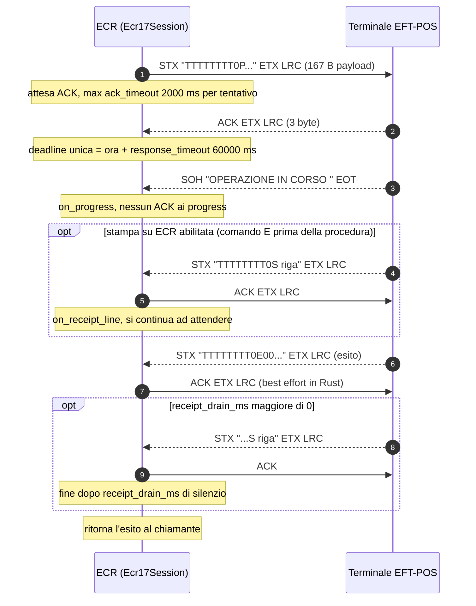
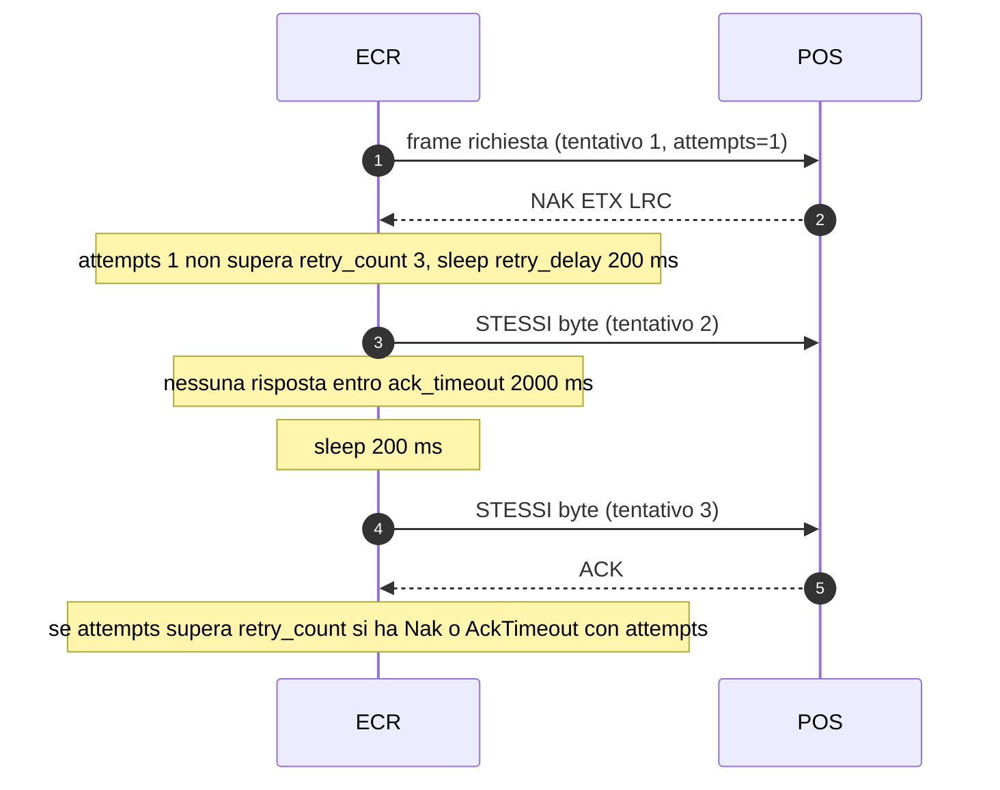
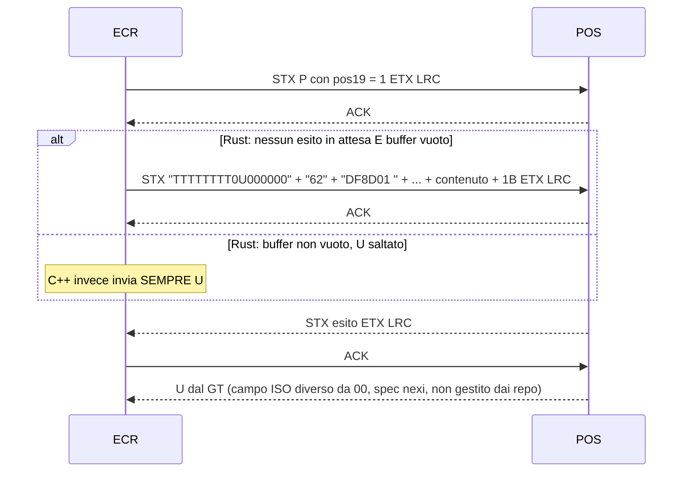
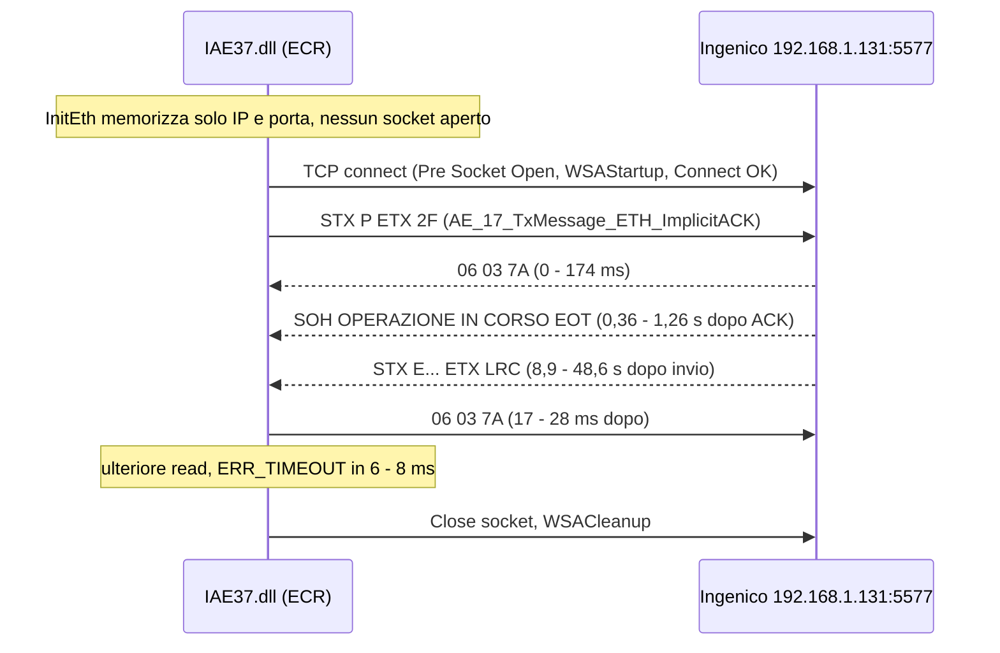
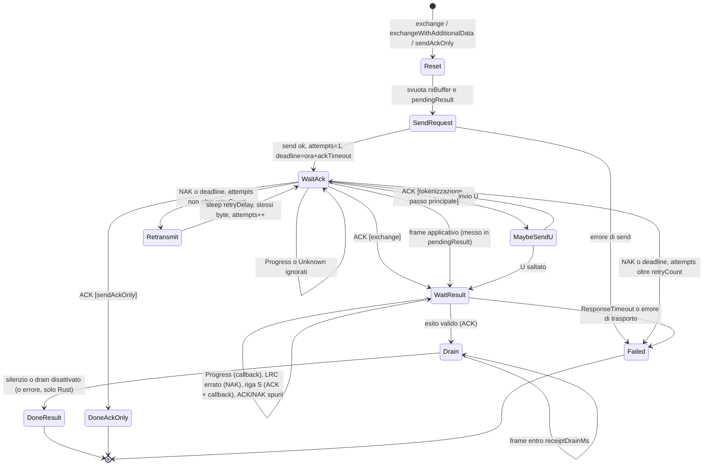
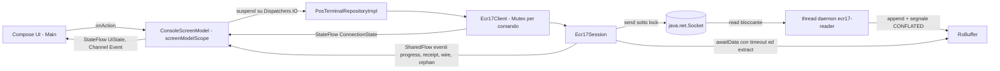

# Analisi dei repository ECR17 (Protocollo 17): base per il port Kotlin / Compose Desktop

> Documento di analisi tecnica, redatto il 2026-10-13, preparatorio al porting in **Kotlin / Compose for Desktop (JVM, Windows)**.
> Repository analizzati in sola lettura: nessun build, install o esecuzione di codice.
>
> **Convenzione delle citazioni**
>
> | Prefisso | Sorgente | Radice dei path |
> |---|---|---|
> | `rust:` | <https://github.com/padosoft/rust-ecr17-protocol> | radice del repo (es. `crates/ecr17-protocol/src/lrc.rs:48`) |
> | `rn:` | <https://github.com/padosoft/react-native-ecr17-protocol> | radice del repo (es. `package/cpp/Lcr/Lcr.cpp:8`) |
> | `wpf:` | app C# esistente `D:/Programmazione/Prime/TestVari/Protocollo17WpfTest` | radice del progetto |
> | `nexi:` | portale pubblico <https://developer.nexigroup.com/traditionalpos/en-EU/docs/> | nome della pagina |
> | `lda:` | app d'esempio `D:/LLM/DesktopApp/LocalDesktopAi` | radice del progetto |
>
> - `rn: …/HybridEcr17Transport.kt` è `package/android/src/main/java/com/margelo/nitro/ecr17/HybridEcr17Transport.kt`. Su Windows non è stato possibile fare checkout di quel file (path troppo lungo), quindi è stato letto da una copia estratta identica; i numeri di riga si riferiscono a quella copia.
> - Le pagine `nexi:` sono state lette con un fetch che **riassume** il contenuto. Gli offset contrassegnati con ⚠️ vanno ricontrollati da una persona sulla specifica ufficiale prima di andare in produzione.
> - **pos** indica una posizione 1-based, come nella specifica e nei commenti dei sorgenti. **off** indica un offset 0-based, come nei test (`payload[9]` corrisponde a pos 10).
> - **(derivato)** indica un valore calcolato con uno script indipendente e non presente nei repository.
> - Hex sempre in maiuscolo e separato da spazi (`02 30 … 03 2F`). Nei log della DLL Ingenico l'hex compare in minuscolo e viene riportato così com'è.

---

## Indice

1. [Sintesi esecutiva](#1-sintesi-esecutiva)
2. [Panoramica dei repository](#2-panoramica-dei-repository)
3. [Protocollo sul filo](#3-protocollo-sul-filo)
4. [Catalogo comandi](#4-catalogo-comandi)
5. [Sessione e trasporto](#5-sessione-e-trasporto)
6. [API pubbliche](#6-api-pubbliche)
7. [App di riferimento UI](#7-app-di-riferimento-ui)
8. [Differenze Rust vs C++ verificate](#8-differenze-rust-vs-c-verificate)
9. [Test vector per gli unit test Kotlin](#9-test-vector-per-gli-unit-test-kotlin)
10. [Mappatura con l'app WPF/DLL esistente](#10-mappatura-con-lapp-wpfdll-esistente)
11. [Lezioni apprese e insidie con i terminali reali](#11-lezioni-apprese-e-insidie-con-i-terminali-reali)
12. [Implicazioni per il port Kotlin/Compose Desktop](#12-implicazioni-per-il-port-kotlincompose-desktop)
13. [Domande aperte](#13-domande-aperte)
14. [Addendum: laravel-ecr17 e profili Ingenico/CCV](#14-addendum-laravel-ecr17-e-profili-ingenicoccv)

---

## 1. Sintesi esecutiva

### 1.1 Cos'è il Protocollo 17 / ECR17

**ECR17** ("Protocollo 17") è il protocollo standard italiano che collega un **ECR** (*Electronic Cash Register*, la cassa) a un terminale **EFT-POS**. Lo supportano i terminali Nexi Group e, tramite la DLL del vendor, anche i terminali Ingenico usati dall'app WPF. Lo scambio è sincrono:

- la cassa invia una richiesta (pagamento, storno, stato, chiusura…);
- il terminale parla con l'host acquirer;
- il terminale risponde.

Il trasporto è **TCP su LAN** (porta tipica `10000` nei repo, `5577` sul terminale dell'utente). Con la DLL Ingenico è possibile anche RS-232.

| Caratteristica | Valore |
|---|---|
| Messaggi | ASCII a campi fissi, senza campo lunghezza nel frame |
| Frame applicativo | `STX payload ETX LRC` |
| Conferma fisica | frame di controllo `ACK/NAK ETX LRC` (3 byte) |
| Messaggi di avanzamento | `SOH testo(20) EOT`, senza LRC |
| Scontrini | messaggi applicativi con codice `'S'` |
| LRC | XOR con **base `0x7F`** (non `0x00`) |

La specifica completa è riservata, condivisa sotto NDA (rust: `README.md:61-80`). Esiste un portale pubblico Nexi con una pagina per comando (nexi: `communication-protocol` e seguenti). La DLL Ingenico usata dall'app WPF registra se stessa internamente come `IAE17`/`AE_17_*` (wpf: `bin/Debug/2026_03_18-iaedll-debug.txt:10`): è lo stesso motore "Protocollo 17".

### 1.2 Cosa fanno i due repository

| | **rust** (`padosoft/rust-ecr17-protocol`) | **rn** (`padosoft/react-native-ecr17-protocol`) |
|---|---|---|
| Prodotto | crate `ecr17-protocol` **v1.0.1** + app desktop **Tauri 2** "ECR17 Control Panel" v1.0.1 | pacchetto npm `@padosoft/react-native-ecr17` **v2.0.1** + app Expo "ECR17 Debug Console" |
| Core del protocollo | Rust puro, `#![forbid(unsafe_code)]`, async (tokio) | **C++20** condiviso (`package/cpp`), esposto con **Nitro Modules** |
| Trasporto | `TcpTransport` tokio (feature `tokio-transport`) | nativo: **Kotlin** `java.net.Socket` (Android), **Swift** `NWConnection` (iOS) |
| UI di riferimento | Tauri + React 19 (desktop, 2 colonne, dark) | Expo/RN (mobile, 2 tab Home/Logs, dark) |
| Licenza | **MIT** (rust: `LICENSE`, `Cargo.toml` `license = "MIT"`) | ⚠️ **ambigua**: il file `LICENSE` in radice è **Apache-2.0**, ma `package/package.json` dichiara `"license": "MIT"` |

**Relazione tra i due.** Il core C++ del repo RN è l'**implementazione di riferimento**. Il crate Rust ne è un **port dichiarato**: "Port of the reference C++ `Ecr17Response`" (rust: `crates/ecr17-protocol/src/response.rs:12`). Il port è stato irrobustito su più punti, documentati in rust: `docs/LESSON.md`. L'app Tauri riprende quasi alla lettera i componenti dell'app d'esempio RN (`commands.ts`, `useEcr17`, `results`, `logger`, `storage`, `DEFAULT_CONFIG`) disposti su due colonne per il desktop. Entrambi i README citano un terzo port fratello, `padosoft/laravel-ecr17` (PHP), che **non** è stato analizzato.

### 1.3 Stato e maturità

| | rust | rn |
|---|---|---|
| Storia git | 13 commit tra 2026-07-10 e 2026-07-13 (release v1.0.0 e v1.0.1) | 75 commit visibili (clone shallow), ultimi 2026-07-24 |
| Test | unit test in ogni modulo (18 test di sessione, test di builder, parser, codec, LRC, client, retry); Vitest 12, Playwright 12, 4 test serde nel backend Tauri | **85** test GoogleTest v1.15.2: lrc 5, codec 15, protocol 12, protocol_commands 18, response 12, session 15, flows 5, retry 2, integration 1 |
| CI | `rust-tests` (fmt, clippy `-D warnings`, test, build, doc), `frontend-checks`, `e2e`, `tauri-check`, `readme-check`, `release` (tauri-action, crates.io) | `cpp-tests` (CMake+Ninja+ctest), `Android build`, `TS & codegen`, `release` (changesets) |
| Verifica su terminale reale | **nessuna** cattura (il test reale `real_terminal_status` è `#[ignore]`, rust: `crates/ecr17-protocol/src/transport/tcp.rs:156-169`) | screenshot di log reali da iOS con un terminale **Nexi** (TID `97508027`, SW `SYSEMV  204`, `lrcMode "stx"`): status, pay contactless, verifyCard, closeSession (rn: `resources/screenshoots/demo-app-iOS-logs.jpeg`) |

I layout byte di richiesta `P` e risposta `E` coincidono **byte per byte** con il traffico reale catturato dalla DLL Ingenico dell'utente (wpf: `bin/Debug/2026_03_18-iaedll-log.txt`, verificato con script, §3.6). I due repo sono quindi una base valida. Hanno però lacune verificate contro la specifica pubblica Nexi, elencate in §4.5 e §8.

### 1.4 I risultati più importanti

1. **LRC sul terminale dell'utente.** Tutti i 13 frame applicativi catturati (6 `P` e 1 `R` in Tx, 6 `E` in Rx) tornano **solo** in modalità `stx` (`0x7F ^ STX ^ payload ^ ETX`). Gli ACK invece valgono `06 03 7A` in entrambe le direzioni, cioè `0x7F ^ 06 ^ 03`. Nessuna `LrcMode` dei repo produce questa combinazione: in `stx` Rust e C++ inviano `06 03 78`. Rust inoltre **scarta** l'ACK reale `06 03 7A`, ritrasmette il pagamento fino a 3 volte e chiude con `AckTimeout`, mentre il terminale sta già elaborando la transazione. **In Kotlin l'LRC dei frame di controllo va reso configurabile separatamente** (§3.3, §8 S1/W1).
2. **La DLL del vendor apre e chiude una connessione TCP per ogni operazione.** Usa inoltre l'"**ImplicitACK**": se manca l'ACK non reinvia alla cieca un frame finanziario e passa ad attendere l'esito (stringa `ACK NOT RECEIVED - IMPLICIT GO AHEAD` nella DLL). I repo tengono invece un socket persistente e ritrasmettono anche i frame finanziari.
3. **Tempi reali.** L'esito arriva tra **8,9 e 48,6 s** dall'invio. Il timeout di default dei repo, 60 000 ms, lascia poco margine.
4. **Lacune comuni ai due repo rispetto alla spec Nexi:**
   - la risposta a `i` ha un layout proprio (75 B), ma viene parsata col parser di `e`;
   - la chiusura `c` e la sua variante DCC `v` non hanno un parser corretto;
   - la risposta a `G` non viene smistata in base al codice;
   - non gestiscono la concatenazione VAS, il messaggio `U` di ritorno dal GT, la sentinella di fine scontrino (`0x7D`×6 + `0x1B`) e gli action code di `S`/`H`/`c`/`X`;
   - trattano `E` come impostazione persistente, mentre la spec la azzera a fine procedura.
5. **Rust vs C++.**
   - Rust è migliore su: drain degli scontrini, invio ACK *best effort*, resync dei frame di controllo, validazioni.
   - C++ è migliore su: byte residui tra transazioni (reader continuo) e parsing a offset esatti (byte grezzi, mentre Rust decodifica UTF-8 *lossy*).
   - Il port Kotlin deve prendere il meglio di entrambi (§8).
6. **Money-safety** (identica nei due repo): i comandi finanziari non si ripetono mai dopo una riconnessione; l'esito si recupera con `G` (*send last result*). Sono ripetibili solo `s`, `T`, `G`, `E`.
7. **Funzioni WPF/DLL assenti nei repo:**
   - Refund, RefundExt, VoidR, LetturaCarta, StatoPos (operazione separata);
   - RS-232;
   - tipi pagamento `6`/`7`/`8`;
   - scelta del tipo di ristampa.

   Funzioni presenti nei repo ma assenti nel WPF: `E`, `K` (VAS), `U` (tokenizzazione), eventi di progress e di scontrino, DCC.
8. **Architettura proposta** (§12):
   - modulo `ecr17-protocol` in Kotlin/JVM puro e testabile, con reader thread dedicato + buffer, `Mutex` per comando e `StateFlow`/`SharedFlow` per gli eventi;
   - modulo app Compose Desktop con MVI su Voyager `ScreenModel` e Koin, allineato alle skill `compose-desktop-*` e a `LocalDesktopAi`.

---

## 2. Panoramica dei repository

### 2.1 rust: `padosoft/rust-ecr17-protocol`

```
rust-ecr17-protocol/
├── Cargo.toml                 workspace: edition 2021, rust-version 1.85, license MIT, profile release lto/strip
├── Cargo.lock
├── crates/ecr17-protocol/     crate pubblicato su crates.io (v1.0.1)
│   ├── Cargo.toml             feature `tokio-transport` = ["tokio/net","tokio/io-util"]
│   ├── README.md
│   └── src/
│       ├── lib.rs             re-export pubblici, #![forbid(unsafe_code)]
│       ├── lrc.rs             LrcMode + compute()
│       ├── codec.rs           costanti di controllo, PacketCodec (encode/decode singolo frame)
│       ├── protocol.rs        15 builder di richiesta (P X p i c H C T G E R s S K U) + tag tokenizzazione
│       ├── response.rs        parser delle risposte (offset 1-based)
│       ├── session.rs         Ecr17Session: splitter di stream, handshake ACK/NAK, attesa esito, drain
│       ├── retry.rs           should_retry_after_reconnect() (regola money-safety)
│       ├── transport.rs       trait Transport + FakeTransport (test double)
│       ├── transport/tcp.rs   TcpTransport tokio (feature-gated)
│       ├── client.rs          Ecr17Client: facciata async, mapping dei risultati, retry/reconnect
│       ├── types.rs           config, richieste, risultati, enum (serde camelCase)
│       └── error.rs           Ecr17Error (thiserror)
├── app/                       "ECR17 Control Panel" (Tauri 2 + React 19 + Vite 7 + TS 5.8)
│   ├── src-tauri/             backend Rust: lib.rs (comandi IPC + eventi), main.rs, tauri.conf.json, capabilities/
│   ├── src/                   App.tsx, App.css, components/ (6), ecr17/ (commands, logger, results, storage, tauri, types, useEcr17)
│   ├── e2e/                   Playwright (panel.spec.ts) + mock IPC (tauri-mock.ts)
│   └── scripts/capture-assets.mjs   genera screenshot/banner contro il mock
├── docs/LESSON.md, docs/PLAN.md     lezioni apprese e piano a "MACRO"
├── resources/                 banner.png, screenshots/control-panel.png, screenshots/params-sheet.png
├── scripts/sync-readme.mjs
├── .github/workflows/         rust-tests, frontend-checks, e2e, tauri-check, readme-check, release
└── AGENTS.md, CLAUDE.md, PROGRESS.md
```

**Tecnologie e dipendenze del crate** (rust: `Cargo.toml:10-23`, `crates/ecr17-protocol/Cargo.toml:14-31`):

| Dipendenza | Versione | Note |
|---|---|---|
| `serde` (derive) | 1.0.228 | tutti i tipi pubblici in camelCase; `LrcMode` in snake_case |
| `thiserror` | 2.0.18 | `Ecr17Error` |
| `tokio` | 1.52.3 (`default-features=false`, `time,sync,rt`) | `net`/`io-util` solo con la feature `tokio-transport` |
| `async-trait` | 0.1.89 | trait `Transport` |
| dev: `serde_json` 1.0.150, `tokio` (`macros, rt-multi-thread, test-util`) | | |

**App Tauri** (rust: `app/src-tauri/Cargo.toml`, `app/package.json`): tauri 2, tauri-plugin-opener 2 (non usato a runtime), React `^19.1.0`, Vite `^7.0.4`, TypeScript `~5.8.3`, Biome, Vitest, Playwright.

**Build e test** (dai workflow):

| Workflow | Comandi principali |
|---|---|
| `rust-tests.yml` | `cargo fmt --all -- --check`; `cargo clippy --workspace --all-targets --all-features -- -D warnings`; `cargo test --workspace --all-features`; `cargo build --workspace --features tokio-transport`; `cargo doc --no-deps` |
| `frontend-checks.yml` | `npm ci`; `npm run typecheck`; `npm run lint`; `npm test`; `npm run build` (Node 22) |
| `e2e.yml` | `npx playwright install --with-deps chromium`; `npm run e2e` |
| `tauri-check.yml` | `cargo fmt --check` + check del backend Tauri |
| `readme-check.yml` | `node scripts/sync-readme.mjs --check` |
| `release.yml` | sui tag `v*`: pubblicazione crate + `tauri-apps/tauri-action@v0` (matrice di OS) |

Il test su terminale reale è opzionale e pilotato da variabili d'ambiente `ECR17_TEST_*` (rust: `crates/ecr17-protocol/src/transport/tcp.rs:156-169`).

### 2.2 rn: `padosoft/react-native-ecr17-protocol`

```
react-native-ecr17-protocol/
├── package/                   pacchetto npm @padosoft/react-native-ecr17 (v2.0.1)
│   ├── src/                   index.ts, specs/client.nitro.ts, specs/transport.nitro.ts, types/client.ts, utils/client.ts
│   ├── cpp/                   CORE C++20
│   │   ├── Lcr/Lcr.{hpp,cpp}           classe Lrc (il nome cartella "Lcr" è un refuso)
│   │   ├── PacketCodec/                framing
│   │   ├── Ecr17Protocol/              builder richieste
│   │   ├── Ecr17Response/              parser risposte
│   │   ├── Session/Ecr17Session.*, RetryPolicy.hpp
│   │   ├── Transport/Transport.hpp, FakeTransport.hpp, NativeTransportAdapter.*
│   │   ├── Ecr17Client/HybridEcr17Client.{hpp,cpp}   API Nitro
│   │   └── tests/                      GoogleTest (85 TEST), PosixTcpTransport.hpp, stubs/LrcMode.hpp
│   ├── android/               build.gradle (AGP 9.2.1), CMakeLists.txt, cpp-adapter.cpp, Ecr17Package.kt, HybridEcr17Transport.kt
│   ├── ios/                   HybridEcr17Transport.swift, Bridge.h
│   ├── nitro.json, Ecr17.podspec, react-native.config.js, CHANGELOG.md
├── example/                   app Expo "ECR17 Debug Console" (Expo SDK ~56, RN 0.85.3, nitro-modules 0.35.8, reanimated 4.3.1)
├── docs/LESSON.md             lezioni apprese (molto utili, §11)
├── docs/superpowers/          spec e piano della debug console
├── docs-site/                 sito di documentazione (configuration, guides, operations/runbook, troubleshooting, payment-safety…)
├── resources/screenshoots/    demo-app-android.jpeg, demo-app-iOS.jpeg, demo-app-iOS-logs.jpeg
├── .github/workflows/         cpp-tests, android-build, ts-checks, release
└── AGENTS.md, CLAUDE.md, PROGRESS.md, README.md (mirror di package/README.md)
```

**Tecnologie.**

| Area | Dettagli |
|---|---|
| Core | C++20 (`-frtti -fexceptions -Wall -Wextra -fstack-protector-all`, rn: `package/android/build.gradle:51`) |
| Binding | Nitro (codegen `nitrogen`, cartella `nitrogen/` in gitignore) |
| Android | Kotlin `2.1.21`, minSdk 23, target/compile 36, NDK `29.0.14206865` (rn: `package/android/gradle.properties:1-5`) |
| iOS | Swift, `NWConnection` |
| Strumenti | bun, Biome, changesets |

**Build e test** (CI):

| Workflow | Comandi |
|---|---|
| `cpp-tests.yml` | `cmake -S package/cpp/tests -B build -G Ninja -DCMAKE_BUILD_TYPE=Release`; `cmake --build build`; `ctest --test-dir build --output-on-failure` |
| `android-build.yml` | JDK Temurin 17, `bunx nitrogen`, `bunx expo prebuild --platform android`, `./gradlew assembleDebug` |
| `ts-checks.yml` | `sync-readme --check`, `bunx nitrogen`, `bunx tsc --noEmit -p tsconfig.ci.json` |
| `release.yml` | changesets |

Il test di integrazione su terminale reale si attiva solo se è impostato `ECR17_TERMINAL_HOST` (porta in `ECR17_TERMINAL_PORT`, default 10000; `ECR17_TERMINAL_ID`, default `"00000000"`; `ECR17_LRC_MODE`) (rn: `package/cpp/tests/test_integration_terminal.cpp:1-57`).

### 2.3 Confronto rapido dei moduli

| Responsabilità | rust | rn (C++) | Port Kotlin (proposta, §12) |
|---|---|---|---|
| LRC | `lrc.rs` | `Lcr/Lcr.cpp` | `wire/Lrc.kt` |
| Framing singolo frame | `codec.rs` | `PacketCodec/` | `wire/FrameCodec.kt` |
| Splitter di stream | `session.rs::extract_frame` | `Ecr17Session::extractFrameLocked` | `wire/FrameSplitter.kt` (funzione pura) |
| Builder | `protocol.rs` | `Ecr17Protocol/` | `message/Requests.kt` |
| Parser | `response.rs` | `Ecr17Response/` | `message/Responses.kt` (+ smistamento per codice) |
| Sessione | `session.rs` | `Session/Ecr17Session.*` | `session/Ecr17Session.kt` |
| Retry policy | `retry.rs` | `Session/RetryPolicy.hpp` | `session/RetryPolicy.kt` |
| Trasporto | `transport.rs`, `transport/tcp.rs` | `Transport/*` + Kotlin/Swift nativi | `transport/TcpTransport.kt` (reader thread) |
| Client | `client.rs` | `Ecr17Client/HybridEcr17Client.*` | `client/Ecr17Client.kt` |
| Tipi/errori | `types.rs`, `error.rs` | `specs/*.nitro.ts`, `types/client.ts`, eccezioni | `model/`, `error/Ecr17Exception.kt` |
| UI | `app/` (Tauri) | `example/` (Expo) | modulo `app` Compose Desktop |

---

## 3. Protocollo sul filo

### 3.1 Caratteri di controllo

| Nome | Hex | Ruolo | Sorgenti |
|---|---|---|---|
| `SOH` | `0x01` | apre un frame di progress (terminale → ECR) | rust: `crates/ecr17-protocol/src/codec.rs:19`; rn: `package/cpp/PacketCodec/PacketCodec.hpp:31` |
| `STX` | `0x02` | apre un frame applicativo | rust: `codec.rs:15`; rn: `PacketCodec.hpp:29` |
| `ETX` | `0x03` | chiude il payload applicativo (segue l'LRC); è anche il 2° byte dei frame di controllo | rust: `codec.rs:17`; rn: `PacketCodec.hpp:30` |
| `EOT` | `0x04` | ultimo byte del frame di progress (dopo non c'è LRC) | rust: `codec.rs:21`; rn: `PacketCodec.hpp:32` |
| `ACK` | `0x06` | conferma positiva | rust: `codec.rs:23`; rn: `PacketCodec.hpp:33` |
| `NAK` | `0x15` | conferma negativa | rust: `codec.rs:25`; rn: `PacketCodec.hpp:34` |
| `ESC` / FIELD_SEP | `0x1B` | chiude il contenuto TAG del messaggio `U` e la fine scontrino | rust: `src/protocol.rs:15`; rn: `package/cpp/Ecr17Protocol/Ecr17Protocol.cpp:10`; nexi: `send-ticket` |
| riempitivo riservato | `'0'` (`0x30`) | campi riservati numerici e pad sinistro degli id | rust: `protocol.rs:13`; rn: `Ecr17Protocol.cpp:9` |
| base LRC | `0x7F` | valore iniziale dell'LRC | rust: `src/lrc.rs:12`; rn: `package/cpp/Lcr/Lcr.hpp:15` |
| `0x7D` (dentro `S`) | `0x7D` | stampa scontrino: "a capo + reset" | nexi: `send-ticket` |
| `0x7F` (dentro `S`) | `0x7F` | stampa scontrino: doppia altezza grassetto | nexi: `send-ticket` |

Non esistono DLE, byte-stuffing o escaping. I payload si assumono privi di `0x03`, `0x04`, `0x06` e `0x15`, dato che il protocollo è ASCII per specifica.

**Il byte di LRC invece può assumere qualsiasi valore**, compresi `0x02`, `0x03`, `0x06` e `0x15`. Per esempio, il risultato `"123456780E00"+"0"*60` ha LRC std `0x02` (rn: `package/cpp/tests/test_flows.cpp:51-84`, derivato). Lo splitter deve quindi prendere il byte che segue `ETX` come LRC, **senza interpretarlo**.

### 3.2 Le tre forme di frame

```
Frame applicativo (ECR→POS e POS→ECR)
+------+---------------------------+------+-----+
| 0x02 | payload (N byte ASCII)    | 0x03 | LRC |      totale N+3 byte, NESSUN campo lunghezza
+------+---------------------------+------+-----+

Frame di controllo ACK/NAK (entrambe le direzioni)
+-----------+------+-----+
| 0x06/0x15 | 0x03 | LRC |                            sempre 3 byte, NESSUN STX sul filo
+-----------+------+-----+

Frame di progress (solo POS→ECR, solo durante procedure verso l'host)
+------+------------------------------+------+
| 0x01 | messaggio (20 caratteri)     | 0x04 |        22 byte, NESSUN LRC, NON va ACKato
+------+------------------------------+------+
```

| Frame | Encoder | Decodifica |
|---|---|---|
| Applicativo | `encode_application` = `[STX] + payload + [ETX] + [lrc_mode.compute(payload)]` (rust: `codec.rs:94-101`; rn: `PacketCodec.cpp:10-24`) | payload = byte tra STX e il **primo** ETX |
| Controllo | `encode_control(ctrl)` = `[ctrl, ETX, lrc_mode.compute([ctrl])]` (rust: `codec.rs:107-109`; rn: `PacketCodec.cpp:26-37`) | vedi §3.3, problema dell'LRC di controllo |
| Progress | n/d (solo ricezione) | `SOH..EOT`. I 20 caratteri sono documentati (rust: `codec.rs:287`; nexi: `communication-protocol`) ma il decoder **non li verifica** |

Esempio reale di progress dal terminale Ingenico dell'utente: `01 4F 50 45 52 41 5A 49 4F 4E 45 20 49 4E 20 43 4F 52 53 4F 20 04` = `"OPERAZIONE IN CORSO "`, 20 caratteri con lo spazio finale (wpf: `bin/Debug/2026_03_18-iaedll-log.txt:3`). La specifica esclude l'ACK sui progress, e infatti nessuno lo invia: né i due repo né la DLL (nexi: `communication-protocol`; wpf: `…-iaedll-log.txt:3-6`; rust: `session.rs:265`).

### 3.3 LRC

**Algoritmo**, identico in rust: `src/lrc.rs:48-60` e rn: `package/cpp/Lcr/Lcr.cpp:8-36`:

```rust
pub fn compute(self, payload: &[u8]) -> u8 {      // rust: src/lrc.rs:48-60
    let mut lrc = BASE;                            // 0x7F
    if matches!(self, LrcMode::Stx | LrcMode::StxNoext) { lrc ^= STX; }   // 0x02
    for &b in payload { lrc ^= b; }
    if matches!(self, LrcMode::Stx | LrcMode::Noext)    { lrc ^= ETX; }   // 0x03
    lrc
}
```

| `LrcMode` | Stringa serde/TS | Byte ripiegati dopo la base `0x7F` | Relazione con `std` | Fonte |
|---|---|---|---|---|
| `Std` (**default**) | `"std"` | solo payload | `std` | rust: `lrc.rs:30-32` (`#[default]`) |
| `Stx` | `"stx"` | STX + payload + ETX | `std ^ 0x01` | rust: `lrc.rs:28-29` |
| `Noext` | `"noext"` | payload + **ETX** (nessun STX) | `std ^ 0x03` | rust: `lrc.rs:33-34` |
| `StxNoext` | `"stx_noext"` | STX + payload (nessun ETX) | `std ^ 0x02` | rust: `lrc.rs:35-36` |

- **I nomi traggono in inganno.** `NOEXT` ripiega l'ETX: va letto come "no STX, con ETX". Il commit `44f178e` aveva invertito la semantica (in `std` ripiegava l'ETX) e il risultato era che "il terminale NAKa tutto". Il commit `27ec54b` l'ha ripristinata (rn: `PROGRESS.md:45-46`). **In Kotlin conviene esprimere la modalità con due booleani espliciti** (`foldStx`, `foldEtx`) dietro l'enum.
- È uno XOR puro: niente complemento, niente XOR finale. Essendo commutativo, l'ordine di STX ed ETX non conta.
- La specifica dice solo "exclusive OR di ogni byte del messaggio, base `0x7F`" e non precisa se STX ed ETX siano inclusi (nexi: `communication-protocol`). La modalità va quindi **verificata sul terminale**.

#### LRC dei frame di controllo: il problema principale con il terminale dell'utente

Entrambi i repo calcolano l'LRC di ACK/NAK come `lrc_mode.compute([ctrl])`, con la **stessa** modalità dei frame applicativi. In `stx` e in `stx_noext` ripiegano quindi anche uno STX che sul filo non compare.

| Modalità | ACK prodotto dai repo | NAK prodotto dai repo |
|---|---|---|
| `std` | `06 03 79` | `15 03 6A` |
| `stx` | `06 03 78` | `15 03 6B` |
| `noext` | `06 03 7A` | `15 03 69` |
| `stx_noext` | `06 03 7B` | `15 03 68` |

Valori derivati da rust: `lrc.rs:48-60` + `codec.rs:107-109`, coincidenti con quelli calcolati dai lettori delle due codebase.

**Cosa passa davvero sul filo con il terminale Ingenico** (wpf: `bin/Debug/2026_03_18-iaedll-log.txt`, ricalcolato con uno script):

- I 13 frame applicativi (righe 1, 4, 7, 10, 13, 16, 19, 22, 25, 28, 31, 34, 37) hanno l'LRC corretto **solo** in modalità `stx`.
- I 7 ACK ricevuti dal terminale e i 6 ACK inviati dalla DLL sono **sempre `06 03 7A`** = `0x7F ^ 0x06 ^ 0x03`. È lo XOR dei byte sul filo che precedono l'LRC, ed equivale a `Noext.compute([0x06])`.

Ne segue che nessuna `LrcMode` dei repo, presa da sola, funziona con questo terminale:

| Configurazione | Cosa succede |
|---|---|
| Rust in `stx` | Invia `06 03 78`. Lo splitter **scarta l'ACK reale `06 03 7A`** perché `buf[2] != 0x78` (rust: `crates/ecr17-protocol/src/session.rs:329-334`). L'handshake va in timeout e ritrasmette il frame di **pagamento** dopo 2000 + 200 ms, fino a 3 volte. Dopo circa 8,6 s fallisce con `AckTimeout{attempts:4}`, mentre il terminale sta ancora elaborando la transazione (il cui esito arriverebbe dopo 8,9–48,6 s). |
| Rust in `noext` | L'LRC dei frame di controllo tornerebbe, ma quello dei frame applicativi sarebbe sbagliato e il terminale li NAKerebbe. |
| C++ | Funziona per caso: lo splitter accetta qualsiasi 3 byte che iniziano con `06`/`15` (rn: `package/cpp/Session/Ecr17Session.cpp:41-48`). I suoi ACK uscirebbero comunque come `06 03 78`. |

**Regola per Kotlin** (da nexi + wpf; il NAK `15 03 69` è derivato, mai osservato sul DESK3200 ma visto da un altro terminale Ingenico, §9.11):

- `appLrcMode = STX`;
- LRC di controllo **separato**: `controlLrc = 0x7F ^ ctrl ^ ETX`, quindi ACK `06 03 7A` e NAK `15 03 69`;
- in ricezione si richiede `ETX` in posizione [1] e si accetta l'LRC di **entrambe** le convenzioni, scrivendo nel log l'eventuale mismatch (§12.4).

```kotlin
// Bozza Kotlin (nessun byte con segno: sempre `and 0xFF`)
enum class LrcMode(val foldStx: Boolean, val foldEtx: Boolean) {
    STD(false, false), STX(true, true), NOEXT(false, true), STX_NOEXT(true, false);
    fun compute(payload: ByteArray, from: Int = 0, to: Int = payload.size): Int {
        var lrc = 0x7F
        if (foldStx) lrc = lrc xor 0x02
        for (i in from until to) lrc = lrc xor (payload[i].toInt() and 0xFF)
        if (foldEtx) lrc = lrc xor 0x03
        return lrc and 0xFF
    }
}
```

Per restare compatibili con i file di configurazione esistenti vanno mantenuti i valori serializzati `"std"`, `"stx"`, `"noext"`, `"stx_noext"` (rust: `lrc.rs:132-141`; rn: `package/src/types/client.ts:6`).

### 3.4 Codifica dei caratteri

**Testo in uscita**

- Specifica: ASCII 0–127 in chiaro (nexi: `communication-protocol`). La DLL usa `Encoding.ASCII` (wpf: `IAE37Wrapper.cs:37-54`).
- rust: `String` UTF-8 convertita con `as_bytes()`. Le larghezze sono contate in **byte UTF-8** e non c'è validazione ASCII (rust: `src/protocol.rs:19,35`; `session.rs:191`).
- rn (C++): `std::string` con i byte grezzi ricevuti da JS (UTF-8).
- **Kotlin:** costruire un `ByteArray` in **US-ASCII** e **rifiutare** i caratteri sopra `0x7F`, oppure definire una traslitterazione esplicita (es. `è` → `e'`).

**Testo in ingresso**

- Specifica: ASCII. Negli scontrini `S` compaiono in banda anche `0x7D` e `0x7F`.
- rust: applica `String::from_utf8_lossy` **prima** del parsing. Un byte non UTF-8 diventa U+FFFD (3 byte) e **sposta di +2 tutti gli offset successivi** (rust: `client.rs:442-444`; `response.rs:29-36`; §8 W6/S12).
- rn (C++): parsing sui byte grezzi con `substr`, quindi offset esatti (rn: `Ecr17Response.cpp:12-18`).
- **Kotlin:** parsare direttamente il `ByteArray` oppure decodificare con **`Charsets.ISO_8859_1`** (1 byte = 1 char). **Mai** decodificare in UTF-8 prima di applicare gli offset.

> Attenzione in Kotlin: `String.length` conta unità UTF-16, e `padStart`/`padEnd` **non** segnalano errore se il valore è troppo lungo. Servono helper che lavorino sui byte e lancino `FieldOverflow` (§4.4).

### 3.5 Validazione e decodifica (due livelli)

**Livello 1: splitter di stream** (rust: `session.rs:317-356`; rn: `Ecr17Session.cpp:37-75`). Lavora su un buffer di ricezione (`VecDeque<u8>` in Rust, `std::string rxBuffer_` in C++) e taglia un frame alla volta dalla testa.

| Byte di testa | rust | rn (C++) |
|---|---|---|
| `06` / `15` | Servono almeno 3 byte, altrimenti attende. Accetta solo se `buf[1]==ETX` **e** `buf[2]==lrc_mode.compute([lead])`; altrimenti **scarta solo il primo byte** e riparte (resync). Test: `stray_ack_byte_is_resynced_not_a_false_ack`, `control_frame_with_bad_lrc_is_resynced` (rust: `session.rs:462-492`) | Servono almeno 3 byte, poi prende **qualsiasi** terna, senza controllare né ETX né LRC (rn: `Ecr17Session.cpp:41-48`) |
| `02` | Cerca il **primo** `03`. Se manca, o manca il byte successivo, attende. Altrimenti estrae `STX..ETX+LRC`. Qui l'LRC non viene controllato | Uguale |
| `01` | Cerca il primo `04`: se manca attende, altrimenti estrae `SOH..EOT` | Uguale |
| altro | Scarta 1 byte (resync silenzioso, nessun NAK) | Uguale |

**Livello 2: decodifica di un singolo frame** (rust: `codec.rs:124-170`; rn: `PacketCodec.cpp:39-144`). Il risultato è `DecodedPacket { packet_type, payload, valid_lrc }`.

| Input | Esito |
|---|---|
| vuoto | `Unknown`, `valid_lrc=false` |
| primo byte `06` | `Ack`, `valid_lrc=true`. Conta **solo il primo byte**: coda e LRC sono ignorati, quindi `[06]`, `[06 00]` e `[06 03 FF]` danno tutti Ack |
| primo byte `15` | `Nak`, `valid_lrc=true` (es. `[15 99 42]` → Nak) |
| `01` con lunghezza < 2, oppure ultimo byte ≠ `04` | `Unknown` |
| `01 … 04` | `Progress`, payload = byte interni, `valid_lrc=true` (lunghezza non verificata) |
| `02` senza `03` | `Unknown` |
| `02` con primo `03` all'indice `i` e `i+2 != len` (LRC mancante, byte in coda o due frame concatenati) | `Unknown` |
| `02 … 03 LRC` ben formato | `Application`, payload = `data[1..i]`, `valid_lrc = (data[i+1] == compute(payload))`. **Con LRC errato l'esito è comunque `Application`**, con `valid_lrc=false` |
| altro | `Unknown` |

> **Non restringere la decodifica di ACK/NAK a `len == 1`**: tutti gli ACK reali a 3 byte diventerebbero `Unknown` (rust: `codec.rs:113-118`, `docs/LESSON.md:88-97`). Il controllo stretto va fatto nello splitter, non nel decoder.

### 3.6 Esempi byte per byte annotati

**(a) Richiesta status `s` con terminal id `12345678`, modalità `std`** (derivato; coerente con rust: `protocol.rs:440-443` e rn: `test_flows.cpp:139-148`).

```
02 | 31 32 33 34 35 36 37 38 | 30 | 73 | 03 | 34
STX  "12345678" (TID, pos1-8)  '0'  's'  ETX  LRC
                               pos9 pos10
```

| passo | operazione | risultato |
|---|---|---|
| base | | `7F` |
| 1 | `7F ^ 31 ('1')` | `4E` |
| 2 | `4E ^ 32 ('2')` | `7C` |
| 3 | `7C ^ 33 ('3')` | `4F` |
| 4 | `4F ^ 34 ('4')` | `7B` |
| 5 | `7B ^ 35 ('5')` | `4E` |
| 6 | `4E ^ 36 ('6')` | `78` |
| 7 | `78 ^ 37 ('7')` | `4F` |
| 8 | `4F ^ 38 ('8')` | `77` |
| 9 | `77 ^ 30 ('0')` | `47` |
| 10 | `47 ^ 73 ('s')` | **`34`** (`std`); `stx`=`35`, `noext`=`37`, `stx_noext`=`36` |

Lo stesso comando con TID `00000000` in `stx`, cioè la forma adatta al terminale dell'utente, dà `02 30 30 30 30 30 30 30 30 30 73 03 3D`. Calcolo: `7F^02` = `7D`; nove volte `^30` = `4D`; `^73` = `3E`; `^03` = `3D`.

**(b) Pagamento `P` reale verso il terminale Ingenico** (wpf: `bin/Debug/2026_03_18-iaedll-log.txt:1`; 170 byte totali, payload 167).

```
02                                          STX
30 30 30 30 30 30 30 30                     pos 1-8    Terminal ID "00000000" (left-pad '0')
30                                          pos 9      riservato '0'
50                                          pos 10     codice messaggio 'P'
30 30 30 30 30 30 30 30                     pos 11-18  Cash register / ECR id "00000000"
30                                          pos 19     presenza dati aggiuntivi GT '0'
30 30                                       pos 20-21  riservato "00"
30                                          pos 22     avvio con carta già presente '0'
30                                          pos 23     tipo pagamento '0' (automatico)
30 30 30 30 30 30 30 31                     pos 24-31  importo in centesimi "00000001" (0,01 €)
20 × 128                                    pos 32-159 testo scontrino: 128 spazi (allineato a destra)
30 30 30 30 30 30 30 30                     pos 160-167 riservato "00000000"
03                                          ETX
2F                                          LRC modalità stx  (std=2E, noext=2D, stx_noext=2C)
```

Il frame coincide con `build_payment("00000000","00000000",1,'0',false,false,"")` (rust: `protocol.rs:79-106`).

**(c) ACK del terminale** (wpf: `…-iaedll-log.txt:2`). `06 03 7A` = `ACK`, `ETX`, LRC con `7F^06^03` = `7A`.

**(d) Progress** (riga 3). `01` + `"OPERAZIONE IN CORSO "` + `04`, ricevuto 0,36–1,26 s dopo l'ACK.

**(e) Esito approvato reale** (riga 22; payload 71 byte, LRC stx `21`).

```
02
30 32 35 37 35 37 33 33     pos 1-8   TID reale del terminale "02575733"
30                          pos 9     '0'
45                          pos 10    'E' (risposta a P)
30 30                       pos 11-12 esito "00" (OK)
30 30 30 35 35 38 32 37 38 2A 2A 2A 2A 2A 2A 34 37 36 38
                            pos 13-31 PAN "000558278******4768" (mascherato DAL TERMINALE)
43 4C 49                    pos 32-34 tipo transazione "CLI" (contactless chip)
52 34 38 34 33 32           pos 35-40 codice autorizzazione "R48432"
30 37 37 30 39 34 37        pos 41-47 data/ora host "0770947" = giorno 077 (18 marzo) 09:47
32                          pos 48    tipo carta '2' (credito)
30 30 30 30 30 30 30 30 30 32 33   pos 49-59 acquirer id "00000000023"
30 30 30 30 30 34           pos 60-65 STAN "000004"
30 30 30 30 35 35           pos 66-71 online id "000055" (= "Operation Number" della DLL)
03 21
```

Dopo questo frame la DLL ha risposto con `06 03 7A` dopo 21 ms (riga 24).

---

## 4. Catalogo comandi

### 4.1 Intestazione comune a tutte le richieste

| pos | off | len | Campo | Valore |
|---|---|---|---|---|
| 1 | 0 | 8 | Terminal id | `left_pad(terminal_id, 8, '0')`; oltre 8 byte → `FieldOverflow` |
| 9 | 8 | 1 | Riservato | `'0'` |
| 10 | 9 | 1 | Codice messaggio | lettera ASCII, **distingue maiuscole e minuscole** (`s` ≠ `S`, `p` ≠ `P`) |

Il TID `00000000` funziona da jolly. La specifica prevede un controllo opzionale del TID: quando è attivo, il terminale accetta il proprio TID oppure `00000000`. Un codice messaggio o un TID non validi provocano un NAK. Entrambi i terminali reali hanno accettato `00000000` e risposto con il proprio TID: Ingenico `02575733`, Nexi `97508027` (nexi: `communication-protocol`; wpf: `…-iaedll-log.txt:1,4`; rn: `resources/screenshoots/demo-app-iOS-logs.jpeg`).

### 4.2 Tabella riassuntiva

Valori della colonna "Tipo":
- **exchange**: handshake ACK seguito dall'attesa dell'esito applicativo;
- **ACK-only**: solo handshake;
- **+U**: dopo l'handshake segue il messaggio `U`, se è richiesta la tokenizzazione.

La colonna "Safe" corrisponde a `safe_to_retry`, cioè se il comando si può ripetere dopo un auto-reconnect.

| Comando (metodo rust / rn) | Cod. | Scopo | Len richiesta | Tipo | Safe | Risposta attesa (spec Nexi) | Parser nei repo |
|---|---|---|---|---|---|---|---|
| `status()` | `s` | stato terminale, data/ora, release SW | 10 | exchange | **sì** | `s`, lunghezza variabile (31 + release) | `parse_status` ✓ |
| `pay()` | `P` | pagamento | 167 | exchange (+U) | no | `E` 71 B, o `V` 117 B con DCC | `parse_payment` ✓ |
| `pay_extended()` / `payExtended()` | `X` | pagamento con esito esteso | 167 | exchange (+U) | no | `E` **92 B** (action code 72/3, importo host 75/8) ⚠️ | `parse_payment` (ignora i byte 72-92) |
| `reverse()` | `S` | storno | 26 | exchange | no | `E` **84 B** (action code 72/3; pos 35-40 riservate) ⚠️ | `parse_payment`, `action_code` mai valorizzato |
| `pre_auth()` / `preAuth()` | `p` | preautorizzazione | 167 | exchange (+U) | no | `e` 106 B | `parse_pre_auth` ✓ |
| `incremental_auth()` | `i` | integrazione preautorizzazione | 176 | exchange | no | **`i` 75 B, layout proprio** ⚠️ | `parse_pre_auth` ✗ **errato** |
| `pre_auth_closure()` | `c` | chiusura preautorizzazione | 176 | exchange | no | `c` 74 B, o **`v`** 109 B con DCC ⚠️ | `parse_payment` (perde action code e variante `v`) |
| `verify_card()` | `H` | verifica carta | 39 | exchange (+U) | no | `E` 71 B; in caso di KO, action code 37/3 ⚠️ | `parse_payment`, `action_code` mai valorizzato |
| `close_session()` | `C` | chiusura contabile | 26 | exchange | no | `C` 44 B | `parse_close` ✓ |
| `totals()` | `T` | totali terminale | 26 | exchange | **sì** | `T` 34 B | `parse_totals` ✓ |
| `send_last_result()` | `G` | reinvio dell'ultimo esito salvato (recupero) | 22 | exchange | **sì** | **identica all'ultimo esito salvato**: `E`, `V`, `e`, `i`, `c` o `v` ⚠️ | sempre `parse_payment` ✗ |
| `enable_ecr_printing(bool)` | `E` | stampa scontrini su ECR (righe `S`) | 11 | **ACK-only** | **sì** | solo ACK; impostazione **non persistente**, si azzera a fine procedura ⚠️ | — |
| `reprint(to_ecr)` | `R` | ristampa ultimo scontrino | 22 | **ACK-only** | no | solo ACK, più le righe `S` se `to_ecr` | — (righe `S` non raccolte) |
| `vas(xml)` | `K` | servizi a valore aggiunto (XML) | 26 + n | exchange | no | `K`, anche **su più messaggi** (flag in pos 15) ⚠️ | `parse_vas`, legge solo il primo |
| (interno) | `U` | dati aggiuntivi / tokenizzazione | 36 + n + 1 | dopo l'ACK della richiesta principale | — | ACK; dopo l'esito il terminale invia **`U` dal GT** se il campo ISO ≠ `"00"` ⚠️ | non letto |

Fonti dei metodi: rust: `crates/ecr17-protocol/src/client.rs:130-305`; rn: `package/cpp/Ecr17Client/HybridEcr17Client.cpp:436-584`. Fonti delle risposte, pagine nexi: `payment`, `payment-with-extended-result`, `reversal`, `pre-authorization-request`, `incremental-authorization-transaction`, `pre-authorization-closure`, `card-verification`, `close-session`, `terminal-totals`, `send-last-result`, `enable-and-disable-printing-receipt-on-ecr`, `reprint-ticket`, `vas-request-k-command`, `additional-data-to-or-from-host`, `terminal-status-request-message-from-ecr`.

Il set completo è `P X p i c H U C T G E R K s S` (rust: `README.md:126`; `docs/PLAN.md:91-94`): 15 codici in tutto, di cui 14 corrispondono a metodi pubblici e `U` è interno.

### 4.3 Layout delle richieste (byte esatti)

Convenzioni usate nelle tabelle:
- "left-pad" = allineato a destra, riempito a sinistra (Kotlin `padStart`);
- "right-pad" = allineato a sinistra, riempito a destra (`padEnd`);
- se il valore è troppo lungo si ottiene **sempre un errore**, mai un troncamento.

#### 4.3.1 `P` pagamento / `X` pagamento esteso / `p` preautorizzazione: **167 byte**
Fonti: rust: `protocol.rs:79-106` (`build_payment_like`), `:151-216`; rn: `Ecr17Protocol.cpp:45-62`.

| pos | off | len | Campo | Codifica | Valori ammessi |
|---|---|---|---|---|---|
| 1 | 0 | 8 | Terminal id | left-pad `'0'` | ≤ 8 byte |
| 9 | 8 | 1 | Riservato | `'0'` | |
| 10 | 9 | 1 | Codice | `'P'` / `'X'` / `'p'` | |
| 11 | 10 | 8 | Cash register id | left-pad `'0'` | ≤ 8 byte |
| 19 | 18 | 1 | Presenza dati aggiuntivi GT | `'1'` se c'è tokenizzazione, altrimenti `'0'` | |
| 20 | 19 | 2 | Riservato | `"00"` | |
| 22 | 21 | 1 | Avvio con carta già presente | `'1'`/`'0'` (default `'0'`) | |
| 23 | 22 | 1 | Tipo pagamento | `'0'` auto (default), `'1'` debito, `'2'` credito, `'3'` altro | Rust: fuori da `'0'..'3'` → `InvalidPaymentType`; C++: nessun controllo |
| 24 | 23 | 8 | Importo (centesimi) | left-pad `'0'` | 0..=99 999 999; negativo → `NegativeAmount`; 9 cifre → `FieldOverflow`. **Lo 0 è accettato** dal builder |
| 32 | 31 | 128 | Testo da stampare sullo scontrino | **left-pad `' '`, cioè ALLINEATO A DESTRA** | ≤ 128 byte |
| 160 | 159 | 8 | Riservato | `"00000000"` | |

L'allineamento a destra del testo è voluto e **confermato dalla spec**: "always 128 characters, right-justified, space-filled on the left"; il terminale stampa solo i caratteri validi (nexi: `payment`, `incremental-authorization-transaction`). Il codice Rust avverte "Do NOT switch to right_pad" (rust: `protocol.rs:100-103`, `docs/LESSON.md:237-245`). L'esito `05` (carta non presente) è valido solo con pos 22 = `'1'` (nexi: `payment`).

#### 4.3.2 `i` integrazione / `c` chiusura preautorizzazione: **176 byte**
Fonti: rust: `protocol.rs:109-130`; rn: `Ecr17Protocol.cpp:65-81`.

| pos | off | len | Campo | Codifica |
|---|---|---|---|---|
| 1 | 0 | 8 | Terminal id | left-pad `'0'` |
| 9 | 8 | 1 | Riservato | `'0'` |
| 10 | 9 | 1 | Codice | `'i'` / `'c'` |
| 11 | 10 | 8 | Cash register id | left-pad `'0'` |
| 19 | 18 | 1 | Dati aggiuntivi GT | il client passa sempre `'0'` (rust: `client.rs:198,216`) |
| 20 | 19 | 4 | Riservato | `"0000"` |
| 24 | 23 | 8 | Importo | left-pad `'0'` |
| 32 | 31 | 128 | Testo scontrino | left-pad `' '` (allineato a destra) |
| 160 | 159 | 9 | Codice preautorizzazione originale | left-pad `'0'`, ≤ 9 byte |
| 169 | 168 | 8 | Riservato | `"00000000"` |

Mancano il tipo pagamento e il flag carta presente. Nella pagina nexi `pre-authorization-closure` la tabella della richiesta `c` riporta la lettera `'i'` accanto all'hex `0x63`. Siccome `0x63` è `'c'`, si tratta di un refuso della spec: il codice dei repo è corretto.

#### 4.3.3 `H` verifica carta: **39 byte**
Fonti: rust: `protocol.rs:259-277`; rn: `Ecr17Protocol.cpp:146-160`.

| pos | off | len | Campo | Codifica |
|---|---|---|---|---|
| 1 | 0 | 8 | Terminal id | left-pad `'0'` |
| 9 | 8 | 1 | Riservato | `'0'` |
| 10 | 9 | 1 | Codice | `'H'` |
| 11 | 10 | 8 | Cash register id | left-pad `'0'` |
| 19 | 18 | 1 | Dati aggiuntivi GT | `'1'` se c'è tokenizzazione |
| 20 | 19 | 2 | Riservato | `"00"` |
| 22 | 21 | 1 | Tipo verifica | `'0'` = verifica standard (unico valore ufficiale) |
| 23 | 22 | 1 | Tipo pagamento | `'0'..'3'` |
| 24 | 23 | 16 | Riservato | `"0000000000000000"` |

#### 4.3.4 `C` chiusura sessione / `T` totali: **26 byte**
Fonti: rust: `protocol.rs:133-147`; rn: `Ecr17Protocol.cpp:84-94`.

| pos | off | len | Campo | Codifica |
|---|---|---|---|---|
| 1 | 0 | 8 | Terminal id | left-pad `'0'` |
| 9 | 8 | 1 | Riservato | `'0'` |
| 10 | 9 | 1 | Codice | `'C'` / `'T'` |
| 11 | 10 | 8 | Cash register id | dalla config (nessun override) |
| 19 | 18 | 1 | Dati aggiuntivi GT | `'0'` |
| 20 | 19 | 7 | Riservato | `"0000000"` |

#### 4.3.5 `G` invia ultimo esito: **22 byte**
Fonti: rust: `protocol.rs:298-311`; rn: `Ecr17Protocol.cpp:174-185`.

| pos | off | len | Campo | Codifica |
|---|---|---|---|---|
| 1 | 0 | 8 | Terminal id | left-pad `'0'` |
| 9 | 8 | 1 | Riservato | `'0'` |
| 10 | 9 | 1 | Codice | `'G'` |
| 11 | 10 | 8 | Cash register id | dalla config |
| 19 | 18 | 1 | Dati aggiuntivi GT | `'0'` |
| 20 | 19 | 3 | Riservato | `"000"` |

#### 4.3.6 `E` abilita/disabilita stampa su ECR: **11 byte**
Fonti: rust: `protocol.rs:314-321`; rn: `Ecr17Protocol.cpp:187-194`.

| pos | off | len | Campo | Codifica |
|---|---|---|---|---|
| 1 | 0 | 8 | Terminal id | left-pad `'0'` |
| 9 | 8 | 1 | Riservato | `'0'` |
| 10 | 9 | 1 | Codice | `'E'` |
| 11 | 10 | 1 | Abilita | `'1'` abilita / `'0'` disabilita |

- Il messaggio non contiene il cash register id.
- La risposta è solo ACK.
- Per la spec l'impostazione **non è persistente**: a riposo e alla fine di ogni procedura il terminale torna a stampare sulla propria stampante (nexi: `enable-and-disable-printing-receipt-on-ecr`). Va quindi inviata prima di ogni procedura di cui si vogliono ricevere le righe `S`.

#### 4.3.7 `R` ristampa: **22 byte**
Fonti: rust: `protocol.rs:324-333`; rn: `Ecr17Protocol.cpp:196-206`.

| pos | off | len | Campo | Codifica |
|---|---|---|---|---|
| 1 | 0 | 8 | Terminal id | left-pad `'0'` |
| 9 | 8 | 1 | Riservato | `'0'` |
| 10 | 9 | 1 | Codice | `'R'` |
| 11 | 10 | 1 | Destinazione | `'0'` stampa sul terminale; `'1'` invia lo scontrino all'ECR come messaggi `S` |
| 12 | 11 | 1 | Tipo ticket | `'0'` ultimo ticket **finanziario**; `'1'` ultimo ticket **di servizio** (nexi: `reprint-ticket`). Nei client dei repo è fisso a `'0'` (rust: `client.rs:287`) |
| 13 | 12 | 10 | Riservato | `"0000000000"` |

Il comando è ACK-only. Nella cattura Ingenico la DLL ha inviato `0x00` in pos 11, perché il campo `Ticket2Ecr` era vuoto, e il terminale ha risposto comunque con ACK (wpf: `…-iaedll-log.txt:37-38`). **In Kotlin non vanno mai inviati byte NUL.**

#### 4.3.8 `s` stato: **10 byte**
Fonti: rust: `protocol.rs:336-342`; rn: `Ecr17Protocol.cpp:208-214`. Struttura: TID in pos 1-8, `'0'` in pos 9, `'s'` (**minuscolo**) in pos 10.

#### 4.3.9 `S` storno: **26 byte**
Fonti: rust: `protocol.rs:345-355`; rn: `Ecr17Protocol.cpp:216-228`.

| pos | off | len | Campo | Codifica |
|---|---|---|---|---|
| 1 | 0 | 8 | Terminal id | left-pad `'0'` |
| 9 | 8 | 1 | Riservato | `'0'` |
| 10 | 9 | 1 | Codice | `'S'` |
| 11 | 10 | 8 | Cash register id | override o config |
| 19 | 18 | 6 | STAN | left-pad `'0'`. Con `"000000"` (default) storna l'ultima transazione senza controllare lo STAN; con qualsiasi altro valore deve coincidere con lo STAN dell'ultimo pagamento |
| 25 | 24 | 1 | Dati aggiuntivi GT | fisso a `'0'` nei repo; la spec ammette `'0'`/`'1'` |
| 26 | 25 | 1 | Riservato | `'0'` |

Lo storno richiede la stessa carta usata per il pagamento (nexi: `reversal`).

La lettera `'S'` ha due significati: *storno* nelle richieste ECR→POS e *riga di scontrino* nei frame POS→ECR. La risposta allo storno però ha codice `'E'`, quindi il classificatore delle ricevute (`payload[9]=='S'`) non la confonde con una riga di scontrino.

#### 4.3.10 `K` VAS: **26 + n byte**
Fonti: rust: `protocol.rs:358-372`; rn: `Ecr17Protocol.cpp:230-245`.

| pos | off | len | Campo | Codifica |
|---|---|---|---|---|
| 1 | 0 | 8 | Terminal id | left-pad `'0'` |
| 9 | 8 | 1 | Riservato | `'0'` |
| 10 | 9 | 1 | Codice | `'K'` |
| 11 | 10 | 8 | ECR id | left-pad `'0'`; i client passano `cash_register_id` |
| 19 | 18 | 3 | Riservato | `"000"` |
| 22 | 21 | 1 | Riservato | `'0'` |
| 23 | 22 | 4 | Lunghezza XML | lunghezza in **byte**, decimale, left-pad `'0'` |
| 27 | 26 | n | XML della richiesta | n ≤ 1024, altrimenti `VasTooLong` (controllo eseguito per primo); XML vuoto ammesso (`"0000"`) |

#### 4.3.11 `U` dati aggiuntivi / tokenizzazione: **36 + n + 1 byte**
Fonti: rust: `protocol.rs:379-403`; rn: `Ecr17Protocol.cpp:247-267`.

| pos | off | len | Campo | Codifica |
|---|---|---|---|---|
| 1 | 0 | 8 | Terminal id | left-pad `'0'` |
| 9 | 8 | 1 | Riservato | `'0'` |
| 10 | 9 | 1 | Codice | `'U'` |
| 11 | 10 | 6 | Tipo pagamento | `"000000"` (standard) |
| 17 | 16 | 2 | Campo ISO | left-pad `'0'`; il client passa `"62"`. Con `"00"` il GT non rimanda dati; con qualsiasi altro valore il terminale **deve** rimandare dati GT dopo l'esito (nexi: `additional-data-to-or-from-host`) |
| 19 | 18 | 8 | Numero TAG | **right-pad `' '`, cioè allineato a SINISTRA**: `"DF8D01"` → `"DF8D01  "` |
| 27 | 26 | 1 | Riservato | `'0'` |
| 28 | 27 | 4 | Bytemap indici TAG esclusivi | `"0000"` |
| 32 | 31 | 5 | Riservato | `"00000"` |
| 37 | 36 | n | Contenuto TAG privativo | 1..=100 byte. Rust vieta anche `0x1B` (`TagContentInvalid`); C++ controlla solo la lunghezza |
| 37+n | 36+n | 1 | Fine campo | `0x1B` |

Contenuto del TAG di tokenizzazione (rust: `protocol.rs:408-420`; rn: `Ecr17Protocol.cpp:269-275`):

- formato: `("0REC"|"0COF") + "0TRK" + contractCode + "|0FNZ03"`;
- `0REC` = ricorrente; `0COF` = *unscheduled/one-click*;
- `contractCode` va da 1 a 18 caratteri. Rust richiede che siano **ASCII alfanumerici** (`ContractCodeInvalid`), C++ controlla solo la lunghezza.

Questo è il formato del TAG5 Intesa. Per le altre banche la spec indica TAG1 `BTD`, TAG4 = contratto e TAG5 = `0COF0FNZ03`; il contenuto può ripetersi fino a 4 volte (nexi: `additional-data-to-or-from-host`).

Sequenza: `P/X/p/H` con pos 19 = `'1'` → ACK → `U` → ACK → esito (§5.1).

### 4.4 Regole di padding e validazione (sintesi)

| Campo | Larghezza | Allineamento / riempimento | Kotlin |
|---|---|---|---|
| Terminal id, cash register id, ECR id (K) | 8 | destra, `'0'` | `padStartStrict(8,'0')` |
| Importo | 8 | destra, `'0'` | `Long` in centesimi, 0..=99 999 999 |
| STAN | 6 | destra, `'0'` | `null` → `"000000"` |
| Codice preautorizzazione originale | 9 | destra, `'0'` | |
| Lunghezza XML (K) | 4 | destra, `'0'` | |
| Campo ISO (U) | 2 | destra, `'0'` | |
| Testo scontrino | 128 | **destra, `' '`** | `padStartStrict(128,' ')` |
| Numero TAG (U) | 8 | **sinistra, `' '`** | `padEndStrict(8,' ')` |

In entrambi i repo un valore oltre la larghezza produce **errore**, mai troncamento. Il WPF invece tronca in silenzio (wpf: `IAE37Wrapper.cs:37-43`). Nessuno dei due repo verifica che TID, cash register id, STAN e codice di preautorizzazione contengano solo cifre: in Kotlin conviene aggiungere il controllo. Le larghezze vanno misurate in **byte ASCII**.

### 4.5 Layout delle risposte

Legenda: ✓ implementato correttamente; ✗ mancante o errato; ⚠️ dato dalla spec pubblica letta tramite fetch riassuntivo, da ricontrollare.

#### 4.5.1 `E` (risposta a `P`/`H`) e `V` (con DCC)
Fonti: rust: `response.rs:208-238`; rn: `Ecr17Response.cpp:51-82`; nexi: `payment`.

| pos | len | Campo | Ramo | Decodifica nei repo |
|---|---|---|---|---|
| 1 | 8 | TID (reale del terminale) | — | non letto |
| 9 | 1 | `'0'` | — | — |
| 10 | 1 | codice `'E'` / `'V'` | — | `== "V"` abilita il blocco DCC |
| 11 | 2 | esito | tutti | grezzo → `outcome_from_code` |
| 13 | 19 | PAN (a destra, riempito `'0'`) | esito ≠ `01` | grezzo, **senza trim** |
| 32 | 3 | tipo transazione / entry mode `ICC` `MAG` `MAN` `CLM` `CLI` | ≠ `01` | trim spazi a destra |
| 35 | 6 | codice autorizzazione | ≠ `01` | trim a destra |
| 41 | 7 | data/ora host `DDDHHMM` (giorno dell'anno + ora + minuti, **senza anno**) | ≠ `01` | grezzo |
| 13 | 24 | descrizione errore (ASCII, a sinistra, spazi) | esito == `01` | trim a destra |
| 37 | 11 | riservato (zeri) | `01` | — |
| 48 | 1 | tipo carta: `1` debito, `2` credito, `3` altro | tutti | grezzo |
| 49 | 11 | acquirer id | tutti | trim a destra |
| 60 | 6 | STAN | tutti | grezzo |
| 66 | 6 | online id ("Operation Number" della DLL) | tutti | grezzo |
| *`V` 72* | 3 | action code | solo `V` | ✗ non letto |
| *`V` 75* | 8 | importo originale | solo `V` | ✗ non letto |
| *`V` 83* | 1 | DCC applicato, `"1"` | solo `V` | ✓ |
| *`V` 84* | 8 | tasso, **4 decimali impliciti** | solo `V` | ✓ letto grezzo; il client lo converte in f64 **senza scala** (`"00012345"` → `12345.0`) |
| *`V` 92* | 3 | valuta alpha-3 | solo `V` | ✓ |
| *`V` 95* | 12 | importo nella valuta della transazione | solo `V` | ✓ |
| *`V` 107* | 1 | precisione (decimali dell'**importo**, non del tasso) | solo `V` | ✓ |
| *`V` 108* | 10 | riservato (totale `V` = 117 B) | — | — |

Note:
- Un messaggio `E` è lungo esattamente **71 byte**, come confermano tutte e 6 le risposte Ingenico catturate.
- Anche le risposte KO riportano tipo carta, acquirer, STAN e online id in pos 48-71 (wpf: `…-iaedll-log.txt:10`).
- Lo STAN di un KO **non è univoco**. Un KO annullato dopo la lettura della carta riportava STAN `000004` e online `000055`, gli stessi valori del pagamento approvato successivo (riga 22).
- Con i codici `05`, `09` o sconosciuti i repo leggono il layout positivo; la spec però definisce i layout solo per `00` e `01`.
- La pagina nexi conferma che `rate` ha **sempre 4 decimali impliciti** e che `precision` riguarda solo l'importo. Il commento in rust: `client.rs:501-504`, secondo cui il tasso andrebbe scalato con la precisione, è **sbagliato**.

#### 4.5.2 Varianti di `E` che i repo ignorano ⚠️

| Risposta a | Codice | Len | Differenze rispetto a `E` base | Repo |
|---|---|---|---|---|
| `X` pagamento esteso | `E` | 92 | action code 72/3, importo ricevuto dall'host 75/8, riservato 83-92 | ✗ extra non letti |
| `S` storno | `E` | 84 | OK: PAN 13/19, tipo 32/3, **35-40 riservate** (nessun codice autorizzazione), data/ora host 41/7. KO: descrizione 13/24, riservato 37-47. Comune: 48, 49/11, 60/6, 66/6, **action code 72/3**, riservato 75-84 | ✗ `ReversalResult.action_code` sempre `None` (rust: `client.rs:515-529`) |
| `H` verifica carta | `E` | 71 | KO: descrizione 13/24, **action code 37/3**, riservato 40-47. Esiti 00/01/09 | ✗ `action_code` sempre `None` (rust: `client.rs:531-546`) |

#### 4.5.3 `e`, risposta a `p` (preautorizzazione): 106 B
Fonti: rust: `response.rs:288-315`; rn: `Ecr17Response.cpp:116-142`; nexi: `pre-authorization-request`.

| pos | len | Ramo OK (`00`) | Ramo KO (`01`) |
|---|---|---|---|
| 13 | 19 / 24 | PAN | descrizione errore (24, con trim) |
| 32 | 3 | tipo transazione | — |
| 35 | 6 | codice autorizzazione | — |
| 37 | 3 | — | action code |
| 41 | 8 | importo preautorizzato | — |
| 48 | 1 | ultima cifra dell'importo (**NON** è il tipo carta) | tipo carta |
| 49 | 9 | codice preautorizzazione | — |
| 58 | 3 | action code | — |
| 61 | 7 | data/ora host | — |
| 68-70 | 3 | riservato | riservato (40-70) |
| 72 | 11 | acquirer id | acquirer id |
| 83 | 6 | STAN | STAN |
| 89 | 6 | online id | online id |
| 95-106 | 12 | riservato | riservato |

- Esiti ammessi: 00, 01, 05, 09.
- Nella tabella ufficiale il tipo carta in pos 48 si **sovrappone** all'importo (ramo OK) e al riservato (ramo KO): l'ambiguità è nella spec stessa.
- I repo leggono il tipo carta solo nel ramo KO, e un test di regressione lo verifica (rust: `response.rs:479-498`). Ne segue che `PreAuthResult.card_type` è sempre `None` per una preautorizzazione approvata.
- La pos 71 non è definita.

#### 4.5.4 `i`, risposta a `i` (integrazione): 75 B, layout proprio ⚠️

| pos | len | Campo |
|---|---|---|
| 11 | 2 | esito (00/01/09) |
| 13 | 19 | PAN |
| 32 | 3 | tipo transazione |
| 35 | 11 | acquirer id |
| 46 | 6 | codice autorizzazione |
| 52 | 6 | STAN |
| 58 | 6 | online id |
| 64 | 7 | data/ora host |
| 71 | 3 | action code |
| 74 | 2 | riservato |

Non esistono un ramo KO né una descrizione d'errore (nexi: `incremental-authorization-transaction`). **Entrambi i repo** la parsano con il layout `e` (rust: `client.rs:187-203`; rn: `HybridEcr17Client.cpp:495-506`), quindi tutto ciò che segue il tipo transazione viene letto in modo errato. In Kotlin serve un parser dedicato.

#### 4.5.5 `c` / `v`, risposte a `c` (chiusura preautorizzazione) ⚠️

| Codice | Len | Layout |
|---|---|---|
| `c` | 74 | pos 1-71 uguali all'`E` di pagamento, più **action code 72/3**. Esiti 00/01/09 |
| `v` (DCC, minuscola) | 109 | pos 1-74 come `c`; flag DCC 75/1; tasso 76/8 (4 decimali); valuta 84/3; importo 87/12; precisione 99/1; riservato 100-109 |

I repo usano `parse_payment`, che riconosce solo la `'V'` maiuscola con il DCC alle pos 83/84/92/95/107. Di conseguenza il blocco `v` va perso senza segnalazioni e l'action code di `c` viene scartato. Rust lo documenta come limite noto (rust: `response.rs:15-22`).

#### 4.5.6 `s` stato
Fonti: rust: `response.rs:242-255`; rn: `Ecr17Response.cpp:84-92`; nexi: `terminal-status-request-message-from-ecr`.

| pos | len | Campo | Decodifica |
|---|---|---|---|
| 1 | 8 | terminal id | grezzo |
| 11 | 10 | riservato `'0'` | — |
| 21 | 10 | data/ora `DDMMYYhhmm` | grezzo. Rust la converte in `"20YY-MM-DDThh:mm:00"` senza validazione (`""` se < 10); C++ usa `mktime` in **ora locale** |
| 31 | 1 | cifra di stato (dipende dal produttore) | cifra ASCII → 0..9, altrimenti `-1` |
| 32 | resto | release SW (lunghezza "N*8") | trim degli spazi a destra |

Se i parametri ECR del terminale non sono configurati, il terminale **non risponde affatto** a `s`.

Terminali Ingenico reali del 2025 usano un'altra forma: alla pos 31 la parola `OPERATIVE`, seguita subito dalla release (§9.11).

#### 4.5.7 `T` totali (34 B) e `C` chiusura (44 B)
Fonti: rust: `response.rs:257-284`; nexi: `terminal-totals`, `close-session`.

| Codice | pos | len | Campo |
|---|---|---|---|
| `T` | 11 | 2 | esito (00/01/09) |
| `T` | 13 | 16 | totale EFT-POS in centesimi (letto con **qualsiasi** esito) |
| `T` | 29 | 6 | riservato |
| `C` OK | 13 | 16 | totale POS |
| `C` OK | 29 | 16 | totale host |
| `C` KO | 13 | 19 | descrizione errore |
| `C` KO | 32 | 3 | action code |
| `C` KO | 35 | 10 | riservato |

Le condizioni di ramo sono **asimmetriche** e il port le deve riprodurre (§9): il parser di `C` sceglie il layout positivo solo se l'esito è `00`, mentre il parser di pagamento sceglie quello KO solo se l'esito è `01`.

#### 4.5.8 `K` VAS ⚠️

| pos | len | Campo |
|---|---|---|
| 11 | 4 | riservato |
| 15 | 1 | flag di concatenazione (`'1'` = seguono altri messaggi) |
| 16 | 3 | id messaggio `001`, `002`, … |
| 19 | 4 | riservato |
| 23 | 4 | lunghezza |
| 27 | … | XML, ≤ 1024 per messaggio |

Parametri XML nella forma `<p k="KEY">valore</p>`:
- `RESPID`: `"0"` significa OK;
- `RESPMSG`;
- `ORDER_ID`: fino a 27 caratteri, necessario per i rimborsi.

L'ECR deve ACKare ogni messaggio e continuare a leggere finché il flag vale `'1'`, poi concatenare gli XML. **I due repo leggono solo il primo messaggio**, quindi i successivi restano nel socket.

Differenza nell'estrazione dei valori XML: Rust applica `.trim()`, che toglie tutto lo spazio bianco Unicode; C++ toglie solo `" \t\r\n"` (rust: `response.rs:43-55`; rn: `Ecr17Response.cpp:26-39`).

#### 4.5.9 `S`, riga di scontrino (POS → ECR) ⚠️

| pos | len | Campo |
|---|---|---|
| 1-8 | 8 | TID |
| 9 | 1 | `'0'` |
| 10 | 1 | `'S'` |
| 11 | 1..200 | testo; `0x7D` = a capo + reset, `0x7F` = doppia altezza grassetto |

- **Fine scontrino**: l'ultimo `S` termina con sei `0x7D` seguiti da `0x1B` (nexi: `send-ticket`). Sui terminali Ingenico reali (§9.11) l'ultima riga finisce solo con `0x1B` (preceduto da `}}` o da spazi), e nel formato a righe da 24 colonne lo `0x7E` sostituisce il separatore `0x7D` della riga in doppia altezza (a capo + doppia altezza).
- Ogni `S` va ACKato.
- La spec non dice se le righe arrivano prima o dopo l'esito. La documentazione RN dice "dopo l'esito su alcuni terminali" (rn: `docs-site/docs/operations/troubleshooting.md:23-25`).
- I repo classificano un messaggio come ricevuta con `payload[9]=='S'` (lunghezza ≥ 10) e passano al callback **l'intero payload, intestazione compresa** (es. `"123456780SLINE 1"`).

#### 4.5.10 `U` dal GT (POS → ECR, dopo l'esito) ⚠️

| pos | len | Campo |
|---|---|---|
| 11 | 6 | riservato |
| 17 | 3 | lunghezza n |
| 20 | n | dati (≤ 255) |
| 20+n | 10 | riservato |

Nessuno dei due repo legge questo messaggio, che quindi resta come dato "stantio" e viene letto dal comando successivo.

### 4.6 Codici di esito e tabelle di decodifica

**Esito della transazione** (rust: `response.rs:59-67`; rn: `Ecr17Response.cpp:43-49`):

| Codice | `TransactionOutcome` | JSON |
|---|---|---|
| `00` | `Ok` | `"ok"` |
| `01` | `Ko` | `"ko"` |
| `05` | `CardNotPresent` | `"cardNotPresent"` |
| `09` | `UnknownTag` | `"unknownTag"` |
| altro, incluso `""` | `Unknown` | `"unknown"` |

Un KO **non è un errore di trasporto**. Nei repo arriva come `Ok(PaymentResult{outcome: Ko})`; nella DLL come return code `0` con `TransactionResult="01"`.

**Entry mode** (pos 32/3; rust: `client.rs:477-486`): `ICC`→`icc`, `MAG`→`mag`, `MAN`→`manual`, `CLM`→`clessMag`, `CLI`→`clessIcc`. Qualsiasi altro valore dà `None`.

**Tipo carta** (pos 48): `1`→`debit`, `2`→`credit`, `3`→`other`. Qualsiasi altro valore dà `None` (i repo non producono mai `unknown`).

**Stato terminale**: cifra in pos 31 della risposta `s` (rust: `types.rs:189-200`; rn: `package/src/specs/client.nitro.ts:48-57`; nexi).

| Cifra | Nexi / repo | Tabella WPF `IAE37PosStatus` (riferita a **StatoPos** Ingenico, wpf: `IAE37Interop.cs:238-266`) |
|---|---|---|
| `0` | Terminal not configured | Inizializzato |
| `1` | Terminal configured, no DLL | Configurato, no DLL |
| `2` | Terminal operative (after a DLL) | Operativo dopo DLL |
| `3` | Terminal not aligned (first DLL requested) | Non allineato |
| `4` | KMPB/KPOS key corrupted (first DLL requested) | Chiavi da ricaricare |
| `5` | DLL solicited by GT pending | DLL richiesto dall'host |
| `6` | Remote SW updated request pending | TMS richiesto dall'host |
| `7` | (Unknown) | Upload log transazioni richiesto |
| `9` | (Unknown) | Non inizializzato |
| `-1` | Unknown (non è una cifra) | — |

La tabella WPF descrive l'operazione DLL separata `StatoPos`, non la cifra della risposta `s`. In questo contesto "DLL" significa *download parametri*, non libreria Windows.

**Codici di ritorno della DLL** (`IAE37ErrorCodes`, wpf: `IAE37Interop.cs:202-236`). I testi italiani si possono riutilizzare nella UI.

| Codice | Costante | Testo | `Ecr17Error` più vicino |
|---|---|---|---|
| 0 | `IAE_OK` | OK | `Ok(..)` |
| 1 | `IAE_COM_ERROR` | Errore comunicazione | `Transport` / `Disconnected` |
| 2 | `IAE_PROTOCOL_ERROR` | Errore protocollo | (gestito internamente con NAK) |
| 3 | `IAE_TIMEOUT` | Timeout | `ResponseTimeout` |
| 4 | `IAE_NOT_SUPPORTED` | Non supportato | — |
| 5 | `IAE_TIMEOUT_ACK` | Timeout ACK | `AckTimeout{attempts}` |
| 6 | `IAE_NAK` | NAK ricevuto | `Nak{attempts}` |
| 7 | `IAE_TICKET_ERROR` | Errore ticket | — |
| 8 | `IAE_EXTRATAGS_ERROR` | Errore extra tags | ≈ `TagContentInvalid` |
| 9 | `IAE_ABORT` | Operazione annullata | — (nessuna API di annullamento) |
| 10 | `IAE_EXT_PRINTER_ERROR` | Errore stampante esterna | — |
| 11 | `IAE_INSUFFICIENT_MEMORY` | Memoria insufficiente | — |

---

## 5. Sessione e trasporto

### 5.1 Sequenze di scambio

**(a) Pagamento normale con progress e scontrini.** Il flusso è descritto in rust: `crates/ecr17-protocol/src/session.rs:145-149,190-284` e rn: `package/cpp/Session/Ecr17Session.cpp:117-227`. Gli esempi di byte sono in `std`; per il terminale Ingenico dell'utente il frame applicativo usa `stx` e l'ACK è `06 03 7A`.



**(b) NAK, timeout dell'ACK e ritrasmissione** (rust: `session.rs:190-244`; rn: `Ecr17Session.cpp:117-167`).



**(c) Esito arrivato prima dell'ACK o senza ACK** (rust: `session.rs:217-221`; rn: `Ecr17Session.cpp:157-164`). Durante l'handshake, un frame applicativo con LRC qualsiasi vale come "ACK ricevuto" e viene messo da parte in `pending_result`. La fase di attesa dell'esito lo verifica e lo ACKa (o lo NAKa se l'LRC è errato).

**(d) Tokenizzazione** (rust: `session.rs:154-170`; rn: `Ecr17Session.cpp:175-181`).



**(e) Comandi ACK-only `E` e `R`** (rust: `session.rs:175-178`; rn: `Ecr17Session.cpp:112-115`). Sequenza: `reset → handshake`, poi ritorno al primo ACK. Un frame applicativo che arriva durante l'handshake viene messo da parte, ma non viene mai ACKato e viene scartato al reset successivo. Con `R` e `to_ecr='1'` le righe `S` che seguono **non vengono raccolte**.

**(f) Modello della DLL Ingenico osservato** (wpf: `bin/Debug/2026_03_18-iaedll-debug.txt:47-58,86-98,124-127,583-585,646-655`).



### 5.2 Timeout e default

| Parametro | Default rust | Default rn (C++) | Default UI (Tauri / Expo) | WPF/DLL osservato | Note |
|---|---|---|---|---|---|
| `ackTimeoutMs` | 2000 (rust: `session.rs:41-52`, `client.rs:434`) | 2000 (rn: `Ecr17Session.hpp:17-25`, `HybridEcr17Client.cpp:302`) | 2000 | ACK in 0–174 ms | **per tentativo**, si riarma a ogni ritrasmissione |
| `responseTimeoutMs` | 60000 (`client.rs:435`) | 60000 (`:303`) | 60000 | esiti in **8,9 / 13,1 / 18,8 / 24,3 / 25,8 / 48,6 s** | **una deadline sola**, parte a fine handshake e **non** viene estesa da progress o scontrini |
| `retryCount` | 3 (`client.rs:436`) | 3 (`:304`) | 3 | — | ritrasmissioni; invii totali = `retryCount + 1` = 4 |
| `retryDelayMs` | 200 (`client.rs:437`) | 200 (`:305`) | 200 | — | pausa **prima** di ogni ritrasmissione, esclusa dalla deadline ACK |
| `receiptDrainMs` | 0 = off (`client.rs:438`) | 0 (`:306`) | 0 | DLL: drain di ~7 ms | finestra di silenzio che si riarma dopo ogni frame; nessun limite complessivo |
| `connectionTimeoutMs` | non usato dal crate; Tauri `unwrap_or(5000)` (rust: `app/src-tauri/src/lib.rs:55`) | 5000 (`:336`) | 5000 | — | include la risoluzione DNS in Rust; su Android il DNS è **fuori** dal timeout; su iOS il timeout è **ignorato** |
| `port` | nessun default nel crate; Tauri 10000 (`lib.rs:54`) | 10000 (`:335`) | 10000 | **5577** (porta 8000: `Connect Fail`) | |
| `autoReconnect` | `false` (`client.rs:422`) | `false` (`:375`) | **`true`** (rust: `app/src/ecr17/storage.ts:14`; rn: `example/src/ecr17/storage.ts:16-17`) | — | governa solo il recupero dopo un errore; la connessione automatica prima del comando avviene **sempre** |
| `keepAlive`, `debug` | **non letti** (rust: `types.rs:158,180`) | **non letti** | `true` | — | da implementare o eliminare in Kotlin |
| timeout di scrittura | nessuno (rust: `transport/tcp.rs:83-88`) | nessuno | — | — | |

Varianti documentate negli esempi RN (non sono default): ack 5000, receiptDrain 1500, connect 10000, retryDelay 250 (rn: `docs-site/docs/configuration.md:13-24`). Il test d'integrazione C++ usa ack 3000 e response 15000 (rn: `package/cpp/tests/test_integration_terminal.cpp:54-57`). La spec Nexi non indica valori di timeout.

**Casi peggiori con i default:**
- fase ACK: `(R+1)·A + R·D` = 4×2000 + 3×200 = **8600 ms**;
- fase esito: 60 000 ms;
- con la tokenizzazione si aggiunge una seconda fase ACK, fino a +8600 ms;
- in tutto, circa 69 s durante i quali, nell'app Tauri, il mutex resta bloccato.

### 5.3 Ritrasmissione e retry

I livelli di ripetizione sono **due**, distinti.

**1. Ritrasmissione a livello di collegamento**, dentro l'handshake (identica in rust: `session.rs:190-244` e rn: `Ecr17Session.cpp:117-167`):

```
frame = encode_application(payload); send(frame)?; attempts = 1; deadline = now + ack_timeout
loop:
  if now >= deadline:
     if attempts > retry_count -> Err(AckTimeout{attempts})
     sleep(retry_delay); send(STESSO frame)?; attempts++; deadline = now + ack_timeout; continue
  match wait_for_frame(remaining):
     ACK         -> Ok
     NAK         -> if attempts > retry_count -> Err(Nak{attempts}) else ritrasmetti come sopra
     APPLICATION -> pending_result = pkt; Ok          (LRC non controllato qui)
     PROGRESS / UNKNOWN -> ignorati (il progress NON va al callback in questa fase, UNKNOWN non riceve NAK)
     errore di trasporto -> Err(e)
```

Questo meccanismo **ritrasmette anche i frame finanziari**. La spec dice solo "repeated up to three" volte, sia su timeout sia su NAK e da entrambe le parti, senza chiarire se il conteggio includa il primo invio (nexi: `communication-protocol`). La DLL Ingenico, per le operazioni finanziarie, usa invece `AE_17_TxMessage_ETH_ImplicitACK`: la stringa `ACK NOT RECEIVED - IMPLICIT GO AHEAD` indica che, se l'ACK manca, la DLL **non** reinvia e passa ad attendere l'esito (wpf: stringhe di `x64/IAE37.dll` @0x37408 e @0x37438). Le ristampe usano invece `AE_17_TxMessage_ETH` semplice. Nessuna fonte dice se il terminale scarta un `P` ritrasmesso come duplicato.

**2. Replay dopo una riconnessione**, a livello di client (rust: `client.rs:385-428` + `retry.rs:21-27`; rn: `HybridEcr17Client.cpp:352-417` + `Session/RetryPolicy.hpp:18-21`):

```
try exchange
catch original:
   dropped = !is_connected()                 // probe di liveness DOPO l'errore
   if auto_reconnect && dropped: try ensure_connected() catch -> throw original
   if should_retry_after_reconnect(auto_reconnect, dropped, safe_to_retry): return exchange()   // UNA volta
   throw original
should_retry_after_reconnect(a, d, s) = a && d && s
```

- Si fa **al massimo un replay**.
- Un timeout (`AckTimeout`, `Nak`, `ResponseTimeout`) su un socket ancora vivo dà `dropped == false` e quindi **non viene mai ripetuto**, nemmeno per i comandi sicuri.
- I comandi `safe_to_retry=true` sono solo **`s`, `T`, `G`, `E`**. `P X S p i c H C R K` restituiscono l'errore originale, e l'esito si recupera con `G`.
- La tabella di verità è fissata dai test (rust: `retry.rs:35-51`; rn: `tests/test_retry_policy.cpp:14-28`): restituisce `true` solo per `(true,true,true)`.

### 5.4 NAK e LRC errati

| Situazione | Comportamento (rust e C++ concordano, salvo dove indicato) |
|---|---|
| NAK ricevuto durante l'handshake | ritrasmissione dei byte identici, fino al limite (§5.3) |
| frame applicativo con LRC errato durante l'attesa dell'esito | l'ECR invia **NAK** e continua ad attendere la ritrasmissione del terminale; non c'è limite ai NAK oltre la deadline |
| frame applicativo con LRC errato durante il drain | NAK |
| frame `Unknown` durante l'attesa dell'esito | NAK (codice difensivo: lo splitter produce solo frame ben formati) |
| ACK/NAK spurii durante l'attesa dell'esito | ignorati; l'ECR non ritrasmette |
| ACK/NAK di controllo con LRC "diverso" | **rust**: scarta e risincronizza; **C++**: accetta (§3.3, §8 S1) |
| fallimento nell'invio di un ACK/NAK dell'ECR | **rust**: ignorato (best effort, `session.rs:377-384`); **C++**: eccezione che fa perdere l'esito (§8 W2/S4) |

### 5.5 Messaggi intermedi

- **Progress (SOH)**: inoltrati a `on_progress` solo durante l'attesa dell'esito e il drain. **Durante l'handshake vengono scartati** (rust: `session.rs:217-223`; rn: `Ecr17Session.cpp:162`). Il messaggio ha 20 caratteri grezzi, senza trim (es. `"ATTENDERE PREGO     "`). Non si ACKano.
- **Scontrini (`S`)**: un frame valido con `payload[9]=='S'` viene ACKato, passato a `on_receipt_line` con il payload intero (intestazione inclusa) e l'attesa prosegue. Fuori dalla procedura l'ECR riceve righe `S` solo se `E(1)` è stato inviato **prima** della procedura (nexi), oppure dopo `R` con destinazione ECR.
- **Drain** (`receipt_drain_ms > 0`): ogni frame riarma la finestra di silenzio.
  - frame validi: ACK, e inoltro se sono scontrini; un frame applicativo valido che **non** è uno scontrino viene ACKato e scartato in silenzio;
  - LRC errato: NAK;
  - progress: inoltrato.
  - Su timeout o errore di trasporto: **rust** termina il drain e restituisce l'esito; **C++** lancia un'eccezione e l'esito, già ACKato, va perso (§8 W3/S3).
- La spec definisce una **sentinella di fine scontrino** (`0x7D`×6 + `0x1B`) che i repo non usano.

### 5.6 Ciclo di vita della connessione TCP

| Aspetto | rust `TcpTransport` (rust: `transport/tcp.rs`) | rn Android `HybridEcr17Transport.kt` | rn iOS (`package/ios/HybridEcr17Transport.swift`) | DLL Ingenico |
|---|---|---|---|---|
| Modello | socket persistente aperto **pigramente**: `ensure_connected()` prima di **ogni** comando (rust: `client.rs:341-356`); nessuna chiusura dopo la transazione | come rust (C++ `ensureConnected`, rn: `HybridEcr17Client.cpp:317-346`) | come rust | **una connessione per operazione**; `InitEth` salva solo i parametri |
| Connect | `tokio::time::timeout(connect_timeout, TcpStream::connect((host,port)))`, poi `set_nodelay(true)` best effort; **non idempotente** (sostituisce lo stream) (`:42-58`) | `closeCurrent()`, poi `Socket().apply{tcpNoDelay=true}.connect(InetSocketAddress(host,port), timeoutMs)`; `soTimeout=100` (`kt:45-65`) | `NWConnection(..., .tcp)` su una coda privata; `timeoutMs` **ignorato**; `UInt16(port)` va in crash se la porta è fuori range (`swift:17-47`) | `Connect OK` / `Connect Fail` |
| Lettura | nessun reader in background: `recv()` = una `read` su un buffer di 4096 byte, solo dentro `wait_for_frame`, con `tokio::time::timeout` (cancel-safe) (`:90-100`) | thread daemon `ecr17-reader`, buffer di 4096, `read` sotto `ioLock` con `soTimeout` 100 ms; i byte vanno a `onData`; con EOF o `IOException` viene chiamato `markDropped()` (`kt:67-100`) | `receive(min:1, max:4096)` ri-armato | — |
| EOF | `n==0`: `stream=None` + `Err(Disconnected)` | `markDropped()`: chiusura e `onDisconnect` una sola volta (soppresso se la chiusura è intenzionale) | `onDisconnect` (anche su un `cancel` intenzionale, potenzialmente due volte) | — |
| Reset da parte del peer (Windows) | `Transport{ConnectionReset}` con lo stream **non** azzerato; il probe successivo lo rileva | `IOException` → `markDropped` | — | — |
| Probe di liveness | `poll_peek` non distruttivo con `Waker::noop`: `Ready(Ok(0))`=morto, `Ready(Ok(n>0))`=vivo, `Ready(Err)`=morto, `Pending`=vivo (`:65-81`) | sotto `ioLock`: `soTimeout=1`, `read()`; `-1` → morto; byte letto → `unread` e vivo; `SocketTimeoutException` → vivo (`kt:122-158`) | `state == .ready` | — |
| Keepalive | nessun `SO_KEEPALIVE`; `keep_alive` non usato | nessuno | nessuno | — |
| Eventi di stato | `Connecting`/`Connected`/`Disconnected` emessi **solo** da `ensure_connected` e `disconnect()`; una caduta durante lo scambio **non** emette eventi | idem; `configure()` chiude senza emettere eventi | idem | — |

**Fatto noto, da LESSON.** Nexi chiude il TCP tra una transazione e l'altra (rn: `docs/LESSON.md:83-117`; rust: `docs/LESSON.md:82-85,182-188`). Il sintomo era che i comandi finanziari a volte fallivano con "transport disconnected during exchange", mentre status e totals riuscivano perché vengono ripetuti. La correzione è il probe *prima* dell'invio. **Non usare mai un probe che scrive sul socket**: `sendUrgentData(0xFF)` con `SO_OOBINLINE` faceva arrivare lo `0xFF` in banda davanti allo STX successivo (rn: `docs/LESSON.md:100-104`; commit `e557443` → `d6eb6ed`).

**Bug latente del probe Android**, confermato sul sorgente JDK 21 (`java/io/PushbackInputStream.java:186-201`). `PushbackInputStream.read(byte[],off,len)` copia il byte reinserito e avanza `pos` **prima** di chiamare la `read` sottostante. Se quella lancia `SocketTimeoutException` (100 ms), la chiamata viene scartata come `SENTINEL_TIMEOUT` e **il byte reinserito va perso**: per esempio lo `0x06` di un ACK arrivato in due segmenti. Per il port JVM: **non usare `PushbackInputStream`** (§6.3, §12.4).

### 5.7 Cancellazione

| | rust | rn | DLL |
|---|---|---|---|
| API di annullamento | **nessuna**. Tutti i metodi sono `&mut self`; il mutex Tauri è tenuto per l'intero scambio, quindi anche `disconnect`/`is_connected` attendono (fino a ~69 s) (rust: `app/src-tauri/src/lib.rs:33-36,107-113,127-147`) | **nessuna**. `disconnect()` **non** prende `txMutex_`. Su Android la sessione non viene svegliata: arriva al timeout o fallisce al send successivo con `IllegalStateException`. Su iOS l'annullamento è immediato. In entrambi i casi, con `autoReconnect`, il catch **si riconnette** (annullando l'effetto della disconnessione) e ripete i comandi sicuri (rn: `HybridEcr17Client.cpp:370-391,427-432`) | codice `IAE_ABORT` (9) previsto, ma il WPF non offre un modo per annullare |
| UI | overlay "Working…" senza pulsante Annulla | overlay senza Annulla; i pulsanti Connetti/Disconnetti sono disabilitati quando `busy` | pulsanti disabilitati con `IsBusy` |

Annullare un comando finanziario **dopo** il suo ACK lascia l'esito **sconosciuto**: il terminale continua a elaborare la transazione. L'unico recupero sicuro è `G`.

### 5.8 Tassonomia degli errori

**rust** `Ecr17Error` (rust: `error.rs:12-97`; `#[non_exhaustive]`, `Clone + Eq`):

| Variante | Messaggio (esatto) | Origine |
|---|---|---|
| `FieldOverflow{value,width}` | `ECR17: value '{value}' exceeds fixed field width of {width} bytes` | builder |
| `NegativeAmount` | `ECR17: amount must be non-negative` | builder |
| `InvalidPaymentType{value}` | `ECR17: invalid payment type '{value}' (expected '0'..'3')` | builder |
| `VasTooLong` | `ECR17: VAS request exceeds 1024 bytes` | builder K |
| `TagContentInvalid` | `ECR17: additional TAG content must be 1..=100 chars with no field separator (0x1B)` | builder U |
| `ContractCodeInvalid` | `ECR17: tokenization contract code must be 1..=18 alphanumeric chars` | tag di tokenizzazione |
| `Disconnected` | `ECR17: transport disconnected during exchange` | send/recv senza stream, EOF |
| `AckTimeout{attempts}` | `ECR17: no ACK after {attempts} attempt(s)` | handshake esaurito |
| `Nak{attempts}` | `ECR17: NAK after {attempts} attempt(s)` | handshake esaurito |
| `ResponseTimeout` | `ECR17: no application response before timeout` | deadline dell'esito |
| `Transport{kind,message}` | `ECR17: transport error ({kind:?}): {message}` | `From<io::Error>`; timeout di connessione = `Transport{TimedOut, "connect to {host}:{port} timed out"}` |
| (Tauri) | `ECR17: not configured — call configure() first` | rust: `app/src-tauri/src/lib.rs:30` |

**rn (C++)**: stringhe non tipizzate.
- Builder (`std::invalid_argument`): `ECR17: value '<v>' exceeds fixed field width of <n> bytes`, `ECR17: amount must be non-negative`, `ECR17: VAS request exceeds 1024 bytes`, `ECR17: additional TAG content must be 1..100 chars`, `ECR17: tokenization contract code must be 1..18 chars`.
- Sessione (`runtime_error`): `ECR17: transport disconnected during exchange`, `ECR17: no ACK after <N> attempts`, `ECR17: NAK after <N> attempts` (senza "(s)"), `ECR17: no application response before timeout`.
- Client: `ECR17: registry returned an incompatible Ecr17Transport object`.
- Eccezioni native che passano così come sono: `IllegalStateException("ECR17 transport is not connected")`, `ConnectException`, `SocketTimeoutException`.

Il confronto testuale dei messaggi **non** è portabile tra le due implementazioni. Serve una gerarchia tipizzata (§12.4).

**DLL**: codici `IAE_*` 0..11 (§4.6).

### 5.9 Macchina a stati della sessione



---

## 6. API pubbliche

### 6.1 Client Rust `Ecr17Client<T: Transport>`

Fonti: rust: `crates/ecr17-protocol/src/client.rs`. Re-export in rust: `src/lib.rs:42-49`: `Ecr17Client`, `DecodedPacket`, `PacketCodec`, `PacketType`, `Ecr17Error`, `Result`, `LrcMode`, `should_retry_after_reconnect`, `Ecr17Session`, `SessionConfig`, `FakeTransport`, `Transport` e `types::*`.

```rust
pub fn new(transport: T, config: Ecr17Config) -> Self                       // :51
pub fn configuration(&self) -> &Ecr17Config                                  // :83
pub fn set_on_progress(&self, cb: impl Fn(ProgressEvent) + Send + Sync + 'static)       // :88
pub fn set_on_receipt_line(&self, cb: impl Fn(ReceiptLine) + Send + Sync + 'static)    // :93
pub fn set_on_connection_state_change(&self, cb: impl Fn(ConnectionState) + ...)       // :98
pub fn transport(&self) -> &T                                                // :106
pub async fn connect(&mut self) -> Result<()>                                // :111 (= ensure_connected)
pub async fn disconnect(&mut self)                                           // :116 (emette Disconnected)
pub fn is_connected(&self) -> bool                                           // :123 (probe TCP)
pub async fn status(&mut self) -> Result<PosStatusResponse>                  // :130  's'
pub async fn pay(&mut self, request: &PaymentRequest) -> Result<PaymentResult>          // :138  'P'
pub async fn pay_extended(&mut self, request: &PaymentRequest) -> Result<PaymentResult> // :148  'X'
pub async fn reverse(&mut self, request: &ReversalRequest) -> Result<ReversalResult>    // :158  'S'
pub async fn pre_auth(&mut self, request: &PreAuthRequest) -> Result<PreAuthResult>     // :170  'p'
pub async fn incremental_auth(&mut self, r: &IncrementalAuthRequest) -> Result<PreAuthResult> // :188 'i'
pub async fn pre_auth_closure(&mut self, r: &PreAuthClosureRequest) -> Result<PaymentResult>  // :206 'c'
pub async fn verify_card(&mut self, r: &CardVerificationRequest) -> Result<CardVerificationResult> // :224 'H'
pub async fn close_session(&mut self) -> Result<CloseSessionResult>          // :242  'C'
pub async fn totals(&mut self) -> Result<TotalsResult>                       // :254  'T'
pub async fn send_last_result(&mut self) -> Result<PaymentResult>            // :266  'G'
pub async fn enable_ecr_printing(&mut self, enabled: bool) -> Result<()>     // :278  'E' (ACK-only)
pub async fn reprint(&mut self, to_ecr: bool) -> Result<()>                  // :285  'R' (ACK-only, ticket type '0')
pub async fn vas(&mut self, xml_request: &str) -> Result<VasResult>          // :296  'K'
```

**Flusso di ogni comando** (rust: `client.rs:341-444`):

1. `ensure_connected()`, eseguito sempre, quindi anche **prima** della validazione. Ne segue che un errore di input arriva solo dopo un tentativo di connessione.
2. `protocol::build_*`.
3. `run_transaction` oppure `run_ack_only`.
4. Conversione in testo con `String::from_utf8_lossy`.
5. `response::parse_*`.
6. `map_*`, che produce il risultato tipizzato.

I callback del client sono `Arc<Mutex<Option<Arc<dyn Fn>>>>`: l'`Arc` interno viene clonato e il callback è invocato **dopo aver rilasciato il lock**, per cui è rientrante (rust: `client.rs:26-29,57-70,330-335`).

**`Ecr17Config`** (rust: `types.rs:140-181`, serde camelCase; `None` serializzato come `null`):

| Campo JSON | Tipo | Default effettivo nel crate | Note |
|---|---|---|---|
| `host` | String (obbligatorio) | — | **il crate non lo legge**; lo usa chi costruisce il trasporto |
| `port` | u16? | **non usato** dal crate (Tauri: 10000) | |
| `terminalId` | String (obbligatorio) | — | ≤ 8, pad `'0'` |
| `cashRegisterId` | String (obbligatorio) | — | ≤ 8, pad `'0'`; override per richiesta solo in P/X/p/i/c/H/S |
| `lrcMode` | `"stx"`\|`"std"`\|`"noext"`\|`"stx_noext"`? | `std` | |
| `keepAlive` | bool? | **nessun effetto** | |
| `autoReconnect` | bool? | `false` | |
| `connectionTimeoutMs` | u32? | **non usato** dal crate (Tauri: 5000) | |
| `responseTimeoutMs` | u32? | 60000 | |
| `ackTimeoutMs` | u32? | 2000 | |
| `receiptDrainMs` | u32? | 0 | |
| `retryCount` | u32? | 3 | |
| `retryDelayMs` | u32? | 200 | |
| `debug` | bool? | **nessun effetto** | |

**Richieste** (rust: `types.rs:225-309`):
- `PaymentRequest {amountCents: i64, cashRegisterId?, paymentType?: "auto"|"debit"|"credit"|"other", cardAlreadyPresent?, receiptText?, tokenization?}`, usata per P e X.
- `ReversalRequest {cashRegisterId?, stan?}`, dove `stan` vuoto o `None` diventa `"000000"`.
- `PreAuthRequest` ha gli stessi campi di `PaymentRequest`.
- `IncrementalAuthRequest` e `PreAuthClosureRequest`: `{amountCents, originalPreAuthCode, cashRegisterId?, receiptText?}`.
- `CardVerificationRequest {cashRegisterId?, paymentType?, tokenization?}`.
- `TokenizationRequest {service: "recurring"|"unscheduledOrOneClick", contractCode}`.

**Risultati** (rust: `types.rs:316-495`; mapping in rust: `client.rs:446-612`):

| Tipo | Campi |
|---|---|
| `PaymentResult` | `outcome`, `resultCode`, `pan?`, `entryMode?`, `authCode?`, `hostDateTime?` (`DDDHHMM` grezzo), `cardType?`, `acquirerId?`, `stan?`, `onlineId?`, `errorDescription?`, `currencyExchange?` (solo se il flag DCC vale `"1"`) |
| `CurrencyExchange` | `{applied, rate?: f64 non scalato, currencyCode?, amountCents?, precision?}` |
| `ReversalResult` | come Payment senza `authCode` e senza DCC; `actionCode` sempre `None` |
| `CardVerificationResult` | come Payment + `actionCode` (sempre `None`) |
| `PreAuthResult` | aggiunge `preAuthorizedAmountCents?`, `preAuthCode?`, `actionCode?`; `cardType` vale `None` se l'esito è OK |
| `TotalsResult` | `posTotalCents: i64`, **non opzionale**: 0 se non parsabile |
| `CloseSessionResult` | `posTotalCents?`, `hostTotalCents?`, `actionCode?`, `errorDescription?` |
| `VasResult` | `responseId`, `responseMessage`, `orderId?`, `rawXml` |
| `PosStatusResponse` | `terminalId`, `terminalDateTime` (stringa ISO naive), `status: i32`, `softwareRelease` |

Regole di mapping (rust: `client.rs:448-486`):
- `opt_str`: `""` diventa `None`. Il valore **non** viene trimmato, quindi un PAN fatto di soli zeri resta `Some`.
- `opt_i64`, `opt_f64`, `opt_i32`: `trim().parse().ok()`, conversione rigorosa.
- Codici di tipo carta e di entry mode sconosciuti diventano `None`, mai `Unknown`.

**Enum JSON** (rust: `types.rs:15-134`, test `:521-551`):

| Enum | Valori |
|---|---|
| `ConnectionState` | `disconnected` (default), `connecting`, `connected` |
| `TransactionOutcome` | `ok`, `ko`, `cardNotPresent`, `unknownTag`, `unknown` |
| `CardType` | `debit`, `credit`, `other`, `unknown` |
| `TransactionEntryMode` | `icc`, `mag`, `manual`, `clessMag`, `clessIcc`, `unknown` |
| `PaymentCardType` | `auto` (default), `debit`, `credit`, `other` |
| `TokenizationService` | `recurring`, `unscheduledOrOneClick` |
| `LrcMode` | `stx`, `std` (default), `noext`, `stx_noext` |

**Eventi**:
- `ProgressEvent { message }`: 20 caratteri grezzi.
- `ReceiptLine { text }`: payload `S` intero, intestazione compresa.
- `ConnectionState`.

**Trait `Transport`** (rust: `transport.rs:21-35`):

```rust
#[async_trait]
pub trait Transport: Send {
    async fn connect(&mut self) -> Result<()>;        // "Idempotent if already connected" (doc)
    async fn disconnect(&mut self);
    fn is_connected(&self) -> bool;                    // sincrono; per TCP = probe di liveness
    async fn send(&mut self, bytes: &[u8]) -> Result<()>;   // un pacchetto già framato
    async fn recv(&mut self) -> Result<Vec<u8>>;       // prossimo chunk; Err(Disconnected) se caduto;
                                                       // resta in attesa finché non arrivano dati o il timeout del chiamante lo cancella
}
```

**`FakeTransport`** (rust: `transport.rs:42-153`), semantica su cui si basano i test:
- parte **connesso**;
- `enqueue_response(bytes)` mette in coda una risposta, rilasciata al prossimo invio che inizia con `STX`, ritrasmissioni e `U` comprese;
- gli invii di controllo vengono solo registrati;
- `recv()` restituisce il chunk intero, oppure `Err(Disconnected)` se non è connesso, oppure resta in attesa per sempre;
- `disconnect_on_next_request()`: il send va a buon fine ma marca il trasporto come disconnesso;
- `rearm()` e `connect()` ripristinano lo stato connesso;
- `sent_frames()` e `application_request_count()` servono alle asserzioni.

### 6.2 API TypeScript / Nitro (rn)

**Factory** (rn: `package/src/utils/client.ts:4-10`):

```ts
export function createEcr17Client(config: Ecr17Config): Ecr17Client {
  const client = NitroModules.createHybridObject<Ecr17Client>("Ecr17Client");
  client.configure(config);
  return client;
}
```

**`Ecr17Client`** (rn: `package/src/specs/client.nitro.ts:68-102`):

```ts
configure(config: Ecr17Config): void;        configuration(): Ecr17Config;
connect(): Promise<void>;                    disconnect(): void;     isConnected(): boolean;
status(): Promise<PosStatusResponse>;                                   // 's'
pay(request: PaymentRequest): Promise<PaymentResult>;                   // 'P'
payExtended(request: PaymentRequest): Promise<PaymentResult>;           // 'X'
reverse(request: ReversalRequest): Promise<ReversalResult>;             // 'S'
preAuth(request: PreAuthRequest): Promise<PreAuthResult>;               // 'p'
incrementalAuth(request: IncrementalAuthRequest): Promise<PreAuthResult>;   // 'i'
preAuthClosure(request: PreAuthClosureRequest): Promise<PaymentResult>;     // 'c'
verifyCard(request: CardVerificationRequest): Promise<CardVerificationResult>; // 'H'
closeSession(): Promise<CloseSessionResult>;                            // 'C'
totals(): Promise<TotalsResult>;                                        // 'T'
sendLastResult(): Promise<PaymentResult>;                               // 'G'
enableEcrPrinting(enabled: boolean): Promise<void>;                     // 'E'
reprint(toEcr: boolean): Promise<void>;                                 // 'R'
vas(xmlRequest: string): Promise<VasResult>;                            // 'K'
setOnProgress(cb); setOnReceiptLine(cb); setOnConnectionStateChange(cb);
```

**Differenze del C++ rispetto a Rust**, oltre a quelle di §8:

| Aspetto | rn (C++) |
|---|---|
| Importo | `amountCents` è un `number` JS convertito con `static_cast<int>`, che **tronca** i decimali (`6.99` → `6`) e ha comportamento indefinito con NaN o valori fuori range (§8 W7) |
| Data dello status | `terminalDateTime` è una `Date` calcolata con `mktime` nel **fuso locale del dispositivo**; con input non valido diventa l'epoch (rn: `HybridEcr17Client.cpp:207-233`) |
| Conversione numerica | `std::stod`, permissiva (§8 W10) |
| Serializzazione | mutex `txMutex_` **solo** intorno allo scambio; `configure()` e `disconnect()` non sono serializzati (rn: `HybridEcr17Client.hpp:70-74`) |
| Errori | rifiuti della Promise con il `what()` C++; nessun codice tipizzato |

**Contratto del trasporto nativo** (rn: `package/src/specs/transport.nitro.ts:12-25`):

```ts
connect(host: string, port: number, timeoutMs: number): Promise<void>;
disconnect(): void;
isConnected(): boolean;                    // check di liveness prima dell'invio, sincrono
send(bytes: ArrayBuffer): void;            // fire-and-forget, sincrono/ordinato
setOnData(callback: (bytes: ArrayBuffer) => void): void;   // dal thread reader nativo
setOnDisconnect(callback: () => void): void;               // solo cadute NON intenzionali
```

Requisiti del contratto (rn: `Ecr17Session.cpp`):

1. `onData` può consegnare qualsiasi spezzatura o concatenazione di frame.
2. Tutti i dati ricevuti prima di una caduta vanno consegnati **prima** di `onDisconnect`. `waitForFrame` estrae i frame già in buffer prima di controllare `disconnected_` (`:77-94`).
3. `resetForNewTransaction()` svuota `rxBuffer_`, `disconnected_` e `pendingResult_` (`:105-110`).

### 6.3 Transport Android in Kotlin: estratti riutilizzabili sulla JVM

Il file (233 righe) usa soltanto `java.io`, `java.net`, `AtomicBoolean` e `kotlin.concurrent.thread`, più `ArrayBuffer`/`Promise` di Nitro. Si porta quasi riga per riga sul desktop. Estratti chiave (rn: `…/HybridEcr17Transport.kt`):

```kotlin
// connect (righe 45-65)
override fun connect(host: String, port: Double, timeoutMs: Double): Promise<Unit> {
  return Promise.parallel {
    closeCurrent()
    intentionalDisconnect = false
    disconnectEmitted.set(false)
    val s = Socket()
    s.tcpNoDelay = true
    s.connect(InetSocketAddress(host, port.toInt()), timeoutMs.toInt())
    s.soTimeout = READ_TIMEOUT_MS          // 100 ms: rilascia ioLock periodicamente
    socket = s
    input = PushbackInputStream(s.getInputStream(), 1)
    running = true
    startReader()
    Unit
  }
}

// reader (righe 67-100)
readerThread = thread(name = "ecr17-reader", isDaemon = true) {
  val buffer = ByteArray(4096)
  try {
    while (running) {
      val read = synchronized(ioLock) {
        if (!running) return@synchronized SENTINEL_STOP          // -3
        try { input?.read(buffer) ?: -1 }
        catch (_: SocketTimeoutException) { SENTINEL_TIMEOUT }   // -2
      }
      when {
        read == SENTINEL_STOP -> break
        read == SENTINEL_TIMEOUT -> continue
        read < 0 -> break                                        // EOF: il peer ha chiuso
        read > 0 -> onDataCallback?.invoke(ArrayBuffer.copy(buffer.copyOfRange(0, read)))
      }
    }
  } catch (_: IOException) { /* atteso in chiusura */ }
  finally { markDropped() }
}

// chiusura e caduta (righe 161-198)
private fun closeCurrent() {            // chiusura intenzionale
  intentionalDisconnect = true; running = false
  try { socket?.close() } catch (_: Throwable) {}
  socket = null; input = null
  readerThread?.let { t -> try { t.join(1000) } catch (_: Throwable) {} }
  readerThread = null
}
private fun markDropped() {             // caduta: chiude e notifica UNA volta
  running = false
  try { socket?.close() } catch (_: Throwable) {}
  if (!intentionalDisconnect && disconnectEmitted.compareAndSet(false, true)) onDisconnectCallback?.invoke()
}

// send (righe 204-209): sincrono sul thread chiamante, senza lock
override fun send(bytes: ArrayBuffer) {
  val s = socket ?: throw IllegalStateException("ECR17 transport is not connected")
  val out = s.getOutputStream(); out.write(bytes.toByteArray()); out.flush()
}
```

Costanti (`:219-232`): `READ_TIMEOUT_MS = 100`, `PROBE_TIMEOUT_MS = 1`, `SENTINEL_TIMEOUT = -2`, `SENTINEL_STOP = -3`.

**Problemi da correggere nel port**:

| # | Problema | Correzione |
|---|---|---|
| 1 | Perdita del byte reinserito con `PushbackInputStream` (§5.6) | eliminare il probe che legge; il reader è **l'unico** a leggere e marca EOF/errore in uno stato `@Volatile` (§12.4) |
| 2 | `socket`, `input`, `readerThread` e i callback **non** sono `@Volatile` ma vengono letti da più thread | `@Volatile` o `AtomicReference`, oppure confinamento a un solo thread |
| 3 | `InetSocketAddress(host, port)` risolve il DNS in modo sincrono, **fuori** dal timeout | richiedere un IP, oppure risolvere separatamente con un proprio timeout |
| 4 | Una chiusura intenzionale non sveglia la sessione | far fallire subito l'attesa in corso con `Cancelled` |
| 5 | `markDropped` chiude il socket ma non lo azzera, quindi il send successivo lancia `SocketException` | trattarlo come `Disconnected` tipizzato |
| 6 | Su Windows un RST del peer si presenta come `SocketException: Connection reset`, non come EOF | mappare su `Disconnected` e chiudere |

---

## 7. App di riferimento UI

### 7.1 App Tauri "ECR17 Control Panel" (rust: `app/`)

**Finestra** (rust: `app/src-tauri/tauri.conf.json`):

| Proprietà | Valore |
|---|---|
| productName / title | `ECR17 Control Panel` |
| version | `1.0.1` |
| identifier | `com.padosoft.ecr17` |
| dimensioni | `1100 x 760` |
| console di sistema | nessuna in release (`windows_subsystem = "windows"`, rust: `app/src-tauri/src/main.rs`) |

L'app ha una sola schermata, senza tab né menu, ed è solo in tema scuro.

**Layout** (rust: `app/src/App.tsx:78-117`, `App.css:37-94`):

```
┌──────────────────────────────────────────────────────────────────────────────┐
│ header (bg #171b21, bordo #262c35, pad 14x20)                                │
│  💳 ECR17 Control Panel                 ● Connected  [Connect] [Disconnect]   │
├──────────────────────────────────────────────┬───────────────────────────────┤
│ body: grid minmax(0,1.1fr) | minmax(0,1fr), gap 16, pad 16x20                │
│ SINISTRA (scroll)                            │ DESTRA                         │
│ ┌ CONFIGURATION ───────────────────────────┐ │ ┌ LOG       [Download][Clear]┐│
│ │ Host (POS IP) | Port | Terminal ID       │ │ │ mono 12.5px, scroll interno ││
│ │ Cash register ID | LRC mode | Resp. tmo  │ │ │ 11:09:28 INFO connection: … ││
│ │ [x]Keep alive [x]Auto-reconnect [x]Debug │ │ │ …                           ││
│ └──────────────────────────────────────────┘ │ └─────────────────────────────┘│
│ ┌ COMMANDS ────────────────────────────────┐ │                               │
│ │ 14 tile auto-fill minmax(150px,1fr)      │ │                               │
│ └──────────────────────────────────────────┘ │                               │
└──────────────────────────────────────────────┴───────────────────────────────┘
  overlay: dialog parametri (z 50) < busy overlay (z 60) < toast (z 70, in basso al centro)
  sotto 860px di larghezza: una sola colonna
```

**Componenti**

| Componente | Comportamento | Fonte |
|---|---|---|
| `ConnectionBar` | Pallino 10px colorato per stato: disconnected `#8b95a5`; connected `#22c55e` con anello 3px `rgba(34,197,94,0.2)`; connecting `#f59e0b` con animazione `pulse` di 1s. Etichetta: `Disconnected` / `Connecting…` / `Connected`. **Connect** disabilitato se `busy` o se connesso; **Disconnect** disabilitato se `busy` o se disconnesso. Lo stato arriva **solo** dagli eventi, senza polling: l'etichetta può restare "Connected" anche quando il socket è già chiuso | rust: `app/src/components/ConnectionBar.tsx:10-41` |
| `ConfigForm` | Griglia `auto-fit minmax(160px,1fr)`. Campi: `Host (POS IP)` (placeholder `192.168.1.50`), `Port` (parseInt limitato a 0..65535, vuoto = undefined), `Terminal ID` (placeholder `12345678`), `Cash register ID` (`00000001`), `LRC mode` (select `stx/std/noext/stx_noext`), `Response timeout (ms)`; checkbox `Keep alive`, `Auto-reconnect`, `Debug`. **Mai disabilitato**. Nessuna validazione della lunghezza massima. **Non mostra** connect, ack timeout, retry, retry delay e drain, che però vengono salvati | rust: `app/src/components/ConfigForm.tsx:8-125` |
| `CommandPalette` | 14 tile con lettera colorata in un chip 26×26 (radius 7): viola `#6d5cf5`, oppure rosso `#b4442e` per i comandi "danger". Disabilitata se `busy`. Un comando senza campi parte **subito senza conferma**, anche *Close session* (scelta deliberata, rust: `docs/LESSON.md`); gli altri aprono il dialog dei parametri | rust: `app/src/components/CommandPalette.tsx:13-27`; `App.tsx:67-76` |
| `CommandParamsSheet` | Dialog generato dalla lista dei campi. Valori iniziali: bool=`false`, enum=prima opzione, text/money=`""`. **money**: `parseFloat`, poi `Math.round(euro*100)`; un campo obbligatorio è "mancante" se il valore convertito è ≤ 0, quindi `0`, `-5` e `0.004` sono rifiutati. Pulsante `Run {label}`, rosso se danger. Si chiude con Esc, con ✕ o con il "backdrop", che però **non funziona**: la classe `.sheet-backdrop__hit` non ha CSS e appare come un pulsantino grigio, inoltre sposta il dialog fuori centro. Invio non esegue il submit. Il dialog si chiude **prima** che arrivi l'esito | rust: `app/src/components/CommandParamsSheet.tsx:12-200` |
| `BusyOverlay` | Velo `rgba(0,0,0,0.5)` su tutta la finestra (z 60), spinner 18px e il testo dell'ultimo progress oppure `Working…`. **Nessun pulsante Annulla**. `connect()` non azzera l'ultimo progress (bug minore) | rust: `app/src/components/BusyOverlay.tsx:6-17` |
| `LogConsole` | Buffer circolare di 500 voci (`UI_MAX`). Riga: `ora locale` + badge del livello + label + dettaglio. Auto-scroll solo se l'utente è a meno di 24px dal fondo. Pulsanti `Download` (file `ecr17-debug.log`) e `Clear`. Stato vuoto: `No activity yet.` | rust: `app/src/components/LogConsole.tsx`, `app/src/ecr17/logger.ts:4-78` |
| Toast | Testo `OK` (`#22c55e`), `KO (<outcome>)` o `KO (vas <responseId>)` (`#f59e0b`), `Error — see log` (`#ef4444`). Scompare dopo **2500 ms** e il timer precedente viene annullato. Compare solo per l'esecuzione dei comandi | rust: `app/src/App.tsx:43-57` |

**Catalogo comandi della UI** (rust: `app/src/ecr17/commands.ts:47-113`; identico a rn: `example/src/ecr17/commands.ts:43-99`):

| # | key | Etichetta | Lettera | Danger | Campi |
|---|---|---|---|---|---|
| 1 | status | Status | `s` | – | – |
| 2 | pay | Pay | `P` | ✓ | `amountCents` "Amount (€)" money obbligatorio; `paymentType` "Card type" enum `auto/debit/credit/other`; `cardAlreadyPresent` bool; `receiptText` text |
| 3 | payExtended | Pay (extended) | `X` | ✓ | come pay |
| 4 | reverse | Reverse | `S` | ✓ | `stan` "STAN (blank = last)" |
| 5 | preAuth | Pre-auth | `p` | ✓ | come pay |
| 6 | incrementalAuth | Incremental auth | `i` | ✓ | amount obbligatorio, `originalPreAuthCode` obbligatorio, receiptText |
| 7 | preAuthClosure | Pre-auth closure | `c` | ✓ | come 6 |
| 8 | verifyCard | Verify card | `H` | – | paymentType |
| 9 | closeSession | Close session | `C` | ✓ | – |
| 10 | totals | Totals | `T` | – | – |
| 11 | sendLastResult | Send last result (G) | `G` | – | – |
| 12 | enableEcrPrinting | ECR printing | `E` | – | `enabled` bool |
| 13 | reprint | Reprint | `R` | – | `toEcr` bool |
| 14 | vas | VAS | `K` | – | `xmlRequest` text obbligatorio (riga singola) |

La UI non espone tokenizzazione, override del cash register id né tipo di ristampa.

**Log** (rust: `app/src/ecr17/useEcr17.ts`, `logger.ts`):

- Livelli: `info|sent|recv|progress|receipt|ok|ko|error`. **`recv` non viene mai usato.**
- Nel log **non compaiono mai i byte sul filo** (niente hex, niente STX/ETX/LRC).
- Righe tipiche:
  - `sent connect() <config JSON>`;
  - `sent <key> <params JSON>`;
  - `ok|ko <key> → <risultato JSON con PAN mascherato>`;
  - `error <key> failed <messaggio>`;
  - `info connection: <state>`;
  - `progress <msg>`;
  - `receipt <text>`.
- Il PAN viene mascherato **solo** sotto la chiave `pan`: si tolgono i caratteri non cifra e restano le ultime 4 cifre; con ≤ 4 cifre si mostra `****` (rust: `app/src/ecr17/results.ts:24-53`).
- Formato del file scaricato: `${ISO ts} [${level}] ${label}${detail ? " " + detail : ""}`, righe separate da `\n` più un `\n` finale.

**Persistenza** (rust: `app/src/ecr17/storage.ts:5-43`): chiave `localStorage` `"ecr17.config"`, salvata a **ogni tasto premuto**; al caricamento si fa merge `{...DEFAULT_CONFIG, ...parsed}`.

```json
{"host":"","port":10000,"terminalId":"","cashRegisterId":"","lrcMode":"std","keepAlive":true,
 "autoReconnect":true,"connectionTimeoutMs":5000,"responseTimeoutMs":60000,"ackTimeoutMs":2000,
 "retryCount":3,"retryDelayMs":200,"receiptDrainMs":0,"debug":true}
```

**Bridge Tauri** (rust: `app/src-tauri/src/lib.rs`):

- Stato: `AppState { client: tokio::sync::Mutex<Option<Ecr17Client<TcpTransport>>> }`, con il lock tenuto per tutto lo scambio.
- Comandi in snake_case (`configure`, `connect`, `disconnect`, `is_connected`, `status`, `pay`, `pay_extended`, …); argomenti in camelCase (`request`, `enabled`, `toEcr`, `xmlRequest`).
- Eventi: `ecr17:progress {message}`, `ecr17:receipt {text}`, `ecr17:connection "disconnected"|"connecting"|"connected"`.
- `configure` costruisce un nuovo client e disconnette il vecchio. La UI lo chiama solo se `JSON.stringify(config)` è cambiato (`useEcr17.ts:140-146`).

**Tema** (rust: `app/src/App.css:1-16`): solo scuro.

| Token | Valore | Token | Valore |
|---|---|---|---|
| `--bg` | `#0f1216` | `--primary` | `#6d5cf5` |
| `--bg-elev` | `#171b21` | `--primary-ink` | `#ffffff` |
| `--bg-input` | `#0b0e12` | `--ok` | `#22c55e` |
| `--border` | `#262c35` | `--ko` | `#f59e0b` |
| `--text` | `#e6e9ef` | `--error` | `#ef4444` |
| `--text-dim` | `#8b95a5` | `--danger` | `#b4442e` |
| `--radius` | `10px` | font | system-ui/Segoe UI 14px; mono `ui-monospace, SFMono-Regular, Menlo, monospace` |

Misure: pannelli con radius 14 e padding 16; titoli di pannello 13px/700 maiuscoli con letter-spacing .06em. L'unica scorciatoia da tastiera è Esc, che chiude il dialog.

**Test UI**:
- Vitest (12): render dello shell, conversione euro→cent (`"6.50"` → `650`), gate dei campi obbligatori, `maskPan`, `isFailure`, `safeDetail`.
- Playwright (12) con mock IPC: avvio disconnesso, guardia sull'host vuoto (`Host is empty — enter the POS IP address first`), evento connected, toast OK/KO/Error, mascheramento del PAN nel log, busy overlay, progress/receipt nel log, Clear, persistenza dopo reload.

### 7.2 App d'esempio RN "ECR17 Debug Console" (rn: `example/`)

- **Struttura**: Expo Router con due tab native, **Home** (icona `build`/`wrench`) e **Logs** (`text_snippet`/`doc.text`) (rn: `example/src/components/app-tabs.tsx:11-26`).
- **Home** (rn: `example/src/app/index.tsx`): titolo "ECR17 Debug Console", `ConnectionBar` con **un solo pulsante** che alterna Connect/Disconnect (rosso quando connesso) e stato in maiuscolo con pallino pulsante. Sotto:
  - `ConfigForm` richiudibile, aperto di default, con **tutti i 14 campi**: Host, Port, Terminal ID, Cash register ID, LRC mode come segmented control nell'ordine **std, stx, noext, stx_noext**, Keep alive, Auto reconnect, Debug, Connection timeout, Response timeout, ACK timeout, Retry count, Retry delay, Receipt drain;
  - `CommandPalette`;
  - bottom sheet dei parametri con pulsante "Run" oppure **"Run (financial)"** in rosso per i comandi danger;
  - `BusyOverlay` senza Annulla;
  - toast.
- **Logs**: titolo "ECR17 Logs" e `LogConsole` con toolbar "Log (N)", **Export** e **Clear**, ordinata **dalla più recente**.
  - Righe: `hh:mm:ss`, livello, label, dettaglio selezionabile.
  - Stato vuoto: "No activity yet. Connect and run a command."
- **Logger** (rn: `example/src/ecr17/logger.ts`): `UI_MAX=500`, file `ecr17-debug.log` limitato a `FILE_MAX=5000` righe, flush con debounce di 400 ms tramite riscrittura completa del file. Formato riga `<ISO> [level] label detail`.
- **Storage** (rn: `example/src/ecr17/storage.ts:9-24`): `ecr17-config.json` con gli stessi `DEFAULT_CONFIG` dell'app Tauri (`autoReconnect: true`).
- **MoneyField** (rn: `example/src/components/ecr17/fields.tsx:43-58`): converte `','` in `'.'`, toglie `[^0-9.]`, poi `Math.round(n*100)`. La riformattazione controllata rende scomoda la digitazione.
- **Tema** (rn: `example/src/ecr17/theme.ts`):
  - colori: bg `#0b0f14`, surface `#121821`, surfaceAlt `#1a2230`, border `#243040`, text `#e6edf3`, textDim `#8b98a5`, accent `#3b82f6`, danger/error `#ef4444`, ok `#22c55e`, ko `#f59e0b`, disconnected `#6b7280`;
  - colore del livello `receipt`: `#a78bfa`.

### 7.3 Descrizione degli screenshot

| Screenshot | Contenuto |
|---|---|
| rust: `resources/screenshots/control-panel.png` (2360×1640, viewport 1180×820 @2x, **IPC mock**) | Header con 💳 "ECR17 Control Panel", pallino verde "Connected", Connect sbiadito, Disconnect attivo. CONFIGURATION: Host `192.168.1.50`, Port `10000`, Terminal ID e Cash register ID **vuoti** (si vede solo il placeholder), LRC `std`, Response timeout `60000`, tre checkbox spuntate. COMMANDS: griglia 3 colonne con 14 tile (rosse: Pay, Pay (extended), Reverse, Pre-auth, Incremental auth, Pre-auth closure, Close session). LOG: `connection: connected` (duplicato), `SENT status {}`, `status → {"terminalId":"12345678","terminalDateTime":"2026-07-12T09:41:00","status":2,"softwareRelease":"1.4.2"}` OK, `SENT pay {"amountCents":650,"paymentType":"auto","cardAlreadyPresent":false,"receiptText":""}`, `pay → {"outcome":"ok","authCode":"004521","pan":"******0114",…}` OK, `PROGRESS INSERIRE CARTA` ×2, `RECEIPT PAGAMENTO ESEGUITO` ×2. Toast verde "OK" in basso. **Le righe doppie sono un artefatto della cattura** (React StrictMode più un mock che non rimuove i listener, rust: `app/scripts/capture-assets.mjs:40`). |
| rust: `resources/screenshots/params-sheet.png` | Velo scuro al 55%, dialog con chip rosso `X` e titolo "Pay (extended)". Campi: Amount (€) `24.00` con `*` rosso e bordo viola di focus, Card type `auto`, checkbox "Card already present", Receipt text vuoto. Pulsante pieno rosso "Run Pay (extended)". In alto al centro un **pulsantino grigio**: è il backdrop senza CSS (bug). |
| rust: `resources/banner.png` | Grafica di marketing, non UI. |
| rn: `resources/screenshoots/demo-app-android.jpeg` | CONNECTED, host `192.168.0.154`, port 10000, ID vuoti, LRC **std**, timeout 5000/60000. |
| rn: `resources/screenshoots/demo-app-iOS.jpeg` | CONNECTED, stesso host, ID vuoti, LRC **stx**, ack 2000, retry 3, delay 200. |
| rn: `resources/screenshoots/demo-app-iOS-logs.jpeg` | **Log reali** di un terminale Nexi, "Log (159)", dal più recente al più vecchio. In ordine cronologico inverso: `01:13:04 ok pay → {"outcome":"ok","resultCode":"00","pan":"***************0382","entryMode":"clessIcc","authCode":"R45621","hostDateTime":"1490113","cardType":"credit","acquirerId":"00000000018","stan":"002409","onlineId":"002517"}` (inviato alle 01:12:31 con `{"amountCents":10,…,"receiptText":"test"}`, circa 33 s); `01:12:16 error pay failed Error: ECR17: transport disconnected during exchange`, preceduto da `connecting`/`connected` (riconnessione dopo il guasto; il pay delle 01:12:13 con `receiptText "ciao"` **non** è stato ripetuto, corretto per la money-safety); `01:11:22 ko verifyCard → {"outcome":"ko","resultCode":"01","acquirerId":"00000000000","stan":"000000","onlineId":"000000","errorDescription":"Cancelled"}`; `01:09:08 ok status → {"terminalId":"97508027","terminalDateTime":"2026-05-28T23:09:00.000Z","status":2,"softwareRelease":"SYSEMV  204"}` (doppio spazio; data convertita in UTC dal fuso del dispositivo); `01:06:44 ok closeSession → {"outcome":"ok","resultCode":"00","posTotalCents":0,"hostTotalCents":0}`, preceduto da un `closeSession failed … transport disconnected during exchange`. |

### 7.4 Cosa replicare in Compose Desktop

| Elemento di riferimento | Da replicare | Da migliorare |
|---|---|---|
| Layout Tauri a 2 colonne (config + comandi a sinistra, log sempre visibile a destra) | ✓ base del layout | colonna destra divisibile tra **Log** e **Dettaglio esito** (oggi manca una vista chiave/valore) |
| Config ridotta (Tauri) / completa (RN, 14 campi) | campi principali sempre visibili | sezione "Avanzate" richiudibile con tutti i timeout, i retry, il drain, l'**LRC di controllo**, la modalità di connessione e la porta (default **5577** per il sito dell'utente) |
| Tab WPF (Connessione / Pagamento / Preautorizzazione / Terminale) | raggruppare i comandi in queste 3 categorie (familiare agli utenti WPF) | — |
| Chip con lettera + colore "danger" | ✓ | conferma opzionale per Close session (da decidere, §13) |
| Dialog dei parametri generato dai metadati | ✓ (`CommandDef` + `FieldDef`) | chiusura cliccando fuori, Esc, **Invio** per il submit, importo con **virgola** (`BigDecimal`), validazione delle lunghezze massime (TID/ECR 8, testo 128, STAN 6) |
| Busy overlay con l'ultimo progress | ✓ | pulsante **Annulla** che chiude il socket, avvisa che l'esito è sconosciuto e propone **G** |
| Toast OK/KO/Errore 2500 ms | ✓ (testi in italiano) | toast anche per Connect |
| Log con livelli, 500 voci, Download/Clear | ✓ (`LazyColumn` con `key`, `SelectionContainer`) | livello `recv` e **vista hex TX/RX** (con `debug=true`), file di log persistente e rotazione |
| Mascheramento PAN | ✓ | applicare la maschera anche al log hex del wire, che può contenere il PAN in chiaro se il terminale non lo maschera |
| Stato di connessione guidato solo dagli eventi | — | stato derivato dal reader (EOF ⇒ Disconnected), quindi mai "Connected" stantio |
| Tema scuro Tauri | ✓ come tema scuro | tema chiaro opzionale (il WPF è chiaro con log scuro `#1E1E1E`/`#DCDCDC`, font Consolas) |
| Persistenza `ecr17.config` | JSON atomico in `%APPDATA%`, con debounce | — |
| Stringhe in inglese | — | UI **in italiano** come WPF e LocalDesktopAi |

---

## 8. Differenze Rust vs C++ verificate

Ogni differenza elencata qui è stata **verificata** da una seconda lettura indipendente del codice. Gli identificativi tra parentesi (W*n*, S*n*) rimandano ai report di verifica: W = lente "wire/comandi", S = lente "sessione". Dove le due lenti segnalavano la stessa differenza, le voci sono state unite.

| # | Tema | rust | C++ (rn) | Impatto | Raccomandazione per Kotlin |
|---|---|---|---|---|---|
| D1 (W1, S1) | Accettazione di ACK/NAK in ingresso nello splitter | Richiede `rx[1]==ETX` **e** `rx[2]==lrc_mode.compute([ctrl])`; in caso contrario scarta 1 byte e risincronizza (rust: `session.rs:317-336`; test `:462-492`; `docs/LESSON.md:98-106`) | Accetta **qualsiasi** 3 byte con lead `06`/`15` (rn: `Ecr17Session.cpp:41-48`) | (a) Se l'LRC di controllo del terminale segue un'altra convenzione (è il caso Ingenico, §3.3), Rust ignora ogni ACK: ritrasmette il frame finanziario dopo ogni timeout (circa 2,2 s tra un invio e l'altro, 4 invii) e fallisce con `AckTimeout{4}` dopo circa 8,6 s. C++ accetta l'ACK. (b) Se arriva un ACK di 1 byte seguito subito dall'esito nello stesso chunk, C++ consuma `[06,02,p0]` e scarta il resto dell'esito (che si perde, a meno che il terminale non lo ritrasmetta); Rust risincronizza e conserva l'esito | Richiedere `ETX` in [1], altrimenti risincronizzare (come Rust). LRC in [2]: accettare entrambe le convenzioni (`compute([ctrl])` e `0x7F^ctrl^ETX`) e loggare il mismatch. Opzione `strictControlLrc` con default **lenient** |
| D2 (W2, S4) | Errore nell'**invio** dell'ACK/NAK da parte dell'ECR | Best effort: `let _ = transport.send(..)`; l'esito già decodificato viene restituito (rust: `session.rs:377-384`) | `sendControl` non è protetto: su Android, se il reader ha già visto EOF, l'ACK lancia `SocketException`/`IllegalStateException` e l'esito si perde. Su iOS il send non lancia mai (rn: `Ecr17Session.cpp:96-98,207-218`; `kt:204-209`) | C++ può segnalare come errore un pagamento **approvato**. Non viene ripetuto, quindi serve `G`. Dalle fonti non risulta che i terminali chiudano prima dell'ACK finale | Come Rust: ACK/NAK best effort con log, mai far fallire un esito valido |
| D3 (W3, S3) | Caduta della connessione durante il **drain** degli scontrini (`receiptDrainMs>0`) | Il drain termina su timeout **o** errore e l'esito viene restituito (rust: `session.rs:288-313`, `:309-310`) | `waitForFrame` lancia `transport disconnected during exchange` **dopo** l'ACK dell'esito (rn: `Ecr17Session.cpp:84-86,229-258`) | Con la stampa su ECR attiva e un terminale che chiude il TCP, C++ trasforma un esito completato in un errore | Come Rust: il drain è best effort |
| D4 (W4, S2) | Quando inviare il messaggio `U` (tokenizzazione) | Lo invia solo se `pending_result` è vuoto **e** `rx_buffer` è vuoto (rust: `session.rs:166`) | Lo invia **sempre**. Se l'handshake di `U` fallisce (`no ACK after 4 attempts` / `NAK after 4 attempts`), l'esito messo da parte va perso; inoltre `pendingResult_` viene sovrascritto (rn: `Ecr17Session.cpp:157-163,175-181`) | C++ può perdere un esito già arrivato. Rust salta `U` anche quando nel buffer c'è solo un progress o un byte spazzatura, e allora il terminale resta in attesa di `U` e si arriva a `ResponseTimeout` | Saltare `U` **solo** se è stato messo da parte un frame applicativo, o se nel buffer c'è un frame STX **completo** (verificabile eseguendo l'estrattore su una copia). Se l'handshake di `U` fallisce ma un esito è già stato messo da parte, restituire quell'esito. Non sovrascrivere mai un esito già salvato |
| D5 (W5, S5) | Byte residui tra una transazione e l'altra (stale RX) | Lettura **pull**: il socket viene letto solo durante lo scambio. Quello che il terminale invia dopo resta nel buffer del SO e viene consumato dallo scambio **successivo**: un frame applicativo vecchio soddisfa l'handshake e un esito vecchio può essere restituito come esito del nuovo comando. I dati in buffer nascondono anche il FIN al `poll_peek` (rust: `session.rs:184-187,217-221,359-375`; `tcp.rs:75`) | Lettura **push**: il reader legge in continuo e `resetForNewTransaction` svuota il buffer, per cui i frame arrivati **tra** le transazioni vengono scartati senza ACK. Un esito tardivo che arriva **durante** lo scambio successivo viene però comunque preso come esito di quello scambio (rn: `Ecr17Session.cpp:14-24,105-110`) | **Attribuzione errata di un esito**, critica per i soldi, possibile in entrambi; in Rust la finestra è più ampia. Un pagamento tardivo potrebbe essere scambiato per l'esito di un altro pagamento | Reader continuo in un thread dedicato. All'inizio della transazione i byte residui vanno scartati **e registrati nel log** come "frame orfani"; un orfano `E/e/i/c/v/V` genera l'evento "possibile esito perso, usa G". **Verificare che il codice di risposta corrisponda a quello atteso** dal comando (§12.4) |
| D6 (W6, S12) | Codifica del payload ricevuto prima del parsing a offset | `String::from_utf8_lossy`, poi slicing per **byte**. Un byte ≥ `0x80` diventa U+FFFD (3 byte) e sposta i campi successivi di +2. `at()` restituisce `""` se il taglio cade dentro un carattere multibyte; `raw_datetime_to_iso` può andare in **panic** (rust: `client.rs:442-444,604-612`; `response.rs:29-36`) | Byte grezzi in `std::string`, `substr` sugli offset: offset esatti (rn: `Ecr17Response.cpp:12-18`; `PacketCodec.cpp:89,126`) | Una lettera accentata nella descrizione di un KO sposta tipo carta, acquirer, **STAN** e online id letti da Rust | Parsing sul `ByteArray` o decodifica `ISO_8859_1`, mai UTF-8 prima degli offset |
| D7 (W7) | Tipo e conversione dell'importo | `i64`; JSON con decimali rifiutato da serde; `<0` → `NegativeAmount`; `>99 999 999` → `FieldOverflow`; `0` accettato (rust: `types.rs:229,258,276,290`; `protocol.rs:50-55`) | `static_cast<int>(double)`: tronca (`6.99` → `6`), `-0.5` diventa `0`. NaN/Inf sono comportamento indefinito: su ARM64 NaN → 0 (inviato come `"00000000"`), su x86 → `INT_MIN`, poi rifiutato (rn: `HybridEcr17Client.cpp:451,464,488,501,514`) | C++ può inviare un importo diverso da quello voluto senza segnalare errori | `Long` in centesimi; rifiutare input non intero o NaN al confine UI/API; ammettere 0..99 999 999; valutare il rifiuto dello 0 (la UI già lo vieta) |
| D8 (W8) | Validazione del codice contratto e del contenuto TAG di `U` | Contratto 1..=18 **ASCII alfanumerici**; contenuto 1..=100 senza `0x1B` (rust: `protocol.rs:385-389,408-420`) | Controlla solo le lunghezze: passano `|`, spazi, `0x1B` e perfino `0x02`/`0x03`, che rompono il framing (rn: `Ecr17Protocol.cpp:247-275`) | C++ può generare un TAG ambiguo o un frame corrotto | Regole Rust, più il divieto di qualsiasi byte di controllo |
| D9 (W9) | Validazione del tipo pagamento nei builder | `'0'..'3'`, altrimenti `InvalidPaymentType` (rust: `protocol.rs:65-75`) | Nessun controllo (rn: `Ecr17Protocol.cpp:45-62,146-160`) | Irrilevante passando per i client, che mappano un enum | Enum nei builder. I valori `6/7/8` del WPF solo dopo verifica (§10) |
| D10 (W10, S13) | Conversione numerica dei campi della risposta | `trim().parse()` rigoroso: `i64`/`i32` senza decimali né caratteri in coda. Il campo `f64` del tasso accetta però decimali, esponenti e `inf`/`nan` (rust: `client.rs:456-466`) | `std::stod` permissivo (`"00000650AB"` → 650, accetta hex); tutto è `double`, quindi oltre 2^53 si perde precisione sui totali a 16 cifre (rn: `HybridEcr17Client.cpp:85-94`) | Su campi ben formati il risultato è identico. Su dati malformati C++ restituisce un numero parziale, Rust `None` | Parsing rigoroso di sole cifre in `Long`; `BigDecimal` per tasso e importi DCC; campo malformato → `null` e valore grezzo nel log |
| D11 (W11, S13) | Data/ora della risposta `s` (`DDMMYYhhmm`) | Stringa naive `"20YY-MM-DDThh:mm:00"`, non validata; `""` se < 10 caratteri | `stoi` + `mktime` in **ora locale**, normalizza i valori fuori range; epoch solo se un campo non ha cifre iniziali o se `mktime` fallisce | Solo presentazione | `LocalDateTime` (anno 2000+YY) validato, `null` se non valido, più il valore grezzo |
| D12 (W12) | Trim dei valori XML VAS | `.trim()` Unicode (rust: `response.rs:43-55`) | Solo `" \t\r\n"` (rn: `Ecr17Response.cpp:26-39`) | Trascurabile | Trim di `" \t\r\n"` sul testo `ISO_8859_1` |
| D13 (S6) | Come viene rilevata una caduta | Nessun flag: EOF → `Disconnected` (stream azzerato); altri IO → `Transport{kind}` (stream mantenuto, il probe successivo lo vede morto) (rust: `tcp.rs:90-100`) | Flag `disconnected_` impostato dal callback nativo e **azzerato a ogni transazione**: una caduta tra il probe e il reset viene dimenticata (su iOS si arriva a ~8,6 s di timeout ACK) (rn: `Ecr17Session.cpp:26-32,105-110`) | Diagnosi incoerenti tra piattaforme | Stato derivato dal reader (EOF/IOException ⇒ `Disconnected(cause)`), mai un flag azzerato per transazione |
| D14 (S7) | Annullamento / disconnessione chiesta dall'utente durante uno scambio | Nessuna API; la `disconnect` resta in coda dietro al comando (`&mut self`, mutex Tauri) | `disconnect()` non usa lock. Android: la sessione non viene svegliata. iOS: si interrompe subito. Con `autoReconnect`, in entrambi i casi si **riconnette** (annullando la disconnessione) e ripete i comandi sicuri | Nessun annullamento pulito | `Cancelled` esplicito: chiude il socket, **mai** riconnessione o replay dopo un annullamento; esito marcato SCONOSCIUTO e proposta di `G` |
| D15 (S8) | Modello degli errori | Enum tipizzato, messaggi stabili `attempt(s)` | Stringhe (`attempts`) più eccezioni native grezze; il send iOS su connessione nulla è un no-op silenzioso | Il confronto tra stringhe non è portabile | `sealed class` tipizzata (§12.4) con flag `outcomeUnknown` |
| D16 (S9) | Concorrenza | Comando esclusivo per costruzione (`&mut self`); il mutex Tauri copre l'intero comando, connessione e recovery compresi | `txMutex_` copre solo lo scambio. `ensureConnected` gira senza lock: connessioni concorrenti possono chiudersi il socket a vicenda. `configure()` distrugge la sessione mentre un worker la usa (use-after-free). `isConnected()` sincrono blocca il thread JS su `ioLock` per ≥ 100 ms | Rischio concreto con doppio clic o polling della UI | Un `Mutex` per l'**intero** comando; `configure()`/`connect()` rifiutati o messi in coda mentre c'è un comando in corso; `isConnected()` non bloccante |
| D17 (S10) | Probe di liveness | `poll_peek` non distruttivo | Android: lettura da 1 ms con `unread` (**può perdere un byte**, §5.6); iOS: `state == .ready` | — | Reader unico che registra EOF in uno stato atomico; nessuna `PushbackInputStream`; nessuna scrittura di prova |
| D18 (S11) | Dove si applicano host, porta e timeout di connessione | Li ignora il crate: li passa il chiamante (`TcpTransport::new`); il timeout include il DNS | `port ?: 10000`, `timeout ?: 5000` a ogni connessione. Android: DNS **fuori** dal timeout. iOS: timeout ignorato e crash con porta fuori range | Una connessione senza timeout può bloccare un comando per sempre | La config Kotlin gestisce host, porta e timeout; DNS risolto a parte, oppure IP obbligatorio |
| D19 (S14) | `FakeTransport` dei test | Parte connesso; send/recv falliscono se disconnesso; `connect()` azzera il drop | Parte disconnesso; il send non fallisce mai; risposta consegnata in modo sincrono dentro `send()`; il flag di drop sopravvive a `connect()` | I test portati potrebbero dare esiti diversi | Fake in stile Rust; stessa regola "una risposta per ogni invio STX"; config rapida 40/40/2/1 |

### 8.1 Affermazioni corrette o ridimensionate in verifica (in breve)

- **S1, test vector**: l'ACK in `Noext` è `06 03 7A`, **non** `06 03 7C`. Le ritrasmissioni non sono distanziate di 200 ms: tra un invio e l'altro passano circa `ack_timeout + delay` ≈ 2,2 s.
- **S1/W1 (b)**: in C++ l'esito "perso" va perso davvero solo se il terminale **non** ritrasmette un esito che non ha ricevuto ACK.
- **S2**: in C++, se ACK ed esito arrivano nello stesso chunk il caso **non** è dannoso, perché l'esito soddisfa l'handshake di `U` e viene restituito.
- **W2**: il codice si comporta come dichiarato, ma che i terminali chiudano il TCP **prima** dell'ACK dell'esito non è dimostrato; la LESSON parla di chiusura "tra le transazioni".
- **S5**: non è vero che C++ "non attribuisca mai erroneamente" un esito. Lo fa anch'esso, se il frame tardivo arriva durante lo scambio successivo.
- **W7**: "NaN inviato come `00000000`" vale solo su ARM64; su x86 diventa `INT_MIN` ed è rifiutato.
- **W10**: anche Rust accetta `inf`/`nan`/esponenti, ma solo sul tasso `f64`.
- **W11**: Rust non produce una "Invalid Date" ma una stringa malformata. Inoltre `stoi` in C++ accetta prefissi numerici, quindi non tutti gli input errati diventano epoch.
- **S11**: su iOS il fallback a `10000` non scatta: `UInt16(port)` va in **crash** con valori fuori range.
- **S6**: su Android una caduta "dimenticata" non passa inosservata, perché il socket chiuso fa fallire subito il send successivo; il caso degli ~8,6 s riguarda solo iOS.

### 8.2 Punti in cui le due implementazioni concordano (sintesi)

- Byte di controllo e algoritmo LRC; default `std`.
- Struttura dei frame e decoder; layout dei 15 builder.
- Validazione "errore e mai troncamento"; larghezze misurate in byte UTF-8.
- Mappatura degli esiti `00/01/05/09`, offset dei parser (comprese le asimmetrie di ramo), DCC solo su `'V'` maiuscola.
- Default di sessione 2000/60000/3/200/0; aritmetica dei retry (al massimo 4 invii).
- Esito arrivato prima dell'ACK messo da parte; NAK su LRC errato; ricevuta riconosciuta da `payload[9]=='S'`; drain con finestra che si riarma.
- Regola di money-safety e tabella dei comandi sicuri; connessione automatica prima di ogni comando.
- `keepAlive` e `debug` non usati; nessun evento `disconnected` quando il peer chiude da solo.
- Validazione eseguita **dopo** `ensureConnected`.

---

## 9. Test vector per gli unit test Kotlin

Questa sezione raccoglie, così come sono, i vettori presenti nei test dei repository, i frame **reali** catturati dalla DLL Ingenico e alcuni valori **derivati** calcolati con uno script indipendente (sono segnalati come tali). Le stringhe di payload stanno in blocchi di codice per conservare gli spazi. Dove compare una lunghezza tra parentesi, si intende in byte.

### 9.1 LRC

| Nome | Input | Atteso | Fonte |
|---|---|---|---|
| vuoto Std | `compute(b"")` Std | `0x7F` | rust: `lrc.rs:44,84-86`; rn: `tests/test_lrc.cpp:36-38` |
| vuoto Stx | `compute(b"")` Stx | `0x7E` (`7F^02^03`) | rust: `lrc.rs:88-92`; rn: `test_lrc.cpp:40-43` |
| vuoto, tutte le modalità (derivato) | `""` | std `7F`, stx `7E`, noext `7C`, stx_noext `7D` | derivato |
| `"A"` (`0x41`) | tutte le modalità | Std `3E`, Stx `3F`, Noext `3D`, StxNoext `3C` | rust: `lrc.rs:94-101`; rn: `test_lrc.cpp:45-51` |
| `"AB"` (derivato) | tutte le modalità | std `7C`, stx `7D`, noext `7F`, stx_noext `7E` | derivato |
| riferimento | `[00 7F 55 AA 5A 10]` | uguale alla funzione di riferimento; valori concreti (derivati): std `B5`, stx `B4`, noext `B6`, stx_noext `B7` | rust: `lrc.rs:69-81,103-114`; rn: `test_lrc.cpp:53-58` |
| `"12345678P0"` | overload stringa = overload byte | std `17`, stx `16`, noext `14`, stx_noext `15` (derivato) | rust: `lrc.rs:116-130`; rn: `test_lrc.cpp:60-66` |
| `"123456780P0000065000"` | round trip | std `14`, stx `15`, noext `17`, stx_noext `16` (derivato) | rn: `test_packet_codec.cpp:34-43` |
| serde | `StxNoext` / `Std` → JSON; `"noext"` ← JSON | `"stx_noext"` / `"std"` / `Noext` | rust: `lrc.rs:132-141` |

### 9.2 Frame di controllo (derivati, coerenti con i test)

| Modalità | ACK | NAK |
|---|---|---|
| std | `06 03 79` | `15 03 6A` |
| stx | `06 03 78` | `15 03 6B` |
| noext | `06 03 7A` | `15 03 69` |
| stx_noext | `06 03 7B` | `15 03 68` |
| **Ingenico reale (wire XOR `7F^ctrl^03`)** | **`06 03 7A`** (osservato) | `15 03 69` (atteso; visto da un altro Ingenico, §9.11) |

Test dei repo: `encode_control(ACK)` in Std produce 3 byte, `[0]=06`, `[1]=03` (rust: `codec.rs:212-219`; rn: `test_packet_codec.cpp:55-61`).

### 9.3 Codec (encode e decode di un singolo frame)

| Nome | Input | Atteso | Fonte |
|---|---|---|---|
| encode AB | `encode_application(b"AB")` Std | `02 41 42 03 7C` | rust: `codec.rs:177-182`; rn: `test_packet_codec.cpp:23-32` |
| round trip | `b"123456780P0000065000"`, ciascuna modalità | `Application`, payload uguale, `valid_lrc=true` | rust: `codec.rs:184-199` |
| LRC corrotto | `encode("HELLO")` Std = `02 48 45 4C 4C 4F 03 3D`, ultimo byte `^0xFF` → `… 03 C2` | `Application`, payload `"HELLO"`, `valid_lrc=false` | rust: `codec.rs:201-210`; rn: `test_packet_codec.cpp:45-53` |
| ACK nudo | `[06]` | `Ack`, `valid_lrc=true` | rust: `codec.rs:221-226` |
| NAK nudo | `[15]` | `Nak`, `valid_lrc=true` | rust: `codec.rs:228-233` |
| controllo completo | `decode(encode_control(ACK))`, `decode(encode_control(NAK))` | `Ack` / `Nak` | rust: `codec.rs:239-250` |
| tolleranza sul lead | `[06 00]`; `[06 03 FF]`; `[15 99 42]` | `Ack`; `Ack`; `Nak` | rust: `codec.rs:255-267` |
| vuoto | `[]` | `Unknown`, `false` | rust: `codec.rs:269-274` |
| SOH isolato | `[01]` | `Unknown` (nessun panic) | rust: `codec.rs:276-282` |
| progress | `01` + `"ELABORAZIONE...     "` (20) + `04` | `Progress`, payload `"ELABORAZIONE...     "` | rust: `codec.rs:284-294`; rn: `test_packet_codec.cpp:93-103` |
| STX senza ETX | `[02 41 42]` | `Unknown` | rust: `codec.rs:296-301` |
| STX ETX senza LRC | `[02 41 03]` | `Unknown` | rust: `codec.rs:303-310` |
| lead sconosciuto | `[99 00]` | `Unknown` | rust: `codec.rs:312-317` |
| byte dopo l'LRC | `02 41 42 03 7C 00` | `Unknown` | rust: `codec.rs:319-328` |
| frame concatenati | `02 41 42 03 7C 02 43 44 03 78` | `Unknown` | rust: `codec.rs:330-340`; rn: `test_packet_codec.cpp:142-150` |
| SOH senza EOT | `01` + `"ELABORAZIONE...     "` + `FF` | `Unknown` | rust: `codec.rs:342-352` |

### 9.4 Builder delle richieste

T = `"12345678"`, C = `"87654321"`. Gli indici sono 0-based.

| Nome | Chiamata | Atteso | Fonte |
|---|---|---|---|
| status | `build_status("12345678")` | `"123456780s"`. Frame Std (derivato): `02 31 32 33 34 35 36 37 38 30 73 03 34` | rust: `protocol.rs:440-443`; rn: `test_protocol.cpp:32-35` |
| status id corto | `build_status("42")` | `"000000420s"` (len 10, `[9]='s'`); LRC std `3A`, stx `3B` (derivato) | rust: `protocol.rs:431-438` |
| status id troppo lungo | `build_status("123456789")` | `FieldOverflow` | rust: `protocol.rs:503-509` |
| pagamento, lunghezza | `build_payment("1","2",650,'0',false,false,"")` | len 167 | rust: `protocol.rs:445-453` |
| pagamento, layout | `build_payment(T,C,650,'0',false,false,"")` | `[0..8]="12345678"` `[8]='0'` `[9]='P'` `[10..18]="87654321"` `[18]='0'` `[19..21]="00"` `[21]='0'` `[22]='0'` `[23..31]="00000650"` `[31..159]`=128 spazi `[159..167]="00000000"`. LRC (derivato): std `2C`, stx `2D`, noext `2F`, stx_noext `2E` | rust: `protocol.rs:455-470`; rn: `test_protocol.cpp:42-56` |
| importo max | amount `99_999_999` | `[23..31]="99999999"` | rust: `protocol.rs:472-476` |
| importo negativo | amount `-1` | `NegativeAmount` | rust: `protocol.rs:478-484` |
| overflow importo | amount `100_000_000` | `FieldOverflow` | rust: `protocol.rs:486-493` |
| TID troppo lungo | `build_payment("123456789",…)` | `FieldOverflow` | rust: `protocol.rs:495-501` |
| storno | `build_reversal(T,C,"000123")` | `"123456780S8765432100012300"` (26) | rust: `protocol.rs:511-522`; rn: `test_protocol.cpp:83-93` |
| storno senza STAN | `build_reversal(T,C,"000000")` | `[18..24]="000000"`. Frame `"123456780S8765432100000000"`, LRC std `1C`, stx `1D` (derivato) | rust: `protocol.rs:524-528` |
| STAN troppo lungo | `"1234567"` | `FieldOverflow` | rust: `protocol.rs:530-536` |
| esteso con flag | `build_extended_payment(T,C,650,'2',true,true,"ABC")` | len 167, `[9]='X'` `[18]='1'` `[19..21]="00"` `[21]='1'` `[22]='2'` `[23..31]="00000650"` `[31..156]`=125 spazi `[156..159]="ABC"` `[159..167]="00000000"` | rust: `protocol.rs:540-556`; rn: `test_protocol_commands.cpp:21-36` |
| testo allineato a destra | `build_payment(T,C,650,'0',false,false,"ABC")` | `[31..156]`=125 spazi, `[156..159]="ABC"` | rust: `protocol.rs:558-565` |
| preautorizzazione | `build_pre_auth(T,C,1000,'0',false,false,"")` | len 167, `[9]='p'`, `[23..31]="00001000"` | rust: `protocol.rs:567-573` |
| default pagamento | `build_payment(T,C,650,'0',false,false,"")` | `[9]='P'` `[18]='0'` `[21]='0'` `[22]='0'` `[31..159]`=128 spazi | rust: `protocol.rs:575-584` |
| integrazione | `build_incremental(T,C,1000,"123456789",false,"")` | len 176, `[9]='i'` `[19..23]="0000"` `[23..31]="00001000"` `[159..168]="123456789"` `[168..176]="00000000"` | rust: `protocol.rs:586-595`; rn: `test_protocol_commands.cpp:57-65` |
| chiusura preautorizzazione | `build_pre_auth_closure(T,C,500,"000000042",false,"")` | len 176, `[9]='c'`, `[159..168]="000000042"` | rust: `protocol.rs:597-603` |
| codice preautorizzazione troppo lungo | `build_incremental(T,C,100,"1234567890",…)` | `FieldOverflow` | rust: `protocol.rs:741-747` |
| verifica carta | `build_card_verification(T,C,'1',false)` | `"123456780H87654321"+"0"+"00"+"0"+"1"+"0000000000000000"` (39) | rust: `protocol.rs:605-616`; rn: `test_protocol_commands.cpp:76-86` |
| chiusura | `build_close_session(T,C,false)` | `"123456780C8765432100000000"` (26). LRC std `0C`, stx `0D` (derivato) | rust: `protocol.rs:618-626` |
| totali | `build_totals(T,C,false)` | `"123456780T8765432100000000"` (26). LRC std `1B`, stx `1A` (derivato) | rust: `protocol.rs:628-633` |
| ultimo esito | `build_send_last_result(T,C,false)` | `"123456780G876543210000"` (22). LRC std `08`, stx `09` (derivato) | rust: `protocol.rs:635-641` |
| stampa ECR | `build_enable_ecr_print(T,true/false)` | `"123456780E1"` / `"123456780E0"`. Frame E1 Std: `02 31 32 33 34 35 36 37 38 30 45 31 03 33`; LRC E1: std `33`, stx `32`, noext `30`, stx_noext `31`; E0: std `32`, stx `33`, noext `31`, stx_noext `30` (derivato) | rust: `protocol.rs:643-647` |
| ristampa | `build_reprint(T,true,'0')` | `"123456780R10"+"0000000000"` (22) | rust: `protocol.rs:649-657`; rn: `test_protocol_commands.cpp:123-130` |
| VAS | `build_vas(T,C,"<x/>")` | `"123456780K8765432100000004<x/>"` (30). LRC std `55` (derivato) | rust: `protocol.rs:659-669` |
| VAS troppo lungo | `"x"*1025` | `VasTooLong` | rust: `protocol.rs:671-677` |
| U | `build_additional_tags(T,"0COF0TRK123\|0FNZ03","62","DF8D01")` | `"123456780U"+"000000"+"62"+"DF8D01  "+"0"+"0000"+"00000"+"0COF0TRK123\|0FNZ03"+0x1B` (55). LRC std `58` (derivato) | rust: `protocol.rs:679-693`; rn: `test_protocol_commands.cpp:151-164` |
| contenuto U non valido | `""`; `"x"*101`; `"abc\u{1B}def"` | `TagContentInvalid` per ciascuno | rust: `protocol.rs:695-710` |
| tag di tokenizzazione | `(false,"1666354841608")`; `(true,"ABC")`; `(false,"")`; `(false,"x"*19)`; `(false,"AB\|CD")`; `(true,"ab cd")` | `"0COF0TRK1666354841608\|0FNZ03"`; `"0REC0TRKABC\|0FNZ03"`; poi 4 volte `ContractCodeInvalid` | rust: `protocol.rs:712-739` |
| tipo pagamento non valido | `build_payment(…,'9',…)`; `build_card_verification(T,C,'x',false)`; `'0'..'3'` | `InvalidPaymentType{'9'}`; `InvalidPaymentType{'x'}`; Ok | rust: `protocol.rs:749-764` |
| preautorizzazione negativa | `build_pre_auth(T,C,-1,…)` | `NegativeAmount` | rust: `protocol.rs:766-772` |
| flussi C++ | `buildPaymentMessage("12345678","00000001",650)` | LRC std `25` (derivato); frame `02 … 03 25` | rn: `test_flows.cpp:51-84` |

### 9.5 Parser delle risposte

```
payment_positive (71)   rust: response.rs:347-372; rn: test_response.cpp:29-47
"123456780E000000000004111111111ICCABC12321115202ACQ        000042000099"
→ outcome Ok, resultCode "00", pan "0000000004111111111", txType "ICC", auth "ABC123",
  hostDateTime "2111520", cardType "2", acquirer "ACQ", stan "000042", onlineId "000099", DCC non applicato
  (LRC derivato: std 5D, stx 5C)

payment_negative (71)   rust: response.rs:374-391; rn: test_response.cpp:49-59
"123456780E01CARTA RIFIUTATA         000000000003AC2        000007000003"
→ outcome Ko, "01", errorDescription "CARTA RIFIUTATA" (grezzo: 24 caratteri con 9 spazi finali),
  cardType "3", acquirer "AC2", stan "000007", onlineId "000003"

payment_with_currency_exchange (107)   rust: response.rs:393-420; rn: test_response.cpp:61-73
"123456780V000000000004111111111ICCABC12321115202ACQ        00004200009900000000650100012345USD0000000006502"
→ outcome Ok, DCC applied=true, rate "00012345" (= 1,2345 con 4 decimali impliciti), currency "USD",
  amount "000000000650", precision "2"   (nota: la spec dice V = 117 B; il test si ferma a 107)

status (37)   rust: response.rs:422-430; rn: test_response.cpp:75-83
"123456780s000000000001022515302V1.2.3"
→ terminalId "12345678", dateTimeRaw "0102251530", status 2, softwareRelease "V1.2.3";
  ISO del client "2025-02-01T15:30:00" (rust: client.rs:783-787)

totals (34)   rust: response.rs:432-438
"123456780T000000000000123456000000"
→ Ok, posTotal "0000000000123456"

close_positive (44)   rust: response.rs:440-447
"123456780C0000000000000010000000000000001000"
→ Ok, posTotal "0000000000001000", hostTotal "0000000000001000"

close_negative (34)   rust: response.rs:449-456
"123456780C01SBILANCIO          100"
→ Ko, errorDescription "SBILANCIO" (19 caratteri grezzi), actionCode "100"

pre_auth_positive (67)   rust: response.rs:458-477; rn: test_response.cpp:108-118
"123456780e000000000004111111111CLIAUTH01000500000000001230002111520"
→ Ok, txType "CLI", auth "AUTH01", preAuthorizedAmount "00050000", preAuthCode "000000123", hostDateTime "2111520"

pre_auth_positive con importo che termina in 1 (regressione)   rust: response.rs:479-498; rn: test_response.cpp:124-131
"123456780e000000000004111111111CLIAUTH01000500010000001230002111520"
→ preAuthorizedAmount "00050001", cardType "" (NON "1")

pre_auth_negative (94)   rust: response.rs:500-523
"123456780e01NEGATO                  10000000000300000000000000000000000ACQ        000055000066"
→ Ko, errorDescription "NEGATO", actionCode "100", cardType "3", acquirer "ACQ", stan "000055", onlineId "000066", pan ""

vas (118)   rust: response.rs:525-538; rn: test_response.cpp:133-146
"123456780K0000000100000000<ecrres><p k="RESPID">0</p><p k="RESPMSG">OK-APPROVED</p><p k="ORDER_ID">ABC123</p></ecrres>"
→ moreMessages false, idMessage "001", responseId "0", responseMessage "OK-APPROVED", orderId "ABC123", rawXml = parte XML

difensivi   rust: response.rs:540-549
parse_payment("") → outcome Unknown, resultCode "", pan "";   parse_status("123") → status -1 (nessun panic)

mappatura degli esiti   rn: test_response.cpp:158-164
"00","01","05","09","zz" → Ok, Ko, CardNotPresent, UnknownTag, Unknown
```

### 9.6 Sessione (con `FakeTransport`)

**Config rapida** (rust: `session.rs:410-419`; rn: `test_session.cpp:19-27`): `lrc Std, ack 40 ms, response 40 ms, retry 2, delay 1 ms, drain 0`.

**Fixture** (rust: `session.rs:437-438`; LRC derivati):

| Fixture | Payload | Frame |
|---|---|---|
| Richiesta | `"123456780P..."` | `02 31 32 33 34 35 36 37 38 30 50 2E 2E 2E 03 39` |
| Richiesta U | `"123456780U..."` | `… 55 2E 2E 2E 03 3C` |
| RESULT | `"123456780E0000DATA"` | `02 31 32 33 34 35 36 37 38 30 45 30 30 30 30 44 41 54 41 03 12` (stx `13`, noext `11`, stx_noext `10`) |
| RECEIPT | `"123456780SLINE 1"` | `02 31 32 33 34 35 36 37 38 30 53 4C 49 4E 45 20 31 03 0B` (stx `0A`, noext `08`, stx_noext `09`) |

**Scenari** (A = `06 03 79`, N = `15 03 6A`):

| Scenario | Risposte scriptate | Atteso | Fonte |
|---|---|---|---|
| happy path | req#1: `A ++ RESULT` (un chunk) | Ok(RESULT, valid_lrc); 1 richiesta; l'ECR invia `06 03 79` dopo l'esito | rust: `session.rs:444-460`; rn: `test_session.cpp:45-65` |
| ACK spurio | req#1: `06 FF ++ A ++ RESULT` | Ok(RESULT); `06 FF` scartati | rust: `session.rs:462-476` |
| ACK con LRC errato (solo Rust) | req#1: `06 03 00 ++ A ++ RESULT` | Ok(RESULT); `06 03 00` non accettato come ACK | rust: `session.rs:478-492` |
| NAK poi OK | req#1: `N`; req#2: `A ++ RESULT` | Ok; 2 richieste | rust: `session.rs:494-508`; rn: `test_session.cpp:67-79` |
| timeout ACK | nessuna risposta, retry 2 | `AckTimeout{attempts:3}`; 3 richieste | rust: `session.rs:510-516`; rn: `test_session.cpp:81-87` |
| esito con LRC errato | req#1: `A ++ RESULT` con ultimo byte `^FF` (`12`→`ED`) | l'ECR invia `15 03 6A`, poi `ResponseTimeout` | rust: `session.rs:518-530` |
| progress | req#1: `A ++ 01 "ATTENDERE PREGO     " 04 ++ RESULT` | Ok; `on_progress` = `["ATTENDERE PREGO     "]` | rust: `session.rs:532-552` |
| scontrino prima dell'esito | req#1: `A ++ RECEIPT ++ RESULT` | Ok; `on_receipt_line` = `["123456780SLINE 1"]`; ACK per entrambi | rust: `session.rs:554-571` |
| esito senza ACK | req#1: solo `RESULT` | Ok; 1 richiesta; ACK inviato | rust: `session.rs:573-585`; rn: `test_session.cpp:147-164` |
| timeout dell'esito | req#1: solo `A` | `ResponseTimeout` | rust: `session.rs:587-597` |
| disconnessione | `disconnect_on_next_request()` | `Disconnected` | rust: `session.rs:599-608` |
| recupero dopo riconnessione | 1) drop; 2) `rearm()` + `A ++ RESULT` | 1) `Disconnected`; 2) Ok(RESULT) | rust: `session.rs:610-631` |
| ACK-only | `send_ack_only("123456780E1")` (frame `… 45 31 03 33`), risposta `A` | Ok; 1 richiesta | rust: `session.rs:633-641` |
| ACK-only con NAK | `"123456780E0"` (`… 45 30 03 32`); `N` poi `A` | Ok; 2 richieste | rust: `session.rs:643-652` |
| ACK-only timeout | nessuna risposta | `AckTimeout{3}` | rust: `session.rs:654-661` |
| con dati aggiuntivi | req P → `A`; req U → `A ++ RESULT` | Ok; 2 richieste | rust: `session.rs:663-680` |
| `U` saltato | req P → `A ++ RESULT` nello stesso chunk | Ok; **1** richiesta (solo Rust) | rust: `session.rs:682-700` |
| drain degli scontrini | drain 30 ms; `A ++ RESULT ++ RECEIPT` | Ok; receipt `["123456780SLINE 1"]` | rust: `session.rs:702-721`; rn: `test_session.cpp:244-262` |

### 9.7 Client e retry

| Nome | Input | Atteso | Fonte |
|---|---|---|---|
| tabella di verità retry | `should_retry_after_reconnect(a,d,s)` su tutte le 8 combinazioni | `true` solo per `(true,true,true)` | rust: `retry.rs:35-51`; rn: `test_retry_policy.cpp:14-28` |
| finanziario non ripetuto | autoReconnect=true, drop alla prima richiesta, `pay(1000)` | `Disconnected`; `application_request_count == 1` | rust: `client.rs:740-760` |
| comando sicuro ripetuto | drop, poi `A ++ STX "123456780s"+"0"*10+"0102251530"+"2"+"V1" ETX LRC`; `status()` | status 2; 2 richieste | rust: `client.rs:762-781` |
| pay approvato | `A` + frame di `"123456780E000000000000000000000ICCAUTH0121115202ACQ        000042000099"` (LRC std `21`) | Ok, `"00"`, entryMode Icc, cardType Credit, auth `"AUTH01"`, stan `"000042"` | rust: `client.rs:642-686` |
| inoltro progress | `A + 01 "ATTENDERE PREGO     " 04 + esito` | `ProgressEvent.message == "ATTENDERE PREGO     "` | rust: `client.rs:688-718` |
| data ISO | `raw_datetime_to_iso("0102251530")`; `("short")` | `"2025-02-01T15:30:00"`; `""` | rust: `client.rs:783-787` |
| JSON di config | `{"host":"10.0.0.5","terminalId":"12345678","cashRegisterId":"1","lrcMode":"stx"}` | lrc Stx, port None | rust: `types.rs:603-611` |
| JSON di PaymentRequest | `{"amountCents":100,"paymentType":"credit","cardAlreadyPresent":true,"receiptText":"x"}` | valori popolati; `{"amountCents":650}` → opzionali `None` | rust: `types.rs:561-576` |
| enum serde | CardNotPresent, UnknownTag, ClessMag, Auto, UnscheduledOrOneClick, StxNoext | `"cardNotPresent"`, `"unknownTag"`, `"clessMag"`, `"auto"`, `"unscheduledOrOneClick"`, `"stx_noext"` | rust: `types.rs:521-551` |

### 9.8 Frame REALI del terminale Ingenico dell'utente (oracolo d'oro)

Sorgente: wpf: `bin/Debug/2026_03_18-iaedll-log.txt`. L'LRC di ogni frame applicativo è stato ricalcolato con uno script e torna **solo in `stx`**. Nel log, ogni frame Rx compare due volte: la riga con lo STX e poi il solo payload loggato dalla DLL.

```
[1]  Tx 09:35:05.399  P  amount 00000001 type 0          LRC 2F
     02 "000000000P000000000000000000001" + 20×128 + "00000000" 03 2F
[2]  Rx 09:35:05.573  06 03 7A                                         (+174 ms)
[3]  Rx 09:35:06.032  01 "OPERAZIONE IN CORSO " 04                     (+459 ms)
[4]  Rx 09:35:14.280  02 "025757330E01OPERAZIONE ANNULLATA    00000000000000000000000000000000000" 03 46
[6]  Tx 09:35:14.299  06 03 7A

[7]  Tx 09:41:18.817  P  amount 00000010 type 0          LRC 2F
     02 "000000000P000000000000000000010" + 20×128 + "00000000" 03 2F
[10] Rx 09:42:07.407  02 "025757330E01OPERAZIONE ANNULLATA    00000000000200000000023000004000055" 03 41   (48,6 s)

[13] Tx 09:45:38.579  P  amount 00000010 type 1          LRC 2E
     02 "000000000P000000000000100000010" + 20×128 + "00000000" 03 2E
[16] Rx 09:46:02.849  02 "025757330E01CARTA NON VALIDA        00000000000000000000000000000000000" 03 25

[19] Tx 09:47:35.946  P  amount 00000010 type 0          LRC 2F
[22] Rx 09:47:54.697  02 "025757330E00000558278******4768CLIR484320770947200000000023000004000055" 03 21   APPROVATO

[25] Tx 09:54:50.754  P  amount 00000010 type 0          LRC 2F
[28] Rx 09:55:16.522  02 "025757330E01CARTA SCONOSCIUTA       00000000000000000000000000000000000" 03 3A

[31] Tx 09:55:40.856  P  amount 00000010 type 0          LRC 2F
[34] Rx 09:55:53.976  02 "025757330E00000558278******4768CLIR802220770955200000000023000005000056" 03 23   APPROVATO

[37] Tx 10:43:44.495  R  (pos 11 = 0x00, pos 12 = '0')   LRC 2C
     02 30 30 30 30 30 30 30 30 30 52 00 30 30 30 30 30 30 30 30 30 30 30 03 2C
[38] Rx 10:43:44.540  06 03 7A   (solo ACK, nessun esito)
```

Esiti di parsing attesi:

| Riga | Atteso |
|---|---|
| [4] | Ko, `"01"`, descrizione `"OPERAZIONE ANNULLATA"` (24 grezzi con 4 spazi), cardType `"0"`, acquirer `"00000000000"`, stan `"000000"`, online `"000000"` |
| [10] | Ko, `"OPERAZIONE ANNULLATA"`, cardType `"2"`, acquirer `"00000000023"`, stan `"000004"`, online `"000055"` |
| [16] | Ko, `"CARTA NON VALIDA"` |
| [28] | Ko, `"CARTA SCONOSCIUTA"` |
| [22] | Ok, pan `"000558278******4768"`, `"CLI"` (ClessIcc), auth `"R48432"`, hostDateTime `"0770947"`, cardType `"2"` (Credit), acquirer `"00000000023"`, stan `"000004"`, online `"000055"` |
| [34] | Ok, auth `"R80222"`, hostDateTime `"0770955"`, stan `"000005"`, online `"000056"` |

Vettori derivati in `stx` con TID `00000000`, utili per il terminale reale:

| Comando | LRC `stx` |
|---|---|
| `s` | `3D` (frame `02 30 30 30 30 30 30 30 30 30 73 03 3D`) |
| `E1` | `3A` |
| `G` (crid `00000000`) | `09` |
| `T` | `1A` |
| `C` | `0D` |
| `R` con `to_ecr='0'`, tipo `'0'` | `1C` |
| `R` con `to_ecr='1'`, tipo `'0'` | `1D` |

`DDDHHMM` = `"0770947"`: giorno 077 dell'anno, cioè 31 + 28 + 18 = 18 marzo, ore 09:47.

### 9.9 Log reali Nexi (rn, iOS, `lrcMode "stx"`, TID richiesta `00000000`)

| Comando | Risultato |
|---|---|
| status | `{"terminalId":"97508027","terminalDateTime":"2026-05-28T23:09:00.000Z","status":2,"softwareRelease":"SYSEMV  204"}` (vedi §7.3) |
| pay | `{"amountCents":10,…,"receiptText":"test"}` → `{"outcome":"ok","resultCode":"00","pan":"***************0382","entryMode":"clessIcc","authCode":"R45621","hostDateTime":"1490113","cardType":"credit","acquirerId":"00000000018","stan":"002409","onlineId":"002517"}`. `1490113` = giorno 149 (29 maggio), ore 01:13. Il PAN aveva 19 cifre, quindi **non** era mascherato dal terminale |
| verifyCard | `{"outcome":"ko","resultCode":"01","acquirerId":"00000000000","stan":"000000","onlineId":"000000","errorDescription":"Cancelled"}` |
| closeSession | `{"outcome":"ok","resultCode":"00","posTotalCents":0,"hostTotalCents":0}` |

> Il campo grezzo `DDMMYYhhmm` dello status non è visibile nello screenshot. Se l'orologio del terminale è in ora locale CEST, dovrebbe valere `2905260109` (29/05/26 01:09). È una **ricostruzione**, non un dato osservato.

### 9.10 Helper della UI

| Nome | Input | Atteso | Fonte |
|---|---|---|---|
| maskPan | `"4111111111111111"`; `"123"` | `"************1111"`; `"****"` | rust: `app/src/ecr17/results.test.ts:6-7` |
| maskPan su PAN già mascherato | `"492917******0114"` (cifre `4929170114`) | `"******0114"` | rust: `app/scripts/capture-assets.mjs:125` |
| isFailure | `undefined`, `null`, `{}`; `{outcome:"ok"}`/`"ko"`/`"cardNotPresent"`; `{responseId:"0"}`/`"1"` | false ×3; false/true/true; false/true | rust: `results.test.ts:12-25` |
| safeDetail | `undefined`; `{outcome:"ok",pan:"4111111111111111",authCode:"AB"}` | `"ok"`; JSON con pan `"************1111"` | rust: `results.test.ts:29-38` |
| euro → centesimi | `"6.50"`; `"0"`, `"-5"`, `"0.004"`, `"1"` | `650`; disabilitato ×3; abilitato | rust: `CommandParamsSheet.test.tsx:26-67` |
| guardia host | host vuoto + Connect | log error `connect failed` / `Host is empty — enter the POS IP address first` | rust: `app/e2e/panel.spec.ts:46-50` |

### 9.11 Catture reali del progetto PosMock (log DLL IAE37, altri terminali Ingenico)

Aggiunta del 2026-10-16. Il progetto PosMock (`D:\Programmazione\Prime\PerClaude\PosMock`, app Android che finge di essere un POS) conserva in `doc/campioni` tre log reali della DLL IAE37, copiati perché la DLL li cancella a mezzanotte. Riferimenti come `file:riga`:

| File | Terminale | Contenuto |
|---|---|---|
| `iaedll-pagamenti-20250708.txt` | TID `10002912`, build `01.00.14_B2807_2807` | `t` rifiutati con NAK, `D`, P e X con testo scontrino, esiti 71/74/92 B, `E1` + X con righe `S`, `s` |
| `iaedll-annulli-20250723.txt` | TID `10002001`, build `01.00.14_B2827_2827` | rifiuti `ABORTED_MANUALLY` e `CARD_SEARCH_TIMEOUT`, `s`, NAK di polling della DLL |
| `iaedll-status-20260812.txt` | TID `02575733` (il DESK3200 dell'utente) | `t` e risposta da 225 B |

Ogni frame applicativo, in entrambe le direzioni, torna **solo** in `stx`, come in §9.8. I vettori sono in `IngenicoCaptureTest` (sezione "Catture PosMock").

Cosa cambia rispetto a §4.5 e §9.8:

1. **`s` testuale.** Risposta da 58 B: `<TID>0s` + `0000000000` + `DDMMYYhhmm` + `OPERATIVE` + release, `01.00.14_B2807_2807` (pagamenti:100) e `01.00.14_B2827_2827` (annulli:17). Alla pos 31 c'è una parola, non la cifra di §4.5.6, e la release parte dopo la parola. Il parser riconosce le due forme (DESIGN §3.14). La forma del DESK3200 non è ancora nota. (`01.00.14_B2778_2778`, citata nel codice di PosMock, è la costante del suo simulatore, non una cattura.)
2. **Fine scontrino.** Le righe `S` intermedie sono da 210 B (10 di intestazione + 200 di testo) e non finiscono mai con `0x1B`. L'ultima finisce con `}}` + `0x1B` (pagamenti:126, 146, 166) oppure con sei blocchi `}` + 24 spazi + `0x1B` (pagamenti:95). La coda `7D×6 1B` di §4.5.9 (spec Nexi) non compare mai: la fine è l'ESC finale.
3. **Due formati di scontrino, stesso terminale e stesso giorno.** Formato A (pagamenti:83-95): righe da 24 colonne, ognuna preceduta da `0x7D`; la riga in doppia altezza è preceduta da `0x7E` **al posto** del `0x7D` (`~        PAGAMENTO`, `~IMPORTO EUR`), quindi `0x7E` = a capo + doppia altezza. Formato B (pagamenti:117-126): colonne da 24 senza separatori, `0x7F` è un byte **in più** sul bordo di una colonna (offset 48, 600, 624) e non sostituisce nulla. Nel formato B la DLL taglia il flusso in frame da 200 caratteri anche in mezzo a un campo (`Data 08` | `/07/25`, AID `A0000` | `000031010`).
4. **Entry mode `CLE`** accanto a `CLI` (pagamenti:28, 46, 80).
5. **X da 92 B** (pagamenti:46, 80, 114, 134, 154): action code `000` in 72/3, importo host in 75/8 uguale all'importo richiesto (`00000005`), zeri in 83-92. Conferma il layout `EXTENDED_92`.
6. **P da 74 B** (pagamenti:106): i 71 B consueti più `000` in coda; altrove il P risponde con 71 B (pagamenti:28).
7. **Richieste della DLL**: P e X da 167 B con il testo scontrino allineato a destra in 32-159 (pagamenti:10, 31), `E1` = `000000000E1` con LRC `3A`, `s` = `000000000s` con LRC `3D`. Il nostro encoder le riproduce byte per byte. `E1` arriva solo prima delle X con stampa su ECR (pagamenti:49, 109, 129, 149, ognuna seguita da righe `S`); la X di pagamenti:31 e il P di pagamenti:10 partono senza `E1` e non ricevono righe `S`. Non persistente: il P di pagamenti:103, che segue E1 + X + `s`, non ha `E1` e non riceve righe `S`.
8. **Ordine con la stampa su ECR**: dopo `E1` + X le righe `S` arrivano **dopo** l'esito `E`, e la DLL ACKa ognuna: la prima da 6 a 120 ms circa dopo l'ACK dell'esito, poi una ogni 130-200 ms; il primo scontrino è completo in circa 0,8 s (pagamenti:80-95), gli altri in 40-120 ms dall'esito.
9. **Rifiuti locali in inglese**: `ABORTED_MANUALLY` (tipo carta `2`, acquirer di spazi, STAN `000005`, online `000034`, annulli:5) e `CARD_SEARCH_TIMEOUT` (tipo carta `0`, STAN `000000`, online di spazi, annulli:26). Il DESK3200 invece manda testi italiani (§9.8: `OPERAZIONE ANNULLATA`, `CARTA NON VALIDA`, `CARTA SCONOSCIUTA`).
10. **Tempi**: il `CARD_SEARCH_TIMEOUT` arriva **128,7 s** dopo il P (annulli:20-26): ACK a +114 ms, progress `ATTESA CARTA`, 120 s di silenzio, NAK `15 03 69` di polling della DLL, il terminale ripete il progress, l'esito arriva 6,4 s dopo. La DLL manda NAK di polling anche ogni 30 s mentre aspetta (annulli:33-38).
11. **NAK reale dal terminale**: `15 03 69` in risposta a un `t` (pagamenti:2, 4), la forma che DESIGN §9.2 punto 6 si aspetta. Il `t` aveva un LRC `stx` valido (`3A`): quel NAK vuol dire "comando non gestito", non "LRC sbagliato".
12. **`t` è lo `StatoPos` della DLL** (§10.3): risposta da 225 B del DESK3200 con modello `P/NDESK3200EM4`, seriale `182592207401594`, IP `192168001106` e gateway `192168001001`. Il 12/08/2026 il terminale era quindi su `192.168.1.106`, non sul `.131` di §10.5.
13. **PAN sullo scontrino**: le righe `S` riportano il PAN troncato con il BIN in chiaro (`438746******9993`, `518619******1017`, `679999*********3224`: pagamenti:120, 140, 160), mentre l'esito `E` lo porta come `000************9993` o `000438746******9993`. La rete di sicurezza di M9 conta quindi anche le `*` nelle sequenze (DESIGN §3.8). Tagliato tra due frame (punto 3), un PAN, in chiaro o troncato con il BIN, sfuggirebbe al mascheramento per frame: nelle catture la riga del PAN non cade mai su un taglio, ma dal 2026-10-16 la coda di una riga piena è mascherata per intero e la sessione la passa alla riga dopo (DESIGN §3.8). Lo stesso punto 3 vale per la vista: le righe `S` sono pezzi di un flusso, che la UI ricompone (DESIGN §6.7).

---

## 10. Mappatura con l'app WPF/DLL esistente

### 10.1 Cos'è l'app WPF

`Protocollo17WpfTest` è un banco di prova scritto in **WPF**, target **.NET Framework 4.7** (`WinExe`, `AnyCPU`). Tramite P/Invoke chiama la libreria Ingenico **IAE37.dll** (wpf: `Protocollo17WpfTest.csproj:11,17,27,73-82`; `Properties/AssemblyInfo.cs`: "Test WPF per Protocollo 17 - DLL IAE37 Ingenico/CCV").

| File | Righe | Ruolo |
|---|---|---|
| `IAE37Interop.cs` | 366 | strutture (da `VarDefs.h` del vendor), codici errore e stato, dichiarazioni P/Invoke |
| `IAE37Wrapper.cs` | 387 | wrapper gestito (allocazione struct, conversioni ASCII, guardia FPU, `SetDllDirectory`) |
| `MainWindowViewModel.cs` | 457 | ViewModel `INotifyPropertyChanged`, default, logica comandi, log |
| `MainWindow.xaml` / `.xaml.cs` | 319 / 177 | UI + click handler |
| `x86/IAE37.dll`, `x64/IAE37.dll` | | DLL del vendor, copiata nell'output |
| `bin/Debug/2026_03_18-iaedll-log.txt` | 38 | **log wire hex della DLL**: verità di riferimento sul terminale reale |
| `bin/Debug/2026_03_18-iaedll-debug.txt` | 681 | trace della DLL (dump delle struct, ciclo di vita del socket) |

**DLL** (sono stati letti solo i metadati):

| Proprietà | x64 | x86 |
|---|---|---|
| Prodotto | Ingenico Italia S.p.A., "Ingenico Amount Exchange" | idem |
| FileVersion | **5.45.0.0** | **5.45.0.0** |
| Dimensione | 763 392 B | 913 408 B |
| SHA256 | `B501EC24…07BF9` | `47D14BE5…780AC` |

A runtime `IAE37AX_GetVersion` restituisce `5.45`. Entrambe le architetture esportano 183 simboli.

### 10.2 Strutture native (riassunto)

Le strutture sono dichiarate `Pack=1`, ANSI, ogni campo `char[N+1]` terminato da NUL (wpf: `IAE37Interop.cs:8-196`):

| Struttura | Dimensione |
|---|---|
| `TETHParametersAX` | 22 B (IP 16 + porta 6) |
| `TCOMParametersAX` | 14 B (COM 6, baud, data, parity e stop come **indici carattere**: baud `'0'`=300 … `'4'`=9600 … `'8'`=115200) |
| `TECRData` (ECR → POS) | 657 B |
| `TPOSData` (POS → ECR) | 4907 B |

**`TECRData` → campi ECR17**

| Campo DLL (offset, max) | Campo wire ECR17 | Valorizzato dal WPF |
|---|---|---|
| `Amount` (0, 8) | importo, pos 24-31 | ✓ |
| `ECRId` (9, 8) | cash register id, pos 11-18 | ✓ |
| `PaymentType` (18, 1) | pos 23 | ✓ |
| `TerminalId` (20, 8) | pos 1-8 | ✓ |
| `Contract` (29, 128) | probabilmente il testo scontrino, pos 32-159 (nella cattura sempre 128 spazi) ⚠️ | ✓ |
| `PreauthorizationCode` (158, 9) | codice originale pos 160-168 di `i`/`c` | ✓ |
| `STAN` (168, 6) | STAN dello storno, pos 19-24 | ✓ |
| `Ticket2Ecr` (175, 1) | pos 11 di `R` (sul filo è finito **NUL**) | ✗ |
| `TypeReprint` (179, 1) | pos 12 di `R` | ✓ |
| `TipoStornoR`, `PANABI`, `IdAcquirer`, `DataStornoR`, `AuthorizationCode`, `CRO` | VoidR (codici sconosciuti) | ✗ |
| `DatiAggiuntivi*` (ISO, tag, num tag, 4×100) | messaggio `U` | ✗ |
| `ExtendedPaymentType` (642, 1) | sconosciuto | ✗ |

**`TPOSData` → campi della risposta** (verificati sul filo quando è indicato ✓)

| Campo DLL | Campo ECR17 | Verificato |
|---|---|---|
| `TerminalId` | pos 1-8 | ✓ `02575733` |
| `AcquirerId` (11) | `acquirer_id` 49/11 | ✓ |
| `TransactionType` (3) | entry mode 32/3 | ✓ `CLI` |
| `TransactionResult` (2) | esito 11/2 | ✓ |
| `KODescription` (24) | 13/24 | ✓ |
| `CardType` (1) | 48 | ✓ (anche sui KO) |
| `STAN` (6) | 60/6 | ✓ |
| `POSBalance` / `BankBalance` (16) | totali `T`/`C` 13/16 e 29/16 | — |
| `PAN` (19) | 13/19 | ✓ `000558278******4768` |
| `AuthorizationCode` (6) | 35/6 | ✓ |
| **`OperationNumber`** (6) | **`online_id` 66/6** | ✓ |
| `AmountAuth` (8) / `PreauthorizationCode` (9) | `e` 41/8 e 49/9 | — |
| `ActionCode` (3) | action code | — |
| **`DataTrs`** "GGGOOMM" (7) | **`host_date_time` 41/7** | ✓ `0770947` |
| `AmountEcho` (8) | ? | — |
| `Ticket` (4096) | testo dello scontrino concatenato dalla DLL (i repo invece trasmettono righe `S`) | — |
| `Trk1`/`Trk2`, `EsitoLettura*` | nessun equivalente (LetturaCarta) | — |
| `StatoPos` (1) / `InfoRelease` (64) | status 31 / release 32.. | — |
| `CRO` (12), `DatiAggiuntiviTagDaGt` (255) | `U` dal GT? | — |

Nella trace la DLL stampa `TECRData->CRO` subito dopo `DataStornoR`, mentre la struct C# dichiara `CRO` come ultimo campo. Potrebbe esserci un **disallineamento** della struct nel WPF; non è rilevante per il port.

### 10.3 Funzioni DLL (P/Invoke) → comandi ECR17

Firma comune: `int f(ref TECRData, ref TPOSData)`, StdCall/Ansi; restituisce un codice `IAE_*` (wpf: `IAE37Interop.cs:272-362`). Riferimenti ai metodi rust in `crates/ecr17-protocol/src/client.rs`.

| Pulsante WPF | Funzione DLL | Metodo rust / rn | Codice ECR17 | Note |
|---|---|---|---|---|
| Connetti / Init (Ethernet) | `IAE37AX_InitEth` | `Ecr17Client::new(TcpTransport::new(..))` + `connect()` `:111` | — | la DLL memorizza solo IP e porta, mentre Rust apre il socket |
| Connetti / Init (Seriale) | `IAE37AX_InitRS232` | **nessuno** | — | RS-232 assente nei repo |
| Disconnetti / Free | `IAE37AX_Free` | `disconnect()` `:116` | — | |
| Versione DLL | `IAE37AX_GetVersion` | nessuno | — | in Kotlin: mostrare la versione di app e libreria |
| (non usata) | `IAE37AX_SetDebugPath` | `debug` (non usato) | — | in Kotlin: log hex del wire |
| (non chiamabile) | **`IAE37AX_SetTimeout` non esportata** (esiste solo `IAE37_SetTimeout`) | `ack_timeout_ms`/`response_timeout_ms` | — | la DLL ha sempre girato con il suo timeout interno, di valore ignoto |
| Payment | `IAE37AX_Payment` | `pay()` `:138` | `P` (167) → `E`/`V` | ✓ verificato byte per byte |
| Payment Ext | `IAE37AX_PaymentExt` | `pay_extended()` `:148` | `X` → `E` 92 B | non catturato sul DESK3200; catturato su un altro Ingenico (§9.11) |
| Refund | `IAE37AX_Refund` | **nessuno** | ? | assente nei repo e nelle pagine pubbliche |
| Refund Ext | `IAE37AX_RefundExt` | **nessuno** | ? | |
| Void (Storno) | `IAE37AX_Void` | `reverse()` `:158` | `S` (26) → `E` 84 B | il WPF invia anche Amount nella struct; lo storno ECR17 non ha campo importo |
| VoidR (Storno R) | `IAE37AX_VoidR` | **nessuno** | ? | storno "con riferimenti"; il WPF non valorizza mai i campi necessari |
| Preautorizzazione | `IAE37AX_Preauthorization` | `pre_auth()` `:170` | `p` → `e` | con la porta sbagliata (8000) la cattura mostra solo `Connect Fail` |
| Preauth Integrazione | `IAE37AX_PreauthorizationInt` | `incremental_auth()` `:188` | `i` → `i` 75 B | parser dei repo errato (§4.5.4) |
| Preauth Chiusura | `IAE37AX_PreauthorizationClose` | `pre_auth_closure()` `:206` | `c` → `c`/`v` | |
| Status | `IAE37AX_Status` | `status()` `:130` | `s` | |
| Stato POS | `IAE37AX_StatoPos` | **nessuno** | `t` → `t` 225 B (cattura del DESK3200 nei campioni PosMock, §9.11) | prima era ambiguo; esistono anche `StatoPosEvolutoA/B` |
| Chiusura | `IAE37AX_Closure` | `close_session()` `:242` | `C` → `C` 44 B | |
| Terminal Balance | `IAE37AX_TerminalBalance` | `totals()` `:254` | `T` → `T` 34 B | |
| Ristampa | `IAE37AX_Reprint` | `reprint(to_ecr)` `:285` | `R` (ACK-only) | Rust fissa il tipo ticket a `'0'`, mentre il WPF permette `0`/`1` |
| Ultimo Risultato | `IAE37AX_LastResult` | `send_last_result()` `:266` | `G` | è la via di recupero per la money-safety |
| Lettura Carta | **`IAE37AX_LetturaCarta` non esportata** (esiste `IAE37_LetturaCarta`) | **nessuno** | ? | il pulsante WPF **fallisce sempre** con `EntryPointNotFoundException` |
| Verifica Carta | `IAE37AX_VerificaCarta` | `verify_card()` `:224` | `H` → `E` | |

Esportazioni AX disponibili ma non usate: `Dll` (download parametri), `GetLastStatusMessage` (ultimo progress), `GetLastExtPrinterResult`, `PrintTicket`, `SelectTID`, `SetDebugStatus`, `StatoPosEvolutoA/B`, `TerminalBalanceEvoluto`, `PaymentContractData`, `PaymentExtMetadata`, `PaymentExtendedPDF`, `PagobancomatRead`, `ReadGiftCard`, `Lettura_CF_CNS_Evo/Ex`. A queste si aggiunge l'intera famiglia `XML_IAE37_*`.

### 10.4 Lacune nelle due direzioni

**WPF/DLL → non presenti nei repo**

- Trasporto **RS-232**: `InitRS232`; default COM1 9600 8N1; la DLL gestisce anche un timeout inter-carattere (`TIMEOUT INTRA-CAR SCADUTO`).
- **Refund**, **RefundExt**, **VoidR**, **LetturaCarta** (tracce 1/2), **StatoPos** come comando separato, **GetVersion**.
- **Tipi pagamento `6` Contactless, `7` Carte Speciali, `8` Escludi Carte Speciali**. La spec Nexi definisce solo `0..3` e il loro encoding sul filo è ignoto. Potrebbero passare da `ExtendedPaymentType`.
- Scelta del **tipo di ristampa** (`0`/`1`).
- Ticket concatenato nella struct (`TPOSData.Ticket`, 4096 B) e redirect alla stampante esterna (`RedirectTicketToExtPrinter`).
- Campi CRO, DllType, ExtendedPaymentType, i 4 TAG di `DatiAggiuntivi`, AmountEcho.

**Repo → non presenti nel WPF**

- `E` (stampa su ECR), `K` (VAS), `U` (tokenizzazione).
- Flag `card_already_present`, testo scontrino esplicito, override del cash register id.
- Eventi di **progress**: il WPF non mostra mai "OPERAZIONE IN CORSO", perché non usa `GetLastStatusMessage`.
- Righe di scontrino in streaming e stato della connessione.
- `lrcMode`, timeout, retry e drain configurabili.
- Auto-reconnect con money-safety.
- Decodifica del DCC (`V`).

### 10.5 TCP vs seriale e modello di connessione

| | DLL (WPF) | Repo |
|---|---|---|
| Trasporti | Ethernet **e** RS-232 (`AE_17_*_ETH`, `AE_17_*_RS232`); tutto il traffico catturato è TCP | solo TCP |
| Connessione | **una per operazione**: connect → transazione → ACK dell'esito → read breve → close → `WSACleanup` | persistente, aperta in modo pigro, con probe e riconnessione |
| Endpoint | `192.168.1.131:5577` (la porta 8000 ha dato `Connect Fail`) | porta di default 10000 |
| ID | TID `00000000`, ECR `00000000`, accettati | default `""`, che diventa `00000000` |
| Log | `<yyyy_MM_dd>-iaedll-log.txt` (hex) e `-iaedll-debug.txt` nella working directory, formato `dd/MM/yyyy-HH:mm:ss-SSS[%010d]: Data Tx:02 30 … ` (hex minuscolo con spazio finale) | nessun log del wire |
| Mancato ACK su operazioni finanziarie | "IMPLICIT GO AHEAD" (nessun reinvio) | ritrasmissione fino a 3 volte |

Per Kotlin:
- il TCP è **obbligatorio**;
- la seriale è un secondo `Transport` che riusa lo stesso framing (es. jSerialComm, 9600 8N1), da realizzare **solo se richiesto** (§13).

### 10.6 UI WPF (riferimento funzionale)

Finestra "**Protocollo 17 - Test IAE37 DLL (Ingenico/CCV)**", 750×850, centrata. Contiene un TabControl con 4 tab, un `GridSplitter` di 5 px e, sotto, un log di **250 px** (wpf: `MainWindow.xaml:1-15,295-316`).

1. **Connessione**
   - Tipo connessione (Ethernet/Seriale).
   - Parametri Ethernet: IP, Porta.
   - Parametri Seriale: COM, Baud, Data bits, Parity, Stop bits.
   - Parametri Terminale: Terminal ID e ECR ID (MaxLength 8).
   - Pulsanti "Connetti / Init", "Disconnetti / Free", "Versione DLL"; etichette versione e architettura.
2. **Pagamento**
   - "Importo (centesimi)" (MaxLength 8, suggerimento "es: 00000100 = 1.00 EUR").
   - "Tipo Pagamento": `0 - Automatico`, `1 - Debito (Bancomat)`, `2 - Credito`, `3 - Altro`, `6 - Contactless`, `7 - Carte Speciali`, `8 - Escludi Carte Speciali`.
   - "STAN" (6) e "Contratto" (128).
   - Pulsanti: Payment, Payment Ext, Refund, Refund Ext, Void (Storno), VoidR (Storno R).
3. **Preautorizzazione**
   - Importo (stesso campo del tab Pagamento) e "Codice Preautorizzazione" (9).
   - Pulsanti: Preautorizzazione, Preauth Integrazione, Preauth Chiusura.
4. **Terminale**
   - "Tipo Ristampa" (1, suggerimento "(0=Ultimo, 1=Penultimo)").
   - Pulsanti: Status, Stato POS, Chiusura, Terminal Balance, Ristampa, Ultimo Risultato, Lettura Carta, Verifica Carta.

**Log**
- Font Consolas 11, sfondo `#1E1E1E`, testo `#DCDCDC`, pulsante "Cancella Log", scorrimento automatico.
- Formato della riga: `[yyyy/MM/dd HH:mm:ss.fff] messaggio`.
- `LogResult` scrive `--- {op} ---`, `Return Code: rc (testo)`, `Transaction Result`, e poi solo i campi non vuoti, cioè KO Description, Terminal ID, Acquirer ID, PAN, Card Type, Authorization Code, STAN, Amount Auth, Amount Echo, Operation Number, Action Code, Stato POS, Info Release, CRO, Ticket.
- **Non vengono loggati** entry mode, codice preautorizzazione (che pure serve per `i`/`c`), totali e DataTrs.

**Default** (wpf: `MainWindowViewModel.cs:20-34`): IP `192.168.1.131`, porta `5577`, Ethernet, COM1, baud idx `4` (9600), data idx `1` (8), parity `0`, stop `0`, TID `00000000`, ECRId `00000000`, Amount `00000001`, PaymentType `0`.

**Esecuzione**: ogni operazione gira in `Task.Run` dietro un flag `IsBusy`, con i pulsanti legati a `IsNotBusy`. Non c'è modo di annullare. La **stessa** `TECRData` con 8 campi viene inviata a ogni comando.

**Comportamenti da non copiare**
- Troncamento silenzioso dei campi.
- Importo come stringa di 8 cifre senza validazione.
- Byte NUL nei flag non impostati.
- "Init" che non verifica la connessione.
- Nessuna possibilità di annullare e nessun progress visibile.
- Codice preautorizzazione non mostrato.
- Due entry point che non esistono nella DLL.
- Binding `{Binding Architecture}` inesistente (wpf: `MainWindow.xaml:144`).

---

## 11. Lezioni apprese e insidie con i terminali reali

1. **LRC con base `0x7F`, non `0x00`.** È "la trappola classica" (rust: `README.md:72-73`).
2. **`lrcMode` dipende dal terminale.** Se lo status funziona ma gli altri comandi ricevono NAK o vanno in timeout, la prima cosa da controllare è `lrcMode` (rn: `docs-site/docs/configuration.md:42-44`). Il terminale Ingenico dell'utente richiede `stx` per i frame applicativi e `06 03 7A` per i frame di controllo (§3.3). Anche il terminale Nexi della demo iOS funzionava in `stx`.
3. **L'LRC dei frame di controllo può seguire una convenzione diversa da quella applicativa.** Nessuno dei due repo lo prevede. Validarlo in modo troppo rigido trasforma ogni ACK in un timeout e porta a **ritrasmettere un pagamento**.
4. **I terminali chiudono il TCP tra una transazione e l'altra** (rn: `docs/LESSON.md:83-117`). La chiusura va rilevata **prima** dell'invio, altrimenti si ottiene un falso "disconnected" su un'operazione finanziaria, che per la money-safety non può essere ripetuta. Il log reale su iOS lo mostra: `pay failed … transport disconnected during exchange` subito dopo una riconnessione. La DLL evita del tutto il problema con una **connessione per operazione**.
5. **Mai scrivere sul socket per verificarne lo stato.** `sendUrgentData(0xFF)` con `SO_OOBINLINE` inserisce `0xFF` davanti allo STX successivo (rn: `docs/LESSON.md:100-104`). Neanche `SO_KEEPALIVE` serve su Windows: l'intervallo di default è di 2 h.
6. **Non perdere byte nei timeout di lettura.** `PushbackInputStream` combinato con `SocketTimeoutException` perde il byte reinserito (§5.6). In Rust il `recv` deve essere cancel-safe (rust: `docs/LESSON.md:144-151`). In Kotlin, `Channel.receive` dentro `withTimeout` può perdere l'elemento: vale la *prompt cancellation guarantee*.
7. **L'esito può arrivare prima dell'ACK, o senza ACK.** Va conservato, non scartato (rn: test `ResultBeforeAckIsNotLost`).
8. **Il flag di disconnessione e il buffer di ricezione vanno azzerati a ogni transazione.** Prima di questa correzione l'auto-reconnect non riusciva mai a recuperare (rn: `docs/LESSON.md:240-246`).
9. **Money-safety.** Mai ripetere un comando finanziario. Dopo un errore si recupera con `G`. La procedura applicativa raccomandata (rn: `docs-site/docs/best-practices/payment-safety.md`) è:
   1. salvare il tentativo **prima** di `pay`;
   2. conservare importo e id vendita fuori dal terminale;
   3. in caso di successo, registrare `stan`, `onlineId`, `authCode` e `resultCode`;
   4. in caso di disconnessione, chiamare `sendLastResult()`;
   5. riconciliare i tentativi irrisolti prima di consentire un nuovo addebito per la stessa vendita.

   Esempio di recupero (rn: `docs-site/docs/guides/worked-example.md:70-78`): `try { pay } catch { await connect(); return sendLastResult(); }`.
10. **Progress senza esito** significa che il terminale aspetta il titolare della carta o l'host. In quel caso conviene **alzare `responseTimeoutMs`** invece di sospettare il protocollo (rn: `docs-site/docs/operations/runbook.md`). I tempi reali osservati arrivano a 48,6 s (Ingenico) e circa 33 s (Nexi).
11. **Diagnosi rapida:**
    - ACK timeout: LAN, terminale occupato o porta sbagliata;
    - NAK: `lrcMode`, ID, larghezze dei campi o comando non supportato (rn: `runbook.md`).
12. **Scontrini.** Arrivano come messaggi `S`, a volte dopo l'esito, e richiedono `receiptDrainMs` (la documentazione suggerisce 1500). Non vanno usati per decisioni di business. `E` va inviato a ogni procedura e la fine scontrino è `0x7D`×6 + `0x1B`.
13. **Il campo testo dello scontrino è allineato a destra.** Spostarlo a sinistra "sembra" una correzione ma è sbagliato (rust: `docs/LESSON.md:237-245`; nexi).
14. **Decodifica di ACK/NAK.** Il decoder deve restare permissivo (controlla solo il byte iniziale); la severità va messa nello splitter (rust: `docs/LESSON.md:88-106`).
15. **Callback.** Vanno eseguiti senza tenere lock, perché devono poter rientrare nel client (rust: `docs/LESSON.md:168-174`).
16. **Timeout di connessione.** Senza un timeout reale, la connessione può bloccare un comando per sempre (iOS). Sulla JVM la risoluzione DNS avviene **fuori** dal timeout di `Socket.connect`.
17. **PAN.** Il terminale Ingenico lo maschera (`000558278******4768`), il Nexi della demo no (19 cifre). L'app deve mascherarlo sempre, **anche nel log hex**.
18. **Lo STAN di un KO non è univoco** (§4.5.1). Non va usato come chiave per riconciliare un esito negativo.
19. **Il TID `00000000` è accettato** da entrambi i terminali reali, che rispondono con il proprio TID: va mostrato all'utente.
20. **Diffidare dei commenti nel codice e verificare sulla spec.**
    - Il commento sullo scaling del tasso DCC in rust: `client.rs:501-504` è sbagliato.
    - `incremental_auth` viene parsato con il layout sbagliato.
    - Il refuso `'i'`/`0x63` è nella spec stessa.

---

## 12. Implicazioni per il port Kotlin/Compose Desktop

### 12.1 Principi guida

Le convenzioni seguenti vengono da `D:/Programmazione/skills/skills_compose_desktop/README.md` e da lda: `CLAUDE.md`, `build.gradle.kts`, `gradle/libs.versions.toml`.

| Convenzione | Fonte | Applicazione qui |
|---|---|---|
| Kotlin/JVM 21, `jvmToolchain(21)` e `javaHome` puntato al toolchain in `compose.desktop.application` | lda: `build.gradle.kts:13-15,90-97` | stessa configurazione |
| Version catalog `gradle/libs.versions.toml`; plugin `kotlin.jvm`, `kotlin.serialization`, `kotlin.compose`, `org.jetbrains.compose` | lda: `libs.versions.toml:77-81` | stessi plugin e stesse versioni (§12.2) |
| Le due righe che si dimenticano sempre: plugin `kotlin-compose` e `kotlinx-coroutines-swing`, che fornisce `Dispatchers.Main` | skills README | entrambe obbligatorie |
| Layering per package: `domain/`, `data/`, `presentation/screen/<sezione>/{viewModel,view}`, `di/AppModule.kt` (un solo modulo Koin) | lda: `CLAUDE.md` | modulo `app` |
| MVI: un `UiState` immutabile, `Action` sealed, `Event` one-shot su `Channel`, un solo `onAction`, split Root/Screen, `ObserveAsEvents` | skill `compose-desktop-presentation-mvi` | `ConsoleScreenModel` |
| Voyager `ScreenModel` + `screenModelScope`; Koin con `single`/`factory` e provider per l'hot-reload delle impostazioni | skill `-navigation`, `-di-koin` | un solo `Screen` principale |
| Gli errori sono **eventi** con messaggi azionabili in italiano, non eccezioni; regole su `CancellationException` (trappola di `runCatching`) | skill `-error-handling` | `Ecr17Exception` → messaggio UI |
| Settings come file JSON atomico, con debounce e hot-reload, esposto come `StateFlow` | skill `-data-layer` | `SettingsStore` |
| UI desktop: scrollbar obbligatorie, tooltip, `SelectionContainer`, dialog file AWT dentro `runCatching`, geometria della finestra persistita | skill `-ui` | log, export, finestra |
| Test: JUnit5 + mockk + Turbine + coroutines-test; fake con "gate" invece di `delay`; logica in funzioni pure | skill `-testing` | il modulo protocol è quasi tutto puro |
| UI in **italiano** | lda: `CLAUDE.md` ("UI in italiano") | testi della UI in italiano |

**Deroga motivata alla regola "un solo modulo Gradle".** La skill `compose-desktop-project-structure` sconsiglia di creare più moduli "senza un secondo consumatore reale". Qui un secondo consumatore c'è: la libreria del protocollo deve essere **testabile senza Compose** e riutilizzabile da altri gestionali/casse JVM. Si propongono quindi **due moduli**: `:ecr17-protocol` (Kotlin/JVM puro) e `:app` (Compose).

Se si preferisce restare fedeli alla skill, va bene anche **un solo modulo** con il package `…ecr17` privo di import Compose/Koin. In quel caso la regola va imposta in review o con un piccolo test architetturale che scansiona gli import.

### 12.2 Struttura Gradle proposta

```
Protocollo17ComposeDesktop/
├── settings.gradle.kts            include(":ecr17-protocol", ":app")   rootProject.name senza punti
├── gradle/libs.versions.toml
├── gradle.properties
├── docs/ANALISI_REPOSITORY.md     (questo documento)
├── ecr17-protocol/                Kotlin/JVM PURO: nessuna dipendenza da Compose/Koin/Voyager
│   ├── build.gradle.kts           plugins: kotlin.jvm, kotlin.serialization (solo per i @Serializable dei modelli)
│   └── src/
│       ├── main/kotlin/<pkg>/ecr17/
│       │   ├── wire/       ControlChars.kt, LrcMode.kt, ControlLrc.kt, FrameCodec.kt, FrameSplitter.kt, HexDump.kt
│       │   ├── message/    Fields.kt (padStartStrict/padEndStrict/ascii), Requests.kt (15 builder),
│       │   │               Responses.kt (parser), ResponseDispatcher.kt (smistamento per codice pos 10), ExpectedCodes.kt
│       │   ├── transport/  Ecr17Transport.kt, TcpTransport.kt (reader thread), RxBuffer.kt
│       │   ├── session/    Ecr17Session.kt, SessionConfig.kt, RetryPolicy.kt, OrphanFrames.kt
│       │   ├── client/     Ecr17Client.kt, Ecr17Config.kt, CommandSafety.kt, Ecr17Events.kt
│       │   ├── model/      richieste, risultati, enum (@SerialName compatibili con rust/rn)
│       │   ├── error/      Ecr17Exception.kt (sealed)
│       │   └── log/        WireLogger.kt (hex TX/RX, mascheramento PAN)
│       ├── testFixtures/ oppure test/  FakeTransport.kt, FakeTerminalServer.kt (ServerSocket locale)
│       └── test/kotlin/…   porting dei vettori del §9
└── app/                           Compose Desktop
    ├── build.gradle.kts           plugins: kotlin.jvm, kotlin.serialization, kotlin.compose, org.jetbrains.compose
    └── src/main/kotlin/<pkg>/protocollo17/
        ├── Main.kt                main() ordinato: handler globale, startKoin, finestra con stato persistito
        ├── di/AppModule.kt
        ├── domain/                PosTerminalRepository (interfaccia), modelli UI-agnostici, CommandDef
        ├── data/                  PosTerminalRepositoryImpl (usa Ecr17Client), SettingsStore (JSON atomico),
        │                          TransactionJournal (JSONL: tentativi finanziari), LogStore, WireLogFile
        └── presentation/
            ├── screen/console/viewModel/  ConsoleUiState, ConsoleAction, ConsoleEvent, ConsoleScreenModel
            ├── screen/console/view/       ConsoleRoot, ConsoleScreen, ConnectionBar, ConfigPanel, CommandPalette,
            │                              ParamsDialog, BusyOverlay, LogPanel, ResultPanel, Toast
            └── theme/                     Ecr17Theme (dark da token Tauri + light opzionale), colori semantici ok/ko/danger
```

`<pkg>` è da decidere (§13). Proposta: `it.prime.ecr17` per la libreria e `it.prime.protocollo17` per l'app.

**Versioni allineate a LocalDesktopAi** (lda: `gradle/libs.versions.toml`):

| Componente | Versione |
|---|---|
| Kotlin | `2.1.10` |
| Compose plugin | `1.8.2` |
| kotlinx-coroutines (+ `-swing`, `-test`) | `1.10.1` |
| kotlinx-serialization | `1.7.3` |
| Koin | `3.5.6` / koin-compose `1.1.5` |
| Voyager | `1.1.0-beta03` |
| logback | `1.5.12` |
| JUnit5 | `5.11.3` |
| mockk | `1.13.13` |
| Turbine | `1.2.0` |

Non servono Ktor, KMongo né JNA.

Packaging: `nativeDistributions { targetFormats(Msi, Exe); packageName; packageVersion; windows { menuGroup; upgradeUuid = <nuovo UUID> } }`, con i moduli JDK calcolati con `./gradlew suggestModules`.

### 12.3 Trasporto: `java.net.Socket` oppure ktor-network

| Opzione | Pro | Contro | Scelta |
|---|---|---|---|
| **`java.net.Socket` + thread reader daemon** (porting del transport Android) | nessuna dipendenza; semantica nota e già collaudata dal repo RN; `Socket.close()` da un altro thread sblocca la `read` con `SocketException` (per i socket, a differenza delle pipe di processo citate in lda: `CLAUDE.md`); il reader continuo risolve **D5** (byte stantii) e **D13/D17** (EOF rilevato subito, senza probe) | un thread per connessione (trascurabile) | **consigliata** |
| `ktor-network` (socket raw su NIO) | API `suspend`, cancellazione cooperativa; `ByteReadChannel` non perde byte quando una lettura viene annullata | dipendenza aggiuntiva; senza un reader continuo si ricade nel modello pull di Rust (D5) | alternativa |
| `SocketChannel` NIO non bloccante | consente un peek non distruttivo | più codice | solo se serve un probe senza reader |

### 12.4 Design del modulo `ecr17-protocol`

**Wire**

```kotlin
object Ctl { const val SOH = 0x01; const val STX = 0x02; const val ETX = 0x03; const val EOT = 0x04
             const val ACK = 0x06; const val NAK = 0x15; const val FS = 0x1B; const val LRC_BASE = 0x7F }

enum class ControlLrc { APPLICATION_MODE /* rust/C++: mode.compute([ctrl]) */, WIRE_BYTES /* 0x7F^ctrl^ETX, Ingenico */ }

class FrameCodec(val appMode: LrcMode, val controlLrc: ControlLrc) {
    fun encodeApplication(payload: ByteArray): ByteArray          // STX + payload + ETX + LRC
    fun encodeControl(ctrl: Int): ByteArray                       // ctrl, ETX, LRC secondo controlLrc
    fun decode(frame: ByteArray): DecodedPacket                    // semantica codec.rs (ACK/NAK tollerante)
}

/** Funzione pura: estrae al più un frame dalla testa; restituisce anche i byte scartati (per il log). */
fun splitFrame(buf: ByteWindow, codec: FrameCodec, strictControlLrc: Boolean): SplitResult
```

Regole dello splitter:
- `06`/`15`: attendere 3 byte. Se `[1] != ETX`, scartare 1 byte e loggarlo. Accettare come LRC sia `appMode.compute([ctrl])` sia `0x7F^ctrl^ETX`; se non coincide con nessuno dei due, accettare comunque in modalità *lenient* (con warning nel log) oppure scartare in modalità *strict*.
- `02`: dal byte di testa fino al primo `03`, più 1 byte. **L'LRC non si interpreta mai.**
- `01`: dal byte di testa fino al primo `04`.
- Altro: scartare 1 byte e loggarlo.
- Un `06`/`15` isolato seguito da `02`/`01` va trattato come byte di controllo "nudo", da loggare come anomalia.

**Message**
- Builder puri su `ByteArray` US-ASCII, con `padStartStrict`/`padEndStrict` che lanciano `FieldOverflow(value, width)`.
- Validazione: solo cifre per TID, ECR, STAN e codice preautorizzazione; ASCII 0x20..0x7E per i testi.
- Parser su `ByteArray`/`ISO_8859_1`, con `at(pos1, len)` 1-based tollerante (stringa vuota se fuori range, lunghezza troncata al disponibile) e `trimEnd(' ')`.
- **Smistamento per codice in pos 10** con parser dedicati: `E` (71), `E`-X (92), `E`-storno (84), `E`-H, `V` (117), `e` (106), `i` (75), `c` (74), `v` (109), `s`, `T`, `C`, `K` (multi-messaggio), `S`, `U` dal GT.
- **Codici attesi per comando**:
  - `P`/`X`/`H`/`S` → `E`/`V`
  - `p` → `e`
  - `i` → `i`
  - `c` → `c`/`v`
  - `C` → `C`
  - `T` → `T`
  - `s` → `s`
  - `K` → `K`
  - `G` → qualunque codice di esito

  Un codice inatteso **non** va restituito come esito: si registra come orfano e si continua ad attendere fino alla deadline.
- Ogni risultato conserva anche il **payload grezzo**, per audit e per i casi in cui la spec non è verificata.

**Transport**

```kotlin
interface Ecr17Transport {
    val state: StateFlow<LinkState>                 // Disconnected / Connecting / Connected (+cause)
    suspend fun connect()                           // con timeout; risoluzione DNS separata
    suspend fun disconnect()                        // intenzionale: sveglia gli attesi con Cancelled
    suspend fun send(bytes: ByteArray)              // sotto lock di scrittura; IOException -> Disconnected(cause)
    val rx: RxBuffer                                // alimentato dal thread "ecr17-reader"
}

class RxBuffer {                                   // stile C++: buffer sotto lock + segnale di risveglio
    fun append(bytes: ByteArray, len: Int)          // dal reader; poi signal.trySend(Unit) (Channel.CONFLATED)
    fun markClosed(cause: Throwable)                // EOF / RST / chiusura
    fun drainAll(): ByteArray                       // a inizio transazione: byte da registrare come orfani
    suspend fun awaitData(timeoutMs: Long): Boolean // withTimeoutOrNull(signal.receive()): perdere un risveglio
                                                    // è innocuo, i dati restano nel buffer
}
```

Il segnale di risveglio è separato dai dati. Così si evita il caso in cui un `Channel.receive` annullato da `withTimeout` perde un elemento (*prompt cancellation guarantee*), e si evita anche il bug del `PushbackInputStream`. Lo stato EOF deriva dal reader: in un dato istante `isConnected` vale `state.value == Connected`, e non serve alcun probe che legge o scrive.

**Session** (port della logica Rust, con le correzioni di §8)

```kotlin
class Ecr17Session(transport, codec, cfg: SessionConfig, wireLog: WireLogger, events: MutableSharedFlow<Ecr17Event>) {
    suspend fun exchange(payload: ByteArray, expected: Set<Char>, financial: Boolean): DecodedPacket
    suspend fun exchangeWithAdditionalData(main: ByteArray, u: ByteArray, expected: Set<Char>, financial: Boolean): DecodedPacket
    suspend fun sendAckOnly(payload: ByteArray)
}
```

1. **Reset.** `rx.drainAll()`: i byte trovati generano l'evento `OrphanBytes`, e se contengono un frame applicativo di esito anche l'avviso "possibile esito perso: usare G". Si azzera `pendingResult`.
2. **Handshake ACK.** Aritmetica identica (attempts parte da 1, ritrasmissione se `attempts <= retryCount`, `retryDelayMs` prima del reinvio, deadline per tentativo, monotona con `System.nanoTime()`). Novità:
   - i progress ricevuti in questa fase **vengono inoltrati**;
   - policy `AckTimeoutPolicy`: `RETRANSMIT` (comportamento dei repo) oppure **`IMPLICIT_GO_AHEAD`** (comportamento della DLL; consigliata per i comandi finanziari). Con `IMPLICIT_GO_AHEAD`, al primo timeout dell'ACK non si reinvia e si passa direttamente all'attesa dell'esito; su **NAK** si ritrasmette comunque, perché il NAK significa che il frame non è stato accettato.
3. **`U`.** Saltato solo se un frame applicativo è già stato messo da parte, oppure se nel buffer c'è un frame STX **completo**. Se l'handshake di `U` fallisce ma c'è un esito salvato, si restituisce l'esito.
4. **Attesa dell'esito.** Una deadline unica, `responseTimeoutMs`. Gestione dei frame:
   - progress → evento;
   - LRC errato → NAK;
   - frame valido → ACK (best effort, errori ignorati con log);
   - `S` → evento `ReceiptLine`, testo dopo l'intestazione con `0x7D` → newline;
   - **codice inatteso** → orfano;
   - esito → drain.
5. **Drain.** Best effort: si ferma su timeout o errore, oppure sulla sentinella `0x7D`×6+`0x1B` (sui terminali Ingenico reali basta l'ESC finale, §9.11). Gestisce `K` multi-messaggio (finché il flag in pos 15 vale `'1'`) e `U` dal GT.
6. **Annullamento.** Se la coroutine viene annullata, si chiude il socket; il chiamante riceve `Cancelled(afterAck = true|false)`.

**Client**

```kotlin
class Ecr17Client(configProvider: () -> Ecr17Config, transportFactory: (Ecr17Config) -> Ecr17Transport) {
    val connectionState: StateFlow<ConnectionState>
    val events: SharedFlow<Ecr17Event>          // Progress, ReceiptLine, Orphan, WireTx, WireRx, Warning
    suspend fun status(): PosStatus
    suspend fun pay(r: PaymentRequest): PaymentResult            // … tutti i 14 comandi
    suspend fun sendLastResult(): LastResult                     // sealed: Payment | PreAuth | Incremental | Closure
    suspend fun cancelCurrent()                                  // chiude il socket; non riconnette, non ripete
}
```

- Un **solo `Mutex`** copre l'intero comando: validazione, connessione, scambio, recupero e chiusura.
- La **validazione avviene prima** della connessione, a differenza dei repo.
- `ConnectionMode.PER_COMMAND`: connessione, scambio, drain, chiusura, come la DLL; è il **default consigliato per il terminale Ingenico**. `PERSISTENT`: comportamento dei repo.
- Money-safety: `shouldRetryAfterReconnect(auto, dropped, safe) = auto && dropped && safe` e tabella `safe` = {`s`,`T`,`G`,`E`}. Mai replay dopo un timeout o un `Cancelled`.
- `E(1)` viene inviato automaticamente prima di ogni procedura quando l'opzione "stampa su ECR" è attiva (la spec non lo rende persistente).
- `TransactionJournal`: il tentativo viene **salvato prima** dell'invio di `P/X/p/i/c/S` e chiuso con esito, STAN, online id e codice autorizzazione. Un tentativo rimasto aperto porta all'invio di `G` all'avvio o su richiesta.

**Errori**

```kotlin
sealed class Ecr17Exception(msg: String, cause: Throwable? = null) : Exception(msg, cause) {
    class FieldOverflow(val value: String, val width: Int)      // "ECR17: value '%s' exceeds fixed field width of %d bytes"
    data object NegativeAmount; class InvalidPaymentType(val value: Char); data object VasTooLong
    data object TagContentInvalid; data object ContractCodeInvalid; class InvalidCharacter(val field: String)
    class Disconnected(cause: Throwable?)                       // "ECR17: transport disconnected during exchange"
    class AckTimeout(val attempts: Int); class Nak(val attempts: Int)
    data object ResponseTimeout; class ConnectFailed(cause: Throwable); class ConnectTimeout(host: String, port: Int)
    data object NotConfigured; class Cancelled(val afterAck: Boolean)
    class UnexpectedResponse(val code: Char, val raw: ByteArray)
}
val Ecr17Exception.outcomeUnknown get() = /* comando finanziario && (Disconnected || ResponseTimeout || Cancelled(afterAck)) */
```

Si mantengono i prefissi `ECR17: …` dei repo per il log. Nella UI si mostrano invece messaggi italiani azionabili, ad esempio: "Esito sconosciuto: premi **Ultimo esito (G)** prima di riprovare".

**Log del wire.** Con `debug=true` ogni TX e RX viene registrato in hex, con i nomi dei caratteri di controllo e l'esito della verifica LRC. Opzionalmente si usa il formato della DLL (`dd/MM/yyyy-HH:mm:ss-SSS[%010d]: Data Tx:02 30 …`) per confrontare direttamente le tracce con i log IAE37. Il **PAN viene mascherato** nella resa testuale, ad esempio pos 13-31 delle risposte `E`/`e`/`i`/`c`.

### 12.5 Modello di concorrenza



- La UI non tocca mai il socket. Gli eventi vengono raccolti nello `screenModelScope` (Main, tramite `kotlinx-coroutines-swing`).
- `isConnected`, la configurazione e il log **non** richiedono il mutex del comando, quindi la UI non si blocca mai (risolve D16).
- `cancelCurrent()` agisce fuori dal mutex: chiude il socket e il comando in corso termina con `Cancelled`.

### 12.6 Modulo `app` (Compose Desktop, MVI)

**Stato e azioni**

```kotlin
data class ConsoleUiState(
    val config: Ecr17Config, val connection: ConnectionState, val busy: Boolean, val busyCommand: CommandId?,
    val lastProgress: String, val sheet: CommandId?, val lastResult: ResultView?, val log: List<LogEntry>,
    val wireLogVisible: Boolean, val unresolvedAttempt: JournalEntry?)
sealed interface ConsoleAction {
    data class ChangeConfig(val config: Ecr17Config) : ConsoleAction
    data object Connect : ConsoleAction; data object Disconnect : ConsoleAction; data object Cancel : ConsoleAction
    data class PickCommand(val id: CommandId) : ConsoleAction
    data class Run(val id: CommandId, val params: Map<String, Any>) : ConsoleAction
    data object DismissSheet : ConsoleAction; data object ClearLog : ConsoleAction; data object ExportLog : ConsoleAction
    data object RecoverWithG : ConsoleAction
}
sealed interface ConsoleEvent { data class Toast(val kind: ToastKind, val text: String) : ConsoleEvent
                                 data class SaveFile(val suggestedName: String, val content: String) : ConsoleEvent }
```

**Layout proposto**, sintesi dei tre riferimenti:
- **barra superiore**: titolo, pallino di stato, Connetti/Disconnetti, TID reale del terminale (dall'ultimo status);
- **colonna sinistra**:
  - pannello *Configurazione*: host, porta, TID, ECR id, profilo terminale, LRC applicativo/controllo, timeout esito; sezione *Avanzate* richiudibile con ack timeout, retry, delay, drain, connect timeout, modalità connessione, `strictControlLrc`, stampa su ECR, debug;
  - pannello *Comandi* raggruppato come le tab WPF (Pagamento: P, X, S; Preautorizzazione: p, i, c; Terminale: s, H, C, T, G, E, R, K);
- **colonna destra**: tab *Log* (livelli, filtro, vista hex del wire) e *Ultimo esito* (tabella chiave/valore con valori grezzi, testo di stato tradotto, action code, PAN mascherato).

**Dialog dei parametri** generato da `CommandDef`/`FieldDef`, con gli stessi metadati di `commands.ts`:
- testi in italiano;
- importo in euro con virgola, convertito a `Long` centesimi con `BigDecimal` (al massimo 2 decimali, > 0);
- contatori di lunghezza;
- Invio esegue, Esc o clic fuori annulla;
- pulsante "Esegui (finanziario)" in rosso per i comandi "danger".

**Overlay di occupato** con progress, pulsante **Annulla** e messaggio sull'esito sconosciuto. **Toast** di 2500 ms con id univoco nel `LaunchedEffect`.

**Persistenza**: `%APPDATA%/<App>/settings.json`, atomica e con debounce, merge sopra i default. Profili predefiniti:

| Profilo | LRC applicativo | Controllo | Porta | Modalità |
|---|---|---|---|---|
| *Ingenico (osservato)* | `stx` | `WIRE_BYTES` | 5577 | per comando |
| *Nexi (repo)* | `std` | `APPLICATION_MODE` lenient | 10000 | persistente |

Altri file in `%APPDATA%`: `journal.jsonl` per i tentativi finanziari, `logs/ecr17-wire-<data>.log` con rotazione.

### 12.7 Mappatura componente per componente

| Rust / RN | Kotlin (modulo, file) | Note sul port |
|---|---|---|
| `lrc.rs` / `Lcr.cpp` | `ecr17-protocol/wire/LrcMode.kt` | flag `foldStx`/`foldEtx`; `and 0xFF` |
| (assente) | `wire/ControlLrc.kt` | **nuovo**: convenzione dell'LRC di controllo |
| `codec.rs` / `PacketCodec.cpp` | `wire/FrameCodec.kt` | decode tollerante su ACK/NAK |
| `session.rs::extract_frame` / `extractFrameLocked` | `wire/FrameSplitter.kt` (funzione pura) | ETX obbligatorio, LRC accettato in entrambe le convenzioni, log dei byte scartati |
| `protocol.rs` / `Ecr17Protocol.cpp` | `message/Requests.kt`, `message/Fields.kt` | `ByteArray` ASCII, errori tipizzati, validazione numerica |
| `response.rs` / `Ecr17Response.cpp` | `message/Responses.kt`, `ResponseDispatcher.kt` | parser **aggiunti**: `i`, `c`, `v`, X-92, S-84, H-KO, K multi, `U` dal GT, `S` con sentinella |
| `session.rs` / `Ecr17Session.cpp` | `session/Ecr17Session.kt` | correzioni D1–D5, policy ImplicitGoAhead, orfani, codici attesi |
| `retry.rs` / `RetryPolicy.hpp` | `session/RetryPolicy.kt`, `client/CommandSafety.kt` | identico + tabella `safe` |
| `transport.rs` (trait) / `Transport.hpp` / `transport.nitro.ts` | `transport/Ecr17Transport.kt` | `StateFlow<LinkState>` + `RxBuffer` |
| `transport/tcp.rs` / `HybridEcr17Transport.kt` | `transport/TcpTransport.kt` | reader daemon `ecr17-reader` (4096 B), `tcpNoDelay`, connect con timeout, **senza** PushbackInputStream, campi `@Volatile` |
| `FakeTransport` (rust) / `FakeTransport.hpp` | `test/FakeTransport.kt` | semantica Rust (§8 D19) |
| (assente) | `test/FakeTerminalServer.kt` | `ServerSocket` locale che **riproduce la cattura Ingenico** (§9.8) |
| `client.rs` / `HybridEcr17Client.cpp` | `client/Ecr17Client.kt` | Mutex per comando, validazione prima della connessione, PER_COMMAND/PERSISTENT, annullamento, journal |
| `types.rs` / `types/client.ts` | `model/*.kt` | `@Serializable` + `@SerialName` identici ai valori JSON dei repo |
| `error.rs` | `error/Ecr17Exception.kt` | sealed + `outcomeUnknown` |
| Tauri `lib.rs` (`AppState`, comandi, eventi) | `app/data/PosTerminalRepositoryImpl.kt` + flussi | nessun IPC |
| `useEcr17.ts` | `ConsoleScreenModel` | `applyConfig` con confronto `data class ==` |
| `commands.ts` | `app/domain/CommandDef.kt` | stessi tasti, lettere e flag "danger"; etichette in italiano |
| `ConnectionBar.tsx` | `view/ConnectionBar.kt` | stato derivato dal reader |
| `ConfigForm.tsx` (+ campi RN) | `view/ConfigPanel.kt` | `FlowRow`, sezione "Avanzate" |
| `CommandPalette.tsx` | `view/CommandPalette.kt` | `FlowRow` o griglia a righe **non** lazy dentro `verticalScroll` |
| `CommandParamsSheet.tsx` | `view/ParamsDialog.kt` | `DialogWindow` o scrim; Invio/Esc; `BigDecimal` |
| `BusyOverlay.tsx` | `view/BusyOverlay.kt` | `pointerInput` che consuma gli eventi; pulsante Annulla |
| `LogConsole.tsx` + `logger.ts` | `view/LogPanel.kt` + `data/LogStore.kt` | `ArrayDeque(500)`, `LazyColumn(key=id)`, `SelectionContainer`, scrollbar, export con `FileDialog` AWT, formato riga `<ISO .SSSZ> [level] label detail` |
| `results.ts` (`isFailure`, `maskPan`, `safeDetail`) | `app/domain/ResultClassifier.kt`, `PanMasking.kt` | identico + mascheramento sul wire |
| `storage.ts` | `data/SettingsStore.kt` | JSON atomico, con debounce |
| `App.css` (token) | `theme/Ecr17Theme.kt` | `darkColorScheme` + `CompositionLocal` per ok/ko/danger |

### 12.8 Strategia di test

1. **Funzioni pure** (la maggior parte): LRC, codec, splitter, builder, parser e smistamento, retry policy. Tutti i vettori del §9 vengono portati in JUnit5.
2. **Sessione** con `FakeTransport` e `TestDispatcher`: i 18 scenari Rust e i 15 C++. In più gli scenari nuovi:
   - ACK `06 03 7A` con `lrc=STX`, che deve essere accettato;
   - ACK nudo seguito dall'esito;
   - errore nell'invio dell'ACK finale, con esito comunque restituito;
   - drop durante il drain;
   - `U` saltato o inviato;
   - orfani a inizio transazione;
   - codice di risposta inatteso;
   - `IMPLICIT_GO_AHEAD`;
   - annullamento.
3. **Trasporto TCP reale** su `ServerSocket` locale: andata e ritorno, chiusura del peer che produce `Disconnected`, RST, timeout di connessione, nessuna perdita di byte con chunk spezzati (ad esempio `06` e `03 7A` in due write separate).
4. **FakeTerminalServer** che riproduce la cattura Ingenico, per un test end-to-end del flusso P → ACK → progress → E → ACK con i byte reali.
5. **ScreenModel** con Turbine: busy, toast, gestione dell'esito sconosciuto, `applyConfig`.
6. Test opzionale su **terminale reale**, attivato da variabili d'ambiente come in rust e rn.

### 12.9 Rischi

| # | Rischio | Probabilità / impatto | Mitigazione |
|---|---|---|---|
| R1 | LRC di controllo errato: gli ACK vengono scartati e i pagamenti ritrasmessi (possibile **doppio addebito** se il terminale non deduplica) | alta sul terminale dell'utente con una configurazione ingenua / alto | `ControlLrc` separato (default `WIRE_BYTES` sul profilo Ingenico), splitter tollerante, `IMPLICIT_GO_AHEAD` per i comandi finanziari, prima prova sempre con `s` |
| R2 | Esito tardivo o stantio attribuito al comando sbagliato | media / alto | modalità PER_COMMAND, orfani loggati, verifica del codice atteso, journal, `G` |
| R3 | Timeout di 60 s troppo corto (osservati 48,6 s) | media / alto (falso errore su un pagamento approvato) | default **120 000 ms** (da confermare), recupero guidato con `G` |
| R4 | Layout di risposta non verificati sul campo (`i`, `c`/`v`, S-84, H-KO, K multi, `U` dal GT; X-92 visto su un altro Ingenico, §9.11) | media / medio | parser dedicati e conservazione del payload grezzo; catturare le tracce reali con il log hex; verifica umana sulla spec |
| R5 | Charset: testo non ASCII sposta i campi | bassa / alto | ASCII in uscita (rifiuto o traslitterazione), `ISO_8859_1` in ingresso |
| R6 | Funzioni presenti solo nella DLL (Refund, RefundExt, VoidR, LetturaCarta, tipi 6/7/8) senza codici noti; StatoPos è `t` (§9.11) | certa / medio | non implementarle "a intuito"; catturare i frame usando l'app WPF con il log DLL attivo |
| R7 | Seriale RS-232 richiesta | ignota / medio | interfaccia `Ecr17Transport` già astratta; aggiungere jSerialComm se necessario |
| R8 | Insidie di Compose Desktop: lazy dentro scroll, `Dispatchers.Main` mancante, emoji non renderizzate, AWT dialog | media / basso | seguire le skill `compose-desktop-*` e usare icone Material invece degli emoji |
| R9 | Licenze: rust MIT; rn **ambigua** (Apache-2.0 nel file `LICENSE`, MIT in `package.json`) | — | reimplementare citando le fonti; se si copiano porzioni sostanziali, includere la notice MIT ed eventualmente chiarire la licenza rn con l'autore |
| R10 | Un solo terminale di prova; NAK mai osservato sul DESK3200. Sul DESK3200 sono stati catturati soltanto `P` e `R` (più la risposta `t`, §9.11): `s`, `E`, `G`, `C`, `T`, `S`, `p`, `i`, `c`, `H` non sono mai stati osservati sul suo filo. Su altri due Ingenico (§9.11) si sono visti `s`, `X`, `E1`, righe `S` e il NAK | certa / medio | piano di collaudo con log hex prima del rilascio |

---

## 13. Domande aperte

### 13.1 Terminale e protocollo (da verificare sull'hardware o sulla specifica)

1. **Modello e firmware del terminale.** Su quale terminale gira l'app? L'Ingenico della cattura (TID `02575733`, `192.168.1.131:5577`) è l'unico, o servono anche terminali Nexi o altri modelli? Serve una gestione a **profili**?
2. **LRC dei frame di controllo.**
   - L'Ingenico rifiuta un ACK dell'ECR con LRC `78` (cioè quello che invierebbero i repo in `stx`)? Finora è stato osservato solo `7A`.
   - Che forma ha il NAK? Si presume `15 03 69`, ma non è mai stato visto.
   - Proposta: impostare `WIRE_BYTES` di default per il profilo Ingenico.
3. **Ritrasmissione dei frame finanziari in caso di timeout dell'ACK.** Se il terminale ha ricevuto il `P` ma il suo ACK si è perso, un `P` ritrasmesso può generare un **secondo pagamento**? Proposta: adottare la policy `IMPLICIT_GO_AHEAD` della DLL per i comandi finanziari.
4. **Modello di connessione.** L'Ingenico chiude il TCP dopo ogni transazione o accetta una connessione persistente sulla 5577? Proposta: **una connessione per comando**, come fa la DLL.
5. **Timeout dell'esito.** Si osservano tempi fino a 48,6 s. Si porta il default a 120 s?
6. **Comandi presenti solo nella DLL.** Servono Refund, RefundExt, VoidR (storno con riferimenti), LetturaCarta, StatoPos, ExtendedPaymentType e i tipi di pagamento `6`/`7`/`8`?
   - In caso affermativo, il modo più rapido per conoscerne il formato è **premere ogni pulsante dell'app WPF** con il terminale collegato e leggere i nuovi frame in `<data>-iaedll-log.txt`.
   - Va fatto dall'utente: in questa analisi nessun codice è stato eseguito.
7. **Campo `Contract` della DLL.** Coincide con il testo scontrino (pos 32-159, allineato a destra)? Nelle catture è sempre vuoto.
8. **Storno Ingenico.** Il `Void` della DLL invia anche l'importo. Lo storno ECR17 `S` non ha un campo importo: va verificato che l'Ingenico accetti lo `S` a 26 byte.
9. **Status.**
   - `IAE37AX_Status` corrisponde al comando `s`, mentre `StatoPos` è un'operazione diversa?
   - Quale tabella degli stati si mostra: Nexi `0..6` o Ingenico `0..9`?
10. **Scontrini su ECR.**
    - Serve ricevere lo scontrino in cassa (`E` prima di ogni procedura, righe `S`)?
    - Oppure basta la stampa sul terminale?
    - Lo scontrino va salvato o stampato dall'app?
11. **Charset.** Il testo dello scontrino deve accettare caratteri accentati? Proposta: solo ASCII, con traslitterazione esplicita.
12. **Messaggio `U` di ritorno dal GT e tokenizzazione.** Servono tokenizzazione e VAS (`K`)? Il messaggio `U` dal GT, atteso quando il campo ISO vale `"62"`, non è mai stato osservato.
13. **Specifica completa.** È disponibile la specifica ECR17 riservata (sotto NDA)? Servirebbe per confermare gli offset contrassegnati con ⚠️ (`i` 75 B, `c`/`v`, X 92 B, S 84 B, H-KO, K multi-messaggio, sentinella di fine scontrino).

### 13.2 Prodotto e UI

14. **Seriale RS-232.** Il WPF la supporta: è necessaria anche nell'app Kotlin, o basta il TCP?
15. **Pulsante Annulla.** Si vuole un pulsante *Annulla* durante una transazione? Dopo un annullamento si lancia automaticamente `G` (ultimo esito) o si propone soltanto?
16. **Conferme.** Serve una finestra di conferma per i comandi "danger" senza parametri, come *Chiusura contabile*? Le app di riferimento lo eseguono senza conferma.
17. **Layout.** Quale si preferisce?
    - Le 4 tab come nel WPF.
    - Le 2 colonne come nell'app Tauri.
    - Un ibrido: 2 colonne con i comandi raggruppati per categoria (proposta §12.6).
18. **Lingua e tema.** UI in italiano (proposta)? Tema scuro, chiaro, o entrambi?
19. **Configurazione avanzata.** Quali campi esporre nella UI (ack timeout, retry, drain, modalità di connessione, LRC di controllo)? Quali preimpostazioni usare (profilo Ingenico)?
20. **Journal delle transazioni.** Si vuole un journal persistente dei tentativi finanziari, con riconciliazione tramite `G` all'avvio? Oppure basta il log?
21. **Log del wire.** Si vuole il log hex del wire? In che formato: compatibile con la DLL (`Data Tx:` / `Data Rx:`) o un formato proprio? Con quale rotazione e dove salvarlo?

### 13.3 Progetto e build

22. **Naming.** Nome dell'app, `groupId`/package (proposta: `it.prime.ecr17` per la libreria, `it.prime.protocollo17` per l'app), `packageName` dell'installer e `upgradeUuid`.
23. **Struttura dei moduli.** Due moduli Gradle (libreria pura + app), oppure un unico modulo come previsto dalle skill?
24. **Distribuzione.** MSI/EXE con runtime Java 21 incluso? È necessaria la firma del codice?
25. **Licenza dei repo di riferimento.** Si intende riusare porzioni di codice? Per rn la licenza è ambigua (Apache-2.0 nel file `LICENSE`, MIT in `package.json`). Va chiarita, oppure si reimplementa citando le fonti.
26. **Altre implementazioni.** Si vuole analizzare anche `padosoft/laravel-ecr17` per confronto?

---

## 14. Addendum: laravel-ecr17 e profili Ingenico/CCV

Analisi completa in [`ANALISI_LARAVEL_ECR17.md`](ANALISI_LARAVEL_ECR17.md) (2026-10-14). Punti chiave:

- **Natura.** `padosoft/laravel-ecr17` (PHP 8.3 / Laravel 13, HEAD `d1beff3`, codice fermo a `a8038ae` del 2026-05-29, 74 test Pest) è un port sincrono, quasi riga per riga, del core C++ di rn. Sul filo non aggiunge nulla: LRC, decoder e 15 builder sono byte-identici a §3-§4, i test vector sono un sottoinsieme di §9. Pensato solo per Nexi: nessuna menzione di Ingenico o CCV.
- **Filo Ingenico.** Come rust e rn, l'ACK in uscita usa la modalità applicativa (`06 03 78` in `stx`); lo splitter accetta qualsiasi terna `06`/`15` (come C++), quindi riceve l'ACK reale `06 03 7A` per caso. Con il default `std` il `P` viene NAKato; un `lrc_mode` sconosciuto ricade in silenzio su `std`. Il `ControlLrc` separato (§3.3) resta indispensabile.
- **Sessione.** Segue il C++ su D1-D4 (ACK finale e drain non best effort, `U` sempre inviato) e Rust su D5 (lettura pull, byte stantii attribuiti al comando successivo in un processo persistente). Ritrasmette i frame finanziari: **nessun port padosoft ha l'implicit go-ahead** della DLL.
- **Connessione.** La libreria è persistente con probe non distruttivo, ma con PHP-FPM e nella demo client e socket vivono per una richiesta HTTP: di fatto una connessione per comando, "which mirrors how ECR17 terminals typically close the TCP connection after each transaction". Terzo precedente per `PER_COMMAND`.
- **Risposte.** Stesse lacune di rust/rn (`i`, `c`/`v`, `G`, action code, `U` dal GT, VAS multi, sentinella). Un `U` dal GT stantio verrebbe letto come pagamento **OK** (derivato): il controllo del codice atteso (§12.4) è obbligatorio.
- **Money-safety.** Documentazione utile (runbook con la fase del guasto, journal per tentativo, `G` come azione deliberata), ma l'esempio `catch → return sendLastResult()` può attribuire l'esito precedente e il confronto dell'importo non è possibile sulla `E` da 71 B.
- **Nuove differenze L1-L9**: fallback silenziosi di `lrc_mode` e tipo pagamento, porta di default 1024 e `autoReconnect=true` in libreria, nessun `TCP_NODELAY`, nessun lock tra processi, `send` senza deadline.
- **Profili.** Ingenico: `stx`, ACK `WIRE` `06 03 7A`, porta 5577, per comando, implicit go-ahead, response 120 s [CAPTURE]. CCV: nessuna evidenza in nessuna fonte (DLL senza selettore di vendor; CCV pubblici documentati solo con ZVT/OPI): stessi valori come [ASSUMPTION], porta obbligatoria, procedura di cattura in §10.6 del nuovo documento.
- **Decisioni utente recepite** (§12 del nuovo documento): solo Ingenico e CCV; *implicit go-ahead* e *connessione per comando* come switch nella UI; layout LocalDesktopAi con più finestre/sezioni; un solo modulo Gradle (`Protocollo17ComposeDesktop`) con il package `ecr17` privo di dipendenze Compose, da estrarre dopo il collaudo; licenza rimandata (laravel ha la stessa ambiguità Apache-2.0/MIT di rn).
