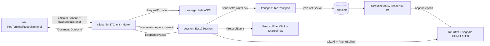
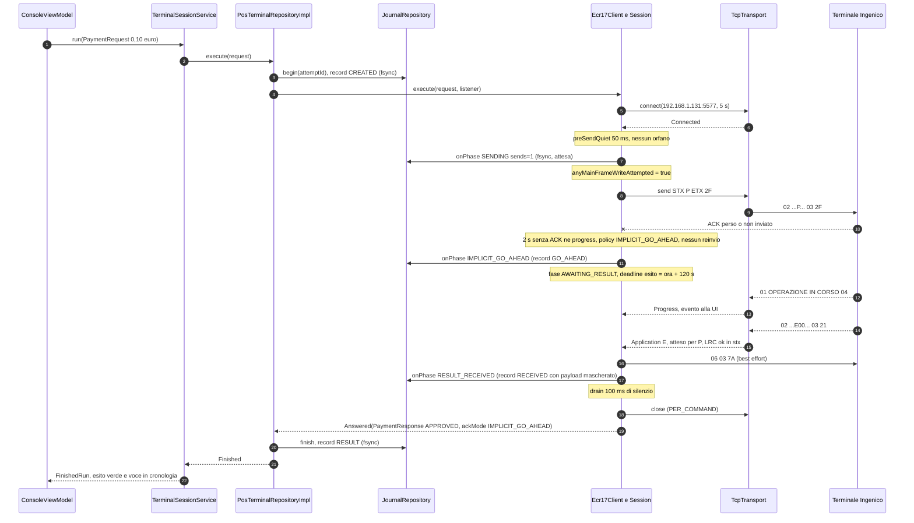
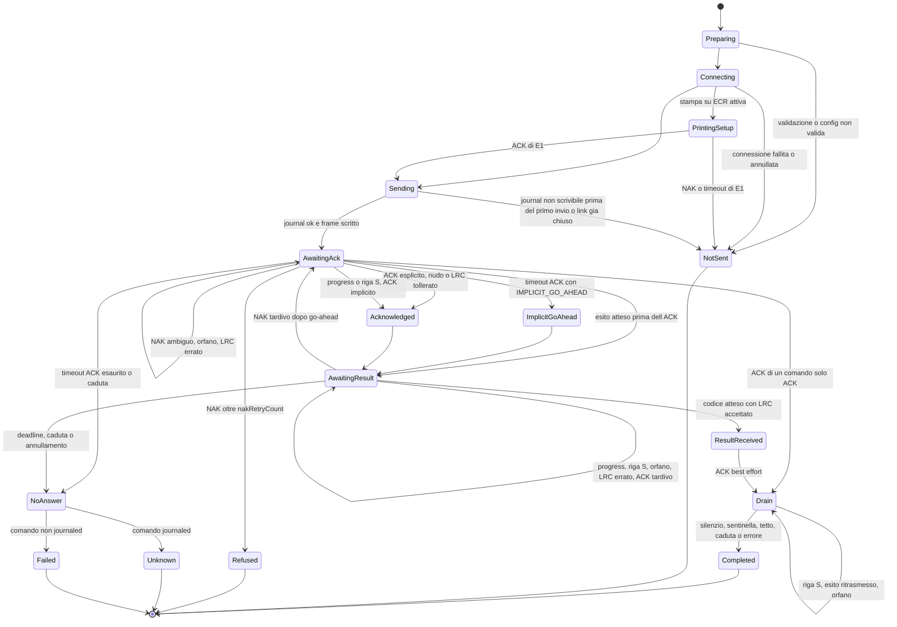
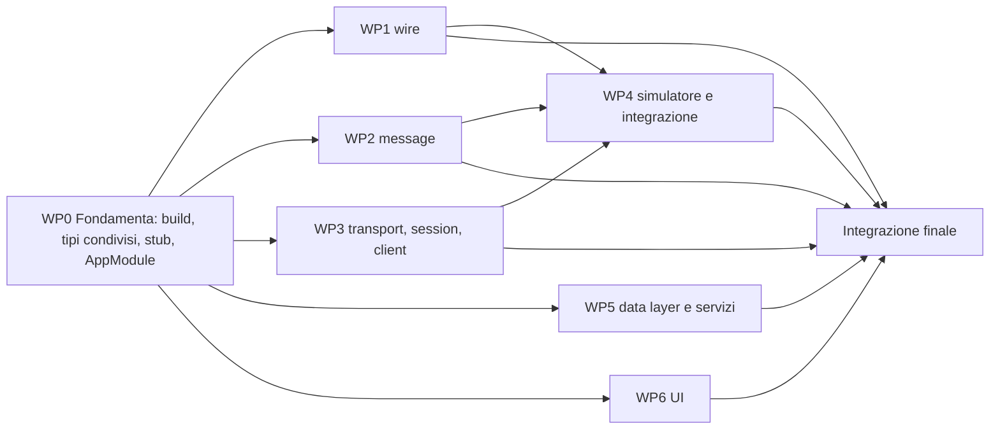

# Protocollo17ComposeDesktop: blueprint di implementazione (DESIGN)

> Redatto il 2026-10-14, **revisione 2** dello stesso giorno (esito della revisione in [Appendice](#appendice-esito-revisione)). È la **fonte unica di verità** per gli implementatori che lavorano in parallelo (§8).
> Le scelte sul comportamento del protocollo derivano da [`ANALISI_REPOSITORY.md`](ANALISI_REPOSITORY.md) (citato come `A§x`) e da [`ANALISI_LARAVEL_ECR17.md`](ANALISI_LARAVEL_ECR17.md) (citato come `L§x`). Dove questo documento e le analisi divergono, vale **questo documento**: le divergenze sono volute e motivate nel testo.
>
> **Regole di lettura**
>
> - Le firme Kotlin nei blocchi di codice sono **vincolanti**: nomi, package, parametri, default e tipi di ritorno. Un implementatore che ha bisogno di cambiare una firma condivisa si ferma e lo segnala nella PR del proprio WP, senza modificarla da solo.
> - Dove compare `// …` il corpo spetta al WP proprietario del file. Dove compare `= TODO("WPn")` si tratta di uno stub creato da WP0.
> - **pos** = posizione 1-based (come la spec), **off** = offset 0-based. Hex maiuscolo nel testo; il log traffico usa il minuscolo della DLL.
> - Prosa in italiano, identificatori in inglese, commenti nel codice in italiano (stile LocalDesktopAi).

---

## Indice

1. [Obiettivi e vincoli](#1-obiettivi-e-vincoli)
2. [Struttura del progetto](#2-struttura-del-progetto)
3. [Protocollo: package `ecr17`](#3-protocollo-package-ecr17)
4. [Simulatore terminale](#4-simulatore-terminale)
5. [Data layer](#5-data-layer)
6. [Presentation](#6-presentation)
7. [Piano di test](#7-piano-di-test)
8. [Work breakdown per l'implementazione parallela](#8-work-breakdown-per-limplementazione-parallela)
9. [Rischi e punti da verificare sul terminale reale](#9-rischi-e-punti-da-verificare-sul-terminale-reale)
10. [Appendice: esito revisione](#appendice-esito-revisione)

---

## 1. Obiettivi e vincoli

### 1.1 Obiettivo

App desktop di **test** (Kotlin, Compose for Desktop, JVM 21, Windows) per terminali POS che parlano il **Protocollo 17 / ECR17 su TCP**. Sostituisce `Protocollo17WpfTest` (WPF + IAE37.dll) con una reimplementazione da zero del protocollo, ispirata ai port padosoft (rust, react-native, laravel) senza copiarne il codice.

L'app deve:

- inviare ogni comando v1 con parametri modificabili e mostrare l'esito decodificato, con valori grezzi e posizioni;
- riprodurre sul filo il comportamento della DLL Ingenico osservato (A§3.6, A§9.8), con ogni scostamento selezionabile dalle opzioni;
- rendere **impossibile** confondere un esito: niente ritrasmissioni cieche di comandi finanziari (salvo scelta esplicita), niente esiti stantii, blocco dei pagamenti con esito sconosciuto;
- registrare tutto: traffico hex in un formato confrontabile con il log della DLL e journal persistente dei tentativi finanziari;
- includere un **simulatore** di terminale, così da poter provare senza hardware.

### 1.2 Decisioni dell'utente (vincolanti)

| # | Decisione | Dove si applica |
|---|---|---|
| U1 | Solo profili **Ingenico** e **CCV**. CCV = clone di Ingenico, marcato **[ASSUMPTION]** finché non c'è una cattura | §3.16 `TerminalProfiles` |
| U2 | Frame applicativi con LRC `stx` (`0x7F^STX^payload^ETX`). ACK in entrambe le direzioni `06 03 7A` (LRC senza STX) | §3.3, §3.4 |
| U3 | LRC dei frame di controllo configurabile a parte: **in uscita** `WIRE` (7A, default) o `SAME_AS_APP` (78 in `stx`); **in ingresso** ETX obbligatorio, LRC diverso tollerato con warning nel log (default) oppure rigido. Applicazione **asimmetrica**: la tolleranza vale per l'ACK; un NAK senza ETX o con LRC di nessuna convenzione è "ambiguo" e non provoca mai un reinvio (§3.7) | §3.4, §3.7 |
| U4 | Switch persistito: **ACK mancante su comando finanziario** → nessuna ritrasmissione, si passa all'attesa dell'esito ("implicit go-ahead", default) oppure ritrasmissione fino a `ackTimeoutRetransmitCount` (default 3) come i repo. Su **NAK esplicito** si ritrasmette fino a `nakRetryCount` (default 3). I due limiti sono separati | §3.16, §3.21 |
| U5 | Switch persistito: **una connessione TCP per comando** (default) oppure connessione persistente | §3.16, §3.23 |
| U6 | Timeout di default: ACK 2 s, esito 120 s, connessione 5 s; drain post-esito 100 ms (1,5 s con stampa scontrino su ECR). Tutti modificabili | §3.16 |
| U7 | Esito sconosciuto (timeout o caduta dopo l'invio di una richiesta finanziaria) ⇒ **pagamenti bloccati** finché l'operatore non esegue `G` o non chiude il tentativo con conferma esplicita. `G` è solo **proposto** (pulsante), mai automatico. Journal persistente di ogni tentativo finanziario | §5.3, §6.8 |
| U8 | Ogni risposta va confrontata con il codice atteso per il comando inviato: un `U` tardivo o un frame stantio **non** deve mai diventare un'approvazione | §3.21 |
| U9 | Perimetro v1: tutti i comandi dei port **tranne** `U` (tokenizzazione) e `K` (VAS). Le operazioni solo-DLL (Refund, RefundExt, VoidR, LetturaCarta, StatoPos, seriale) sono rimandate | §1.3 |
| U10 | Più finestre: principale, Opzioni, Log traffico (hex TX/RX), Journal (più Simulatore) | §6.1 |
| U11 | Layout libero; si riusano aspetto e shell di LocalDesktopAi | §6.2 |
| U12 | **Un solo modulo Gradle**; tutto il codice di protocollo/comunicazione in un sottoalbero con **zero** dipendenze Compose/Koin/UI, estraibile in un modulo separato | §2.8, §2.10 |
| U13 | Package radice `it.prime.protocollo17`; `rootProject.name = "Protocollo17ComposeDesktop"`; versioni allineate a LocalDesktopAi | §2 |
| U14 | File `NOTICE` con i crediti ai repo padosoft, aggiunto alla fine | §8.10 |
| U15 | UI in italiano, identificatori in inglese, commenti come LocalDesktopAi | ovunque |

### 1.3 Perimetro v1: i 13 comandi

| Comando | Cod. | Tipo | Finanziario (blocca su esito sconosciuto) | Risposte attese | Rif. layout |
|---|---|---|---|---|---|
| Stato terminale | `s` | esito | no | `s` | A§4.3.8, A§4.5.6 |
| Pagamento | `P` | esito | **sì** | `E`, `V` | A§4.3.1, A§4.5.1 |
| Pagamento esteso | `X` | esito | **sì** | `E` (92 B), `V` | A§4.3.1, A§4.5.2 |
| Storno | `S` | esito | **sì** | `E` (84 B), `V` | A§4.3.9, A§4.5.2 |
| Preautorizzazione | `p` | esito | **sì** | `e` | A§4.3.1, A§4.5.3 |
| Integrazione preautorizzazione | `i` | esito | **sì** | `i` (75 B) | A§4.3.2, A§4.5.4 |
| Chiusura preautorizzazione | `c` | esito | **sì** | `c` (74 B), `v` (109 B) | A§4.3.2, A§4.5.5 |
| Verifica carta | `H` | esito | no; journal sì, l'esito sconosciuto blocca solo la stessa famiglia di risposta (`P X S H`, §5.8) | `E`, `V` | A§4.3.3, A§4.5.2 |
| Chiusura contabile | `C` | esito | no; journal sì, l'esito sconosciuto blocca solo un nuovo `C` | `C` | A§4.3.4, A§4.5.7 |
| Totali | `T` | esito | no | `T` | A§4.3.4, A§4.5.7 |
| Ultimo esito | `G` | esito | no | `E`, `V`, `e`, `i`, `c`, `v` | A§4.3.5, L§6.5 |
| Stampa su ECR | `E` | solo ACK | no | — | A§4.3.6 |
| Ristampa | `R` | solo ACK (+ righe `S` se verso ECR) | no | — | A§4.3.7 |

### 1.4 Fuori perimetro v1

- `U` (tokenizzazione, dati aggiuntivi verso/dal GT) e `K` (VAS). Se il terminale invia comunque un `U` o un `K`, il frame viene trattato come **risposta inattesa** (ACK + warning, mai esito).
- Refund, RefundExt, VoidR, LetturaCarta, StatoPos, tipi pagamento `6/7/8`, trasporto RS-232.
- Sonda LRC automatica e test "variante ACK" (L§10.6 fase 2): in v1 si fanno a mano cambiando le opzioni e lanciando `s`. Predisposti per v1.1 (§9).
- Installer firmato; `.ico` dell'installer (la finestra usa un'icona vettoriale Material).
- Estrazione del modulo `ecr17` (dopo il collaudo, U12).

### 1.5 Invarianti di money-safety (da rispettare in ogni WP)

| Id | Invariante |
|---|---|
| M1 | Un comando finanziario non viene **mai** ripetuto dopo una caduta, un timeout o un annullamento. Il solo replay ammesso è quello dei comandi `s`, `T`, `G`, `E` dopo una caduta (A§5.3). |
| M2 | Con `IMPLICIT_GO_AHEAD` un frame finanziario viene inviato **una volta** se manca l'ACK. Ritrasmissioni solo su NAK esplicito e valido (con ETX e LRC di una delle due convenzioni), fino a `nakRetryCount`. Un progress, una riga `S` o l'esito atteso valgono come ACK implicito: dopo uno di questi **nessun** reinvio, in nessuna modalità. |
| M3 | Il journal registra il tentativo (`CREATED`) prima della connessione e la fase `SENDING` **prima di ogni scrittura** del frame finanziario, con `fsync`. Se il journal non è scrivibile **prima del primo invio**, il comando **non** parte (`NotSent(Internal)`). Dopo il primo invio un errore del journal non interrompe lo scambio (warning `JOURNAL_WRITE_FAILED`) e il tentativo resta bloccante in memoria (§5.3.3). |
| M4 | Un frame applicativo diventa esito solo se il suo codice (pos 10) è tra quelli attesi per il comando inviato. Tutto il resto riceve ACK, viene registrato come orfano e non è mai restituito; un orfano della famiglia degli esiti (`E V e i c v`) diventa anche prova (`EVIDENCE`) per l'ultimo tentativo non risolto. |
| M5 | ACK finale, NAK e drain sono *best effort*: un errore di invio non trasforma mai un esito già decodificato in un errore (A§8 D2/D3). |
| M6 | Esito sconosciuto ⇒ fase `UNKNOWN` nel journal ⇒ comandi non ripetibili bloccati finché l'operatore non risolve. `G` è sempre un'azione dell'operatore. Lo stesso blocco vale per un esito ricevuto ma **da verificare** (possibile doppio addebito, esito prima dell'ACK). |
| M7 | Un solo comando alla volta: `Mutex` nel client più controllo nel servizio applicativo. Un secondo comando viene **rifiutato**, mai accodato. |
| M8 | Nessun timeout esterno più corto della sessione attorno a un comando: niente `withTimeout` nella UI o nei repository (L§6.5 punto 7). |
| M9 | Il PAN è mascherato ovunque esca dal parser: log traffico (anche byte scartati), journal, UI, eventi, righe di scontrino e log del simulatore (A§11 punto 17). |
| M10 | Lo stato "scrittura del frame principale tentata" è **appiccicoso**: impostato prima della prima `transport.send` e mai azzerato. Dopo di esso nessuna eccezione, cancellazione o errore del journal produce `NotSent`: l'esito è `Answered`, `Refused`, `Unknown` o `Failed`. |

---

## 2. Struttura del progetto

### 2.1 Albero delle cartelle

```
Protocollo17ComposeDesktop/
├── settings.gradle.kts
├── build.gradle.kts
├── gradle.properties
├── gradle/
│   ├── libs.versions.toml
│   └── wrapper/gradle-wrapper.jar, gradle-wrapper.properties   (copiati da LocalDesktopAi)
├── gradlew, gradlew.bat                                         (copiati da LocalDesktopAi)
├── CLAUDE.md                                                    (WP0; aggiornato in integrazione, §8.10)
├── NOTICE                                                       (§8.10)
├── docs/ ANALISI_REPOSITORY.md, ANALISI_LARAVEL_ECR17.md, DESIGN.md
└── src/
    ├── main/kotlin/it/prime/protocollo17/      (§2.8)
    ├── main/resources/logback.xml, app-version.properties (§2.5)
    ├── main/packaging/icon.ico                 (icona dell'installer, §2.5)
    └── test/kotlin/it/prime/protocollo17/      (§2.9)
```

### 2.2 `settings.gradle.kts`

```kotlin
pluginManagement {
    repositories {
        gradlePluginPortal()
        mavenCentral()
        google()
        maven("https://maven.pkg.jetbrains.space/public/p/compose/dev")
    }
}

dependencyResolutionManagement {
    @Suppress("UnstableApiUsage")
    repositoriesMode.set(RepositoriesMode.PREFER_SETTINGS)
    @Suppress("UnstableApiUsage")
    repositories {
        mavenCentral()
        google()
        maven("https://maven.pkg.jetbrains.space/public/p/compose/dev")
    }
}

// Nota: niente punti nel rootProject.name (Gradle non li ama nei build path).
rootProject.name = "Protocollo17ComposeDesktop"
```

### 2.3 `gradle.properties`

```properties
kotlin.code.style=official
org.gradle.jvmargs=-Xmx3072M -Dfile.encoding=UTF-8
org.gradle.parallel=true
org.gradle.caching=true
# OOM fix: il plugin del compilatore Compose esauriva la memoria durante l'IR lowering
# ("Backend Internal error" su un file a caso)
kotlin.daemon.jvmargs=-Xmx4096M
```

### 2.4 `gradle/libs.versions.toml`

```toml
[versions]
kotlin = "2.1.10"
compose-plugin = "1.8.2"
koin = "3.5.6"
koin-compose = "1.1.5"
voyager = "1.1.0-beta03"
kotlinx-coroutines = "1.10.1"
kotlinx-serialization = "1.7.3"
logback = "1.5.12"
junit5 = "5.11.3"
mockk = "1.13.13"
turbine = "1.2.0"

[libraries]
# Voyager (navigazione + ScreenModel)
voyager-navigator = { module = "cafe.adriel.voyager:voyager-navigator", version.ref = "voyager" }
voyager-screenmodel = { module = "cafe.adriel.voyager:voyager-screenmodel", version.ref = "voyager" }
voyager-koin = { module = "cafe.adriel.voyager:voyager-koin", version.ref = "voyager" }

# Koin DI
koin-core = { module = "io.insert-koin:koin-core", version.ref = "koin" }
koin-compose = { module = "io.insert-koin:koin-compose", version.ref = "koin-compose" }

# Coroutines + Serialization
kotlinx-coroutines-core = { module = "org.jetbrains.kotlinx:kotlinx-coroutines-core", version.ref = "kotlinx-coroutines" }
kotlinx-coroutines-swing = { module = "org.jetbrains.kotlinx:kotlinx-coroutines-swing", version.ref = "kotlinx-coroutines" }
kotlinx-coroutines-test = { module = "org.jetbrains.kotlinx:kotlinx-coroutines-test", version.ref = "kotlinx-coroutines" }
kotlinx-serialization-json = { module = "org.jetbrains.kotlinx:kotlinx-serialization-json", version.ref = "kotlinx-serialization" }

# Logging
logback-classic = { module = "ch.qos.logback:logback-classic", version.ref = "logback" }

# Testing
junit-jupiter = { module = "org.junit.jupiter:junit-jupiter", version.ref = "junit5" }
# Version-less: allineato a junit-jupiter dal BOM. Esplicito per la deprecation di Gradle 9.
junit-platform-launcher = { module = "org.junit.platform:junit-platform-launcher" }
mockk = { module = "io.mockk:mockk", version.ref = "mockk" }
turbine = { module = "app.cash.turbine:turbine", version.ref = "turbine" }

[plugins]
kotlin-jvm = { id = "org.jetbrains.kotlin.jvm", version.ref = "kotlin" }
kotlin-serialization = { id = "org.jetbrains.kotlin.plugin.serialization", version.ref = "kotlin" }
kotlin-compose = { id = "org.jetbrains.kotlin.plugin.compose", version.ref = "kotlin" }
compose = { id = "org.jetbrains.compose", version.ref = "compose-plugin" }
```

### 2.5 `build.gradle.kts`

```kotlin
import org.jetbrains.compose.desktop.application.dsl.TargetFormat

plugins {
    alias(libs.plugins.kotlin.jvm)
    alias(libs.plugins.kotlin.serialization)
    alias(libs.plugins.kotlin.compose)
    alias(libs.plugins.compose)
}

group = "it.prime"
// Unica fonte della versione: ne derivano packageVersion e app-version.properties (Aiuto > Informazioni).
version = "1.0.0"

kotlin {
    jvmToolchain(21)
}

dependencies {
    // Compose Desktop
    implementation(compose.desktop.currentOs)
    implementation(compose.material3)
    implementation(compose.materialIconsExtended)

    // Voyager
    implementation(libs.voyager.navigator)
    implementation(libs.voyager.screenmodel)
    implementation(libs.voyager.koin)

    // Koin DI
    implementation(libs.koin.core)
    implementation(libs.koin.compose)

    // Serialization (settings, journal) + Coroutines
    implementation(libs.kotlinx.serialization.json)
    implementation(libs.kotlinx.coroutines.core)
    implementation(libs.kotlinx.coroutines.swing)

    // Logging
    implementation(libs.logback.classic)

    // Testing
    testImplementation(libs.junit.jupiter)
    testImplementation(libs.mockk)
    testImplementation(libs.turbine)
    testImplementation(libs.kotlinx.coroutines.test)
    // Esplicito: silenzia la deprecation "automatic loading of test framework" (errore in Gradle 9)
    testRuntimeOnly(libs.junit.platform.launcher)
}

tasks.processResources {
    // Prima la versione mostrata dall'app era una costante in MainWindow e poteva divergere dal pacchetto.
    val appVersion = project.version.toString()
    inputs.property("appVersion", appVersion)
    filesMatching("app-version.properties") { expand("version" to appVersion) }
}

tasks.test {
    useJUnitPlatform {
        // I test contro un terminale reale partono solo con -PrealTerminal (vedi §7.10)
        if (!project.hasProperty("realTerminal")) excludeTags("real-terminal")
    }
    // AppVersionTest confronta la risorsa generata con la versione di Gradle.
    systemProperty("app.version", project.version.toString())
}

compose.desktop {
    application {
        mainClass = "it.prime.protocollo17.MainKt"
        // Senza, `run` usa la JVM di `org.gradle.java.home` del gradle.properties GLOBALE
        // (una 17 su questo PC): l'app compilata per la 21 morirebbe all'avvio senza log.
        javaHome = javaToolchains.launcherFor {
            languageVersion.set(JavaLanguageVersion.of(21))
        }.get().metadata.installationPath.asFile.absolutePath
        nativeDistributions {
            // Da `.\gradlew.bat suggestModules` (2026-10-16); rieseguirlo quando cambiano le dipendenze.
            modules("java.instrument", "jdk.unsupported")
            targetFormats(TargetFormat.Msi, TargetFormat.Exe)
            packageName = "Protocollo17ComposeDesktop"
            packageVersion = project.version.toString()   // MSI rifiuta MAJOR = 0
            description = "Test app Protocollo 17 (ECR17) per terminali Ingenico/CCV"
            vendor = "Prime Software"
            windows {
                menuGroup = "Protocollo17"
                upgradeUuid = "0e99d6a1-1ceb-4d07-8b01-6d9f27d4a11b"   // fisso per sempre
                // Prima l'installer usava l'icona di default di Compose. Stesso disegno di rememberAppIcon() (§6.1),
                // renderizzato una volta a 16/32/48/256 px: se cambia AppIcon.kt va rigenerato.
                iconFile.set(project.file("src/main/packaging/icon.ico"))
            }
        }
    }
}
```

`src/main/packaging/icon.ico` (committato) è l'icona di MSI, EXE, collegamenti e *Impostazioni > App*: lo stesso disegno di `rememberAppIcon()` (§6.1) renderizzato con `ImageComposeScene` a 16, 32 e 48 px (BMP 32 bit con alfa) e a 256 px (PNG). È stato generato una volta sola da un test temporaneo non committato; se cambia `AppIcon.kt` va rigenerato allo stesso modo.

Comandi (riportati in `CLAUDE.md`): `.\gradlew.bat compileKotlin`, `.\gradlew.bat test`, `.\gradlew.bat run`, `.\gradlew.bat packageDistributionForCurrentOS` (MSI ed EXE in `build/compose/binaries/main/{msi,exe}`), `.\gradlew.bat suggestModules`. Per i test di rete o contro terminale reale: `--no-build-cache cleanTest test` (le variabili d'ambiente non sono input del task).

### 2.6 Gradle wrapper

Copiare da `D:/LLM/DesktopApp/LocalDesktopAi`: `gradlew`, `gradlew.bat`, `gradle/wrapper/gradle-wrapper.jar`, `gradle/wrapper/gradle-wrapper.properties` (`distributionUrl=https\://services.gradle.org/distributions/gradle-8.10.1-bin.zip`, già in cache in `~/.gradle/wrapper/dists`). Il JDK 21 (`C:/Program Files/Eclipse Adoptium/jdk-21.0.6.7-hotspot`) viene trovato dall'auto-detection del toolchain.

### 2.7 `src/main/resources/logback.xml`

```xml
<configuration>
    <!-- Cartella dati: ~/.protocollo17, come AppDirs (§5.1), LocalDesktopAi e skill data-layer -->
    <property name="APP_HOME" value="${user.home}/.protocollo17" />
    <property name="LOG_DIR" value="${APP_HOME}/logs" />
    <property name="LOG_FILE" value="${LOG_DIR}/app.log" />

    <appender name="CONSOLE" class="ch.qos.logback.core.ConsoleAppender">
        <encoder><pattern>%date{HH:mm:ss.SSS} [%thread] %-5level %logger{32} - %msg%n</pattern></encoder>
    </appender>

    <appender name="FILE" class="ch.qos.logback.core.rolling.RollingFileAppender">
        <file>${LOG_FILE}</file>
        <rollingPolicy class="ch.qos.logback.core.rolling.SizeAndTimeBasedRollingPolicy">
            <fileNamePattern>${LOG_DIR}/app-%d{yyyy-MM-dd}.%i.log.gz</fileNamePattern>
            <maxFileSize>10MB</maxFileSize>
            <maxHistory>14</maxHistory>
            <totalSizeCap>200MB</totalSizeCap>
            <cleanHistoryOnStart>true</cleanHistoryOnStart>
        </rollingPolicy>
        <encoder><pattern>%date{yyyy-MM-dd HH:mm:ss.SSS} [%thread] %-5level %logger{40} - %msg%n</pattern></encoder>
    </appender>

    <logger name="it.prime.protocollo17" level="DEBUG" />
    <root level="INFO">
        <appender-ref ref="CONSOLE" />
        <appender-ref ref="FILE" />
    </root>
</configuration>
```

Nota: il percorso è sempre `~/.protocollo17/logs` (`C:\Users\<utente>\.protocollo17\logs`). `AppDirs.default()` (§5.1) usa **la stessa** radice, senza varianti per variabile d'ambiente: un solo posto da cercare quando si chiede un log. La scelta segue LocalDesktopAi (`~/.localdesktopai`) e la skill data-layer (`~/.myapp/`); `%APPDATA%` proposto in A§12.6 non porta vantaggi per un'app di test non roaming. Il log traffico hex **non** passa da logback (file dedicato, §5.4).

### 2.8 Albero dei package (main)

Legenda proprietari: `[WP0]` file completo scritto da WP0; `[WP0→WPn]` stub di WP0 implementato da WPn; `[WPn]` file creato da WPn; `[§8.10]` file aggiunto nell'integrazione finale.

```
it/prime/protocollo17/
├── Main.kt                                   [WP0→WP6]
├── di/AppModule.kt                           [WP0]  (modifiche successive solo in integrazione, §8.10)
│
├── ecr17/                                    ← PURO: solo stdlib, JDK, kotlinx-coroutines-core
│   ├── wire/
│   │   ├── ControlChars.kt                   [WP0]
│   │   ├── LrcMode.kt                        [WP0]
│   │   ├── ControlLrcRule.kt                 [WP0]
│   │   ├── WireFrame.kt                      [WP0]  WireFrame, SplitItem, ControlLrcMatch, AppLrcCheck
│   │   ├── FrameCodec.kt                     [WP0→WP1]
│   │   ├── FrameSplitter.kt                  [WP0→WP1]
│   │   ├── Hex.kt                            [WP0→WP1]
│   │   └── PanMasker.kt                      [WP0→WP1]
│   ├── model/
│   │   ├── CommandCode.kt                    [WP0]
│   │   ├── Requests.kt                       [WP0]
│   │   ├── Responses.kt                      [WP0]
│   │   ├── LinkState.kt                      [WP0]
│   │   └── Outcome.kt                        [WP0]
│   ├── error/Ecr17Failure.kt                 [WP0]
│   ├── event/
│   │   ├── ProtocolEvent.kt                  [WP0]
│   │   └── ExchangeListener.kt               [WP0]
│   ├── profile/
│   │   ├── ProtocolOptions.kt                [WP0]
│   │   └── TerminalProfile.kt                [WP0]
│   ├── message/
│   │   ├── AsciiFields.kt                    [WP2]
│   │   ├── RequestEncoder.kt                 [WP0→WP2]
│   │   └── ResponseParser.kt                 [WP0→WP2]
│   ├── transport/
│   │   ├── Ecr17Transport.kt                 [WP0]  + TransportException, TransportErrorKind
│   │   ├── RxBuffer.kt                       [WP0]
│   │   └── TcpTransport.kt                   [WP0→WP3]
│   ├── session/
│   │   ├── ExchangeSpec.kt                   [WP3]  (internal) ExchangeSpec + ExchangeResult
│   │   ├── SessionSupport.kt                 [WP3]  (internal) EventEmitter, CancelToken
│   │   ├── TraceRecorder.kt                  [WP3]  (internal)
│   │   ├── Ecr17Session.kt                   [WP3]  (internal)
│   │   └── RetryPolicy.kt                    [WP3]
│   ├── client/Ecr17Client.kt                 [WP0→WP3]
│   └── sim/
│       ├── SimulatorConfig.kt                [WP0]  SimDecision, SimFault, SimulatorConfig, SimEvent, SimState (tipi completi)
│       ├── TerminalSimulator.kt              [WP0→WP4]
│       ├── SimResponder.kt                   [WP4]  (internal: costruzione delle risposte)
│       └── SimConnection.kt                  [WP4]  (internal: una connessione)
│
├── domain/
│   ├── model/settings/AppSettings.kt         [WP0]  AppSettings + DTO annidati (ProtocolSettings…)
│   ├── model/settings/OptionKey.kt           [WP0]
│   ├── model/journal/Journal.kt              [WP0]  JournalPhase, JournalRecord, JournalEntry, ResolutionKind, KnownResult
│   ├── model/traffic/TrafficEntry.kt         [WP0]
│   ├── model/command/CommandProgress.kt      [WP0]
│   ├── model/command/CommandTitles.kt        [WP0]  titoli italiani e flag "danger" per CommandCode
│   ├── model/command/FieldKey.kt             [WP0]
│   ├── model/command/ConfigResolution.kt     [WP0]
│   ├── model/simulator/SimulatorModels.kt    [WP0]  SimLogEntry, SimStats, SimulatorStatus, SimulatorFailure
│   ├── model/simulator/SimCatalog.kt         [WP0]  nomi + etichette + descrizioni di guasti/decisioni/regole
│   ├── repository/PosTerminalRepository.kt   [WP0]
│   ├── repository/JournalRepository.kt       [WP0]
│   ├── repository/TrafficRepository.kt       [WP0]
│   ├── repository/SimulatorController.kt     [WP0]
│   └── util/
│       ├── Money.kt                          [WP0]  formatCents(): l'unico formattatore di importi
│       ├── ConfigResolver.kt                 [WP0→WP5]  (+ OptionRanges)
│       ├── RequestFactory.kt                 [WP6]
│       ├── AmountParser.kt                   [WP6]
│       ├── PaymentBlockPolicy.kt             [WP0→WP5]
│       └── GAssessment.kt                    [WP6]
│
├── data/
│   ├── local/AppDirs.kt                      [WP0]
│   ├── local/settings/SettingsRepository.kt  [WP0→WP5]
│   ├── local/journal/JournalStore.kt         [WP0→WP5]  (stub perché AppModule lo costruisce)
│   ├── local/traffic/TrafficRecorder.kt      [WP0→WP5]
│   ├── local/traffic/TrafficFormatter.kt     [WP5]
│   ├── local/simulator/SimulatorControllerImpl.kt [WP0→WP5]
│   ├── local/system/SingleInstanceGuard.kt   [WP0→WP5]
│   ├── local/system/ShutdownWatchdog.kt      [WP0→WP5]
│   ├── mapper/JournalMapper.kt               [WP5]
│   ├── mapper/SimulatorConfigMapper.kt       [WP5]
│   ├── repository/PosTerminalRepositoryImpl.kt [WP0→WP5]
│   └── repository/JournalRepositoryImpl.kt   [WP0→WP5]
│
└── presentation/
    ├── state/                                ← nessun import androidx.* / org.jetbrains.compose.* (§2.10)
    │   ├── AppWindowId.kt                    [WP0]
    │   ├── AppNotifications.kt               [WP0]
    │   ├── ShortcutBus.kt                    [WP0]
    │   ├── CommandRunner.kt                  [WP0]  interfaccia + stato
    │   ├── CloseGuard.kt                     [WP0]  closeNeedsConfirmation(state): pura
    │   ├── TerminalSessionService.kt         [WP0→WP5]  implementa CommandRunner
    │   └── AppWindows.kt                     [WP0→WP6]
    ├── theme/  Color.kt, Type.kt, Shapes.kt, Theme.kt, SemanticColors.kt, PreviewTheme.kt          [WP6]
    ├── model/  ResultView.kt, ResultViewMapper.kt, FieldLabels.kt, AttemptTexts.kt
    │           (condivisi: Console, Journal, dialog; AttemptTexts = testi di un tentativo del journal)      [WP6]
    ├── components/  Scrollbars.kt, TooltipIconButton.kt, CopyIconButton.kt, SectionLabel.kt,
    │                StatusDot.kt, CommandLetterChip.kt, KeyValueTable.kt, SettingsCard.kt,
    │                SwitchRow.kt, EnumDropdown.kt, NumberTextField.kt, ResolveAttemptDialog.kt,
    │                AppSnackbar.kt (NoticeTone e snackbar con icona e colore del tono)            [WP6]
    ├── util/  ObserveAsEvents.kt, StopOnEscape.kt, DisposeSafely.kt, FilePickers.kt,
    │          Formatters.kt, DesktopActions.kt, WindowGeometrySupport.kt, GeometryRules.kt,
    │          AppIcon.kt                                                                          [WP6]
    │          FailureMessages.kt                                                             [WP0→WP6]
    │          AppVersion.kt (versione da app-version.properties, §2.5)                         [§8.10]
    ├── windows/  MainWindow.kt, SecondaryWindows.kt, OptionsWindow.kt, TrafficLogWindow.kt,
    │             JournalWindow.kt, SimulatorWindow.kt                                             [WP6]
    └── screen/
        ├── main/MainScreen.kt                                                                     [WP6]
        ├── console/
        │   ├── model/  CommandCatalog.kt                                                          [WP6]
        │   ├── viewModel/ConsoleContract.kt                                                       [WP6]
        │   ├── viewModel/ConsoleViewModel.kt                                                      [WP0→WP6]
        │   └── view/  ConsoleScreenRoot.kt, ConsoleScreen.kt, components/{ConnectionHeader,
        │              CommandSidebar, CommandFormCard, ResultPanel, HistoryPanel, BusyOverlay,
        │              UnresolvedBanner, ConsoleDialogs}.kt                                         [WP6]
        ├── options/   viewModel/{OptionsContract.kt [WP6], OptionsViewModel.kt [WP0→WP6]}, view/…  [WP6]
        ├── traffic/   viewModel/{TrafficLogContract.kt, TrafficLogViewModel.kt [WP0→WP6]}, view/… [WP6]
        ├── journal/   viewModel/{JournalContract.kt, JournalViewModel.kt [WP0→WP6]}, view/…       [WP6]
        └── simulator/ viewModel/{SimulatorContract.kt, SimulatorViewModel.kt [WP0→WP6]}, view/…   [WP6]
```

### 2.9 Albero dei test

Rispecchia i package di main (`src/test/kotlin/it/prime/protocollo17/…`):

```
architecture/   Ecr17IsolationTest.kt, PresentationBoundaryTest.kt,
                SourceImports.kt (sorgenti e import letti dai due test)                    [WP0]
ecr17/testing/  Frames.kt (costanti byte comuni: SOLO costanti e LrcMode.compute)          [WP0]
ecr17/testing/  ScriptedTransport.kt                                                       [WP3]
ecr17/wire/     LrcModeTest, ControlLrcRuleTest, FrameCodecTest, FrameSplitterTest,
                HexTest, PanMaskerTest                                                     [WP1]
ecr17/message/  RequestEncoderTest, ResponseParserTest, ReceiptLineTest, IngenicoCaptureTest [WP2]
ecr17/transport/RxBufferTest [WP0], TcpTransportTest [WP3]
ecr17/session/  Ecr17SessionTest, RetryPolicyTest                                          [WP3]
ecr17/client/   Ecr17ClientTest, RealTerminalTest (@Tag real-terminal)                     [WP3]
ecr17/sim/      SimResponderTest, TerminalSimulatorLifecycleTest, SimulatorIntegrationTest [WP4]
domain/util/    ConfigResolverTest, PaymentBlockPolicyTest                                 [WP5]
domain/model/   SimCatalogTest (nomi allineati agli enum di ecr17.sim)                     [WP5]
domain/util/    AmountParserTest, RequestFactoryTest, GAssessmentTest                      [WP6]
data/…          SettingsRepositoryTest, JournalStoreTest, JournalRepositoryImplTest,
                JournalMapperTest, TrafficFormatterTest, TrafficRecorderTest,
                PosTerminalRepositoryImplTest, SimulatorConfigMapperTest,
                SimulatorControllerImplTest, SingleInstanceGuardTest, ShutdownWatchdogTest [WP5]
data/testing/   FakeJournalRepository.kt, OutcomeFixtures.kt                               [WP5]
presentation/state/ TerminalSessionServiceTest                                             [WP5]
presentation/state/ CloseGuardTest                                                         [WP0]
integration/    UnknownRecoveryIntegrationTest (simulatore + servizio + journal reale)    [WP5]
presentation/   ScreenModelTestSupport.kt, FakeCommandRunner.kt, UiFixtures.kt,
                StubFallbacks.kt (ponte verso gli stub degli altri WP, inerte dopo il merge),
                ScreenRenderSmokeTest (schermate composte alla dimensione minima),
                console/ConsoleViewModelTest, model/ResultViewMapperTest,
                options/OptionsViewModelTest, traffic/TrafficLogViewModelTest,
                journal/JournalViewModelTest, simulator/SimulatorViewModelTest,
                state/AppWindowsTest, util/GeometryRulesTest, util/FailureMessagesTest     [WP6]
presentation/util/ AppVersionTest (versione della risorsa = version di Gradle)            [§8.10]
```

`Frames.kt` è di WP0 perché lo usano i test di WP1 (`PanMaskerTest`), WP2 (`ResponseParserTest`), WP3 e WP4: contiene solo costanti e `app()` costruito con `LrcMode.compute` (WP0), mai `Hex.parse` (stub WP1).

### 2.10 Regole di dipendenza

| Package | Può importare | Non può importare |
|---|---|---|
| `ecr17.**` | `kotlin.*`, `java.*` (JDK), `kotlinx.coroutines.*` (core) | `androidx.*`, `org.jetbrains.compose.*`, `org.koin.*`, `cafe.adriel.*`, `java.awt.*`, `javax.swing.*`, `kotlinx.coroutines.swing.*`, `kotlinx.serialization.*`, `org.slf4j.*`, `ch.qos.*`, `it.prime.protocollo17.(domain\|data\|presentation\|di)`; nessun uso di `Dispatchers.Main` |
| `domain.**` | stdlib, `kotlinx.serialization`, `kotlinx.coroutines` core, `ecr17.(model\|profile\|error\|event)`, i due enum `ecr17.wire.LrcMode` e `ecr17.wire.ControlLrcRule` (tipi valore delle opzioni), gli oggetti senza stato `ecr17.wire.Hex` e `ecr17.message.RequestEncoder` (unica fonte delle regole di validazione, usata da `RequestFactory`) | Compose, Koin, Voyager, `data`, `presentation`, il resto di `ecr17.wire` e di `ecr17.message`, `ecr17.(transport\|session\|client\|sim)` |
| `data.**` | `domain`, tutto `ecr17`, slf4j, kotlinx.serialization | `presentation`, Compose, Voyager |
| `presentation.**` | `domain`, `ecr17.(model\|profile\|error\|event)`, `ecr17.wire.LrcMode`, `ecr17.wire.ControlLrcRule`, `ecr17.wire.Hex`, Compose, Voyager, Koin; `data.local.settings.SettingsRepository` e `data.local.AppDirs` (classi locali concrete, scorciatoia tollerata dalla skill) | il resto di `ecr17.wire`, `ecr17.(message\|transport\|session\|client\|sim)`, `data.repository.*`, `data.local.(journal\|traffic\|simulator\|system)` |
| `presentation.state.**` | come `presentation`, **senza** Compose | `androidx.*`, `org.jetbrains.compose.*` (i servizi app-scoped sono testabili senza UI) |
| `di` | tutto | — |
| `Main.kt` | tutto | — (è l'unico a vedere `ShutdownWatchdog`: `MainWindow` riceve una lambda, §6.18) |

`ecr17` non usa slf4j: tutta la diagnostica esce come `ProtocolEvent` (§3.19) e il data layer la scrive su file/logback. Così l'estrazione futura del modulo non trascina dipendenze.

**Dispatcher** (vincolante): `Ecr17Client` e `Ecr17Session` girano sul dispatcher del chiamante e non cambiano mai dispatcher; solo `TcpTransport` usa il proprio scope su `Dispatchers.IO`. Così i test con tempo virtuale (§7.1) restano deterministici: un solo `withContext(Dispatchers.IO)` nel client farebbe usare a `withTimeoutOrNull` il tempo reale e i test attenderebbero 120 s.

**Test architetturali** (WP0, stile `SelectionSafeImportsTest` di LocalDesktopAi): `File("src/main/kotlin/it/prime/protocollo17/<pkg>").walkTopDown()` sui `.kt`, regex `^import\s+([\w.]+)` e asserzioni con messaggio che elenca file e import colpevoli.

- `Ecr17IsolationTest`: applica la prima riga della tabella, più due controlli testuali: nessun `Dispatchers.Main` in `ecr17/**`; nessun `Dispatchers.IO` in `ecr17/client/**` e `ecr17/session/**`.
- `PresentationBoundaryTest`: applica le righe `presentation`, `presentation.state` e `domain` (per `ecr17.wire` e `ecr17.message` ammette solo gli import nominati esplicitamente nella tabella).

### 2.11 Cartella dati utente

`AppDirs.default()` (§5.1): `~/.protocollo17/` (motivazione in §2.7).

```
.protocollo17/
├── settings.json            impostazioni (§5.2)
├── settings.json.broken-*   copie dei file illeggibili, mai sovrascritti
├── app.lock                 SingleInstanceGuard
├── journal/journal.jsonl    journal dei tentativi (§5.3) + journal.jsonl.bak (ultima compattazione)
├── traffic/2026_10_14-p17-traffic.txt   log hex giornaliero (§5.4)
└── logs/app.log             logback
```

### 2.12 Convenzioni di codice

- Identificatori in inglese; stringhe UI e commenti in italiano; KDoc su ogni classe pubblica che spiega il **perché** (stile "Prima… ora…" quando c'è una storia).
- Separatori `// ─── Titolo ───────` nei file lunghi.
- Byte senza segno: sempre `b.toInt() and 0xFF`. Mai `String(bytes)` senza charset: in ingresso `Charsets.ISO_8859_1`, in uscita `Charsets.US_ASCII` dopo validazione.
- `CancellationException` sempre rilanciata per prima; `runCatching` vietato attorno a codice `suspend`.
- Attese con deadline: `withTimeoutOrNull`, **mai** `withTimeout` dentro un `try/catch (CancellationException)`: `withTimeout` lancia `TimeoutCancellationException`, che è una `CancellationException`, e un timeout dell'ACK verrebbe rilanciato come annullamento invece di essere gestito come timeout.
- Ogni file con composable termina con un `@Suppress("unused") @Preview @Composable private fun XPreview() { PreviewTheme { … } }` (`androidx.compose.desktop.ui.tooling.preview.Preview`) che mostra gli stati significativi (inattivo, occupato, esito sconosciuto, errore, testo lungo), come LocalDesktopAi.
- Named arguments per chiamate con più di due parametri. `internal` per i tipi di sessione non esposti.
- Dopo ogni modifica significativa: `.\gradlew.bat compileKotlin` e `.\gradlew.bat test`, con l'esito riportato nel riepilogo.

---

## 3. Protocollo: package `ecr17`

Package radice: `it.prime.protocollo17.ecr17`. Nessuna dipendenza da UI, DI o logging (§2.10).

### 3.1 Panoramica e concorrenza



- Un solo lettore del socket: la coroutine `ecr17-reader` (blocking `read` su `Dispatchers.IO`). Nessuno, nemmeno un probe, legge o scrive per controllare la connessione (A§5.6, A§11 punti 5-6).
- Lo stato del collegamento deriva dal lettore (EOF/IOException ⇒ `LinkState.Closed`), mai da un flag azzerato per transazione (A§8 D13).
- La sessione non riceve mai byte da un `Channel` (rischio di perdita con la cancellazione pronta): legge dall'`RxBuffer` e aspetta solo un **segnale** conflated, la cui perdita è innocua (A§12.4).
- Tutti i tempi passano da un `TimeSource.WithComparableMarks` iniettato (test con tempo virtuale) e da un `wallClock: () -> Long` per i timestamp degli eventi.
- Client e sessione girano sul dispatcher del chiamante (il repository usa `flowOn(Dispatchers.IO)`); solo `TcpTransport` ha un proprio scope IO (regola vincolante in §2.10).

### 3.2 `wire/ControlChars.kt` [WP0]

```kotlin
package it.prime.protocollo17.ecr17.wire

/** Caratteri di controllo ECR17 (A§3.1). Valori Int 0..255, mai Byte con segno. */
object ControlChars {
    const val SOH = 0x01
    const val STX = 0x02
    const val ETX = 0x03
    const val EOT = 0x04
    const val ACK = 0x06
    const val NAK = 0x15
    const val ESC = 0x1B              // separatore TAG / fine scontrino
    const val LRC_BASE = 0x7F
    const val RECEIPT_NEWLINE = 0x7D  // dentro le righe S: a capo + reset
    const val RECEIPT_DOUBLE = 0x7F   // dentro le righe S: doppia altezza grassetto
    const val ZERO = 0x30             // riempitivo '0'
    const val PROGRESS_TEXT_LENGTH = 20

    /** Nome simbolico per il log ("STX", "ACK"…), null se non è un carattere di controllo noto. */
    fun nameOf(b: Int): String? = when (b and 0xFF) {
        SOH -> "SOH"; STX -> "STX"; ETX -> "ETX"; EOT -> "EOT"; ACK -> "ACK"; NAK -> "NAK"; ESC -> "ESC"
        else -> null
    }
}
```

### 3.3 `wire/LrcMode.kt` [WP0]

**Convenzione dei nomi.** Si mantengono i valori serializzati dei repo (`"std"`, `"stx"`, `"noext"`, `"stx_noext"`, A§3.3), ma la semantica è espressa da due booleani: `foldStx` = lo STX entra nello XOR, `foldEtx` = l'ETX entra nello XOR. Il nome `noext` inganna: significa "**no STX, con ETX**". Tabella vincolante:

| Enum | `wireName` | `foldStx` | `foldEtx` | Relazione con `std` | `"A"` → |
|---|---|---|---|---|---|
| `STD` | `std` | no | no | `std` | `3E` |
| `STX` | `stx` | **sì** | **sì** | `std ^ 0x01` | `3F` |
| `NOEXT` | `noext` | no | sì | `std ^ 0x03` | `3D` |
| `STX_NOEXT` | `stx_noext` | sì | no | `std ^ 0x02` | `3C` |

```kotlin
package it.prime.protocollo17.ecr17.wire

/**
 * Modalità di calcolo dell'LRC dei frame APPLICATIVI (base 0x7F, XOR puro, A§3.3).
 * Il terminale Ingenico dell'utente richiede STX (cattura A§9.8).
 */
enum class LrcMode(val wireName: String, val foldStx: Boolean, val foldEtx: Boolean) {
    STD("std", foldStx = false, foldEtx = false),
    STX("stx", foldStx = true, foldEtx = true),
    NOEXT("noext", foldStx = false, foldEtx = true),
    STX_NOEXT("stx_noext", foldStx = true, foldEtx = false);

    /** LRC del payload [from, to) (byte tra STX ed ETX esclusi). Risultato 0..255. */
    fun compute(payload: ByteArray, from: Int = 0, to: Int = payload.size): Int {
        var lrc = ControlChars.LRC_BASE
        if (foldStx) lrc = lrc xor ControlChars.STX
        for (i in from until to) lrc = lrc xor (payload[i].toInt() and 0xFF)
        if (foldEtx) lrc = lrc xor ControlChars.ETX
        return lrc and 0xFF
    }

    companion object {
        /**
         * Parsing RIGOROSO (L§9.2 L1): trim + case-insensitive sui 4 wireName; null se sconosciuto.
         * Mai un fallback silenzioso su STD: chi riceve null deve segnalare l'errore.
         */
        fun fromWireName(value: String): LrcMode? =
            entries.firstOrNull { it.wireName.equals(value.trim(), ignoreCase = true) }
    }
}
```

### 3.4 `wire/ControlLrcRule.kt` [WP0]

```kotlin
package it.prime.protocollo17.ecr17.wire

/**
 * Convenzione dell'LRC dei frame di controllo [ctrl, ETX, LRC] (A§3.3, L§3.2, decisione U3).
 * - WIRE: 0x7F ^ ctrl ^ ETX = XOR di tutti i byte sul filo prima dell'LRC → ACK 06 03 7A, NAK 15 03 69.
 *   È ciò che fanno DLL e terminale Ingenico (13/13 ACK catturati).
 * - SAME_AS_APP: appMode.compute([ctrl]) come i repo padosoft → in STX: ACK 06 03 78, NAK 15 03 6B.
 */
enum class ControlLrcRule {
    WIRE, SAME_AS_APP;

    fun lrcFor(ctrl: Int, appMode: LrcMode): Int = when (this) {
        WIRE -> (ControlChars.LRC_BASE xor ctrl xor ControlChars.ETX) and 0xFF
        SAME_AS_APP -> appMode.compute(byteArrayOf(ctrl.toByte()))
    }

    fun encode(ctrl: Int, appMode: LrcMode): ByteArray =
        byteArrayOf(ctrl.toByte(), ControlChars.ETX.toByte(), lrcFor(ctrl, appMode).toByte())
}
```

Tabella di controllo (test vector §7.2): `WIRE` dà `06 03 7A` / `15 03 69` in qualsiasi modalità; `SAME_AS_APP` dà `std` `79/6A`, `stx` `78/6B`, `noext` `7A/69`, `stx_noext` `7B/68` (A§9.2).

### 3.5 `wire/WireFrame.kt` [WP0]

```kotlin
package it.prime.protocollo17.ecr17.wire

enum class ControlKind { ACK, NAK }

/**
 * Come l'LRC di un ACK/NAK ricevuto si confronta con le due convenzioni.
 * Asimmetria voluta (U3): un ACK accettato per errore è innocuo, un NAK accettato per errore provoca un
 * reinvio. Per questo MISMATCH e BARE esistono SOLO per l'ACK: un NAK con LRC di nessuna convenzione o
 * senza ETX non diventa mai Control ma Discarded(AMBIGUOUS_NAK) (§3.7).
 */
enum class ControlLrcMatch {
    WIRE,          // 0x7F^ctrl^ETX (preferito quando coincide con SAME_AS_APP, es. in NOEXT)
    SAME_AS_APP,   // appMode.compute([ctrl])
    MISMATCH,      // solo ACK: nessuna delle due convenzioni, accettato con ControlLrcRxPolicy.TOLERANT (+ warning)
    BARE,          // solo ACK: 06 senza ETX o 06 03 senza LRC, seguito da un inizio frame (02/01), accettato con warning
}

/** Verifica dell'LRC di un frame applicativo ricevuto, in tutte e 4 le modalità. */
data class AppLrcCheck(val received: Int, val configuredMode: LrcMode, val matchingModes: Set<LrcMode>) {
    val validInConfiguredMode: Boolean get() = configuredMode in matchingModes
    val validInSomeMode: Boolean get() = matchingModes.isNotEmpty()
}

/** Frame completo estratto dallo splitter. `raw` = byte esatti sul filo (copia, PAN NON mascherato). */
sealed interface WireFrame {
    val raw: ByteArray

    class Control(override val raw: ByteArray, val kind: ControlKind, val lrc: Int?, val match: ControlLrcMatch) : WireFrame

    class Application(override val raw: ByteArray, val payload: ByteArray, val lrc: Int, val check: AppLrcCheck) : WireFrame {
        /** Codice messaggio in pos 10, null se il payload ha meno di 10 byte. */
        val replyCode: Char? get() = if (payload.size >= 10) (payload[9].toInt() and 0xFF).toChar() else null
        /** Riga di scontrino POS→ECR (A§4.5.9). */
        val isReceiptLine: Boolean get() = replyCode == 'S'
    }

    /** SOH testo EOT: nessun LRC, mai ACKato (A§3.2). `text` = byte interni (di norma 20). */
    class Progress(override val raw: ByteArray, val text: ByteArray) : WireFrame
}

enum class DiscardReason {
    NOISE,                     // byte di testa non riconosciuto (resync di 1 byte, consecutivi accorpati)
    CONTROL_WITHOUT_ETX,       // 06/15 seguito da un byte che non è ETX né STX/SOH
    CONTROL_LRC_STRICT,        // ACK con LRC MISMATCH in modalità STRICT
    AMBIGUOUS_NAK,             // 15 nudo, 15 03 senza LRC, 15 03 con LRC di nessuna convenzione: MAI un reinvio
    RESYNC_ON_NEW_START,       // STX/SOH annidato prima di ETX/EOT: scartati i byte fino al nuovo inizio
    OVERSIZED,                 // nessun ETX/EOT entro maxFrameBytes
}

sealed interface SplitItem {
    class Parsed(val frame: WireFrame) : SplitItem
    class Discarded(val bytes: ByteArray, val reason: DiscardReason) : SplitItem
}
```

Le classi con `ByteArray` **non** sono `data class` (equals per riferimento); i test confrontano con `contentEquals`.

### 3.6 `wire/FrameCodec.kt` [WP0→WP1]

Codec di un **singolo** frame, con la semantica permissiva dei repo (A§3.5 livello 2). Serve ai test vector di A§9.3 e al simulatore; la sessione usa lo splitter.

```kotlin
package it.prime.protocollo17.ecr17.wire

enum class PacketType { ACK, NAK, APPLICATION, PROGRESS, UNKNOWN }

class DecodedPacket(val type: PacketType, val payload: ByteArray, val validLrc: Boolean)

class FrameCodec(val appMode: LrcMode, val controlRule: ControlLrcRule) {
    /** STX + payload + ETX + appMode.compute(payload). Non valida il contenuto (lo fa RequestEncoder). */
    fun encodeApplication(payload: ByteArray): ByteArray
    /** [ctrl, ETX, controlRule.lrcFor(ctrl, appMode)]. */
    fun encodeControl(ctrl: Int): ByteArray
    /**
     * Decodifica permissiva: primo byte 06/15 ⇒ ACK/NAK (validLrc=true, coda ignorata);
     * 01…04 ⇒ PROGRESS; 02 + primo 03 all'indice i con i+2 == size ⇒ APPLICATION (validLrc confrontato
     * con appMode, anche false); tutto il resto (vuoto, troncato, byte in coda, concatenati) ⇒ UNKNOWN.
     */
    fun decode(frame: ByteArray): DecodedPacket
}
```

### 3.7 `wire/FrameSplitter.kt` [WP0→WP1]

Splitter di stream **puro e con stato** (buffer interno), alimentato con chunk qualsiasi. Riunisce il meglio di rust e C++ (A§8 D1, L§13.3).

```kotlin
package it.prime.protocollo17.ecr17.wire

class FrameSplitter(
    private val appMode: LrcMode,
    private val controlRxPolicy: ControlLrcRxPolicy,    // da ecr17.profile
    private val maxFrameBytes: Int = 4096,
) {
    /** Accoda byte ricevuti (copia). */
    fun feed(bytes: ByteArray)
    /** Prossimo elemento estraibile dalla testa, oppure null se servono altri byte. */
    fun next(): SplitItem?
    /** Byte in attesa nel buffer interno. */
    fun pendingSize(): Int
    /**
     * Da chiamare alla scadenza dell'attesa ACK. Buffer = SOLO [06] o [06 03] ⇒ Parsed(Control(ACK, BARE)) e svuota;
     * buffer = SOLO [15] o [15 03] ⇒ Discarded(AMBIGUOUS_NAK) e svuota; altrimenti null.
     */
    fun flushBareControl(): SplitItem?
    /** Svuota e restituisce i byte pendenti (per log). */
    fun clear(): ByteArray
}
```

Regole di `next()` (vincolanti, nell'ordine). `01` e `02` non sono **mai** un LRC valido di un frame di controllo (i valori validi sono `7A/79/78/7B` per l'ACK e `69/6A/6B/68` per il NAK), quindi quando compaiono subito dopo `06`/`15` o dopo `06 03`/`15 03` sono l'inizio del frame successivo e non vanno consumati.

| Testa | Regola |
|---|---|
| `06` (ACK) | Servono ≥ 2 byte per decidere. `buf[1]` ∈ {`02`, `01`} ⇒ **ACK nudo**: consuma 1 byte, `Control(ACK, BARE, lrc=null)`. `buf[1]` ≠ `03` ⇒ `Discarded(1 byte, CONTROL_WITHOUT_ETX)`. Con `buf[1]==03` servono 3 byte: `buf[2]` ∈ {`02`, `01`} ⇒ consuma **2** byte, `Control(ACK, BARE, lrc=null)` (il frame che segue resta intatto); LRC = `buf[2]` uguale a `WIRE` ⇒ match `WIRE`, altrimenti a `SAME_AS_APP` ⇒ `SAME_AS_APP`, altrimenti `MISMATCH`: con `TOLERANT` si consegna `Control(ACK, MISMATCH, lrc)` (3 byte), con `STRICT` si scarta **1 byte** (`CONTROL_LRC_STRICT`) e si risincronizza. |
| `15` (NAK) | Servono ≥ 2 byte. `buf[1]` ∈ {`02`, `01`} ⇒ `Discarded(1 byte, AMBIGUOUS_NAK)`. `buf[1]` ≠ `03` ⇒ `Discarded(1 byte, CONTROL_WITHOUT_ETX)`. Con `buf[1]==03` servono 3 byte: `buf[2]` ∈ {`02`, `01`} ⇒ `Discarded(2 byte, AMBIGUOUS_NAK)`; LRC uguale a `WIRE` o `SAME_AS_APP` ⇒ `Control(NAK, match, lrc)`; altrimenti ⇒ `Discarded(3 byte, AMBIGUOUS_NAK)` **con qualsiasi** `ControlLrcRxPolicy`. Solo un `Control(NAK)` può far ritrasmettere (§3.21). |
| `02` | Cerca il primo `03` a partire dall'indice 1. Se prima del `03` compare un altro `02` o un `01` ⇒ `Discarded(bytes fino al nuovo inizio escluso, RESYNC_ON_NEW_START)`. Se manca il `03` o il byte successivo ⇒ attende (oltre `maxFrameBytes` ⇒ `Discarded(1, OVERSIZED)`). Altrimenti estrae `STX…ETX LRC`: **il byte dopo ETX è l'LRC e non viene mai interpretato** (può valere 02/03/06/15, A§3.1). `AppLrcCheck` calcolato nelle 4 modalità. |
| `01` | Cerca il primo `04`; un `02`/`01` annidato ⇒ resync come sopra; oltre 64 byte senza `04` ⇒ `Discarded(1, OVERSIZED)`. Estrae `Progress(text = byte interni)`. |
| altro | Scarta; più byte consecutivi non riconosciuti vengono **accorpati** in un solo `Discarded(NOISE)`, consegnato solo quando la sequenza è chiusa da un lead (`01 02 06 15`) o raggiunge `maxFrameBytes` (blocco di `maxFrameBytes` byte). Se il buffer finisce con del rumore, `next()` restituisce `null` e i byte restano pendenti: potrebbero continuare nel chunk successivo. |

Proprietà: dare i byte in un solo chunk o uno alla volta produce la **stessa** sequenza di elementi (test di equivalenza). Lo splitter non conosce il comando inviato: la classificazione esito/orfano/scontrino è della sessione.

**Residuo.** Per l'equivalenza, `next() == null` **non** vuol dire buffer vuoto: rumore in coda, un frame senza terminatore e `06`/`06 03`/`15`/`15 03` isolati restano pendenti finché arrivano altri byte. Ne escono solo con `flushBareControl()` (controlli isolati, alla scadenza dell'attesa ACK) o con `clear()`. Chi usa lo splitter chiama `clear()` a fine scambio e registra il residuo (§3.21); altrimenti quei byte spariscono dal log del traffico.

### 3.8 `wire/Hex.kt` e `wire/PanMasker.kt` [WP0→WP1]

```kotlin
package it.prime.protocollo17.ecr17.wire

object Hex {
    /** "02 30 7A" (upper) o "02 30 7a " (lower + spazio finale, stile DLL). */
    fun spaced(bytes: ByteArray, upper: Boolean = true, trailingSpace: Boolean = false): String
    /** Inverso tollerante a spazi e maiuscole/minuscole; usato dai test e dal simulatore. */
    fun parse(hex: String): ByteArray
    /** Resa leggibile: ASCII stampabile così com'è, controlli come <STX>, altri byte come <xx>. */
    fun printable(bytes: ByteArray): String
}

/** Mascheramento del PAN (A§11 punto 17, invariante M9). */
object PanMasker {
    /** Vista UI (semantica rust maskPan): solo cifre, ultime 4 visibili; ≤ 4 cifre ⇒ "****". */
    fun maskForDisplay(pan: String): String
    /** Larghezza fissa: ogni cifra tranne le ultime 4 diventa '*', gli altri caratteri restano. */
    fun maskFixedWidth(field: String): String
    /**
     * Copia del payload applicativo mascherato secondo il codice in pos 10:
     * - 'i': PAN (pos 13 len 19) SEMPRE mascherato (la risposta 75 B non ha ramo KO, A§4.5.4);
     * - E, V, e, c, v: PAN (pos 13 len 19) mascherato se l'esito (pos 11-12) è diverso da "01";
     * - 'S' (riga di scontrino) e codici fuori dalle risposte v1 (U, K, altro): maskDigitRuns dalla pos 11;
     * - s, T, C: copia identica (nessun PAN; contengono lunghe sequenze di cifre che NON vanno toccate).
     * Le sequenze del ramo maskDigitRuns si contano su tutto il payload: con il codice in pos 10 non numerico è
     * come partire dalla pos 11 (TID + '0' = 9 cifre, sotto la soglia), e con una pos 10 numerica (intestazione
     * spostata) un PAN iniziato prima della pos 11 non resta in chiaro.
     */
    fun maskApplicationPayload(payload: ByteArray): ByteArray
    /** Come sopra ma su un frame STX…ETX LRC completo; l'LRC resta quello originale. */
    fun maskFrame(raw: ByteArray): ByteArray
    /**
     * Rete di sicurezza senza posizioni: ogni sequenza di ≥ 13 cifre ASCII consecutive diventa '*' tranne le
     * ultime 4. Per byte scartati (ProtocolEvent.Discarded), testo delle righe S, byte non applicativi del
     * log del simulatore. Può mascherare anche STAN/online in un frammento scartato: accettato.
     */
    fun maskDigitRuns(bytes: ByteArray): ByteArray
    fun maskDigitRuns(text: String): String
}
```

Dove si applica (M9): `ProtocolEvent.Wire` RX ⇒ `maskFrame`; `ProtocolEvent.Discarded` ⇒ `maskDigitRuns`; `ResponseParser.parseReceiptLine(maskPan = true)` ⇒ `maskDigitRuns` su `raw` e `text`; `SimEvent.FrameOut` ⇒ `maskFrame`; `SimEvent.FrameIn` (richieste dell'ECR, senza PAN) e i byte di controllo ⇒ invariati.

### 3.9 `model/CommandCode.kt` [WP0]

```kotlin
package it.prime.protocollo17.ecr17.model

import it.prime.protocollo17.ecr17.model.ExchangeKind.ACK_ONLY
import it.prime.protocollo17.ecr17.model.ExchangeKind.EXCHANGE
import it.prime.protocollo17.ecr17.model.JournalPolicy.NONE
import it.prime.protocollo17.ecr17.model.JournalPolicy.RECORD
import it.prime.protocollo17.ecr17.model.JournalPolicy.RECORD_AND_BLOCK

enum class ExchangeKind { EXCHANGE, ACK_ONLY }

/** Cosa registra il journal (§5.3) e cosa succede con un esito sconosciuto. */
enum class JournalPolicy {
    NONE,              // s T G E R
    RECORD,            // H C: non ripetibili; esito sconosciuto = blocco SOLO della stessa famiglia di risposta (§5.8)
    RECORD_AND_BLOCK,  // P X S p i c: muovono denaro; esito sconosciuto = blocco di tutti i journaled (U7)
}

enum class CommandCode(
    val wire: Char,
    val kind: ExchangeKind,
    /** Codici (pos 10) accettati come esito. Vuoto per i comandi solo-ACK. (U8) */
    val expectedReplies: Set<Char>,
    /** true: su ACK mancante vale ProtocolOptions.financialAckPolicy; false: sempre ritrasmissione. */
    val usesFinancialAckPolicy: Boolean,
    /** Tabella money-safety (A§5.3): un solo replay dopo caduta + riconnessione. */
    val safeToRetryAfterReconnect: Boolean,
    val journalPolicy: JournalPolicy,
    /** true: con "stampa su ECR" attiva si invia E1 prima del comando (A§4.3.6, non persistente). */
    val wantsEcrPrintingSetup: Boolean,
) {
    STATUS('s', EXCHANGE, setOf('s'), false, true, NONE, false),
    PAYMENT('P', EXCHANGE, setOf('E', 'V'), true, false, RECORD_AND_BLOCK, true),
    PAYMENT_EXTENDED('X', EXCHANGE, setOf('E', 'V'), true, false, RECORD_AND_BLOCK, true),
    REVERSAL('S', EXCHANGE, setOf('E', 'V'), true, false, RECORD_AND_BLOCK, true),
    PRE_AUTH('p', EXCHANGE, setOf('e'), true, false, RECORD_AND_BLOCK, true),
    INCREMENTAL_AUTH('i', EXCHANGE, setOf('i'), true, false, RECORD_AND_BLOCK, true),
    PRE_AUTH_CLOSURE('c', EXCHANGE, setOf('c', 'v'), true, false, RECORD_AND_BLOCK, true),
    CARD_VERIFICATION('H', EXCHANGE, setOf('E', 'V'), true, false, RECORD, true),
    CLOSE_SESSION('C', EXCHANGE, setOf('C'), true, false, RECORD, true),
    TOTALS('T', EXCHANGE, setOf('T'), false, true, NONE, true),
    LAST_RESULT('G', EXCHANGE, setOf('E', 'V', 'e', 'i', 'c', 'v'), false, true, NONE, false),
    ECR_PRINTING('E', ACK_ONLY, emptySet(), false, true, NONE, false),
    REPRINT('R', ACK_ONLY, emptySet(), false, false, NONE, false);

    val movesMoney: Boolean get() = journalPolicy == RECORD_AND_BLOCK
    val journaled: Boolean get() = journalPolicy != NONE

    companion object {
        fun fromWire(c: Char): CommandCode? = entries.firstOrNull { it.wire == c }
    }
}
```

Note: `H` e `C` seguono la policy finanziaria sull'ACK per prudenza (L§10.5). Un `U` o `K` ricevuto non è mai in `expectedReplies` ⇒ orfano (§1.4). `H` condivide con `P X S` la famiglia di risposta `E`/`V`: un `E` tardivo di un `H` senza esito potrebbe essere letto come esito di un pagamento, per questo un `H` sconosciuto blocca `P X S H` (§5.8).

### 3.10 `model/Requests.kt` [WP0]

```kotlin
package it.prime.protocollo17.ecr17.model

/** TID e cash register id di default (config). Validati da RequestEncoder: solo cifre, ≤ 8. */
data class TerminalIds(val terminalId: String = "00000000", val cashRegisterId: String = "00000000")

enum class PaymentType(val wire: Char) { AUTO('0'), DEBIT('1'), CREDIT('2'), OTHER('3') }
enum class ReprintTarget(val wire: Char) { TERMINAL('0'), ECR('1') }
enum class TicketType(val wire: Char) { LAST_FINANCIAL('0'), LAST_SERVICE('1') }

/** Richiesta tipizzata. `cashRegisterId` null = valore della configurazione. */
sealed interface Ecr17Request {
    val command: CommandCode
}

data object StatusRequest : Ecr17Request {
    override val command: CommandCode get() = CommandCode.STATUS
}

data class PaymentRequest(
    val amountCents: Long,
    val paymentType: PaymentType = PaymentType.AUTO,
    val cardAlreadyPresent: Boolean = false,
    val receiptText: String = "",
    val cashRegisterId: String? = null,
    /** false = 'P', true = 'X' (pagamento con esito esteso). */
    val extended: Boolean = false,
) : Ecr17Request {
    override val command: CommandCode get() = if (extended) CommandCode.PAYMENT_EXTENDED else CommandCode.PAYMENT
}

/** Storno: stan null o vuoto ⇒ "000000" = ultima transazione (A§4.3.9). */
data class ReversalRequest(val stan: String? = null, val cashRegisterId: String? = null) : Ecr17Request {
    override val command: CommandCode get() = CommandCode.REVERSAL
}

data class PreAuthRequest(
    val amountCents: Long,
    val paymentType: PaymentType = PaymentType.AUTO,
    val cardAlreadyPresent: Boolean = false,
    val receiptText: String = "",
    val cashRegisterId: String? = null,
) : Ecr17Request {
    override val command: CommandCode get() = CommandCode.PRE_AUTH
}

data class IncrementalAuthRequest(
    val amountCents: Long,
    val originalPreAuthCode: String,
    val receiptText: String = "",
    val cashRegisterId: String? = null,
) : Ecr17Request {
    override val command: CommandCode get() = CommandCode.INCREMENTAL_AUTH
}

data class PreAuthClosureRequest(
    val amountCents: Long,
    val originalPreAuthCode: String,
    val receiptText: String = "",
    val cashRegisterId: String? = null,
) : Ecr17Request {
    override val command: CommandCode get() = CommandCode.PRE_AUTH_CLOSURE
}

data class CardVerificationRequest(
    val paymentType: PaymentType = PaymentType.AUTO,
    val cashRegisterId: String? = null,
) : Ecr17Request {
    override val command: CommandCode get() = CommandCode.CARD_VERIFICATION
}

data class CloseSessionRequest(val cashRegisterId: String? = null) : Ecr17Request {
    override val command: CommandCode get() = CommandCode.CLOSE_SESSION
}

data class TotalsRequest(val cashRegisterId: String? = null) : Ecr17Request {
    override val command: CommandCode get() = CommandCode.TOTALS
}

data class LastResultRequest(val cashRegisterId: String? = null) : Ecr17Request {
    override val command: CommandCode get() = CommandCode.LAST_RESULT
}

data class EcrPrintingRequest(val enabled: Boolean) : Ecr17Request {
    override val command: CommandCode get() = CommandCode.ECR_PRINTING
}

data class ReprintRequest(
    val target: ReprintTarget = ReprintTarget.TERMINAL,
    val ticketType: TicketType = TicketType.LAST_FINANCIAL,
) : Ecr17Request {
    override val command: CommandCode get() = CommandCode.REPRINT
}

/** Importo in centesimi, se il comando ne ha uno (journal, UI). */
val Ecr17Request.amountCents: Long?
    get() = when (this) {
        is PaymentRequest -> amountCents
        is PreAuthRequest -> amountCents
        is IncrementalAuthRequest -> amountCents
        is PreAuthClosureRequest -> amountCents
        else -> null
    }
```

### 3.11 `message/AsciiFields.kt` [WP2]

Helper interni (`internal`) su byte, senza `String.padStart` (A§3.4: non segnala overflow e conta UTF-16).

```kotlin
package it.prime.protocollo17.ecr17.message

internal class FieldWriter(capacity: Int) {
    fun char(c: Char)                                       // ASCII 0x20..0x7E, altrimenti IllegalArgumentException (bug)
    fun literal(s: String)                                  // costanti di layout ("00", "0000000"…)
    /** Allineato a destra, riempito a sinistra con [pad]. Overflow ⇒ ValidationError.FieldOverflow. */
    fun padStart(field: RequestField, value: String, width: Int, pad: Char)
    /** Solo cifre 0-9, left-pad '0'. ⇒ NotDigits / FieldOverflow. */
    fun digits(field: RequestField, value: String, width: Int)
    /**
     * Campo obbligatorio mancante: ValidationError.Required e [width] riempitivi, così il layout resta della
     * lunghezza giusta. Il chiamante decide che cosa è "mancante": il codice di preautorizzazione vuoto o di soli
     * spazi è Required e non NotDigits (altrimenti diventerebbe "000000000", una preautorizzazione inesistente).
     */
    fun required(field: RequestField, width: Int, pad: Char = '0')
    /** 8 cifre in centesimi: < 0 ⇒ NegativeAmount; > 99_999_999 ⇒ FieldOverflow. */
    fun amount(cents: Long)
    /** Testo libero: solo 0x20..0x7E (NonAscii con indice), larghezza 128, ALLINEATO A DESTRA. */
    fun receiptText(value: String)
    /** Accumula gli errori invece di lanciare: toByteArray() lancia Ecr17ValidationException se ce ne sono. */
    val errors: List<ValidationError>
    fun toByteArray(): ByteArray
}

internal class FieldReader(private val payload: ByteArray) {
    val length: Int
    /** 1-based, tollerante: "" se pos1 < 1 o oltre la fine; lunghezza troncata al disponibile. ISO-8859-1. */
    fun at(pos1: Int, len: Int): String
    fun trimmedAt(pos1: Int, len: Int): String              // at(...).trimEnd(' ')
    fun charAt(pos1: Int): Char?
    fun restFrom(pos1: Int): String                         // dal pos1 alla fine
}
```

### 3.12 `message/RequestEncoder.kt` [WP0→WP2]

```kotlin
package it.prime.protocollo17.ecr17.message

object RequestEncoder {
    /**
     * Tutti gli errori di validazione della richiesta (lista vuota = valida). Pura. È l'unica fonte delle regole
     * su cifre, larghezze e ASCII: la usa anche domain/util/RequestFactory (§5.8), ammesso da §2.10.
     */
    fun validate(request: Ecr17Request, ids: TerminalIds): List<ValidationError>

    /** Payload ASCII (senza STX/ETX/LRC). Lancia Ecr17ValidationException se validate() non è vuota. */
    fun encode(request: Ecr17Request, ids: TerminalIds): ByteArray

    // ─── Builder di basso livello (firme usate dai test vector A§9.4) ───
    fun buildStatus(terminalId: String): ByteArray
    fun buildPaymentLike(
        code: Char, terminalId: String, cashRegisterId: String, amountCents: Long,
        paymentType: PaymentType, cardAlreadyPresent: Boolean, additionalGtData: Boolean, receiptText: String,
    ): ByteArray                                            // code ∈ {'P','X','p'}
    fun buildIncrementalLike(
        code: Char, terminalId: String, cashRegisterId: String, amountCents: Long,
        originalPreAuthCode: String, receiptText: String,
    ): ByteArray                                            // code ∈ {'i','c'}
    fun buildCardVerification(terminalId: String, cashRegisterId: String, paymentType: PaymentType, additionalGtData: Boolean = false): ByteArray
    fun buildReversal(terminalId: String, cashRegisterId: String, stan: String?): ByteArray
    fun buildCloseOrTotals(code: Char, terminalId: String, cashRegisterId: String): ByteArray   // 'C' | 'T'
    fun buildSendLastResult(terminalId: String, cashRegisterId: String): ByteArray
    fun buildEcrPrinting(terminalId: String, enabled: Boolean): ByteArray
    fun buildReprint(terminalId: String, target: ReprintTarget, ticketType: TicketType): ByteArray
}
```

Layout (byte esatti, A§4.3; `T`=TID left-pad `'0'` 8, `C`=cash register left-pad `'0'` 8; il flag GT `additionalGtData` è sempre `false` nel client v1):

| Comando | Builder | Len | Composizione (pos) | Rif. |
|---|---|---|---|---|
| `s` | `buildStatus` | 10 | T(1-8) `'0'`(9) `'s'`(10) | A§4.3.8 |
| `P` `X` `p` | `buildPaymentLike` | 167 | T, `'0'`, code, C(11-18), GT(19), `"00"`(20-21), carta presente(22), tipo(23), importo 8(24-31), testo 128 **a destra**(32-159), `"00000000"`(160-167) | A§4.3.1 |
| `i` `c` | `buildIncrementalLike` | 176 | T, `'0'`, code, C, `'0'`(19), `"0000"`(20-23), importo(24-31), testo 128 a destra(32-159), codice preaut. 9 left-pad `'0'`(160-168), `"00000000"`(169-176) | A§4.3.2 |
| `H` | `buildCardVerification` | 39 | T, `'0'`, `'H'`, C, GT(19), `"00"`(20-21), `'0'` tipo verifica(22), tipo pagamento(23), 16×`'0'`(24-39) | A§4.3.3 |
| `S` | `buildReversal` | 26 | T, `'0'`, `'S'`, C, STAN 6 left-pad `'0'` (null/vuoto ⇒ `"000000"`)(19-24), `'0'` GT(25), `'0'`(26) | A§4.3.9 |
| `C` `T` | `buildCloseOrTotals` | 26 | T, `'0'`, code, C, `'0'`(19), `"0000000"`(20-26) | A§4.3.4 |
| `G` | `buildSendLastResult` | 22 | T, `'0'`, `'G'`, C, `'0'`(19), `"000"`(20-22) | A§4.3.5 |
| `E` | `buildEcrPrinting` | 11 | T, `'0'`, `'E'`, `'1'`/`'0'`(11) | A§4.3.6 |
| `R` | `buildReprint` | 22 | T, `'0'`, `'R'`, target(11), tipo ticket(12), `"0000000000"`(13-22). **Mai NUL** (la DLL inviava `0x00`) | A§4.3.7 |

Validazione (in `validate`, tutte le violazioni insieme): TID, cash register, STAN e codice preautorizzazione **solo cifre** e larghezza; importo `0..99_999_999` (lo 0 è accettato dal livello protocollo, la UI lo rifiuta); codice preautorizzazione obbligatorio (non vuoto) per `i`/`c`; testo scontrino solo `0x20..0x7E`, ≤ 128 byte. Mai troncare.

### 3.13 `model/Responses.kt` [WP0]

Modello della risposta. **Valore grezzo sempre conservato** + vista tipizzata calcolata (`null` se il grezzo è malformato), come raccomandato in L§5.6. Il PAN è già mascherato quando il parser è chiamato con `maskPan = true` (sempre, dal client).

```kotlin
package it.prime.protocollo17.ecr17.model

import java.math.BigDecimal
import java.time.LocalDateTime

enum class Verdict {
    APPROVED, DECLINED, CARD_NOT_PRESENT, UNKNOWN_TAG, UNRECOGNIZED;
    companion object {
        /** "00"→APPROVED, "01"→DECLINED, "05"→CARD_NOT_PRESENT, "09"→UNKNOWN_TAG, altro (anche "")→UNRECOGNIZED. */
        fun fromResultCode(code: String): Verdict
    }
}

enum class EntryMode(val wire: String) {
    ICC("ICC"), MAG("MAG"), MANUAL("MAN"), CLESS_MAG("CLM"), CLESS_ICC("CLI");
    companion object { fun fromWire(value: String): EntryMode? = entries.firstOrNull { it.wire == value.trimEnd() } }
}

enum class CardType(val wire: Char) {
    DEBIT('1'), CREDIT('2'), OTHER('3');
    companion object { fun fromWire(value: String): CardType? = entries.firstOrNull { value.length == 1 && it.wire == value[0] } }
}

/** Layout della risposta 'E'/'V' (A§4.5.1-4.5.2). */
enum class PaymentLayout(val nominalLength: Int) {
    BASE_71(71), EXTENDED_92(92), REVERSAL_84(84), CARD_VERIFICATION_71(71), DCC_117(117)
}

/** Payload ricevuto (senza STX/ETX/LRC) decodificato ISO-8859-1 (1 byte = 1 char), PAN mascherato. */
data class RawPayload(val text: String) {
    val length: Int get() = text.length
    val replyCode: Char? get() = text.getOrNull(9)
}

enum class FieldId {
    TERMINAL_ID, REPLY_CODE, RESULT_CODE, PAN, ENTRY_MODE, AUTH_CODE, HOST_DATE_TIME, ERROR_DESCRIPTION,
    CARD_TYPE, ACQUIRER_ID, STAN, ONLINE_ID, ACTION_CODE, HOST_AMOUNT, ORIGINAL_AMOUNT,
    DCC_APPLIED, DCC_RATE, DCC_CURRENCY, DCC_AMOUNT, DCC_PRECISION,
    PRE_AUTH_AMOUNT, PRE_AUTH_CODE, TERMINAL_DATE_TIME, STATUS, SOFTWARE_RELEASE, POS_TOTAL, HOST_TOTAL,
}

/** Campo per la vista "chiave/valore con posizione" della UI. raw = come sul filo (PAN mascherato). */
data class ResponseField(val id: FieldId, val pos: Int, val len: Int, val raw: String)

data class DccInfo(
    val applied: Boolean,
    val rateRaw: String, val rate: BigDecimal?,          // 4 decimali impliciti SEMPRE (A§4.5.1)
    val currencyCode: String,
    val amountRaw: String, val amountMinor: Long?,
    val precisionRaw: String, val precision: Int?,       // decimali dell'IMPORTO, non del tasso
)

/** Riga di scontrino 'S' (A§4.5.9). */
data class ReceiptLine(
    val raw: String,          // payload dalla pos 11, ISO-8859-1
    val text: String,         // 0x7D → '\n', 0x7F rimosso, sentinella rimossa
    val doubleHeight: Boolean,
    val isEnd: Boolean,       // terminava con 0x7D×6 + 0x1B
)

sealed interface Ecr17Response {
    val raw: RawPayload
    val terminalId: String
    val replyCode: Char
    val fields: List<ResponseField>
}

/** Risposte con esito 00/01/05/09. */
sealed interface HasResult : Ecr17Response {
    val resultCode: String
    val verdict: Verdict
}

/** Risposte di transazione: i campi di riconciliazione (L§6.5 punto 4). */
sealed interface TransactionResponse : HasResult {
    val stan: String?
    val onlineId: String?
    val hostDateTimeRaw: String?
    val authCode: String?
}

data class PaymentResponse(
    override val raw: RawPayload, override val terminalId: String, override val replyCode: Char,
    override val fields: List<ResponseField>,
    override val resultCode: String, override val verdict: Verdict,
    val layout: PaymentLayout,
    val pan: String?, val entryModeRaw: String?, val entryMode: EntryMode?,
    override val authCode: String?, override val hostDateTimeRaw: String?,
    val errorDescription: String?,
    val cardTypeRaw: String?, val cardType: CardType?,
    val acquirerId: String?, override val stan: String?, override val onlineId: String?,
    val actionCode: String?,                 // X-92, S-84, H-KO, V
    val hostAmountCents: Long?,              // X-92 pos 75/8
    val originalAmountCents: Long?,          // V pos 75/8
    val dcc: DccInfo?,                       // solo V
) : TransactionResponse

data class PreAuthResponse(                  // 'e' (A§4.5.3)
    override val raw: RawPayload, override val terminalId: String, override val replyCode: Char,
    override val fields: List<ResponseField>,
    override val resultCode: String, override val verdict: Verdict,
    val pan: String?, val entryModeRaw: String?, val entryMode: EntryMode?,
    override val authCode: String?,
    val preAuthorizedAmountRaw: String?, val preAuthorizedAmountCents: Long?,
    val preAuthCode: String?, val actionCode: String?,
    override val hostDateTimeRaw: String?, val errorDescription: String?,
    val cardTypeRaw: String?, val cardType: CardType?,   // SOLO ramo KO
    val acquirerId: String?, override val stan: String?, override val onlineId: String?,
) : TransactionResponse

data class IncrementalAuthResponse(          // 'i' 75 B (A§4.5.4)
    override val raw: RawPayload, override val terminalId: String, override val replyCode: Char,
    override val fields: List<ResponseField>,
    override val resultCode: String, override val verdict: Verdict,
    val pan: String?, val entryModeRaw: String?, val entryMode: EntryMode?,
    val acquirerId: String?, override val authCode: String?,
    override val stan: String?, override val onlineId: String?,
    override val hostDateTimeRaw: String?, val actionCode: String?,
) : TransactionResponse

data class PreAuthClosureResponse(           // 'c' 74 B / 'v' 109 B (A§4.5.5)
    override val raw: RawPayload, override val terminalId: String, override val replyCode: Char,
    override val fields: List<ResponseField>,
    override val resultCode: String, override val verdict: Verdict,
    val pan: String?, val entryModeRaw: String?, val entryMode: EntryMode?,
    override val authCode: String?, override val hostDateTimeRaw: String?,
    val errorDescription: String?, val cardTypeRaw: String?, val cardType: CardType?,
    val acquirerId: String?, override val stan: String?, override val onlineId: String?,
    val actionCode: String?, val dcc: DccInfo?,
) : TransactionResponse

data class StatusResponse(                   // 's' (A§4.5.6)
    override val raw: RawPayload, override val terminalId: String, override val replyCode: Char,
    override val fields: List<ResponseField>,
    val dateTimeRaw: String, val dateTime: LocalDateTime?,   // DDMMYYhhmm, anno 2000+YY, null se non valida
    val statusDigit: Int,                                    // 0..9, -1 se non è una cifra
    val softwareRelease: String,
) : Ecr17Response

data class TotalsResponse(                   // 'T' 34 B
    override val raw: RawPayload, override val terminalId: String, override val replyCode: Char,
    override val fields: List<ResponseField>,
    override val resultCode: String, override val verdict: Verdict,
    val posTotalRaw: String, val posTotalCents: Long?,       // letto con QUALSIASI esito (A§4.5.7)
) : HasResult

data class CloseSessionResponse(             // 'C' 44 B
    override val raw: RawPayload, override val terminalId: String, override val replyCode: Char,
    override val fields: List<ResponseField>,
    override val resultCode: String, override val verdict: Verdict,
    val posTotalRaw: String?, val posTotalCents: Long?,
    val hostTotalRaw: String?, val hostTotalCents: Long?,
    val errorDescription: String?, val actionCode: String?,
) : HasResult
```

### 3.14 `message/ResponseParser.kt` [WP0→WP2]

```kotlin
package it.prime.protocollo17.ecr17.message

object ResponseParser {
    /**
     * Smistamento per codice in pos 10 con il contesto del comando inviato. Restituisce null per codici
     * senza parser v1 ('S' riga scontrino, 'U', 'K', altro): la sessione li tratta prima di chiamare parse.
     */
    fun parse(payload: ByteArray, sent: CommandCode, maskPan: Boolean = true): Ecr17Response?

    /** Layout di una 'E'/'V' in base al comando inviato (per G: in base alla lunghezza). */
    fun paymentLayoutFor(sent: CommandCode, replyCode: Char, length: Int): PaymentLayout

    fun parsePayment(payload: ByteArray, layout: PaymentLayout, maskPan: Boolean = true): PaymentResponse
    fun parsePreAuth(payload: ByteArray, maskPan: Boolean = true): PreAuthResponse
    fun parseIncrementalAuth(payload: ByteArray, maskPan: Boolean = true): IncrementalAuthResponse
    fun parsePreAuthClosure(payload: ByteArray, maskPan: Boolean = true): PreAuthClosureResponse
    fun parseStatus(payload: ByteArray): StatusResponse
    fun parseTotals(payload: ByteArray): TotalsResponse
    fun parseCloseSession(payload: ByteArray): CloseSessionResponse
    /** maskPan = true: PanMasker.maskDigitRuns su raw e text (alcuni terminali stampano il PAN in chiaro). */
    fun parseReceiptLine(payload: ByteArray, maskPan: Boolean = true): ReceiptLine
}
```

Regole generali: decodifica **ISO-8859-1** sui byte, mai UTF-8 (A§8 D6); lettura con `FieldReader.at` tollerante (payload corti non lanciano mai); numeri convertiti solo se composti esclusivamente da cifre (`Long`), altrimenti `null` (A§8 D10); stringhe vuote dopo il trim ⇒ `null` nei campi opzionali; `TERMINAL_ID` = pos 1/8 grezzo; ogni campo letto va anche in `fields` con pos/len.

`paymentLayoutFor`: `'V'` ⇒ `DCC_117`. Per `'E'`: inviato `X` ⇒ `EXTENDED_92`; `S` ⇒ `REVERSAL_84`; `H` ⇒ `CARD_VERIFICATION_71`; `P` ⇒ `BASE_71`; `G` ⇒ per lunghezza (≥ 92 ⇒ `EXTENDED_92`, 84 ⇒ `REVERSAL_84`, altrimenti `BASE_71`).

Smistamento di `parse`: `E`/`V` ⇒ `parsePayment(paymentLayoutFor(...))`; `e` ⇒ `parsePreAuth`; `i` ⇒ `parseIncrementalAuth`; `c`/`v` ⇒ `parsePreAuthClosure`; `s` ⇒ `parseStatus`; `T` ⇒ `parseTotals`; `C` ⇒ `parseCloseSession`.

**Offset** (pos/len). Le condizioni di ramo sono **asimmetriche** come nei repo (A§4.5.7): pagamento e preautorizzazione usano il ramo KO **solo** con esito `"01"`; la chiusura `C` usa il ramo positivo **solo** con `"00"`.

| Risposta | Comuni | Ramo OK (≠ `01`) | Ramo KO (`01`) | Estensioni |
|---|---|---|---|---|
| `E` `BASE_71` | esito 11/2; tipo carta 48/1; acquirer 49/11 (trim); STAN 60/6; online 66/6 | PAN 13/19; entry mode 32/3 (trim); auth 35/6 (trim); data/ora host 41/7 | descrizione 13/24 (trim); 37-47 riservato | — |
| `E` `EXTENDED_92` | come BASE | come BASE | come BASE | action code 72/3; importo host 75/8 |
| `E` `REVERSAL_84` | come BASE | PAN 13/19; entry 32/3; **35-40 riservato ⇒ authCode null**; data/ora 41/7 | descrizione 13/24 | action code 72/3; riservato 75-84 |
| `E` `CARD_VERIFICATION_71` | come BASE | come BASE | descrizione 13/24; **action code 37/3** | — |
| `V` `DCC_117` | come BASE | come BASE | come BASE | action 72/3; importo originale 75/8; DCC flag 83/1 (`"1"`); tasso 84/8 (`BigDecimal(raw).movePointLeft(4)`); valuta 92/3; importo 95/12; precisione 107/1 |
| `e` | esito 11/2; acquirer 72/11; STAN 83/6; online 89/6 | PAN 13/19; entry 32/3; auth 35/6; importo 41/8; codice preaut. 49/9; action 58/3; data/ora 61/7; **tipo carta null** | descrizione 13/24; action 37/3; tipo carta 48/1 | — |
| `i` (75) | esito 11/2; PAN 13/19; entry 32/3; acquirer 35/11; auth 46/6; STAN 52/6; online 58/6; data/ora 64/7; action 71/3 | — (nessun ramo KO, A§4.5.4) | — | — |
| `c` (74) / `v` (109) | come `E BASE_71` pos 1-71 + action 72/3 | idem | idem | solo `v`: DCC flag 75/1; tasso 76/8; valuta 84/3; importo 87/12; precisione 99/1 |
| `s` | TID 1/8; data/ora 21/10 (`DDMMYYhhmm`); stato 31/1 (cifra o -1); release 32..fine (trimEnd) | — | — | — |
| `T` (34) | esito 11/2; totale POS 13/16 (con qualsiasi esito) | — | — | — |
| `C` (44) | esito 11/2 | (`00`) totale POS 13/16; totale host 29/16 | (≠ `00`) descrizione 13/19 (trim); action 32/3 | — |

`parseReceiptLine`: testo dalla pos 11; ogni `0x7D` diventa `'\n'`; la presenza di `0x7F` imposta `doubleHeight` e il byte viene rimosso; `isEnd` = il testo termina con `7D 7D 7D 7D 7D 7D 1B` (la sentinella è rimossa da `text`).

### 3.15 `error/Ecr17Failure.kt` [WP0]

Gli errori attesi sono **dati**, non eccezioni (skill error-handling). L'unica eccezione pubblica è `Ecr17ValidationException`, lanciata da `RequestEncoder.encode` e convertita dal client in `NotSent(Validation)`. I `message` sono in inglese con il prefisso `ECR17:` dei repo (per i log); la UI li traduce con `FailureMessages` (§6.19).

```kotlin
package it.prime.protocollo17.ecr17.error

enum class RequestField { TERMINAL_ID, CASH_REGISTER_ID, AMOUNT, RECEIPT_TEXT, STAN, PRE_AUTH_CODE }

sealed interface ValidationError {
    val field: RequestField
    val message: String
    data class FieldOverflow(override val field: RequestField, val value: String, val width: Int) : ValidationError {
        override val message get() = "ECR17: value '$value' exceeds fixed field width of $width bytes"
    }
    data class NotDigits(override val field: RequestField, val value: String) : ValidationError {
        override val message get() = "ECR17: field $field must contain only digits"
    }
    data class NonAscii(override val field: RequestField, val index: Int) : ValidationError {
        override val message get() = "ECR17: field $field contains a non printable ASCII char at index $index"
    }
    data class NegativeAmount(override val field: RequestField = RequestField.AMOUNT) : ValidationError {
        override val message get() = "ECR17: amount must be non-negative"
    }
    data class Required(override val field: RequestField) : ValidationError {
        override val message get() = "ECR17: field $field is required"
    }
}

class Ecr17ValidationException(val errors: List<ValidationError>) :
    IllegalArgumentException(errors.joinToString("; ") { it.message })

data class ConfigProblem(val key: String, val message: String)

sealed interface Ecr17Failure {
    /** Testo stabile in inglese con prefisso "ECR17:" (log, journal). La UI usa FailureMessages (§6.19). */
    val message: String

    data class Validation(val errors: List<ValidationError>) : Ecr17Failure {
        override val message get() = "ECR17: invalid request: " + errors.joinToString("; ") { it.message.removePrefix("ECR17: ") }
    }
    data class ConfigInvalid(val problems: List<ConfigProblem>) : Ecr17Failure {
        override val message get() = "ECR17: invalid configuration: " + problems.joinToString("; ") { "${it.key}: ${it.message}" }
    }
    data object Busy : Ecr17Failure {
        override val message get() = "ECR17: another command is in progress"
    }
    data class ConnectFailed(val endpoint: Endpoint, val detail: String?) : Ecr17Failure {
        override val message get() = "ECR17: connection to $endpoint failed" + (detail?.let { ": $it" } ?: "")
    }
    data class ConnectTimeout(val endpoint: Endpoint, val timeoutMs: Long) : Ecr17Failure {
        override val message get() = "ECR17: connection to $endpoint timed out after $timeoutMs ms"
    }
    data class PrintingSetupFailed(val cause: Ecr17Failure) : Ecr17Failure {
        override val message get() = "ECR17: ECR printing setup (E1) failed: ${cause.message.removePrefix("ECR17: ")}"
    }
    data class Nak(val attempts: Int) : Ecr17Failure {
        override val message get() = "ECR17: NAK after $attempts attempt(s)"
    }
    data class AckTimeout(val attempts: Int) : Ecr17Failure {
        override val message get() = "ECR17: no ACK after $attempts attempt(s)"
    }
    data class ResponseTimeout(val timeoutMs: Long) : Ecr17Failure {
        override val message get() = "ECR17: no application response before timeout ($timeoutMs ms)"
    }
    data class Disconnected(val cause: CloseCause, val detail: String?) : Ecr17Failure {
        override val message get() = "ECR17: connection closed ($cause)" + (detail?.let { ": $it" } ?: "")
    }
    data class WriteFailed(val detail: String?) : Ecr17Failure {
        override val message get() = "ECR17: write failed" + (detail?.let { ": $it" } ?: "")
    }
    data class Cancelled(val byUser: Boolean) : Ecr17Failure {
        override val message get() = if (byUser) "ECR17: cancelled by user" else "ECR17: cancelled"
    }
    /**
     * Eccezione inattesa (journal non scrivibile prima del primo invio, bug, errore del parser) catturata dal
     * client o dal repository. Con NotSent SOLO se nessuna scrittura del frame principale è stata tentata (M10);
     * dopo il primo tentativo di scrittura la stessa failure arriva dentro Unknown (journaled) o Failed.
     */
    data class Internal(val detail: String) : Ecr17Failure {
        override val message get() = "ECR17: internal error: $detail"
    }
}
```

`Endpoint` e `CloseCause` sono in `ecr17.model` (§3.17). WP0 scrive questo file **completo**, `message` compresi (§8.3).

### 3.16 `profile/ProtocolOptions.kt` e `profile/TerminalProfile.kt` [WP0]

```kotlin
package it.prime.protocollo17.ecr17.profile

/** U4: cosa fare se manca l'ACK di un comando con usesFinancialAckPolicy. */
enum class FinancialAckPolicy { IMPLICIT_GO_AHEAD, RETRANSMIT }
/** U5. */
enum class ConnectionMode { PER_COMMAND, PERSISTENT }
/** U3 lato ricezione: ETX è SEMPRE obbligatorio; qui si decide solo per l'LRC dell'ACK (il NAK è sempre rigido, §3.7). */
enum class ControlLrcRxPolicy { TOLERANT, STRICT }
/**
 * LRC dei frame applicativi ricevuti (L§10.3). ACCEPT_ANY_MODE accetta (con warning) un frame valido solo in
 * un'altra modalità, TRANNE gli esiti attesi di comandi journaled e di G (ExchangeSpec.strictResultLrc): lì
 * un LRC valido solo in un'altra modalità riceve NAK, perché un errore di 1 bit con delta 01/02/03 diventerebbe
 * invisibile (es. E4 KO con "01"→"00": LRC std del frame alterato = LRC stx dell'originale, 46).
 */
enum class AppLrcRxPolicy { ACCEPT_ANY_MODE, STRICT }

/** Opzioni di sessione. Il client ne legge UNA istantanea per comando: le modifiche valgono dal comando successivo. */
data class ProtocolOptions(
    val appLrcMode: LrcMode = LrcMode.STX,
    val controlLrcTx: ControlLrcRule = ControlLrcRule.WIRE,
    val controlLrcRx: ControlLrcRxPolicy = ControlLrcRxPolicy.TOLERANT,
    val appLrcRx: AppLrcRxPolicy = AppLrcRxPolicy.ACCEPT_ANY_MODE,
    val financialAckPolicy: FinancialAckPolicy = FinancialAckPolicy.IMPLICIT_GO_AHEAD,
    val connectionMode: ConnectionMode = ConnectionMode.PER_COMMAND,
    val connectTimeoutMs: Long = 5_000,
    val ackTimeoutMs: Long = 2_000,
    val responseTimeoutMs: Long = 120_000,
    /** Reinvii su NAK esplicito valido (invii massimi per soli NAK = nakRetryCount + 1). U4. */
    val nakRetryCount: Int = 3,
    /** Reinvii su ACK mancante: solo con RETRANSMIT o per i comandi senza usesFinancialAckPolicy. U4. */
    val ackTimeoutRetransmitCount: Int = 3,
    val retryDelayMs: Long = 200,
    /** Silenzio che chiude il drain dopo l'esito quando NON si attendono righe S. */
    val postResultDrainMs: Long = 100,
    /** Silenzio che chiude il drain quando si attendono righe S (ExchangeSpec.expectReceipt). */
    val receiptDrainMs: Long = 1_500,
    /** Invia E1 prima dei comandi con wantsEcrPrintingSetup e attende le righe S. */
    val ecrPrinting: Boolean = false,
    /** Dopo una connessione nuova: attesa breve per raccogliere byte spontanei (orfani) prima di inviare. */
    val preSendQuietMs: Long = 50,
    val writeTimeoutMs: Long = 5_000,
    /** Un replay di s/T/G/E dopo una caduta (A§5.3). Mai per gli altri comandi. */
    val autoReconnectSafeCommands: Boolean = true,
) {
    /** Finestra di silenzio del drain: receiptDrainMs se si attendono righe S, altrimenti postResultDrainMs. */
    fun drainWindowMs(expectReceipt: Boolean): Long = if (expectReceipt) receiptDrainMs else postResultDrainMs

    /** Solo coerenza STRUTTURALE (vedi sotto); lista vuota = valide. */
    fun validate(): List<ConfigProblem>

    /** Riepilogo compatto per log e journal, es. "stx/WIRE rx=TOLERANT/ANY ack=IMPLICIT_GO_AHEAD conn=PER_COMMAND to=2000/120000/5000 nak=3 ackRetx=3 delay=200 drain=100/1500 print=off". */
    fun summary(): String
}

/** Configurazione completa di un comando. */
data class Ecr17Config(
    val profile: TerminalProfileId,
    val endpoint: Endpoint,
    val ids: TerminalIds,
    val options: ProtocolOptions,
) {
    /** options.validate() + host non vuoto + porta 1..65535. */
    fun validate(): List<ConfigProblem>
}
```

**Due livelli di controllo** (regola vincolante):

- `ProtocolOptions.validate()` / `Ecr17Config.validate()` (protocollo, usata dal client al punto 2 di §3.23) controlla **solo la coerenza strutturale**: `connectTimeoutMs`, `ackTimeoutMs`, `responseTimeoutMs`, `writeTimeoutMs` > 0; `retryDelayMs`, `postResultDrainMs`, `receiptDrainMs`, `preSendQuietMs` ≥ 0; `nakRetryCount` e `ackTimeoutRetransmitCount` 0..5 (tetto anti-ciclo); host non vuoto; porta 1..65535. Le configurazioni dei test (`Frames.fast`: ACK 40 ms, esito 200 ms; integrazione: 300/2 000 ms) sono quindi **valide**.
- I range **dell'operatore** (ACK ≥ 100 ms, esito ≥ 5 s, ecc.) stanno in `OptionRanges` dentro `ConfigResolver` (§5.2.2): li applica `parseInput` sui testi della finestra Opzioni, e `resolve` li segnala come **avvisi** non bloccanti se il file contiene valori fuori range scritti a mano.

```kotlin
package it.prime.protocollo17.ecr17.profile

enum class TerminalProfileId { INGENICO, CCV }

/** Livello di evidenza (L§10): CAPTURE = osservato sul filo; ASSUMPTION = dedotto, da verificare. */
enum class Evidence { CAPTURE, ASSUMPTION }

data class TerminalProfile(
    val id: TerminalProfileId,
    val displayName: String,
    val defaultPort: Int?,               // null = porta obbligatoria
    val defaults: ProtocolOptions,
    val evidence: Evidence,
    val notes: String,
)

object TerminalProfiles {
    /** Porte tipiche ZVT/OPI: avviso "non è Protocollo 17" (L§10.7). */
    val ZVT_OPI_PORTS: Set<Int> = setOf(20002, 20007, 20011)

    val INGENICO = TerminalProfile(
        id = TerminalProfileId.INGENICO, displayName = "Ingenico", defaultPort = 5577,
        defaults = ProtocolOptions(), evidence = Evidence.CAPTURE,
        notes = "Filo osservato con IAE37.dll 5.45: LRC stx, ACK 06 03 7A, una connessione per operazione, implicit go-ahead.",
    )
    val CCV = TerminalProfile(
        id = TerminalProfileId.CCV, displayName = "CCV", defaultPort = null,
        defaults = ProtocolOptions(), evidence = Evidence.ASSUMPTION,
        notes = "Clone del profilo Ingenico: nessuna cattura CCV disponibile (ANALISI_LARAVEL §10). Porta obbligatoria.",
    )
    // I due profili hanno oggi gli STESSI default: per questo le opzioni sono persistite per intero (§5.2.1)
    // e il profilo fornisce solo i valori di "Ripristina valori del profilo". Divergeranno con una cattura CCV.
    val all: List<TerminalProfile> = listOf(INGENICO, CCV)
    fun of(id: TerminalProfileId): TerminalProfile = all.first { it.id == id }
}
```

### 3.17 `model/LinkState.kt`, `transport/Ecr17Transport.kt`, `transport/RxBuffer.kt` [WP0]

```kotlin
package it.prime.protocollo17.ecr17.model

data class Endpoint(val host: String, val port: Int) {
    override fun toString(): String = "$host:$port"
}

enum class CloseCause { LOCAL, PEER_CLOSED, RESET, IO_ERROR, ABORTED, WRITE_TIMEOUT }

/** Stato del collegamento, derivato dal lettore e dalle operazioni esplicite. `at` = epoch ms. */
sealed interface LinkState {
    data object Idle : LinkState
    data class Connecting(val endpoint: Endpoint, val at: Long) : LinkState
    data class Connected(val endpoint: Endpoint, val at: Long) : LinkState
    data class Closed(val endpoint: Endpoint, val cause: CloseCause, val detail: String?, val at: Long) : LinkState
    data class ConnectFailed(val endpoint: Endpoint, val timeout: Boolean, val detail: String?, val at: Long) : LinkState
}
```

```kotlin
package it.prime.protocollo17.ecr17.transport

enum class TransportErrorKind { DNS_FAILED, CONNECT_TIMEOUT, CONNECT_FAILED, NOT_CONNECTED, WRITE_FAILED, WRITE_TIMEOUT, ABORTED }

class TransportException(val kind: TransportErrorKind, val detail: String?, cause: Throwable? = null) :
    java.io.IOException("ECR17: transport $kind${detail?.let { ": $it" } ?: ""}", cause)

/**
 * Trasporto byte-oriented. Un'istanza vive quanto il client e può connettersi più volte.
 * Contratto: tutti i byte ricevuti prima di una chiusura sono in `rx` PRIMA che rx risulti chiuso.
 */
interface Ecr17Transport {
    val linkState: StateFlow<LinkState>
    val rx: RxBuffer
    val isOpen: Boolean get() = linkState.value is LinkState.Connected
    /** Notificato a ogni cambio di stato, anche dal thread del lettore. Impostato dal client. */
    var linkListener: ((LinkState) -> Unit)?

    /** Chiude un'eventuale connessione precedente, poi connette (TCP_NODELAY). Lancia TransportException. Cancellabile. */
    suspend fun connect(endpoint: Endpoint, connectTimeoutMs: Long)
    /** Una sola write+flush del frame sotto lock di scrittura. Lancia TransportException (NOT_CONNECTED, WRITE_*). */
    suspend fun send(bytes: ByteArray, writeTimeoutMs: Long)
    /** Chiusura intenzionale (CloseCause.LOCAL). Idempotente. */
    suspend fun close()
    /** Da qualsiasi thread, non sospende: chiude subito socket e connect in corso; rx chiuso con ABORTED. */
    fun abort()
    /** Fine vita: abort + cancellazione dello scope interno. */
    fun shutdown()
}
```

```kotlin
package it.prime.protocollo17.ecr17.transport

/**
 * Buffer di ricezione condiviso tra lettore (append) e sessione (takeAll), più un segnale CONFLATED.
 * Perdere un segnale è innocuo: i dati restano nel buffer (A§12.4). Le "epoche" impediscono che un lettore
 * di una connessione precedente scriva nel buffer della nuova.
 */
class RxBuffer(private val maxBytes: Int = 1 shl 20) {
    /** Nuova connessione: svuota, azzera la chiusura, incrementa e restituisce l'epoca. */
    fun reset(): Long
    /** Dal lettore. Ignorato se epoch non è quella corrente. Oltre maxBytes scarta i più vecchi e imposta overflowed. */
    fun append(epoch: Long, src: ByteArray, offset: Int, length: Int)
    /** Dal lettore (EOF/IOException). Ignorato se epoch non corrente o già chiuso. */
    fun markClosed(epoch: Long, cause: CloseCause, detail: String?)
    /** Da abort()/close(): chiude l'epoca corrente. */
    fun markClosedCurrent(cause: CloseCause, detail: String?)
    /** Rimuove e restituisce tutti i byte (anche vuoto). */
    fun takeAll(): ByteArray
    fun isEmpty(): Boolean
    val closedCause: CloseCause?          // @Volatile
    val closedDetail: String?
    /** true se dall'ultimo reset() sono stati scartati byte per overflow (warning RX_OVERFLOW). */
    val overflowed: Boolean
    /** Ritorna appena ci sono byte o l'epoca è chiusa. Da usare dentro withTimeoutOrNull. */
    suspend fun awaitDataOrClose()
}
```

Implementazione (WP0): `synchronized(lock)` su `ByteArray` + `size`; `Channel<Unit>(Channel.CONFLATED)` con `trySend` dopo ogni `append`/`markClosed*`/`reset`; `awaitDataOrClose` = `while (isEmpty() && closedCause == null) signal.receive()`.

### 3.18 `transport/TcpTransport.kt` [WP0→WP3]

```kotlin
package it.prime.protocollo17.ecr17.transport

class TcpTransport(
    private val wallClock: () -> Long = System::currentTimeMillis,
    private val readBufferSize: Int = 4096,
) : Ecr17Transport
```

Requisiti di implementazione:

1. **Scope interno** `CoroutineScope(SupervisorJob() + Dispatchers.IO + CoroutineName("ecr17-io"))`, cancellato da `shutdown()`.
2. **connect**: chiude l'eventuale socket precedente (come `close()`); stato `Connecting`; se `host` non è un IP letterale, risolve il DNS in una coroutine separata con `withTimeoutOrNull(connectTimeoutMs)` (A§6.3 punto 3) ⇒ `DNS_FAILED`; crea `Socket()` con `tcpNoDelay = true`, `keepAlive = false`, `soTimeout = 0`; il socket in costruzione è registrato in un campo `@Volatile pendingSocket` così che `abort()` e la cancellazione della coroutine (`suspendCancellableCoroutine` + `invokeOnCancellation { socket.close() }`) sblocchino subito `connect()`; `SocketTimeoutException` ⇒ `CONNECT_TIMEOUT`, altre `IOException` ⇒ `CONNECT_FAILED` (stato `ConnectFailed`). Riuscito: `epoch = rx.reset()`, avvio del lettore, stato `Connected`.
3. **Lettore** `scope.launch(CoroutineName("ecr17-reader"))`: ciclo `input.read(buf)` bloccante; `n > 0` ⇒ `rx.append(epoch, …)`; `n < 0` ⇒ `rx.markClosed(epoch, PEER_CLOSED)`; `IOException` ⇒ causa `LOCAL` se la chiusura era intenzionale, `ABORTED` se da `abort()`, `RESET` se il messaggio contiene "reset" (Windows: `Connection reset`), altrimenti `IO_ERROR`. Lo stato `Closed` è pubblicato solo se `epoch` è ancora quella corrente. **Nessuna** `PushbackInputStream`, nessun probe.
4. **send**: `NOT_CONNECTED` se lo stato non è `Connected` o `rx.closedCause != null` (così una caduta già vista non diventa una scrittura persa); `Mutex` di scrittura; watchdog `scope.launch { delay(writeTimeoutMs); abortInternal(WRITE_TIMEOUT) }` cancellato a fine scrittura (una write su socket ignora l'interrupt); `out.write(bytes); out.flush()` in **una** chiamata; `IOException` ⇒ `WRITE_FAILED`.
5. **close**: `intentionalClose = true`, `socket.close()`, `rx.markClosedCurrent(LOCAL)`, stato `Closed(LOCAL)`. Idempotente.
6. **abort**: `aborted = true`, chiude `pendingSocket` e `socket`, `rx.markClosedCurrent(ABORTED)`, stato `Closed(ABORTED)`. Thread-safe, non sospende.
7. Tutti i campi condivisi `@Volatile`; `linkListener` invocato dopo ogni aggiornamento di `linkState`.

### 3.19 `event/ProtocolEvent.kt` e `event/ExchangeListener.kt` [WP0]

```kotlin
package it.prime.protocollo17.ecr17.event

enum class FrameDirection { TX, RX }
enum class FrameKind { APPLICATION, ACK, NAK, PROGRESS }

enum class WarningCode {
    CONTROL_LRC_MISMATCH,   // ACK con LRC di nessuna convenzione (tollerato)
    BARE_CONTROL,           // ACK senza ETX o senza LRC
    AMBIGUOUS_NAK,          // NAK senza ETX/LRC o con LRC di nessuna convenzione: ignorato, nessun reinvio
    APP_LRC_OTHER_MODE,     // frame applicativo valido solo in un'altra LrcMode (accettato)
    APP_LRC_INVALID,        // frame applicativo con LRC errato (o valido solo in un'altra modalità per un esito "rigido"): NAK inviato
    IMPLICIT_GO_AHEAD,      // ACK non ricevuto: si attende l'esito senza reinviare
    LATE_ACK,               // ACK arrivato dopo il go-ahead
    SPURIOUS_CONTROL,       // ACK/NAK durante l'attesa dell'esito, ignorato
    UNEXPECTED_REPLY,       // codice non atteso per il comando (orfano, ACK inviato, mai esito)
    STALE_BYTES,            // byte trovati prima dell'invio (scartati)
    POSSIBLE_LOST_RESULT,   // un esito (E/V/e/i/c/v) non attribuibile: prima dell'invio, durante l'attesa o nel drain; payload mascherato allegato
    EARLY_RESULT,           // esito atteso prima di ACK/progress per un comando finanziario: "da verificare" (revisione)
    POSSIBLE_DUPLICATE,     // esito ricevuto dopo almeno un reinvio per ACK mancante: possibile doppio addebito (revisione)
    RESULT_RETRANSMITTED,   // esito identico ricevuto di nuovo nel drain: il nostro ACK non è stato accettato?
    CONTROL_SEND_FAILED,    // invio di ACK/NAK fallito (best effort)
    JOURNAL_WRITE_FAILED,   // il listener (journal) ha lanciato DOPO il primo tentativo di scrittura: lo scambio prosegue
    DRAIN_INTERRUPTED,      // caduta, errore o limite raggiunto durante il drain (esito comunque valido)
    RX_OVERFLOW,            // RxBuffer pieno: byte scartati
    PROGRESS_LENGTH,        // progress con lunghezza diversa da 20
    RECEIPT_END_MISSING,    // drain chiuso senza sentinella pur attendendo uno scontrino
}

/**
 * payload: solo per POSSIBLE_LOST_RESULT, payload ISO-8859-1 del frame orfano con PAN mascherato
 * (il repository lo allega al journal come prova, §5.5).
 */
data class ProtocolWarning(val code: WarningCode, val detail: String, val at: Long, val payload: String? = null)

/** Warning che rendono un esito Answered "da verificare" per i comandi RECORD_AND_BLOCK (M6, §3.20). */
val REVIEW_WARNINGS: Set<WarningCode> = setOf(WarningCode.EARLY_RESULT, WarningCode.POSSIBLE_DUPLICATE)

/** Eventi per log traffico e diagnostica. `seq` monotono per client; `at` = epoch ms. */
sealed interface ProtocolEvent {
    val seq: Long
    val at: Long

    data class CommandStarted(override val seq: Long, override val at: Long, val exchangeId: Long,
        val command: CommandCode, val endpoint: Endpoint, val profile: TerminalProfileId, val optionsSummary: String) : ProtocolEvent
    data class CommandFinished(override val seq: Long, override val at: Long, val exchangeId: Long,
        val command: CommandCode, val outcome: OutcomeClass, val failure: Ecr17Failure?) : ProtocolEvent
    data class PhaseChanged(override val seq: Long, override val at: Long, val change: PhaseChange) : ProtocolEvent
    data class Link(override val seq: Long, override val at: Long, val state: LinkState) : ProtocolEvent
    /** Un frame completo. bytes = byte sul filo con PAN mascherato (PanMasker.maskFrame, M9); lrcNote es. "LRC 2F ok (stx)". */
    class Wire(override val seq: Long, override val at: Long, val exchangeId: Long?, val direction: FrameDirection,
        val kind: FrameKind, val code: Char?, val bytes: ByteArray, val attempt: Int?, val lrcNote: String?) : ProtocolEvent
    /** bytes già passati da PanMasker.maskDigitRuns (un frammento di esito può contenere il PAN, M9). */
    class Discarded(override val seq: Long, override val at: Long, val exchangeId: Long?, val bytes: ByteArray,
        val reason: DiscardReason) : ProtocolEvent
    data class Progress(override val seq: Long, override val at: Long, val exchangeId: Long, val text: String) : ProtocolEvent
    data class Receipt(override val seq: Long, override val at: Long, val exchangeId: Long, val line: ReceiptLine) : ProtocolEvent
    data class Warning(override val seq: Long, override val at: Long, val exchangeId: Long?, val warning: ProtocolWarning) : ProtocolEvent
}

/** Destinatario sincrono degli eventi. DEVE essere non bloccante (al massimo un trySend). */
fun interface ProtocolEventSink {
    fun onEvent(event: ProtocolEvent)
    companion object { val NONE = ProtocolEventSink { } }
}
```

```kotlin
package it.prime.protocollo17.ecr17.event

/**
 * Callback di un singolo comando (il repository le usa per journal e progress UI).
 * Tutte le chiamate passano dal TraceRecorder (creato dal client, uno per comando), che applica la regola delle eccezioni:
 * - CancellationException: sempre rilanciata;
 * - eccezione in onPhase(SENDING) PRIMA del primo tentativo di scrittura del frame principale
 *   (TraceRecorder.anyMainFrameWriteAttempted == false): il frame NON viene scritto, NotSent(Internal) (M3);
 * - qualsiasi altra eccezione (onPhase con SENDING ≥ 2, ACKNOWLEDGED, IMPLICIT_GO_AHEAD, RESULT_RECEIVED…,
 *   onProgress, onReceiptLine, onWarning): catturata, warning JOURNAL_WRITE_FAILED (solo evento + trace,
 *   non rinviato a onWarning), e lo scambio PROSEGUE (M10). Mai NotSent dopo una scrittura.
 */
interface ExchangeListener {
    /**
     * Sospesa e ATTESA dalla sessione. Con phase = SENDING è chiamata prima di OGNI scrittura del frame
     * principale (sends = numero dell'invio che sta per partire). Con phase = RESULT_RECEIVED,
     * change.resultRaw contiene il payload dell'esito con PAN mascherato (il journal lo salva subito, §5.5).
     */
    suspend fun onPhase(change: PhaseChange) {}
    fun onProgress(text: String) {}
    fun onReceiptLine(line: ReceiptLine) {}
    fun onWarning(warning: ProtocolWarning) {}

    companion object { val NONE: ExchangeListener = object : ExchangeListener {} }
}
```

### 3.20 `model/Outcome.kt` [WP0]

```kotlin
package it.prime.protocollo17.ecr17.model

enum class ExchangePhase {
    PREPARING, CONNECTING, PRINTING_SETUP, SENDING, AWAITING_ACK, IMPLICIT_GO_AHEAD,
    ACKNOWLEDGED, AWAITING_RESULT, RESULT_RECEIVED, DRAINING, COMPLETED
}
// AWAITING_RESULT è emessa a ogni ingresso nel punto 4 di §3.21 (dopo ACKNOWLEDGED, IMPLICIT_GO_AHEAD o
// direttamente da AWAITING_ACK con RESULT_BEFORE_ACK). Non ha un record di journal (journalPhaseOf ⇒ null).

/** Come si è chiuso l'handshake del frame principale. */
enum class AckMode {
    EXPLICIT,               // ACK con ETX (LRC WIRE, SAME_AS_APP o MISMATCH tollerato)
    BARE,                   // ACK senza ETX o senza LRC
    PROGRESS_BEFORE_ACK,    // progress o riga S prima dell'ACK: ACK implicito, il terminale sta elaborando
    RESULT_BEFORE_ACK,      // esito atteso prima dell'ACK (con un comando finanziario: warning EARLY_RESULT)
    IMPLICIT_GO_AHEAD,      // nessun segnale entro ackTimeoutMs, si attende l'esito senza reinviare
}

/** resultRaw: solo con phase = RESULT_RECEIVED, payload dell'esito ISO-8859-1 con PAN mascherato. */
data class PhaseChange(
    val exchangeId: Long, val command: CommandCode, val phase: ExchangePhase, val at: Long, val sends: Int,
    val resultRaw: String? = null,
)
data class PhaseStamp(val phase: ExchangePhase, val at: Long)

data class ExchangeTrace(
    val exchangeId: Long,
    val command: CommandCode,
    val endpoint: Endpoint,
    val profile: TerminalProfileId,
    val optionsSummary: String,
    val sends: Int,                       // invii del frame principale
    /** true dal primo tentativo di transport.send del frame principale (anche fallito); mai azzerato (M10). */
    val anyMainFrameWriteAttempted: Boolean,
    /** NAK validi (Control NAK) ricevuti per il frame principale, compresi i NAK tardivi. */
    val naksReceived: Int,
    /** Reinvii causati da ACK mancante (solo RETRANSMIT o comandi non finanziari). */
    val timeoutRetransmissions: Int,
    val ackMode: AckMode?,
    val lateAck: Boolean,
    val phases: List<PhaseStamp>,
    val receipt: List<ReceiptLine>,
    val warnings: List<ProtocolWarning>,
    val resultRetransmissions: Int,
    val replayedAfterReconnect: Boolean,
    val printingSetupSent: Boolean,
    val startedAt: Long,
    val finishedAt: Long,
)

/** Esito di un comando. Nessuna eccezione per i casi attesi. */
sealed interface CommandOutcome {
    val command: CommandCode
    val trace: ExchangeTrace?

    /** Il terminale ha risposto con un codice atteso. Approvato/rifiutato è in response (HasResult.verdict). */
    data class Answered(override val command: CommandCode, val response: Ecr17Response, override val trace: ExchangeTrace) : CommandOutcome {
        /** Warning di REVIEW_WARNINGS presenti nella trace (EARLY_RESULT, POSSIBLE_DUPLICATE). */
        val reviewWarnings: List<ProtocolWarning> get() = trace.warnings.filter { it.code in REVIEW_WARNINGS }
        /** Esito "da verificare": blocca i pagamenti finché l'operatore non lo chiude (M6, §5.3). */
        val needsReview: Boolean get() = command.movesMoney && reviewWarnings.isNotEmpty()
    }
    /** Comando solo-ACK (E, R) confermato. */
    data class Acknowledged(override val command: CommandCode, override val trace: ExchangeTrace) : CommandOutcome
    /** Nessun tentativo di scrittura del frame principale: esito certo, nessun effetto sul terminale. */
    data class NotSent(override val command: CommandCode, val failure: Ecr17Failure, override val trace: ExchangeTrace?) : CommandOutcome
    /**
     * OGNI invio del frame principale ha ricevuto un NAK valido e nessun reinvio è avvenuto per ACK mancante
     * (trace.timeoutRetransmissions == 0 && trace.naksReceived >= trace.sends): esito certo, non eseguito.
     * Con invii misti (un invio senza risposta seguito da NAK) l'esito è Unknown (§3.23).
     */
    data class Refused(override val command: CommandCode, val failure: Ecr17Failure.Nak, override val trace: ExchangeTrace) : CommandOutcome
    /** Comando NON journaled inviato senza risposta (es. timeout di s): nessun rischio di denaro. trace null solo se sintetizzato dal servizio (§6.4). */
    data class Failed(override val command: CommandCode, val failure: Ecr17Failure, val phase: ExchangePhase, override val trace: ExchangeTrace?) : CommandOutcome
    /** Comando journaled inviato senza esito: ESITO SCONOSCIUTO (U7). trace null solo se sintetizzato dal servizio (§6.4). */
    data class Unknown(override val command: CommandCode, val failure: Ecr17Failure, val phase: ExchangePhase, override val trace: ExchangeTrace?) : CommandOutcome {
        val blocksPayments: Boolean get() = command.journalPolicy == JournalPolicy.RECORD_AND_BLOCK
    }
}

enum class OutcomeClass { APPROVED, DECLINED, ANSWERED_OTHER, ACKNOWLEDGED, NOT_SENT, REFUSED, FAILED, UNKNOWN }

/** APPROVED/DECLINED solo per HasResult con verdict APPROVED/DECLINED; altri verdict o risposte senza esito ⇒ ANSWERED_OTHER. */
fun CommandOutcome.outcomeClass(): OutcomeClass

data class ConnectionTestResult(val endpoint: Endpoint, val ok: Boolean, val millis: Long, val failure: Ecr17Failure?)
```

### 3.21 `session/Ecr17Session.kt` [WP3]

Classe `internal`, una istanza **per comando** (stato locale: splitter, contatori). Riceve un'istantanea delle opzioni. Gira sul dispatcher del chiamante (§2.10).

```kotlin
package it.prime.protocollo17.ecr17.session

// ExchangeSpec.kt (ExchangeSpec + ExchangeResult nello stesso file)
internal data class ExchangeSpec(
    val exchangeId: Long,
    val command: CommandCode,
    val payload: ByteArray,                       // payload ASCII della richiesta
    val expectedReplies: Set<Char>,
    val kind: ExchangeKind,
    val ackPolicy: FinancialAckPolicy,            // RETRANSMIT per i comandi senza usesFinancialAckPolicy
    val collectReceiptAfterAck: Boolean,          // R verso ECR
    /** Si attendono righe S: (ecrPrinting && command.wantsEcrPrintingSetup) || R verso ECR. Decide finestra del drain e RECEIPT_END_MISSING. */
    val expectReceipt: Boolean,
    /** Esiti per cui ACCEPT_ANY_MODE NON vale (§3.16): command.journaled || command == LAST_RESULT. */
    val strictResultLrc: Boolean,
    val freshConnection: Boolean,                 // true ⇒ applica preSendQuietMs
)

internal sealed interface ExchangeResult {
    data class Success(val result: WireFrame.Application?, val ackMode: AckMode?) : ExchangeResult
    /** Nessun flag di scrittura qui: il client legge TraceRecorder.anyMainFrameWriteAttempted (M10). */
    data class Failure(val failure: Ecr17Failure, val phase: ExchangePhase) : ExchangeResult
}

// SessionSupport.kt
/** Emettitore del client: assegna seq (AtomicLong) e at (wallClock), poi sink sincrono + SharedFlow. */
internal fun interface EventEmitter {
    fun emit(build: (seq: Long, at: Long) -> ProtocolEvent)
}

/** Annullamento richiesto dall'operatore per UN execute: creato al punto 1 di §3.23, mai riusato né azzerato. */
internal class CancelToken {
    @Volatile var cancelled: Boolean = false
        private set
    fun cancel() { cancelled = true }
}

/** Lanciata da TraceRecorder.phase SOLO per SENDING prima del primo tentativo di scrittura (§3.19). */
internal class ListenerAbortException(cause: Throwable) : Exception(cause.message, cause)

// TraceRecorder.kt — creato e posseduto dal CLIENT (uno per execute), condiviso con la sessione principale
internal class TraceRecorder(
    exchangeId: Long, command: CommandCode, endpoint: Endpoint, profile: TerminalProfileId, optionsSummary: String,
    private val listener: ExchangeListener,
    private val emitter: EventEmitter,
    private val wallClock: () -> Long,
) {
    /** Impostato a true SUBITO PRIMA della prima transport.send del frame principale; mai azzerato (M10). */
    @Volatile var anyMainFrameWriteAttempted: Boolean = false
    var sends: Int; var naksReceived: Int; var timeoutRetransmissions: Int
    var ackMode: AckMode?; var lateAck: Boolean; var resultRetransmissions: Int
    var replayedAfterReconnect: Boolean; var printingSetupSent: Boolean
    val warnings: List<ProtocolWarning>

    /**
     * Registra la fase, emette PhaseChanged e attende listener.onPhase. Regola delle eccezioni di §3.19:
     * lancia ListenerAbortException SOLO se phase == SENDING && !anyMainFrameWriteAttempted; altrimenti
     * cattura, warning JOURNAL_WRITE_FAILED e ritorna normalmente. CancellationException sempre rilanciata.
     */
    suspend fun phase(phase: ExchangePhase, sends: Int, resultRaw: String? = null)
    fun warning(code: WarningCode, detail: String, payload: String? = null)   // evento + listener.onWarning (protetto)
    fun progress(text: String)                                                  // evento + listener.onProgress (protetto)
    fun receipt(line: ReceiptLine)                                              // evento + listener.onReceiptLine (protetto)
    fun build(finishedAt: Long): ExchangeTrace
}

// Ecr17Session.kt
internal class Ecr17Session(
    private val transport: Ecr17Transport,
    private val options: ProtocolOptions,
    private val emitter: EventEmitter,
    private val trace: TraceRecorder,
    private val cancel: CancelToken,
    private val timeSource: TimeSource.WithComparableMarks,
) {
    suspend fun run(spec: ExchangeSpec): ExchangeResult
}
```

La sessione di **E1** (stampa su ECR, §3.23 punto 6) usa un proprio `TraceRecorder` interno con `ExchangeListener.NONE`: le sue scritture non toccano mai il flag del comando principale.

**Primitive.**

- `next(deadline): Next` con `Next = Item(SplitItem) | Timeout | LinkClosed(cause, detail)`. Ordine **vincolante**: (1) `splitter.next()`; (2) `rx.takeAll()` non vuoto ⇒ `feed` e ripeti; (3) `rx.closedCause` ⇒ `LinkClosed` (solo dopo aver consumato tutti i byte, contratto C++ A§6.2 punto 2); (4) deadline passata ⇒ `Timeout`; (5) `withTimeoutOrNull(rimanente) { rx.awaitDataOrClose() }` e ripeti. Ogni `Item` viene anche emesso come evento: `Wire` RX con `PanMasker.maskFrame` e `lrcNote`, oppure `Discarded` con `PanMasker.maskDigitRuns`. Un `Discarded(AMBIGUOUS_NAK)` produce anche, in qualsiasi fase, il warning `AMBIGUOUS_NAK` ("NAK ambiguo ignorato: nessun reinvio").
- **Residuo dello splitter** (§3.7): `next()` trattiene il rumore in coda e i frame troncati, che quindi non diventano mai `Item`. La sessione chiama `splitter.clear()` alla fine di `run` su **ogni** via d'uscita (`Success`, ogni `Failure`, eccezioni comprese: in un `finally`, con codice non sospendente) e subito dopo lo splitter temporaneo del punto 1. Un residuo non vuoto ⇒ evento `Discarded(PanMasker.maskDigitRuns(residuo), NOISE)`. `NOISE` vale anche per un frame troncato, perché `DiscardReason` (WP0) non ha un motivo dedicato. Il residuo non riceve ACK, non è mai un esito e non passa a un altro splitter.
- `sendControl(ctrl)`: `options.controlLrcTx.encode(ctrl, appMode)`, `transport.send`; `TransportException` ⇒ warning `CONTROL_SEND_FAILED` e si prosegue (**best effort**, M5). Evento `Wire` TX.
- `lrcAccepted(frame, spec)`: `true` se `check.validInConfiguredMode`; altrimenti `true` con warning `APP_LRC_OTHER_MODE` se `check.validInSomeMode && options.appLrcRx == ACCEPT_ANY_MODE && !(spec.strictResultLrc && frame.replyCode in spec.expectedReplies)`; altrimenti `false` (il chiamante invia NAK con warning `APP_LRC_INVALID`, che per l'esito rigido dice "valido solo in <modalità>: rifiutato per un esito che decide un pagamento").
- `transmitMain(reason)` con `reason ∈ {FIRST, NAK, ACK_TIMEOUT}`:
  1. `cancel.cancelled` ⇒ `Failure(Cancelled(true), fase corrente)`;
  2. `trace.phase(SENDING, trace.sends + 1)`: `ListenerAbortException` (possibile solo prima del primo tentativo) ⇒ `Failure(Internal("journal: …"), SENDING)`; per i reinvii un errore del journal è già diventato warning e si prosegue;
  3. `!transport.isOpen` ⇒ `Failure(Disconnected(cause), SENDING)`;
  4. `trace.anyMainFrameWriteAttempted = true`, poi `transport.send(frame)`; riuscito ⇒ `sends++`, se `reason == ACK_TIMEOUT` ⇒ `timeoutRetransmissions++`, evento `Wire` TX con `attempt = sends`, fase `AWAITING_ACK`; `TransportException` ⇒ `Failure(WriteFailed / Disconnected, SENDING)`.

Contatori locali: `nakResends` (reinvii per NAK, limite `nakRetryCount`), `timeoutResends` (limite `ackTimeoutRetransmitCount`), `activitySinceSend` (true se dall'ultimo invio è arrivato un ACK, un progress, una riga `S` o un esito atteso).

**Algoritmo di `run`.**

1. **Orfani prima dell'invio.** Se `spec.freshConnection` e `preSendQuietMs > 0`: attende `preSendQuietMs` raccogliendo byte. Poi `rx.takeAll()`: se non vuoto, li passa a uno splitter temporaneo ed emette eventi (`Discarded`/`Wire` RX, poi il residuo del suo `clear()`, vedi le primitive) + warning `STALE_BYTES`; per ogni frame applicativo con codice in `E V e i c v` ⇒ warning `POSSIBLE_LOST_RESULT` ("possibile esito perso: usa G") con `payload` = payload mascherato. Gli orfani **non** ricevono ACK.
2. **Invio**: `transmitMain(FIRST)`.
3. **Handshake** (`AWAITING_ACK`, deadline = ora + `ackTimeoutMs`, riarmata **solo** a ogni invio):
   - `Control ACK` (match `WIRE`/`SAME_AS_APP` ⇒ `EXPLICIT`; `MISMATCH` ⇒ `EXPLICIT` + warning `CONTROL_LRC_MISMATCH`; `BARE` ⇒ `BARE` + warning `BARE_CONTROL`) ⇒ fase `ACKNOWLEDGED`; con `EXCHANGE` ⇒ punto 4; con `ACK_ONLY` ⇒ se `collectReceiptAfterAck` drain (punto 5), poi `Success(null, ackMode)`.
   - `Control NAK` (lo splitter consegna solo NAK con ETX e LRC `WIRE`/`SAME_AS_APP`, §3.7) ⇒ `naksReceived++`; se `nakResends < nakRetryCount`: `nakResends++`, `delay(retryDelayMs)`, `transmitMain(NAK)`, nuova deadline; altrimenti `Failure(Nak(sends), AWAITING_ACK)`.
   - `Discarded(AMBIGUOUS_NAK)` ⇒ solo warning; **nessun** reinvio, l'attesa continua con la stessa deadline.
   - `Application`:
     - (a) `!lrcAccepted` ⇒ `sendControl(NAK)` + warning `APP_LRC_INVALID`, si resta in `AWAITING_ACK` (il terminale ritrasmetterà);
     - (b) `EXCHANGE` e codice in `expectedReplies` ⇒ messo da parte come `pending`, `ackMode = RESULT_BEFORE_ACK`; se `spec.command.usesFinancialAckPolicy` ⇒ warning `EARLY_RESULT` ("esito arrivato prima dell'ACK: verificalo con Ultimo esito (G)"; su connessione riusata il dettaglio lo dice); punto 4;
     - (c) codice `'S'`: `sendControl(ACK)`, `parseReceiptLine`, `trace.receipt`; con `EXCHANGE` ⇒ ACK implicito: `ackMode = PROGRESS_BEFORE_ACK`, fase `ACKNOWLEDGED`, punto 4; con `ACK_ONLY` e `collectReceiptAfterAck` ⇒ `ackMode = PROGRESS_BEFORE_ACK`, fase `ACKNOWLEDGED`, drain (punto 5), `Success(null, ackMode)`; con `ACK_ONLY` senza raccolta ⇒ warning `UNEXPECTED_REPLY` e si continua;
     - (d) qualsiasi altro codice (stantio `U`, codice non atteso, payload < 10 byte) ⇒ `sendControl(ACK)` + warning `UNEXPECTED_REPLY`, più `POSSIBLE_LOST_RESULT` con payload se il codice è in `E V e i c v`; si **resta** in `AWAITING_ACK` con la stessa deadline: un NAK o il timeout che seguono valgono ancora. Un frame non atteso non dimostra che il terminale abbia ricevuto **questa** richiesta, quindi non è un ACK implicito.
   - `Progress` ⇒ `trace.progress`; con `EXCHANGE` è un **ACK implicito**: il terminale ha ricevuto la richiesta e la sta elaborando (sull'Ingenico arriva 0,36-1,26 s dopo l'ACK, L§7.3) ⇒ `ackMode = PROGRESS_BEFORE_ACK`, fase `ACKNOWLEDGED`, punto 4. Con `ACK_ONLY` ⇒ evento e si continua.
   - `Timeout` ⇒ prima `splitter.flushBareControl()`: `Control(ACK, BARE)` ⇒ come un ACK; `Discarded(AMBIGUOUS_NAK)` ⇒ warning. Poi, se `spec.ackPolicy == IMPLICIT_GO_AHEAD` ⇒ warning `IMPLICIT_GO_AHEAD`, fase `IMPLICIT_GO_AHEAD`, `ackMode = IMPLICIT_GO_AHEAD`, punto 4 **senza reinvio** (M2); altrimenti (`RETRANSMIT`), se `timeoutResends < ackTimeoutRetransmitCount` ⇒ `timeoutResends++`, `delay(retryDelayMs)`, `transmitMain(ACK_TIMEOUT)`; altrimenti `Failure(AckTimeout(sends), AWAITING_ACK)`. Il reinvio per timeout è possibile **solo** se `activitySinceSend == false`; dopo un ACK implicito si è già al punto 4, quindi la regola "mai reinviare dopo un segnale del terminale" vale per costruzione.
   - `LinkClosed` ⇒ `Failure(if (cancel.cancelled) Cancelled(true) else Disconnected(cause), AWAITING_ACK)`.
4. **Attesa esito.** A ogni ingresso: fase `AWAITING_RESULT`, deadline = ora + `responseTimeoutMs`. La deadline **non** è mai estesa da progress, scontrini o ACK tardivi; si riparte solo dopo un reinvio per NAK tardivo (il terminale elabora un frame nuovo). Si consuma prima `pending` (LRC già verificato al punto 3, nessun warning ripetuto), poi `next(deadline)`:
   - `Application`: (a) `!lrcAccepted` ⇒ `sendControl(NAK)` + `APP_LRC_INVALID`, si continua; (b) `'S'` ⇒ `sendControl(ACK)`, `parseReceiptLine`, `trace.receipt`, si continua; (c) codice in `expectedReplies` ⇒ `sendControl(ACK)`, `result = frame`, fase `RESULT_RECEIVED` con `resultRaw = maskApplicationPayload(payload)`; se `trace.timeoutRetransmissions > 0` ⇒ warning `POSSIBLE_DUPLICATE` ("esito ricevuto dopo n reinvii per ACK mancante: possibile doppio addebito, verifica con G o Totali"); punto 5; (d) altro codice ⇒ `sendControl(ACK)` + `UNEXPECTED_REPLY` ("codice 'U' inatteso per P, attesi E/V"), più `POSSIBLE_LOST_RESULT` con payload se in `E V e i c v`; **si continua** (M4).
   - `Control ACK`: con `ackMode == IMPLICIT_GO_AHEAD` e nessun ACK già visto ⇒ warning `LATE_ACK`, `lateAck = true`, fase `ACKNOWLEDGED` (journal `ACKED`) e di nuovo `AWAITING_RESULT` **con la stessa deadline**; con `ackMode == PROGRESS_BEFORE_ACK` e nessun ACK esplicito già visto ⇒ accettato in silenzio (è l'ACK che il progress ha preceduto); altrimenti warning `SPURIOUS_CONTROL`.
   - `Control NAK`: se `ackMode == IMPLICIT_GO_AHEAD`, `activitySinceSend == false` e `nakResends < nakRetryCount` ⇒ **NAK tardivo** del nostro frame: `naksReceived++`, `nakResends++`, `delay(retryDelayMs)`, `transmitMain(NAK)`, si torna al punto 3; altrimenti warning `SPURIOUS_CONTROL`.
   - `Discarded(AMBIGUOUS_NAK)` ⇒ solo warning.
   - `Progress` ⇒ `trace.progress`.
   - `Timeout` ⇒ `Failure(ResponseTimeout(responseTimeoutMs), fase corrente)`.
   - `LinkClosed` ⇒ `Failure(Cancelled(true) se cancel.cancelled, altrimenti Disconnected(cause), fase corrente)`.
5. **Drain** (fase `DRAINING`). Finestra di silenzio = `options.drainWindowMs(spec.expectReceipt)`, **riarmata** dopo ogni frame, con un **tetto complessivo**: durata totale ≤ `max(5_000, 4 × finestra)` ms e al massimo 20 frame; raggiunto il tetto ⇒ warning `DRAIN_INTERRUPTED` ("limite del drain raggiunto") e chiusura. Regole: riga `S` ⇒ ACK + `trace.receipt` (con `isEnd` si chiude subito); applicativo con byte identici all'esito ⇒ warning `RESULT_RETRANSMITTED`, ACK di nuovo, `resultRetransmissions++`; altro applicativo con LRC accettato ⇒ ACK + `UNEXPECTED_REPLY` (+ `POSSIBLE_LOST_RESULT` con payload se in `E V e i c v`); LRC non accettato ⇒ NAK; progress ⇒ evento; controllo e `AMBIGUOUS_NAK` ⇒ ignorati (warning per l'ambiguo). Si chiude su silenzio, sentinella, tetto, `LinkClosed` (warning `DRAIN_INTERRUPTED` solo se non è `PEER_CLOSED` dopo l'esito) o errore. **Best effort**: non trasforma mai l'esito in errore (M5). Se `spec.expectReceipt` e non si è vista la sentinella ⇒ warning `RECEIPT_END_MISSING`. Con `s`, `G`, `T`, `C`, `H` e la stampa su ECR attiva la finestra è quindi `postResultDrainMs` (nessuna riga S attesa, nessun warning spurio).
6. Fase `COMPLETED`; `Success(result, ackMode)`.

**Cancellazione.** Due vie, entrambe gestite: (a) `Ecr17Client.cancelCurrent()` chiama `token.cancel()` e `transport.abort()` ⇒ la sessione vede `LinkClosed(ABORTED)` (o il token in `transmitMain`) e restituisce `Cancelled(byUser = true)`; (b) cancellazione della coroutine chiamante ⇒ `CancellationException` attraversa la sessione (mai catturata), il client fa `transport.abort()` in `withContext(NonCancellable)` e rilancia. Il journal gestisce (b) da solo (§5.3).

**Sequenza: pagamento con implicit go-ahead** (profilo Ingenico, connessione per comando):



**Macchina a stati della sessione:**



`Refused` nel diagramma è lo stato della sessione; il client lo trasforma in `CommandOutcome.Refused` solo se ogni invio ha avuto un NAK (§3.23), altrimenti in `Unknown`.

### 3.22 `session/RetryPolicy.kt` [WP3]

```kotlin
package it.prime.protocollo17.ecr17.session

object RetryPolicy {
    /** Tabella di verità A§9.7: true solo per (true, true, true). */
    fun shouldRetryAfterReconnect(autoReconnect: Boolean, dropped: Boolean, safeToRetry: Boolean): Boolean =
        autoReconnect && dropped && safeToRetry
}
```

### 3.23 `client/Ecr17Client.kt` [WP0→WP3]

```kotlin
package it.prime.protocollo17.ecr17.client

/**
 * Facciata del protocollo. Un comando alla volta (Mutex.tryLock: un secondo comando riceve NotSent(Busy), M7).
 * configProvider è letto UNA volta all'inizio di ogni comando: le modifiche alle opzioni valgono dal comando successivo.
 * Gira sul dispatcher del chiamante (§2.10).
 */
class Ecr17Client(
    private val configProvider: () -> Ecr17Config,
    private val transport: Ecr17Transport,
    private val eventSink: ProtocolEventSink = ProtocolEventSink.NONE,
    private val timeSource: TimeSource.WithComparableMarks = TimeSource.Monotonic,
    private val wallClock: () -> Long = System::currentTimeMillis,
) : AutoCloseable {
    /** Copia degli eventi per test e osservatori non critici (extraBufferCapacity 256, DROP_OLDEST). */
    val events: SharedFlow<ProtocolEvent>
    val linkState: StateFlow<LinkState>          // = transport.linkState
    val busy: StateFlow<CommandCode?>

    suspend fun execute(request: Ecr17Request, listener: ExchangeListener = ExchangeListener.NONE): CommandOutcome

    // ─── Scorciatoie tipizzate (delegano a execute) ───
    suspend fun status(listener: ExchangeListener = ExchangeListener.NONE): CommandOutcome
    suspend fun pay(request: PaymentRequest, listener: ExchangeListener = ExchangeListener.NONE): CommandOutcome
    suspend fun reverse(request: ReversalRequest, listener: ExchangeListener = ExchangeListener.NONE): CommandOutcome
    suspend fun preAuth(request: PreAuthRequest, listener: ExchangeListener = ExchangeListener.NONE): CommandOutcome
    suspend fun incrementalAuth(request: IncrementalAuthRequest, listener: ExchangeListener = ExchangeListener.NONE): CommandOutcome
    suspend fun preAuthClosure(request: PreAuthClosureRequest, listener: ExchangeListener = ExchangeListener.NONE): CommandOutcome
    suspend fun verifyCard(request: CardVerificationRequest, listener: ExchangeListener = ExchangeListener.NONE): CommandOutcome
    suspend fun closeSession(request: CloseSessionRequest = CloseSessionRequest(), listener: ExchangeListener = ExchangeListener.NONE): CommandOutcome
    suspend fun totals(request: TotalsRequest = TotalsRequest(), listener: ExchangeListener = ExchangeListener.NONE): CommandOutcome
    suspend fun sendLastResult(request: LastResultRequest = LastResultRequest(), listener: ExchangeListener = ExchangeListener.NONE): CommandOutcome
    suspend fun setEcrPrinting(enabled: Boolean, listener: ExchangeListener = ExchangeListener.NONE): CommandOutcome
    suspend fun reprint(request: ReprintRequest, listener: ExchangeListener = ExchangeListener.NONE): CommandOutcome

    /** Apre e (in PER_COMMAND) richiude la connessione misurando il tempo. Busy se un comando è in corso. */
    suspend fun testConnection(): ConnectionTestResult
    /** Solo PERSISTENT: apre il collegamento. null = ok. */
    suspend fun connect(): Ecr17Failure?
    /** Chiusura intenzionale (rifiutata con Busy durante un comando). */
    suspend fun disconnect(): Ecr17Failure?
    /** Thread-safe, non sospende: token.cancel() + transport.abort() del comando corrente. true se c'era un comando. */
    fun cancelCurrent(): Boolean
    /** transport.shutdown(). */
    override fun close()
}
```

**Algoritmo di `execute`** (vincolante):

1. `mutex.tryLock()` fallito ⇒ `NotSent(Busy, null)`. Altrimenti: `token = CancelToken()` (nuovo per **questo** execute, pubblicato in `@Volatile current`; mai azzerato dopo il lock: un `cancelCurrent()` arrivato tra il lock e la connessione resta valido), `busy = command`, `exchangeId = nextId()`.
2. `cfg = configProvider()` (una volta). `cfg.validate()` (solo controlli strutturali, §3.16) non vuota ⇒ `NotSent(ConfigInvalid)`.
3. `RequestEncoder.validate(request, cfg.ids)` non vuota ⇒ `NotSent(Validation)` **prima** di qualsiasi connessione (correzione rispetto ai repo, A§8.2).
4. Evento `CommandStarted`; `trace = TraceRecorder(…, listener, emitter, wallClock)`; fase `PREPARING` poi `CONNECTING`.
5. `token.cancelled` ⇒ `NotSent(Cancelled(true))`. Connessione: `PER_COMMAND` ⇒ sempre `transport.connect(cfg.endpoint, connectTimeoutMs)` (fresca). `PERSISTENT` ⇒ riusa se `isOpen` e stesso endpoint, altrimenti `connect`. `TransportException` ⇒ `NotSent(ConnectFailed | ConnectTimeout)`; annullamento durante la connessione, o `token.cancelled` appena dopo ⇒ `NotSent(Cancelled(true))`.
6. Se `cfg.options.ecrPrinting && command.wantsEcrPrintingSetup`: fase `PRINTING_SETUP`, sessione ACK-only con payload `E1`, policy `RETRANSMIT` e un `TraceRecorder` interno con `ExchangeListener.NONE` (nessun journal). Fallimento ⇒ `NotSent(PrintingSetupFailed(inner))`: il comando principale **non** parte.
7. Sessione principale con `ExchangeSpec(ackPolicy = if (command.usesFinancialAckPolicy) options.financialAckPolicy else RETRANSMIT, collectReceiptAfterAck = request is ReprintRequest && target == ECR, expectReceipt = (options.ecrPrinting && command.wantsEcrPrintingSetup) || collectReceiptAfterAck, strictResultLrc = command.journaled || command == LAST_RESULT, freshConnection = connessione aperta al punto 5)`.
8. Replay sicuro: `Failure` con `Disconnected` e `RetryPolicy.shouldRetryAfterReconnect(options.autoReconnectSafeCommands, dropped = true, command.safeToRetryAfterReconnect)` e `!token.cancelled` ⇒ riconnessione e **un** nuovo `run` con lo stesso `trace` (`replayedAfterReconnect = true`). Mai per gli altri comandi (M1).
9. Mappatura, con `w = trace.anyMainFrameWriteAttempted` (letto dal recorder, **non** dal risultato):

| `ExchangeResult` | Condizione | `CommandOutcome` |
|---|---|---|
| `Success(result != null)` | — | `Answered(ResponseParser.parse(result.payload, command, maskPan = true)!!)` |
| `Success(null)` | `ACK_ONLY` | `Acknowledged` |
| `Failure` | `!w` | `NotSent(failure)` |
| `Failure(Nak)` | `w`, `trace.timeoutRetransmissions == 0` e `trace.naksReceived >= trace.sends` | `Refused` |
| `Failure` (qualsiasi, `Nak` con invii misti compreso) | `w` e `command.journaled` | `Unknown(failure, phase)` |
| `Failure` | `w`, non journaled | `Failed(failure, phase)` |

10. `finally` (in `withContext(NonCancellable)`): politica di chiusura —
    - `PER_COMMAND` ⇒ `transport.close()`;
    - `PERSISTENT` ⇒ si chiude se: l'esito non è `Answered`/`Acknowledged`/`Refused` con `w` vero (cioè `Unknown`, `Failed`, `NotSent` dopo la connessione, annullamento), **oppure** la trace contiene un warning "sospetto" (`STALE_BYTES`, `POSSIBLE_LOST_RESULT`, `UNEXPECTED_REPLY`, `RESULT_RETRANSMITTED`, `EARLY_RESULT`), **oppure** la configurazione è passata a `PER_COMMAND` o l'endpoint è cambiato. Così un esito tardivo di un comando rimasto senza risposta arriva su un socket morto e non può essere letto come esito del comando successivo;
    - evento `CommandFinished`; `busy = null`; `current = null`; `mutex.unlock()`.
11. `catch (e: CancellationException)`: `transport.abort()` in `NonCancellable`, evento `CommandFinished` con `outcome = if (w) (if (journaled) UNKNOWN else FAILED) else NOT_SENT`, rilancio. Qualsiasi altra eccezione inattesa (bug, errore del parser al punto 9, eccezione non `TransportException` dal trasporto) ⇒ `Internal(detail)` mappata **con lo stesso `w`**: `!w` ⇒ `NotSent(Internal)`; `w` e journaled ⇒ `Unknown(Internal)`; `w` e non journaled ⇒ `Failed(Internal)`. Mai propagata. Un esito APPROVATO già ricevuto e poi perso per un bug diventa quindi `Unknown` (bloccante), e il suo payload resta nel journal (record `RECEIVED`, §5.3).

Emissione eventi: un `AtomicLong seq`; l'`EventEmitter` del client costruisce l'evento con `(seq, wallClock())`, lo passa prima a `eventSink.onEvent` (sincrono) e poi a `events.tryEmit`. `transport.linkListener` è impostato nel costruttore per emettere `ProtocolEvent.Link`.

---

## 4. Simulatore terminale

### 4.1 Scopo

`ecr17.sim.TerminalSimulator` è un **terminale finto su TCP loopback** che parla il filo Ingenico osservato (LRC `stx`, ACK `06 03 7A`, un progress `"OPERAZIONE IN CORSO "`, esito `E` da 71 B). Serve a due cose:

1. **test di integrazione** reali (socket, lettore, timeout) contro `Ecr17Client` + `TcpTransport` (§7.6);
2. **uso dall'app** (menu *Strumenti → Avvia simulatore*, finestra *Simulatore*), così l'utente prova tutti i comandi e i guasti senza hardware.

Vive in `ecr17.sim` (puro come il resto di `ecr17`): usa `LrcMode`, `ControlLrcRule`, `FrameSplitter`, `Hex` e niente altro dell'app. Non usa `RequestEncoder`/`ResponseParser` per costruire le risposte (`SimResponder` le compone da sé, così i test incrociati hanno valore).

### 4.2 `sim/SimulatorConfig.kt` [WP0]

File **completo** di WP0: contiene anche `SimEvent` e `SimState`, perché WP5 (`SimulatorControllerImpl`) compila contro di essi prima che WP4 implementi il simulatore.

```kotlin
package it.prime.protocollo17.ecr17.sim

enum class SimDecision { APPROVE, DECLINE, CARD_NOT_PRESENT }

enum class SimFault {
    NONE,
    NO_ACK,                          // non invia l'ACK della richiesta, ma elabora ed invia l'esito
    PROGRESS_NO_ACK,                 // nessun ACK, ma progress dopo progressDelayMs ed esito regolare
    SILENT,                          // né ACK né esito
    NAK_ONCE,                        // NAK al primo invio, ACK alla ritrasmissione
    NAK_ALWAYS,                      // NAK a ogni invio
    BARE_NAK,                        // un 0x15 nudo subito, poi (senza ACK) l'esito regolare
    DROP_AFTER_REQUEST,              // chiude il socket appena letta la richiesta
    DROP_AFTER_ACK,                  // ACK, poi chiude prima dell'esito
    DROP_AFTER_RESULT,               // invia l'esito e chiude subito, senza attendere l'ACK dell'ECR
    NO_RESULT,                       // ACK + progress, poi nulla
    UNEXPECTED_FRAME_BEFORE_RESULT,  // prima dell'esito invia un 'U' stantio (L§13.6 U34)
    BAD_LRC_RESULT_ONCE,             // primo esito con LRC corrotto; dopo il NAK lo reinvia corretto
    BARE_ACK,                        // ACK di 1 byte (06) seguito subito dall'esito
    STALE_RESULT_ON_CONNECT,         // appena connesso invia l'ultimo esito (frame stantio)
    LATE_RESULT_AFTER_NEXT_SEND,     // ACK ma esito trattenuto; lo invia subito dopo la richiesta SUCCESSIVA (anche su un'altra connessione), poi serve quella normalmente
}

data class SimulatorConfig(
    val bindHost: String = "127.0.0.1",
    val port: Int = 0,                                   // 0 = porta libera
    val terminalId: String = "02575733",
    /** LRC dei frame applicativi inviati E atteso sulle richieste: una richiesta con LRC errato in questa modalità riceve NAK. */
    val appLrcMode: LrcMode = LrcMode.STX,
    /** Regola dell'ACK/NAK che il SIMULATORE invia (WIRE = 06 03 7A) e che si aspetta dall'ECR. */
    val ackRule: ControlLrcRule = ControlLrcRule.WIRE,
    val ackDelayMs: Long = 40,
    val progressText: String = "OPERAZIONE IN CORSO ",   // 20 caratteri
    val progressDelayMs: Long = 400,
    val resultDelayMs: Long = 2_500,                     // dall'arrivo della richiesta
    val decision: SimDecision = SimDecision.APPROVE,
    val declineText: String = "OPERAZIONE ANNULLATA",
    val fault: SimFault = SimFault.NONE,
    /** true: il guasto vale solo per P X S p i c H C; i comandi di servizio funzionano sempre. */
    val faultOnlyFinancial: Boolean = true,
    /**
     * Chiude il TCP dopo ogni transazione (comportamento "Nexi" della LESSON). Non dopo `E` (E0/E1 preparano la
     * procedura successiva, che l'ECR invia sulla stessa connessione, §3.23 punto 6) né dopo un NAK per LRC.
     */
    val closeAfterTransaction: Boolean = false,
    /** Se l'ACK dell'ECR all'esito manca o non rispetta ackRule entro resultRetransmitDelayMs, reinvia l'esito (max resultRetransmitMax). */
    val retransmitResultIfNoValidAck: Boolean = false,
    /** Attesa dell'ACK dell'ECR prima di reinviare l'esito. Va confrontata con il drain dell'ECR (§4.4). */
    val resultRetransmitDelayMs: Long = 1_000,
    val resultRetransmitMax: Int = 2,
    /** Con E1 armato: righe S dopo l'esito (true) o prima (false). */
    val receiptAfterResult: Boolean = true,
    val softwareRelease: String = "SIMP17 1",
    /** PAN in chiaro inviato dal simulatore (19 cifre left-pad '0'): serve a verificare il mascheramento. */
    val pan: String = "0004111111111111111",
)

/** Log del simulatore. I byte di FrameOut sono già mascherati con PanMasker.maskFrame (M9). */
sealed interface SimEvent {
    val at: Long
    data class Started(override val at: Long, val port: Int) : SimEvent
    data class Stopped(override val at: Long) : SimEvent
    data class ClientConnected(override val at: Long, val remote: String) : SimEvent
    data class ClientDisconnected(override val at: Long, val remote: String, val byPeer: Boolean) : SimEvent
    class FrameIn(override val at: Long, val bytes: ByteArray, val description: String) : SimEvent
    class FrameOut(override val at: Long, val bytes: ByteArray, val description: String) : SimEvent
    data class Note(override val at: Long, val text: String) : SimEvent
}

data class SimState(
    val connections: Int,
    val applicationFramesReceived: Map<Char, Int>,   // per codice: conta anche le ritrasmissioni (doppio addebito!)
    val controlFramesReceived: List<String>,         // hex degli ACK/NAK ricevuti dall'ECR
    val requestsRejectedForLrc: Int,                 // richieste con LRC errato in appLrcMode: NAK, non elaborate
    val lastResultPayload: String?,
    val stan: Int,
    val onlineId: Int,
    val posTotalCents: Long,
    val ecrPrintingArmed: Boolean,
)
```

### 4.3 `sim/TerminalSimulator.kt` [WP0→WP4]

```kotlin
package it.prime.protocollo17.ecr17.sim

class TerminalSimulator(
    initial: SimulatorConfig = SimulatorConfig(),
    private val wallClock: () -> Long = System::currentTimeMillis,
) : AutoCloseable {
    val config: StateFlow<SimulatorConfig>
    /** Porta in ascolto, null se fermo. */
    val boundPort: StateFlow<Int?>
    /** Log del simulatore (extraBufferCapacity 512, DROP_OLDEST). */
    val events: SharedFlow<SimEvent>

    /** Vale dalla prossima richiesta ricevuta. bindHost e port valgono solo dal prossimo start(). */
    fun updateConfig(transform: (SimulatorConfig) -> SimulatorConfig)
    /** Bind su bindHost:port; restituisce la porta effettiva. java.net.BindException se la porta è occupata; IllegalStateException se già avviato. */
    suspend fun start(): Int
    /** Chiude server e connessioni e libera la porta; idempotente. */
    suspend fun stop()
    /** Contatori e ultimo esito, per i test. */
    fun snapshot(): SimState
    /** Azzera contatori, STAN, totali, ultimo esito, esito trattenuto. */
    fun resetState()
    override fun close()
}
```

Implementazione (WP4): `ServerSocket(port, 50, InetAddress.getByName(bindHost))` con `reuseAddress = true` su uno scope `SupervisorJob() + Dispatchers.IO`; una coroutine per connessione (`SimConnection`) con il proprio `FrameSplitter(appMode, TOLERANT)`; risposte composte da `SimResponder` (internal, puro, testabile senza socket). Stato condiviso (`SimState`, esito trattenuto per `LATE_RESULT_AFTER_NEXT_SEND`) sotto lock. Più connessioni in sequenza sono ammesse; una sola alla volta viene servita (la seconda attende). **Ordine di `stop()`** (skill embedded-server §6): chiude il `ServerSocket`, poi ogni socket client, poi `cancelAndJoin` dello scope con timeout 2 s, infine `boundPort = null` ed evento `Stopped`; dopo `stop()` la stessa porta è subito riutilizzabile.

### 4.4 Comportamento per comando (`SimResponder`)

Tempi: ACK dopo `ackDelayMs`; per i comandi con esito, progress dopo `progressDelayMs` e esito dopo `resultDelayMs` dall'arrivo della richiesta (ai comandi `s`, `T`, `G` si applica `min(resultDelayMs, 300)`). TID = `config.terminalId`. Data/ora host `DDDHHMM` = giorno dell'anno + ora + minuti correnti. STAN e online id: contatori a 6 cifre incrementati a ogni transazione finanziaria approvata o rifiutata.

**Richiesta con LRC errato** nella modalità `appLrcMode` del simulatore ⇒ NAK secondo `ackRule`, nessuna elaborazione, `requestsRejectedForLrc++` ed evento `Note`. È ciò che permette di provare col simulatore la sonda di §9.2 punto 1 e i percorsi `APP_LRC_OTHER_MODE`/`STRICT`.

| Richiesta | Risposta del simulatore (payload) |
|---|---|
| `s` | TID `0s` + `"0000000000"` + `DDMMYYhhmm` corrente + `'2'` + `softwareRelease` portata a multipli di 8 con spazi |
| `P` / `H`, `APPROVE` | `E` 71 B: `"00"` + PAN(19) + `"CLI"` + auth `"SIM"`+3 cifre + data/ora 7 + `'2'` + `"00000000023"` + STAN + online |
| `X`, `APPROVE` | come sopra + action `"000"` + importo richiesto 8 + `"0000000000"` (92 B) |
| `S`, `APPROVE` | `E` 84 B: `"00"` + PAN + `"CLI"` + `"000000"` (35-40 riservato) + data/ora + `'2'` + acquirer + STAN + online + `"000"` + 10×`'0'` |
| `P X S H`, `DECLINE` | `"01"` + `declineText` a sinistra su 24 + 11×`'0'` + `'2'` + acquirer + STAN + online (71 B; 92/84 B con le estensioni a zero; `H` con action `"100"` in 37/3) |
| `P X S H`, `CARD_NOT_PRESENT` | layout positivo con esito `"05"` e PAN/auth a zero |
| `p` | `e` 106 B (A§4.5.3): OK con importo richiesto in 41/8, codice preautorizzazione 9 cifre (nuovo, ricordato), action `"000"`, acquirer/STAN/online in 72/83/89; KO con descrizione, action `"100"`, tipo carta in 48 |
| `i` | `i` 75 B (A§4.5.4) con il codice preautorizzazione ricevuto ignorato e auth nuovo |
| `c` | `c` 74 B: `E` base + action `"000"` |
| `C` | `C` 44 B: `"00"` + totale POS 16 + totale host 16 (uguali), poi azzera i totali |
| `T` | `T` 34 B: `"00"` + totale POS 16 + `"000000"` |
| `G` | l'ultimo payload di esito inviato, **identico**; se non c'è: `E` KO `"NESSUNA OPERAZIONE"` |
| `E` | solo ACK; `'1'` arma la stampa su ECR **per la prossima procedura** (poi si disarma, A§4.3.6); con `closeAfterTransaction` la connessione resta aperta, perché la procedura armata arriva sulla stessa connessione |
| `R` | solo ACK; con pos 11 = `'1'` invia 3 righe `S` dell'ultimo scontrino, l'ultima con `7D`×6 + `1B` |
| altro codice | NAK |

Totale POS: + importo per `P`/`X`/`c` approvati; − importo dell'ultimo approvato per `S` approvato. Righe `S` (stampa armata): `"TID0S"` + 4 righe ("SIMULATORE P17", "PAGAMENTO", "IMPORTO EUR x,xx", "ESITO …"), l'ultima con la sentinella; prima o dopo l'esito secondo `receiptAfterResult`.

ACK dell'ECR: dopo ogni frame applicativo inviato il simulatore registra in `controlFramesReceived` l'ACK/NAK ricevuto. Con `retransmitResultIfNoValidAck`, se entro `resultRetransmitDelayMs` non arriva un ACK con l'LRC di `ackRule`, reinvia l'esito (al massimo `resultRetransmitMax` volte): è lo scenario T3/I-7 (L§7.2). Un NAK all'esito provoca sempre il reinvio. **Il reinvio è visibile all'ECR solo se arriva prima della fine del suo drain**: con il drain di default (100 ms) e la connessione per comando, un reinvio a 1 s finisce su un socket già chiuso. I test (IT-17) e la sonda di §9.2 punto 4 devono quindi alzare il drain dell'ECR oltre il ritardo di reinvio.

`closeAfterTransaction`: la connessione si chiude dopo l'ultimo passo di ogni comando con esito e di `R`, mai dopo `E` (E0 o E1) né dopo il NAK a una richiesta con LRC errato (SR-21, IT-27). I guasti `DROP_*` chiudono comunque.

### 4.5 Guasti e reazione attesa dell'ECR

| `SimFault` | Cosa fa il simulatore | Reazione attesa dell'app (default Ingenico) |
|---|---|---|
| `NO_ACK` | nessun ACK, esito regolare | implicit go-ahead: **1** invio, esito restituito; con `RETRANSMIT` il simulatore conta più `P` ricevuti e l'esito arriva con `POSSIBLE_DUPLICATE` (da verificare, pagamenti bloccati) |
| `PROGRESS_NO_ACK` | nessun ACK, progress, esito | **1** invio anche con `RETRANSMIT`: il progress è un ACK implicito (`PROGRESS_BEFORE_ACK`) |
| `SILENT` | nulla | go-ahead, poi `Unknown(ResponseTimeout)` e blocco pagamenti |
| `NAK_ONCE` | NAK, poi ACK | 2 invii, esito |
| `NAK_ALWAYS` | NAK a ogni invio | `Refused(Nak(4))`, nessun blocco |
| `BARE_NAK` | `15` nudo, poi esito | warning `AMBIGUOUS_NAK`, **nessun** reinvio, `Answered`; simulatore: 1 `P` |
| `DROP_AFTER_REQUEST` | chiude subito | `Unknown(Disconnected)` |
| `DROP_AFTER_ACK` | ACK e chiude | `Unknown(Disconnected)` dopo l'ACK |
| `DROP_AFTER_RESULT` | esito e chiude | `Answered` (ACK finale best effort, warning) |
| `NO_RESULT` | ACK + progress | `Unknown(ResponseTimeout)` |
| `UNEXPECTED_FRAME_BEFORE_RESULT` | `U` stantio, poi esito | esito corretto + warning `UNEXPECTED_REPLY`; il `U` non è mai un esito |
| `BAD_LRC_RESULT_ONCE` | esito con LRC errato, poi corretto | NAK inviato, esito corretto restituito |
| `BARE_ACK` | `06` + esito | `ackMode = BARE`, esito integro |
| `STALE_RESULT_ON_CONNECT` | esito vecchio appena connesso | scartato prima dell'invio (`preSendQuietMs`), warning `POSSIBLE_LOST_RESULT` |
| `LATE_RESULT_AFTER_NEXT_SEND` | esito del primo comando finanziario trattenuto e inviato dopo la richiesta successiva | primo comando `Unknown(ResponseTimeout)` (pagamenti bloccati); un successivo `s` riceve l'esito vecchio come `UNEXPECTED_REPLY` + `POSSIBLE_LOST_RESULT` (prova allegata al tentativo); un `P` è rifiutato dal blocco prima ancora di partire |

### 4.6 Uso dai test e dall'app

- **Test** (§7.6): `TerminalSimulator(SimulatorConfig(port = 0, resultDelayMs = 150, progressDelayMs = 50))`, `start()` restituisce la porta; `Ecr17Client` con `TcpTransport` reale e `configProvider` che punta a `127.0.0.1:port` con timeout brevi (ack 300 ms, response 2 000 ms): validi per i controlli strutturali di §3.16.
- **Bind solo su `127.0.0.1`** (default di `bindHost`): nessun prompt del firewall di Windows e nulla di esposto sulla LAN. Porta occupata ⇒ `start()` lancia `java.net.BindException`; `SimulatorControllerImpl` la trasforma nello stato `Failed(PortInUse(port))`, visibile all'utente (§5.6, skill embedded-server §1).
- **App** (§5.6, §6.14): `SimulatorControllerImpl` mappa `AppSettings.simulator` su `SimulatorConfig`, aggiorna il simulatore a ogni modifica delle impostazioni e lo **riavvia** se cambia la porta mentre è in esecuzione. La porta di default è **15577** (non 5577, per non confondersi con un terminale vero sulla LAN). *Usa come terminale* / *Ripristina terminale* sono metodi del controller (`useAsTarget()` / `restoreTarget()`), usati sia dalla finestra Simulatore sia dal menu *Strumenti*.
- **Ciclo di vita**: avviato da `Main` dopo Koin (se `autoStart`) o dall'utente; fermato alla chiusura dell'app **dopo** il comando in corso e **prima** del client (§6.18). Niente tray né keep-awake: è uno strumento locale che vive quanto la finestra principale.

---

## 5. Data layer

### 5.1 `data/local/AppDirs.kt` [WP0]

```kotlin
package it.prime.protocollo17.data.local

/** Cartelle dell'app. Stessa radice di logback.xml (§2.7). */
class AppDirs(val root: File) {
    val settingsFile: File get() = File(root, "settings.json")
    val journalDir: File get() = File(root, "journal")
    val trafficDir: File get() = File(root, "traffic")
    val logsDir: File get() = File(root, "logs")
    val lockFile: File get() = File(root, "app.lock")

    /** Crea le cartelle mancanti; restituisce this. */
    fun ensure(): AppDirs

    companion object {
        /** File(System.getProperty("user.home"), ".protocollo17"). */
        fun default(): AppDirs
    }
}
```

### 5.2 Impostazioni

#### 5.2.1 `domain/model/settings/AppSettings.kt` [WP0]

Ogni campo ha un default. Le opzioni di protocollo sono persistite **per intero** in `protocol` (non come scostamenti dal profilo): i due profili v1 hanno gli stessi default (CCV = clone di Ingenico), quindi un meccanismo di override con diff per campo non darebbe nulla di visibile. Il profilo fornisce solo i valori di **"Ripristina valori del profilo"** (§6.11). Quando una cattura CCV farà divergere i profili, la v1.1 potrà reintrodurre il confronto campo per campo (L§10.4) senza cambiare il formato dei valori.

```kotlin
package it.prime.protocollo17.domain.model.settings

@Serializable
data class AppSettings(
    val schemaVersion: Int = 1,
    val terminal: TerminalSettings = TerminalSettings(),
    val protocol: ProtocolSettings = ProtocolSettings(),
    val ui: UiSettings = UiSettings(),
    val traffic: TrafficLogSettings = TrafficLogSettings(),
    val journal: JournalSettings = JournalSettings(),
    val simulator: SimulatorSettings = SimulatorSettings(),
    /** Ultimi valori dei form: chiave esterna = lettera del comando ("P"), interna = FieldKey.name. */
    val drafts: Map<String, Map<String, String>> = emptyMap(),
)

@Serializable
data class TerminalSettings(
    val profile: String = "INGENICO",            // TerminalProfileId.name
    val host: String = "192.168.1.131",
    val port: Int? = null,                       // null = porta del profilo (CCV: obbligatoria)
    val terminalId: String = "00000000",
    val cashRegisterId: String = "00000000",
)

/**
 * Opzioni di protocollo complete. Gli enum sono stringhe (wireName per l'LRC, name per gli altri): un valore
 * illeggibile diventa un ConfigIssue visibile invece di un file di impostazioni scartato (L§9.2 L1).
 * I default coincidono con ProtocolOptions() (verificato da ConfigResolverTest).
 */
@Serializable
data class ProtocolSettings(
    val appLrcMode: String = "stx",
    val controlLrcTx: String = "WIRE",
    val controlLrcRx: String = "TOLERANT",
    val appLrcRx: String = "ACCEPT_ANY_MODE",
    val financialAckPolicy: String = "IMPLICIT_GO_AHEAD",
    val connectionMode: String = "PER_COMMAND",
    val connectTimeoutMs: Long = 5_000,
    val ackTimeoutMs: Long = 2_000,
    val responseTimeoutMs: Long = 120_000,
    val nakRetryCount: Int = 3,
    val ackTimeoutRetransmitCount: Int = 3,
    val retryDelayMs: Long = 200,
    val postResultDrainMs: Long = 100,
    val receiptDrainMs: Long = 1_500,
    val ecrPrinting: Boolean = false,
    val preSendQuietMs: Long = 50,
    val writeTimeoutMs: Long = 5_000,
    val autoReconnectSafeCommands: Boolean = true,
)

@Serializable
enum class ThemeMode { Light, Dark, System }

@Serializable
data class WindowGeometry(
    val widthDp: Float, val heightDp: Float,
    val xDp: Float? = null, val yDp: Float? = null,
    val maximized: Boolean = false,
)

@Serializable
data class UiSettings(
    val themeMode: ThemeMode = ThemeMode.System,
    val lastCommand: String = "P",
    val windows: Map<String, WindowGeometry> = emptyMap(),   // chiave: "MAIN" o AppWindowId.name
    val openWindows: Set<String> = emptySet(),               // finestre secondarie riaperte all'avvio
    val confirmCloseSession: Boolean = true,
)

@Serializable
data class TrafficLogSettings(
    val fileEnabled: Boolean = true,
    val retentionDays: Int = 30,
    val maxTotalMb: Int = 200,
    val memoryEntries: Int = 5_000,
)

@Serializable
data class JournalSettings(
    val compactAboveKb: Int = 2_048,
    val keepClosedDays: Int = 180,
    val memoryAttempts: Int = 500,
)

@Serializable
data class SimulatorSettings(
    val port: Int = 15577,
    val terminalId: String = "02575733",
    val appLrcMode: String = "stx",              // LrcMode.wireName
    val ackRule: String = "WIRE",
    val ackDelayMs: Long = 40,
    val progressDelayMs: Long = 400,
    val resultDelayMs: Long = 2_500,
    val decision: String = "APPROVE",
    val fault: String = "NONE",
    val faultOnlyFinancial: Boolean = true,
    val closeAfterTransaction: Boolean = false,
    val retransmitResultIfNoValidAck: Boolean = false,
    val receiptAfterResult: Boolean = true,
    val autoStart: Boolean = false,
    val previousHost: String? = null,
    val previousPort: Int? = null,
)
```

```kotlin
package it.prime.protocollo17.domain.model.settings

/** Una chiave per ogni campo di ProtocolSettings/ProtocolOptions (stesso ordine). */
enum class OptionKey {
    APP_LRC_MODE, CONTROL_LRC_TX, CONTROL_LRC_RX, APP_LRC_RX, FINANCIAL_ACK_POLICY, CONNECTION_MODE,
    CONNECT_TIMEOUT_MS, ACK_TIMEOUT_MS, RESPONSE_TIMEOUT_MS, NAK_RETRY_COUNT, ACK_TIMEOUT_RETRANSMIT_COUNT,
    RETRY_DELAY_MS, POST_RESULT_DRAIN_MS, RECEIPT_DRAIN_MS, ECR_PRINTING, PRE_SEND_QUIET_MS, WRITE_TIMEOUT_MS,
    AUTO_RECONNECT_SAFE_COMMANDS,
}
```

#### 5.2.2 `domain/model/command/ConfigResolution.kt` [WP0] e `domain/util/ConfigResolver.kt` [WP0→WP5]

```kotlin
package it.prime.protocollo17.domain.model.command

data class ConfigIssue(val key: String, val message: String)   // message in italiano

data class ConfigResolution(
    val profile: TerminalProfile,
    val config: Ecr17Config,
    /** Valori illeggibili nel file (es. appLrcMode "sxt"): la config NON è utilizzabile finché non si correggono. */
    val issues: List<ConfigIssue>,
    /** Avvisi non bloccanti (porta ZVT/OPI, profilo CCV non verificato, valori fuori dai range dell'operatore). */
    val warnings: List<ConfigIssue>,
) {
    val problems: List<ConfigProblem> get() = config.validate()
    val usable: Boolean get() = issues.isEmpty() && problems.isEmpty()
}
```

```kotlin
package it.prime.protocollo17.domain.util

object ConfigResolver {
    fun resolve(settings: AppSettings): ConfigResolution
    /** Valori di "Ripristina valori del profilo". */
    fun profileDefaults(profile: TerminalProfile): ProtocolSettings
    /** Testo del valore per la UI ("stx", "WIRE", "2000"…). */
    fun textOf(protocol: ProtocolSettings, key: OptionKey): String
    /** Valida un testo inserito con i range dell'operatore: success(testo normalizzato) o failure(IllegalArgumentException, messaggio italiano). */
    fun parseInput(key: OptionKey, text: String): Result<String>
    /** Applica un valore già normalizzato da parseInput. */
    fun withValue(protocol: ProtocolSettings, key: OptionKey, normalized: String): ProtocolSettings
}

/** Range dell'operatore (non del protocollo, §3.16). Usati da parseInput e, come avvisi, da resolve. */
internal object OptionRanges {
    val ranges: Map<OptionKey, LongRange>
}
```

`OptionRanges` (chiave ⇒ range): `CONNECT_TIMEOUT_MS` 500..60 000; `ACK_TIMEOUT_MS` 100..30 000; `RESPONSE_TIMEOUT_MS` 5 000..600 000; `NAK_RETRY_COUNT` 0..5; `ACK_TIMEOUT_RETRANSMIT_COUNT` 0..5; `RETRY_DELAY_MS` 0..5 000; `POST_RESULT_DRAIN_MS` 0..10 000; `RECEIPT_DRAIN_MS` 0..10 000; `PRE_SEND_QUIET_MS` 0..2 000; `WRITE_TIMEOUT_MS` 500..60 000. Esempio di messaggio: "Timeout ACK: valore tra 100 e 30000 ms".

Regole di `resolve` (vincolanti): profilo sconosciuto ⇒ issue `"Profilo 'X' non riconosciuto: scegli Ingenico o CCV in Opzioni"` e si usa `INGENICO` solo per costruire la config (che resta non utilizzabile); porta = `terminal.port ?: profile.defaultPort ?: 0` (con CCV senza porta, `validate()` produce il problema "porta obbligatoria"); ogni valore enum illeggibile ⇒ issue (`"Valore 'sxt' non valido per LRC applicativo"`) e valore del profilo nel config; valore numerico fuori da `OptionRanges` ⇒ **warning** (`"Timeout ACK 40 ms fuori dal range consigliato 100..30000"`) e valore usato così com'è se passa i controlli strutturali; porta in `ZVT_OPI_PORTS` ⇒ warning `"Porta tipica ZVT/OPI: probabilmente non è Protocollo 17"`; profilo con `Evidence.ASSUMPTION` ⇒ warning `"Profilo CCV non verificato: valori copiati da Ingenico"`.

#### 5.2.3 `data/local/settings/SettingsRepository.kt` [WP0→WP5]

Replica di LocalDesktopAi (convenzioni §9), con il file come parametro.

```kotlin
package it.prime.protocollo17.data.local.settings

class SettingsRepository(private val file: File) : AutoCloseable {
    val flow: StateFlow<AppSettings>
    fun getSnapshot(): AppSettings
    /** CAS su MutableStateFlow + segnale di salvataggio con debounce 400 ms. */
    fun update(transform: (AppSettings) -> AppSettings)
    /** Annulla lo scope e salva subito se ci sono modifiche. */
    override fun close()
}
```

`Json { prettyPrint = true; ignoreUnknownKeys = true; encodeDefaults = true }`. Caricamento: file assente ⇒ default; BOM UTF-8 rimosso; errore di parsing ⇒ copia in `settings.json.broken-<millis>` e default (mai sovrascrivere senza copia). Scrittura atomica `settings.json.part` + `Files.move(ATOMIC_MOVE, REPLACE_EXISTING)` (fallback senza ATOMIC_MOVE), sotto `synchronized(diskLock)`, saltata se uguale all'ultimo salvato; shutdown hook `Thread({ flushIfDirty() }, "settings-flush")`.

### 5.3 Journal dei tentativi

#### 5.3.1 Modello (`domain/model/journal/Journal.kt`) [WP0]

Fasi (da L§6.5, con i nomi richiesti dall'utente: *sent / acked / result / unknown / resolved*):

| `JournalPhase` | Scritto quando | Esito noto? | Chiude il tentativo? |
|---|---|---|---|
| `CREATED` | prima della connessione e prima della validazione del client (la validazione o la configurazione possono ancora chiuderlo come `NOT_SENT`) | sì (nulla inviato) | no |
| `SENDING` | **prima di ogni** scrittura del frame principale (`sends` = numero dell'invio) | **no** | no |
| `ACKED` | ACK ricevuto (anche tardivo) o ACK implicito (progress, riga S) | no | no |
| `GO_AHEAD` | ACK mancante, implicit go-ahead | no | no |
| `RECEIVED` | esito atteso ricevuto, **prima** del drain: `rawResult` mascherato | non ancora chiuso: se l'app muore qui il recupero lo chiude come `UNKNOWN` **con** il payload come prova | no |
| `EVIDENCE` | esito orfano (`POSSIBLE_LOST_RESULT`) allegato a un tentativo non risolto; **non** cambia la fase | — | no |
| `RESULT` | esito decodificato (`Answered`); con `needsReview` se l'esito è da verificare | sì (con `needsReview`: da confermare) | sì (con `needsReview`: sospeso fino a `RESOLVED`) |
| `NOT_SENT` | `NotSent` (connect fallito, E1 fallito, annullato prima dell'invio, journal non scrivibile prima dell'invio) | sì | sì |
| `REFUSED` | `Refused` (ogni invio rifiutato con NAK) | sì | sì |
| `UNKNOWN` | `Unknown` (timeout, caduta, annullamento dopo l'invio, NAK dopo invii senza risposta, app terminata a metà, bug dopo l'invio) | **no** | sospeso fino a `RESOLVED` |
| `RESOLVED` | l'operatore chiude un `UNKNOWN` o un `RESULT` da verificare (dopo `G` o con conferma) | sì | sì |

```kotlin
package it.prime.protocollo17.domain.model.journal

@Serializable enum class JournalPhase { CREATED, SENDING, ACKED, GO_AHEAD, RECEIVED, EVIDENCE, RESULT, NOT_SENT, REFUSED, UNKNOWN, RESOLVED }

@Serializable enum class ResolutionKind {
    CONFIRMED_BY_G,     // l'esito di G appartiene al tentativo (si registra il suo verdict)
    NOT_EXECUTED,       // G mostra un esito precedente: il tentativo non è stato eseguito
    REVIEWED,           // esito "da verificare" controllato (G, Totali o scontrino): nessun doppio addebito, o già stornato
    DISMISSED,          // chiuso dall'operatore dopo verifica esterna (scontrino, terminale)
}

/** Una riga JSONL. I campi null non vengono scritti (explicitNulls = false). */
@Serializable
data class JournalRecord(
    val attemptId: String,
    val seq: Int,
    val at: Long,
    val phase: JournalPhase,
    // CREATED
    val command: String? = null,
    val amountCents: Long? = null,
    val requestSummary: String? = null,
    val profile: String? = null,
    val endpoint: String? = null,
    val terminalId: String? = null,
    val cashRegisterId: String? = null,
    val optionsSummary: String? = null,
    // SENDING / ACKED / GO_AHEAD / RECEIVED
    val sends: Int? = null,
    // RECEIVED / EVIDENCE / RESULT
    val rawResult: String? = null,        // payload ISO-8859-1, PAN mascherato
    val evidenceNote: String? = null,     // EVIDENCE: "orfano durante 's' delle 09:41:02"
    // RESULT
    val outcome: String? = null,          // OutcomeClass.name
    val replyCode: String? = null,
    val resultCode: String? = null,
    val verdict: String? = null,
    val stan: String? = null,
    val onlineId: String? = null,
    val authCode: String? = null,
    val hostDateTime: String? = null,
    val ackMode: String? = null,
    val naksReceived: Int? = null,
    val timeoutRetransmissions: Int? = null,
    val needsReview: Boolean? = null,     // true: EARLY_RESULT o POSSIBLE_DUPLICATE su un comando RECORD_AND_BLOCK
    val reviewReason: String? = null,     // codici dei warning, es. "POSSIBLE_DUPLICATE"
    // NOT_SENT / REFUSED / UNKNOWN
    val failure: String? = null,          // Ecr17Failure.message
    val failurePhase: String? = null,     // ExchangePhase.name
    // RESOLVED
    val resolution: ResolutionKind? = null,
    val note: String? = null,
    val gVerdict: String? = null,
    val gRawResult: String? = null,
    val gStan: String? = null,
    val gOnlineId: String? = null,
    val gHostDateTime: String? = null,
)

/**
 * Vista aggregata di un tentativo: fold di TUTTI i suoi record in ordine di seq, anche se il CREATED manca
 * (riga corrotta): in quel caso command = null e i campi descrittivi sono vuoti.
 */
data class JournalEntry(
    val attemptId: String,
    /** null: record CREATED mancante o illeggibile ⇒ "tentativo con dati incompleti", trattato come RECORD_AND_BLOCK. */
    val command: CommandCode?,
    val createdAt: Long,
    val amountCents: Long?,
    val requestSummary: String,
    val endpoint: String,
    val profile: String,
    /** Fase dell'ultimo record diverso da EVIDENCE (forzata a UNKNOWN in memoria se un append è fallito). */
    val phase: JournalPhase,
    val lastUpdate: Long,
    val sends: Int,
    val records: List<JournalRecord>,
    /** false: l'ultimo append di questo tentativo è fallito; la fase in memoria è stata forzata a UNKNOWN (§5.3.3). */
    val persisted: Boolean = true,
) {
    val incomplete: Boolean get() = command == null
    val resultRecord: JournalRecord? get() = records.lastOrNull { it.phase == JournalPhase.RESULT }
    val receivedRecord: JournalRecord? get() = records.lastOrNull { it.phase == JournalPhase.RECEIVED }
    val evidence: List<JournalRecord> get() = records.filter { it.phase == JournalPhase.EVIDENCE }
    val failureRecord: JournalRecord? get() = records.lastOrNull { it.phase in setOf(JournalPhase.NOT_SENT, JournalPhase.REFUSED, JournalPhase.UNKNOWN) }
    val resolutionRecord: JournalRecord? get() = records.lastOrNull { it.phase == JournalPhase.RESOLVED }
    val isInFlight: Boolean get() = phase in setOf(JournalPhase.CREATED, JournalPhase.SENDING, JournalPhase.ACKED, JournalPhase.GO_AHEAD, JournalPhase.RECEIVED)
    val needsReview: Boolean get() = phase == JournalPhase.RESULT && resultRecord?.needsReview == true
    val isUnresolved: Boolean get() = phase == JournalPhase.UNKNOWN || needsReview
    /** Blocca TUTTI i comandi journaled; il blocco per famiglia di H/C è in PaymentBlockPolicy (§5.8). */
    val blocksPayments: Boolean get() = isUnresolved && (command == null || command.movesMoney)
}

enum class KnownResultSource { RESULT, RECEIVED, G_RESOLUTION, EVIDENCE }

/** Un esito già visto (per GAssessment, §5.3.4). raw = payload mascherato; campi null se non noti (RECEIVED, EVIDENCE). */
data class KnownResult(
    val attemptId: String,
    val source: KnownResultSource,
    val raw: String,
    val stan: String?,
    val onlineId: String?,
    val hostDateTime: String?,
    val at: Long,
)
```

#### 5.3.2 `domain/repository/JournalRepository.kt` [WP0]

```kotlin
package it.prime.protocollo17.domain.repository

interface JournalRepository {
    /** Più recenti prima: ultimi JournalSettings.memoryAttempts + tutti i non risolti. */
    val entries: StateFlow<List<JournalEntry>>
    /** isUnresolved: fase UNKNOWN (anche forzata in memoria) oppure RESULT con needsReview. Blocchi e avvisi. */
    val unresolved: StateFlow<List<JournalEntry>>

    /**
     * Avvio (prima della UI): carica, compatta se oltre la soglia, chiude come UNKNOWN i tentativi rimasti in
     * SENDING/ACKED/GO_AHEAD/RECEIVED (failure "app terminata durante lo scambio"; con RECEIVED il payload resta
     * come prova), come NOT_SENT quelli in CREATED, e come UNKNOWN quelli senza CREATED non chiusi.
     */
    suspend fun recoverOnStartup(): List<JournalEntry>
    /** Nuovo attemptId (UUID), generato PRIMA di begin così che il chiamante possa sempre chiudere il tentativo. */
    fun newAttemptId(): String
    /** Record CREATED con fsync (scrittura in NonCancellable). Lancia IOException se il file non è scrivibile. */
    suspend fun begin(attemptId: String, request: Ecr17Request, config: Ecr17Config)
    /** SENDING / ACKED / GO_AHEAD / RECEIVED (con rawResult) con fsync. Lancia IOException se non scrivibile (M3). */
    suspend fun recordPhase(attemptId: String, phase: JournalPhase, sends: Int, rawResult: String? = null)
    /** Record EVIDENCE (payload mascherato di un esito orfano) su un tentativo esistente. */
    suspend fun attachEvidence(attemptId: String, rawResult: String, note: String)
    /**
     * Record terminale (RESULT, NOT_SENT, REFUSED, UNKNOWN) da un outcome. outcome == null (coroutine annullata):
     * UNKNOWN se l'ultimo record è SENDING/ACKED/GO_AHEAD/RECEIVED, NOT_SENT se è CREATED, nulla se il tentativo
     * non esiste (begin mai completato). Lancia IOException se non scrivibile (dopo aver forzato UNKNOWN in memoria).
     */
    suspend fun finish(attemptId: String, outcome: CommandOutcome?)
    /** Chiude un tentativo isUnresolved. note non vuota obbligatoria. IllegalStateException se non è da risolvere. */
    suspend fun resolve(attemptId: String, kind: ResolutionKind, note: String, gOutcome: CommandOutcome.Answered?)
    /**
     * Esiti noti di tentativi creati PRIMA di attemptId (escluso il tentativo stesso), più recenti prima:
     * rawResult dei RESULT e RECEIVED, gRawResult/gStan/gOnlineId/gHostDateTime dei RESOLVED, EVIDENCE.
     */
    fun knownResultsBefore(attemptId: String): List<KnownResult>
    fun journalFile(): File
    fun close()
}
```

#### 5.3.3 File e durabilità (`data/local/journal/JournalStore.kt`) [WP0→WP5]

```kotlin
package it.prime.protocollo17.data.local.journal

/** Accesso al file JSONL. Thread-safe; tutte le funzioni sospese girano su Dispatchers.IO. */
class JournalStore(private val dir: File) : AutoCloseable {
    val file: File                                              // dir/journal.jsonl
    /** Legge tutti i record validi in ordine di file; le righe illeggibili finiscono in journal.jsonl.corrupt-<millis>. */
    suspend fun readAll(): List<JournalRecord>
    /** Append di una riga + force(true). Ritorna solo a dato durevole; IOException se non scrivibile. */
    suspend fun append(record: JournalRecord)
    /** Riscrive atomicamente il file con i soli record dati (backup in journal.jsonl.bak). */
    suspend fun rewrite(records: List<JournalRecord>)
    fun sizeBytes(): Long
    override fun close()
}
```

```kotlin
package it.prime.protocollo17.data.repository

class JournalRepositoryImpl(
    private val store: JournalStore,
    private val settingsProvider: () -> JournalSettings,
    private val wallClock: () -> Long = System::currentTimeMillis,
) : JournalRepository
```

- File unico `journal/journal.jsonl`, una riga `JournalRecord` per transizione (append-only), `Json { explicitNulls = false; encodeDefaults = false }`, UTF-8.
- `FileChannel.open(path, CREATE, WRITE, APPEND)` tenuto aperto; ogni `append` = una `write` della riga + `force(true)`, sotto `Mutex`, su `Dispatchers.IO`, dentro `withContext(NonCancellable)` (una riga è scritta per intero o per niente dal punto di vista del chiamante). Il chiamante attende il ritorno: è la garanzia di M3.
- Lettura: riga per riga; una riga non parsabile (tipicamente l'ultima, troncata) viene saltata con `log.warn` e conservata in `journal.jsonl.corrupt-<millis>` (append).
- **Fold robusto**: le entry si costruiscono da **qualsiasi** record del tentativo. Senza `CREATED` (riga corrotta) ⇒ `command = null`, descrizione "tentativo con dati incompleti", `createdAt` = `at` del primo record trovato; un'entry così, se non chiusa, è `UNKNOWN` dopo `recoverOnStartup` e **blocca tutti** i comandi journaled (`blocksPayments`), così un tentativo bloccante non sparisce per una riga rovinata (M6).
- **Errore di scrittura dopo il primo invio** (fail-safe): se un `append` di `recordPhase`, `attachEvidence` o `finish` fallisce, l'entry in memoria viene **forzata** a fase `UNKNOWN` con `persisted = false` e ripubblicata in `entries`/`unresolved` **prima** di rilanciare l'eccezione. Il blocco dei pagamenti scatta quindi subito, senza attendere un riavvio; al riavvio il file (ultimo record `SENDING`/`ACKED`/`GO_AHEAD`/`RECEIVED`) porta allo stesso `UNKNOWN`. `resolve` su un'entry non persistita prova a scrivere `RESOLVED`; se fallisce di nuovo lancia e l'entry resta bloccante. Un append successivo **riuscito** sullo stesso tentativo (ad esempio il `RESULT` dopo un `SENDING` non scritto per un errore transitorio) ripristina il fold normale (`persisted = true`, fase dall'ultimo record scritto): il blocco resta solo finché il disco non contiene una chiusura del tentativo. Un `begin` fallito non crea entry.
- **Compattazione** all'avvio se il file supera `compactAboveKb`: si riscrive `journal.jsonl.part` con tutti i record dei tentativi (a) non chiusi, `UNKNOWN` o da verificare, (b) chiusi negli ultimi `keepClosedDays`; copia del vecchio in `journal.jsonl.bak`; `Files.move(ATOMIC_MOVE, REPLACE_EXISTING)`. **Mai** eliminare un tentativo non risolto (retention, skill data-layer).
- `JournalRepositoryImpl(store, settingsProvider, wallClock)` mantiene in memoria la mappa `attemptId → JournalEntry` (fold), pubblica `entries`/`unresolved` dopo ogni append. Mapping outcome → record in `data/mapper/JournalMapper.kt` (puro, testato): `Answered` ⇒ `RESULT` con `outcome`, `replyCode`, campi di `TransactionResponse`/`HasResult`, `ackMode`, `rawResult`, `naksReceived`, `timeoutRetransmissions`, e `needsReview = true` + `reviewReason` se `outcome.needsReview`; `NotSent` ⇒ `NOT_SENT`; `Refused` ⇒ `REFUSED`; `Unknown` e `Failed` ⇒ `UNKNOWN` (per i comandi journaled `Failed` non si verifica, ma il mapper è totale). `resolve` con `gOutcome` scrive anche `gStan`, `gOnlineId`, `gHostDateTime`, `gRawResult` letti dalla risposta.

#### 5.3.4 Recupero con `G` (domain/util/GAssessment.kt) [WP6]

```kotlin
package it.prime.protocollo17.domain.util

enum class GVerdict { LIKELY_THIS_ATTEMPT, LIKELY_PREVIOUS_RESULT, INCONCLUSIVE }
data class GAssessmentResult(val verdict: GVerdict, val explanation: String)   // italiano

object GAssessment {
    /** earlier = journal.knownResultsBefore(attempt.attemptId). */
    fun assess(attempt: JournalEntry, earlier: List<KnownResult>, g: CommandOutcome.Answered): GAssessmentResult
}
```

Regole (L§6.5 punti 4-5), **nell'ordine**; `gRaw` = `g.response.raw.text` (già mascherato, stessa maschera del journal):

1. `g.response` non è `TransactionResponse` ⇒ `INCONCLUSIVE`.
2. `gRaw` uguale al `raw` di un esito in `earlier` ⇒ `LIKELY_PREVIOUS_RESULT` ("G restituisce un esito già registrato alle {ora} per {tentativo}: il tentativo probabilmente NON è stato eseguito"). Copre anche i tentativi chiusi `CONFIRMED_BY_G`, il cui esito esiste solo come `gRawResult`.
3. `gRaw` uguale al `rawResult` di un record `EVIDENCE` o `RECEIVED` **di questo tentativo** ⇒ `LIKELY_THIS_ATTEMPT` ("coincide con l'esito ricevuto o arrivato in ritardo per questo tentativo").
4. STAN, online id e data/ora host di `g` **tutti non null** e uguali a quelli di un esito in `earlier` ⇒ `LIKELY_PREVIOUS_RESULT`. Un campo null non è mai "uguale" (null ≠ null).
5. `g` con `verdict == DECLINED` e data/ora host null (ramo KO: pos 37-47 riservato) ⇒ `INCONCLUSIVE`: lo STAN di un KO non è univoco (A§4.5.1: un KO e il pagamento approvato successivo condividono STAN `000004` e online `000055`).
6. Famiglia del codice di `g` coerente col comando del tentativo (`P X S H` ⇒ `E V`; `p` ⇒ `e`; `i` ⇒ `i`; `c` ⇒ `c v`) ⇒ `LIKELY_THIS_ATTEMPT`; tentativo con `command == null` ⇒ `INCONCLUSIVE`.
7. Altrimenti `INCONCLUSIVE`.

**La decisione finale è sempre dell'operatore** (dialog §6.8).

### 5.4 Log del traffico

#### 5.4.1 Modello e interfaccia [WP0]

```kotlin
package it.prime.protocollo17.domain.model.traffic

enum class TrafficKind { TX, RX, DISCARDED, LINK, PHASE, PROGRESS, RECEIPT, WARNING, COMMAND }
enum class TrafficSeverity { NORMAL, INFO, WARNING, ERROR }

data class TrafficEntry(
    val id: Long,                 // = ProtocolEvent.seq
    val at: Long,
    val exchangeId: Long?,
    val kind: TrafficKind,
    val command: Char?,           // lettera del comando dello scambio, se nota
    val hex: String?,             // "02 30 30 …" maiuscolo (solo TX/RX/DISCARDED), PAN già mascherato
    val ascii: String?,           // Hex.printable
    val summary: String,          // italiano, es. "ACK (LRC 7A, WIRE)", "Esito 'E' atteso, LRC 21 ok (stx)"
    val severity: TrafficSeverity,
)
```

```kotlin
package it.prime.protocollo17.domain.repository

interface TrafficRepository {
    /** Ring buffer in memoria (TrafficLogSettings.memoryEntries), dal più vecchio al più recente. */
    val entries: StateFlow<List<TrafficEntry>>
    /** File di oggi, null se la scrittura su file è disattivata. */
    val currentFile: StateFlow<File?>
    val directory: File
    fun clearMemory()
    /** Esporta le voci date nel formato file (§5.4.2), scrittura atomica. Result = numero di righe. */
    suspend fun export(target: File, entries: List<TrafficEntry>): Result<Int>
}
```

#### 5.4.2 Formato del file (`data/local/traffic/TrafficFormatter.kt`) [WP5]

Un file al giorno, `traffic/yyyy_MM_dd-p17-traffic.txt` (stessa forma di `2026_03_18-iaedll-log.txt` della DLL). Timestamp `dd/MM/yyyy-HH:mm:ss-SSS` in ora locale. I frame usano **esattamente** la forma della DLL (hex minuscolo, ogni byte seguito da uno spazio, quindi anche l'ultimo), così le tracce si confrontano con `diff` dopo aver tolto il timestamp; le altre righe usano un prefisso a 7 caratteri (`Info   `, `Warn   `, `Error  `, `Discard`).

Righe prodotte da `TrafficFormatter.toFileLines` (catturate col simulatore in `NO_ACK` e opzioni Ingenico di default; indirizzo, numero di scambio e orari ritoccati, frame lunghi accorciati con `…`):

```
14/10/2026-09:35:05-399: Info   :#12 P avviato verso 192.168.1.131:5577 (INGENICO stx/WIRE rx=TOLERANT/ANY ack=IMPLICIT_GO_AHEAD conn=PER_COMMAND to=2000/120000/5000 nak=3 ackRetx=3 delay=200 drain=100/1500 print=off)
14/10/2026-09:35:05-399: Info   :#12 fase PREPARING
14/10/2026-09:35:05-399: Info   :#12 fase CONNECTING
14/10/2026-09:35:05-400: Info   :link Connecting 192.168.1.131:5577
14/10/2026-09:35:05-451: Info   :link Connected 192.168.1.131:5577
14/10/2026-09:35:05-452: Info   :#12 fase SENDING invio 1
14/10/2026-09:35:05-453: Data Tx:02 30 30 30 30 30 30 30 30 30 50 30 … 30 30 03 2f
14/10/2026-09:35:05-453: Info   :#12 fase AWAITING_ACK
14/10/2026-09:35:07-455: Warn   :#12 IMPLICIT_GO_AHEAD ACK non ricevuto entro 2000 ms: attendo l'esito senza reinviare
14/10/2026-09:35:07-455: Info   :#12 fase IMPLICIT_GO_AHEAD
14/10/2026-09:35:07-455: Info   :#12 fase AWAITING_RESULT
14/10/2026-09:35:08-032: Data Rx:01 4f 50 45 52 41 5a 49 4f 4e 45 20 49 4e 20 43 4f 52 53 4f 20 04
14/10/2026-09:35:08-032: Info   :#12 progress "OPERAZIONE IN CORSO "
14/10/2026-09:35:14-280: Data Rx:02 30 32 35 37 35 37 33 33 30 45 30 30 2a 2a … 03 21
14/10/2026-09:35:14-280: Info   :#12 Frame 'E', LRC 21 ok (stx)
14/10/2026-09:35:14-299: Data Tx:06 03 7a
14/10/2026-09:35:14-299: Info   :#12 fase RESULT_RECEIVED
14/10/2026-09:35:14-299: Info   :#12 fase DRAINING
14/10/2026-09:35:14-400: Info   :#12 fase COMPLETED
14/10/2026-09:35:14-400: Info   :link Closed LOCAL
14/10/2026-09:35:14-400: Info   :#12 P terminato APPROVED
14/10/2026-09:40:01-002: Discard:ff 00 | NOISE
```

Regole che l'esempio mostra: ogni cambio di fase ha la sua riga `fase …` (`SENDING` con il numero d'invio); le righe `link …` non portano `#id` (lo stato del link non appartiene a uno scambio); sotto ogni `Data Rx` di un frame **applicativo** c'è una riga `Info` con codice e verifica LRC (`Frame 'E', LRC 21 ok (stx)`, oppure il motivo del rifiuto), mentre ACK, NAK e progress non ne hanno; `Discard` porta i byte e, dopo `| `, il `DiscardReason`. Le righe che non sono frame né scarti hanno il prefisso della gravità: `Warn` per gli avvisi, gli esiti `DECLINED`/`NOT_SENT`/`REFUSED` e un link chiuso non da noi (`Closed` diverso da `LOCAL`); `Error` per gli esiti `FAILED`/`UNKNOWN`, `ConnectFailed` e gli avvisi `JOURNAL_WRITE_FAILED`, `POSSIBLE_LOST_RESULT`, `POSSIBLE_DUPLICATE`, `EARLY_RESULT`. L'export della finestra Log (`exportLines`) produce le stesse righe dalla voce già formattata.

```kotlin
package it.prime.protocollo17.data.local.traffic

object TrafficFormatter {
    const val TIMESTAMP_PATTERN = "dd/MM/yyyy-HH:mm:ss-SSS"
    /** Voce per la finestra Log; null per eventi non mostrati. commandOf risolve exchangeId → lettera. */
    fun toEntry(event: ProtocolEvent, commandOf: (Long?) -> Char?): TrafficEntry?
    /** Righe per il file (formato sopra), in ora locale. */
    fun toFileLines(event: ProtocolEvent, zone: ZoneId = ZoneId.systemDefault()): List<String>
    /** "yyyy_MM_dd-p17-traffic.txt". */
    fun fileNameFor(epochMs: Long, zone: ZoneId = ZoneId.systemDefault()): String
}
```

#### 5.4.3 `data/local/traffic/TrafficRecorder.kt` [WP0→WP5]

```kotlin
package it.prime.protocollo17.data.local.traffic

/** Sink degli eventi ECR17: memoria per la UI + file giornaliero. onEvent non blocca mai (contratto di ProtocolEventSink, §3.19). */
class TrafficRecorder(
    private val dir: File,
    private val settingsProvider: () -> TrafficLogSettings,
    private val wallClock: () -> Long = System::currentTimeMillis,
) : ProtocolEventSink, TrafficRepository, AutoCloseable
```

- `onEvent` = `channel.trySend(event)` su un `Channel.UNLIMITED`; un consumatore su `Dispatchers.IO` converte, aggiorna il ring buffer (`ArrayDeque`) e scrive il file con un `BufferedWriter` (flush dopo ogni lotto). La pubblicazione di `entries` è limitata a 10 Hz (copia della deque).
- Rotazione al cambio di data dell'evento. **Retention** all'avvio e a ogni rotazione: cancella i file `*-p17-traffic.txt` più vecchi di `retentionDays`, poi i più vecchi finché il totale supera `maxTotalMb`. Mai il file del giorno corrente.
- `close()` svuota il canale e chiude il file (attesa massima 1 s).
- Il PAN è già mascherato negli eventi (M9): il formatter non vede mai un PAN in chiaro.

### 5.5 `data/repository/PosTerminalRepositoryImpl.kt` [WP0→WP5]

```kotlin
package it.prime.protocollo17.domain.repository

interface PosTerminalRepository {
    val linkState: StateFlow<LinkState>
    val busy: StateFlow<CommandCode?>
    /** Configurazione effettiva corrente (per la UI e per i controlli prima dell'esecuzione). */
    fun effectiveConfig(): ConfigResolution
    /** Esegue un comando: Started, Phase…, Progress…, Receipt…, Warning…, poi ESATTAMENTE un Finished (salvo cancellazione del collector). */
    fun execute(request: Ecr17Request): Flow<CommandProgress>
    fun cancelCurrent(): Boolean
    suspend fun testConnection(): ConnectionTestResult
    suspend fun connect(): Ecr17Failure?
    suspend fun disconnect(): Ecr17Failure?
}
```

```kotlin
package it.prime.protocollo17.domain.model.command

sealed interface CommandProgress {
    data class Started(val command: CommandCode, val attemptId: String?, val at: Long) : CommandProgress
    data class Phase(val change: PhaseChange) : CommandProgress
    data class Progress(val text: String, val at: Long) : CommandProgress
    data class Receipt(val line: ReceiptLine, val at: Long) : CommandProgress
    data class Warning(val warning: ProtocolWarning) : CommandProgress
    /** journalError: messaggio (italiano) se la chiusura del tentativo nel journal è fallita; l'outcome resta quello vero. */
    data class Finished(val outcome: CommandOutcome, val attemptId: String?, val journalError: String? = null) : CommandProgress
}
```

```kotlin
package it.prime.protocollo17.data.repository

class PosTerminalRepositoryImpl(
    private val client: Ecr17Client,
    private val journal: JournalRepository,
    private val settingsProvider: () -> AppSettings,
) : PosTerminalRepository
```

`execute` (vincolante):

```kotlin
override fun execute(request: Ecr17Request): Flow<CommandProgress> = channelFlow {
    val resolution = ConfigResolver.resolve(settingsProvider())
    if (!resolution.usable) {   // valori illeggibili nel file (L1): rifiuto esplicito, mai sostituzione silenziosa
        send(CommandProgress.Started(request.command, null, now()))
        send(CommandProgress.Finished(CommandOutcome.NotSent(request.command,
            Ecr17Failure.ConfigInvalid(resolution.problems + resolution.issues.map { ConfigProblem(it.key, it.message) }), null), null))
        return@channelFlow
    }
    // attemptId generato PRIMA di begin: il finally può sempre chiudere il tentativo (anche se begin è stato annullato)
    val attemptId = if (request.command.journaled) journal.newAttemptId() else null
    val evidence = ConcurrentLinkedQueue<String>()            // payload di POSSIBLE_LOST_RESULT (già mascherati)
    var outcome: CommandOutcome? = null
    var journalError: String? = null
    try {
        if (attemptId != null) {
            try { journal.begin(attemptId, request, resolution.config) }                     // CREATED + fsync
            catch (e: CancellationException) { throw e }
            catch (e: Exception) {                                                          // M3, R9: nulla è partito
                send(CommandProgress.Started(request.command, null, now()))
                outcome = CommandOutcome.NotSent(request.command, Ecr17Failure.Internal("journal: ${e.message}"), null)
                send(CommandProgress.Finished(outcome!!, null, journalError = "journal non scrivibile: ${e.message}"))
                return@channelFlow
            }
        }
        send(CommandProgress.Started(request.command, attemptId, now()))
        val listener = object : ExchangeListener {
            override suspend fun onPhase(change: PhaseChange) {
                // Può lanciare: la sessione decide (solo SENDING prima del primo invio annulla, §3.19)
                if (attemptId != null) journalPhaseOf(change.phase)?.let { journal.recordPhase(attemptId, it, change.sends, change.resultRaw) }
                trySend(CommandProgress.Phase(change))
            }
            override fun onProgress(text: String) { trySend(CommandProgress.Progress(text, now())) }
            override fun onReceiptLine(line: ReceiptLine) { trySend(CommandProgress.Receipt(line, now())) }
            override fun onWarning(warning: ProtocolWarning) {
                if (warning.code == WarningCode.POSSIBLE_LOST_RESULT) warning.payload?.let(evidence::add)
                trySend(CommandProgress.Warning(warning))
            }
        }
        outcome = client.execute(request, listener)
    } finally {
        withContext(NonCancellable) {
            journalError = closeJournal(attemptId, outcome, evidence)   // mai lancia; finish su un tentativo inesistente = no-op
        }
    }
    send(CommandProgress.Finished(outcome!!, attemptId, journalError))
}.buffer(Channel.UNLIMITED).flowOn(Dispatchers.IO)
```

`closeJournal(attemptId, outcome, evidence): String?` (privata, **non lancia mai**): (1) per ogni payload in `evidence`: `target` = il tentativo non risolto più recente **diverso** da `attemptId` (`journal.unresolved.value`), e se c'è `journal.attachEvidence(target, payload, "orfano durante '<cmd>' delle HH:mm:ss")`; senza tentativi non risolti la prova resta solo nel log traffico; (2) se `attemptId != null`: `journal.finish(attemptId, outcome)` (con `outcome == null` dopo una cancellazione). Ogni chiamata in un proprio `try/catch (Exception)`: l'errore viene loggato e restituito come messaggio ("journal non scritto: pagamenti bloccati finché non lo risolvi"); il journal ha già forzato l'entry a `UNKNOWN` in memoria (§5.3.3). Così `Finished` è emesso **sempre** con l'esito vero, e un errore di disco non trasforma un APPROVATO in un errore generico.

`journalPhaseOf`: `SENDING` ⇒ `SENDING`, `ACKNOWLEDGED` ⇒ `ACKED`, `IMPLICIT_GO_AHEAD` ⇒ `GO_AHEAD`, `RESULT_RECEIVED` ⇒ `RECEIVED` (con `change.resultRaw`), altre (compresa `AWAITING_RESULT`) ⇒ null. Il record `RECEIVED` rende durevole l'esito **prima** del drain (100 ms-1,5 s): se l'app muore o il comando viene annullato durante il drain, il tentativo diventa `UNKNOWN` ma il payload ricevuto resta nel journal e `GAssessment` lo usa. La config usata per il journal è letta qui **una** volta; il client la rilegge dal proprio provider nello stesso istante (stessa istantanea di settings in pratica; la differenza teorica è accettata e documentata nel log `CommandStarted`).

### 5.6 `data/local/simulator/SimulatorControllerImpl.kt` [WP0→WP5]

```kotlin
package it.prime.protocollo17.domain.repository

interface SimulatorController {
    /** Stato del simulatore per la UI (skill embedded-server §1): mai l'engine. */
    val status: StateFlow<SimulatorStatus>
    val log: StateFlow<List<SimLogEntry>>          // ultime 500 voci
    val stats: StateFlow<SimStats>
    /** true se terminal.host/port puntano al simulatore in esecuzione. */
    val isTarget: StateFlow<Boolean>
    /** Avvia sulla porta delle impostazioni; restituisce lo stato finale (Running o Failed). Idempotente se già avviato. */
    suspend fun start(): SimulatorStatus
    suspend fun stop()
    /** terminal.host = 127.0.0.1, terminal.port = porta attiva, salvando la destinazione precedente. false se non è in esecuzione. */
    fun useAsTarget(): Boolean
    /** Rimette previousHost/previousPort. false se non c'è una destinazione salvata. */
    fun restoreTarget(): Boolean
    fun clearLog()
    fun resetState()
    /** stop() + cancellazione dello scope; idempotente. */
    fun close()
}
```

```kotlin
package it.prime.protocollo17.domain.model.simulator          // SimulatorModels.kt [WP0]

data class SimLogEntry(val id: Long, val at: Long, val direction: String, val text: String, val hex: String?)  // direction "IN" | "OUT" | ""; hex già mascherato
data class SimStats(val connections: Int = 0, val requests: Int = 0, val rejectedForLrc: Int = 0, val lastCommand: Char? = null, val posTotalCents: Long = 0)

sealed interface SimulatorFailure {
    data class PortInUse(val port: Int) : SimulatorFailure
    data class Unexpected(val message: String) : SimulatorFailure
}

sealed interface SimulatorStatus {
    data object Stopped : SimulatorStatus
    data object Starting : SimulatorStatus
    data class Running(val port: Int) : SimulatorStatus
    data class Failed(val failure: SimulatorFailure) : SimulatorStatus
}
val SimulatorStatus.runningPort: Int? get() = (this as? SimulatorStatus.Running)?.port
```

```kotlin
package it.prime.protocollo17.domain.model.simulator          // SimCatalog.kt [WP0]

/** Voce di menu del simulatore. name = Enum.name di ecr17.sim (o wireName per l'LRC); allineamento verificato da SimCatalogTest. */
data class SimOption(val name: String, val label: String, val description: String)

/** Etichette italiane per la finestra Simulatore: la presentation non può importare ecr17.sim (§2.10). */
object SimCatalog {
    val faults: List<SimOption>       // una voce per SimFault, descrizione = colonna "Cosa fa" di §4.5
    val decisions: List<SimOption>    // APPROVE "Approva", DECLINE "Rifiuta", CARD_NOT_PRESENT "Carta non presente (05)"
    val ackRules: List<SimOption>     // WIRE "06 03 7A (Ingenico)", SAME_AS_APP "06 03 78 (repo padosoft)"
    val lrcModes: List<SimOption>     // std, stx, noext, stx_noext
}
```

```kotlin
package it.prime.protocollo17.data.local.simulator

class SimulatorControllerImpl(
    private val settings: SettingsRepository,
    private val wallClock: () -> Long = System::currentTimeMillis,
) : SimulatorController
```

Comportamento (vincolante, skill embedded-server §1 e §8):

- Scope proprio `CoroutineScope(SupervisorJob() + Dispatchers.IO + CoroutineName("simulator"))`. Crea un `TerminalSimulator` con `SimulatorConfigMapper.toConfig(settings.getSnapshot().simulator)` (`data/mapper/SimulatorConfigMapper.kt`: enum come stringhe, valori sconosciuti ⇒ default + `SimLogEntry` di avviso, perché è uno strumento di sviluppo).
- `start()`: `status = Starting`; `simulator.start()`; riuscito ⇒ `Running(port)`; `BindException` ⇒ `Failed(PortInUse(port))`; altra eccezione ⇒ `Failed(Unexpected(msg))` con `log.error`. Mai un'eccezione verso il chiamante. `stop()` ⇒ `simulator.stop()` e `Stopped`.
- Osserva `settings.flow`: ogni cambio della sezione `simulator` ⇒ `updateConfig`; `settings.flow.map { it.simulator.port }.distinctUntilChanged().drop(1)` ⇒ se `Running` ⇒ `stop()` + `start()` sulla nuova porta (riavvio). `isTarget` = `combine(settings.flow, status)`.
- Con `autoStart`, avvia all'inizializzazione (Koin lo crea in `Main` subito dopo `startKoin`); un fallimento resta nello stato `Failed` e la finestra principale lo notifica (§6.18).
- Converte `SimEvent` in `SimLogEntry` (hex già mascherato dal simulatore) e aggiorna `stats` da `snapshot()` dopo ogni evento.
- `close()`: idempotente; ferma il simulatore (porta liberata) e cancella lo scope.

### 5.7 Sistema [WP0→WP5]

```kotlin
package it.prime.protocollo17.data.local.system

/** Due istanze condividerebbero journal e terminale: si impedisce con un FileLock su app.lock. */
object SingleInstanceGuard {
    sealed interface Attempt {
        class Held(val channel: FileChannel, val lock: FileLock) : Attempt
        data object HeldByOther : Attempt
        class Unavailable(val reason: String?) : Attempt        // lock non ottenibile per altri motivi: si prosegue con warning
    }
    fun acquire(lockFile: File): Attempt
    fun release()
}

/** Thread daemon: dopo graceMs dalla richiesta di chiusura forza Runtime.halt(0) (stile LocalDesktopAi). Solo Main.kt lo vede (§2.10). */
class ShutdownWatchdog(private val graceMs: Long = 10_000, private val halt: () -> Unit = { Runtime.getRuntime().halt(0) }) {
    fun arm()
}
```

### 5.8 Utilità di dominio

`Money` e `CommandTitles` [WP0, completi]; `ConfigResolver` e `PaymentBlockPolicy` [WP0→WP5]; `AmountParser`, `RequestFactory` [WP6].

```kotlin
package it.prime.protocollo17.domain.util                      // Money.kt [WP0]

/** L'UNICO formattatore di importi: "0,10 €", "1.234,56 €" (Locale.ITALY, sempre 2 decimali). */
fun formatCents(cents: Long): String
```

```kotlin
package it.prime.protocollo17.domain.model.command             // CommandTitles.kt [WP0]

/** Titoli italiani dei comandi: li usano TerminalSessionService (notifiche), i mapper e CommandCatalog. */
object CommandTitles {
    fun title(code: CommandCode): String       // "Pagamento", "Pagamento esteso", "Storno", … , "Ultimo esito (G)"
    /** true per i comandi con pulsante rosso: movesMoney || code == CLOSE_SESSION. */
    fun isDanger(code: CommandCode): Boolean
}
```

```kotlin
package it.prime.protocollo17.domain.model.command

/** Chiavi dei campi dei form; i valori sono testi ("true"/"false" per i toggle, Enum.name per le scelte). */
enum class FieldKey { AMOUNT, PAYMENT_TYPE, CARD_PRESENT, RECEIPT_TEXT, CASH_REGISTER_OVERRIDE, STAN, PRE_AUTH_CODE, ENABLED, REPRINT_TARGET, TICKET_TYPE }
```

```kotlin
package it.prime.protocollo17.domain.util

sealed interface AmountParse {
    data class Ok(val cents: Long) : AmountParse
    data class Invalid(val message: String) : AmountParse
}

/** Importo in euro → centesimi (BigDecimal): cifre, un separatore decimale ',' o '.', max 2 decimali, > 0, ≤ 999 999,99. Per la resa usa formatCents (Money.kt). */
object AmountParser {
    fun parseEuroToCents(text: String): AmountParse
}

sealed interface RequestBuild {
    data class Ok(val request: Ecr17Request) : RequestBuild
    data class Invalid(val errors: Map<FieldKey, String>) : RequestBuild    // messaggi in italiano
}

object RequestFactory {
    /** Valori iniziali dei campi per il comando (tabella §6.6). */
    fun defaults(command: CommandCode): Map<FieldKey, String>
    /**
     * Costruisce la richiesta tipizzata; un campo assente usa il default. Importo con AmountParser; poi
     * RequestEncoder.validate(request, TerminalIds()) (UNICA fonte delle regole su cifre/larghezze/ASCII, §2.10)
     * e mappatura RequestField → FieldKey (CASH_REGISTER_ID → CASH_REGISTER_OVERRIDE, AMOUNT, RECEIPT_TEXT,
     * STAN, PRE_AUTH_CODE) con messaggi italiani. TID ed ECR id della configurazione li valida ConfigResolver.
     */
    fun build(command: CommandCode, values: Map<FieldKey, String>): RequestBuild
}

object PaymentBlockPolicy {
    /**
     * Tentativi non risolti che bloccano command (vuoto ⇒ consentito). Regole (U7, M6):
     * - command non journaled (s T G E R) ⇒ mai bloccato;
     * - entry.blocksPayments (RECORD_AND_BLOCK, da verificare, dati incompleti) ⇒ blocca ogni comando journaled;
     * - entry H/C (RECORD) non risolta ⇒ blocca i comandi la cui famiglia di risposta interseca la sua
     *   (expectedReplies): un H blocca P X S H, un C blocca C. Motivo: un 'E' tardivo dell'H potrebbe essere letto
     *   come esito di un P (§3.9).
     */
    fun blocking(command: CommandCode, unresolved: List<JournalEntry>): List<JournalEntry>
    fun isBlocked(command: CommandCode, unresolved: List<JournalEntry>): Boolean = blocking(command, unresolved).isNotEmpty()
    /** Insieme dei comandi bloccati (per sidebar e banner). */
    fun blockedCommands(unresolved: List<JournalEntry>): Set<CommandCode>
}
```

---

## 6. Presentation

### 6.1 Finestre

Ogni finestra è un vero `Window` dichiarato nello scope `application {}` (mai annidato nel contenuto di un'altra), con un proprio `Navigator` Voyager radice, il proprio `AppTheme`, il proprio `SnackbarHost` e la geometria persistita in `ui.windows[<chiave>]`.

| Finestra | `AppWindowId` / chiave geometria | Titolo | Aperta da | Default / minimo (dp) | Screen radice (`key` del Navigator) |
|---|---|---|---|---|---|
| Principale | — / `"MAIN"` | `Protocollo17ComposeDesktop` | avvio | 1280×800 / 960×600 | `MainScreen` (`"nav-main"`) |
| Opzioni | `OPTIONS` | `Opzioni — Protocollo 17` | menu *Finestre*, Ctrl+, , icona ingranaggio | 760×720 / 560×420 | `OptionsWindowScreen` (`"nav-options"`) |
| Log traffico | `TRAFFIC_LOG` | `Log traffico TX/RX — Protocollo 17` | menu *Finestre*, Ctrl+L, icona | 1100×680 / 640×420 | `TrafficLogWindowScreen` (`"nav-traffic"`) |
| Journal | `JOURNAL` | `Journal tentativi — Protocollo 17` | menu *Finestre*, Ctrl+J, icona (badge con i non risolti) | 1100×680 / 720×420 | `JournalWindowScreen` (`"nav-journal"`) |
| Simulatore | `SIMULATOR` | `Simulatore terminale — Protocollo 17` | menu *Finestre*, Ctrl+Shift+S, icona | 680×720 / 520×420 | `SimulatorWindowScreen` (`"nav-simulator"`) |

- **Dimensioni e scalatura** (skill ui "Test at the minimum window size and at 150% scaling"): un portatile 1920×1080 al 150% ha un'area di lavoro di circa 1280×688 dp. Tutti i minimi ci stanno (il principale ha 600 dp di altezza, come LocalDesktopAi 944×600). I default e le geometrie ripristinate passano da `coerceGeometry` (§6.18): larghezza e altezza ≤ area di lavoro (`GraphicsEnvironment.getLocalGraphicsEnvironment().maximumWindowBounds` convertita in dp con la densità), ≥ minimo; un minimo più grande dell'area di lavoro viene ridotto all'area.
- Chiudere la finestra principale chiude l'app (`exitApplication()` dopo la sequenza di §6.18). Chiudere una secondaria toglie solo il suo id da `AppWindows.open`.
- **Riapertura in primo piano**: `AppWindows.open(id)` su una finestra già aperta emette su `focusRequests`; ogni finestra raccoglie il flusso in un `LaunchedEffect` e fa `state.isMinimized = false; window.toFront(); window.requestFocus()`. Ctrl+L, l'icona della barra e l'azione "Apri" di una notifica portano quindi davanti anche una finestra minimizzata o coperta.
- **Geometria persistita in continuo**: `rememberPersistedWindowState` osserva `snapshotFlow { state.size to state.position to state.placement }.debounce(500)` e chiama `AppWindows.saveGeometry`. Così la geometria delle secondarie è salvata anche quando la chiusura della principale le distrugge senza passare dal loro `onCloseRequest`; il `onCloseRequest` della principale fa comunque un ultimo salvataggio della propria.
- Le finestre secondarie aperte alla chiusura vengono riaperte all'avvio (`ui.openWindows`).
- Lo stato condiviso (traffico, journal, collegamento, comando in corso, cronologia) vive in singleton (`TrafficRepository`, `JournalRepository`, `CommandRunner`, `SimulatorController`); i ViewModel delle finestre lo osservano soltanto.
- **Icona** di tutte le finestre: `rememberAppIcon()` (`presentation/util/AppIcon.kt`), un `Painter` che disegna un quadrato arrotondato `Indigo600` con il glifo `Icons.Filled.PointOfSale` in bianco (`VectorPainter` disegnato con `ColorFilter.tint(Color.White)`). Il glifo nudo, con la tinta non specificata, risulterebbe nero e quasi invisibile sulla barra del titolo e sulla taskbar scure. A runtime nessun PNG: le finestre disegnano il `Painter`. L'installer usa invece `src/main/packaging/icon.ico`, lo stesso disegno renderizzato una volta (§2.5).

### 6.2 Finestra principale: layout

**Scelta: barra laterale con un comando per voce** (stile `AppNavigationSidebar` di LocalDesktopAi, una colonna da 232 dp con intestazioni di gruppo), contenuto a due pannelli *form | esito*. Motivazioni:

- 13 comandi in 3 gruppi familiari agli utenti WPF (*Pagamenti*, *Preautorizzazioni*, *Terminale*, A§7.4) si leggono tutti a colpo d'occhio, senza tab annidate;
- il form del comando resta **visibile** accanto all'esito (nella UI Tauri il dialog dei parametri si chiudeva prima dell'esito): per un'app di test serve rilanciare cambiando un campo;
- i valori dei form sono per comando e persistiti (`drafts`), l'ultimo comando scelto è ripristinato (`ui.lastCommand`), come la sezione in LocalDesktopAi;
- il pannello di destra ha due schede, **Esito** e **Cronologia**: la cronologia è il log decodificato di tutte le operazioni della sessione, come il riquadro "Log" + "Cancella Log" dell'app WPF (A§7.4, A§10.6), che il solo esito per comando non sostituisce;
- le funzioni trasversali (opzioni, log hex, journal, simulatore) stanno in finestre separate (U10), quindi la barra resta dedicata ai comandi.

```
┌ MenuBar: File | Comandi | Finestre | Strumenti | Aiuto ──────────────────────────────────────────────────────┐
│ ConnectionHeader (Surface surfaceContainerLow)                                                              │
│  FlowRow: [● Ingenico OSSERVATO] [192.168.1.131:5577] [Per comando] [Go-ahead implicito] [stx · ACK 7A]     │
│           [● Inattivo] [TID terminale 02575733]                                                             │
│  Row:     [Stato (F5)] [Test connessione]                          (Log) (Journal ②) (Simulatore ●) (⚙)     │
├ Sidebar 232dp ─────────────┬ Contenuto ─────────────────────────────────────────────────────────────────────┤
│ PAGAMENTI                  │ ┌ UnresolvedBanner (ambra, solo con tentativi da risolvere) ─────────────────┐ │
│  [P] Pagamento        ◀sel │ │ ⚠ Esito sconosciuto: Pagamento 0,10 € delle 09:35:05 (nessun esito in 120 s)│ │
│  [X] Pagamento esteso      │ │   Pagamenti bloccati.   [Ultimo esito (G)]  [Chiudi tentativo…]  [Journal] │ │
│  [S] Storno                │ └────────────────────────────────────────────────────────────────────────────┘ │
│  [H] Verifica carta        │ ┌ Form (weight 1) ─────────────────────┐ ┌ [Esito] [Cronologia (12)] ───────┐ │
│ PREAUTORIZZAZIONI          │ │ [P] Pagamento        FINANZIARIO     │ │ ● APPROVATO           09:35:14  ⧉ │ │
│  [p] Preautorizzazione     │ │ descrizione                          │ │ PAN       ***************4768 13/19│ │
│  [i] Integrazione          │ │ Importo (€) [0,10      ]             │ │ Entry     Contactless chip  32/3   │ │
│  [c] Chiusura preaut.      │ │ Tipo carta  [Automatico ▾]           │ │ Auth      R48432            35/6   │ │
│ TERMINALE                  │ │ [ ] Carta già inserita               │ │ [Usa STAN in Storno]               │ │
│  [s] Stato terminale       │ │ Testo scontrino [            ] 0/128 │ │ ▸ Dettagli scambio (invii 1, ACK…) │ │
│  [T] Totali                │ │ ECR id (vuoto = Opzioni) [        ]  │ │ ▸ Payload grezzo                   │ │
│  [C] Chiusura contabile    │ │                                      │ │ ▸ Righe scontrino (0)              │ │
│  [G] Ultimo esito          │ │ [Ripristina]  [▶ Esegui (finanziario)│ │ ⚠ Avvisi (1)                       │ │
│  [E] Stampa su ECR         │ │                      Ctrl+Invio]     │ │                                    │ │
│  [R] Ristampa              │ └──────────────────────────────────────┘ └────────────────────────────────────┘ │
│                            │  (BusyOverlay sopra il contenuto durante un comando)                          │
└────────────────────────────┴───────────────────────────────────────────────────────────────────────────────┘
```

Riga della sidebar: chip con la lettera (26 dp, `RoundedCornerShape(7.dp)`, `primaryContainer`; `errorContainer` per i comandi *danger*, `CommandTitles.isDanger`), etichetta `bodyMedium`, lucchetto (`Icons.Filled.Lock` 16 dp, tooltip "Bloccato: esito da risolvere") sui comandi in `blockedCommands`. Selezione come LocalDesktopAi (`secondaryContainer`, `RoundedCornerShape(8.dp)`).

**Larghezza ridotta**: il contenuto usa `BoxWithConstraints`; sotto ~1000 dp di larghezza del contenuto (finestra minima 960 dp − sidebar 232 dp) form ed esito si **impilano** in una `ScrollableColumn` (form sopra, schede Esito/Cronologia sotto) invece di stare affiancati.

### 6.3 Tema e componenti [WP6]

- `theme/`: copia di LocalDesktopAi (convenzioni §6) con `AppTheme(content)` al posto di `LocalDesktopAiTheme` (legge `settings.flow.themeMode` via `koinInject<SettingsRepository>()`, anima ogni slot e il suo "on"), `AppTypography`, `AppShapes`, `appScrollbarStyle`, `PreviewTheme(darkTheme = false, content)`. `SemanticColors.kt`: `SuccessGreen = Color(0xFF22C55E)`, `WarningAmber = Color(0xFFEAB308)`; il rifiuto usa `colorScheme.error`.
- **Preview obbligatorie**: ogni file con composable termina con una `@Preview` privata in `PreviewTheme` che mostra gli stati significativi (inattivo, occupato, esito sconosciuto, errore, testo lungo) (§2.12; checklist WP6 in §8.9).
- Componenti (firme):

```kotlin
// components/Scrollbars.kt
@Composable fun BoxScope.AppVerticalScrollbar(scrollState: ScrollState)
@Composable fun BoxScope.AppVerticalScrollbar(listState: LazyListState, reverseLayout: Boolean = false)
@Composable fun ScrollableColumn(modifier: Modifier = Modifier, scrollState: ScrollState = rememberScrollState(),
    contentPadding: PaddingValues = PaddingValues(0.dp), verticalArrangement: Arrangement.Vertical = Arrangement.Top,
    horizontalAlignment: Alignment.Horizontal = Alignment.Start, content: @Composable ColumnScope.() -> Unit)
// components/TooltipIconButton.kt
@Composable fun TooltipIconButton(icon: ImageVector, tooltip: String, onClick: () -> Unit, modifier: Modifier = Modifier,
    enabled: Boolean = true, tint: Color = LocalContentColor.current, iconSize: Dp = 20.dp, badge: Int? = null)
@Composable fun WithTooltip(text: String, modifier: Modifier = Modifier, content: @Composable () -> Unit)
// components/CopyIconButton.kt
@Composable fun CopyIconButton(text: String, modifier: Modifier = Modifier, contentDescription: String = "Copia")
// components/SectionLabel.kt
@Composable fun SectionLabel(text: String, modifier: Modifier = Modifier)
// components/StatusDot.kt  — pallino 12 dp, colore animato 300 ms
@Composable fun StatusDot(color: Color, modifier: Modifier = Modifier, pulsing: Boolean = false)
// components/CommandLetterChip.kt
@Composable fun CommandLetterChip(letter: Char, danger: Boolean, modifier: Modifier = Modifier, size: Dp = 26.dp)
// components/KeyValueTable.kt — righe etichetta / valore monospace / pos, dentro SelectionContainer
data class KeyValueRow(val label: String, val value: String, val trailing: String? = null, val emphasis: Boolean = false)
@Composable fun KeyValueTable(rows: List<KeyValueRow>, modifier: Modifier = Modifier)
// components/SettingsCard.kt, SwitchRow.kt, EnumDropdown.kt, NumberTextField.kt
@Composable fun SettingsCard(title: String, modifier: Modifier = Modifier, action: (@Composable () -> Unit)? = null, content: @Composable ColumnScope.() -> Unit)
@Composable fun SwitchRow(checked: Boolean, onCheckedChange: (Boolean) -> Unit, title: String, hint: String?, modifier: Modifier = Modifier, enabled: Boolean = true)
@Composable fun <T> EnumDropdown(label: String, options: List<Pair<T, String>>, selected: T, onSelect: (T) -> Unit, modifier: Modifier = Modifier, enabled: Boolean = true)
@Composable fun NumberTextField(label: String, text: String, onTextChange: (String) -> Unit, modifier: Modifier = Modifier, suffix: String? = "ms", error: String? = null, hint: String? = null)
// components/ResolveAttemptDialog.kt — usato da Console e Journal
data class ResolveDialogModel(
    val attemptId: String, val attemptTitle: String, val attemptTime: String, val reason: String,
    /** true: esito ricevuto ma da verificare (possibile doppio addebito, esito prima dell'ACK). */
    val reviewOnly: Boolean,
    val gResult: ResultView?,                  // null = chiusura senza G
    val assessment: GAssessmentResult?,
)
@Composable fun ResolveAttemptDialog(model: ResolveDialogModel, onResolve: (ResolutionKind, String) -> Unit, onDismiss: () -> Unit)
```

Regole UI della skill: ogni pannello scrollabile ha la scrollbar; ogni icona ha tooltip; log, hex, esiti e journal stanno in `SelectionContainer` con i pulsanti fuori; `LazyColumn` sempre con `key =`.

`util/`: `ObserveAsEvents`, `StopOnEscape(enabled, onStop)`, `disposeSafely(owner, block)`, `FilePickers.kt` (`PickerOwner.window`, `openSaveDialog(title, suggestedName, extension): File?`), `Formatters.kt` (`formatTime(epochMs)`, `formatDateTime`, `formatDuration(ms)` "00:23"; per gli importi si usa **solo** `domain.util.formatCents`), `DesktopActions.kt` (`openInExplorer(file)` con `Desktop.getDesktop().open` in `runCatching`, chiamata **solo** dagli `onClick` delle view), `WindowGeometrySupport.kt` e `GeometryRules.kt` (§6.18), `AppIcon.kt` (§6.1), `FailureMessages.kt` (§6.19).

`presentation/model/` [WP6] contiene `ResultView`, `ResultViewMapper` e `FieldLabels` (§6.7): li usano la Console, il Journal e `ResolveAttemptDialog`, quindi non stanno dentro `screen/console` (skill project-structure: la parte condivisa va fuori dalla sezione).

### 6.4 Stato a livello app

```kotlin
package it.prime.protocollo17.presentation.state

enum class AppWindowId { OPTIONS, TRAFFIC_LOG, JOURNAL, SIMULATOR }                  // [WP0]

/** Avvisi globali (snackbar della finestra principale). [WP0] */
class AppNotifications {
    enum class Kind { SUCCESS, WARNING, ERROR, INFO }
    data class Notice(val kind: Kind, val source: String, val message: String, val openWindow: AppWindowId? = null)
    val events: SharedFlow<Notice>              // MutableSharedFlow(extraBufferCapacity = 16, DROP_OLDEST)
    fun notify(notice: Notice)
    fun success(source: String, message: String, openWindow: AppWindowId? = null)
    fun warning(source: String, message: String, openWindow: AppWindowId? = null)
    fun error(source: String, message: String, openWindow: AppWindowId? = null)
    fun info(source: String, message: String, openWindow: AppWindowId? = null)
}

/** Scorciatoie dalla finestra ai ViewModel. [WP0] */
sealed interface Shortcut {
    data object RunSelected : Shortcut
    data object StopCurrentJob : Shortcut
    data object SelectNext : Shortcut
    data object SelectPrevious : Shortcut
    data object PingStatus : Shortcut
    // Voci di menu di MainWindow (sopra il Navigator): il Root della Console le inoltra come ConsoleAction
    data object TestConnection : Shortcut
    data object StartSimulator : Shortcut
    data object StopSimulator : Shortcut
    data object UseSimulatorAsTarget : Shortcut
    data object RestoreTerminal : Shortcut
}
class ShortcutBus {
    val events: SharedFlow<Shortcut>            // MutableSharedFlow(extraBufferCapacity = 8, DROP_OLDEST)
    fun send(shortcut: Shortcut)
}

/** Finestre secondarie aperte e geometrie. Nessun import Compose. [WP0→WP6] */
class AppWindows(private val settings: SettingsRepository) {
    val open: StateFlow<Set<AppWindowId>>       // inizializzato da ui.openWindows
    /** Emesso da open(id) quando la finestra è GIÀ aperta: la finestra si porta in primo piano (§6.1). */
    val focusRequests: SharedFlow<AppWindowId>  // MutableSharedFlow(extraBufferCapacity = 4, DROP_OLDEST)
    fun open(id: AppWindowId)
    fun close(id: AppWindowId)                  // aggiorna anche ui.openWindows
    fun toggle(id: AppWindowId)
    fun geometry(key: String): WindowGeometry?
    fun saveGeometry(key: String, geometry: WindowGeometry)
}
```

```kotlin
package it.prime.protocollo17.presentation.state                                    // CommandRunner.kt [WP0]

enum class RunOrigin { CONSOLE, JOURNAL }

data class RunningCommand(
    val command: CommandCode,
    val request: Ecr17Request,
    val origin: RunOrigin,
    val attemptId: String?,
    val startedAt: Long,
    val phase: ExchangePhase,
    val phaseAt: Long,
    val sends: Int,
    /** true dopo la fase IMPLICIT_GO_AHEAD (testo dell'overlay). */
    val implicitGoAhead: Boolean,
    /** Istante della prima AWAITING_RESULT dopo l'ultimo SENDING; null durante l'handshake (cronometro §6.9). */
    val resultWaitStartedAt: Long?,
    val lastProgress: String?,
    val receipt: List<ReceiptLine>,
    val warnings: List<ProtocolWarning>,
    val cancelRequested: Boolean,
    val ackTimeoutMs: Long,
    val responseTimeoutMs: Long,
) {
    /** Fase SENDING raggiunta: da qui un annullamento lascia l'esito sconosciuto (per i journaled). */
    val requestSent: Boolean get() = phase.ordinal >= ExchangePhase.SENDING.ordinal
}

data class FinishedRun(
    /** Monotono nella sessione dell'app: chiave della cronologia. */
    val id: Long,
    val command: CommandCode,
    val request: Ecr17Request,
    val origin: RunOrigin,
    val outcome: CommandOutcome,
    val attemptId: String?,
    val startedAt: Long,
    val finishedAt: Long,
    /** Da CommandProgress.Finished.journalError: chiusura del tentativo non scritta (pagamenti bloccati in memoria). */
    val journalError: String? = null,
)

data class RunnerState(
    val running: RunningCommand? = null,
    val lastByCommand: Map<CommandCode, FinishedRun> = emptyMap(),
    /** Cronologia della sessione, più recenti prima, al massimo HISTORY_CAP voci (solo in memoria). */
    val history: List<FinishedRun> = emptyList(),
    /** TID restituito dal terminale nell'ultima risposta (A§11 punto 19). */
    val lastSeenTerminalId: String? = null,
) {
    companion object { const val HISTORY_CAP = 200 }
}

sealed interface RunStart {
    data object Started : RunStart
    data object Busy : RunStart
    data class Blocked(val blocking: List<JournalEntry>) : RunStart
    data class InvalidConfig(val messages: List<String>) : RunStart
}

enum class CancelResult { NOT_RUNNING, CANCELLED_BEFORE_SEND, ABORTED_AFTER_SEND }

/** Unico punto di ingresso per eseguire comandi (finestra principale e Journal). */
interface CommandRunner {
    val state: StateFlow<RunnerState>
    /** Un elemento per ogni comando concluso (replay 0, extraBufferCapacity 16). */
    val finished: SharedFlow<FinishedRun>
    /** Non sospende. Rifiuta (mai accoda) se occupato, bloccato o con configurazione non utilizzabile. */
    fun run(request: Ecr17Request, origin: RunOrigin): RunStart
    fun requestCancel(): CancelResult
    fun clearHistory()
}
```

```kotlin
package it.prime.protocollo17.presentation.state                                    // CloseGuard.kt [WP0]

/** La chiusura dell'app chiede conferma se un comando journaled ha già raggiunto SENDING (R11). Pura e testata. */
fun closeNeedsConfirmation(state: RunnerState): Boolean =
    state.running?.let { it.command.journaled && it.requestSent } == true
```

```kotlin
package it.prime.protocollo17.presentation.state                                    // [WP0→WP5]

/** App-scoped: i comandi sopravvivono alla chiusura delle finestre secondarie. Nessun import Compose. */
class TerminalSessionService(
    private val repository: PosTerminalRepository,
    private val journal: JournalRepository,
    private val notifications: AppNotifications,
    private val wallClock: () -> Long = System::currentTimeMillis,
) : CommandRunner, AutoCloseable {
    /** Chiusura app (fuori dall'EDT): annulla il comando in corso e attende al massimo timeoutMs che il journal sia scritto. */
    fun shutdown(timeoutMs: Long = 3_000)
    override fun close()
}
```

Comportamento di `TerminalSessionService`:

- Scope `CoroutineScope(SupervisorJob() + Dispatchers.Default + CoroutineName("terminal-session"))`; `runJob: Job?` del comando corrente (mai azzerato in `requestCancel`).
- `run`: sotto `synchronized(lock)`: `running != null` ⇒ `Busy`; `PaymentBlockPolicy.blocking(cmd, journal.unresolved.value)` non vuota ⇒ `Blocked`; `repository.effectiveConfig().usable == false` ⇒ `InvalidConfig` (issues + problemi tradotti da `FailureMessages.forConfigProblem`); poi `running = RunningCommand(phase = PREPARING, …)` e `runJob = scope.launch { repository.execute(request).collect(::reduce) }` con gestione del completamento (sotto).
- `reduce`: `Started` memorizza `attemptId`; `Phase` aggiorna `phase/phaseAt/sends`, imposta `implicitGoAhead` su `IMPLICIT_GO_AHEAD`, azzera `resultWaitStartedAt` su `SENDING` e lo imposta alla prima `AWAITING_RESULT` successiva; `Progress` aggiorna `lastProgress`; `Receipt` e `Warning` si accodano; `Finished` ⇒ `complete(outcome, journalError)`.
- `complete`: `FinishedRun(id = nextId++)`, `running = null`, `lastByCommand[cmd]`, `history = (run + history).take(HISTORY_CAP)`, `lastSeenTerminalId` dalla risposta, `finished.emit`, notifica con titoli da `CommandTitles` e importi da `formatCents`: `APPROVED` ⇒ `success("Pagamento", "Pagamento 0,10 €: APPROVATO")` (con `needsReview` ⇒ `warning(…"APPROVATO ma da verificare: possibile doppio addebito. Esegui Ultimo esito (G) o Totali", openWindow = JOURNAL)`); `DECLINED` ⇒ `warning(…RIFIUTATO: <descrizione>)`; `UNKNOWN` ⇒ `error("Esito sconosciuto", "…pagamenti bloccati: esegui Ultimo esito (G)", openWindow = JOURNAL)`; `NOT_SENT/REFUSED/FAILED` ⇒ `error` con `FailureMessages`. Con `journalError != null` si aggiunge sempre `error("Journal", "Journal non scritto: pagamenti bloccati. <dettaglio>", openWindow = JOURNAL)`.
- **Completamento senza `Finished`** (il collect termina per cancellazione o per un'eccezione inattesa, bug): il servizio **sintetizza** l'esito dal journal, che il `finally` del repository ha già chiuso (`NonCancellable`) prima che il job termini: entry di `attemptId` in fase `UNKNOWN` ⇒ `Unknown(cmd, Cancelled(true) | Internal(msg), phase, trace = null)`; altrimenti, per un comando non journaled con `requestSent` ⇒ `Failed(…, trace = null)`; altrimenti ⇒ `NotSent(cmd, Cancelled(true) | Internal(msg), null)`. Poi `complete` come sopra; un bug produce anche `log.error`.
- `requestCancel`: nessun comando ⇒ `NOT_RUNNING`; altrimenti `cancelRequested = true` e: se `!running.requestSent` ⇒ `runJob.cancel()` **e** `repository.cancelCurrent()` ⇒ `CANCELLED_BEFORE_SEND`. Cancellare il job copre anche la finestra in cui il client non ha ancora preso il `Mutex` (configurazione, `journal.begin` con fsync): senza, `cancelCurrent()` non troverebbe nulla da annullare e il pagamento partirebbe. Se nel frattempo il client avesse già scritto il frame, il journal (ultimo record `SENDING`) produce `UNKNOWN` e la sintesi lo riflette. Se `requestSent` ⇒ solo `repository.cancelCurrent()` (abort del socket, esito `Unknown(Cancelled)` dal client) ⇒ `ABORTED_AFTER_SEND`. La **conferma** per i comandi già inviati è compito del ViewModel (§6.5).
- `clearHistory()` svuota `history` (non `lastByCommand`).
- `shutdown(timeoutMs)`: senza comando ritorna subito; altrimenti `runJob.cancel()` + `repository.cancelCurrent()`, poi `runBlocking { withTimeoutOrNull(timeoutMs) { runJob.join() } }` (il `finally` del repository scrive `UNKNOWN` o `NOT_SENT`), `running = null`. È l'unico `withTimeoutOrNull` attorno a un comando ed è ammesso (M8) perché il comando è già stato annullato: serve solo a non bloccare la chiusura.

### 6.5 Console: contratto e ViewModel

```kotlin
package it.prime.protocollo17.presentation.screen.console.viewModel                 // ConsoleContract.kt [WP6]

enum class LinkTone { IDLE, CONNECTING, CONNECTED, CLOSED, ERROR }
data class LinkView(val tone: LinkTone = LinkTone.IDLE, val label: String = "Inattivo")

data class ConnectionView(
    val profileName: String = "Ingenico",
    val evidence: Evidence = Evidence.CAPTURE,
    val endpoint: String = "",
    val connectionMode: ConnectionMode = ConnectionMode.PER_COMMAND,
    val ackPolicy: FinancialAckPolicy = FinancialAckPolicy.IMPLICIT_GO_AHEAD,
    val lrcSummary: String = "stx · ACK 06 03 7A",      // calcolato con ControlLrcRule.encode + Hex.spaced
    val link: LinkView = LinkView(),
    val lastSeenTerminalId: String? = null,
    val configUsable: Boolean = true,
    /** Issues, problemi e avvisi di configurazione già in italiano. */
    val configMessages: List<String> = emptyList(),
    val testing: Boolean = false,
)

data class SimulatorView(
    val status: SimulatorStatus = SimulatorStatus.Stopped,
    val isTarget: Boolean = false,
    /** "Simulatore attivo su 127.0.0.1:15577" / "Porta 15577 in uso: cambiala nel Simulatore" / "Simulatore fermo". */
    val label: String = "Simulatore fermo",
)

data class UnresolvedView(
    val attemptId: String,
    val title: String,            // "Pagamento 0,10 €" (o "Tentativo con dati incompleti")
    val time: String,             // "14/10 09:35:05"
    val reason: String,           // da FailureMessages, es. "nessun esito entro 120 s dopo l'ACK" o "possibile doppio addebito"
    val needsReview: Boolean,     // esito ricevuto ma da verificare
    val blocksPayments: Boolean,
)

enum class ResultTab { RESULT, HISTORY }

sealed interface ConsoleDialog {
    data class ConfirmRun(val command: CommandCode, val message: String) : ConsoleDialog
    /** message costruito da command.movesMoney: blocco dei pagamenti solo per i comandi che muovono denaro. */
    data class ConfirmCancelAfterSend(val command: CommandCode, val message: String) : ConsoleDialog
    data class Resolve(val model: ResolveDialogModel) : ConsoleDialog
    data class BlockedInfo(val attempts: List<UnresolvedView>) : ConsoleDialog
}

data class ConsoleUiState(
    val selected: CommandCode = CommandCode.PAYMENT,
    val drafts: Map<CommandCode, Map<FieldKey, String>> = emptyMap(),
    /** Errori di campo del comando selezionato (dopo un tentativo di esecuzione o in digitazione). */
    val fieldErrors: Map<FieldKey, String> = emptyMap(),
    val running: RunningCommand? = null,
    val results: Map<CommandCode, ResultView> = emptyMap(),
    val resultTab: ResultTab = ResultTab.RESULT,
    val history: List<HistoryRowView> = emptyList(),
    /** Voce di cronologia mostrata nella scheda Esito al posto dell'ultimo esito del comando selezionato. */
    val viewedHistory: ResultView? = null,
    /** Testo completo della cronologia per "Copia" (generato dal VM). */
    val historyText: String = "",
    val connection: ConnectionView = ConnectionView(),
    val unresolved: List<UnresolvedView> = emptyList(),
    /** Da PaymentBlockPolicy.blockedCommands(journal.unresolved). */
    val blockedCommands: Set<CommandCode> = emptySet(),
    val dialog: ConsoleDialog? = null,
    val simulator: SimulatorView = SimulatorView(),
) {
    val busy: Boolean get() = running != null
    val paymentsBlocked: Boolean get() = unresolved.any { it.blocksPayments }
    fun isBlocked(command: CommandCode): Boolean = command in blockedCommands
    val canRunSelected: Boolean get() = !busy && !isBlocked(selected) && connection.configUsable
    val canCancel: Boolean get() = running?.cancelRequested == false
    val canRecoverWithG: Boolean get() = !busy && unresolved.isNotEmpty() && connection.configUsable
    /** Azioni della barra (Stato, Test connessione, Connetti/Disconnetti) e del menu Strumenti: disabilitate durante un comando. */
    val barActionsEnabled: Boolean get() = !busy
    /** Esc annulla il comando solo se nessun dialog è aperto (con un dialog aperto Esc chiude il dialog e basta). */
    val escapeCancels: Boolean get() = canCancel && dialog == null
    /** Ctrl+Invio, F5, Ctrl+frecce: ignorati con un dialog aperto. */
    val shortcutsEnabled: Boolean get() = dialog == null
}

sealed interface ConsoleAction {
    data class Select(val command: CommandCode) : ConsoleAction
    data object SelectNext : ConsoleAction
    data object SelectPrevious : ConsoleAction
    data class UpdateField(val command: CommandCode, val key: FieldKey, val value: String) : ConsoleAction
    data class ResetForm(val command: CommandCode) : ConsoleAction
    /** Azione rapida del pannello esito (§6.7): copia un valore nel form di un altro comando e lo seleziona. */
    data class CopyToForm(val target: CommandCode, val key: FieldKey, val value: String) : ConsoleAction
    data object RunSelected : ConsoleAction
    data object ConfirmRun : ConsoleAction
    data object PingStatus : ConsoleAction
    data object RequestCancel : ConsoleAction
    data object ConfirmCancel : ConsoleAction
    data object RecoverWithG : ConsoleAction
    data class OpenResolve(val attemptId: String) : ConsoleAction            // chiusura senza G
    data class Resolve(val attemptId: String, val kind: ResolutionKind, val note: String) : ConsoleAction
    data object DismissDialog : ConsoleAction
    data object TestConnection : ConsoleAction
    data object Connect : ConsoleAction                                      // solo PERSISTENT
    data object Disconnect : ConsoleAction
    data class SetResultTab(val tab: ResultTab) : ConsoleAction
    data class ShowHistoryItem(val id: Long?) : ConsoleAction                // null = torna all'ultimo esito
    data object ClearHistory : ConsoleAction
    data object StartSimulator : ConsoleAction
    data object StopSimulator : ConsoleAction
    data object UseSimulatorAsTarget : ConsoleAction
    data object RestoreTerminal : ConsoleAction
}

sealed interface ConsoleEvent {
    data class ShowError(val message: String) : ConsoleEvent
    data class ShowInfo(val message: String) : ConsoleEvent
    data class ShowSuccess(val message: String) : ConsoleEvent
}
```

```kotlin
package it.prime.protocollo17.presentation.screen.console.viewModel                 // [WP0→WP6]

class ConsoleViewModel(
    private val runner: CommandRunner,
    private val pos: PosTerminalRepository,
    private val journal: JournalRepository,
    private val settings: SettingsRepository,
    private val simulator: SimulatorController,
) : ScreenModel {
    val uiState: StateFlow<ConsoleUiState>
    val events: Flow<ConsoleEvent>                      // Channel(BUFFERED).receiveAsFlow()
    fun onAction(action: ConsoleAction)
    override fun onDispose()                            // disposeSafely(this) { }
}
```

Comportamento (vincolante):

- `init`: legge i `drafts` e `ui.lastCommand` **una sola volta** da `settings.getSnapshot()`; poi **colleziona** `settings.flow` solo per `ConnectionView` (da `pos.effectiveConfig()`, così il VM non chiama ConfigResolver e resta testabile con un mock), `runner.state` (running, risultati e cronologia via `ResultViewMapper`, `lastSeenTerminalId`), `pos.linkState` (`LinkView`), `journal.unresolved` (`UnresolvedView` e `blockedCommands` con `PaymentBlockPolicy`), `simulator.status` e `simulator.isTarget` (`SimulatorView`), `runner.finished` (dialog di risoluzione dopo `G`, esito di F5, eventi).
- `Select` scrive `ui.lastCommand`. `UpdateField` aggiorna **subito e in modo sincrono** `_uiState.drafts` (nessun salto del cursore né caratteri persi nel `TextField`), poi scrive nei `drafts` delle impostazioni (debounce del repository) e ricalcola `fieldErrors` del campo con `RequestFactory.build`. **Importo condiviso**: `AMOUNT` scritto in `P`, `X` o `p` viene copiato nei draft degli altri due (come i campi condivisi dell'app WPF); `i` e `c` hanno importi propri.
- `CopyToForm(target, key, value)` ⇒ scrive il valore nel draft di `target`, seleziona `target`, `ShowInfo("Codice copiato in Integrazione (i)")`.
- `RunSelected`: se `!canRunSelected` ⇒ con blocco apre `BlockedInfo`, altrimenti nulla; `RequestFactory.build` ⇒ `Invalid` mostra `fieldErrors` e `ShowError("Correggi i campi evidenziati")`; comando `C` con `ui.confirmCloseSession` ⇒ `ConfirmRun`; altrimenti `runner.run(request, CONSOLE)` e mappatura di `RunStart` (`Busy`/`Blocked`/`InvalidConfig` ⇒ evento o dialog). `ConfirmRun` esegue il comando in sospeso.
- `PingStatus` (F5, pulsante *Stato*): ignorato se `busy`; `runner.run(StatusRequest, CONSOLE)` senza cambiare selezione e con `pingPending = true`; quando `runner.finished` porta quell'`s`, evento `ShowInfo("Terminale: operativo (2) in 140 ms")` (o il testo di `FailureMessages`). L'esito resta anche in cronologia.
- `RequestCancel` (pulsante Annulla ed Esc): se `running.command.journaled && running.requestSent` ⇒ dialog `ConfirmCancelAfterSend` con messaggio da `movesMoney`: per `P X S p i c` "Interrompere l'attesa? L'esito resterà SCONOSCIUTO e i pagamenti saranno bloccati finché non esegui Ultimo esito (G)."; per `H`/`C` "Interrompere l'attesa? L'esito resterà sconosciuto e un nuovo {titolo} sarà bloccato finché non lo verifichi."; altrimenti `runner.requestCancel()` subito. `ConfirmCancel` ⇒ `runner.requestCancel()`.
- `RecoverWithG`: `runner.run(LastResultRequest(), CONSOLE)`; quando `runner.finished` porta un `G` con `origin == CONSOLE` e `Answered`, e ci sono tentativi non risolti, si apre `Resolve(ResolveDialogModel(attempt = il più recente non risolto, reviewOnly = attempt.needsReview, gResult, assessment = GAssessment.assess(attempt, journal.knownResultsBefore(id), outcome)))`. Se `G` non risponde, nessun dialog: resta l'esito del `G` nel pannello e in cronologia.
- `OpenResolve(id)` ⇒ `Resolve(model con gResult = null)`; `Resolve(id, kind, note)` ⇒ `journal.resolve(...)` in `screenModelScope` (con il `G` collegato se presente), poi chiude il dialog. `note` vuota ⇒ errore (il dialog la rende obbligatoria).
- `TestConnection`: ignorato se `busy`; `pos.testConnection()`; `testing = true` durante; esito come evento ("Connessione riuscita in 14 ms" / `FailureMessages`).
- `SetResultTab`, `ShowHistoryItem(id)` (mappa la `FinishedRun` con `ResultViewMapper` in `viewedHistory` e passa alla scheda Esito), `ClearHistory` ⇒ `runner.clearHistory()`.
- `StartSimulator`/`StopSimulator` ⇒ `simulator.start()`/`stop()` in `screenModelScope` (un `Failed` arriva dallo stato); `UseSimulatorAsTarget` ⇒ `simulator.useAsTarget()` (false ⇒ `ShowError("Avvia prima il simulatore")`); `RestoreTerminal` ⇒ `simulator.restoreTarget()`.
- Aprire finestre e cartelle **non** passa dal VM (skill MVI: il VM non conosce AWT né finestre): le view chiamano `koinInject<AppWindows>().open(id)` e `openInExplorer(file)` negli `onClick`.
- Nessun `withTimeout` attorno ai comandi (M8). Nessun riavvio di comandi: `run` rifiuta se occupato (mai `cancelAndJoin` di un comando finanziario per avviarne un altro).

`ConsoleScreenRoot`: `StopOnEscape(enabled = state.escapeCancels) { onAction(RequestCancel) }`; un solo collector di `ShortcutBus` inoltra `RunSelected`, `PingStatus`, `SelectNext/Previous`, `TestConnection` e le quattro voci del simulatore come `ConsoleAction`, solo se `state.shortcutsEnabled` (letto con `rememberUpdatedState`); il VM ignora comunque quelle di esecuzione se `busy`. Con un dialog aperto Esc chiude solo il dialog (la finestra restituisce `false` e l'`AlertDialog` lo gestisce) e Ctrl+Invio non riesegue nulla.

### 6.6 Form dei comandi

Catalogo in `presentation/screen/console/model/CommandCatalog.kt` [WP6], costruito sopra `CommandTitles` (titolo e `danger` vengono da lì, una sola fonte):

```kotlin
enum class CommandGroup(val title: String) { PAYMENTS("Pagamenti"), PRE_AUTH("Preautorizzazioni"), TERMINAL("Terminale") }

sealed interface FieldType {
    data object Amount : FieldType                                     // euro, virgola o punto
    data class Digits(val maxLength: Int, val required: Boolean) : FieldType
    data class Text(val maxLength: Int) : FieldType                    // ASCII stampabile
    data class Choice(val options: List<Pair<String, String>>) : FieldType   // (Enum.name, etichetta)
    data object Toggle : FieldType
}

data class FieldDef(val key: FieldKey, val label: String, val type: FieldType, val hint: String? = null)

data class CommandDef(
    val code: CommandCode,
    val title: String,                        // = CommandTitles.title(code)
    val description: String,
    val group: CommandGroup,
    val fields: List<FieldDef>,
    val danger: Boolean,                      // = CommandTitles.isDanger(code): pulsante rosso "Esegui (finanziario)", chip rosso
    val confirmText: String? = null,
)

object CommandCatalog {
    val all: List<CommandDef>                 // ordine della sidebar (tabella sotto)
    fun of(code: CommandCode): CommandDef
}
```

Default dei valori da `RequestFactory.defaults` (§5.8), validazione da `RequestFactory.build` (che delega le regole a `RequestEncoder.validate`).

| Cmd | Titolo | Gruppo | Campi (chiave · etichetta · tipo · default) | Danger | Conferma |
|---|---|---|---|---|---|
| `P` | Pagamento | Pagamenti | AMOUNT · Importo (€) · Amount · `0,01` (condiviso con `X` e `p`); PAYMENT_TYPE · Tipo carta · Choice AUTO/DEBIT/CREDIT/OTHER (Automatico, Debito, Credito, Altro) · AUTO; CARD_PRESENT · Carta già inserita · Toggle · false; RECEIPT_TEXT · Testo scontrino (allineato a destra) · Text(128) · ""; CASH_REGISTER_OVERRIDE · ECR id (vuoto = Opzioni) · Digits(8, no) · "" | sì | no |
| `X` | Pagamento esteso | Pagamenti | come `P` | sì | no |
| `S` | Storno | Pagamenti | STAN · STAN (vuoto = ultima transazione) · Digits(6, no) · ""; CASH_REGISTER_OVERRIDE | sì | no |
| `H` | Verifica carta | Pagamenti | PAYMENT_TYPE; CASH_REGISTER_OVERRIDE | no | no |
| `p` | Preautorizzazione | Preautorizzazioni | come `P` | sì | no |
| `i` | Integrazione preautorizzazione | Preautorizzazioni | AMOUNT (proprio); PRE_AUTH_CODE · Codice preautorizzazione · Digits(9, sì) · ""; RECEIPT_TEXT; CASH_REGISTER_OVERRIDE | sì | no |
| `c` | Chiusura preautorizzazione | Preautorizzazioni | come `i` | sì | no |
| `s` | Stato terminale | Terminale | — | no | no |
| `T` | Totali | Terminale | CASH_REGISTER_OVERRIDE | no | no |
| `C` | Chiusura contabile | Terminale | CASH_REGISTER_OVERRIDE | sì | "Eseguire la chiusura contabile sul terminale? L'operazione non è ripetibile." (se `ui.confirmCloseSession`) |
| `G` | Ultimo esito (G) | Terminale | CASH_REGISTER_OVERRIDE | no | no |
| `E` | Stampa su ECR | Terminale | ENABLED · Abilita · Toggle · true (hint: "Vale solo per la prossima procedura. Per riceverla sempre attiva 'Stampa su ECR' in Opzioni") | no | no |
| `R` | Ristampa | Terminale | REPRINT_TARGET · Destinazione · Choice TERMINAL/ECR (Stampa sul terminale, Invia all'ECR) · TERMINAL; TICKET_TYPE · Scontrino · Choice LAST_FINANCIAL/LAST_SERVICE (Ultimo finanziario, Ultimo di servizio) · LAST_FINANCIAL | no | no |

Regole del form: importo con `AmountParser` (2 decimali, > 0, ≤ 999 999,99; `"6.50"` ⇒ 650); contatore `n/128` sul testo scontrino e rifiuto dei caratteri non ASCII con messaggio "Carattere 'è' non ammesso (solo ASCII)"; cifre-solo con contatore; Ctrl+Invio esegue anche con il focus in un campo (gestito nel `onKeyEvent` della finestra **e** con `onPreviewKeyEvent` sul form come rete di sicurezza: vedi §6.15).

**Azioni rapide dal pannello esito** (al posto della copia a mano dell'app WPF, dove Importo, STAN e codice preautorizzazione erano condivisi tra le schede): da un `e` approvato con codice preautorizzazione ⇒ "Usa codice in Integrazione (i)" e "Usa codice in Chiusura (c)"; da un `E` approvato di `P`/`X` con STAN ⇒ "Usa STAN in Storno (S)". Ogni pulsante invia `ConsoleAction.CopyToForm(target, key, value)`.

### 6.7 Visualizzazione dell'esito

`presentation/model/ResultView.kt` e `presentation/model/ResultViewMapper.kt` [WP6] (puro, testato):

```kotlin
package it.prime.protocollo17.presentation.model

enum class ResultTone { SUCCESS, DANGER, WARNING, INFO, NEUTRAL }

data class FieldRow(val label: String, val value: String, val position: String? = null)   // position "13/19"

/** Riga della scheda Cronologia (§6.7). */
data class HistoryRowView(
    val id: Long, val time: String, val letter: Char, val danger: Boolean,
    val headline: String, val tone: ResultTone, val amount: String?,
)

/** Azione rapida (§6.6): copia value nel campo key del form di target. */
data class QuickAction(val label: String, val target: CommandCode, val key: FieldKey, val value: String)

data class ResultView(
    val command: CommandCode,
    val tone: ResultTone,
    val headline: String,
    val detail: String?,
    val fields: List<FieldRow>,          // da ResponseField + FieldLabels, valori leggibili (PAN mascherato)
    val exchange: List<FieldRow>,        // invii, NAK, reinvii per timeout, modalità ACK, ACK tardivo, codice ricevuto/attesi, durata, profilo, opzioni
    val timeline: List<FieldRow>,        // fasi con orario
    val rawPayload: String?,             // RawPayload.text (ISO-8859-1, PAN mascherato) reso con Hex.printable (<STX>, <xx>)
    val receipt: List<String>,
    val warnings: List<String>,
    /** Avvisi di revisione (POSSIBLE_DUPLICATE, EARLY_RESULT) in evidenza sotto il titolo. */
    val reviewNotice: String?,
    val quickActions: List<QuickAction>,
    val journalError: String?,
    val finishedAt: Long,
)

object ResultViewMapper {
    fun map(run: FinishedRun): ResultView
    /** Riga compatta per la cronologia: ora, lettera, titolo, importo (formatCents). */
    fun historyRow(run: FinishedRun): HistoryRowView
}
```

| Outcome | `tone` | `headline` | `detail` |
|---|---|---|---|
| `Answered`, `HasResult` `APPROVED` | SUCCESS (WARNING se `needsReview`) | `APPROVATO` (per `T`/`C` "OK"); con `needsReview` "APPROVATO — DA VERIFICARE" | — |
| `Answered`, `DECLINED` | DANGER | `RIFIUTATO` | descrizione d'errore del terminale |
| `Answered`, `CARD_NOT_PRESENT` / `UNKNOWN_TAG` / `UNRECOGNIZED` | WARNING | `CARTA NON PRESENTE (05)` / `TAG SCONOSCIUTO (09)` / `ESITO NON RICONOSCIUTO (xx)` | — |
| `Answered` `StatusResponse` (non `HasResult`) | INFO | `STATO: <testo cifra>` (tabella Nexi A§4.6: 0 non configurato … 6 aggiornamento SW in sospeso, altro "sconosciuto (x)") | data/ora e release |
| `Acknowledged` | INFO | `CONFERMATO (ACK)` | per `R` verso ECR: n righe ricevute |
| `NotSent` | NEUTRAL | `NON INVIATO` | `FailureMessages` |
| `Refused` | DANGER | `RIFIUTATO DAL TERMINALE (NAK)` | `FailureMessages` |
| `Failed` | DANGER | `NESSUNA RISPOSTA` | `FailureMessages` |
| `Unknown` | WARNING | `ESITO SCONOSCIUTO` | "…esegui Ultimo esito (G) prima di un nuovo pagamento" (solo se `blocksPayments`) |

`reviewNotice`: `POSSIBLE_DUPLICATE` ⇒ "Esito arrivato dopo n reinvii per ACK mancante: possibile doppio addebito. Verifica con Ultimo esito (G) o Totali prima di un nuovo pagamento."; `EARLY_RESULT` ⇒ "Esito arrivato prima dell'ACK: verificalo con Ultimo esito (G)." `journalError` è mostrato in rosso in testa al pannello.

`FieldLabels.kt` (`presentation/model`): `FieldId` ⇒ etichetta italiana (`PAN` "PAN", `ENTRY_MODE` "Modalità lettura", `AUTH_CODE` "Codice autorizzazione", `HOST_DATE_TIME` "Data/ora host", `STAN` "STAN", `ONLINE_ID` "Online id (Operation Number)", `ACTION_CODE` "Action code", `DCC_RATE` "Tasso DCC", …); valori leggibili: entry mode `CLI` ⇒ "Contactless chip (CLI)", tipo carta `2` ⇒ "Credito (2)", data/ora host `0770947` ⇒ "giorno 077 · 09:47", importi con `formatCents`, tasso `1,2345`.

Pannello `ResultPanel` (scheda **Esito**): intestazione con `StatusDot` e headline colorata (`SuccessGreen` / `colorScheme.error` / `WarningAmber`), orario e `CopyIconButton` (testo completo); `reviewNotice` ambra; `KeyValueTable` dei campi; pulsanti delle azioni rapide; sezioni richiudibili *Dettagli scambio*, *Fasi*, *Payload grezzo* (monospace), *Righe scontrino*, *Avvisi* (ambra). Mostra `viewedHistory` se impostata (con un link "Torna all'ultimo esito"), altrimenti `results[selected]`. Stato vuoto: "Nessun esito per questo comando. Premi Esegui (Ctrl+Invio)."

Pannello `HistoryPanel` (scheda **Cronologia**): `LazyColumn(key = id)` con `AppVerticalScrollbar`, più recenti in alto; riga = ora `HH:mm:ss`, `CommandLetterChip`, headline colorata, importo; clic ⇒ `ShowHistoryItem(id)`; menu contestuale "Copia riga". Barra: "Copia" (`CopyIconButton(state.historyText)`) e "Svuota cronologia" (`ClearHistory`). Stato vuoto: "Nessuna operazione in questa sessione."

### 6.8 Esito da risolvere: banner, blocco e `G`

- **Banner** (`UnresolvedBanner`, sopra il contenuto, `WarningAmber` al 15% di sfondo, bordo ambra): per ogni `UnresolvedView` (max 3 righe, poi "e altri n"): "Esito sconosciuto: {title} delle {time} ({reason})" oppure, con `needsReview`, "Esito da verificare: {title} delle {time} ({reason})". Testo: con `paymentsBlocked` "I comandi non ripetibili (P X S p i c H C) sono bloccati finché non esegui Ultimo esito (G) o non chiudi il tentativo."; con un solo `H`/`C` sconosciuto "Bloccati solo i comandi con la stessa risposta ({lettere}) finché non verifichi il tentativo." Pulsanti: **Ultimo esito (G)** (`RecoverWithG`, primario), **Chiudi tentativo…** (`OpenResolve` sul più recente), **Journal** (la view apre la finestra con `AppWindows.open(JOURNAL)`).
- **Blocco**: `ConsoleUiState.isBlocked` disabilita *Esegui* sui comandi in `blockedCommands` (tooltip "Bloccato: esito da risolvere") e il servizio rifiuta comunque (`RunStart.Blocked`, doppia difesa). `s`, `T`, `G`, `E`, `R` restano sempre disponibili.
- **`G` mai automatico** (U7): né all'avvio né dopo un errore. All'avvio, se `recoverOnStartup` ha trovato tentativi interrotti, compare solo il banner più una notifica.
- **`ResolveAttemptDialog`** (dopo `G` o da *Chiudi tentativo…*): riepilogo del tentativo (con le prove allegate: payload `RECEIVED`/`EVIDENCE` se presenti); se c'è `gResult`, il suo pannello compatto e il riquadro `assessment.explanation` (colore per `GVerdict`); campo **nota obbligatoria** (precompilata "Verificato con G alle HH:mm"); scelte:
  - con `G`, tentativo sconosciuto: **"L'esito G appartiene al tentativo"** ⇒ `CONFIRMED_BY_G`; **"Il tentativo non è stato eseguito"** ⇒ `NOT_EXECUTED`; **"Lascia aperto"** ⇒ chiude il dialog;
  - tentativo da verificare (`reviewOnly`): **"Verificato: nessun doppio addebito (o già stornato)"** ⇒ `REVIEWED`; **"Lascia aperto"**;
  - senza `G`: casella "Ho verificato l'esito sul terminale o sullo scontrino" obbligatoria, poi **"Chiudi tentativo"** ⇒ `DISMISSED` (o `REVIEWED` se `reviewOnly`).
  - Con più tentativi non risolti il dialog spiega che `G` riporta **solo l'ultima** transazione: i più vecchi vanno chiusi a mano.

### 6.9 Overlay di occupato e Annulla

`BusyOverlay` copre l'area contenuto (sidebar e barra restano visibili ma la sidebar e le azioni della barra sono disabilitate, `barActionsEnabled`) con velo `scrim` al 45% che consuma i click (`pointerInput { awaitPointerEventScope { while (true) awaitPointerEvent() } }`). Card centrale 460 dp:

- spinner + "{titolo comando} in corso…";
- **fase** (`ExchangePhase` ⇒ testo): `CONNECTING` "Connessione a {endpoint}…", `PRINTING_SETUP` "Abilitazione stampa su ECR…", `SENDING`/`AWAITING_ACK` "Richiesta inviata (invio n), attesa ACK…", `IMPLICIT_GO_AHEAD` "ACK non ricevuto: attendo l'esito senza reinviare", `ACKNOWLEDGED` "Richiesta accettata", `AWAITING_RESULT` "Attesa esito…" (+ " (ACK non ricevuto, nessun reinvio)" se `implicitGoAhead`), `RESULT_RECEIVED`/`DRAINING` "Esito ricevuto, chiusura dello scambio…";
- **cronometro** aggiornato ogni 500 ms solo per la vista (non è un timeout, M8): durante l'handshake (`resultWaitStartedAt == null`) "00:01 / 00:02" = tempo dall'ultimo `SENDING` / `ackTimeoutMs`; dalla prima `AWAITING_RESULT` "00:23 / 02:00" = tempo da `resultWaitStartedAt` / `responseTimeoutMs`. Un ACK tardivo **non** azzera il cronometro, coerente con la deadline mai estesa;
- ultimo progress in monospace grande (`"OPERAZIONE IN CORSO "`), righe scontrino arrivate, avvisi;
- pulsante **Annulla (Esc)** (`RequestCancel`); dopo la richiesta diventa "Annullamento…" disabilitato. `StopOnEscape(enabled = state.escapeCancels)`.

### 6.10 Intestazione di connessione e profilo

`ConnectionHeader` è un'intestazione **propria** in cima a `MainScreen`, non una `TopAppBar` Material3 (che ha uno slot titolo di 64 dp su una riga e taglierebbe tre righe di contenuto): `Surface(color = surfaceContainerLow)` con `Column(padding 12/8 dp)`:

- **riga 1**: `FlowRow` (`horizontalArrangement = spacedBy(8.dp)`, `verticalArrangement = spacedBy(6.dp)`) di chip che vanno a capo alla larghezza minima:
  - profilo: "Ingenico" + badge "OSSERVATO" (`Evidence.CAPTURE`, primario) oppure "CCV" + badge "IPOTESI" (ambra, tooltip con `TerminalProfile.notes`);
  - endpoint `host:porta`; chip "Per comando"/"Persistente" e "Go-ahead implicito"/"Ritrasmissione" (tooltip con la spiegazione; clic apre Opzioni);
  - `lrcSummary` ("stx · ACK 06 03 7A" o "stx · ACK 06 03 78", calcolato con `ControlLrcRule.encode` + `Hex.spaced`);
  - `StatusDot` + etichetta del collegamento: `Idle` "Inattivo", `Connecting` "Connessione…", `Connected` "Connesso" (verde), `Closed(LOCAL)` "Chiuso (fine comando)", `Closed(PEER_CLOSED)` "Chiuso dal terminale" (ambra), `Closed(RESET/IO_ERROR/WRITE_TIMEOUT)` "Connessione interrotta" (rosso), `Closed(ABORTED)` "Annullato", `ConnectFailed` "Connessione fallita" (rosso);
  - "TID terminale: 02575733" (da `lastSeenTerminalId`, tooltip "TID restituito dal terminale nell'ultima risposta");
  - se `!configUsable`: chip rosso "Configurazione non valida" (tooltip con i messaggi; clic apre Opzioni);
- **riga 2**: `Row` con a sinistra le azioni **Stato (F5)**, **Test connessione**, in `PERSISTENT` **Connetti**/**Disconnetti** (tutte con `enabled = barActionsEnabled`), a destra le icone con tooltip: Log (Ctrl+L), Journal (Ctrl+J, badge = n. da risolvere), Simulatore (`StatusDot` verde se `Running`, rosso se `Failed`, tooltip `SimulatorView.label`, es. "Porta 15577 in uso: cambiala nel Simulatore"), Opzioni (Ctrl+,).
- **Larghezza minima** (960 dp − sidebar): la riga 1 va su due o tre righe; sotto 1100 dp la riga 2 mostra le azioni testuali come `TooltipIconButton` (icona + tooltip con il testo e la scorciatoia) tramite `BoxWithConstraints`.

### 6.11 Finestra Opzioni

```kotlin
package it.prime.protocollo17.presentation.screen.options.viewModel                 // OptionsContract.kt [WP6]

data class OptionsUiState(
    val settings: AppSettings = AppSettings(),
    val resolution: ConfigResolution? = null,
    /** Testo in modifica dei campi numerici (valido o no): l'errore resta accanto al testo sbagliato. */
    val texts: Map<OptionKey, String> = emptyMap(),
    val fieldErrors: Map<OptionKey, String> = emptyMap(),
    val hostText: String = "",
    val hostError: String? = null,
    val portText: String = "",
    val portError: String? = null,
    /** Testo in modifica di TID ed ECR id: chiavi "terminalId" | "cashRegisterId". */
    val idTexts: Map<String, String> = emptyMap(),
    val idErrors: Map<String, String> = emptyMap(),
    val filter: String = "",
    val settingsPath: String = "",
    val dataFolder: String = "",                         // aperta dalla view con openInExplorer
    val commandRunning: Boolean = false,                 // mostra "le modifiche valgono dal prossimo comando"
    /** Anteprima dei frame di controllo in uscita, calcolata dal VM con ControlLrcRule.encode + Hex.spaced: "ACK 06 03 7A · NAK 15 03 69". */
    val controlPreview: String = "ACK 06 03 7A · NAK 15 03 69",
)

sealed interface OptionsAction {
    data class SetProfile(val id: TerminalProfileId) : OptionsAction
    data class SetHost(val text: String) : OptionsAction
    data class SetPort(val text: String) : OptionsAction          // vuoto = porta del profilo
    data class SetTerminalId(val text: String) : OptionsAction
    data class SetCashRegisterId(val text: String) : OptionsAction
    data class SetOption(val key: OptionKey, val text: String) : OptionsAction
    data object ResetToProfile : OptionsAction                     // "Ripristina valori del profilo"
    data class SetTheme(val mode: ThemeMode) : OptionsAction
    data class SetConfirmCloseSession(val enabled: Boolean) : OptionsAction
    data class SetTrafficFileEnabled(val enabled: Boolean) : OptionsAction
    data class SetTrafficRetentionDays(val text: String) : OptionsAction
    data class SetFilter(val text: String) : OptionsAction
}

sealed interface OptionsEvent {
    data class ShowError(val message: String) : OptionsEvent
    data class ShowInfo(val message: String) : OptionsEvent
}
```

`OptionsViewModel(settings: SettingsRepository, dirs: AppDirs, runner: CommandRunner)` [WP0→WP6]: osserva `settings.flow` (ricalcola `resolution` con `ConfigResolver`) e `runner.state` (`commandRunning`). `SetOption`: aggiorna `texts[key]`; `ConfigResolver.parseInput(key, text)` ⇒ successo: `settings.update { it.copy(protocol = ConfigResolver.withValue(it.protocol, key, normalized)) }` e rimuove l'errore; fallimento: `fieldErrors[key]` senza salvare (il testo sbagliato resta visibile). Per gli enum e gli switch `SetOption` riceve il nome/valore già valido. `ResetToProfile` ⇒ `protocol = ConfigResolver.profileDefaults(profile)` e svuota `texts`/`fieldErrors`. Host: `hostText` aggiornato sempre; salvato se non vuoto dopo il trim, altrimenti `hostError`. TID/ECR: `idTexts` aggiornato sempre; salvati solo se cifre ≤ 8 (altrimenti `idErrors`). Porta: `portText` sempre; vuoto ⇒ `null`; 1..65535 ⇒ salvata; altrimenti `portError`. "Apri cartella dati" è un pulsante della view (`openInExplorer(File(state.dataFolder))`), non un'azione del VM.

Sezioni (`SettingsCard`, filtro per parole chiave come LocalDesktopAi, footer "Le impostazioni vengono salvate automaticamente in {settingsPath}"):

1. **Terminale**: profilo (due `RadioButton` con badge evidenza e note), host, porta (placeholder "5577 (profilo)" o "obbligatoria"), Terminal ID, ECR id; avvisi `resolution.warnings` (porta ZVT/OPI, CCV non verificato, valori fuori range) e `issues` in rosso.
2. **Comportamento** (gli switch U4/U5, in evidenza): `SwitchRow` "Go-ahead implicito sui comandi finanziari" (hint: "Se l'ACK non arriva entro il timeout NON reinvia il pagamento e attende l'esito, come la DLL Ingenico. Disattivato: ritrasmette fino a N volte come i repo (rischio di doppio addebito; l'esito sarà da verificare)."); `SwitchRow` "Una connessione TCP per comando" (hint: "Apre e chiude il socket a ogni operazione, come la DLL. Disattivato: connessione persistente."); `SwitchRow` "Ripeti una volta Stato/Totali/G/E dopo una caduta".
3. **Tempi e ritrasmissioni**: `NumberTextField` per ACK, esito, connessione, drain post-esito, drain scontrini, attesa pre-invio, scrittura, pausa tra ritrasmissioni; **"Reinvii su NAK"** (`NAK_RETRY_COUNT`, senza suffisso, hint "Il terminale ha rifiutato il messaggio: sempre attivo, default 3") e **"Reinvii su ACK mancante"** (`ACK_TIMEOUT_RETRANSMIT_COUNT`, hint "Solo con 'Go-ahead implicito' disattivato e per i comandi di servizio"; disabilitato con l'aspetto "non applicabile ai finanziari" quando il go-ahead è attivo).
4. **LRC e controllo**: `EnumDropdown` LRC applicativo (`std`/`stx`/`noext`/`stx_noext` con l'esempio di `s`: "3C/3D/3F/3E"); radio ACK/NAK in uscita `WIRE` "06 03 7A (come DLL/Ingenico)" / `SAME_AS_APP` "06 03 78 (come i repo padosoft)" con `controlPreview`; switch "ACK in ingresso: LRC rigido" (spento = tollerante con warning; un NAK ambiguo non provoca mai un reinvio); switch "Frame applicativi: accetta LRC valido in un'altra modalità (con avviso; mai per gli esiti dei pagamenti)".
5. **Scontrini**: switch "Stampa su ECR (invia E1 prima di ogni procedura e attende le righe S)".
6. **Log e journal**: switch "Scrivi il log traffico su file", giorni di conservazione, pulsante "Apri cartella dati".
7. **Aspetto**: tema (Sistema/Chiaro/Scuro); switch "Chiedi conferma prima della chiusura contabile".

In alto a destra: pulsante **"Ripristina valori del profilo {nome}"** (con conferma). Non c'è un indicatore "modificato" per campo: i due profili v1 hanno gli stessi default (§5.2.1).

### 6.12 Finestra Log traffico

```kotlin
package it.prime.protocollo17.presentation.screen.traffic.viewModel                 // [WP6]

data class TrafficFilter(
    val text: String = "",
    val showFrames: Boolean = true,      // TX/RX/DISCARDED
    val showEvents: Boolean = true,      // fasi, link, progress, righe S, comandi
    val onlyWarnings: Boolean = false,
    val showAscii: Boolean = true,
)

data class TrafficLogUiState(
    val visible: List<TrafficEntry> = emptyList(),
    val totalInMemory: Int = 0,
    val filter: TrafficFilter = TrafficFilter(),
    val paused: Boolean = false,         // vista congelata; il registratore continua
    val autoScroll: Boolean = true,
    val currentFile: String? = null,
    val directory: String = "",          // aperta dalla view con openInExplorer
)

sealed interface TrafficLogAction {
    data class SetText(val text: String) : TrafficLogAction
    data object ToggleFrames : TrafficLogAction
    data object ToggleEvents : TrafficLogAction
    data object ToggleOnlyWarnings : TrafficLogAction
    data object ToggleAscii : TrafficLogAction
    data object TogglePause : TrafficLogAction
    data class SetAutoScroll(val enabled: Boolean) : TrafficLogAction
    data object ClearMemory : TrafficLogAction
    data class Export(val target: File) : TrafficLogAction     // file scelto dalla view con openSaveDialog
}

sealed interface TrafficLogEvent {
    data class ShowError(val message: String) : TrafficLogEvent
    data class ShowInfo(val message: String) : TrafficLogEvent
}

class TrafficLogViewModel(private val traffic: TrafficRepository) : ScreenModel     // [WP0→WP6]
```

Calcolo di `visible` fuori dall'EDT: `combine(traffic.entries, filterFlow, pausedFlow) { … }.conflate().map { applyFilter(it) }.flowOn(Dispatchers.Default)` raccolto in `screenModelScope` (il registratore pubblica a 10 Hz copie fino a 5 000 voci, §5.4.3: rifiltrarle sul `Main` a ogni emissione bloccherebbe la UI).

Vista: toolbar (campo filtro, `FilterChip` Frame/Eventi/Solo avvisi/ASCII, Pausa, Auto-scroll, Copia tutto, Esporta…, Svuota, Apri cartella) + `LazyColumn(key = entry.id)` con `AppVerticalScrollbar`. **Un `SelectionContainer` per riga** (una selezione unica su una `LazyColumn` non attraversa le righe riciclate e registra un selezionabile per ogni riga), più `ContextMenuArea` con "Copia riga" e "Copia hex"; "Copia tutto" ed "Esporta…" coprono la copia di più righe. Riga: `HH:mm:ss.SSS` monospace, badge direzione (`TX` primario, `RX` terziario, `!` ambra per DISCARDED/WARNING, `i` per gli eventi), lettera del comando, `summary`; sotto, per i frame, l'hex monospace e (se `showAscii`) la resa ASCII. Auto-scroll in fondo solo se l'utente è già in fondo (`derivedStateOf` sul `LazyListState`). Stato vuoto: "Nessun traffico. Esegui un comando o avvia il simulatore." Footer: percorso del file di oggi.

### 6.13 Finestra Journal

```kotlin
package it.prime.protocollo17.presentation.screen.journal.viewModel                 // [WP6]

enum class JournalFilter { ALL, UNRESOLVED, TODAY }

data class JournalRowView(
    val attemptId: String, val time: String, val letter: Char?, val title: String,
    val phaseLabel: String, val tone: ResultTone, val sends: Int,
)

data class JournalDetailView(
    val attemptId: String,
    val title: String,                    // "Tentativo con dati incompleti" se command == null
    val summary: List<FieldRow>,          // comando, importo, endpoint, profilo, opzioni, invii, NAK, reinvii per timeout, esito, STAN…
    val timeline: List<FieldRow>,         // un record per riga: fase, ora, dettagli
    val rawResult: String?,
    val evidence: List<String>,           // payload RECEIVED/EVIDENCE allegati
    val isUnresolved: Boolean,
    val needsReview: Boolean,
    val blocksPayments: Boolean,
    val persisted: Boolean,               // false: "non scritto su disco"
    val json: String,                     // record JSONL del tentativo (per Copia)
)

sealed interface JournalDialog {
    data class Resolve(val model: ResolveDialogModel) : JournalDialog
}

data class JournalUiState(
    val rows: List<JournalRowView> = emptyList(),
    val filter: JournalFilter = JournalFilter.ALL,
    val selectedId: String? = null,
    val detail: JournalDetailView? = null,
    val unresolvedCount: Int = 0,
    val runnerBusy: Boolean = false,
    val dialog: JournalDialog? = null,
    val filePath: String = "",            // la cartella si apre dalla view con openInExplorer
) {
    val canRunG: Boolean get() = !runnerBusy
}

sealed interface JournalAction {
    data class Select(val attemptId: String) : JournalAction
    data class SetFilter(val filter: JournalFilter) : JournalAction
    data object RunLastResult : JournalAction
    data class OpenResolve(val attemptId: String) : JournalAction
    data class Resolve(val attemptId: String, val kind: ResolutionKind, val note: String) : JournalAction
    data object DismissDialog : JournalAction
}

sealed interface JournalEvent {
    data class ShowError(val message: String) : JournalEvent
    data class ShowInfo(val message: String) : JournalEvent
}

class JournalViewModel(private val journal: JournalRepository, private val runner: CommandRunner) : ScreenModel   // [WP0→WP6]
```

Layout a due pannelli: lista (`LazyColumn(key = attemptId)`, chip colorato per fase: `RESULT` approvato verde, rifiutato rosso, da verificare ambra, `UNKNOWN` ambra, `NOT_SENT`/`REFUSED` neutro/rosso, `RESOLVED` con icona di spunta, entry non persistita con icona di disco barrato) | dettaglio (`KeyValueTable`, timeline, payload e prove, `CopyIconButton` del JSON). Azioni sul dettaglio di un tentativo da risolvere: **Ultimo esito (G)** (`runner.run(LastResultRequest(), JOURNAL)`; al termine dialog di risoluzione per quel tentativo con `GAssessment.assess(entry, journal.knownResultsBefore(id), g)`, come §6.8) e **Chiudi tentativo…**. In testa: "n tentativi da risolvere".

### 6.14 Finestra Simulatore

```kotlin
package it.prime.protocollo17.presentation.screen.simulator.viewModel               // [WP6]

data class SimulatorUiState(
    val settings: SimulatorSettings = SimulatorSettings(),
    val status: SimulatorStatus = SimulatorStatus.Stopped,
    val stats: SimStats = SimStats(),
    val log: List<SimLogEntry> = emptyList(),
    /** La destinazione del terminale nelle impostazioni è questo simulatore. */
    val isTarget: Boolean = false,
    val texts: Map<String, String> = emptyMap(),     // campi numerici in modifica: "port", "ackDelayMs", "progressDelayMs", "resultDelayMs"
    val fieldErrors: Map<String, String> = emptyMap(),
) {
    val running: Boolean get() = status is SimulatorStatus.Running
    val starting: Boolean get() = status is SimulatorStatus.Starting
    /** Messaggio rosso accanto al campo porta; null se il simulatore non è in errore. */
    val statusError: String? get() = when (val f = (status as? SimulatorStatus.Failed)?.failure) {
        is SimulatorFailure.PortInUse -> "La porta ${f.port} è già in uso: scegline un'altra."
        is SimulatorFailure.Unexpected -> "Avvio non riuscito: ${f.message}"
        null -> null
    }
}

sealed interface SimulatorAction {
    data object Start : SimulatorAction
    data object Stop : SimulatorAction
    data class SetNumber(val field: String, val text: String) : SimulatorAction
    data class SetAppLrcMode(val wireName: String) : SimulatorAction     // SimCatalog.lrcModes
    data class SetAckRule(val rule: String) : SimulatorAction           // SimCatalog.ackRules
    data class SetDecision(val decision: String) : SimulatorAction      // SimCatalog.decisions
    data class SetFault(val fault: String) : SimulatorAction            // SimCatalog.faults
    data class SetFaultOnlyFinancial(val enabled: Boolean) : SimulatorAction
    data class SetCloseAfterTransaction(val enabled: Boolean) : SimulatorAction
    data class SetRetransmitResult(val enabled: Boolean) : SimulatorAction
    data class SetReceiptAfterResult(val enabled: Boolean) : SimulatorAction
    data class SetAutoStart(val enabled: Boolean) : SimulatorAction
    data object UseAsTarget : SimulatorAction
    data object RestoreTarget : SimulatorAction
    data object ClearLog : SimulatorAction
    data object ResetState : SimulatorAction
}

sealed interface SimulatorEvent {
    data class ShowError(val message: String) : SimulatorEvent
    data class ShowInfo(val message: String) : SimulatorEvent
}

class SimulatorViewModel(private val simulator: SimulatorController, private val settings: SettingsRepository) : ScreenModel  // [WP0→WP6]
```

Le scelte vengono da `SimCatalog` (dominio, §5.6): la presentation non importa `ecr17.sim` (§2.10) e non tiene liste di stringhe scritte a mano. `Start`/`Stop` ⇒ `simulator.start()`/`stop()`; la porta occupata arriva come `status = Failed(PortInUse(15577))` e la vista mostra `statusError` in rosso accanto al campo porta (stato utente, non eccezione). Cambiare la porta mentre è attivo ⇒ il controller riavvia sulla nuova porta (§5.6). `UseAsTarget`/`RestoreTarget` ⇒ `simulator.useAsTarget()`/`restoreTarget()`, gli stessi metodi del menu *Strumenti*. Vista: card *Stato* (Avvia/Ferma, porta, stato con `StatusDot`, "Usa come terminale"/"Ripristina terminale", contatori incluse le richieste rifiutate per LRC), card *Comportamento* (LRC applicativo del simulatore, ACK 7A/78, decisione, guasto con la descrizione di `SimCatalog`, ritardi, switch), card *Log* (`LazyColumn(key = id)` monospace IN/OUT con hex, già mascherato). Il simulatore ascolta **solo** su `127.0.0.1` (nessun prompt del firewall di Windows).

### 6.15 Scorciatoie e menu

| Tasto | Dove | Effetto |
|---|---|---|
| Ctrl+Invio | finestra principale | `Shortcut.RunSelected` (ignorato con un dialog aperto) |
| Esc | finestra principale | `Shortcut.StopCurrentJob` (restituisce `false`: chiude anche menu e dialog); annulla il comando solo se nessun dialog è aperto (`escapeCancels`) |
| F5 | finestra principale | `Shortcut.PingStatus` (ignorato con un dialog aperto o durante un comando) |
| Ctrl+↓ / Ctrl+↑ | finestra principale | comando successivo / precedente |
| Ctrl+, | tutte (MenuBar principale) | apre o porta in primo piano Opzioni |
| Ctrl+L | idem | Log traffico |
| Ctrl+J | idem | Journal |
| Ctrl+Shift+S | idem | Simulatore |

- Le scorciatoie Ctrl+, / L / J / Shift+S sono acceleratori del `MenuBar` della finestra principale (`Item(…, shortcut = KeyShortcut(Key.L, ctrl = true))`); le finestre secondarie hanno un proprio `onKeyEvent` che chiama `AppWindows.open` per le stesse combinazioni.
- Ctrl+Invio, Esc, F5, Ctrl+frecce nel `onKeyEvent` della finestra principale (controllo `KeyEventType.KeyDown` per primo; Esc fuori dal ramo Ctrl, restituisce `false`). Il filtro "dialog aperto" sta nel Root della Console (`escapeCancels`, `shortcutsEnabled`, §6.5): la finestra inoltra sempre, il Root decide. Poiché un `OutlinedTextField` può consumare l'Invio, `CommandFormCard` aggiunge `Modifier.onPreviewKeyEvent { ctrl+Enter ⇒ onAction(RunSelected); true }`: un solo effetto per pressione, verificato a mano (§7.8).
- `MenuBar` principale: **File** (Apri cartella dati, Esci) · **Comandi** (Esegui comando selezionato — Ctrl+Invio, Annulla comando — Esc, Stato terminale — F5, Test connessione; disabilitati durante un comando salvo Annulla) · **Finestre** (Opzioni, Log traffico, Journal, Simulatore) · **Strumenti** (Avvia simulatore / Ferma simulatore, Usa simulatore come terminale, Ripristina terminale ⇒ `ConsoleAction.StartSimulator/StopSimulator/UseSimulatorAsTarget/RestoreTerminal`) · **Aiuto** (Informazioni: versione da `presentation/util/AppVersion`, che legge `app-version.properties` generato da `processResources` con la `version` di Gradle; cartella dati; crediti del `NOTICE`). Il menu è dichiarato in `MainWindow`, sopra il `Navigator`, e non vede il `ConsoleViewModel`: le voci di *Comandi* e *Strumenti* inviano `Shortcut` sul `ShortcutBus` (`RunSelected`, `StopCurrentJob`, `PingStatus`, `TestConnection`, `StartSimulator`, `StopSimulator`, `UseSimulatorAsTarget`, `RestoreTerminal`) e il Root della Console le inoltra (§6.5); le voci *Finestre* chiamano direttamente `AppWindows.open`. L'abilitazione delle voci legge `CommandRunner.state` e `SimulatorController.status` con `koinInject`.

### 6.16 Modulo Koin (`di/AppModule.kt`) [WP0]

```kotlin
package it.prime.protocollo17.di

val appModule = module {
    // ── fondamenta ──
    single { AppDirs.default().ensure() }
    single { SettingsRepository(file = get<AppDirs>().settingsFile) }

    // ── log traffico: sink degli eventi ECR17 ──
    single {
        TrafficRecorder(
            dir = get<AppDirs>().trafficDir,
            settingsProvider = { get<SettingsRepository>().getSnapshot().traffic },
        )
    }
    single<TrafficRepository> { get<TrafficRecorder>() }

    // ── comunicazione ECR17 (package puro: nessuna dipendenza da Koin al suo interno) ──
    single { TcpTransport() }
    single {
        val settings = get<SettingsRepository>()
        Ecr17Client(
            configProvider = { ConfigResolver.resolve(settings.getSnapshot()).config },
            transport = get<TcpTransport>(),
            eventSink = get<TrafficRecorder>(),
        )
    }

    // ── persistenza ──
    single { JournalStore(dir = get<AppDirs>().journalDir) }
    single<JournalRepository> {
        JournalRepositoryImpl(store = get(), settingsProvider = { get<SettingsRepository>().getSnapshot().journal })
    }

    // ── repository ──
    single<PosTerminalRepository> {
        PosTerminalRepositoryImpl(client = get(), journal = get(), settingsProvider = { get<SettingsRepository>().getSnapshot() })
    }
    single<SimulatorController> { SimulatorControllerImpl(settings = get()) }

    // ── stato app ──
    single { AppNotifications() }
    single { ShortcutBus() }
    single { AppWindows(settings = get()) }
    single { TerminalSessionService(repository = get(), journal = get(), notifications = get()) }
    single<CommandRunner> { get<TerminalSessionService>() }

    // ── ViewModel (ScreenModel Voyager) ──
    factory { ConsoleViewModel(runner = get(), pos = get(), journal = get(), settings = get(), simulator = get()) }
    factory { OptionsViewModel(settings = get(), dirs = get(), runner = get()) }
    factory { TrafficLogViewModel(traffic = get()) }
    factory { JournalViewModel(journal = get(), runner = get()) }
    factory { SimulatorViewModel(simulator = get(), settings = get()) }
}
```

`JournalStore(dir: File)` è la classe di WP5; per far compilare `AppModule` già in WP0, WP0 crea anche lo stub `data/local/journal/JournalStore.kt` con quel costruttore (§8.3).

### 6.17 Voyager

Si usa Voyager (coerenza con LocalDesktopAi e con le skill) solo per due cose: il **ciclo di vita dei ScreenModel** (`koinScreenModel()`, `screenModelScope` su `Dispatchers.Main`, `onDispose`) e un `Navigator` radice per finestra, che smaltisce i ScreenModel quando la finestra si chiude. Non c'è navigazione a stack: le "pagine" secondarie sono finestre vere dichiarate in `application {}` (skill navigation: "a separate task gets a real Window"). Regole:

- ogni finestra: `Navigator(screen = XWindowScreen(), key = "nav-<id>") { CurrentScreen() }`; ogni `Screen` sovrascrive `override val key: ScreenKey = "screen-<id>"` (chiavi uniche tra finestre, così lo `ScreenModelStore` non confonde i modelli);
- dentro `Screen.Content()`: `val vm: XViewModel = koinScreenModel()` e poi `XScreenRoot(vm)`;
- mai `koinInject<XViewModel>()`; mai `GlobalScope`; `onDispose` sempre con `disposeSafely`.

### 6.18 `Main.kt`: sequenza di avvio e chiusura [WP0→WP6]

```kotlin
private val log = LoggerFactory.getLogger("Protocollo17.Main")

fun main() {
    Thread.setDefaultUncaughtExceptionHandler { t, e -> log.error("Eccezione non gestita sul thread '{}'", t.name, e) }
    val dirs = AppDirs.default().ensure()
    logBanner(dirs)                                   // JVM, OS, cartella dati, file di log
    if (SingleInstanceGuard.acquire(dirs.lockFile) is SingleInstanceGuard.Attempt.HeldByOther) {
        showAlreadyRunningDialog()                    // JOptionPane in runCatching
        exitProcess(0)
    }
    runCatching { startKoin { modules(appModule) } }.onFailure { log.error("Avvio Koin fallito", it); throw it }
    val koin = GlobalContext.get()
    val recovered = recoverJournalOrExit()
    koin.get<SimulatorController>()                   // crea il controller (autoStart se impostato)
    val watchdog = ShutdownWatchdog()
    try {
        runUi(onBeforeExit = { runCatching { watchdog.arm() } }, recovered = recovered)
    } catch (t: Throwable) {
        log.error("Errore nella UI", t)
    } finally {
        runCatching { watchdog.arm() }
        closeAppResources()
        exitProcess(0)
    }
}

private fun runUi(onBeforeExit: () -> Unit, recovered: List<JournalEntry>) = application(exitProcessOnExit = false) {
    MainWindow(onBeforeExit = onBeforeExit, startupRecovered = recovered, onExit = ::exitApplication)
    SecondaryWindows()
}

/**
 * Recupero del journal all'avvio (chiude come UNKNOWN i tentativi interrotti). Se il journal non è leggibile l'app
 * NON parte: partire senza sapere quali pagamenti sono rimasti senza esito toglierebbe il blocco (M6).
 */
private fun recoverJournalOrExit(): List<JournalEntry> = try {
    runBlocking(Dispatchers.IO) { GlobalContext.get().get<JournalRepository>().recoverOnStartup() }
} catch (e: CancellationException) {
    throw e
} catch (e: Exception) {
    log.error("Recupero del journal fallito: l'app non parte", e)
    runCatching { JOptionPane.showMessageDialog(null, "Il journal dei tentativi non è leggibile (…)", …, ERROR_MESSAGE) }
    runCatching { SingleInstanceGuard.release() }
    exitProcess(1)
}

/**
 * Ogni passo nel proprio runCatching. Ordine (skill di-koin + embedded-server): comando in corso (il journal
 * scrive UNKNOWN/NOT_SENT finché il simulatore è ancora vivo), simulatore (la porta si libera prima di chiudere
 * i client), client, log, journal, settings, lock.
 */
private fun closeAppResources() {
    val koin = runCatching { GlobalContext.get() }.getOrNull() ?: return
    runCatching { koin.get<TerminalSessionService>().shutdown(timeoutMs = 3_000) }
        .onFailure { log.warn("Chiusura del comando in corso non riuscita: {}", it.message) }
    runCatching { koin.get<SimulatorController>().close() }
    runCatching { koin.get<Ecr17Client>().close() }
    runCatching { koin.get<TrafficRecorder>().close() }
    runCatching { koin.get<JournalRepository>().close() }
    runCatching { koin.get<SettingsRepository>().close() }
    runCatching { SingleInstanceGuard.release() }
    log.info("Protocollo17ComposeDesktop: chiusura completata")
}
```

`recoverJournalOrExit` gira prima della UI. **Journal illeggibile all'avvio ⇒ l'app non parte** (decisione dell'utente, 2026-10-16): se `recoverOnStartup` lancia, cioè il file c'è ma non si riesce a leggerlo (file bloccato, permessi, errore del disco), compare il dialog d'errore (testo completo nel file: journal non leggibile, l'app non parte per non perdere i pagamenti da risolvere, dove guardare), si rilascia il lucchetto e si esce con `exitProcess(1)`. Non sono errori: il file mancante (si parte con il journal vuoto) e le righe corrotte, che `JournalStore` salva in `journal.jsonl.corrupt-<millis>` senza bloccare l'avvio (§5.3.3). `closeAppResources` è difensiva: senza contesto Koin (avvio fallito prima di `startKoin`) non fa nulla, un fallimento di `shutdown` finisce nel log come warning invece di essere ingoiato, e l'ultima riga del log conferma la chiusura.

`MainWindow(onBeforeExit: () -> Unit, startupRecovered: List<JournalEntry>, onExit: () -> Unit)` (`presentation/windows/MainWindow.kt`): non vede `ShutdownWatchdog` (`data.local.system`, vietato alla presentation da §2.10), riceve solo la lambda. `Window(onCloseRequest = …, title = "Protocollo17ComposeDesktop", icon = rememberAppIcon(), state = rememberPersistedWindowState("MAIN", WindowSpec(1280f, 800f, 960f, 600f), windows), onKeyEvent = …)` con `MenuBar`. In `LaunchedEffect(density)`: `window.minimumSize` dal minimo e `PickerOwner.window = window`. `onCloseRequest`: se `closeNeedsConfirmation(runner.state.value)` ⇒ dialog "Un comando finanziario è in corso: chiudendo, l'esito resterà SCONOSCIUTO e sarà registrato nel journal. Chiudere comunque?"; poi (o subito se non serve) `onBeforeExit()`, salvataggio finale della geometria, `window.isVisible = false`, `onExit()`. Se `startupRecovered` contiene tentativi `UNKNOWN`, all'avvio una notifica "All'ultimo avvio n operazioni sono rimaste senza esito: pagamenti bloccati finché non le risolvi". Un `LaunchedEffect` raccoglie `SimulatorController.status`: ogni passaggio a `Failed` (anche dell'avvio automatico) ⇒ `AppNotifications.error("Simulatore", "Porta 15577 già in uso: cambiala nella finestra Simulatore", openWindow = SIMULATOR)`. Il contenuto: `AppTheme { Navigator(MainScreen(), key = "nav-main") { Box { CurrentScreen(); SnackbarHost(…) } } }` con la raccolta di `AppNotifications` sulla snackbar (sostituisce, non accoda; azione "Apri" se `openWindow != null`, che chiama `AppWindows.open` e quindi porta in primo piano una finestra già aperta).

`WindowGeometrySupport.kt` (composable) e `GeometryRules.kt` (puro, testato):

```kotlin
package it.prime.protocollo17.presentation.util

/** Rettangolo in dp (schermo o area di lavoro). */
data class DpRect(val x: Float, val y: Float, val width: Float, val height: Float)
data class WindowSpec(val defaultWidth: Float, val defaultHeight: Float, val minWidth: Float, val minHeight: Float)

/**
 * Pura: dimensioni = salvate o default, forzate in [min, area di lavoro] (il minimo stesso è ridotto all'area se
 * più grande); posizione mantenuta solo se il punto (x + 40, y + 20) cade su uno degli schermi, altrimenti null
 * (finestra centrata); maximized conservato.
 */
fun coerceGeometry(saved: WindowGeometry?, spec: WindowSpec, screens: List<DpRect>, workArea: DpRect): WindowGeometry

/** Legge schermi e area di lavoro (GraphicsEnvironment, in runCatching) e applica coerceGeometry; salva in continuo (§6.1). */
@Composable fun rememberPersistedWindowState(key: String, spec: WindowSpec, windows: AppWindows): WindowState
/** Porta in primo piano la finestra a ogni AppWindows.focusRequests per id. */
@Composable fun FrameWindowScope.BringToFrontOn(id: AppWindowId, state: WindowState, windows: AppWindows)
fun WindowState.toGeometry(): WindowGeometry
```

`SecondaryWindows()` (`presentation/windows/SecondaryWindows.kt`): `ApplicationScope` composable che legge `AppWindows.open` e dichiara `OptionsWindow`, `TrafficLogWindow`, `JournalWindow`, `SimulatorWindow` per gli id presenti; ognuna usa `rememberPersistedWindowState(id.name, spec, windows)` con le misure di §6.1 e `BringToFrontOn(id, …)`; `onCloseRequest` chiama `windows.close(id)`.

### 6.19 Messaggi d'errore (`presentation/util/FailureMessages.kt`) [WP0→WP6]

```kotlin
object FailureMessages {
    /** Testo per qualsiasi esito non positivo (null per Answered/Acknowledged senza revisione). Punto d'ingresso principale. */
    fun forOutcome(outcome: CommandOutcome): String?
    /** unknown = l'esito è sconosciuto (CommandOutcome.Unknown): aggiunge sempre l'indicazione su G. */
    fun forFailure(failure: Ecr17Failure, command: CommandCode, unknown: Boolean): String
    fun forValidation(error: ValidationError): String
    /** Problemi strutturali di Ecr17Config.validate() (chiavi "host", "port", nomi delle opzioni) in italiano. */
    fun forConfigProblem(problem: ConfigProblem): String
    fun forCloseCause(cause: CloseCause): String
    fun forRunStart(start: RunStart): String?
}
```

**Stub di WP0 non lanciante** (eccezione esplicita alla regola `TODO` di §8.2): restituisce testi grezzi (`forOutcome` ⇒ `outcome::class.simpleName`, `forFailure` ⇒ `failure.message`, `forConfigProblem` ⇒ `"${it.key}: ${it.message}"`, …). Così `TerminalSessionService` (WP5) e i suoi test non finiscono nel ramo "eccezione inattesa" prima del merge di WP6; i test di WP5 verificano il **tipo** di notifica e la presenza del titolo/importo, non il testo di `FailureMessages`.

Messaggi (italiano, azionabili, mai codici nudi). Il suffisso **[G]** = " ESITO SCONOSCIUTO: esegui Ultimo esito (G) prima di un nuovo pagamento." ed è aggiunto quando `unknown == true` (per `H`/`C`, che bloccano solo la propria famiglia: " Esito sconosciuto: verifica con Ultimo esito (G) o Totali (T) prima di ripeterlo.").

| Failure | Testo |
|---|---|
| `Validation` | "Dati non validi: {campo}: {problema}. Correggi il campo evidenziato." |
| `ConfigInvalid` | "Configurazione incompleta: {problemi tradotti con forConfigProblem}. Apri Opzioni (Ctrl+,)." |
| `Busy` | "Un comando è già in corso: attendi la fine o premi Annulla (Esc)." |
| `ConnectFailed` | "Connessione a {endpoint} non riuscita ({dettaglio}). Verifica IP e porta in Opzioni (Ingenico: porta tipica 5577)." |
| `ConnectTimeout` | "Il terminale {endpoint} non risponde entro {s} s. Controlla la rete o aumenta il timeout di connessione in Opzioni." |
| `PrintingSetupFailed` | "Il terminale non ha accettato l'abilitazione della stampa su ECR (E1): il comando NON è stato inviato. Disattiva 'Stampa su ECR' in Opzioni o riprova." |
| `Nak` (in `Refused`) | "Il terminale ha rifiutato il messaggio (NAK × {n}): il comando non è stato eseguito. Controlla LRC applicativo, Terminal ID ed ECR id in Opzioni." |
| `Nak` (in `Unknown`, invii misti) | "NAK dopo invii rimasti senza risposta: un invio precedente potrebbe essere stato eseguito." + [G] |
| `AckTimeout` | "Nessun ACK dopo {n} invii. Verifica porta e LRC (prova Stato con le diverse modalità) e che il terminale sia libero." + [G] |
| `ResponseTimeout` | unknown: "Nessun esito entro {s} s." + [G]; altrimenti "Nessuna risposta entro {s} s. Il terminale potrebbe essere occupato o senza parametri ECR (lo Stato non risponde se non configurato)." |
| `Disconnected` | "{forCloseCause} durante lo scambio." + [G] |
| `WriteFailed` | "Invio non riuscito ({dettaglio})." + [G] |
| `Cancelled` | "Annullato dall'operatore." + [G] (senza [G] se `NotSent`) |
| `Internal` | `NotSent`: "Errore interno ({dettaglio}): il comando NON è partito. Controlla il file di log e lo spazio su disco."; `Unknown`/`Failed`: "Errore interno dopo l'invio ({dettaglio}). Controlla il file di log." + [G] |

---

## 7. Piano di test

### 7.1 Stack e convenzioni

- JUnit 5 + `org.junit.jupiter.api.Assertions.*` con messaggio; mockk solo per stub e `verify`; Turbine per i Flow; `kotlinx-coroutines-test`.
- Nomi in italiano con backtick, KDoc di una riga che dice quale regressione il test protegge ("Prima … ora …" quando c'è una storia), come LocalDesktopAi. I test di regressione money-safety sono **mutation-checked**: reintrodurre il difetto deve far fallire quel test (skill testing).
- Vettori: payload come `String` ASCII nei test (blocchi di codice di A§9 e L§13), byte come `Hex.parse("02 30 …")` nei test di WP1+ (mai dentro `Frames`); confronto di array con `assertArrayEquals`.
- **Tempo virtuale** per sessione e client: `runTest { … }` con `ScriptedTransport(backgroundScope)` e `timeSource = testScheduler.timeSource` (opt-in `ExperimentalCoroutinesApi` dove serve). I ritardi scriptati sono `delay()` nel `backgroundScope`, quindi 120 s di timeout durano microsecondi. Mai `Thread.sleep`. Funziona **solo** perché client e sessione non cambiano dispatcher (§2.10, imposto da `Ecr17IsolationTest`).
- **Tempo reale** solo per `TcpTransportTest`, i test del simulatore e di integrazione: timeout brevi (ack 300 ms, response 2 000 ms, drain 50 ms salvo dove indicato) e attese con `withTimeout` di sicurezza attorno all'intero test; mai `delay` per "aspettare che succeda": si osserva uno stato (`linkState.first { … }`, `awaitTrue`).
- File system con `@TempDir`. ViewModel: `Dispatchers.setMain(UnconfinedTestDispatcher())` in `@BeforeEach`, `resetMain()` in `@AfterEach`, `popStandaloneScreenModels()` (`presentation/ScreenModelTestSupport.kt`, come LocalDesktopAi).
- Config rapida di sessione (`Frames.fast`): `ProtocolOptions(appLrcMode = STX, ackTimeoutMs = 40, responseTimeoutMs = 200, nakRetryCount = 3, ackTimeoutRetransmitCount = 3, retryDelayMs = 1, postResultDrainMs = 20, receiptDrainMs = 60, preSendQuietMs = 0)`. Passa i controlli **strutturali** di `validate()` (§3.16): i range dell'operatore non si applicano al protocollo. Variante `Frames.fastStd` = `std` + `SAME_AS_APP` per i vettori dei repo (A§9.6).

**Fixture comuni** in `src/test/kotlin/it/prime/protocollo17/ecr17/testing/`:

```kotlin
/** [WP0] Solo costanti e LrcMode.compute: compilabile e usabile da WP1, WP2, WP3, WP4 senza dipendenze. */
object Frames {
    val fast: ProtocolOptions
    val fastStd: ProtocolOptions
    fun app(payload: String, mode: LrcMode = LrcMode.STX): ByteArray      // STX payload ETX LRC, con LrcMode.compute
    val ACKW: ByteArray      // byteArrayOf(0x06, 0x03, 0x7A)
    val ACK78: ByteArray     // 06 03 78
    val NAKW: ByteArray      // 15 03 69
    val ACK_STD: ByteArray   // 06 03 79
    val PRG: ByteArray       // 01 "OPERAZIONE IN CORSO " 04
    /** A§9.8 [1]: 167 byte, LRC stx 2F (verificato). Non const: la coda è costruita. */
    val P1: String = "000000000P000000000000000000001" + " ".repeat(128) + "00000000"
    const val E4 = "025757330E01OPERAZIONE ANNULLATA    00000000000000000000000000000000000"          // 71 B, LRC stx 46
    /** E4 con il byte 12 alterato ('1'→'0', esito "00"): il suo LRC std è 46, cioè l'LRC stx di E4 (SE-48). */
    const val E4_FLIPPED_12 = "025757330E00OPERAZIONE ANNULLATA    00000000000000000000000000000000000"
    const val E22 = "025757330E00000558278******4768CLIR484320770947200000000023000004000055"         // 71 B, LRC stx 21
    const val E22_CLEAR = "025757330E000004111111111111111CLIR484320770947200000000023000004000055"   // PAN in chiaro
    /** i75 di L§13.6 con esito "01": la 'i' non ha ramo KO, il PAN in 13/19 va mascherato comunque (A§4.5.4). */
    const val I75_KO_CLEAR = "123456780i010000000004111111111CLIACQ        AUTH01000042000099211152000000"
    const val RESULT_STD = "123456780E0000DATA"        // A§9.6
    const val RECEIPT = "123456780SLINE 1"             // A§9.6
    const val RECEIPT_PAN = "123456780SCARTA 4111111111111111"   // riga S con PAN in chiaro (M9)
    const val RECEIPT_END = "025757330SFINE}}}}}}\u001B"
    const val U34 = "123456780U000000005HELLO0000000000"   // L§13.6
    const val T34 = "025757330T00" + "0000000000000150" + "000000"   // 'T' 34 B (A§4.5.7), totale 1,50 €
}
```

```kotlin
/** [WP3] Trasporto scriptato in tempo virtuale (semantica Rust, A§8 D19): una risposta per ogni frame applicativo scritto. */
class ScriptedTransport(private val scope: CoroutineScope, private val wallClock: () -> Long = { 0L }) : Ecr17Transport {
    sealed interface Step {
        class Bytes(val delayMs: Long, val bytes: ByteArray) : Step
        class Close(val delayMs: Long, val cause: CloseCause = CloseCause.PEER_CLOSED) : Step
    }
    /** Script consumato in ordine: uno per ogni write che inizia con STX (ritrasmissioni comprese). Script esaurito = silenzio. */
    fun onApplicationFrame(vararg steps: Step)
    /**
     * Byte spontanei alla connessione (frame stantii). Gli step con delayMs == 0 sono aggiunti a rx in modo
     * SINCRONO dentro connect(), prima che connect() ritorni: con preSendQuietMs = 0 il punto 1 di §3.21 li vede
     * comunque (SE-17 deterministico). Gli step con ritardo partono nel backgroundScope.
     */
    fun onConnect(vararg steps: Step)
    /** Iniezione libera, relativa all'istante corrente. */
    fun push(delayMs: Long, bytes: ByteArray)
    fun failNextConnect(kind: TransportErrorKind)
    /** Dalla (n+1)-esima write in poi: TransportException(WRITE_FAILED). */
    fun failWritesAfter(n: Int)
    /** La (n+1)-esima write lancia error (anche non TransportException: simula un bug, CL-19). */
    fun throwOnWrite(n: Int, error: Throwable)
    val writes: List<ByteArray>
    val applicationWrites: List<ByteArray>
    val connectCount: Int
    val closeCount: Int
    val abortCount: Int
}
```

### 7.2 Unit test per file

**WP1, `ecr17/wire`**

| Test | Casi (fonte) |
|---|---|
| `LrcModeTest` | stringa vuota nelle 4 modalità `7F/7E/7C/7D`; `"A"` `3E/3F/3D/3C`; `"AB"` `7C/7D/7F/7E`; riferimento `00 7F 55 AA 5A 10` `B5/B4/B6/B7`; `"12345678P0"` `17/16/14/15`; `"123456780P0000065000"` `14/15/17/16` (A§9.1); `"123456780s"` `34/35/37/36` (A§3.6a); `"000000000s"` `3C/3D/3F/3E` (L§13.4); proprietà `stx = std^01`, `noext = std^03`, `stx_noext = std^02` su payload casuali; `fromWireName`: `"STX"` e `" stx "` ⇒ STX, `"sxt"`, `"stx-noext"`, `""` ⇒ null (L§13.7) |
| `ControlLrcRuleTest` | `WIRE` ⇒ `06 03 7A` / `15 03 69` in ogni modalità; `SAME_AS_APP` std `79/6A`, stx `78/6B`, noext `7A/69`, stx_noext `7B/68` (A§9.2, L§13.3) |
| `FrameCodecTest` | tutte le righe di A§9.3 (encode AB std `02 41 42 03 7C`; round trip in ogni modalità; LRC corrotto `HELLO` `3D`→`C2` = Application `validLrc=false`; `[06]`, `[15]`; `decode(encodeControl)`; `[06 00]`, `[06 03 FF]`, `[15 99 42]`; vuoto; `[01]`; progress `"ELABORAZIONE...     "`; STX senza ETX; STX ETX senza LRC; `[99 00]`; byte dopo LRC; concatenati; SOH senza EOT); frame reali A§9.8: P [1] LRC `2F`, R [37] LRC `2C`, `s` TID zero in stx = `02 30…73 03 3D` |
| `FrameSplitterTest` | L§13.3 seconda tabella: `06 03 7A` ⇒ WIRE; `06 03 78` ⇒ SAME_AS_APP; `06 03 00` ⇒ MISMATCH (tollerante) / Discarded 1 byte (rigido); `06 FF 06 03 7A`+esito ⇒ Discarded(`06`, CONTROL_WITHOUT_ETX), Discarded(`FF`, NOISE), ACK, esito (lo stesso per `15 FF`+ACK); `06`+`02…` ⇒ Control BARE ed esito integro; **`06 03`+`02…` ⇒ Control(ACK, BARE) di 2 byte ed esito integro** (prima: MISMATCH che consumava lo STX); `06 03` da solo ⇒ attende; `flushBareControl` con solo `06` ⇒ ACK BARE; **asimmetria NAK**: `15`+`02…` ⇒ Discarded(1, AMBIGUOUS_NAK) ed esito integro; `15 03`+`02…` ⇒ Discarded(2, AMBIGUOUS_NAK) ed esito integro; `15 03 00` ⇒ Discarded(3, AMBIGUOUS_NAK) sia `TOLERANT` sia `STRICT`; `15 03 69` e `15 03 6B` ⇒ Control(NAK); `flushBareControl` con solo `15` o `15 03` ⇒ Discarded(AMBIGUOUS_NAK); LRC uguale a `02` (`"123456780E00"+"0"*60` in std, A§3.1) non interpretato; STX annidato ⇒ RESYNC; rumore consecutivo accorpato; OVERSIZED; righe reali [2][3][4] concatenate ⇒ ACK, Progress, Application con `matchingModes == {STX}`; **equivalenza** chunk unico vs byte per byte sulla stessa sequenza (comprese le nuove righe) |
| `HexTest` | `spaced` maiuscolo e minuscolo con spazio finale (`"06 03 7a "`); `parse` tollerante; `printable` con `<STX>`/`<ETX>`/`<1B>` |
| `PanMaskerTest` | `maskForDisplay("4111111111111111")` = `"************1111"`; `("123")` = `"****"`; `("492917******0114")` = `"******0114"` (A§9.10); `maskFixedWidth("000558278******4768")` = `"***************4768"`; `maskApplicationPayload(E22_CLEAR)` maschera solo pos 13-31; `E4` (KO) invariato; `e`, `c`, `v` approvati mascherati; **`i` con esito `01` (`I75_KO_CLEAR`) mascherato** (nessun ramo KO, A§4.5.4); riga `S` `RECEIPT_PAN` ⇒ `4111111111111111` non compare; `s` e `T` invariati (le loro lunghe sequenze di cifre restano); `maskDigitRuns` su un frammento `E22_CLEAR` scartato ⇒ nessuna sequenza di 13+ cifre in chiaro; 12 cifre invariate; `maskFrame` lascia l'LRC originale |

**WP2, `ecr17/message`**

| Test | Casi (fonte) |
|---|---|
| `RequestEncoderTest` | A§9.4: status `"123456780s"` e frame std `…03 34`; status id corto `"42"` ⇒ `"000000420s"`; TID 9 cifre ⇒ FieldOverflow; pagamento len 167 e layout completo con LRC `2C/2D/2F/2E`; importo max `99999999`; negativo ⇒ NegativeAmount; `100_000_000` ⇒ FieldOverflow; storno `"123456780S8765432100012300"`; storno con stan null ⇒ `"000000"` (LRC std `1C`, stx `1D`); STAN 7 cifre ⇒ FieldOverflow; esteso con flag (`additionalGtData=true` solo nel builder di basso livello: `[18]='1'`); testo `"ABC"` allineato a destra in `[156..159]`; preautorizzazione `[9]='p'`; integrazione 176 `[159..168]="123456789"`; chiusura preaut. `"000000042"`; codice preaut. 10 cifre ⇒ FieldOverflow; verifica carta (39); chiusura `C` (LRC std `0C`, stx `0D`); totali `T` (`1B`/`1A`); `G` (`08`/`09`); `E1`/`E0` con le 4 LRC; ristampa `"123456780R10"+"0"*10`; flusso C++ `buildPaymentLike('P',"12345678","00000001",650,…)` LRC std `25`. A§9.8 (stx, TID/ECR `00000000`): `P` importo 1 tipo 0 = `Frames.P1`, frame [1] LRC `2F`; importo 10 tipo `DEBIT` LRC `2E` (riga [13]); `s` `3D`, `E1` `3A`, `G` `09`, `T` `1A`, `C` `0D`, `R(TERMINAL,LAST_FINANCIAL)` `1C`, `R(ECR,…)` `1D`. Validazione: TID `"12AB"` ⇒ NotDigits; testo `"caffè"` ⇒ NonAscii(index 4); `i` con codice vuoto ⇒ Required; più errori restituiti insieme; nessun byte NUL in nessun builder (proprietà su tutte le richieste) |
| `ResponseParserTest` | A§9.5: `payment_positive`, `payment_negative` (descrizione trim, tipo carta `"3"`), `payment_with_currency_exchange` (107 B: `rate` = `BigDecimal("1.2345")`, valuta USD, precisione 2), `status` (`LocalDateTime` 2025-02-01T15:30, stato 2, release `"V1.2.3"`), `totals`, `close_positive`, `close_negative` (`"SBILANCIO"`, action `"100"`), `pre_auth_positive`, regressione tipo carta null con importo che termina in 1, `pre_auth_negative`, difensivi (`parsePayment("")` e `parseStatus("123")` ⇒ nessuna eccezione, stato -1), mappatura esiti `00/01/05/09/zz`. A§9.7 pay approvato (`ICC`, `CREDIT`, `AUTH01`). L§13.6: `i75` (acquirer `"ACQ"`, auth `"AUTH01"`, STAN `"000042"`, online `"000099"`, data/ora `"2111520"`, action `"000"`), `e106` diretto **e** come risposta a `G` (⇒ `PreAuthResponse`), `v109` (DCC applicato, action `"000"`), `S84` con inviato `S` (authCode null, action `"000"`), `U34` ⇒ `parse` restituisce null. Sintetici: `X` 92 (action 72/3, importo host 75/8), `H` KO (action 37/3). D6: descrizione KO con byte `0xE8` in pos 20 ⇒ STAN/online alle posizioni giuste. `maskPan=true` ⇒ PAN mascherato in `pan`, `raw` e `fields` (anche per `i` KO) |
| `ReceiptLineTest` | `0x7D` ⇒ `'\n'`; sentinella `7D×6 1B` ⇒ `isEnd` e rimossa; `0x7F` ⇒ `doubleHeight`; `maskPan = true` su `RECEIPT_PAN` ⇒ PAN mascherato in `raw` e `text` |
| `IngenicoCaptureTest` | i 6 esiti reali A§9.8 ([4], [10], [16], [22], [28], [34]): LRC valido **solo** in `stx` (con `LrcMode.compute`) e campi attesi della tabella A§9.8 |

**WP0**: `RxBufferTest` (append/takeAll; epoca vecchia ignorata; `markClosed` dopo dati ⇒ i dati restano leggibili prima della chiusura; `awaitDataOrClose` si sveglia su append e su chiusura; overflow scarta i byte più vecchi e imposta `overflowed`); `CloseGuardTest` (nessun comando ⇒ false; `s` in `AWAITING_RESULT` ⇒ false; `P` in `CONNECTING` ⇒ false; `P` in `SENDING` ⇒ true; `H` in `AWAITING_ACK` ⇒ true).

### 7.3 Scenari di sessione (`Ecr17SessionTest`, WP3)

Profilo `Frames.fast` (stx, `WIRE`, tollerante, `IMPLICIT_GO_AHEAD`) salvo dove indicato. "Invii" = scritture del frame principale. Il listener di test registra l'ordine delle chiamate e può lanciare su una fase scelta.

| Id | Nome | Script del terminale | Atteso | Fonte |
|---|---|---|---|---|
| SE-01 | `happy path std: ACK ed esito nello stesso chunk` | `fastStd`; P → `06 03 79`+`RESULT_STD` | Success; 1 invio; TX finale `06 03 79` | A§9.6 |
| SE-02 | `ACK 7A accettato in modalità stx (flusso reale)` | P1 → `ACKW`, `PRG`, `E4` | Success E4; 1 invio; TX finale `06 03 7A`; evento progress | L§13.5 I-1, U2 |
| SE-03 | `esito approvato reale` | `ACKW`, `PRG`, `E22` | Success E22 | I-2 |
| SE-04 | `ACK 78 accettato con regola WIRE` | `ACK78`, `E22` | ackMode EXPLICIT, nessun warning | U3 |
| SE-05 | `ACK con LRC errato tollerato con warning` | `06 03 00`, `E22` | EXPLICIT + `CONTROL_LRC_MISMATCH` | U3, L§13.3 |
| SE-06 | `ACK con LRC errato scartato in modalità rigida` | STRICT; `06 03 00`; `E22` a 60 ms | Discarded `CONTROL_LRC_STRICT`; IMPLICIT_GO_AHEAD; 1 invio; Success | U3 |
| SE-07 | `ACK spurio 06 FF poi ACK valido` | `06 FF`+`ACKW`+`E22` | Discarded, EXPLICIT | A§9.6 |
| SE-08 | `implicit go-ahead: un solo invio senza ACK` | nessun ACK; `E22` a 100 ms | 1 invio; IMPLICIT_GO_AHEAD; warning; fasi SENDING→AWAITING_ACK→IMPLICIT_GO_AHEAD→AWAITING_RESULT→RESULT_RECEIVED | I-3, U4, M2 |
| SE-09 | `RETRANSMIT: 4 invii poi AckTimeout` | `RETRANSMIT`; silenzio | Failure `AckTimeout(4)`, 4 invii, `timeoutRetransmissions == 3`, `anyMainFrameWriteAttempted` | I-4 |
| SE-10 | `NAK ritrasmette fino a 3 volte poi rifiuta` | `NAKW` a ogni invio | Failure `Nak(4)`, 4 invii, `naksReceived == 4`, `timeoutRetransmissions == 0` | U4 |
| SE-11 | `NAK poi ACK: due invii` | 1°: `NAKW`; 2°: `ACKW`+`E4` | 2 invii, Success | I-5, A§9.6 |
| SE-12 | `timeout esito dopo l'ACK` | `ACKW` | Failure `ResponseTimeout`, fase AWAITING_RESULT | A§9.6 |
| SE-13 | `nessun ACK né esito con go-ahead` | silenzio | 1 invio; `ResponseTimeout`, fase AWAITING_RESULT, ackMode IMPLICIT_GO_AHEAD | I-6 |
| SE-14 | `caduta subito dopo l'invio` | `Close(0)` | Failure `Disconnected(PEER_CLOSED)`, scrittura tentata | A§9.6 |
| SE-15 | `caduta dopo l'esito: ACK finale fallito ma esito valido` | `ACKW`+`E22`; `failWritesAfter(1)` | Success; warning `CONTROL_SEND_FAILED` | D2, M5 |
| SE-16 | `caduta durante il drain: esito valido` | `ACKW`, `E22`, `Close(5)` | Success | D3, M5 |
| SE-17 | `byte stantii scartati prima dell'invio` | `onConnect(E22)` con ritardo 0 (aggiunto in modo sincrono in `connect`), poi `ACKW`+`E4` | warning `STALE_BYTES` + `POSSIBLE_LOST_RESULT` con payload; esito = E4 (deterministico anche con `preSendQuietMs = 0`) | D5 |
| SE-18 | `codice inatteso mai restituito come esito` | comando `s` → `ACKW`, `E4` | Failure `ResponseTimeout`; `UNEXPECTED_REPLY` + `POSSIBLE_LOST_RESULT`; ACK inviato per E4 | I-8, U8 |
| SE-19 | `U stantio ignorato durante un pagamento` | `ACKW`, app(`U34`), `E22` | Success E22; `UNEXPECTED_REPLY` | L§13.6, U8 |
| SE-20 | `esito con LRC errato: NAK e attesa del corretto` | `ACKW`; E4 corrotto a 10 ms; E4 valido a 50 ms | TX `15 03 69`; Success | A§9.6 |
| SE-21 | `esito valido solo in std accettato con warning (comando non journaled)` | comando `T`; `ACKW`, `app(T34, STD)` | Success + `APP_LRC_OTHER_MODE` | L§10.3 |
| SE-22 | `esito valido solo in std con LRC rigido: NAK` | `AppLrcRxPolicy.STRICT`; come SE-21 | NAK, poi `ResponseTimeout` | L§10.3 |
| SE-23 | `esito senza ACK` | `E22` subito | ackMode RESULT_BEFORE_ACK, 1 invio, warning `EARLY_RESULT` | A§9.6, A§11 p.7 |
| SE-24 | `ACK nudo seguito dall'esito` | `06`+`E22` | ackMode BARE, esito integro | L§13.3 |
| SE-25 | `righe S prima dell'esito` | `ACKW`, `RECEIPT`, `E22` | evento receipt; ACK a entrambi | A§9.6 |
| SE-26 | `righe S dopo l'esito con stampa su ECR` | `ecrPrinting`, P; `ACKW`, `E22`, `RECEIPT_END` a 30 ms | riga raccolta, `isEnd`; drain chiuso dalla sentinella | A§5.5 |
| SE-27 | `esito ritrasmesso nel drain` | `ACKW`, `E4`, `E4` a 10 ms | 1 esito; `RESULT_RETRANSMITTED`; due ACK in TX | I-7, R14 |
| SE-28 | `progress durante l'handshake: ACK implicito` | `PRG`, `ACKW`, `E4` | ackMode PROGRESS_BEFORE_ACK; fase ACKNOWLEDGED dopo il progress; l'ACK successivo accettato senza warning | §3.21 |
| SE-29 | `deadline esito non estesa dai progress` | `ACKW`, `PRG` ogni 50 ms | `ResponseTimeout` a 200 ms virtuali dall'ingresso in AWAITING_RESULT | A§5.2 |
| SE-30 | `NAK tardivo dopo il go-ahead: reinvio` | 1°: `NAKW` a 60 ms; 2°: `ACKW`+`E4` | 2 invii; Success; `naksReceived == 1`; nessun `POSSIBLE_DUPLICATE` | §3.21 |
| SE-31 | `ACK tardivo dopo il go-ahead` | `ACKW` a 60 ms, `E4` a 100 ms | `LATE_ACK`; fase ACKNOWLEDGED registrata | §3.21 |
| SE-31b | `ACK tardivo, deadline non estesa` | `ACKW` a 60 ms, nessun esito | `ResponseTimeout(200)` a 240 ms virtuali: la deadline parte dal go-ahead (40 + 200), non dall'ACK tardivo (60 + 200) | §3.21 |
| SE-32 | `solo ACK: E1 confermato` / `con NAK` / `timeout` | `ACK_ONLY` E1: `ACKW`; `NAKW` poi `ACKW`; silenzio | Success null; 2 invii; `AckTimeout(4)` | A§9.6 |
| SE-33 | `ristampa verso ECR raccoglie le righe S` | `R(ECR)` → `ACKW`, `RECEIPT`, `RECEIPT_END` | Success; 2 righe in trace | §3.21 |
| SE-34 | `onPhase(SENDING) attesa prima di ogni scrittura` | `NAKW`, poi `ACKW`+`E4` | ordine registrato: phase(SENDING,1) < write1 < phase(SENDING,2) < write2 | M3 |
| SE-35 | `journal non scrivibile prima del primo invio: nessun byte inviato` | listener che lancia su SENDING#1 | Failure `Internal`, `anyMainFrameWriteAttempted == false`, `writes` vuoto | M3 |
| SE-36 | `annullamento dopo l'ACK` | `ACKW`; `token.cancel()` + `abort()` a 50 ms | Failure `Cancelled(true)`, scrittura tentata | A§8 D14 |
| SE-37 | `PAN mascherato negli eventi RX` | `ACKW`, `E22_CLEAR` | evento `Wire` RX con pos 13-31 mascherate; `RESULT_RECEIVED.resultRaw` mascherato | M9 |
| SE-38 | `listener che lancia su ACKNOWLEDGED: lo scambio prosegue` | `ACKW`, `E22`; listener lancia `IOException` su ACKNOWLEDGED | Success E22; warning `JOURNAL_WRITE_FAILED`; mai Failure `Internal` | M10 |
| SE-39 | `listener che lancia su IMPLICIT_GO_AHEAD: lo scambio prosegue` | nessun ACK; `E22` a 100 ms; listener lancia su IMPLICIT_GO_AHEAD | Success E22; `JOURNAL_WRITE_FAILED` | M10 |
| SE-40 | `listener che lancia su SENDING#2 dopo un timeout: reinvio comunque` | `RETRANSMIT`; 1° silenzio; 2°: `ACKW`+`E22`; listener lancia su SENDING con sends = 2 | 2 invii; Success; `JOURNAL_WRITE_FAILED`; `POSSIBLE_DUPLICATE` | M10 |
| SE-41 | `NAK nudo seguito dall'esito: nessun reinvio` | P → `15`+`E22` | 1 invio; `AMBIGUOUS_NAK`; Success E22 | U3, §3.7 |
| SE-42 | `NAK con LRC di nessuna convenzione su un pagamento: nessun reinvio` | P → `15 03 00`; `E22` a 100 ms | 1 invio; `AMBIGUOUS_NAK`; IMPLICIT_GO_AHEAD; Success | U3 |
| SE-43 | `ACK troncato 06 03 seguito dall'esito` | `06 03`+`E22` | ackMode BARE; E22 integro; Success | §3.7 |
| SE-44 | `RETRANSMIT: progress prima dell'ACK vale come ACK` | `RETRANSMIT`; `PRG` a 10 ms, nessun ACK, `E22` a 100 ms | **esattamente 1 invio**; ackMode PROGRESS_BEFORE_ACK; Success | M2, L§7.3 |
| SE-45 | `RETRANSMIT: timeout poi NAK fino al limite` | `RETRANSMIT`; 1° silenzio; 2°-5°: `NAKW` | Failure `Nak`; `timeoutRetransmissions == 1` (il client la mappa a `Unknown`, CL-21) | §3.23 |
| SE-46 | `RETRANSMIT: timeout poi ACK ed esito` | `RETRANSMIT`; 1° silenzio; 2°: `ACKW`+`E22` | Success; 2 invii; warning `POSSIBLE_DUPLICATE` | L§6.5 p.8 |
| SE-47 | `U stantio prima dell'ACK, poi NAK: il NAK vale ancora` | 1°: app(`U34`) a 5 ms, `NAKW` a 10 ms; 2°: `ACKW`+`E22` | ACK inviato al `U`; `UNEXPECTED_REPLY`; 2 invii; Success | §3.21 |
| SE-48 | `errore di 1 bit valido solo in std rifiutato per un pagamento` | P, `ACCEPT_ANY_MODE`; `ACKW`, `app(E4_FLIPPED_12, STD)` con LRC 46 (valido solo in std; in stx sarebbe 47, valido nella modalità configurata), poi `E4` valido a 50 ms | NAK + `APP_LRC_INVALID` sul frame alterato; Success E4 (DECLINED); mai APPROVED | §3.16 |
| SE-49 | `orfano della famiglia esiti durante un comando di servizio` | `s` → `ACKW`, `E22` a 5 ms, risposta `s` a 20 ms | ACK all'`E22`; `UNEXPECTED_REPLY` + `POSSIBLE_LOST_RESULT` con payload mascherato; Success `s` | M4 |
| SE-50 | `drain con tetto: frame con LRC errato ripetuto all'infinito` | `ACKW`, `E22`, poi un frame con LRC errato ogni 15 ms | Success E22; drain chiuso al tetto (≤ max(5 000, 4 × finestra) ms o 20 frame); `DRAIN_INTERRUPTED` | §3.21 |
| SE-51 | `s con stampa su ECR: nessuna riga S attesa` | `ecrPrinting`; `s` → `ACKW`, risposta `s` | drain = `postResultDrainMs`; nessun `RECEIPT_END_MISSING` | §3.21 |
| SE-52 | `PAN mascherato nei byte scartati e nelle righe S` | `ACKW`; frammento `02`+metà di `E22_CLEAR` seguito da `02`+`E22` (RESYNC); `RECEIPT_PAN` | `Discarded` senza sequenze di 13+ cifre; riga `S` mascherata nell'evento e nella trace | M9 |
| SE-53 | `cancellazione della coroutine durante il drain` | `ACKW`, `E22`; job annullato a drain iniziato | `CancellationException` propagata; `RESULT_RECEIVED` già notificato al listener (con `resultRaw`) | §5.5 |

### 7.4 Client (`Ecr17ClientTest`, `RetryPolicyTest`, WP3)

| Id | Nome | Atteso | Fonte |
|---|---|---|---|
| CL-01 | `secondo comando concorrente rifiutato` | il primo resta in attesa (script ritardato), il secondo restituisce `NotSent(Busy)` subito | M7 |
| CL-02 | `validazione prima della connessione` | TID `"12AB"` ⇒ `NotSent(Validation)`, `connectCount == 0` | A§8.2 |
| CL-03 | `porta mancante: configurazione non valida` | `NotSent(ConfigInvalid)`, nessuna connessione | §3.16 |
| CL-04 | `per comando: connect, scambio, close` | 1 connect, 1 close; eventi `Link` Connecting → Connected → Closed(LOCAL) | U5 |
| CL-05 | `persistente: una connessione per due comandi` | 1 connect | U5 |
| CL-06 | `persistente: peer chiuso tra due comandi, riconnessione prima dell'invio` | stati Connecting/Connected prima del secondo comando; **un** frame STX trasmesso | L§13.2 |
| CL-07 | `MONEY-SAFETY: pagamento non ripetuto dopo la caduta` | `Unknown(Disconnected)`; `applicationWrites.size == 1` | A§9.7, L§13.2, M1 |
| CL-08 | `stato e totali ripetuti una volta dopo la caduta` | 2 invii, `replayedAfterReconnect` | A§9.7, L§13.2 |
| CL-09 | `verifica carta non ripetuta dopo la caduta` | `Unknown`, `blocksPayments == false`, 1 invio | L§13.2 |
| CL-10 | `E1 inviato prima del pagamento con stampa su ECR` | ordine dei frame: `E1`, poi `P` | A§4.3.6 |
| CL-11 | `E1 rifiutato: il pagamento non parte` | `NotSent(PrintingSetupFailed)`; nessun frame `P`; `anyMainFrameWriteAttempted == false` | §3.23 |
| CL-12 | `G smistato per codice` | risposta `e106` ⇒ `Answered(PreAuthResponse)` | L§13.6 |
| CL-13 | `opzioni lette una sola volta per comando` | il provider cambia `ackTimeoutMs` a metà: nessun effetto sul comando in corso | §3.16 |
| CL-14 | `connessione rifiutata o scaduta` | `NotSent(ConnectFailed)` / `NotSent(ConnectTimeout)` | §3.23 |
| CL-15 | `annullamento durante la connessione` | `NotSent(Cancelled(true))` | §3.23 |
| CL-15b | `annullamento tra il lock e la connessione` | `cancelCurrent()` chiamato da `configProvider` (cioè dopo il lock) ⇒ `NotSent(Cancelled(true))`, `connectCount == 0` | §3.23 p.1, p.5 |
| CL-16 | `cancellazione della coroutine: abort e rilancio` | `CancellationException` propagata, `abort` chiamato, evento `CommandFinished` | §2.12 |
| CL-17 | `comando non journaled senza risposta: Failed` | `s` in timeout ⇒ `Failed` | §3.23 |
| CL-18 | `eventi: seq monotono e sink sincrono` | `CommandStarted` … `CommandFinished`; ogni evento al sink prima dello SharedFlow | §3.19 |
| CL-19 | `bug dopo un esito APPROVATO: mai NotSent` | `ACKW`+`E22`; `throwOnWrite(1, IllegalStateException())` (l'ACK finale lancia un'eccezione non di trasporto) | `Unknown(Internal)` per `P` (mai `NotSent`); `Failed(Internal)` per `s` | M10 |
| CL-20 | `cancellazione dopo RESULT_RECEIVED` | `ACKW`+`E22`, job annullato durante il drain | `CancellationException`; `CommandFinished(UNKNOWN)` per `P`, `FAILED` per `s` | M10 |
| CL-21 | `RETRANSMIT: timeout seguito da NAK fino al limite ⇒ Unknown, non Refused` | script di SE-45 su `P` | `Unknown(Nak)`, `blocksPayments` | §3.20 |
| CL-22 | `RETRANSMIT: timeout seguito da ACK ed esito ⇒ esito da verificare` | script di SE-46 su `P` | `Answered`, `needsReview == true`, `reviewWarnings` = `POSSIBLE_DUPLICATE` | L§6.5 p.8 |
| CL-23 | `PERSISTENT: dopo un Unknown il collegamento viene chiuso` | `H` in timeout ⇒ `Unknown`; `closeCount == 1`; il comando successivo fa una nuova connessione | §3.23 p.10 |
| CL-24 | `PERSISTENT: warning sospetto ⇒ collegamento chiuso` | `s` con `UNEXPECTED_REPLY` ⇒ `Answered` e `closeCount == 1`; `s` pulito ⇒ link riusato | §3.23 p.10 |
| CL-25 | `PERSISTENT: esito tardivo dopo l'invio successivo` | `s` riuscito sul link; poi `P` con `E22` iniettato a 1 ms dall'invio, prima di qualsiasi ACK | `Answered` con `EARLY_RESULT` e `needsReview == true`; link chiuso a fine comando | §3.21 p.3 |
| CL-26 | `controlli strutturali della configurazione` | `Frames.fast` passa `validate()`; `ackTimeoutMs = 0` ⇒ `NotSent(ConfigInvalid)`; `nakRetryCount = 9` ⇒ `ConfigInvalid` | §3.16 |
| CL-27 | `listener che lancia: NotSent solo prima del primo invio` | lancia su SENDING#1 ⇒ `NotSent(Internal)`; lancia su SENDING#2 (NAK poi ACK+esito) ⇒ `Answered` | M3, M10 |
| CL-28 | `Refused solo se ogni invio ha avuto un NAK` | `NAKW` × 4 ⇒ `Refused(Nak(4))` | §3.20 |
| RP-01 | `tabella di verità del replay` | 8 combinazioni, `true` solo per (true, true, true) | A§9.7 |

### 7.5 Trasporto TCP (`TcpTransportTest`, WP3, socket reali su loopback)

`ServerSocket(0, 50, InetAddress.getLoopbackAddress())` nel test. Casi: TT-01 andata e ritorno; TT-02 `06` e `03 7A` in due write a 50 ms ⇒ ricomposti nello splitter, nessun byte perso; TT-03 il peer scrive e chiude ⇒ i dati sono in `rx` **prima** di `Closed(PEER_CLOSED)`; TT-04 RST (`soLinger = 0` e close) ⇒ `Closed(RESET)`; TT-05 porta chiusa ⇒ `CONNECT_FAILED`; TT-06 connect verso un indirizzo non instradabile con 300 ms ⇒ `CONNECT_TIMEOUT` (`@Tag("network")`, `Assumptions` se la rete non lo permette); TT-07 `abort()` sblocca subito il lettore (`Closed(ABORTED)`, il peer vede EOF); TT-07b `abort()` durante una connect verso `10.255.255.1:9` (timeout 10 s) ⇒ `TransportException(ABORTED)` entro 2 s (`@Tag("network")`, `Assumptions` se la connect fallisce da sola); TT-08 `tcpNoDelay == true`, `keepAlive == false`; TT-09 `send` dopo la chiusura del peer ⇒ `NOT_CONNECTED`; TT-10 riconnessione: un lettore vecchio non scrive nel buffer della nuova epoca; TT-11 `close()` idempotente ⇒ `Closed(LOCAL)`.

### 7.6 Simulatore e integrazione (WP4)

**Ciclo di vita** (`TerminalSimulatorLifecycleTest`, skill embedded-server §8): SL-01 `start()` su porta 0 ⇒ porta > 0, `boundPort` valorizzata; SL-02 `start()`, `stop()`, `start()` sulla **stessa** porta ⇒ riesce (porta liberata); SL-03 un secondo simulatore sulla porta occupata ⇒ `BindException`; SL-04 dopo `stop()` un `ServerSocket` del test fa bind sulla stessa porta; SL-05 `stop()` con un client connesso ⇒ il client vede EOF, lo scope termina entro 2 s; SL-06 `stop()` e `close()` idempotenti; SL-07 `stop()` con un client collegato (il client vede EOF), poi `start()` sulla stessa porta ⇒ riesce nonostante il TIME_WAIT lato simulatore, di nuovo in ascolto; SL-08 `accept()` che fallisce da solo (provocato con `soTimeout = 1` sul `ServerSocket` letto per riflessione) ⇒ `boundPort == null`, nota "Ascolto interrotto…", la porta rifiuta le connessioni; `stop()` + `start()` ripartono.

**Integrazione** (`SimulatorIntegrationTest`): `TerminalSimulator` (porta 0, `ackDelayMs = 5`, `progressDelayMs = 20`, `resultDelayMs = 150`) + `Ecr17Client` + `TcpTransport` reali, opzioni Ingenico con ack 300 ms, response 2 000 ms, drain 50 ms (salvo IT-17).

| Id | Scenario | Atteso |
|---|---|---|
| IT-01 | pagamento approvato, `PER_COMMAND`, ACK `7A` | `Answered` APPROVED; PAN mascherato; simulatore: 1 `P`, ACK ricevuto `06 03 7A` |
| IT-02 | simulatore con `ackRule = SAME_AS_APP` (ACK `78`) | `Answered`, nessun warning |
| IT-03 | `DECLINE` | `Answered` DECLINED, descrizione `"OPERAZIONE ANNULLATA"` |
| IT-04 | `NO_ACK` + `IMPLICIT_GO_AHEAD` | `Answered`; simulatore: **1** `P` |
| IT-05 | `NO_ACK` + `RETRANSMIT` (risposta ritardata oltre 4×300 ms) | simulatore: 4 `P` ricevuti (il rischio di doppio addebito è visibile); esito con `POSSIBLE_DUPLICATE`, `needsReview` |
| IT-06 | `NAK_ONCE` | 2 invii, `Answered` |
| IT-07 | `NAK_ALWAYS` | `Refused(Nak(4))` |
| IT-08 | `DROP_AFTER_REQUEST` | `Unknown(Disconnected)` |
| IT-09 | `DROP_AFTER_RESULT` | `Answered` |
| IT-10 | `NO_RESULT` | `Unknown(ResponseTimeout)` dopo ~2 s |
| IT-11 | `UNEXPECTED_FRAME_BEFORE_RESULT` | `Answered` + `UNEXPECTED_REPLY` |
| IT-12 | `BAD_LRC_RESULT_ONCE` | NAK inviato; `Answered` |
| IT-13 | `STALE_RESULT_ON_CONNECT` (`preSendQuietMs = 50`) | `POSSIBLE_LOST_RESULT`; esito nuovo corretto |
| IT-14 | `G` dopo un pagamento | stesso payload dell'esito precedente |
| IT-15 | `PERSISTENT`: `s` + `s` | simulatore: 1 connessione |
| IT-16 | `PERSISTENT` + `closeAfterTransaction` | il secondo comando riconnette; un solo frame STX per comando |
| IT-17 | `retransmitResultIfNoValidAck` + ECR con `SAME_AS_APP`; simulatore `resultRetransmitDelayMs = 200`, ECR `postResultDrainMs = 1 500` | `RESULT_RETRANSMITTED` nel drain (sonda "variante ACK" L§10.6). Con il drain di default (50/100 ms) il reinvio arriverebbe a socket chiuso: è il motivo dei parametri |
| IT-18 | stampa su ECR: E1 + righe `S` + sentinella | 4 righe, `isEnd` sull'ultima; testi mascherati |
| IT-19 | `s` | `StatusResponse` con TID `02575733`, stato 2 |
| IT-20 | `PROGRESS_NO_ACK` + `RETRANSMIT` | simulatore: **1** `P`; `ackMode = PROGRESS_BEFORE_ACK`; `Answered` senza `POSSIBLE_DUPLICATE` |
| IT-21 | `BARE_NAK` | simulatore: 1 `P`; `AMBIGUOUS_NAK`; `Answered` |
| IT-22 | `LATE_RESULT_AFTER_NEXT_SEND`: `P` poi `s` | `P` ⇒ `Unknown(ResponseTimeout)`; `s` ⇒ `Answered(StatusResponse)` con `UNEXPECTED_REPLY` + `POSSIBLE_LOST_RESULT` il cui payload è l'esito trattenuto |
| IT-23 | simulatore con `appLrcMode = std`, ECR in `stx` | il simulatore rifiuta ogni richiesta con NAK (`requestsRejectedForLrc == 4`); ECR `Refused(Nak(4))` |
| IT-24 | `BARE_ACK` (`06` nudo + esito nello stesso segmento) | `ackMode = BARE`; esito APPROVED integro; warning `BARE_CONTROL` |
| IT-25 | `DROP_AFTER_ACK` | `Unknown(Disconnected)` con `ackMode = EXPLICIT`; simulatore: **1** `P` (nessun replay, M1) |
| IT-26 | `P`, poi `R` verso ECR | `Acknowledged`; 3 righe `S` nella trace, `isEnd` sull'ultima |
| IT-27 | simulatore `closeAfterTransaction`; ECR `ecrPrinting` + `PERSISTENT`; due `P` (650 e 100) | entrambi APPROVED con 4 righe `S`; simulatore: 2 connessioni, 2 `E`, 2 `P` (chiude dopo il pagamento, non dopo `E1`) |

**Risposte del simulatore** (`SimResponderTest`): `SimResponder` senza socket (il piano di una richiesta è una lista di passi temporizzati), ora fissa 18/03/2026 09:47; ogni esito è riletto con `ResponseParser`.

| Id | Caso | Atteso |
|---|---|---|
| SR-01 | `P` approvato | `E` 71 B con PAN in chiaro sul filo e LRC stx; parser: APPROVED, TID `02575733`, PAN `***************1111`, auth `SIM001`, CREDIT, acquirer `00000000023`, STAN/online `000001`; STAN 1, totale 650, esito ricordato per `G` |
| SR-02 | `X` approvato | `E` 92 B, action `000`, importo host 650 |
| SR-03 | `S` dopo un `P` | `E` 84 B APPROVED, `authCode` null (35-40 riservate), action `000`, STAN `000002`, totale POS 0 |
| SR-04 | `DECLINE` su `P X S H` | 71/92/84/71 B, DECLINED, `"OPERAZIONE ANNULLATA"`, STAN `000001`, totale invariato; `H` con action `100` |
| SR-05 | `CARD_NOT_PRESENT` | 71 B con esito `05`, nessun PAN, STAN non consumato |
| SR-06 | `p` | `e` 106 B APPROVED, importo 5 000, codice preautorizzazione `000000001` ricordato, action `000`; KO ⇒ 106 B, action `100`, CREDIT |
| SR-07 | `i` | 75 B col layout proprio: auth `SIM001`, acquirer, STAN, data/ora, action `000`, PAN mascherato |
| SR-08 | `c` | 74 B, action `000`, importo sommato al totale POS |
| SR-09 | `s` | 39 B (31 + release 8): TID, data/ora correnti, stato `2`, release `"SIMP17 1"`; esito a `min(resultDelayMs, 300)`, nessun progress; release di 10 caratteri ⇒ 16 (47 B) |
| SR-10 | `T` e `C` | `T` 34 B e `C` 44 B col totale POS accumulato (1 234); `C` APPROVED con totale host = POS, poi totale azzerato |
| SR-11 | `G` | dopo un `P` payload identico, STAN invariato; senza esiti `E` 71 B DECLINED `"NESSUNA OPERAZIONE"` |
| SR-12 | richiesta con LRC errato | solo NAK `15 03 69`, `requestsRejectedForLrc == 1`, nessuna elaborazione, nota "LRC"; lo stesso con simulatore std e richiesta stx |
| SR-13 | codice `Z` o payload di 5 byte | solo NAK |
| SR-14 | `FrameOut` dell'esito | PAN mascherato a larghezza fissa; lunghezza, LRC e descrizione originali |
| SR-15 | `E1`, poi `P` | `E1` ⇒ solo ACK, stampa armata; `P` ⇒ ACK, progress, esito + 4 righe `S` (sentinella solo sull'ultima, PAN mascherato dal parser), poi disarmata; `E0` disarma |
| SR-16 | `receiptAfterResult = false` | ACK, progress, 4 righe `S`, poi esito |
| SR-17 | `R` | verso ECR: ACK + 3 righe `S` dell'ultimo scontrino con sentinella, anche senza scontrino precedente; verso il terminale: solo ACK |
| SR-18 | tempi | ACK `06 03 7A`, progress ed esito a 5/20/150 ms; nessuna chiusura |
| SR-19 | `ackRule = SAME_AS_APP` | ACK `06 03 78`, NAK `15 03 6B` (stx) |
| SR-20 | `retransmitResultIfNoValidAck` | attesa dell'ACK esatto `06 03 7A` per 200 ms, al massimo 2 reinvii; senza l'opzione `validAck == null` e attesa `ECR_REPLY_WAIT_MS` |
| SR-21 | `closeAfterTransaction` | chiude dopo `s` e `R`, non dopo `E1` né dopo un NAK per LRC |
| SR-22 | `NO_ACK`, `PROGRESS_NO_ACK` | `NO_ACK` ⇒ solo esito; `PROGRESS_NO_ACK` ⇒ progress + esito |
| SR-23 | `SILENT`, `NO_RESULT`, `DROP_AFTER_REQUEST`, `DROP_AFTER_ACK` | nessun passo né STAN; ACK + progress senza esito ricordato; solo chiusura; ACK poi chiusura |
| SR-24 | `DROP_AFTER_RESULT` | esito senza attesa dell'ACK, poi chiusura |
| SR-25 | `BARE_NAK`, `BARE_ACK` | `15` nudo + esito; `06` nudo ed esito nello stesso invio, a `ackDelayMs` |
| SR-26 | `BAD_LRC_RESULT_ONCE` | primo esito con LRC non valido in nessuna modalità, poi lo stesso frame con LRC stx corretto |
| SR-27 | `UNEXPECTED_FRAME_BEFORE_RESULT` | ACK, progress, `U` 34 B orfano (il parser restituisce null), esito |
| SR-28 | `NAK_ONCE`, `NAK_ALWAYS` | NAK, ritrasmissione servita, nuova transazione di nuovo NAK; sempre NAK |
| SR-29 | `LATE_RESULT_AFTER_NEXT_SEND` | ACK + progress senza esito; esito 71 B trattenuto e ricordato per `G`; la richiesta successiva (`s`) riceve subito l'esito trattenuto, poi ACK ed esito proprio; dopo, servizio normale |
| SR-30 | `faultOnlyFinancial` | default: `s` con `NO_ACK` riceve l'ACK; con `false` il guasto vale anche per `s` |
| SR-31 | `STALE_RESULT_ON_CONNECT` | alla connessione l'ultimo esito (o `noOperationPayload`) senza attesa di ACK; senza guasto nulla; richieste servite normalmente |
| SR-32 | `PROGRESS_NO_ACK` con progress a 400 ms ed esito a 100 ms | progress ed esito entrambi a 100 ms: il progress precede sempre l'esito |
| SR-33 | matrice `P X S H p i c` × `APPROVE/DECLINE/CARD_NOT_PRESENT` | lunghezze 71/92/84/71/106/75/74 e verdetto riletto; STAN `000001` (`000000` senza carta); nessun PAN in chiaro dopo il parser; esito ricordato per `G` |

### 7.7 Data layer e servizi (WP5)

| Test | Casi |
|---|---|
| `SettingsRepositoryTest` (`@TempDir`) | file assente ⇒ default; BOM; JSON rotto ⇒ `settings.json.broken-*` + default; più `update` ravvicinati ⇒ una scrittura; nessun `.part` residuo; chiavi sconosciute ignorate; `close()` salva subito |
| `ConfigResolverTest` | Ingenico di default ⇒ porta 5577 e `ProtocolOptions()`; `ProtocolSettings()` coincide campo per campo con `ProtocolOptions()` e con `profileDefaults(INGENICO)`; `withValue(ACK_TIMEOUT_MS, "3000")`; `appLrcMode = "sxt"` ⇒ issue e `usable == false`; CCV senza porta ⇒ problema "porta"; porta 20007 ⇒ warning ZVT/OPI; CCV ⇒ warning ASSUMPTION; `parseInput(ACK_TIMEOUT_MS, "40")` ⇒ failure con messaggio; file con `ackTimeoutMs = 40` ⇒ warning fuori range ma config utilizzabile |
| `PaymentBlockPolicyTest` | `UNKNOWN` di `P` blocca tutti i journaled; **`UNKNOWN` di `H` blocca `P X S H` ma non `p i c C`**; `UNKNOWN` di `C` blocca solo `C`; `RESULT` con `needsReview` di `P` blocca; entry con `command == null` blocca tutti i journaled; entry non persistita (`UNKNOWN` forzato) blocca; `s T G E R` mai bloccati |
| `JournalStoreTest` | append + rilettura; ultima riga troncata saltata e salvata in `.corrupt-*`; **riga CREATED corrotta con SENDING/UNKNOWN integri** ⇒ i record validi sono letti; compattazione che conserva `UNKNOWN`, da verificare e recenti, crea `.bak`, scrittura atomica |
| `JournalRepositoryImplTest` | `begin` ⇒ CREATED con riepilogo; `recordPhase` ⇒ SENDING/ACKED/GO_AHEAD/RECEIVED (con `rawResult`); `finish(Answered)` ⇒ RESULT con STAN, online, auth, data/ora, `rawResult` mascherato, `naksReceived`, `timeoutRetransmissions`; `finish(Answered con needsReview)` ⇒ in `unresolved`; `finish(Unknown)` ⇒ UNKNOWN e `unresolved` aggiornato; `finish(null)` dopo SENDING o RECEIVED ⇒ UNKNOWN, dopo CREATED ⇒ NOT_SENT, su tentativo inesistente ⇒ nulla; **append fallito** (store che lancia) ⇒ entry forzata `UNKNOWN`, `persisted == false`, presente in `unresolved` e l'eccezione rilanciata; **fold senza CREATED** ⇒ `command == null`, `incomplete`, `blocksPayments`; `recoverOnStartup` chiude SENDING/ACKED/GO_AHEAD/RECEIVED come UNKNOWN e le entry incomplete non chiuse come UNKNOWN; `attachEvidence` non cambia la fase; `knownResultsBefore` include RESULT, RECEIVED, EVIDENCE e i campi `g*` dei RESOLVED, esclude il tentativo stesso; `resolve` solo da tentativi da risolvere e con nota (`REVIEWED` per i da verificare) |
| `JournalMapperTest` | tabella di §5.3.3 per ogni `CommandOutcome`; `needsReview`/`reviewReason`; `Unknown` con `trace == null` |
| `TrafficFormatterTest` | riga esatta `"14/10/2026-09:35:05-399: Data Tx:02 30 … 03 2f "` per P1 (zona UTC, epoch fisso); `Data Rx:06 03 7a `; `Discard:ff 00 | NOISE`; righe Info/Warn; nome file `2026_10_14-p17-traffic.txt` |
| `TrafficRecorderTest` (`@TempDir`) | file creato e scritto; ring limitato a `memoryEntries`; retention: cancella i file oltre i giorni e oltre i MB, mai quello di oggi; nessuna occorrenza di `4111111111111111` nel file (frame, scarti, righe S) |
| `PosTerminalRepositoryImplTest` | client mockato (`coEvery { execute(any(), any()) }` che invoca il listener): CREATED prima di `execute`; SENDING scritto dal listener; RESULT_RECEIVED ⇒ `recordPhase(RECEIVED, raw)`; `Finished` ultimo elemento; config non utilizzabile ⇒ `NotSent(ConfigInvalid)` senza journal né client; **`begin` che lancia** ⇒ `Started` + `Finished(NotSent(Internal))` con `journalError`, client mai chiamato; **`finish` che lancia** ⇒ `Finished` emesso comunque con l'esito vero e `journalError`; collector annullato (anche durante `begin`, con gate) ⇒ `journal.finish(id, null)` eseguito comunque; warning `POSSIBLE_LOST_RESULT` con payload ⇒ `attachEvidence` sul tentativo non risolto più recente diverso da quello corrente; comando non journaled ⇒ nessuna chiamata al journal |
| `TerminalSessionServiceTest` | repository finto con gate (`CompletableDeferred`): `Busy`; `Blocked` con `UNKNOWN` di P; `Blocked` per famiglia con `UNKNOWN` di `H`; `G` ammesso anche se bloccato; `InvalidConfig`; `requestCancel` dopo `SENDING` ⇒ `cancelCurrent()`; **annullamento durante `journal.begin`** (gate prima di `Started`) ⇒ job annullato, client mai eseguito, `FinishedRun(NotSent(Cancelled))`, `finish(id, null)` chiamato; annullamento in corsa con journal già `UNKNOWN` ⇒ `FinishedRun(Unknown, trace = null)`; `journalError` ⇒ notifica "Journal non scritto: pagamenti bloccati"; `finished` emesso; notifiche per approvato (titolo da `CommandTitles`, importo `formatCents`), sconosciuto, da verificare; `history` più recenti prima, tetto 200, `clearHistory`; `resultWaitStartedAt` impostato su `AWAITING_RESULT` e azzerato su `SENDING`; **`shutdown` durante `P` dopo `SENDING`** ⇒ `journal.finish` chiamato (`UNKNOWN`) entro `timeoutMs`, `running == null`; `shutdown` senza comando ritorna subito |
| `SingleInstanceGuardTest` | secondo `acquire` sullo stesso file ⇒ `HeldByOther` |
| `SimulatorConfigMapperTest` | valori sconosciuti ⇒ default + avviso; `appLrcMode` letto da wireName |
| `SimCatalogTest` | `SimCatalog.faults.map { it.name } == SimFault.entries.map { it.name }`; idem decisioni, regole ACK (`ControlLrcRule`), modalità LRC (`LrcMode.wireName`) |
| `SimulatorControllerImplTest` (`@TempDir`, porta 0 o porta libera) | `autoStart` ⇒ `Running`; porta occupata da un `ServerSocket` del test ⇒ `Failed(PortInUse)` (nessuna eccezione); cambio di `simulator.port` mentre è attivo ⇒ riavvio sulla nuova porta; `useAsTarget`/`restoreTarget` salvano e ripristinano host/porta; `close()` idempotente e porta liberata |
| `UnknownRecoveryIntegrationTest` (`integration/`, dopo il merge di WP3 e WP4) | simulatore reale `SILENT` + `TerminalSessionService` + `PosTerminalRepositoryImpl` + `JournalRepositoryImpl` reale su `@TempDir`, timeout brevi: `run(P)` ⇒ `FinishedRun(Unknown)`; `run(P)` ⇒ `RunStart.Blocked`; simulatore `NONE`; `run(G)` ⇒ `Answered`; `GAssessment` sul tentativo; `journal.resolve(CONFIRMED_BY_G)`; `run(P)` ⇒ `Started`. Variante: riavvio del `JournalRepositoryImpl` sullo stesso file dopo l'`Unknown` ⇒ `recoverOnStartup` mantiene il blocco |

### 7.8 ViewModel e presentazione (WP6)

| Test | Casi |
|---|---|
| `AmountParserTest` | `"6.50"`, `"6,5"` ⇒ 650; `"1"` ⇒ 100; `"0"`, `"-5"`, `"0.004"`, `""`, `"abc"`, `"1.234,56"`, `"1000000"` ⇒ Invalid (A§9.10) |
| `RequestFactoryTest` (dopo il merge di WP2) | default della tabella §6.6 per ogni comando; P valido ⇒ `PaymentRequest(10, AUTO, …)`; STAN vuoto ⇒ `stan = null`; codice preaut. mancante ⇒ errore su `PRE_AUTH_CODE` (da `RequestEncoder.validate`); ECR id override non numerico ⇒ errore su `CASH_REGISTER_OVERRIDE`; testo non ASCII ⇒ errore su `RECEIPT_TEXT`; `R` con `ECR`/`LAST_SERVICE` |
| `GAssessmentTest` | **tentativo precedente chiuso `CONFIRMED_BY_G`** (solo `gRawResult`) e `G` con lo stesso payload ⇒ LIKELY_PREVIOUS_RESULT (prima: confronto con un esito più vecchio ⇒ LIKELY_THIS_ATTEMPT sbagliato); payload uguale a un RESULT precedente ⇒ PREVIOUS; STAN + online + data/ora tutti non null e uguali ⇒ PREVIOUS; data/ora null da entrambe le parti ⇒ **non** uguali; KO con data/ora null e payload diverso ⇒ INCONCLUSIVE; payload uguale all'`EVIDENCE` del tentativo stesso ⇒ LIKELY_THIS_ATTEMPT; famiglia coerente ⇒ LIKELY_THIS_ATTEMPT; `e` per un tentativo `P` ⇒ INCONCLUSIVE; tentativo con `command == null` ⇒ INCONCLUSIVE |
| `ConsoleViewModelTest` (`FakeCommandRunner` con gate, repository mockati) | `Select` salva `lastCommand`; `UpdateField` aggiorna lo stato in modo sincrono e salva i drafts; `AMOUNT` di `P` copiato in `X` e `p` ma non in `i`; drafts letti da settings solo all'init; `RunSelected` con importo invalido ⇒ `fieldErrors`, nessun `run`; valido ⇒ `run(PaymentRequest)`; `C` ⇒ dialog `ConfirmRun`; con `UNKNOWN` bloccante ⇒ `canRunSelected == false` per `P` e `true` per `s`; con `UNKNOWN` di `H` ⇒ `blockedCommands == {P, X, S, H}`; `RequestCancel` dopo `SENDING` di `P` ⇒ dialog con testo "pagamenti saranno bloccati", di `H` ⇒ testo senza blocco dei pagamenti, prima ⇒ `requestCancel()` diretto; `ConfirmCancel` ⇒ `requestCancel()`; `escapeCancels == false` e `shortcutsEnabled == false` con un dialog aperto; `PingStatus` ⇒ `ShowInfo` all'arrivo dell'esito di `s`, ignorato se occupato; `barActionsEnabled == false` durante un comando; `G` concluso con non risolti ⇒ dialog `Resolve` con `assessment` (usa `knownResultsBefore`); `Resolve` ⇒ `journal.resolve` chiamato con la nota; cronologia: `history` mappata, `ShowHistoryItem` ⇒ `viewedHistory`, `ClearHistory` ⇒ `runner.clearHistory()`; `CopyToForm` ⇒ draft del comando di destinazione e selezione; azioni del simulatore ⇒ metodi del controller |
| `ResultViewMapperTest` | tabella §6.7 (tono e titolo per ogni outcome; `T`/`C` "OK"; `StatusResponse` INFO); PAN mascherato nei campi; stato `s` 2 ⇒ "Operativo"; `Unknown` di `P` ⇒ testo con "Ultimo esito (G)"; `POSSIBLE_DUPLICATE` ⇒ tono WARNING e `reviewNotice`; azioni rapide da `e` approvato (codice in `i` e `c`) e da `E` di `P` (STAN in `S`); `historyRow` con importo `formatCents` |
| `FailureMessagesTest` | ogni variante di `Ecr17Failure` ⇒ testo italiano non vuoto senza prefisso `ECR17:`; con `unknown = true` contiene "Ultimo esito (G)"; `Nak` dentro `Unknown` ⇒ testo "invii rimasti senza risposta"; `forConfigProblem("port")` in italiano |
| `OptionsViewModelTest` | `SetOption(ACK_TIMEOUT_MS, "abc")` ⇒ errore, nessun salvataggio, testo sbagliato visibile in `texts`; `"3000"` ⇒ salvato in `protocol`; `ResetToProfile` ⇒ `protocol == profileDefaults`; `SetProfile(CCV)` ⇒ problema porta visibile; `controlPreview` cambia con `CONTROL_LRC_TX`; `SetTerminalId("12AB")` ⇒ `idTexts` = "12AB", `idErrors` valorizzato, nulla salvato; host vuoto ⇒ `hostError` |
| `TrafficLogViewModelTest` | filtro testo/frame/eventi/solo avvisi; pausa congela `visible`; `Export` chiama il repository con le voci visibili |
| `JournalViewModelTest` | selezione e dettaglio; filtro UNRESOLVED (compresi i da verificare); entry incompleta mostrata come "Tentativo con dati incompleti"; `RunLastResult` ⇒ `run(LastResultRequest, JOURNAL)`; `Resolve` |
| `SimulatorViewModelTest` | `Start` ⇒ `status` Running; `Failed(PortInUse)` ⇒ `statusError`; `UseAsTarget`/`RestoreTarget` delegano al controller; `SetAppLrcMode` salva `simulator.appLrcMode` |
| `AppWindowsTest` | `open` aggiunge e aggiorna `ui.openWindows`; `open` su finestra già aperta emette su `focusRequests` e non duplica; `close` toglie; `saveGeometry`/`geometry` |
| `GeometryRulesTest` | `coerceGeometry`: default senza salvataggio; dimensioni salvate più grandi dell'area di lavoro ⇒ ridotte; più piccole del minimo ⇒ portate al minimo; minimo più grande dell'area (1280×688 al 150%) ⇒ ridotto all'area; posizione su uno schermo scollegato ⇒ null; `maximized` conservato |

Controllo manuale UI (riportato nel riepilogo di WP6): dimensione minima e scalatura 150% (anche **1920×1080 al 150%**: la finestra principale ci sta e form/esito si impilano); tema scuro (icona visibile in barra del titolo e taskbar); Ctrl+Invio con il focus in un campo (una sola esecuzione); **con un dialog aperto Esc chiude solo il dialog** e senza dialog annulla il comando; Ctrl+L su una finestra Log minimizzata la porta davanti; finestre secondarie riaperte con la loro geometria dopo aver chiuso l'app dalla finestra principale; scrollbar visibili in ogni pannello; intestazione di connessione alla larghezza minima.

### 7.9 Test architetturali (WP0)

`Ecr17IsolationTest` e `PresentationBoundaryTest` (§2.10), compresi il divieto di `Dispatchers.IO` in `ecr17/client` e `ecr17/session` e di import Compose in `presentation/state`. Mutation check: aggiungere a mano un `import androidx.compose.runtime.Composable` in un file di `ecr17` deve far fallire **solo** `Ecr17IsolationTest`; un `withContext(Dispatchers.IO)` in `Ecr17Client` deve far fallire `Ecr17IsolationTest`.

### 7.10 Terminale reale (opzionale)

`ecr17/client/RealTerminalTest.kt` [WP3] con `@Tag("real-terminal")`: legge `P17_HOST`, `P17_PORT` (default 5577), profilo Ingenico; esegue **solo** `s`, `T`, `G` (mai comandi finanziari) e verifica che il frame `s` sia `02 30…73 03 3D` e che la risposta sia `s`. Avvio: `.\gradlew.bat cleanTest test -PrealTerminal --no-build-cache --tests "*RealTerminalTest"`.

---

## 8. Work breakdown per l'implementazione parallela

### 8.1 Pacchetti e ordine



- **WP0** è sequenziale e precede tutti. Gli altri partono insieme dal suo commit.
- Ogni WP **compila** da solo contro le firme di WP0 (test compresi: le fixture condivise `Frames` sono di WP0). Alcuni test girano solo dopo il merge di altri WP (indicato in ogni pacchetto): l'implementatore li scrive comunque e li esegue dopo il merge.
- Insiemi di file **disgiunti**: un WP modifica solo i file che possiede. Uno stub creato da WP0 passa in proprietà al WP indicato, che ne riscrive il corpo **senza cambiare le firme pubbliche**.
- Merge suggerito: WP1 → WP2 → WP3 → WP5 → WP6 → WP4 → integrazione.

### 8.2 Regole per gli stub di WP0

- Firme pubbliche **identiche** a questo documento (nomi, parametri, default, tipi, visibilità).
- Corpi: `TODO("WPn: <file>")`. Proprietà: `get() = TODO(...)`. **Mai** `TODO` in costruttori, `init` o inizializzatori di proprietà: Koin costruisce i singleton a richiesta e `Main` non deve esplodere all'avvio di prova.
- **Eccezione esplicita**: lo stub di `presentation/util/FailureMessages.kt` **non lancia**: restituisce testi grezzi (§6.19), così i test di WP5 che passano da `TerminalSessionService.complete` girano prima del merge di WP6.
- Gli stub dei ViewModel estendono `ScreenModel` con `uiState`/`events`/`onAction` che lanciano `TODO`.
- Lo stub `Main.kt` di WP0 avvia Koin e apre una finestra vuota "Protocollo17ComposeDesktop — bootstrap"; non risolve i singleton protocollo.

### 8.3 WP0: fondamenta (sequenziale)

**Obiettivo**: progetto che compila e testa, con tutti i tipi condivisi e gli stub.

**File posseduti** (contenuto **completo**):

| Area | File |
|---|---|
| Build | `settings.gradle.kts`, `build.gradle.kts`, `gradle.properties`, `gradle/libs.versions.toml`, wrapper (copia), `CLAUDE.md` (comandi §2.5, regole §2.10/§2.12/§1.5), `src/main/resources/logback.xml`, `di/AppModule.kt` |
| `ecr17/wire` | `ControlChars.kt`, `LrcMode.kt`, `ControlLrcRule.kt`, `WireFrame.kt` (con `ControlLrcMatch`, `DiscardReason.AMBIGUOUS_NAK`) |
| `ecr17/model` | `CommandCode.kt`, `Requests.kt`, `Responses.kt`, `LinkState.kt`, `Outcome.kt` (incluse `Verdict.fromResultCode`, `outcomeClass()`, `Answered.reviewWarnings/needsReview`) |
| `ecr17/error` | `Ecr17Failure.kt` **con tutti i `message`** (§3.15) |
| `ecr17/event` | `ProtocolEvent.kt` (con `REVIEW_WARNINGS`), `ExchangeListener.kt` |
| `ecr17/profile` | `ProtocolOptions.kt` (incluse `validate()` strutturale, `drainWindowMs()` e `summary()`), `TerminalProfile.kt` |
| `ecr17/transport` | `Ecr17Transport.kt`, `RxBuffer.kt` |
| `ecr17/sim` | `SimulatorConfig.kt` **con le definizioni complete di `SimEvent` e `SimState`** (§4.2): WP5 compila contro di esse |
| `domain` | `domain/model/**` (compresi `CommandTitles.kt`, `SimulatorModels.kt`, `SimCatalog.kt`, `KnownResult` in `Journal.kt`), `domain/repository/**`, `domain/util/Money.kt` |
| `data` | `data/local/AppDirs.kt` |
| `presentation/state` | `AppWindowId.kt`, `AppNotifications.kt`, `ShortcutBus.kt`, `CommandRunner.kt`, `CloseGuard.kt` |
| Test | `architecture/{Ecr17IsolationTest,PresentationBoundaryTest}.kt`, `ecr17/transport/RxBufferTest.kt`, `ecr17/testing/Frames.kt`, `presentation/state/CloseGuardTest.kt` |

**Stub creati** (poi del WP indicato):

| Stub | Proprietario |
|---|---|
| `Main.kt` | WP6 |
| `ecr17/wire/{FrameCodec,FrameSplitter,Hex,PanMasker}.kt` | WP1 |
| `ecr17/message/{RequestEncoder,ResponseParser}.kt` | WP2 |
| `ecr17/transport/TcpTransport.kt`, `ecr17/client/Ecr17Client.kt` | WP3 |
| `ecr17/sim/TerminalSimulator.kt` (solo la classe; i tipi sono già completi in `SimulatorConfig.kt`) | WP4 |
| `domain/util/{ConfigResolver,PaymentBlockPolicy}.kt`, `data/local/settings/SettingsRepository.kt`, `data/local/journal/JournalStore.kt`, `data/local/traffic/TrafficRecorder.kt`, `data/local/simulator/SimulatorControllerImpl.kt`, `data/local/system/{SingleInstanceGuard,ShutdownWatchdog}.kt`, `data/repository/{PosTerminalRepositoryImpl,JournalRepositoryImpl}.kt`, `presentation/state/TerminalSessionService.kt` | WP5 |
| `presentation/state/AppWindows.kt` (con `focusRequests`), `presentation/util/FailureMessages.kt` (**non lanciante**, §8.2), `presentation/screen/*/viewModel/*ViewModel.kt` (5 file) | WP6 |

**Completamento**: `.\gradlew.bat compileKotlin` e `.\gradlew.bat test` verdi; `.\gradlew.bat run` apre la finestra di bootstrap; commit unico "WP0".

### 8.4 WP1: wire

- **File**: `ecr17/wire/{FrameCodec,FrameSplitter,Hex,PanMasker}.kt`; test `ecr17/wire/{LrcModeTest,ControlLrcRuleTest,FrameCodecTest,FrameSplitterTest,HexTest,PanMaskerTest}.kt`.
- **Contratti usati**: §3.2-§3.5, §3.16 (`ControlLrcRxPolicy`), `Frames` (WP0). **Forniti**: §3.6-§3.8.
- **Completamento**: tutti i test di §7.2 (WP1) verdi; nessuna dipendenza da altri WP.

### 8.5 WP2: message

- **File**: `ecr17/message/{AsciiFields,RequestEncoder,ResponseParser}.kt`; test `ecr17/message/{RequestEncoderTest,ResponseParserTest,ReceiptLineTest,IngenicoCaptureTest}.kt`.
- **Contratti usati**: §3.9, §3.10, §3.13, §3.15; `PanMasker.maskFixedWidth`/`maskApplicationPayload`/`maskDigitRuns` (§3.8) per `maskPan = true`; `Frames` (WP0). **Forniti**: §3.11-§3.14.
- **Dipendenze di esecuzione**: i casi con `maskPan = true` richiedono WP1 (gli altri usano `maskPan = false` e girano subito).

### 8.6 WP3: transport, session, client

- **File**: `ecr17/transport/TcpTransport.kt`, `ecr17/session/{ExchangeSpec,SessionSupport,TraceRecorder,Ecr17Session,RetryPolicy}.kt`, `ecr17/client/Ecr17Client.kt`; test `ecr17/testing/ScriptedTransport.kt`, `ecr17/session/{Ecr17SessionTest,RetryPolicyTest}.kt`, `ecr17/client/{Ecr17ClientTest,RealTerminalTest}.kt`, `ecr17/transport/TcpTransportTest.kt`.
- **Contratti usati**: §3.2-§3.20 (in particolare `FrameSplitter`, `PanMasker`, `Hex`, `RequestEncoder`, `ResponseParser`), `Frames` (WP0). **Forniti**: §3.18, §3.21-§3.23.
- **Dipendenze di esecuzione**: sessione e client richiedono WP1 e WP2; `TcpTransportTest` e `RetryPolicyTest` girano subito.
- **Attenzione**: algoritmo §3.21, regola delle eccezioni del listener (§3.19) e tabella di mappatura §3.23 (con `w` letto dal `TraceRecorder`) sono vincolanti; nessun `withTimeout` dentro `try/catch(CancellationException)`; nessun cambio di dispatcher in client e sessione (§2.10).

### 8.7 WP4: simulatore e integrazione

- **File**: `ecr17/sim/{TerminalSimulator,SimResponder,SimConnection}.kt`; test `ecr17/sim/{SimResponderTest,TerminalSimulatorLifecycleTest,SimulatorIntegrationTest}.kt`.
- **Contratti usati**: §3.3-§3.8, §4 (tipi completi di `SimulatorConfig.kt`). **Forniti**: §4.3 (usato da WP5 tramite `SimulatorControllerImpl`).
- **Dipendenze di esecuzione**: `SimResponderTest` usa `ResponseParser` (WP2) e `PanMasker` (WP1); `SimulatorIntegrationTest` richiede WP1-WP3. Può iniziare insieme agli altri e chiudere dopo il merge di WP3.

### 8.8 WP5: data layer e servizi

- **File**: `domain/util/{ConfigResolver,PaymentBlockPolicy}.kt`; `data/local/settings/SettingsRepository.kt`; `data/local/journal/JournalStore.kt`; `data/local/traffic/{TrafficRecorder,TrafficFormatter}.kt`; `data/local/simulator/SimulatorControllerImpl.kt`; `data/local/system/{SingleInstanceGuard,ShutdownWatchdog}.kt`; `data/mapper/{JournalMapper,SimulatorConfigMapper}.kt`; `data/repository/{PosTerminalRepositoryImpl,JournalRepositoryImpl}.kt`; `presentation/state/TerminalSessionService.kt`. Test di §7.7, compresi `SimCatalogTest`, `SimulatorControllerImplTest` e `integration/UnknownRecoveryIntegrationTest`.
- **Contratti usati**: §3 (tipi `ecr17.model/profile/error/event`, API di `Ecr17Client`, `TerminalSimulator`, `SimEvent`/`SimState`), §5, §6.4 (`CommandRunner`, `AppNotifications`), `CommandTitles` e `formatCents` (WP0) per i testi delle notifiche, `FailureMessages` (stub non lanciante di WP0).
- **Forniti**: §5 e §6.4 (`TerminalSessionService`).
- **Dipendenze di esecuzione**: `PosTerminalRepositoryImplTest` e `TerminalSessionServiceTest` usano mock e fake (nessuna dipendenza); `SimulatorControllerImplTest` richiede WP4; `UnknownRecoveryIntegrationTest` richiede WP1-WP4. I testi definitivi delle notifiche arrivano con WP6 (`FailureMessages`), ma i test di WP5 non ne dipendono.

### 8.9 WP6: UI

- **File**: `Main.kt`; `presentation/theme/**`, `presentation/model/**`, `presentation/components/**`, `presentation/util/**` (incluso `FailureMessages.kt`), `presentation/windows/**`, `presentation/screen/**`, `presentation/state/AppWindows.kt`; `domain/util/{AmountParser,RequestFactory,GAssessment}.kt`. Test di §7.8 + `presentation/{ScreenModelTestSupport,FakeCommandRunner}.kt`.
- **Contratti usati**: §5 (interfacce di repository, `SettingsRepository`, `ConfigResolver`, `SimulatorController`, `SimCatalog`), §6.4, tipi `ecr17.model/profile/error/event`, `LrcMode`/`ControlLrcRule`/`Hex`, `RequestEncoder.validate` (per `RequestFactory`), `CommandTitles`, `formatCents`.
- **Dipendenze di esecuzione**: `OptionsViewModelTest` richiede `ConfigResolver` (WP5); `RequestFactoryTest` richiede `RequestEncoder` (WP2); gli altri test usano fake e mock. L'app completa gira dopo il merge di tutto.
- **Checklist per ogni file di UI**: `@Preview` privata in `PreviewTheme` con gli stati significativi (§2.12); scrollbar su ogni pannello scrollabile; tooltip su ogni icona; `key =` su ogni lista; nessuna chiamata AWT o apertura di finestre nei ViewModel (solo negli `onClick` delle view); nessun lavoro bloccante sull'EDT.
- **Riferimento visivo**: LocalDesktopAi (`D:/LLM/DesktopApp/LocalDesktopAi`): `theme/*`, `components/{Scrollbars,TooltipIconButton,CopyIconButton}.kt`, `screen/main/components/AppNavigationRail.kt`, `screen/settings/**`. Si ricreano i file nel nuovo package, non si importa nulla da quel progetto.

### 8.10 Integrazione finale (dopo tutti i WP)

1. Merge nell'ordine §8.1, `.\gradlew.bat compileKotlin test` verdi, compresi i test rimandati.
2. Prova manuale col simulatore: avvio da *Strumenti*, *Usa come terminale*, tutti i 13 comandi, ogni `SimFault` della tabella §4.5 con l'esito atteso, banner e blocco su `SILENT` (anche dopo un riavvio dell'app), risoluzione con `G`, cronologia, porta del simulatore occupata (stato rosso e notifica), log traffico confrontato a vista con il formato della DLL. Il percorso "P sconosciuto → bloccato → G → risolto → P" è già coperto in automatico da `UnknownRecoveryIntegrationTest`.
3. `CLAUDE.md` aggiornato (comandi, regole M1-M10, come avviare il simulatore, dove sono i file). Fatto il 2026-10-16.
4. File `NOTICE` nella radice (U14), creato il 2026-10-16 con questo testo:

```
Protocollo17ComposeDesktop
Copyright (c) 2026 Prime Software

Reimplementazione indipendente in Kotlin del protocollo ECR17 ("Protocollo 17").
Il comportamento del protocollo è stato studiato, senza copiarne il codice, nei progetti di padosoft:
  - rust-ecr17-protocol          https://github.com/padosoft/rust-ecr17-protocol          (MIT)
  - react-native-ecr17-protocol  https://github.com/padosoft/react-native-ecr17-protocol  (LICENSE Apache-2.0; package.json MIT)
  - laravel-ecr17                https://github.com/padosoft/laravel-ecr17                (LICENSE Apache-2.0; composer.json MIT)
Grazie a padosoft per il lavoro pubblicato e per la documentazione sulle insidie dei terminali reali.
Il filo del terminale Ingenico è stato ricostruito dai log della DLL IAE37 (Ingenico Italia S.p.A.).
```

5. Primo pacchetto: `.\gradlew.bat suggestModules`, aggiornamento di `modules(...)`, `packageDistributionForCurrentOS`, prova dell'MSI installato.
   Stato al 2026-10-16: `suggestModules` ⇒ `modules("java.instrument", "jdk.unsupported")` (`java.management` non serviva); il pacchetto produce `build/compose/binaries/main/msi/Protocollo17ComposeDesktop-1.0.0.msi` ed `exe/Protocollo17ComposeDesktop-1.0.0.exe` (circa 99 MB, runtime jlink da JDK 21). La versione mostrata dall'app deriva da `version` (§2.5). Prova manuale dell'MSI, a carico dell'utente:
   1. chiudere l'app se aperta; eseguire l'MSI: installazione per macchina (chiede l'elevazione), cartella proposta nel dialog (`C:\Program Files\Protocollo17ComposeDesktop`);
   2. avviare da *Start > Protocollo17*: il collegamento, l'installer e *Impostazioni > App* mostrano l'icona dell'app (glifo bianco su Indigo, §2.5), non quella di default di Compose; *Aiuto > Informazioni* mostra la versione `1.0.0` e la cartella dati;
   3. in `~/.protocollo17/logs/app.log` il banner di avvio e nessun `NoClassDefFoundError`/`ClassNotFoundException` (un modulo JDK mancante si vede qui);
   4. *Strumenti > Avvia simulatore*, *Usa simulatore come terminale*, poi `s` e un `P`: esiti, log traffico e journal scritti;
   5. chiudere e riaprire (impostazioni e journal conservati); disinstallare da *Impostazioni > App*: `~/.protocollo17` resta;
   6. aggiornamento: alzare `version`, ricostruire e installare sopra (stesso `upgradeUuid`); la stessa versione non si reinstalla sopra se stessa.

---

## 9. Rischi e punti da verificare sul terminale reale

### 9.1 Rischi

| # | Rischio | Mitigazione nel design |
|---|---|---|
| R1 | ACK scartati per LRC di controllo diverso ⇒ ritrasmissione di un pagamento (A§12.9) | `ControlLrcRule` separata, splitter tollerante sull'ACK con ETX obbligatorio, progress come ACK implicito, `IMPLICIT_GO_AHEAD` di default (SE-04/05/08/44) |
| R2 | Esito tardivo o stantio attribuito al comando sbagliato | `PER_COMMAND`; in `PERSISTENT` chiusura del link dopo ogni esito mancante o sospetto; `preSendQuietMs`; orfani loggati e allegati al journal; codice atteso obbligatorio anche nell'handshake; `EARLY_RESULT` da verificare; blocco per famiglia di `H` (SE-17/18/19/47, CL-23/25, IT-22) |
| R3 | Timeout esito troppo corto (48,6 s osservati) | default 120 s, deadline mai estesa ma configurabile |
| R4 | Layout non verificati (`i`, `c`/`v`, X-92, S-84, H-KO, `G` dopo `p/i/c`) | parser dedicati, payload grezzo sempre conservato e mostrato con pos/len; catture dal log traffico |
| R5 | Testo non ASCII sposta i campi | uscita solo ASCII con errore visibile; ingresso ISO-8859-1 |
| R6 | CCV senza Protocollo 17 (solo ZVT/OPI) | profilo marcato IPOTESI, porta obbligatoria, avviso sulle porte ZVT/OPI |
| R7 | `IMPLICIT_GO_AHEAD` attende 120 s se il frame si è davvero perso | fase GO_AHEAD visibile nell'overlay, Annulla con esito sconosciuto, NAK tardivo gestito (SE-30) |
| R8 | Il terminale non accetta il nostro ACK `7A` e ritrasmette l'esito | drain post-esito che lo rileva (`RESULT_RETRANSMITTED`, SE-27) **solo** per reinvii entro la finestra del drain (100 ms di default): per la sonda si alza il drain a ≥ 5 s (§9.2 punto 4); regola `SAME_AS_APP` selezionabile; un reinvio fuori finestra finisce come orfano del comando successivo e diventa prova nel journal |
| R9 | Journal non scrivibile (disco pieno, permessi) | M3: prima del primo invio il comando non parte (`NotSent(Internal)`); dopo, lo scambio prosegue, l'entry è forzata `UNKNOWN` in memoria e blocca, `Finished` porta `journalError` |
| R10 | Doppia istanza dell'app sullo stesso journal/terminale | `SingleInstanceGuard` |
| R11 | Chiusura dell'app durante un pagamento | `closeNeedsConfirmation`, annullamento, `UNKNOWN` nel journal entro 3 s (`shutdown`, testato); recupero all'avvio dei tentativi interrotti |
| R12 | Concorrenza UI (doppio clic, G dal Journal durante un pagamento) | `CommandRunner` unico che rifiuta, `Mutex.tryLock` nel client |
| R13 | Esito decodificato perso per un bug o un annullamento dopo la ricezione | M10: mai `NotSent` dopo una scrittura; record `RECEIVED` con il payload prima del drain; `Unknown(Internal)` bloccante (CL-19/20) |
| R14 | NAK spurio (byte isolato, LRC rovinato) ⇒ reinvio di un pagamento | NAK accettato solo con ETX e LRC di una convenzione; il resto è `AMBIGUOUS_NAK` senza reinvio (SE-41/42) |
| R15 | Errore di 1 bit nell'esito nascosto da `ACCEPT_ANY_MODE` | esiti di comandi journaled e di `G` solo nella modalità configurata (SE-48) |

### 9.2 Verifiche da fare sull'Ingenico (in quest'ordine, mai con `P` per le sonde)

1. **Sonda LRC con `s`**: profilo Ingenico, TID `00000000`; verificare frame `02 30…73 03 3D` nel log traffico e risposta `s` con TID `02575733` (o "parametri ECR non configurati" se non risponde, A§4.5.6). Ripetere cambiando l'LRC applicativo per vedere il NAK (si può provare prima col simulatore impostato su un'altra modalità, IT-23).
2. **`T` e `G`**: layout `T` 34 B; risposta di `G` dopo i pagamenti della cattura (lunghezza, codice).
3. **Pagamento da 0,01 € annullato, poi approvato**: confrontare riga per riga il log traffico con `2026_03_18-iaedll-log.txt` (stessi byte TX, ACK `06 03 7A` in entrambe le direzioni, un progress, `E` 71 B).
4. **Variante ACK** (L§10.6 punto 8): impostare l'ACK in uscita `SAME_AS_APP` (`06 03 78`) **e** il drain post-esito ad almeno **5 000 ms** (Opzioni → Tempi), poi lanciare `s`/`T`: se compare `RESULT_RETRANSMITTED` il terminale valida l'LRC dei nostri ACK (conferma che `WIRE` è obbligatorio). Con il drain di default (100 ms) si vedono solo i reinvii immediati: l'assenza del warning **non** dimostra nulla. Riportare poi il drain a 100 ms. Una modalità "sonda ACK" con drain dedicato è prevista per v1.1.
5. **Persistenza**: modalità persistente, due `s` a 5 s e a 60 s; chi chiude il TCP (link `Closed(PEER_CLOSED)` nel log)?
6. **NAK**: forma reale (`15 03 69` atteso, mai visto): provocarlo con un LRC applicativo sbagliato su `s`. Se il terminale usa un'altra forma, il log mostra `AMBIGUOUS_NAK`: in quel caso aggiornare la regola dopo la cattura, mai renderla tollerante a priori.
7. **Comandi mai catturati**: `X`, `H`, `S` (26 B accettato? la DLL inviava anche l'importo), `p`, `i`, `c`, `C`, `E1` + righe `S` (ordine rispetto all'esito, sentinella), `R` verso ECR. Salvare i log traffico come vettori di test.
8. **Tempi**: ACK, progress ed esito rispetto ai default (ACK 2 s, esito 120 s); stato con parametri ECR assenti.
9. **CCV** (L§10.6): verificare che il terminale abbia un'applicazione Protocollo 17 su Ethernet e la sua porta; ripetere 1-8; promuovere il profilo da IPOTESI a OSSERVATO solo con una cattura.

### 9.3 Punti aperti che il design lascia configurabili

- Ritrasmissione su NAK dei finanziari (assunta sicura: NAK valido = frame rifiutato; un NAK dopo invii senza risposta porta comunque a `Unknown`).
- Tabella degli stati di `s`: si mostra quella Nexi 0..6 (A§4.6), con la cifra grezza sempre visibile.
- Comandi solo-DLL, tipi pagamento `6/7/8`, seriale: fuori perimetro (U9), da catturare con l'app WPF prima di implementarli.
- Confronto campo per campo con i default del profilo (override): rimandato a quando una cattura CCV farà divergere i profili (§5.2.1).

### 9.4 Punti aperti emersi dall'allineamento col codice (da decidere)

Il codice e questo documento sono allineati su ciò che il codice fa; restano due incoerenze di progetto, **non decise**:

1. **`T`, `C`, `H` con la stampa su ECR.** §3.21 punto 5 dice che con `s`, `G`, `T`, `C`, `H` e la stampa su ECR attiva il drain usa `postResultDrainMs`, senza righe `S` attese né warning. La formula di §3.23 punto 7 (`expectReceipt = (ecrPrinting && command.wantsEcrPrintingSetup) || collectReceiptAfterAck`) vale invece `true` per `T`, `C` e `H`, che hanno `wantsEcrPrintingSetup = true` (§3.9): oggi quei comandi ricevono `E1`, usano la finestra `receiptDrainMs` e, senza sentinella, il warning `RECEIPT_END_MISSING`. Va deciso se `T`/`C`/`H` producono righe `S` sul terminale reale (§9.2 punto 7), e quindi se correggere il testo o la formula.
2. **`E1` non ripetuto nel replay.** Il replay di §3.23 punto 8 (solo `s T G E`, M1) riesegue la sessione principale con lo stesso `ExchangeSpec` sulla nuova connessione, ma non ripete il `PRINTING_SETUP` del punto 6. Per `T` con la stampa su ECR la procedura ripetuta parte senza `E1` (che non è persistente, A§4.3.6) e si aspetta comunque le righe `S`. Va deciso se il replay debba ripetere `E1` o se basti documentarlo.

---

## Appendice: esito revisione

Revisione 2 del 2026-10-14. Una riga per osservazione, nell'ordine ricevuto (R01-R39). Esito: **39 corrette, 0 respinte**; dove la correzione si discosta dalla proposta, il motivo è nella riga.

| Id | Osservazione | Esito |
|---|---|---|
| R01 | Eccezioni dopo la scrittura (listener/journal, reinvii, bug, cancellazione) classificate `NotSent` | fixed: flag appiccicoso `TraceRecorder.anyMainFrameWriteAttempted` letto dal client (M10, §3.19, §3.21, §3.23 p.9-11), solo `SENDING` prima del primo invio può annullare, warning `JOURNAL_WRITE_FAILED`, KDoc di `Internal` corretta, SE-38..40, CL-19/20/27 |
| R02 | ACK/NAK nudi o con LRC errato e `06 03`+STX | fixed: asimmetria ACK/NAK nello splitter (`DiscardReason.AMBIGUOUS_NAK`, mai reinvio), regola dei 2 byte per `06 03`/`15 03` seguiti da `01`/`02` (§3.5, §3.7), SE-41..43, test dello splitter |
| R03 | Progress durante l'handshake ignorato | fixed: progress e riga `S` sono ACK implicito (`AckMode.PROGRESS_BEFORE_ACK`, M2), SE-44, IT-20, `SimFault.PROGRESS_NO_ACK` |
| R04 | `Refused` con invii misti, nessun avviso di duplicato | fixed: `naksReceived`/`timeoutRetransmissions` nella trace e nel journal; `Refused` solo se ogni invio ha avuto NAK, altrimenti `Unknown`; `POSSIBLE_DUPLICATE` ⇒ esito "da verificare" che blocca (M6, §3.20, §3.23), SE-45/46, CL-21/22 |
| R05 | Attribuzione errata in `PERSISTENT` | fixed: chiusura del link dopo esiti mancanti o warning sospetti (§3.23 p.10); blocco per famiglia di risposta di `H`/`C` applicato **in entrambe le modalità** (più semplice e più sicuro del solo PERSISTENT); handshake chiuso solo da codici attesi o `S`; `EARLY_RESULT` su ogni connessione, non solo riusata (sull'Ingenico l'esito arriva sempre dopo l'ACK) ⇒ esito da verificare; CL-23..25, SE-47, IT-22, `SimFault.LATE_RESULT_AFTER_NEXT_SEND` |
| R06 | `GAssessment` confrontava solo l'ultimo RESULT | fixed: `knownResultsBefore` (RESULT, RECEIVED, EVIDENCE, campi `g*` dei RESOLVED), regola primaria sul payload, secondaria con tre campi non null, KO senza data/ora ⇒ INCONCLUSIVE (§5.3.2, §5.3.4), `GAssessmentTest` con tentativo `CONFIRMED_BY_G` |
| R07 | Errore di `journal.finish`/`begin`, esito perso durante il drain | fixed: `closeJournal` che non lancia e `Finished.journalError`, entry forzata `UNKNOWN` in memoria (`persisted = false`), `begin` fallito ⇒ `NotSent(Internal)`, record `RECEIVED` col payload prima del drain, `newAttemptId()` prima di `begin` (§5.3, §5.5, §6.4) |
| R08 | Range di `validate()` incompatibili con i test | fixed: `validate()` solo strutturale (§3.16), range dell'operatore in `OptionRanges` di `ConfigResolver` (§5.2.2), CL-26 |
| R09 | IT-17 e sonda ACK impossibili col drain di default | fixed: `resultRetransmitDelayMs` configurabile, IT-17 con drain 1 500 ms e reinvio a 200 ms, §9.2 punto 4 con drain ≥ 5 s e avviso sul falso negativo, R8 aggiornato |
| R10 | Mancano test sui percorsi money-safety | fixed: SE-38..53, CL-15b/19..28, IT-20..23, `SimFault` `PROGRESS_NO_ACK`/`BARE_NAK`/`LATE_RESULT_AFTER_NEXT_SEND`, `UnknownRecoveryIntegrationTest` automatico (§7) |
| R11 | Orfani della famiglia esiti durante lo scambio e nel drain | fixed: `POSSIBLE_LOST_RESULT` con payload in ogni fase, record `EVIDENCE` sull'ultimo tentativo non risolto, usato da `GAssessment` (§3.21, §5.5), SE-49 |
| R12 | `ACCEPT_ANY_MODE` nasconde errori di 1 bit | fixed (prima alternativa): esiti di comandi journaled **e di `G`** solo nella modalità configurata (`ExchangeSpec.strictResultLrc`, §3.16), SE-48 con `E4_FLIPPED_12` (LRC 46 verificato) |
| R13 | PAN in chiaro (`i` KO, scarti, righe S, log simulatore) | fixed: `i` sempre mascherata, `maskDigitRuns` per scarti e righe S, `FrameOut` del simulatore con `maskFrame` (non con `maskDigitRuns`, che cancellerebbe STAN/online e i campi di `s`/`T`) (§3.8), test in `PanMaskerTest` e SE-52 |
| R14 | Un solo `retryCount` per NAK e ACK mancante | fixed: `nakRetryCount` e `ackTimeoutRetransmitCount` in opzioni, impostazioni, `OptionKey`, `summary()` e UI (§3.16, §5.2.1, §6.11) |
| R15 | Drain senza tetto, finestra legata solo a `ecrPrinting` | fixed: tetto max(5 s, 4 × finestra) / 20 frame con `DRAIN_INTERRUPTED`, `ExchangeSpec.expectReceipt` per finestra e `RECEIPT_END_MISSING` (§3.21), SE-50/51 |
| R16 | Residui di modifiche interrotte | fixed: `AWAITING_RESULT` aggiunta e mappata (journal null, overlay), regole "C…" esplicitate nel testo, etichette di `FailureMessages` allineate a [WP0→WP6], `CREATED` riformulato, `EventEmitter` con `seq`/`at`, `message` di ogni `Ecr17Failure` scritti, §8.3 dichiara i tipi completi di `SimEvent`/`SimState` |
| R17 | `MainWindow` riceve `ShutdownWatchdog` | fixed: `MainWindow(onBeforeExit: () -> Unit, …)`, solo `Main.kt` vede il watchdog (§2.10, §6.18) |
| R18 | Fixture `Frames` di WP3 usate da WP1/WP2; `P1` const; SE-17 non deterministico | fixed: `Frames` a WP0 (solo costanti), `P1` come `val` (167 B, LRC 2F verificati), `onConnect` con ritardo 0 sincrono dentro `connect()` (§2.9, §7.1) |
| R19 | Fold del journal con `CREATED` corrotto | fixed: fold da qualsiasi record, `command = null` ⇒ "dati incompleti", bloccante per tutti i journaled (§5.3.1, §5.3.3), test in `JournalStoreTest`, `JournalRepositoryImplTest`, `PaymentBlockPolicyTest` |
| R20 | Confine dei package violato dalla presentation | fixed: lambda `onBeforeExit`; `ecr17.wire.Hex` ammesso a domain e presentation; `ecr17.message.RequestEncoder` ammesso a domain e usato da `RequestFactory` come unica fonte delle regole (§2.10, §5.8) |
| R21 | WP5 dipende da helper di WP6 | fixed: `CommandTitles` e `Money.formatCents` completi in WP0, stub di `FailureMessages` non lanciante (§5.8, §6.19, §8.2, §8.3) |
| R22 | Annullamento perso prima del lock | fixed: `requestCancel` prima dell'invio annulla anche il job; `CancelToken` per execute controllato prima della connessione e di ogni invio; sintesi dell'esito dal journal (§3.23, §6.4), CL-15b, test del servizio |
| R23 | Finestre: riapertura senza primo piano, geometria non salvata, nessun test | fixed: `AppWindows.focusRequests` + `BringToFrontOn`, salvataggio continuo con debounce, `coerceGeometry` pura, `AppWindowsTest` e `GeometryRulesTest` (§6.1, §6.4, §6.18) |
| R24 | Dimensioni oltre lo schermo al 150% | fixed: minimo principale 960×600, secondarie 520-720×420, limitazione all'area di lavoro, impilamento sotto ~1000 dp, controllo manuale "1920×1080 al 150%" (§6.1, §6.2, §7.8) |
| R25 | Manca la cronologia degli esiti | fixed: `RunnerState.history` (200, più recenti prima), scheda Cronologia con Svuota/Copia e azioni; chiave `FinishedRun.id` monotono invece di `startedAt`, perché due comandi possono partire nello stesso millisecondo (§6.2, §6.4, §6.7) |
| R26 | Simulatore senza stato utente né riavvio | fixed: `SimulatorStatus`/`SimulatorFailure.PortInUse` in WP0, notifica sui fallimenti, riavvio al cambio porta, ordine di chiusura documentato, `TerminalSimulatorLifecycleTest` e `SimulatorControllerImplTest` (§4.3, §4.6, §5.6, §6.18) |
| R27 | Test della chiusura e del tempo virtuale | fixed: test di `shutdown`, `closeNeedsConfirmation` pura (WP0) con test, regola del dispatcher in §2.10 imposta da `Ecr17IsolationTest` (§7) |
| R28 | Esc/Ctrl+Invio con dialog aperti, testi, azioni durante un comando, cronometro | fixed: `escapeCancels`/`shortcutsEnabled`, messaggio di conferma da `movesMoney`, `barActionsEnabled`, F5 con `ShowInfo`, cronometro ACK/esito con `resultWaitStartedAt` (§6.5, §6.9, §6.15) |
| R29 | `ConnectionBar` in una `TopAppBar` | fixed: `ConnectionHeader` su `Surface` con `FlowRow` e riga azioni, comportamento alla larghezza minima (§6.10) |
| R30 | Log traffico: selezione unica e filtro sull'EDT | fixed: `SelectionContainer` per riga con menu contestuale, filtro `combine…conflate…flowOn(Default)` (§6.12) |
| R31 | Opzioni: testo in modifica e limiti di ritrasmissione | fixed: `hostText`/`idTexts`, due campi di ritrasmissione con hint (§6.11) |
| R32 | Form meno comodi dell'app WPF | fixed: importo condiviso tra `P`/`X`/`p`, azioni rapide `CopyToForm`, `UpdateField` sincrono e draft letti solo all'init (§6.5, §6.6) |
| R33 | Azioni del simulatore senza proprietario | fixed: `useAsTarget`/`restoreTarget` nel controller, azioni nella Console via `ShortcutBus`, menu allineati (*Finestre* apre, *Strumenti* comanda) (§5.6, §6.5, §6.15) |
| R34 | `SimulatorSettings` senza `appLrcMode` | fixed: impostazione, mappatura e UI; richiesta con LRC errato ⇒ NAK e contatore (§4.2, §4.4, §5.2.1, §6.14), IT-23 |
| R35 | Tipi che la presentation non può importare | fixed: `SimCatalog` nel dominio con `SimCatalogTest` contro gli enum; `ResultView`, `ResultViewMapper`, `FieldLabels` e `HistoryRowView` in `presentation/model` (§2.8, §5.6, §6.7) |
| R36 | Convenzioni (AWT nei VM, cartella dati, preview, Compose in `state`) | fixed: aperture di finestre e cartelle solo nelle view; cartella dati `~/.protocollo17` come LocalDesktopAi e skill; regola `@Preview` in §2.12, §6.3 e §8.9; `PresentationBoundaryTest` su `presentation/state` |
| R37 | Residui (riferimenti, alberi, `ExchangeResult`, riga `s/T/C`, `P1`) | fixed: A§9.3, test mancanti nell'albero §2.9, `ExchangeResult` in `ExchangeSpec.kt`, "(per T/C 'OK')", `P1` come `val` |
| R38 | Icona nera invisibile | fixed: `rememberAppIcon()` con glifo bianco su quadrato `Indigo600` (§6.1) |
| R39 | Macchinario degli override sproporzionato | fixed (semplificazione scelta): opzioni persistite per intero in `ProtocolSettings`, un solo "Ripristina valori del profilo"; override per campo rimandato a quando i profili divergeranno (§5.2.1, §6.11, §9.3) |

Verifiche incrociate eseguite in questa revisione: firme di §3-§6 confrontate con le tabelle di proprietà di §8 (WP0 completo: ogni tipo usato da più WP sta in un file WP0 completo o in uno stub con la firma definitiva); vettori ricalcolati (`P1` 167 B, LRC stx `2F`; `E4` LRC stx `46`, std `47`; `E4` con il byte 12 alterato: LRC std `46`; `E22` LRC stx `21`; `I75_KO_CLEAR` 75 B).
